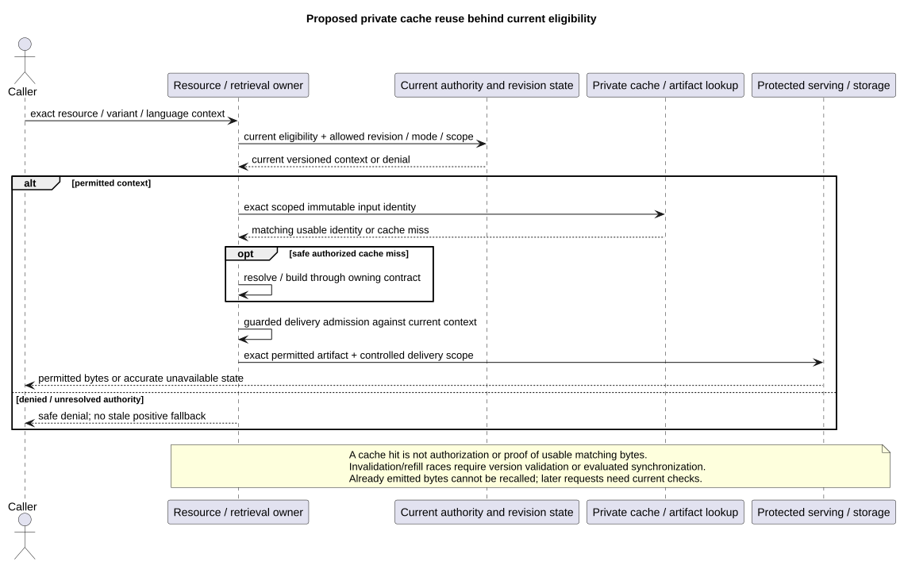
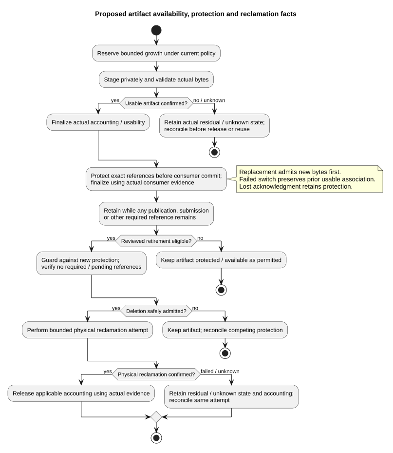
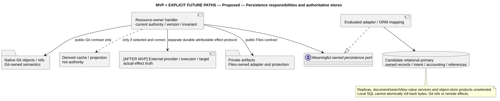
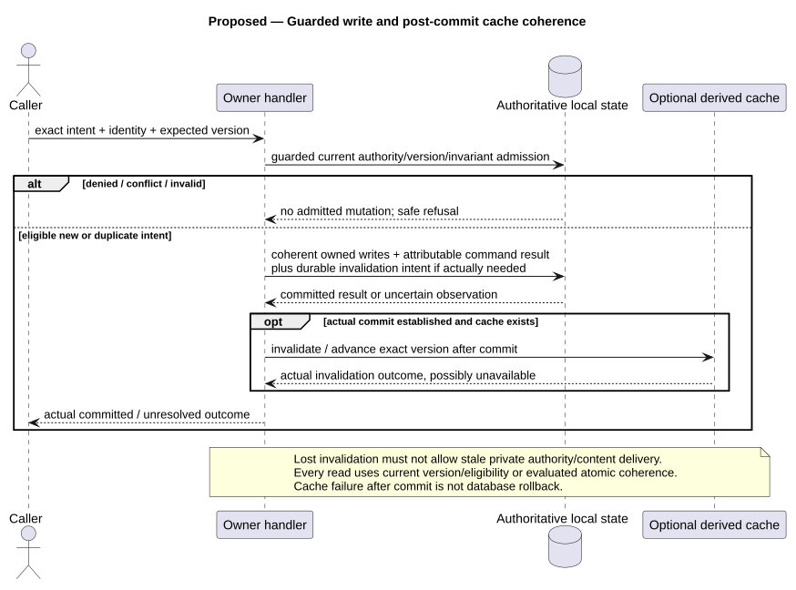
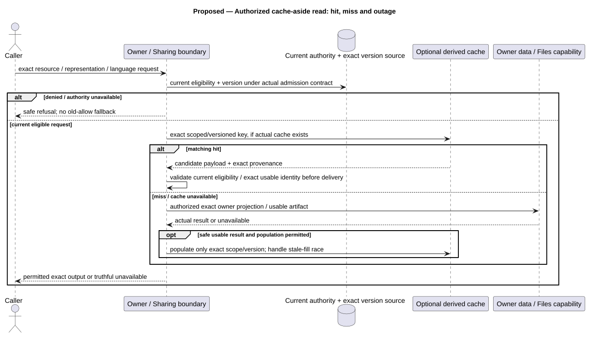
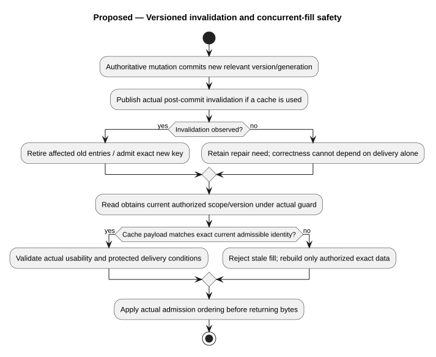
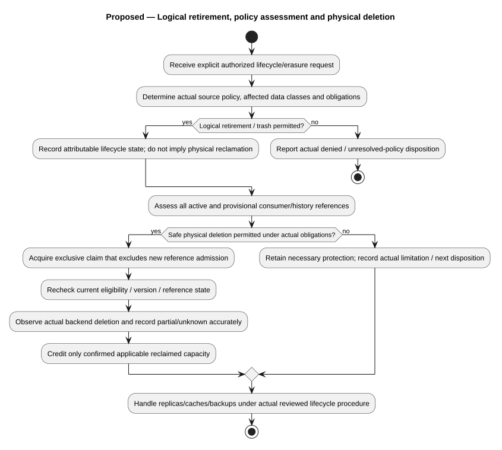
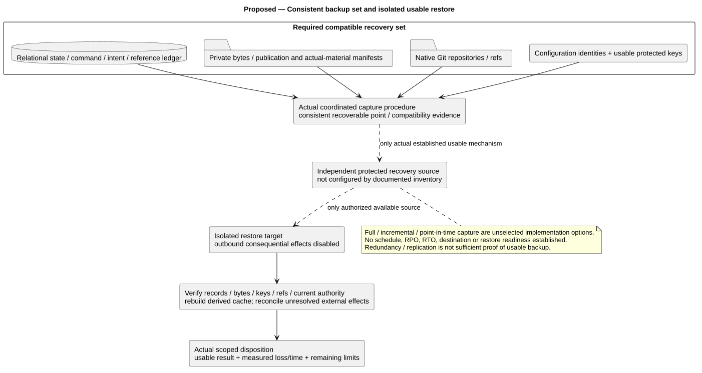

# Resumefolio — Persistence, Caching and Data Lifecycle

Current implementation choices and scope: [Baseline](../../../baseline/README.md). Runtime verification remains subject to its gates.

**Purpose:** define how owned state, private artifacts and external observations remain consistent through normal writes, cache reuse, replacement, retirement and recovery.

**Status:** proposed shared technical design, November 2, 2026. No database/cache engine, retention duration, backup destination or numerical recovery target is accepted here. No storage facility is configured by this update.

[Scope](#1-authority-and-storage-responsibilities) · [Persistence](#2-persistence-strategy-and-consistency) · [Caching](#3-cache-policy-and-invalidation) · [Lifecycle](#4-admission-replacement-and-reclamation) · [Recovery](#5-backup-and-recovery-consistency) · [Review](#6-verification-and-implementation-handoff) · [Essential views](#7-essential-persistence-cache-and-recovery-views)

## 1. Authority and storage responsibilities

Use [business rules and lifecycle](../../02-requirements-engineering/03-requirements-specification/business-rules-and-data-lifecycle.md), [file/operating requirements](../../02-requirements-engineering/03-requirements-specification/administration-files-and-operational-behavior.md), [quality/recovery requirements](../../02-requirements-engineering/03-requirements-specification/quality-security-and-recovery-requirements.md), [conceptual data analysis](../../03-system-analysis/02-domain-and-information-analysis/05-data-oriented-view.md) and [source decisions](../../02-requirements-engineering/07-change-and-baseline/open-questions-and-decisions.md). Detailed proposed limits/lifecycles retain their source status.

The [logical/physical model](01-analysis-to-logical-and-physical-data-models.md) owns record/key/schema refinement. This document owns shared persistence, freshness and lifecycle protocols. [Files and Operations](../03-component-and-module-design/components/files-and-operations.md) owns artifact accounting/protection/reclamation; resource-owning components decide whether references remain necessary. [Operations/recovery](../06-design-quality-and-security-analysis/03-operations-backup-recovery-and-resilience.md) owns the actual backup/restore procedure and evidence.

Preserve the accepted distinctions: source edits do not update existing resumes automatically; selected apply preserves independent content; publication needs separate confirmation; actual submitted material remains independent. Retention is not unlimited merely because history must remain independent.

## 2. Persistence strategy and consistency

### Candidate storage allocation

| State | Candidate responsibility and selection boundary |
| --- | --- |
| Owned structured records | Transactional relational store for local invariants; evaluate engine/version/driver/constraints and actual operating cost |
| Private artifacts | Evaluated private filesystem/object storage adapter with canonical identity, admission and protected references |
| Git objects/refs | Evaluated native Git storage/transport; relational metadata cannot replace native truth |
| Provider/executor/target effects | Local durable intent and attributable observations; external owner remains authoritative for actual effects |
| Rebuildable projections/cache | Derived state with explicit owner/provenance; loss cannot erase authoritative records or create access |
| Backup set | Independent protected recoverable copy of required stores/configuration/keys, with actual consistency evidence |

The demo's observed MySQL installation is an evaluation input, not engine selection. Compare a compatible relational alternative against actual transactions, migrations, operations, resource fit and team capacity before recording a consequential selection in an [ADR](../07-design-decisions/README.md). A separate distributed cache, search service or event platform is not required by this model; add dependencies only for an evidenced need.

### Write and read contract

Authorize the owned operation, validate expected versions, apply its coherent local transaction and record attributable result. Define isolation/locks/conditional writes from actual invariants, including quota totals, publication pointers, Sprint plans and grant-change ordering. Simple check-then-write is not sufficient protection against concurrent mutations.

Read models can combine permitted projections but do not acquire ownership of another component's data. Critical eligibility and version decisions use authoritative or equivalently synchronized state. A replica, cache or worker snapshot requires an explicit consistency contract before it can decide revocation, available quota or deletion safety.

Local SQL, stored bytes, Git refs and provider/target effects do not share an assumed transaction. Record durable pending intent where needed, dispatch through scoped adapters and reconcile the same attempt after ambiguity. A local rollback does not remove uploaded bytes, undo a Git ref or recall a sent message. Follow [runtime design](../01-software-architecture/03-process-view-concurrency-and-runtime-behavior.md) and [ADR-003](../07-design-decisions/ADR-003-durable-external-attempts.md).

## 3. Cache policy and invalidation

[Editable PlantUML](diagrams/persistence-protected-cache-flow.puml) · [PNG](diagrams/persistence-protected-cache-flow.png)

Start with no separate distributed cache dependency unless measurements justify one. Request-local memoization must stay within the current attributable operation; persistent workers must not reuse another request's actor or positive permission decision.

### Cache classes

- **Public static assets:** immutable content/build identity and evaluated browser/server policy; only genuinely public assets belong here.
- **Private generated renditions:** exact publication/language/layout/renderer/input identity and usable artifact association. A cache hit still passes current link/account/grant/mode eligibility before bytes are admitted.
- **Private query projections:** owner/resource/filter/version scope, explicit freshness and safe failure behavior. Never reuse one user's permitted result as another user's projection.
- **Authority/session state:** current source-defined account/link/grant generation and synchronized invalidation. A TTL alone cannot establish the promised post-revocation behavior.
- **Quota/reference/deletion state:** safety-critical authoritative coordination; a stale cached count cannot admit growth or authorize reclamation.

### Required cache record

For each actual cache, specify owner, payload classification, key dimensions, version/provenance, population timing, freshness bound, invalidation trigger, concurrent-fill behavior, size/eviction, failure fallback and verification. Exact TTLs and capacity values remain review/evaluation decisions, not defaults in this file.

Publish invalidation only after the authoritative local commit. If invalidation delivery can be lost, correctness must still follow from current-version validation, an evaluated atomic mechanism or an explicit repair protocol. A pre-commit invalidation followed by a concurrent stale refill cannot be treated as fresh indefinitely. Locking/single-flight may reduce duplicate work but is not proof of freshness or exclusive authority.

Negative results also need scope/freshness: cached missing language/artifact/permission can become outdated after publication or grant changes. Cache absence is not proof of deletion; a cache hit is not proof of available matching bytes. Do not substitute older publications or another language silently when an exact rendition is unavailable.

Browser/server/CDN caches, internal redirects and signed delivery capabilities need evaluated privacy, scope and revocation semantics. No delivery technology is selected here. Later full/range requests require applicable current checks; already emitted/downloaded bytes cannot be recalled. If an authority dependency is unavailable, do not serve private bytes on an unproven old allow. A safe cache miss can rebuild only through authorized owner contracts.

## 4. Admission, replacement and reclamation

[Editable PlantUML](diagrams/persistence-artifact-lifecycle.puml) · [PNG](diagrams/persistence-artifact-lifecycle.png)

The figure separates logical availability, protected consumer use and physical reclamation. Exact source retirement/trash/retention rules remain open; this protocol grants no new deletion authority.

### Admit and protect

1. Resolve current quota/resource policy and reserve bounded growth atomically against concurrent usage/reservations and operating headroom. Include temporary/generated/log/Git growth where applicable, not only visible uploads.
2. Stage bytes privately; validate actual size/type/processing and canonical identity. Metadata or transport success alone is not usable availability.
3. Finalize actual accounting and artifact state. Failed/interrupted writes retain known residual bytes or unknown state until reconciled; do not fabricate reclaimed capacity.
4. Protect an exact artifact reference before its consumer commits publication, historical material or another protected association. Finalize against actual committed consumer evidence. A lost acknowledgment retains protection until the consumer outcome is established.

### Replace and retire

Admit/validate the replacement before switching the guarded consumer association. Preserve the prior usable association on failure. Once switched, release the old consumer reference only when no valid obligation remains; other publications/submissions/consumers may still protect the same bytes. Physical deduplication does not merge their permissions or lifecycles.

Retiring source content, removing a share link, changing a download mode and deleting physical bytes are different operations. Resource owners resolve lifecycle and history obligations under actual source authority. No cascade from source/profile/account deletion may silently destroy protected actual materials or unrelated references.

### Reclaim safely

Establish reviewed retirement/retention eligibility and exclude every protected/pending reference under the concrete reference/deletion guard. Coordinate new reference registration with deletion so a stale scan cannot win a race. A prior count of zero or an old cleanup job is insufficient authority to delete.

Record a bounded reclamation attempt, perform storage deletion and reconcile actual outcome. Unknown deletion remains unknown; do not mark bytes reclaimed or release accounting from an API request alone. Handle stale locators, new protection and worker-generation races through the evaluated protocol. Release accounting only for confirmed applicable reclamation, keeping logical versus physical quantities distinct.

Actual transaction/guard schemas and storage adapter behavior remain joint Files/data-design prerequisites. Cleanup age, cache eviction or a terminal workflow label cannot prove protected references disappeared or workspace resources stopped being used.

## 5. Backup and recovery consistency

Define a recoverable set covering relational records, artifact bytes/manifests, native Git repositories/refs, relevant configuration identities and usable recovery keys. Record compatible versions and a recoverable point or coordinated write procedure; unrelated database/file copies do not establish consistency. Protect the backup's own access and independence from the primary failure domain.

No destination, paid service, schedule, retention duration, RPO or RTO is selected here. Existing backups-not-configured remains an operating gap. Backup success is not restore success, and redundancy/failover is not established by a proposed recovery procedure.

Recovery sequence:

1. Identify actual source/version, intended recovery scope and possible loss; restore into an isolated target with outbound effects disabled.
2. Verify schema/manifest compatibility, native repositories, actual artifact/key usability, reference/accounting integrity and recorded command/attempt context.
3. Reconcile current account/grant/link/revocation decisions rather than resurrecting access from old session rows. Rebuild disposable caches from validated authoritative state.
4. Reconcile provider, executor and deployment effects before resuming pending work. Restored pending intents cannot automatically resend mail, relaunch jobs or redeploy.
5. Measure actual recoverable/usable state and loss, record unresolved findings and follow the owning operating procedure before promotion.

Schema rollback cannot reverse deleted bytes, exposed secrets or irreversible remote/data effects. Keep a compatible forward-repair/recovery path and preserve actual observations. Detailed operating steps and authorization belong to [operations/recovery](../06-design-quality-and-security-analysis/03-operations-backup-recovery-and-resilience.md).

## 6. Verification and implementation handoff

### Planned focused checks

- Actual transaction/version behavior for concurrent ownership/publication/Sprint/quota changes.
- Private cache key isolation, cross-user/viewer requests, stale permission/link/mode state and later range/cache requests.
- Commit/invalidation/refill races, lost invalidation, worker context leakage and safe authority/cache outage behavior.
- Exact publication/language/rendition identity; missing/failed output without silent old-content fallback.
- Concurrent reservations, interrupted writes, failed replacement and accurate residual-byte accounting.
- New reference registration versus cleanup, lost consumer acknowledgment, shared historical references and unknown deletion outcome.
- Isolated restore with missing bytes/keys, current revocation reconciliation, cache rebuild and no remote-action replay.

Use deterministic lifecycle policies plus actual persistence/storage/cache/concurrency and authorized restore evidence. A mock deletion or cache test cannot establish physical reclamation, real revocation behavior or usable recovery. No cache, cleanup, deletion, backup, restore or product test is executed by this update.

### Required implementation decisions

Select/evaluate actual database/storage configuration; specify transaction and reference/deletion guards; define authoritative resource/accounting ownership; document each measured cache need and exact freshness/failure contract. Review source retention/trash rules and numerical policies, establish backup coverage/keys/independent destination and obtain actual restoration evidence. Complete exact criterion mapping and record consequential choices in [ADRs](../07-design-decisions/README.md).

Shared direction is populated; concrete engine/cache/storage facilities, physical protocol verification and recovery readiness remain pending. This document refines the existing data/lifecycle plan and does not reopen accepted publication/history behavior or select new infrastructure. FAU's persistence concern and component-refinement approach are mapped in the [reference guide](../01-reference-and-coverage-map.md).

[Data Design](README.md) · [Logical/physical model](01-analysis-to-logical-and-physical-data-models.md) · [Review/handoff](../06-design-quality-and-security-analysis/05-design-review-traceability-and-handoff.md) · [Diagram catalog](diagrams/README.md)

## 7. Essential persistence, cache and recovery views

Only **six complementary diagrams** are added; no new tables. Reuse the [existing protected-cache view](#3-cache-policy-and-invalidation) and [artifact lifecycle view](#4-admission-replacement-and-reclamation). These diagrams specify candidate correctness obligations, not selected engines, actual cache deployment, configured backup or passing integration tests.

### 7.1 Persistence responsibilities and authoritative stores

[Editable PlantUML](diagrams/persistence-essential-architecture.puml) · [PNG](diagrams/persistence-essential-architecture.png)

Combines persistence allocation with store boundaries without inventing a polyglot service portfolio. Primary is a logical authority role, not a selected engine/host. A replica or derived projection cannot decide current grants, quota or deletion safety unless an actual equivalent synchronization contract is established.

### 7.2 Guarded write and post-commit cache coherence

[Editable PlantUML](diagrams/persistence-essential-write.puml) · [PNG](diagrams/persistence-essential-write.png)

No cache engine, transaction isolation level or event platform selected. If commit is uncertain, reconcile the same command identity before claiming success or failure. Invalidation mechanics must handle lost delivery and concurrent old fills; TTL alone cannot establish revocation correctness.

### 7.3 Authorized cache-aside read: hit, miss and outage

[Editable PlantUML](diagrams/persistence-essential-read.puml) · [PNG](diagrams/persistence-essential-read.png)

Cache-aside is an illustrative candidate; direct authoritative reads remain the simplest baseline. Cache hit/miss is not proof of current permission, artifact presence or matching language. Cache outage may bypass only optional cache work, never required authority or usable-byte checks. No CDN/browser private-cache behavior is selected.

### 7.4 Versioned invalidation and concurrent-fill safety

[Editable PlantUML](diagrams/persistence-essential-invalidation.puml) · [PNG](diagrams/persistence-essential-invalidation.png)

An old fill racing after invalidation must not overwrite a current-version entry or bypass current eligibility. Versioned keys still need cache bounds/eviction and actual authoritative-read ordering. TTL/repair events may support freshness/resource policy but do not replace synchronized authority/ref/quota correctness.

### 7.5 Logical retirement, policy assessment and physical deletion

[Editable PlantUML](diagrams/persistence-essential-deletion.puml) · [PNG](diagrams/persistence-essential-deletion.png)

No retention duration, cascade, automatic purge or legal erasure entitlement is decided by this engineering flow. A privacy/erasure request needs applicable source/legal disposition; protected history is not a blanket indefinite-retention justification. SQL unlink, cache eviction and deletion acknowledgment are not proof of byte reclamation. Backup-expiry handling requires actual policy, not invented immediate erasure.

### 7.6 Consistent backup set and isolated usable restore

[Editable PlantUML](diagrams/persistence-essential-recovery.puml) · [PNG](diagrams/persistence-essential-recovery.png)

Recovery must stop if prerequisites/source/keys are absent. Restore success is usable consistent state, not a completed copy. Reassess current revocations/deletion decisions; never replay restored sends, workflow launches or deployments automatically. Actual recovery steps remain owned by Operations/Recovery.

### Deliberately omitted alternatives

No replicas, sharding/partitioning, document/search store, distributed cache, tiered hot/warm/cold layout or private CDN is selected. Separate read-through/write-through/write-behind diagrams would add unchosen mechanisms rather than clarify the present baseline; write-behind is not permission to defer authoritative safety-critical state. Database buffer caches are engine internals, not an authorization facility. Replica read-your-writes/failover and tier/replication choices require actual resource, consistency and operating evidence before addition.

Physical schema remains in the [logical/physical data-model owner](01-analysis-to-logical-and-physical-data-models.md#essential-data-model-diagrams). Schema migration/evolution stays in the [evolution procedure](../02-detailed-and-object-oriented-design/05-design-evolution-refactoring-and-technical-debt.md), and actual backup/runbook detail in [Operations/Recovery](../06-design-quality-and-security-analysis/03-operations-backup-recovery-and-resilience.md). These references avoid another competing schema, migration policy or recovery target.

Actual implementation must establish current admission ordering, commit/invalidation/refill safety, protected-reference/deletion exclusion, residual accounting and isolated usable recovery. Numerical TTL, retention, rate, workload, isolation-level and recovery values remain pending actual selection/source disposition. This authoring performs no cache flush, deletion, backup, restore, migration, privacy-policy decision or product test.
