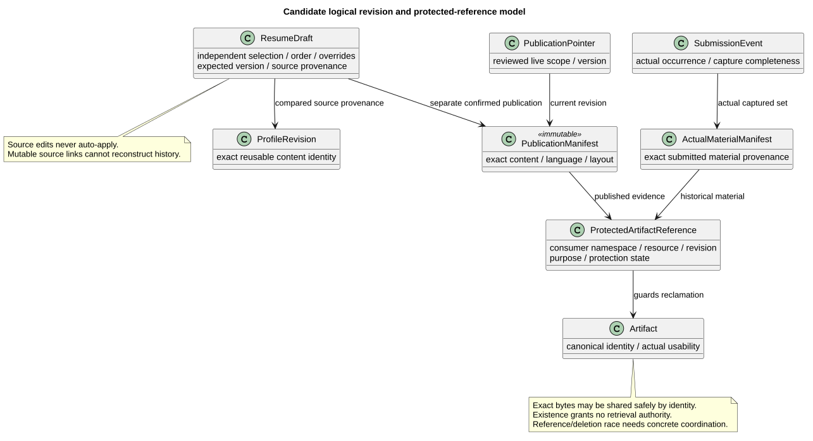
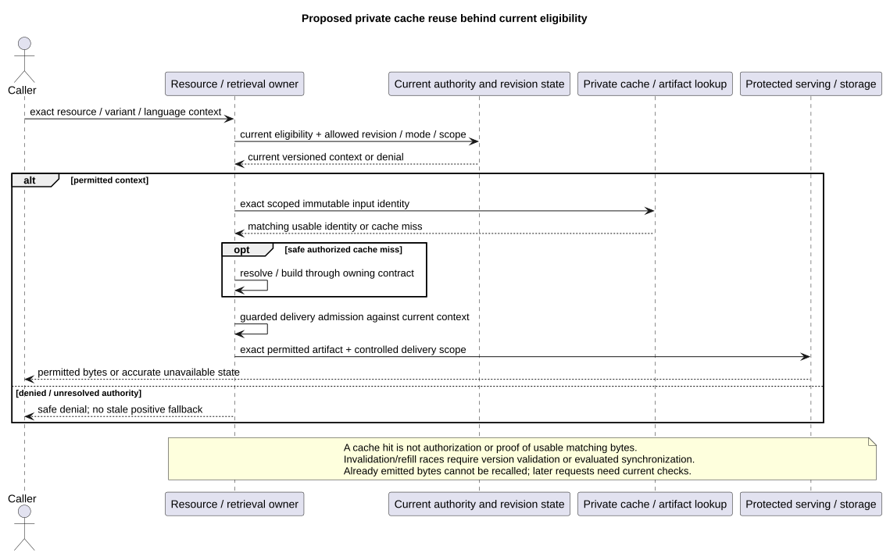

# Resumefolio — Data Design

Current implementation choices and scope: [Baseline](../../../baseline/README.md). Runtime verification remains subject to its gates.

**Use this folder to understand how analysis information becomes owned records, physical integrity rules and recoverable storage behavior.** It defines shared data mechanisms; each component keeps its concrete data structures and operation-specific invariants in its own design package.

Owner and decision authority: Farhad. Updated November 2, 2026.

**Current position:** both documents are populated with project-specific proposed design and **15 distinct diagrams**: seven model/refinement views and eight persistence/lifecycle views. Each has an editable PlantUML source and SVG/PNG exports. They do not establish a final database/cache/storage engine, executable schema, configured backup, accepted retention policy or verified recovery capability.

[Reading route](#1-reading-route) · [Document guide](#2-find-the-right-record) · [Diagrams](#3-diagram-gallery-and-catalog) · [Boundaries](#4-ownership-and-shared-invariants) · [Readiness](#5-review-and-implementation-readiness)

## 1. Reading route

1. Read the [domain model](../../03-system-analysis/02-domain-and-information-analysis/03-domain-model-and-object-oriented-view.md), [data-oriented analysis](../../03-system-analysis/02-domain-and-information-analysis/05-data-oriented-view.md) and [dictionary](../../02-requirements-engineering/05-data-definitions/data-dictionary.md) for meaning, conceptual relationships and lifecycle obligations.
2. Read [Analysis to Logical and Physical Data Models](01-analysis-to-logical-and-physical-data-models.md) for the nine ownership families, revision/reference model, keys, normalization, integrity allocation, candidate physical representations, query-driven indexes and migration/handoff requirements.
3. Read [Persistence, Caching and Data Lifecycle](03-persistence-caching-and-data-lifecycle.md) for storage responsibility, transactions, cache freshness/invalidation, artifact admission/replacement/reclamation and recovery consistency.
4. Apply these shared rules to the [owning component package](../03-component-and-module-design/README.md), aligning its operation contracts with [runtime concurrency](../01-software-architecture/03-process-view-concurrency-and-runtime-behavior.md) and [interface contracts](../05-interface-and-api-design/README.md).
5. Record consequential choices in [ADRs](../07-design-decisions/README.md) and actual criterion findings/evidence in [Design Review and Handoff](../06-design-quality-and-security-analysis/05-design-review-traceability-and-handoff.md).

The retained file numbers are stable locators. Schema integrity and normalization are included in document 01; the numbering does not require creating a separate file 02.

## 2. Find the right record

| Question | Owning record |
| --- | --- |
| How do analysis concepts map to logical records and component owners? | [01 — Analysis-to-design contract and ownership](01-analysis-to-logical-and-physical-data-models.md) |
| How are drafts, publications, submitted material and artifact references kept independent? | [01 — Revision/reference model](01-analysis-to-logical-and-physical-data-models.md#3-revision-and-reference-model) |
| Which rules belong in keys, constraints or guarded transactions? | [01 — Integrity](01-analysis-to-logical-and-physical-data-models.md#4-keys-relationships-and-integrity) |
| What exact physical schema and index evidence is still required? | [01 — Physical mapping and handoff](01-analysis-to-logical-and-physical-data-models.md#5-physical-representation-and-access-paths) |
| What is authoritative in SQL, private storage, Git and external systems? | [03 — Persistence strategy](03-persistence-caching-and-data-lifecycle.md#2-persistence-strategy-and-consistency) |
| Can a private cache hit bypass current permission checks? | [03 — Cache policy](03-persistence-caching-and-data-lifecycle.md#3-cache-policy-and-invalidation) |
| When may references, bytes and quota accounting be released? | [03 — Lifecycle protocol](03-persistence-caching-and-data-lifecycle.md#4-admission-replacement-and-reclamation) |
| Who owns the actual backup/restore procedure and readiness evidence? | [Operations and Recovery](../06-design-quality-and-security-analysis/03-operations-backup-recovery-and-resilience.md) |

## 3. Diagram gallery and catalog

### Independent revisions and protected references

[Owning model document](01-analysis-to-logical-and-physical-data-models.md) · [Editable PlantUML](diagrams/data-logical-revisions-and-references.puml) · [PNG](diagrams/data-logical-revisions-and-references.png)

This selected logical view separates reusable source, independent draft, immutable publication, actual material and artifact protection. Arrows express relationships, not accepted cardinality limits or a complete physical ERD.

### Current eligibility before private cache delivery

[Owning persistence document](03-persistence-caching-and-data-lifecycle.md) · [Editable PlantUML](diagrams/persistence-protected-cache-flow.puml) · [PNG](diagrams/persistence-protected-cache-flow.png)

A cache hit neither grants access nor proves matching bytes remain usable. Actual admission/invalidation synchronization and serving facilities still require evaluation.

### Essential model views — document 01

The [model diagram package](01-analysis-to-logical-and-physical-data-models.md#essential-data-model-diagrams) adds five complementary views to the two existing revision/reference and physical-enforcement diagrams:

- [Conceptual identities without attributes or physical choices](diagrams/data-essential-conceptual.svg) · [source](diagrams/data-essential-conceptual.puml) · [PNG](diagrams/data-essential-conceptual.png)
- [Logical ERD with candidate attributes, keys and cardinalities](diagrams/data-essential-logical.svg) · [source](diagrams/data-essential-logical.puml) · [PNG](diagrams/data-essential-logical.png)
- [Physical schema illustration with types, scoped keys and candidate indexes](diagrams/data-essential-physical.svg) · [source](diagrams/data-essential-physical.puml) · [PNG](diagrams/data-essential-physical.png)
- [Conceptual → logical → physical refinement and verification](diagrams/data-essential-levels.svg) · [source](diagrams/data-essential-levels.puml) · [PNG](diagrams/data-essential-levels.png)
- [Normalization walkthrough with explicit assumed functional dependencies](diagrams/data-essential-normalization.svg) · [source](diagrams/data-essential-normalization.puml) · [PNG](diagrams/data-essential-normalization.png)

The physical schema and normalization relation are labeled examples, not accepted DDL, a migration or a measured current-schema defect. Proposed multiplicities, types and indexes require actual source/engine/workload disposition. Immutable publication and actual-submission snapshots preserve historical meaning; they must not be reconstructed through mutable current source records.

### Essential persistence views — document 03

The [persistence diagram package](03-persistence-caching-and-data-lifecycle.md#7-essential-persistence-cache-and-recovery-views) adds six complementary views to the two existing protected-cache and artifact-lifecycle diagrams:

- [Persistence architecture with authoritative relational state, private bytes, native Git and external effect boundaries](diagrams/persistence-essential-architecture.svg) · [source](diagrams/persistence-essential-architecture.puml) · [PNG](diagrams/persistence-essential-architecture.png)
- [Guarded write, actual commit observation and post-commit cache coherence](diagrams/persistence-essential-write.svg) · [source](diagrams/persistence-essential-write.puml) · [PNG](diagrams/persistence-essential-write.png)
- [Authorized cache-aside read: matching hit, miss and safe outage behavior](diagrams/persistence-essential-read.svg) · [source](diagrams/persistence-essential-read.puml) · [PNG](diagrams/persistence-essential-read.png)
- [Versioned invalidation and concurrent-fill safety](diagrams/persistence-essential-invalidation.svg) · [source](diagrams/persistence-essential-invalidation.puml) · [PNG](diagrams/persistence-essential-invalidation.png)
- [Logical retirement, obligation assessment and guarded physical deletion](diagrams/persistence-essential-deletion.svg) · [source](diagrams/persistence-essential-deletion.puml) · [PNG](diagrams/persistence-essential-deletion.png)
- [Consistent recovery set and isolated usable restore](diagrams/persistence-essential-recovery.svg) · [source](diagrams/persistence-essential-recovery.puml) · [PNG](diagrams/persistence-essential-recovery.png)

A cache hit never replaces current authority or exact usable-artifact checks. Lost invalidation must not create a stale-allow bypass. Unknown consumer commits retain protection, and deletion acknowledgment alone does not prove reclaimed capacity. Recovery requires actual compatible records/bytes/keys/repositories and current permission/effect reconciliation.

The [complete diagram catalog](diagrams/README.md) links **15 PlantUML sources, 15 SVGs and 15 PNGs**. Counts refer to distinct views, not repeated image links. Existing gallery figures above are reused; this README update adds no new diagram or table.

### Reading boundaries

Use the [analysis data model](../../03-system-analysis/02-domain-and-information-analysis/05-data-oriented-view.md) for authoritative conceptual meaning, the [component data template](../03-component-and-module-design/README.md) for component-specific class/ORM refinements, and [Operations/Recovery](../06-design-quality-and-security-analysis/03-operations-backup-recovery-and-resilience.md) for actual procedures and readiness evidence. Shared storage choices do not transfer another module's write authority.

Replicas, sharding, alternate document/search stores, distributed caches, tiered storage and CDN remain unselected options. No TTL, retention, backup schedule, RPO/RTO, physical engine or legal erasure disposition is accepted by these diagrams. Current unconfigured-backup status remains an explicit operating gap.

## 4. Ownership and shared invariants

The [component catalog](../03-component-and-module-design/README.md) defines nine logical owners. Identity owns current access context; Presentation owns professional content and publication intent; Sharing owns links and rendition eligibility; Applications owns actual submitted material; Communication owns provider coordination; Work owns work/Sprint meaning; Git owns native repository collaboration; Workflow owns gated attempt/deployment coordination; Files owns artifact admission/accounting/protection. Detailed record allocation is in document 01.

Shared invariants to preserve:

- Source edits, selected draft application, separate confirmed publication and actual submitted history remain distinct under the [accepted owner policy](../../02-requirements-engineering/07-change-and-baseline/open-questions-and-decisions.md#owner-accepted-profile-update-policy).
- Stable resource identity, exact revision identity and current authority are different facts; a foreign key or unguessable ID is not authorization.
- Scoped grants, private queries and cached delivery respect resource/action context and completed revocation boundaries.
- Protected/pending consumer references exclude unsafe physical reclamation; retiring a logical reference does not prove bytes or capacity were reclaimed.
- Goal, selected items and delivery plan form one coherent Sprint Backlog; board position and elapsed time cannot fabricate acceptance or goal achievement.
- SQL state, private bytes, Git refs and provider/executor/target effects require explicit coordination and truthful pending/partial/unknown outcomes.
- Restoring old data cannot automatically resurrect revoked access or replay uncertain external actions.

Component packages own exact record structures and operation realization. This folder owns shared integrity/storage conventions. Security owns threat controls, and Operations owns actual recovery procedure and evidence. Link these authorities instead of duplicating policy or inventing retention durations here.

## 5. Review and implementation readiness

### Required implementation package

For each schema/storage change, identify its source criterion and owner, logical meaning, exact types/units/nullability, keys and constraints, scoped access paths, query/index rationale, version/transaction guards, sensitive data handling, migration compatibility, reference/lifecycle consequences and recovery checks. Record unresolved decisions as gates.

For any cache, specify payload/key scope, authoritative provenance, freshness/invalidation, concurrent fill, capacity/eviction and safe failure behavior. For any physical cleanup, demonstrate protected-reference exclusion and actual reclamation. For recovery, validate a consistent usable set and reconcile current authority/external effects before resumption.

### Remaining decisions and evidence

Final engine/version/storage selection, exact DDL/types/collation/indexes, policy-dependent cardinalities/retention, reference-deletion and authorization synchronization, measured cache need and backup destination/key handling remain pending. The demo environment is evidence to evaluate, not a selected final data platform.

Use actual persistence/concurrency/storage/cache and authorized isolated recovery checks alongside domain tests. Diagram rendering and file-link checks verify documentation only; they do not establish database integrity, query performance, security or restoration readiness. No live migration, deletion, backup/restore, product-test Pass or phase approval is created by this folder's completion.

## 6. FAU basis and maintenance

FAU's architecture persistence concern and component computational-data refinement inform these views. The shared folder layout, candidate relational mapping, cache records and implementation handoff checklist are project adaptations, not a university-mandated file tree. See the [reference and coverage map](../01-reference-and-coverage-map.md).

When changing a shared rule, reconcile the source decision, owning model/lifecycle document, affected component contracts, runtime/security/operations views and ADRs. Regenerate changed diagrams, check local links and cross-view consistency, and preserve historical evidence with its original scope. Add or split files only when substantive content or ownership makes that useful.

[System Design home](../README.md) · [Component and Module Design](../03-component-and-module-design/README.md) · [Diagram catalog](diagrams/README.md)
