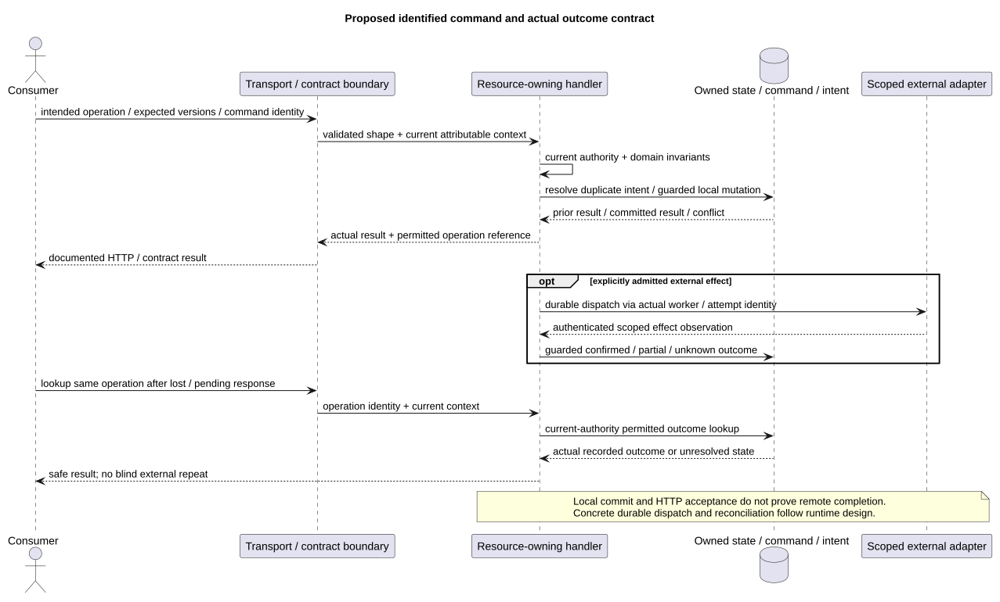
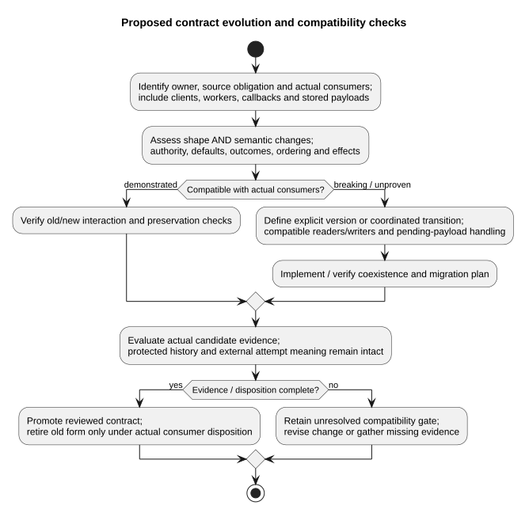
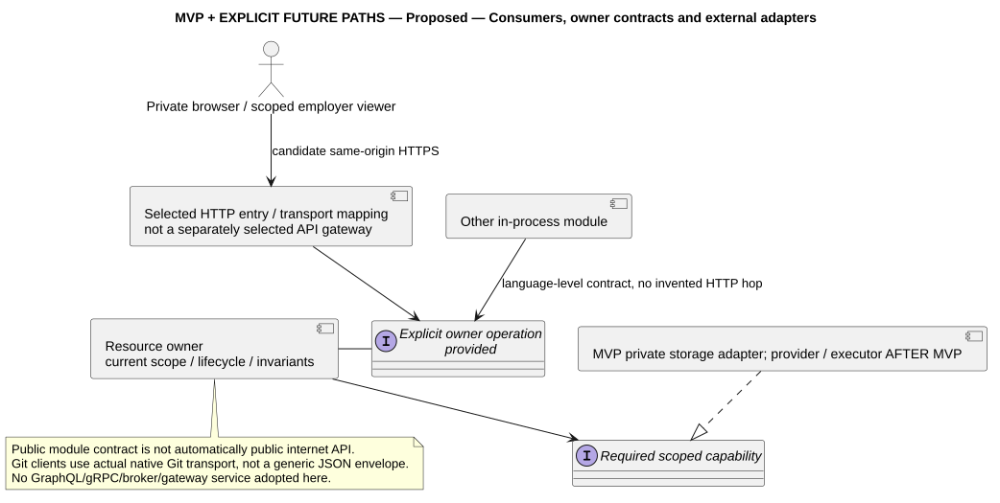
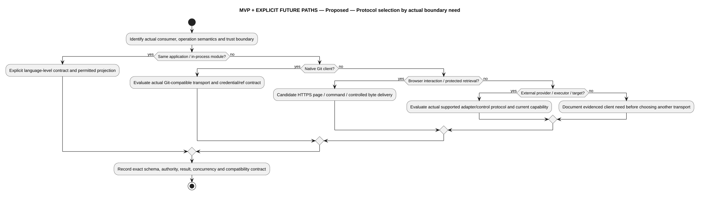
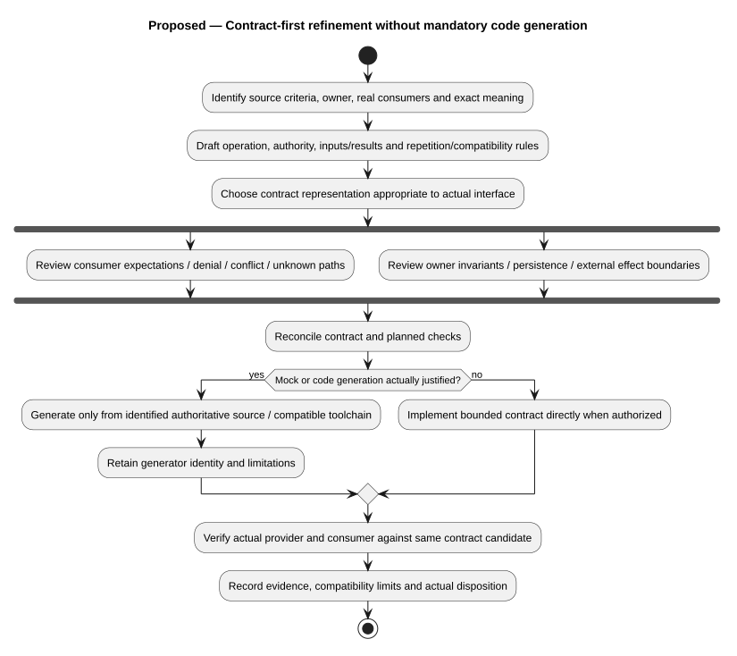
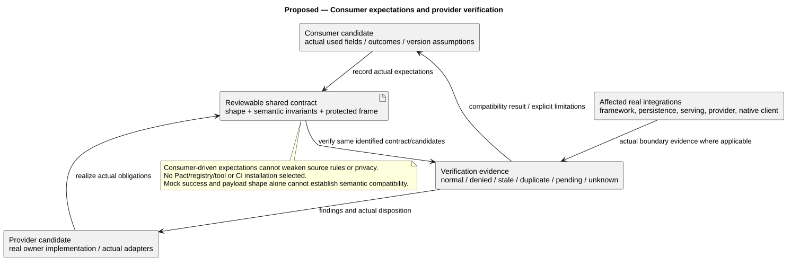

# Resumefolio — API Protocols, Contracts and Compatibility

## Current implementation baseline — November 4, 2026

[BL-MVP-2026-11-04.1](../../../baseline/README.md) selects the MVP technical mechanisms, numerical policies, priorities and requirement/criterion dispositions under Farhad’s explicit delegation. It supersedes earlier Proposed/pending mechanism and whole-baseline statements below for MVP design input. Future clauses and dated evidence remain separate. Runtime/actor validation, credentials, Git isolation, capacity and backup/restore still require the named implementation/Release gates; this update reports no product test Pass.

### Prior source material and rationale (superseded where this Baseline selects a different MVP choice)

**Purpose:** define shared communication choices, contract contents, result semantics and compatibility rules for browser, component and external integration boundaries.

**Status:** proposed technical design, November 2, 2026. This is a shared contract specification, not an implemented route catalog, adopted frontend stack or verified provider/client compatibility matrix. Concrete signatures and payload schemas remain with their owning components.

[Scope](#1-sources-and-interface-ownership) · [Protocols](#2-protocol-choices-by-consumer) · [Contracts](#3-required-contract-record) · [HTTP](#4-http-results-and-concurrency) · [Repetition](#5-command-identity-and-asynchronous-effects) · [Boundaries](#6-external-and-protected-exchanges) · [Evolution](#7-versioning-and-compatibility) · [Review](#8-verification-and-handoff) · [Essential views](#9-essential-api-and-contract-views)

## MVP system allocation and design status

The accepted system boundary separates the Resumefolio core from ProjectForge, joined by an authenticated user-scoped API. Logical responsibilities remain useful within each system; they do not authorize a shared core/ProjectForge process, database or transaction. Core owns dashboard, invited accounts, professional presentation, protected sharing, manual applications and same-server private My Files & Media. ProjectForge MVP owns real repositories/transfers/permissions, file/history browsing, issues and simple Kanban. Its selected engine is native Git Smart HTTP behind the independent Laravel ProjectForge service, with its own MySQL 8.4 database and OS/storage boundaries on the existing host; BL-MVP-2026-11-04.1 governs implementation and evidence gates. The future communications system is independently private and API connected. Advanced Git review/releases, backlog/Sprints and execution/deployment remain deferred. Keep source, independent resume draft, explicit publication and actual submitted material identities distinct. Profile changes require preview/select/apply and cannot mutate publication or submitted history. Manual applications include status, next action and follow-up date without mail/calendar dependencies.

Authority: [OWNER-MVP-2026-11-04](../../01-project-planning/owner-mvp-decision-2026-11-04.md).

## 1. Sources and interface ownership

Use [EIF-D01–EIF-D10 and IF-01–IF-08](../../02-requirements-engineering/03-requirements-specification/external-interface-requirements.md), [analysis interfaces](../../03-system-analysis/06-interfaces-security-and-quality-analysis/12-interfaces-and-external-interactions.md), the [dictionary](../../02-requirements-engineering/05-data-definitions/data-dictionary.md) and [architecture boundaries](../01-software-architecture/02-system-decomposition-and-boundaries.md). Inventory labels identify source boundaries, not new API endpoint IDs or selected transports.

The resource-owning component provides the contract and enforces its invariants. Consumers use explicit permitted identities/projections and cannot mutate private records through a shared ORM model. This folder owns shared conventions; [component designs](../03-component-and-module-design/README.md) own exact operations/types, [interaction realizations](03-use-case-realizations-and-interactions.md) own selected collaborations, and [runtime design](../01-software-architecture/03-process-view-concurrency-and-runtime-behavior.md) owns concurrency/reconciliation behavior.

Accepted publication/history behavior remains binding: preview/select/apply changes only the intended draft, publication needs separate owner confirmation, and actual submitted materials remain independent. API convenience cannot combine these into an implicit publish or submission action.

## 2. Protocol choices by consumer

| Boundary | Candidate communication and rationale |
| --- | --- |
| Private browser UI | Same-origin HTTPS with server-side authorization; server-rendered/progressively enhanced views and HTTP/JSON commands where useful |
| Employer viewing / file retrieval | Protected HTTPS projection/controlled byte delivery, with separate viewer/link scope and exact variant eligibility |
| In-process components | Explicit language-level interfaces/value types; no HTTP hop solely to connect modules in one application |
| Background effects | Durable identified intent and scoped worker/adapter dispatch; transport remains evaluated rather than implying exactly-once messaging |
| Google provider integrations | Evaluated official provider APIs/consent/capabilities through adapters; current scopes/version/quotas require selection-time evidence |
| Git clients | Evaluated native Git-compatible transport and client credentials; browser session/JSON endpoints do not establish clone/fetch/push interoperability |
| Executor / deployment target | Authenticated attempt-scoped control/observation and separate target authority across evaluated trust boundaries |

HTTP/JSON is the current interactive-command proposal, not a mandate to expose a public REST API. GraphQL can be evaluated for evidenced client/query needs; gRPC for an evidenced separately deployed consumer and compatibility needs. Neither is needed merely because the application has components. Do not add a broker, public API, mobile client or service split without a justified requirement/decision. Actual browser support, frontend framework and transport products remain pending evaluation.

## 3. Required contract record

Before implementation, record each provided/required operation with:

- **Identity and trace:** contract owner, consumer, source IF/EIF/domain criteria, scenario and contract revision.
- **Invocation:** operation purpose, transport/method/path or in-process signature, media type, input schema and bounded payload rules.
- **Authority:** caller/context, resource/action scope, current eligibility/revocation checks, anti-forgery mechanism where applicable and safe denial disclosure.
- **Meaning:** required/optional/nullable fields, identifiers/units, dates/instants/time zones, language/revision provenance and enum/unknown-value handling.
- **Consistency:** expected versions, command/attempt identity, transaction/admission boundary and which external effects can remain unknown.
- **Results:** actual outcome variants, permitted response projection, HTTP mapping where relevant, field errors, operation lookup and repetition/reconciliation behavior.
- **Lifecycle:** pagination/filter/order, cancellation/expiry/retention where relevant, compatibility/deprecation and verification evidence.

Validate transport shape at the boundary and domain invariants at the owner. Distinguish omitted from intentional empty/null values, especially resume overrides, patch-like updates and optional provider mappings. Do not accept arbitrary fields for mass assignment. Exposed IDs identify resources; they do not establish permission.

Pagination needs bounded page size, deterministic ordering with a stable tie-breaker and documented cursor/filter semantics. Re-evaluate authority on each page and cursor use; define concurrent-change/completeness behavior. A cursor must not grant access or reveal another user's private query. Numerical limits require reviewed resource policy.

## 4. HTTP results and concurrency

Apply [RFC 9110 HTTP semantics](https://www.rfc-editor.org/rfc/rfc9110.html) rather than using transport success as proof of domain completion. Read-only retrieval must not trigger publication, send, deployment or other business mutations. Protocol idempotence concerns repeated intended server effect, not identical response bodies or a guarantee about remote provider behavior.

| Condition | Candidate HTTP mapping and qualification |
| --- | --- |
| Completed permitted read/command | 200 with the actual result; 201 only when its creation semantics apply; 204 only when no response content is needed |
| Accepted but incomplete operation | 202 with permitted operation reference/status lookup; acceptance does not prove eventual success |
| Malformed / unsupported / semantically invalid input | 400 / 415 / 422 as applicable, with stable safe field/problem details |
| Missing/invalid authentication or insufficient authority | 401 / 403 where applicable; 401 includes the required challenge semantics; reviewed 404 concealment may protect private existence |
| Stale conditional request / domain conflict | 412 for a failed applicable HTTP precondition; 409 for the defined state/intent conflict |
| Resource/abuse pressure | 429 or 503 where appropriate; any retry advice must not authorize blind repetition of uncertain effects |
| Internal/transport uncertainty | Appropriate 5xx/transport failure plus safe operation reconciliation; never invent an HTTP status meaning “definitely not sent” |

Final endpoint mappings and disclosure rules belong in each exact contract. Domain outcomes include confirmed, pending, denied, invalid, conflict, unavailable, partial and unknown where meaningful; they are not a mandatory universal envelope or eight new status codes. A successful operation-status lookup can return 200 while describing a failed or unresolved underlying attempt.

Use an evaluated expected-version field or applicable ETag/If-Match precondition to prevent stale writes. If using HTTP validators, scope them to the actual representation and implement their comparison semantics correctly; an arbitrary domain revision is not automatically a compliant ETag. A single resource validator may not guard a cross-record Sprint or grant-change race. Exact locking/admission remains [data/runtime design](../04-data-design/01-analysis-to-logical-and-physical-data-models.md).

For HTTP error representations, evaluate [RFC 9457 Problem Details](https://www.rfc-editor.org/rfc/rfc9457.html): stable problem type/title/status semantics with safe instance/field extensions where useful. Do not expose stack traces, storage paths, secrets or private target existence. Display text may be localized; machine codes and field identities remain stable. These standards were reviewed November 2, 2026; framework/route compatibility is not verified here.

## 5. Command identity and asynchronous effects

[Editable PlantUML](diagrams/api-command-outcome-sequence.puml) · [PNG](diagrams/api-command-outcome-sequence.png)

Consequential commands use a documented stable command identity scoped to the actual operation/actor/resource contract. Validate current authority before returning a prior result. Compare attributable intended payload/version context so reuse with changed intent conflicts instead of executing new work. Storage/expiry and secret-safe intent representation are explicit implementation decisions; no idempotency-header standard or infinite retention is assumed.

Commit the owned local change, result and required durable external intent coherently. A worker uses current required authority, immutable inputs and stable attempt identity; it does not carry an evergreen privileged session. Operation lookup identifies the actual command/attempt and returns only permitted bounded evidence. Polling, push feedback or callbacks need explicit ownership and compatibility; no realtime protocol is selected here.

A lost response prompts lookup/reconciliation of the same operation. A local deduplication key cannot prove a provider accepted a send, a runner did not start or a target rolled back. Do not repeat such effects blindly. Fresh retries/new attempts require explicit operation policy, current authority and known effect boundaries. Cancellation request and confirmed stop are distinct results; completion can win a race.

## 6. External and protected exchanges

### Browser and employer entry paths

Use evaluated transport/session controls and state-change protection for cookie-authenticated requests. [OWASP CSRF guidance](https://cheatsheetseries.owasp.org/cheatsheets/Cross-Site_Request_Forgery_Prevention_Cheat_Sheet.html) informs anti-forgery evaluation; same-origin deployment alone is not a complete CSRF mechanism. CORS configuration does not replace authentication, resource authorization or applicable CSRF controls. Exact framework/session/cookie compatibility remains pending.

Employer viewer context remains link-scoped and is not proof of a named employer identity. Resolve current link generation, selected content, publication/language and download eligibility before protected delivery. Apply current checks to direct paths, range/cache requests and alternate endpoints. Already emitted/downloaded bytes cannot be recalled. See [Sharing](../03-component-and-module-design/components/representation-and-sharing.md).

### Files and provider adapters

Uploads distinguish transfer, admitted usable artifact and consumer association. Specify supported media, bounded streaming, replacement and unavailable/error behavior through [Files](../03-component-and-module-design/components/files-and-operations.md); do not expose raw private paths or execute uploaded previews.

Provider adapters map actual capabilities/results into local contracts without losing pending/partial/unknown meaning. Provider acceptance is not recipient delivery/reading. Consent changes, disconnect/reconnect, external IDs, time-zone mappings, throttling and reconciliation stay explicit. See [Communication](../03-component-and-module-design/components/communication-and-calendar.md). Current Google API/scopes/quotas must be verified against official sources when selecting the adapter; none is certified here.

### Git, executor and target interfaces

**Release applicability:** future-domain design retained after MVP; core operating/deployment and recovery controls still apply to MVP where relevant.

Native Git clients use evaluated transport/credential/ref rules and actual client interoperability evidence; do not wrap every exchange in a JSON result envelope. See [Git](../03-component-and-module-design/components/git-collaboration.md).

Executor callbacks must be authenticated and bound to the exact attempt/generation, with stale/duplicate observation handling. Deployment approval names exact artifact/target/configuration and separate current authority. A callback, merge or run success cannot approve deployment. Actual containment and execution-enabling evidence remain gates in [Workflow and Deployment](../03-component-and-module-design/components/workflow-and-deployment.md).

## 7. Versioning and compatibility

[Editable PlantUML](diagrams/api-contract-evolution.puml) · [PNG](diagrams/api-contract-evolution.png)

Version externally consumed contracts deliberately. Select path/header/media-type or another explicit scheme only for actual consumers; do not create an arbitrary `/v1` public API solely for internal modularity. In-process interfaces also need consumer coordination, and queued payloads may outlive the deployment that produced them.

An additive field is compatible only if actual consumers tolerate it. Changed requiredness, enum values, defaults, units, ordering, permission scope, side effects and result meaning can break consumers even when JSON shape looks similar. Do not weaken privacy or grant broader permissions to preserve an old client's convenience.

For a change, identify active browsers/clients, workers, stored pending payloads, callbacks and adapters; classify shape and semantic impact; define old/new reader-writer compatibility; migrate/backfill where needed; verify coexistence; then retire only with actual disposition. No default deprecation period or perpetual old-version support is invented. Preserve exact historical publication/submission and pending external-attempt meaning through schema/job/API changes.

## 8. Verification and handoff

| Source group | Shared contract responsibility |
| --- | --- |
| EIF-D01/D02 | Reviewable operation record and clear input/feedback semantics |
| EIF-D03/D04 | Consistent authority across entry paths and protected byte exchange |
| EIF-D05–D07 | Explicit provider, native Git and executor/target boundaries |
| EIF-D08 | Operation-specific conflict, repetition, cancellation and uncertain effects |
| EIF-D09/D10 | Operating/recovery boundaries and consistent identity/time/language/lifecycle meaning |

### Planned focused checks

- Schema/requiredness/unknown-field/media-type behavior, safe errors and exact status/precondition semantics.
- Direct wrong-owner requests, employer scope, anti-forgery paths and current permission/revocation checks.
- Stale versions, duplicate command identities, changed intent and lost responses without duplicate external effects.
- Pending-result lookup under current authority, cancellation races and authenticated stale/duplicate callbacks.
- Bounded deterministic pagination, concurrent changes, time/language/revision and private projection isolation.
- Actual Git-client/provider/serving interoperability once facilities are selected; mock success is insufficient.
- Old/new client/worker/payload coexistence, semantic compatibility and safe retirement.

Use contract tests plus actual framework/persistence/concurrency and authorized integration evidence. No live route, provider send, Git transfer, executor action, deployment or product compatibility test is performed by this update.

**Remaining prescriptions:** specify exact route/signature and payload/result schemas per owner; choose client/framework/session/security facilities; fix endpoint status/precondition/repetition contracts, resource limits and pagination; evaluate actual external versions/capabilities and callback authentication; record compatibility/migration evidence. The shared design is populated, not a complete API implementation or accepted baseline.

The FAU component-interface/use-case realization concerns inform this design; protocol conventions and this document layout are project adaptations. See the [reference map](../01-reference-and-coverage-map.md) and [review/handoff](../06-design-quality-and-security-analysis/05-design-review-traceability-and-handoff.md).

[Interface and API Design](README.md) · [Interaction realizations](03-use-case-realizations-and-interactions.md) · [Diagram catalog](diagrams/README.md)

## 9. Essential API and contract views

Only **four complementary diagrams** are added; no new tables, endpoints or schema excerpts. Reuse the existing [contract evolution diagram](#7-versioning-and-compatibility) and the [interaction realization document](03-use-case-realizations-and-interactions.md) for detailed collaborations. Diagrams express candidate boundaries and engineering workflow, not selected protocols/services or tested client compatibility.

### 9.1 Consumers, owner contracts and external adapters

[Editable PlantUML](diagrams/api-essential-boundaries.puml) · [PNG](diagrams/api-essential-boundaries.png)

Essential interface landscape and provider/consumer boundary in one view. Actual authentication, anti-forgery and resource checks remain required at all applicable entry paths. Adapters preserve denied/conflict/pending/partial/unknown outcomes; a reachable technical credential is not human authority.

### 9.2 Protocol selection by actual boundary need

[Editable PlantUML](diagrams/api-essential-selection.puml) · [PNG](diagrams/api-essential-selection.png)

Decision aid, not a product-selection benchmark. GraphQL/gRPC/WebSocket/async transport require an actual justified need, supported consumers and operating compatibility. Durable asynchronous intent is a semantic requirement where needed, not automatic selection of a messaging broker or exactly-once delivery.

### 9.3 Contract-first refinement without mandatory code generation

[Editable PlantUML](diagrams/api-essential-contract-workflow.puml) · [PNG](diagrams/api-essential-contract-workflow.png)

OpenAPI, AsyncAPI, protobuf and GraphQL schemas are alternative representations for actual selected protocols, not four required artifacts. Mock/codegen is optional and cannot prove real authorization, external idempotency or runtime interoperability. No spec file, toolchain or production implementation is generated here.

### 9.4 Consumer expectations and provider verification

[Editable PlantUML](diagrams/api-essential-consumer-verification.puml) · [PNG](diagrams/api-essential-consumer-verification.png)

Compact consumer-driven contract-testing concept, not an installed test platform. Actual consumers must tolerate additive fields/enums where claimed; changed defaults, permission scope, effects or ordering can break compatibility even with unchanged schema. Required live/controlled evidence remains separately scoped.

### Essential scope and evolution limits

No separate API landscape, HTTP-version/TLS stack or URI resource graph is added before actual transport, routes and clients are selected. A conceptual resource identity does not allocate a public URL. In-process modularity does not mandate HTTP, a gateway or `/v1` routing. HTTP/JSON remains the interactive-command proposal; native Git, protected files and external control/provider exchanges preserve their own contracts.

The existing compatibility/evolution view already owns change classification, consumer coordination and safe retirement. A real deprecation process must identify active client/worker/persisted-payload versions, truthful migration guidance, actual observation and explicit removal disposition; no calendar dates, sunset headers, universal migration window or perpetual old-version support are invented. Public API scheme, rate limits and service targets remain actual selection/source decisions.

Concrete payload/endpoint/error/repetition prescriptions belong in each owning component, preserving separate draft apply, publication and actual history. Old/new consumer coexistence must not weaken current authority, drop unresolved effects or silently reinterpret language/time/version meaning. No route/spec generation, contract test, codegen, protocol upgrade, deprecation notice or provider/native-client operation is executed by this documentation update.

## MVP core–ProjectForge API contract refinement

The API is the integration seam between distinct systems, not an internal module call or shared database. The following are required contract subjects; endpoint paths, transport credentials, token format, versions, timeout values and error codes remain design decisions.

| Contract subject | Required observable behavior | Verification still required |
| --- | --- | --- |
| Authenticated actor and resource | Bind the actual user, action and target resource; reject impersonation, unrelated grants and universal admin bypass | Two-user allowed/denied and forged-subject cases |
| Current authority and revocation | Re-evaluate applicable account/repository/board grants; API access does not itself confer native Git credentials | Changed grant/account state and separate Git transport checks |
| Repository / file / history projection | Return only the permitted repository/revision projection; no private core library paths or unrestricted mutable models | Cross-user/private-path and exact revision checks |
| Issues and simple Kanban | Own state in ProjectForge, preserve attributable changes and truthful failures; no advanced Sprint/review/release promise | Intended issue/board flow plus stale/denied/failure cases |
| Unknown or failed result | Preserve actual local intent/observed remote outcome; reconcile before repeating a consequential request | Interrupted response and duplicate-request cases with selected mechanism |
| Independent storage/recovery | Cross-system IDs carry no shared transaction assumption; restore must reconcile references and current authority | Isolated restore and stale-reference walkthrough |

Native Git clone/fetch/pull/push is a separate ProjectForge entry contract; ordinary commits are client-created. No API method is required to create a server-side commit merely to save core data. Mail/calendar API contracts below are future-only and preserve per-user/account consent; administrator role grants no mail-reading authority.
