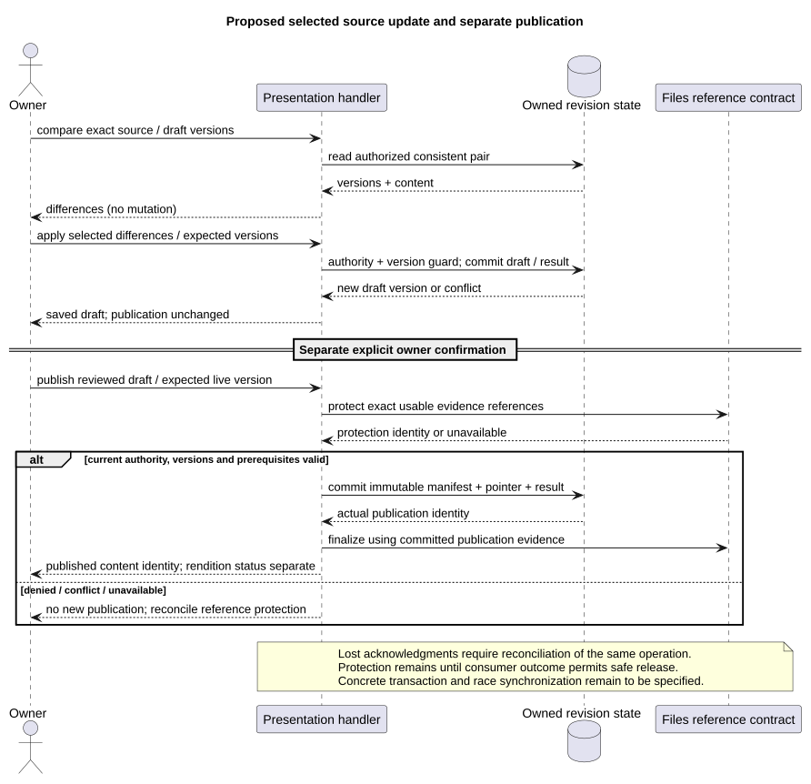
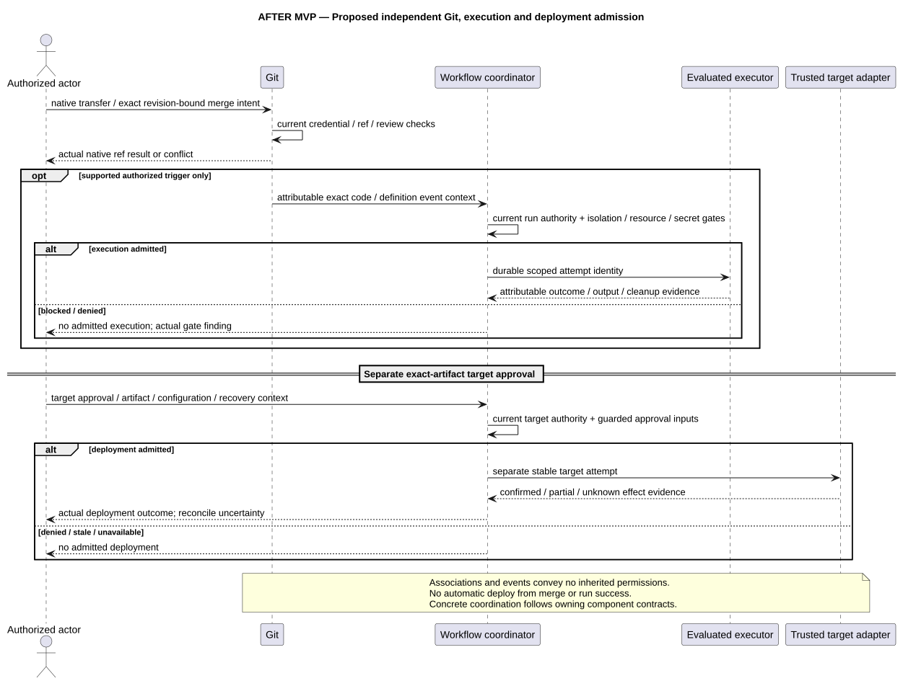
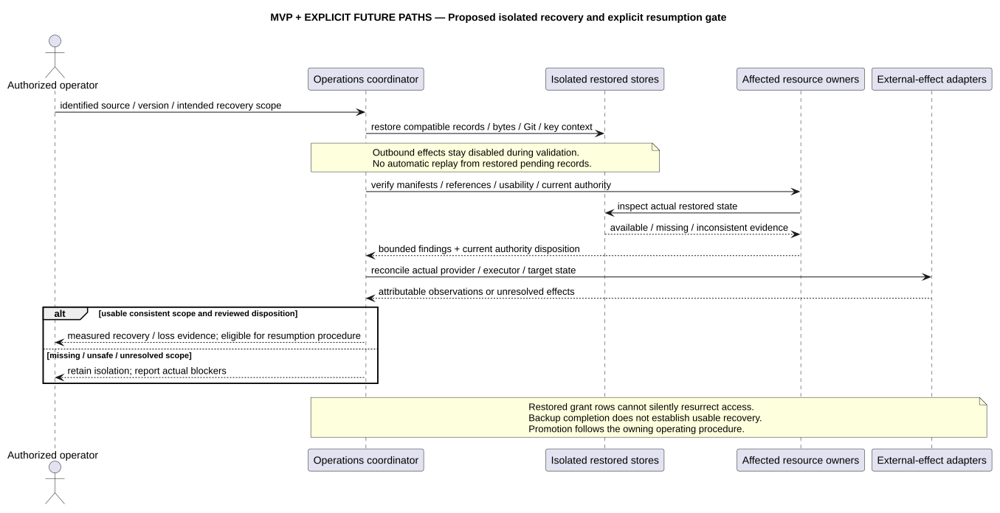
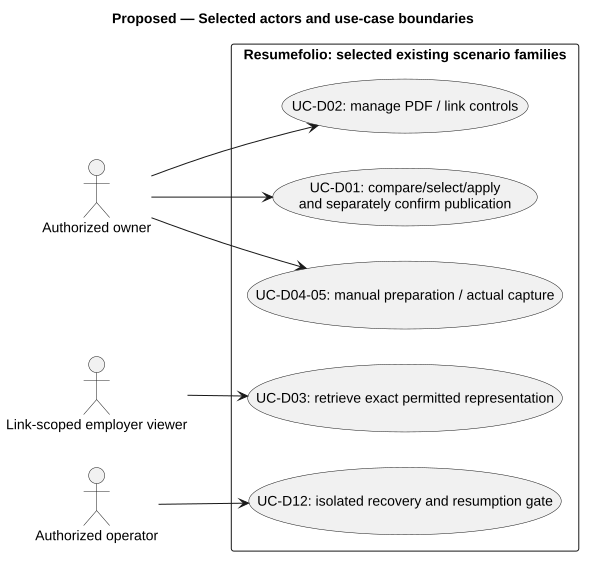
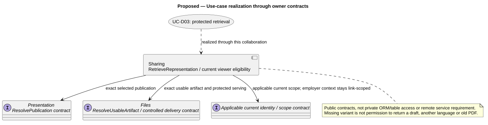
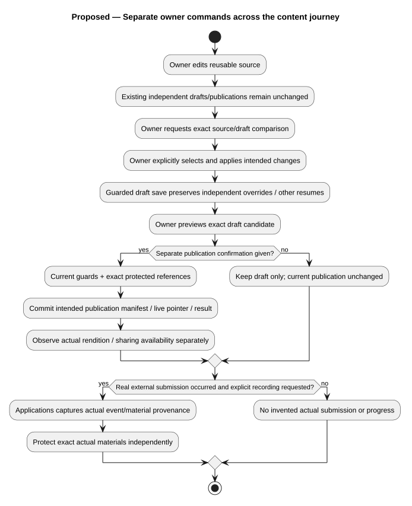
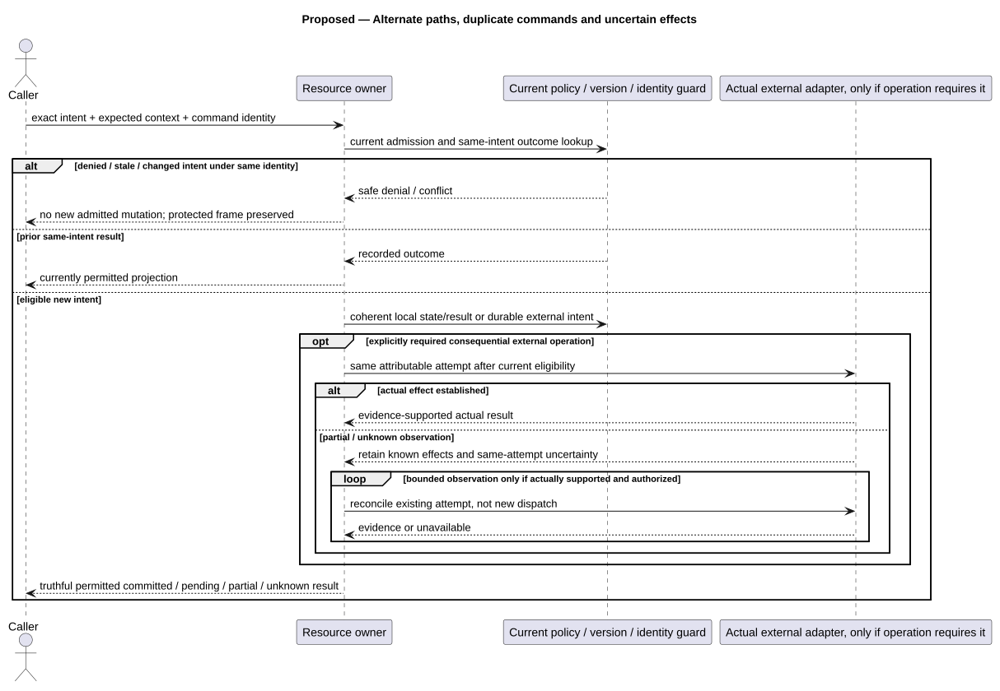

# Resumefolio — Use-Case Realizations and Interactions

Current implementation choices and scope: [Baseline](../../../baseline/README.md). Runtime verification remains subject to its gates.

**Purpose:** show how technical components collaborate to realize existing analysis scenarios without changing their goals or accepted behavior.

**Status:** proposed technical realizations, November 2, 2026. The routes and diagrams specify responsibilities and consistency obligations, not implemented endpoints, proven atomicity or executed scenario tests. Exact signatures and mechanisms remain with component owners.

[Sources](#1-source-and-realization-conventions) · [Coverage](#2-scenario-to-component-map) · [Content](#3-content-sharing-and-actual-material) · [Providers](#4-provider-interactions) · [Work and execution](#5-work-git-execution-and-deployment) · [Recovery](#6-policy-admission-and-recovery) · [Review](#7-verification-and-completion-boundary) · [Essential views](#8-essential-use-case-realization-views)

## 1. Source and realization conventions

Use the existing [use-case/scenario catalog](../../02-requirements-engineering/04-scenarios-and-models/user-stories-and-scenarios.md), [scenario-based analysis](../../03-system-analysis/04-behavioral-and-scenario-analysis/06-scenario-based-view.md), [state-based analysis](../../03-system-analysis/04-behavioral-and-scenario-analysis/07-state-based-view.md) and [operation contracts](../../03-system-analysis/05-business-rules-and-operation-contracts/10-domain-constraints-and-operation-contracts.md). UC-D and SB-M references retain those sources' status; this document allocates no new primary use cases or acceptance.

Follow [shared API contracts](01-api-protocols-contracts-and-compatibility.md), [runtime coordination](../01-software-architecture/03-process-view-concurrency-and-runtime-behavior.md) and [data integrity](../04-data-design/01-analysis-to-logical-and-physical-data-models.md). Each protected operation resolves current actor/resource authority, expected versions and attributable intent before its owner admits effects. An arrow denotes a responsibility exchange, not a remote service, database transaction or automatic trigger.

Existing component diagrams remain the detailed owning views. The new overview and recovery view below connect them rather than replacing their contracts. Unspecified lock ordering, dispatch fencing, provider compatibility and reference/deletion guards remain implementation work.

## 2. Scenario-to-component map

All SB-M identifiers below resolve in the linked [scenario analysis](../../03-system-analysis/04-behavioral-and-scenario-analysis/06-scenario-based-view.md). This is responsibility coverage, not criterion closure or a claim that every alternative path has an implementation sequence.

| Existing scenario family | Technical owner and detailed realization |
| --- | --- |
| UC-D01 / SB-M01 | [Presentation](../03-component-and-module-design/components/professional-presentation.md): compare/select/apply; separately confirmed publication |
| UC-D02 / SB-M02–03 | [Sharing](../03-component-and-module-design/components/representation-and-sharing.md): independent PDF configuration and link/password management |
| UC-D03 / SB-M04 | Sharing with Presentation/Files: selected, current protected representation retrieval |
| UC-D04–05 / SB-M05–06 | [Applications](../03-component-and-module-design/components/applications.md): manual preparation/progress and separate actual-material capture |
| UC-D06 / SB-M07–08 | [Communication/Calendar](../03-component-and-module-design/components/communication-and-calendar.md): read/send and explicit local/provider synchronization  **After MVP.** |
| UC-D07 / SB-M09 | [Work](../03-component-and-module-design/components/work-management.md): refinement, coherent Sprint planning and actual period outcomes |
| UC-D08 / SB-M10 | [Identity](../03-component-and-module-design/components/identity-and-access.md) with resource owner: effective membership, scoped grants and revocation |
| UC-D09 / SB-M11–12 | [Git](../03-component-and-module-design/components/git-collaboration.md): native transfers, revision-bound review and guarded ref update |
| UC-D10 / SB-M13–14 | [Workflow/Deployment](../03-component-and-module-design/components/workflow-and-deployment.md): gated execution and separate target-authorized deployment  **After MVP.** |
| UC-D11 / SB-M15 | [Files/Operations](../03-component-and-module-design/components/files-and-operations.md): effective policy, admission/accounting and restricted evidence |
| UC-D12 / SB-M16 | Files/Operations with affected owners: isolated restore, current authority and external-state reconciliation |

## 3. Content, sharing and actual material

### Source update and separate publication

Presentation resolves authorized source/draft versions and returns read-only differences. Explicit selected apply rechecks those versions and saves only intended draft changes, preserving unrelated overrides and other resumes. Separate owner confirmation names the reviewed candidate; Presentation protects exact evidence references through Files and commits the publication manifest/live pointer/result within its defined consistency boundary.

[Owning design and editable exports](../03-component-and-module-design/components/professional-presentation.md#4-update-and-publication-protocol).

Stale comparisons conflict/recompare; denied operations do not mutate. Lost save/publish responses resolve the same command outcome. Failed/unknown reference finalization retains protection until consumer evidence permits release. Draft save, publication, PDF availability and employer access remain distinct outcomes under the [accepted policy](../../02-requirements-engineering/07-change-and-baseline/open-questions-and-decisions.md#owner-accepted-profile-update-policy).

### PDF/link management and protected retrieval

Sharing authorizes owner-side configuration against exact versions. Download mode changes neither rotate passwords nor disable links implicitly. Viewer context is independently link-scoped; it proves password possession under reviewed policy, not named employer identity.

At retrieval, Sharing resolves current link/viewer generation, selected publication/content, language/mode and exact matching rendition. Files supplies actual usable identity and controlled delivery. The evaluated admission protocol must cover revocation/configuration/publication races; direct paths, caches and range requests cannot bypass applicable checks. Missing variants return their permitted actual state without draft/old-language fallback. Already emitted bytes cannot be recalled.

[Protected retrieval sequence and failure cases](../03-component-and-module-design/components/representation-and-sharing.md#4-protected-retrieval-and-revocation-protocol) own the detailed diagram and unresolved serving mechanism.

### Manual application and actual capture

Applications owns preparation/progress without implicit sending. An explicit actual-event/material command resolves exact admitted artifacts, protects references through Files and commits attributable submission/material completeness. Finalization reconciles actual committed consumer evidence. Capture does not publish, change a sharing link or certify provider receipt. Incomplete material stays labeled incomplete; later profile/publication edits cannot rewrite actual submitted material.

[Actual-material capture sequence](../03-component-and-module-design/components/diagrams/applications-capture-sequence.svg) and [Applications design](../03-component-and-module-design/components/applications.md) define duplicate/lost-response/reference failure behavior.

## 4. Provider interactions

### Deliberate send

Communication validates current account/provider capability and reviewed recipient/content/attachment intent, then records durable send attempt context. The scoped worker dispatches the same attempt under the actual provider contract and records observed acceptance/failure/unknown state. Provider acceptance is not recipient delivery or reading, and does not automatically create a complete application-history capture.

On timeout/lost response, reconcile the existing attempt before any consequential repeat. An expired local worker lease or generic queue retry cannot prove no send occurred. Read-only mail access creates no send intent. [Send sequence](../03-component-and-module-design/components/diagrams/communication-send-sequence.svg) and the [owning component](../03-component-and-module-design/components/communication-and-calendar.md) hold exact responsibilities and provider gates.

### Local activity and selected calendar synchronization

**Release applicability:** future-domain design retained after MVP; core operating/deployment and recovery controls still apply to MVP where relevant.

Communication distinguishes locally owned event intent, provider identity/mapping and actual synchronization observations. Explicitly selected synchronization rechecks current capability, field authority, versions/time meaning and actual provider state. Local save does not imply provider success. Conflicts, disconnect/reconnect, deleted targets and ambiguous writes retain real outcomes instead of inventing agreement or repeating effects blindly.

[Calendar reconciliation route](../03-component-and-module-design/components/diagrams/calendar-reconciliation-route.svg) is the owning view. Actual provider versions/scopes/quotas and source synchronization policies remain pending evaluation/disposition.

## 5. Work, Git, execution and deployment

**Release applicability:** future-domain design retained after MVP; core operating/deployment and recovery controls still apply to MVP where relevant.

[Editable PlantUML](diagrams/interaction-git-execution-deployment.puml) · [PNG](diagrams/interaction-git-execution-deployment.png)

### Work and changed collaboration

Work validates current project/action authority, coherent item/task/board/plan relationships and relevant versions before committing. Goal, selected items and delivery plan remain one Sprint Backlog. Period-end records actual context/outcomes; task completion, item acceptance and goal achievement do not follow automatically from a column move or elapsed date.

Identity and the resource owner coordinate effective membership/grant changes and assignment consequences under reviewed policy. Invitation alone is not effective membership, and project access does not grant repository/private-mail authority. Stale contexts and grant changes racing operations need concrete synchronization. See [work mutation/Sprint-close sequence](../03-component-and-module-design/components/diagrams/work-mutation-sprint-close.svg) and [Identity authorization sequence](../03-component-and-module-design/components/diagrams/identity-authorization-sequence.svg).

### Native Git and revision-bound review

Git authenticates actual client credentials and repository/ref scope for native transfer. Review/merge resolves exact current source/target revisions, current authority and required review/check policy. A guarded native ref update is coordinated with durable metadata observations; SQL rollback cannot undo an already changed ref. Stale revision/review produces conflict/re-evaluation, not a blind merge repeat. See [Git merge sequence](../03-component-and-module-design/components/diagrams/git-merge-sequence.svg).

### Conditional execution and separate target stage

**Release applicability:** future-domain design retained after MVP; core operating/deployment and recovery controls still apply to MVP where relevant.

A Git event may produce workflow intent only under an explicit supported authorized trigger. Workflow separately validates immutable code/definition context and actual isolation/resource/secret-enabling evidence before admission. Run identity, launch acknowledgment, terminal outcome, cancellation request, output availability and cleanup remain distinct.

Run success supplies no deployment permission. The target stage separately binds current approval to exact artifact/revision/target/configuration and recovery compatibility. Unknown executor/target effects require same-attempt reconciliation; do not relaunch/redeploy automatically. [Workflow boundaries](../03-component-and-module-design/components/diagrams/workflow-trust-model.svg) and [deployment sequence](../03-component-and-module-design/components/diagrams/workflow-deployment-sequence.svg) own detailed mechanisms/gates.

## 6. Policy, admission and recovery

Files/Operations authorizes effective policy changes, atomically reserves concurrent growth, validates actual usable artifacts and records true accounting. Protected consumer references exclude reclamation; retiring a record or a finished workflow does not prove bytes/workspace were reclaimed. Partial/unknown storage outcomes retain evidence and applicable protection/accounting for reconciliation. See [admission sequence](../03-component-and-module-design/components/diagrams/files-admission-sequence.svg) and [reclamation route](../03-component-and-module-design/components/diagrams/files-reclamation-route.svg).

[Editable PlantUML](diagrams/interaction-isolated-recovery.puml) · [PNG](diagrams/interaction-isolated-recovery.png)

For UC-D12, the authorized operator identifies source/version and intended scope; Operations coordinates isolated restoration with outbound actions disabled. Affected owners verify schema/content manifests, bytes/native repositories, keys, protected references and actual current authority. Reconcile provider/executor/target effects before resuming work. Missing bytes/keys, inconsistent references or unresolved dangerous effects remain findings, not a successful usable-state claim.

Backup coverage/destination, recovery targets and promotion disposition remain in [Operations/Recovery](../06-design-quality-and-security-analysis/03-operations-backup-recovery-and-resilience.md). Restoration does not re-enable historical grants/links or replay pending remote actions automatically. No backup or recovery capability is established by this sequence.

## 7. Verification and completion boundary

For each realization, record the exact source scenario/criterion, owner/consumer, candidate/environment, actor and current grants, input/state versions, command/attempt identity, expected effects and unchanged protected state, observed result and remaining limits. Cover normal, denied, invalid, conflict, partial, uncertain and recovery branches where applicable. Diagram coverage is not executed verification.

Focused preservation checks:

- Separate source apply/publication and independent actual material across later changes.
- Current authority on all entry/follow-through paths and no permission inherited from associations/events.
- Protected-reference coordination before consumer commit and safe reconciliation before release.
- Actual provider/native-ref/executor/target observations without false atomicity or blind repeat.
- Coherent work/Sprint history and recovery without access resurrection or remote replay.

Use component policy tests plus actual persistence/concurrency and authorized integration evidence. Remaining work includes exact signatures/types, synchronization/fencing, selected external compatibility, full criterion mapping and implementation-specific scenario sequences. No live product action, acceptance test, baseline approval or new policy selection is performed here.

These technical interaction views adapt FAU's use-case realization/component-collaboration approach; source goals remain in requirements/analysis. Use the [reference map](../01-reference-and-coverage-map.md) and [review/handoff](../06-design-quality-and-security-analysis/05-design-review-traceability-and-handoff.md).

[Interface and API Design](README.md) · [Contract conventions](01-api-protocols-contracts-and-compatibility.md) · [Diagram catalog](diagrams/README.md)

## 8. Essential use-case realization views

Only **four complementary diagrams** are added; no new tables, payloads or use-case IDs. Reuse the detailed source/apply/publication, actual-material capture, provider send/calendar, Work/Identity, native Git, execution/deployment and recovery sequences already linked in sections 3–6. This prevents a second competing definition of the same collaboration.

### 8.1 Selected actors and use-case boundaries

[Editable PlantUML](diagrams/interaction-essential-use-cases.puml) · [PNG](diagrams/interaction-essential-use-cases.png)

Selected existing source-family summary, not new use-case allocation or complete system coverage. No include/extend arrow joins apply, publish or capture: they are distinct deliberate goals/actions, not automatically executed substeps. Other source families remain mapped in section 2.

### 8.2 Use-case realization through owner contracts

[Editable PlantUML](diagrams/interaction-essential-realization.puml) · [PNG](diagrams/interaction-essential-realization.png)

UML-style realization overview, not a claim that every arrow is a network API call. The existing Sharing retrieval sequence owns detailed ordering. Concrete revocation/admission/reference synchronization must still be designed and verified.

### 8.3 Separate owner commands across the content journey

[Editable PlantUML](diagrams/interaction-essential-end-to-end.puml) · [PNG](diagrams/interaction-essential-end-to-end.png)

End-to-end activity spans separate commands and user decisions, not one atomic API transaction or mandatory sequence for every user. Recording a manual submission does not require this exact publication journey; actual submitted material can come from the source-permitted real route. Provider acceptance alone is not an actual submission claim.

### 8.4 Alternate paths, duplicate commands and uncertain effects

[Editable PlantUML](diagrams/interaction-essential-alternates.puml) · [PNG](diagrams/interaction-essential-alternates.png)

Generic exception interaction complements rather than replaces operation-specific sequences. Local commit response loss uses same-command local reconciliation; remote effects require actual adapter evidence and cannot be inferred from SQL rollback, lease expiry or timeout. No observation API, retry count or automatic effect replay is invented.

### Reading and coverage limits

The existing scenario-to-component map owns source-family references; it is not exact criterion closure. Use-case summaries show goals, realization views show participating contracts, activity views show control flow, and sequences show message ordering/evidence. None proves a selected locking scheme, remote service deployment or atomic transaction across owners and facilities.

No generic orchestration engine, choreography bus, gateway, boundary/control/entity hierarchy or additional interaction state model is introduced solely to satisfy a diagram taxonomy. Actual operations remain owner-coordinated; events carry provenance without granting permission. Optional state/communication diagrams belong with a concrete component when they resolve a real question.

Before implementation, refine exact signatures, permitted inputs/projections, authority/version ordering, actual external capabilities and safe repetition/cancellation behavior. Validate normal/denied/conflict/partial/unknown paths and protected state against an identified candidate; numerical timeout, latency or retry budgets remain actual design decisions. No request, provider operation, ref update, workflow, deployment or live scenario test is executed by this update.
