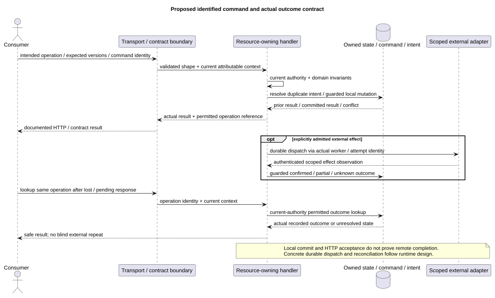
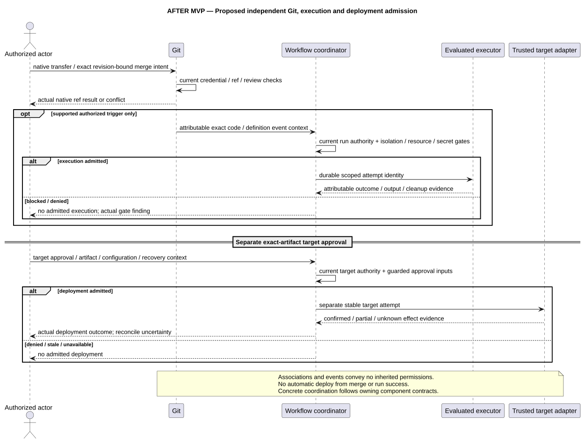

# Resumefolio — Interface and API Design

## Current implementation baseline — November 4, 2026

[BL-MVP-2026-11-04.1](../../../baseline/README.md) selects the MVP technical mechanisms, numerical policies, priorities and requirement/criterion dispositions under Farhad’s explicit delegation. It supersedes earlier Proposed/pending mechanism and whole-baseline statements below for MVP design input. Future clauses and dated evidence remain separate. Runtime/actor validation, credentials, Git isolation, capacity and backup/restore still require the named implementation/Release gates; this update reports no product test Pass.

### Prior source material and rationale (superseded where this Baseline selects a different MVP choice)

**Use this folder to understand communication contracts and how components collaborate to realize existing scenarios.** Shared protocol/result/compatibility conventions belong here; exact signatures and domain invariants remain with their owning components.

Owner and decision authority: Farhad. Updated November 2, 2026.

**Current position:** both documents are populated with project-specific proposed design. **Twelve local diagrams** illustrate contracts, protocol selection, consumer verification, use-case realization and safe interactions; detailed component diagrams are linked at their owning locations. No implemented route catalog, adopted frontend/API stack, verified external integration or accepted baseline is claimed.

[Reading route](#1-reading-route) · [Document guide](#2-find-the-right-record) · [Diagrams](#3-diagrams-and-owning-views) · [Boundaries](#4-ownership-and-preservation-rules) · [Readiness](#5-review-and-current-limits)

## MVP system allocation and design status

The accepted system boundary separates the Resumefolio core from ProjectForge, joined by an authenticated user-scoped API. Logical responsibilities remain useful within each system; they do not authorize a shared core/ProjectForge process, database or transaction. Core owns dashboard, invited accounts, professional presentation, protected sharing, manual applications and same-server private My Files & Media. ProjectForge MVP owns real repositories/transfers/permissions, file/history browsing, issues and simple Kanban. Its selected engine is native Git Smart HTTP behind the independent Laravel ProjectForge service, with its own MySQL 8.4 database and OS/storage boundaries on the existing host; BL-MVP-2026-11-04.1 governs implementation and evidence gates. The future communications system is independently private and API connected. Advanced Git review/releases, backlog/Sprints and execution/deployment remain deferred. Keep source, independent resume draft, explicit publication and actual submitted material identities distinct. Profile changes require preview/select/apply and cannot mutate publication or submitted history. Manual applications include status, next action and follow-up date without mail/calendar dependencies.

Authority: [OWNER-MVP-2026-11-04](../../01-project-planning/owner-mvp-decision-2026-11-04.md).

## 1. Reading route

1. Read [interface requirements](../../02-requirements-engineering/03-requirements-specification/external-interface-requirements.md) and [analysis interfaces](../../03-system-analysis/06-interfaces-security-and-quality-analysis/12-interfaces-and-external-interactions.md) for existing boundary meanings and source status.
2. Read [API Protocols, Contracts and Compatibility](01-api-protocols-contracts-and-compatibility.md) for protocol options, required contract records, HTTP/result semantics, expected versions, command identity, protected/external exchanges and compatibility.
3. Read [Use-Case Realizations and Interactions](03-use-case-realizations-and-interactions.md) for UC-D01–UC-D12/SB-M01–SB-M16 responsibility coverage, technical routes, failure boundaries and linked component sequences.
4. Follow the [component catalog](../03-component-and-module-design/README.md) for concrete operations/types and the [runtime design](../01-software-architecture/03-process-view-concurrency-and-runtime-behavior.md) for concurrency and reconciliation obligations.
5. Record consequential choices in [ADRs](../07-design-decisions/README.md) and actual criterion/evidence disposition in [review/handoff](../06-design-quality-and-security-analysis/05-design-review-traceability-and-handoff.md).

The retained numbers are stable document locators. Component/external integration guidance is included in document 01; no separate file 02 is required merely to close the numbering gap.

## 2. Find the right record

| Question | Owning location |
| --- | --- |
| Which transport fits browser, local component, Git or external consumers? | [01 — Protocol choices](01-api-protocols-contracts-and-compatibility.md#2-protocol-choices-by-consumer) |
| What must each operation contract specify? | [01 — Required contract record](01-api-protocols-contracts-and-compatibility.md#3-required-contract-record) |
| How do HTTP results, stale writes and uncertain effects differ? | [01 — Results and repetition](01-api-protocols-contracts-and-compatibility.md) |
| How are clients, workers and stored payloads kept compatible? | [01 — Compatibility](01-api-protocols-contracts-and-compatibility.md#7-versioning-and-compatibility) |
| Which components realize each existing source scenario? | [03 — Scenario map](03-use-case-realizations-and-interactions.md#2-scenario-to-component-map) |
| Where are detailed publication, send, Git, work and target sequences? | [03 — Owning component links](03-use-case-realizations-and-interactions.md) |
| Where do schema/storage and threat/operating details belong? | [Data](../04-data-design/README.md) and [Quality/Security](../06-design-quality-and-security-analysis/README.md) |

## 3. Diagrams and owning views

### Identified command and actual outcome

[Owning contract document](01-api-protocols-contracts-and-compatibility.md) · [PlantUML](diagrams/api-command-outcome-sequence.puml) · [PNG](diagrams/api-command-outcome-sequence.png)

Transport acceptance and a local commit do not certify remote completion. Lost responses resolve the same attributable operation before a consequential repeat.

### Independent Git, execution and target admission

**Release applicability:** future-domain design retained after MVP; core operating/deployment and recovery controls still apply to MVP where relevant.

[Owning realizations document](03-use-case-realizations-and-interactions.md) · [PlantUML](diagrams/interaction-git-execution-deployment.puml) · [PNG](diagrams/interaction-git-execution-deployment.png)

The overview does not prescribe automatic execution or deployment. Explicit trigger policy, actual execution-enabling evidence and separate target approval remain necessary.

### Contract guide — six local views

The [essential API package](01-api-protocols-contracts-and-compatibility.md#9-essential-api-and-contract-views) adds four views to the existing command/outcome sequence and contract-evolution diagram:

- [Consumer/provider boundaries](diagrams/api-essential-boundaries.svg) · [PlantUML](diagrams/api-essential-boundaries.puml) · [PNG](diagrams/api-essential-boundaries.png)
- [Protocol selection by actual consumer need](diagrams/api-essential-selection.svg) · [PlantUML](diagrams/api-essential-selection.puml) · [PNG](diagrams/api-essential-selection.png)
- [Contract-first refinement](diagrams/api-essential-contract-workflow.svg) · [PlantUML](diagrams/api-essential-contract-workflow.puml) · [PNG](diagrams/api-essential-contract-workflow.png)
- [Consumer expectations and provider verification](diagrams/api-essential-consumer-verification.svg) · [PlantUML](diagrams/api-essential-consumer-verification.puml) · [PNG](diagrams/api-essential-consumer-verification.png)

These views select no public REST API, gateway, GraphQL/gRPC/broker, code-generation tool or versioned endpoint scheme. Module contracts can remain in-process; native Git and protected-byte/provider/control exchanges retain their actual distinct contracts. Consumer expectations cannot override accepted behavior or privacy.

### Interaction guide — six local views

The [essential realization package](03-use-case-realizations-and-interactions.md#8-essential-use-case-realization-views) adds four views to the existing Git/execution/deployment overview and isolated-recovery sequence:

- [Selected actors and existing use-case families](diagrams/interaction-essential-use-cases.svg) · [PlantUML](diagrams/interaction-essential-use-cases.puml) · [PNG](diagrams/interaction-essential-use-cases.png)
- [Protected retrieval realized through owner contracts](diagrams/interaction-essential-realization.svg) · [PlantUML](diagrams/interaction-essential-realization.puml) · [PNG](diagrams/interaction-essential-realization.png)
- [Separate commands across the content journey](diagrams/interaction-essential-end-to-end.svg) · [PlantUML](diagrams/interaction-essential-end-to-end.puml) · [PNG](diagrams/interaction-essential-end-to-end.png)
- [Alternate paths and uncertain effects](diagrams/interaction-essential-alternates.svg) · [PlantUML](diagrams/interaction-essential-alternates.puml) · [PNG](diagrams/interaction-essential-alternates.png)

Document 03 reuses the detailed component-owned publication/retrieval/capture/send/calendar/work/Git/executor/file sequences. Its scenario map describes responsibility, not exact criterion closure. The content journey spans deliberate separate actions, not one automatic publish/send/submit transaction. Generic alternate paths complement, rather than replace, each operation's actual contract.

The [complete diagram catalog](diagrams/README.md) contains **12 PlantUML sources, 12 SVGs and 12 PNGs**. Counts refer to distinct local views, not repeated links or component diagrams maintained elsewhere. Read captions at the stated abstraction level: arrows are not proof of remote-service deployment, automatic permission, atomicity or runtime behavior. This README update adds no table or diagram.

## 4. Ownership and preservation rules

Requirements/analysis retain source goals and scenario meaning. This folder refines provided/required contracts and collaborations; resource owners enforce actual operations. Data design owns schema/reference integrity, runtime owns concurrency/reconciliation, security owns threat controls and Operations owns the actual recovery procedure.

Preserve these shared rules:

- Current actor/resource/action authority applies across browser, native-client, file, background and callback entry paths.
- Source preview/apply, separately confirmed publication and actual submitted material remain independent.
- Private cached/direct/range retrieval cannot silently bypass current eligibility or substitute another revision/language.
- Command identity prevents defined duplicate local intent; it does not prove remote exactly-once execution.
- Provider acceptance is not recipient receipt; cancellation request is not confirmed stop; terminal execution is not cleanup; run success is not target approval.
- Membership, resource association and emitted events convey no unrelated permissions or automatic side effects.
- Recovery reconciles current authority and actual external state before resumption, without replaying uncertain actions.

## 5. Review and current limits

Before implementation handoff, specify exact signatures/routes and payload/result schemas, requiredness/units/language/time/revision conventions, authority and anti-forgery controls, status/precondition/error mappings, pagination/resource bounds, command/attempt repetition semantics and compatibility behavior. Each realization needs source/criterion links, current context/version checks, consistency boundary, external effects and applicable failure/recovery branches.

Verify actual framework, persistence/concurrency, protected serving and selected provider/Git/executor compatibility using suitable authorized evidence. Mock results and diagram/link checks do not establish interoperability, safe remote retries, isolation or recovery readiness. Final transport/client/framework facilities, external capabilities, synchronization and exact criterion closure remain pending.

No endpoint, provider send, repository transfer, execution, deployment, account/link change or acceptance test is performed by this documentation. Scope and baseline acceptance remain with their source authorities.

## 6. FAU basis and maintenance

FAU's component interfaces and use-case realization views inform these documents. HTTP conventions, compatibility records and this folder structure are project adaptations, not a university-mandated API style. See the [reference map](../01-reference-and-coverage-map.md).

When changing a contract, identify consumers and stored pending payloads, reconcile source/owner/data/runtime/security consequences, update the owning realization and ADR, regenerate affected diagrams and check local links. Preserve historical evidence and distinguish documentation checks from product verification.

[System Design home](../README.md) · [Component Design](../03-component-and-module-design/README.md) · [Diagram catalog](diagrams/README.md)
