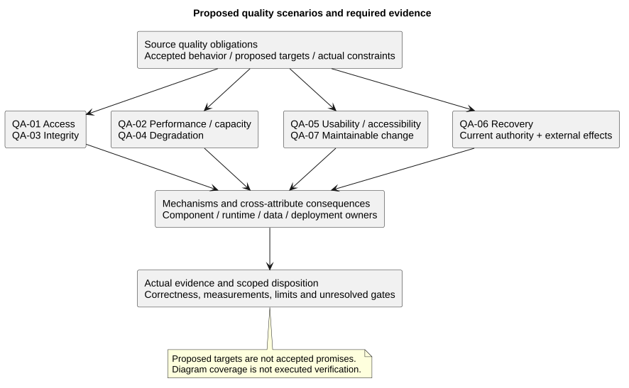
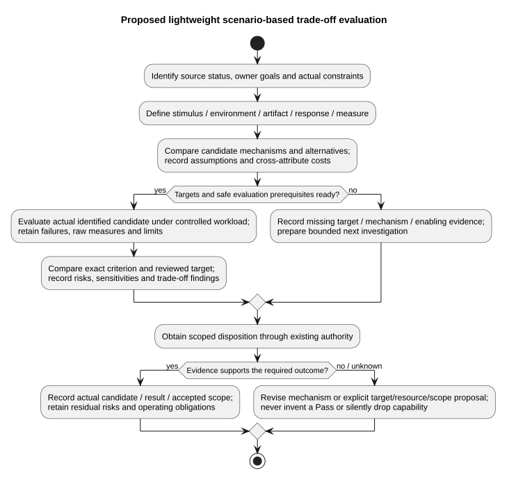
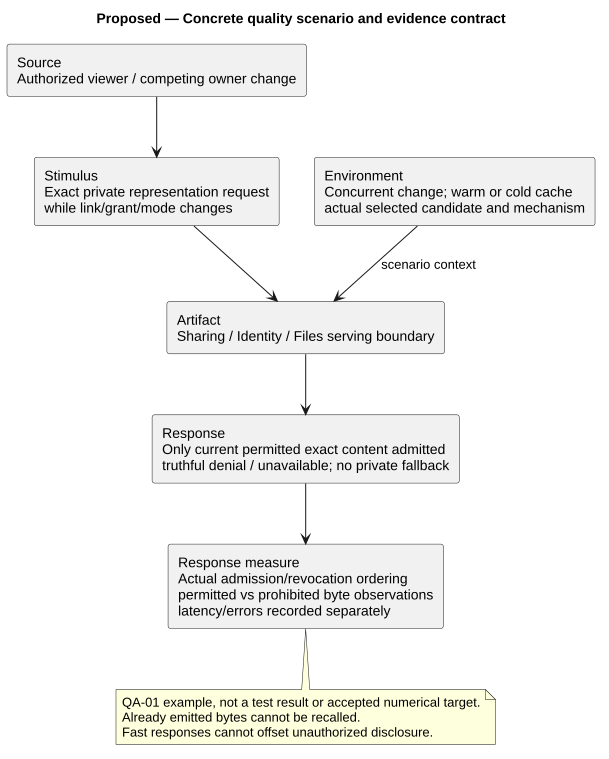
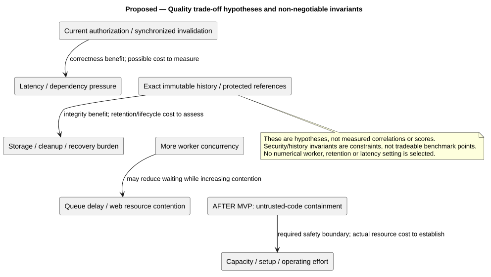
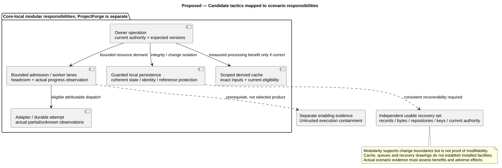

# Resumefolio — Quality Attributes and Design Trade-offs

## Current implementation baseline — November 4, 2026

[BL-MVP-2026-11-04.1](../../../baseline/README.md) selects the MVP technical mechanisms, numerical policies, priorities and requirement/criterion dispositions under Farhad’s explicit delegation. It supersedes earlier Proposed/pending mechanism and whole-baseline statements below for MVP design input. Future clauses and dated evidence remain separate. Runtime/actor validation, credentials, Git isolation, capacity and backup/restore still require the named implementation/Release gates; this update reports no product test Pass.

### Prior source material and rationale (superseded where this Baseline selects a different MVP choice)

**Purpose:** connect quality obligations to concrete design scenarios, mechanisms, trade-offs and evidence needed to judge the candidate architecture.

**Status:** proposed evaluation design, November 2, 2026. No workload, latency, availability, accessibility or recovery target is accepted here. No benchmark, security assessment, restoration or formal ATAM workshop has been performed by this update.

[Authority](#1-source-authority-and-evaluation-boundaries) · [Scenarios](#2-quality-scenario-catalog) · [Trade-offs](#3-design-trade-offs-and-sensitive-decisions) · [Method](#4-evaluation-and-measurement-procedure) · [Evidence](#5-evidence-record-and-readiness) · [Essential views](#6-essential-quality-and-trade-off-views)

## MVP system allocation and design status

The accepted system boundary separates the Resumefolio core from ProjectForge, joined by an authenticated user-scoped API. Logical responsibilities remain useful within each system; they do not authorize a shared core/ProjectForge process, database or transaction. Core owns dashboard, invited accounts, professional presentation, protected sharing, manual applications and same-server private My Files & Media. ProjectForge MVP owns real repositories/transfers/permissions, file/history browsing, issues and simple Kanban. Its selected engine is native Git Smart HTTP behind the independent Laravel ProjectForge service, with its own MySQL 8.4 database and OS/storage boundaries on the existing host; BL-MVP-2026-11-04.1 governs implementation and evidence gates. The future communications system is independently private and API connected. Advanced Git review/releases, backlog/Sprints and execution/deployment remain deferred. Keep source, independent resume draft, explicit publication and actual submitted material identities distinct. Profile changes require preview/select/apply and cannot mutate publication or submitted history. Manual applications include status, next action and follow-up date without mail/calendar dependencies.

Authority: [OWNER-MVP-2026-11-04](../../01-project-planning/owner-mvp-decision-2026-11-04.md).

## 1. Source authority and evaluation boundaries

Use [QSR-D01–QSR-D14](../../02-requirements-engineering/03-requirements-specification/quality-security-and-recovery-requirements.md), the [quantitative target contracts](../../02-requirements-engineering/03-requirements-specification/quality-security-and-recovery-requirements.md#target-decision-contracts), [Q-D25](../../02-requirements-engineering/03-requirements-specification/quality-security-and-recovery-requirements.md#resolution-q-d25), [Q-D26](../../02-requirements-engineering/03-requirements-specification/quality-security-and-recovery-requirements.md#resolution-q-d26) and [analysis quality/operating view](../../03-system-analysis/06-interfaces-security-and-quality-analysis/13-security-quality-and-operational-analysis.md). Source-defined behavior and owner acceptance remain authoritative; design cannot convert a target proposal into an agreed NFR.

Q-D25 supplies concrete proposed workload/latency/error/availability/client/accessibility values, and Q-D26 proposes backup/retention/recovery objectives. They remain pending owner disposition and actual evidence. Preserve their exact measurement contexts when evaluating them; do not copy only a convenient number into an ADR or acceptance checklist. The owner confirmed backups are not set up.

The dated server allocation is 2 vCPU/4 GB/40 GB with existing application workloads. It is an infrastructure input, not measured spare capacity or proof that real execution fits. Ten initial accounts and possible growth toward about 1,000 users do not define concurrent demand. The sole owner's total project capacity is 20 hours/week; deployment, monitoring, backup and incident work consume that same capacity.

This document owns cross-attribute evaluation. Detailed controls/procedures remain with [Security](02-security-threat-modeling-and-trust-boundaries.md), [Operations/Recovery](03-operations-backup-recovery-and-resilience.md), [UI/Accessibility](04-user-interface-accessibility-and-interaction-quality.md), [Data](../04-data-design/README.md), [Runtime](../01-software-architecture/03-process-view-concurrency-and-runtime-behavior.md) and component owners.

## 2. Quality scenario catalog

[Editable PlantUML](diagrams/quality-scenario-evidence-map.puml) · [PNG](diagrams/quality-scenario-evidence-map.png)

The QA labels below are local design-evaluation locators, not primary requirement IDs or assigned priorities. Each scenario records stimulus/source, environment, affected artifact, response and response measure. Proposed evaluation order follows unresolved dependencies and risk, not an accepted requirement priority.

### QA-01 — Current protected retrieval

**Basis:** QSR-D05–D07; Sharing/Identity requirements. **Stimulus/environment:** an authorized viewer requests an exact representation while a link/grant/password/mode changes, including direct, cached and range paths. **Response:** admit only permitted selected content under the defined current-authority ordering; return safe denied/unavailable states without private fallback. Already emitted bytes are outside recall.

**Mechanisms:** resource-specific authority, link generations, exact rendition identity and evaluated serving/invalidation synchronization. **Measures/evidence:** actual decision/admission ordering, permitted/denied byte observations, stale-context behavior and safe disclosure. Speed cannot compensate for an unauthorized disclosure. See [Sharing](../03-component-and-module-design/components/representation-and-sharing.md).

### QA-02 — Responsive web work under combined load

**Basis:** QSR-D01/D02. **Stimulus/environment:** representative permitted reads/saves alongside PDF/upload/provider/Git activity and, only after enabling gates, bounded execution. Separate cold/warm and mixed-load runs. **Response:** truthful results and controlled admission/degradation without lost updates or unbounded queues/resources.

**Mechanisms:** guarded local transactions, bounded jobs/growth, scoped derived caching and observation. **Measures/evidence:** operation-specific latency distribution, errors/timeouts, completion counts, CPU/memory/disk/network, queue age and artifact/temp growth. Evaluate exact Q-D25 proposals only in their stated workload; execution is not authorized by a load-test plan. Record actual saturation behavior instead of inferring capacity from account count.

### QA-03 — Concurrent change and historical integrity

**Basis:** QSR-D08/D09 and accepted publication/history policy. **Stimulus/environment:** simultaneous source apply/publication, quota reservations, Sprint close, reference registration/cleanup or Git ref change. **Response:** one attributable guarded outcome or explicit conflict/unknown state, with unrelated overrides and required history/references preserved.

**Mechanisms:** expected versions, coherent transactions, native compare/update and protected-reference coordination. **Measures/evidence:** final invariant checks, actual commit/ref/effect ordering, duplicate-command resolution, unchanged protected state and residual accounting. A successful HTTP response or isolated row check cannot establish cross-record integrity. See [Data Model](../04-data-design/01-analysis-to-logical-and-physical-data-models.md).

### QA-04 — Dependency failure and truthful degradation

**Basis:** QSR-D04/D08/D13 and provider/execution requirements. **Stimulus/environment:** provider outage, lost send/launch acknowledgment, worker loss or unavailable rendition. **Response:** preserve actual pending/partial/unknown effects, offer safe bounded feedback/reconciliation and keep unrelated permitted workflows usable where feasible. Do not resend/relaunch/deploy blindly.

**Mechanisms:** durable attempts, scoped adapters, actual observations and explicit dependency states. **Measures/evidence:** effect count, status truthfulness, queue/backlog growth, recovery ordering and service-path availability. Provider acceptance is not recipient delivery; cancellation request is not confirmed stop. See [Runtime](../01-software-architecture/03-process-view-concurrency-and-runtime-behavior.md).

### QA-05 — Usable, accessible and compatible journeys

**Basis:** QSR-D03; EIF-D02. **Stimulus/environment:** owner/viewer performs representative editing, confirmation, protected viewing and failure recovery with the reviewed client/input/viewport matrix. **Response:** understandable outcomes, operable controls, preserved input and accessible feedback without accidental publication or duplicate actions.

**Mechanisms:** explicit confirmations, stable labels/focus, accessible form/error handling and responsive presentation. **Measures/evidence:** task success/error observations and applicable criterion checks under the exact reviewed standard/client matrix. Q-D25's WCAG/client proposals remain proposals; automated checks alone cannot certify conformance, and PDFs require separate assessment. See [UI/Accessibility](04-user-interface-accessibility-and-interaction-quality.md).

### QA-06 — Usable restoration and safe resumed operation

**Basis:** QSR-D10–D12. **Stimulus/environment:** an identified consistent recovery point is restored in isolation after loss. **Response:** validate usable records/bytes/native repositories/keys, current authority and actual external effects before resumption, without resurrected access or remote replay.

**Mechanisms:** independent backup coverage, compatible recovery-point manifests and reviewed restoration/reconciliation. **Measures/evidence:** actual recoverable point/loss, elapsed time to defined usable workflows, missing dependencies and residual effects. Compare only with actually agreed targets; Q-D26 objectives are not demonstrated capability. See [Operations/Recovery](03-operations-backup-recovery-and-resilience.md).

### QA-07 — Maintainable, observable and recoverable change

**Basis:** QSR-D13/D14. **Stimulus/environment:** a component/schema/API/worker payload changes while old consumers or pending attempts exist. **Response:** preserve contract/history/authority semantics through a compatible transition and record useful restricted diagnostics.

**Mechanisms:** explicit module contracts, versioned payloads/manifests, migration guards and scoped evidence. **Measures/evidence:** affected consumers, compatibility checks, migration/repair effort, safe incident diagnosis and actual solo operating burden. Logs must not expose secrets/private dumps. See [Design Evolution](../02-detailed-and-object-oriented-design/05-design-evolution-refactoring-and-technical-debt.md) and [API Compatibility](../05-interface-and-api-design/01-api-protocols-contracts-and-compatibility.md).

## 3. Design trade-offs and sensitive decisions

These are qualitative candidate assessments, not scored benchmarks or accepted selections.

| Candidate approach | Benefit and cost to evaluate |
| --- | --- |
| Modular trusted Laravel application versus early distributed services | Simpler local transactions/deployment for a sole owner; shared failure/resource contention remains. Distribution adds independent failure/consistency/operations costs and needs evidence to justify it |
| Current authority checks versus long-lived positive caches | Stronger revocation semantics; added dependency/latency and invalidation coordination. Optimize only while preserving the promised admission boundary |
| Immutable manifests/protected references versus mutable live lookup | Preserves publication/submission meaning; adds storage, reference accounting and cleanup complexity. Retention still needs source policy |
| Durable asynchronous effects versus synchronous remote calls | Decouples interaction from external delay and preserves intent; adds queue age, reconciliation and worker operations. Neither promises exactly-once remote effects |
| Private rendition cache versus regeneration | Can reduce repeated processing; adds exact-input keys, storage and invalidation/privacy obligations. Actual workload determines benefit |
| Separate untrusted executor boundary versus in-process execution | Supports evaluated containment; adds resources/configuration/cleanup burden. In-process convenience cannot satisfy untrusted-code isolation by itself |
| Backup/recovery versus HA/failover | A feasible recovery path can address defined loss; backup does not provide redundant capacity or uninterrupted service. HA needs separate facilities, cost and evidence |

The proposed modular boundary is recorded in [ADR-001](../07-design-decisions/ADR-001-modular-application-boundaries.md), publication/history in [ADR-002](../07-design-decisions/ADR-002-explicit-publication-and-history.md), and durable effects in [ADR-003](../07-design-decisions/ADR-003-durable-external-attempts.md). Their proposed status is unchanged.

**Sensitivity candidates:** worker concurrency, lock scope, rendition payload size, invalidation timing, reference protection, backup coverage and restore ordering can materially affect individual scenario responses. **Trade-off candidates:** increasing concurrency may improve queue delay while worsening web latency/headroom; retaining exact material aids recovery/integrity while increasing storage/reclamation work. These hypotheses need actual workload/implementation evidence; do not label a control a proven non-risk from prose alone.

## 4. Evaluation and measurement procedure

[Editable PlantUML](diagrams/quality-tradeoff-evaluation-route.puml) · [PNG](diagrams/quality-tradeoff-evaluation-route.png)

The [SEI ATAM description](https://www.sei.cmu.edu/library/the-architecture-tradeoff-analysis-method/) supplies the rationale for examining interacting quality attributes. The [SEI ATAM collection](https://www.sei.cmu.edu/library/architecture-tradeoff-analysis-method-collection/) describes scenarios, architectural approaches, sensitivity/trade-off points and risk findings. Sources reviewed November 2, 2026. This document uses a lightweight scenario-based review inspired by that approach; it is not a completed formal ATAM evaluation.

1. Establish source status, important journeys and actual stakeholder/operating constraints. Resolve target proposals with the owner rather than importing an industry default.
2. Define precise stimulus, environment, affected artifact, response and measure for each selected scenario. Record normal/stress/failure/growth/change conditions separately.
3. Identify candidate mechanisms and alternatives, assumptions and potential adverse effects on other attributes. State evidence that would change the recommendation.
4. Prepare a controlled, authorized candidate/environment and synthetic fixtures. Establish workload, competing activity, client/network, warm-up/sample interval, latency boundaries, error treatment and cleanup/recovery scope before measurement.
5. Observe actual results. Report denominators and failed/timed-out/uncompleted work separately; do not hide correctness/security failures in an acceptable percentile or error average. A short run cannot establish a rolling availability objective.
6. Compare with the exact reviewed criterion/target, record risks/unknowns and cross-attribute effects, and obtain scoped disposition. Revise mechanism, target/resource/scope proposal or evidence plan through existing authority; do not silently reduce agreed capability or add spending.

## 5. Evidence record and readiness

Each evaluation record identifies scenario/source criterion, source/target status, candidate/commit/configuration, actual environment/dependencies, actor/grants and data versions, workload/fixtures, expected response, measurement method/raw results, adverse effects and limits, reviewer/date and disposition. Store sanitized actual evidence with [review/traceability](review-and-traceability) and link it from [handoff](05-design-review-traceability-and-handoff.md); never fabricate Pass records or expose secrets.

Prioritize dependent enabling questions before dangerous or misleading tests: actual execution containment before untrusted load; consistent backup/key coverage before recovery claims; exact serving/authority protocol before revocation assurance. Document-only review can identify risk and missing evidence but cannot establish production behavior.

**Readiness remains pending:** source Q-D24–Q-D26 disposition, exact workload/target/client contracts, selected mechanisms, real resource/compatibility evidence, backup setup and isolated usable restoration. Full criterion closure and release readiness are separate owner/review decisions. No new numeric limit, baseline approval, architecture selection, live test or operating configuration is created here.

FAU's architecture-quality and design-refinement concerns inform the coverage; the scenario catalog and lightweight trade-off procedure are project adaptations. See the [reference map](../01-reference-and-coverage-map.md).

[Quality and Security home](README.md) · [Cross-cutting overview](../01-software-architecture/05-cross-cutting-concerns-overview.md) · [Diagram catalog](diagrams/README.md)

## 6. Essential quality and trade-off views

Only **three complementary diagrams** are added; no new tables, scores, targets or ADRs. Reuse the existing [scenario/evidence map](#2-quality-scenario-catalog) and [evaluation/disposition route](#4-evaluation-and-measurement-procedure). Proposed importance/difficulty, numerical targets and formal ATAM status are not accepted merely by illustrating them.

### 6.1 Concrete quality scenario and evidence contract

[Editable PlantUML](diagrams/quality-essential-scenario.puml) · [PNG](diagrams/quality-essential-scenario.png)

The six-part scenario shape refines the existing QA-01 narrative without a new table. Exact criterion, current authority/serving synchronization, test environment and raw observations are still required. A cache hit or mock allow cannot prove the admission boundary.

### 6.2 Quality trade-off hypotheses and non-negotiable invariants

[Editable PlantUML](diagrams/quality-essential-conflicts.puml) · [PNG](diagrams/quality-essential-conflicts.png)

Selected cross-attribute tensions, not a universal rule that security always worsens performance. Mechanisms can improve several attributes; measure actual combined effects. Missing isolation cannot be compensated by a favorable cost score, and existing scope cannot be silently dropped to improve a metric.

### 6.3 Candidate tactics mapped to scenario responsibilities

[Editable PlantUML](diagrams/quality-essential-tactics.puml) · [PNG](diagrams/quality-essential-tactics.png)

Combines tactics and component responsibility without selecting middleware, cache, broker, isolation product or backup destination. Bounded work, current guards and explicit outcomes support planned scenarios; their effectiveness and operating burden remain to verify. Total project work, including operations, stays within the actual 20-hour/week capacity constraint.

### Reused decision-support views and deliberate omissions

The architecture drivers already own the [quality utility tree](../01-software-architecture/diagrams/drivers-quality-utility-tree.svg) and [option radar](../01-software-architecture/diagrams/drivers-options-radar.svg), with [owning option context and sources](../01-software-architecture/01-design-drivers-and-solution-options.md). Link to those views rather than create a second ranking or inconsistent option score. The radar is **unweighted illustrative author judgment**, not measured performance, accepted stakeholder weights or an aggregate winner. The utility tree does not establish owner-approved importance/difficulty ranking.

CAP/PACELC or Pareto charts are omitted: no actual partitioned replicated service decision, quantified objective set or measured option frontier has been established for this modular application. These diagrams would not replace the concrete authority, persistence, unknown-effect and resource scenarios above. There is no measured before/after result to plot; candidate tactics remain hypotheses until actual controlled evaluation.

Significant trade-offs remain linked to [ADR-001 modular boundaries](../07-design-decisions/ADR-001-modular-application-boundaries.md), [ADR-002 publication/history](../07-design-decisions/ADR-002-explicit-publication-and-history.md) and [ADR-003 durable attempts](../07-design-decisions/ADR-003-durable-external-attempts.md), all still Proposed. No new accepted architecture or risk/non-risk disposition is manufactured. No benchmark, fault injection, security test, formal workshop or recovery run is performed by this documentation update.
