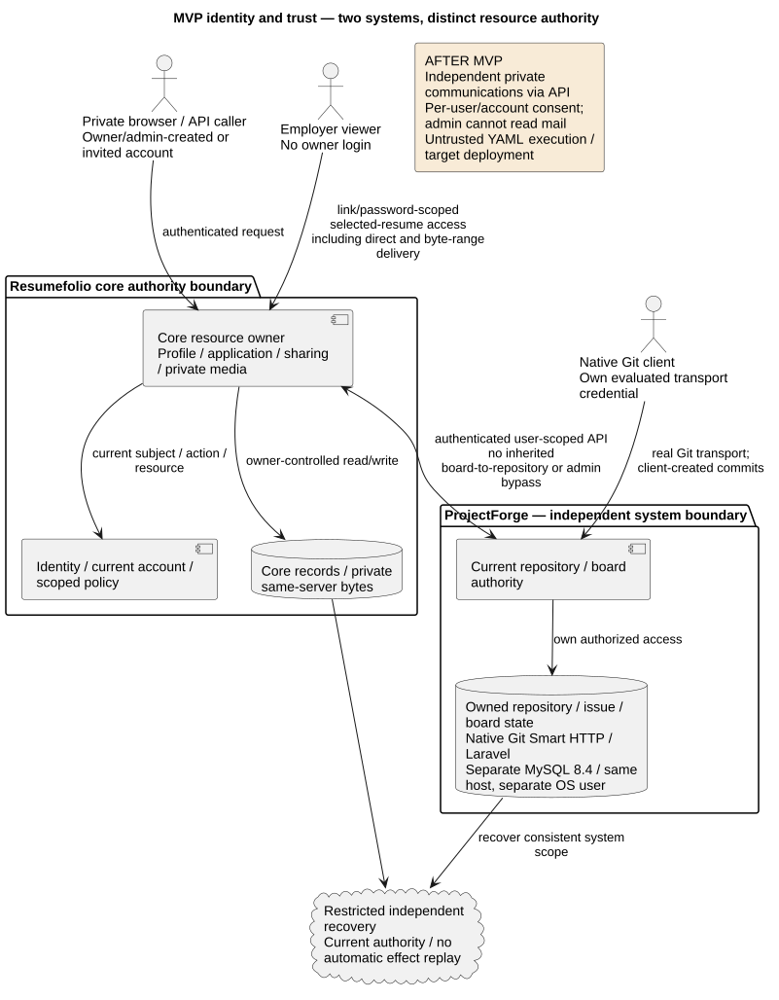
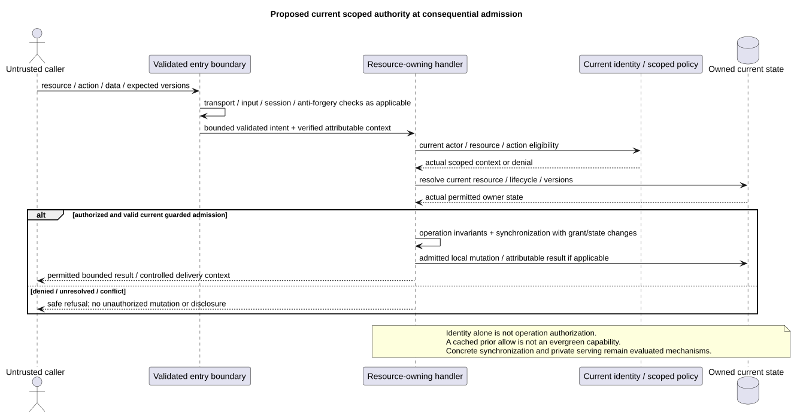

# Resumefolio — Security, Threat Modeling and Trust Boundaries

Current implementation choices and scope: [Baseline](../../../baseline/README.md). Runtime verification remains subject to its gates.

**Purpose:** refine analysis threats into explicit assets, trust crossings, control responsibilities, residual risks and planned verification for the proposed design.

**Status:** proposed bounded threat model, November 2, 2026. This is neither a complete attack inventory nor a penetration test, implemented control assessment, compliance certification or accepted security baseline. Concrete authentication, cryptographic, serving and containment mechanisms require evaluation.

[Authority](#1-sources-assets-and-authority) · [Boundaries](#2-trust-boundaries-and-data-flows) · [Threats](#3-stride-informed-threat-register) · [Controls](#4-shared-control-design) · [Verification](#5-verification-incident-and-recovery-boundaries) · [Readiness](#6-open-decisions-and-maintenance)

## 1. Sources, assets and authority

Use [analysis security/quality/operations](../../03-system-analysis/06-interfaces-security-and-quality-analysis/13-security-quality-and-operational-analysis.md), [account requirements](../../02-requirements-engineering/03-requirements-specification/accounts-authentication-and-permissions.md), [QSR security/recovery requirements](../../02-requirements-engineering/03-requirements-specification/quality-security-and-recovery-requirements.md), [interface requirements](../../02-requirements-engineering/03-requirements-specification/external-interface-requirements.md) and [source decisions](../../02-requirements-engineering/07-change-and-baseline/open-questions-and-decisions.md). Analysis SQ-A/SQ-T locators and proposed detailed Q-D03–Q-D05/Q-D08/Q-D11/Q-D23 policies retain their source status.

**Protected assets:** private professional/application/correspondence/work data; exact publication/submission/history manifests; artifact bytes and Git objects/refs; account/session/link/provider/client credentials and recovery material; current grants/approval intent; restricted diagnostics; resource headroom; and consistent usable recovery points/keys.

**Authority is resource/action/state specific.** Unified sign-in, a board invitation, repository ownership, an administrative label, provider connection or resource association grants no universal capability. Unknown scope cannot become an allow. Employer password possession establishes a bounded viewing context, not verified employer identity.

**Administrative-policy reconciliation:** earlier source powers and later proposed restrictions must be reconciled at exact actor/resource/action scope. Do not silently replace accepted owner/admin powers with a newer “no routine private read” proposal, or infer a universal bypass. [Identity design](../03-component-and-module-design/components/identity-and-access.md) owns this unresolved policy boundary and the current-context contract.

## 2. Trust boundaries and data flows

[Editable PlantUML](diagrams/security-trust-boundaries.puml) · [PNG](diagrams/security-trust-boundaries.png)

The figure is a logical security view, not a firewall rule set or proof of physical isolation. Module separation inside one application does not create an OS/process trust boundary.

| Boundary | Input/effect and enforcement owner |
| --- | --- |
| TB-01 Browser/employer to application | Untrusted requests, identifiers, content and cookies; transport/session/anti-forgery plus resource-owner authorization |
| TB-02 Application to private stores/serving | Scoped records, exact artifacts and native Git state; restricted adapters, current retrieval eligibility and reference integrity |
| TB-03 Application to providers/native Git clients | Distinct credential scopes, external identities, untrusted messages/repository content and uncertain effects; owning adapter/contract |
| TB-04 Coordinator to untrusted execution | Exact code/definition and bounded resources; evaluated filesystem/process/network/secret containment, scoped control/observations |
| TB-05 Trusted deployment control to target | Separate exact-artifact/target approval and narrow target authority; untrusted jobs cannot approve themselves or receive production secrets |
| TB-06 Operations to backup/recovery state | Restricted consistent records/bytes/refs/configuration/key recovery; isolation, current authority and external-state reconciliation before promotion |

Provider origin, TLS, authenticated callbacks and stored files do not make payload content safe to render or execute. Each adapter validates identity/provenance and expected schema, and each consumer preserves its own authorization/invariants. Detailed responsibilities remain with [component owners](../03-component-and-module-design/README.md).

## 3. STRIDE-informed threat register

Use STRIDE as a review lens: **S** spoofing, **T** tampering, **R** repudiation, **I** information disclosure, **D** denial of service and **E** elevation of privilege. The official [OWASP Threat Modeling guidance](https://cheatsheetseries.owasp.org/cheatsheets/Threat_Modeling_Cheat_Sheet.html) informs the structured review. ST labels below are local design locators, not primary requirements, observed vulnerabilities or accepted risk scores. All controls are proposed and verification remains pending.

### ST-01 — Account/session impersonation (S/E; TB-01)

An attacker supplies another actor identity, replays a stale session or abuses recovery. **Control/owner:** Identity resolves current server-verified eligibility, evaluated credential/session/factor/recovery lifecycle and resource scope; resource owners ignore client role/owner claims. **Residual/evidence:** exact mechanisms and Q-D03–Q-D05 rules remain unresolved; check cross-user context, fixation/replay, logout/reset/suspension and safe recovery without bypass.

### ST-02 — Object or administrative authority substitution (T/I/E; TB-01/02)

A signed-in actor guesses another resource or invokes an undocumented admin path. **Control/owner:** current actor/resource/action matrix at every protected owner operation, safe private lookups and consistent direct/background paths. **Residual/evidence:** reconcile administrative source powers and admission races; exercise permitted/denied owner/admin/collaborator operations without assuming a global role bypass.

### ST-03 — Stale viewer or cached private delivery (S/I/E; TB-01/02)

A revoked link/context or raw cache/static/range endpoint leaks selected or unrelated bytes. **Control/owner:** Sharing/Identity current generation, exact publication/language/mode and protected serving admission; Files never grants access from byte existence. **Residual/evidence:** actual cache/serving/invalidation protocol pending; test rotation/disable/revocation races and later requests. Already emitted/downloaded bytes remain outside recall.

### ST-04 — Unsafe content and file/path manipulation (T/I/E; TB-01/02/03)

Uploads, rich text, provider messages or repository paths inject active content, overwrite storage or trigger unsafe processing. **Control/owner:** Files and consuming owners validate admitted content/size, canonical private identity and safe contextual display/processing; Git uses evaluated native path/ref handling. **Residual/evidence:** formats/renderer/parser/adapter choices pending; test misleading types, active previews, traversal, symlink/argument edge cases and safe error output in controlled fixtures.

### ST-05 — Unintended network access or secret exfiltration (I/E; TB-03/04)

A submitted URL, repository dependency or workflow contacts internal/admin services or leaks credentials. **Control/owner:** no arbitrary preview fetch by default; evaluate outbound destinations/redirect/DNS handling where fetching is required; executor enforces reviewed network/credential scope. **Residual/evidence:** no network control is demonstrated here; verify actual denial paths and secret isolation, not only URL text validation or log redaction.

### ST-06 — Stale/tampered intent, duplicate effect or false completion (T/R; TB-01/03/05)

Changed payloads reuse command identity, obsolete revisions are applied, or timeout is mislabeled as rollback. **Control/owner:** version/intent guards, exact code/material/target bindings and durable attempt observations; safe current-authority result lookup. **Residual/evidence:** SQL and remote effects are not atomic; test lost acknowledgments, duplicate callbacks and same-attempt reconciliation without blind resend/relaunch/redeploy.

### ST-07 — Workflow escape or self-approved deployment (T/I/E; TB-04/05)

**Release applicability:** future-domain design retained after MVP; core operating/deployment and recovery controls still apply to MVP where relevant.

Untrusted code reaches host data/admin interfaces, another job or target credentials. **Control/owner:** Workflow requires demonstrated containment/resource/secret/cleanup gates; separate trusted target adapter and exact current approval. **Residual/evidence:** actual safe execution feasibility is unresolved. A container label, schema validation or local module boundary is insufficient. No real execution or target stage is enabled by this design.

### ST-08 — Resource exhaustion and cleanup/accounting races (D/T; TB-01–04)

Concurrent uploads, rendering, Git growth, abusive authentication or logs exhaust shared resources or bypass quota. **Control/owner:** Files/owners atomically reserve bounded growth and enforce reviewed rate/resource policy; workers report actual residual usage/cleanup. **Residual/evidence:** numeric limits and capacity fit pending; verify concurrent admission, output/temp growth, overload and false reclamation without unsafe live stress.

### ST-09 — Credential/key exposure or unusable recovery (S/I/E; TB-02–06)

Logs, backups, repositories or jobs disclose passwords/tokens/keys; missing keys prevent restore. **Control/owner:** restricted secret/verifier handling, scoped credentials, recoverable key separation and rotation/revocation procedures. **Residual/evidence:** exact key storage/recovery not selected; verify authorized retrieval, accidental disclosure paths and isolated key usability without placing real secrets in evidence.

### ST-10 — Evidence tampering or misleading attribution (R/T/I; TB-02/06)

An actor edits diagnostics, injects log content or claims employer identity/receipt from weak evidence. **Control/owner:** bounded attributable operation/resource/version/result records with controlled access/changes and safe display. **Residual/evidence:** audit retention/immutability policy pending; test provenance and integrity while avoiding raw content/credential capture. Ordinary logs alone do not provide cryptographic non-repudiation.

### ST-11 — Restored revoked authority or destructive historical loss (T/I/E; TB-02/06)

Old grants/pending work are restored, protected references are deleted, or queued effects replay. **Control/owner:** isolated recovery, current authority/deletion reconciliation, manifest/reference/byte validation and disabled outbound dispatch until reviewed resumption. **Residual/evidence:** backups are not set up; consistent restore and reference/deletion synchronization remain unverified. Test missing bytes/keys and safe restored access before readiness claims.

### ST-12 — Compromised dependency, configuration or callback (S/T/E; TB-01–05)

An unsafe library/configuration or forged worker/provider observation crosses trust scope. **Control/owner:** evaluate actual dependency versions/provenance, restricted runtime configuration and authenticated scoped callback/adapter identity; guard attempts/generations and reject stale/foreign observations. **Residual/evidence:** installed facility assessment and update/rollback process pending; test actual config/identity checks rather than assuming default framework protection.

This register covers selected threats across all six STRIDE categories. It does not prove every flow/category combination was analyzed, assign residual risk acceptance or supersede existing project risks. Reconcile exact analysis SQ-T/source criteria during implementation review.

## 4. Shared control design

### Current authorization and state-change admission

[Editable PlantUML](diagrams/security-current-authority-sequence.puml) · [PNG](diagrams/security-current-authority-sequence.png)

Identity supplies verified current context; the resource owner evaluates operation/lifecycle invariants and synchronizes admission with relevant grant/account/version changes. Missing authority denies safely. Cached positive decisions, serialized worker sessions and client-supplied ownership cannot become evergreen capabilities. Protect state-changing cookie-authenticated requests through evaluated session/anti-forgery controls; same-origin deployment alone is insufficient.

The official [OWASP Authorization guidance](https://cheatsheetseries.owasp.org/cheatsheets/Authorization_Cheat_Sheet.html) informs default denial, per-request checks and protected static-resource paths. Follow [Identity](../03-component-and-module-design/components/identity-and-access.md), [Sharing](../03-component-and-module-design/components/representation-and-sharing.md) and [API contracts](../05-interface-and-api-design/01-api-protocols-contracts-and-compatibility.md) for exact owner responsibilities; this file selects no new role matrix or session duration.

### Content, paths and private serving

Use evaluated input schemas, parameterized data access, canonical storage/repository identities and safe subprocess/native adapter arguments. Treat display/processing safety separately from admission. A file extension or declared MIME type alone is not sufficient validation, and sanitized display cannot authorize access. Keep private bytes outside uncontrolled public delivery and prevent arbitrary path resolution.

The official [OWASP File Upload guidance](https://cheatsheetseries.owasp.org/cheatsheets/File_Upload_Cheat_Sheet.html) supports layered validation and restricted storage/processing. Exact formats, size bounds, active-content handling, renderer/scanner facilities and resource costs remain reviewed policy/selection work. See [Files](../03-component-and-module-design/components/files-and-operations.md); no scanner is claimed installed and no arbitrary remote-fetch/preview service is added.

### Secrets and recovery keys

Use an evaluated supported password-verification facility for authentication passwords and link verifiers; retrievable provider/target credentials need a distinct protected storage and access lifecycle. Do not substitute reversible password storage or hashing of a credential that must actually be presented to its provider. Exact algorithms/parameters/libraries require current compatibility evaluation before selection.

Scope credential use to the actual actor/resource/attempt, restrict operators/adapters and exclude broad production/application secrets from untrusted jobs. Define provisioning, rotation/revocation, key versioning, incident handling and independent recoverable key access. Avoid placing unrestricted decryption keys alongside the entire exposed data set; separation must not make legitimate recovery impossible. Backing up ciphertext without usable authorized key recovery is not sufficient.

The official [OWASP Secrets Management guidance](https://cheatsheetseries.owasp.org/cheatsheets/Secrets_Management_Cheat_Sheet.html) informs credential lifecycle evaluation. No vault, encryption product, key location or token lifetime is selected. Sources in this document were reviewed November 2, 2026; implementation compatibility and control effectiveness remain unverified.

### Restricted diagnostics and secure change

Record bounded actor/context, operation/attempt, target/revision, policy provenance and actual outcome. Exclude passwords, raw session/link/reset tokens, provider credentials, private correspondence and arbitrary payload dumps. Evaluate URL/query/referrer/error/log paths where secrets may escape. Protect evidence access/change and avoid treating truncation/redaction as proof of no exposure.

Review dependency/configuration changes with affected consumers, migrations and recovery consequences. Use [design evolution](../02-detailed-and-object-oriented-design/05-design-evolution-refactoring-and-technical-debt.md) and actual version/configuration evidence. TLS and transport protections, headers, cookie settings, process credentials and network access need actual deployed evaluation, not copied defaults from this draft.

## 5. Verification, incident and recovery boundaries

Use synthetic private data, controlled credentials and authorized isolated test targets. Verify denied paths and unchanged protected state as well as allowed behavior. Expected test families are: cross-owner/admin scope; session/link/grant lifecycle and races; private serving/cache/range paths; content/path/argument safety; secret disclosure and key recovery; concurrent bounded admission; authenticated callback/worker generation; execution containment; and restored authority/external effects.

Each result records threat/source criterion, exact candidate/environment/control configuration, actor/grants/versions, stimulus and expected/actual effect, retained sanitized evidence, residual gap and disposition. Unit mocks cannot establish real serving privacy, process isolation, network denial or key recovery. No penetration/escape/stress test or live security mutation is performed by this documentation update.

For an actual incident, identify affected assets/scope and current effects, restrict further exposure through authorized owners, preserve bounded evidence and coordinate credential revocation/rotation and recovery. Deleting a log does not make an exposed credential safe; rollback cannot recall disclosed bytes. Concrete incident authority, escalation and operating steps remain [Operations](03-operations-backup-recovery-and-resilience.md), not new privileges introduced here.

Findings feed [quality trade-offs](01-quality-attributes-and-design-trade-offs.md), [review/handoff](05-design-review-traceability-and-handoff.md) and existing risk/decision authority. Security/correctness failures cannot be averaged away by acceptable latency/error percentages.

## 6. Open decisions and maintenance

Reconcile the exact administrative matrix and detailed authentication/link/factor/recovery policies; choose/evaluate actual session/CSRF/credential/key/serving/content/network facilities; specify authority/reference/attempt synchronization; establish real execution containment and safe target separation; configure consistent backup/key recovery and demonstrate isolated restoration. Record justified risk prioritization/residual acceptance through actual review instead of inventing numeric scores here.

Revisit this bounded model when actors, entry paths, grants, stores, provider scopes, rendering/processing, executor/targets or recovery procedures change. Update the affected flow, threat record, control owner, residual assumption and verification evidence together. Source permissions and accepted publication/history behavior cannot be weakened silently by a mitigation.

Advisor consultation was unavailable because its required shell launcher was absent; no independent endorsement is claimed. FAU's quality/security cross-cutting and component-refinement concerns support this organization; STRIDE and the local register are project review tools, not a university certification. See the [reference map](../01-reference-and-coverage-map.md).

[Quality and Security home](README.md) · [Cross-cutting overview](../01-software-architecture/05-cross-cutting-concerns-overview.md) · [Diagram catalog](diagrams/README.md)
