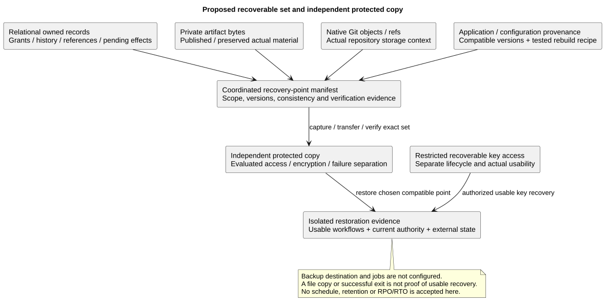
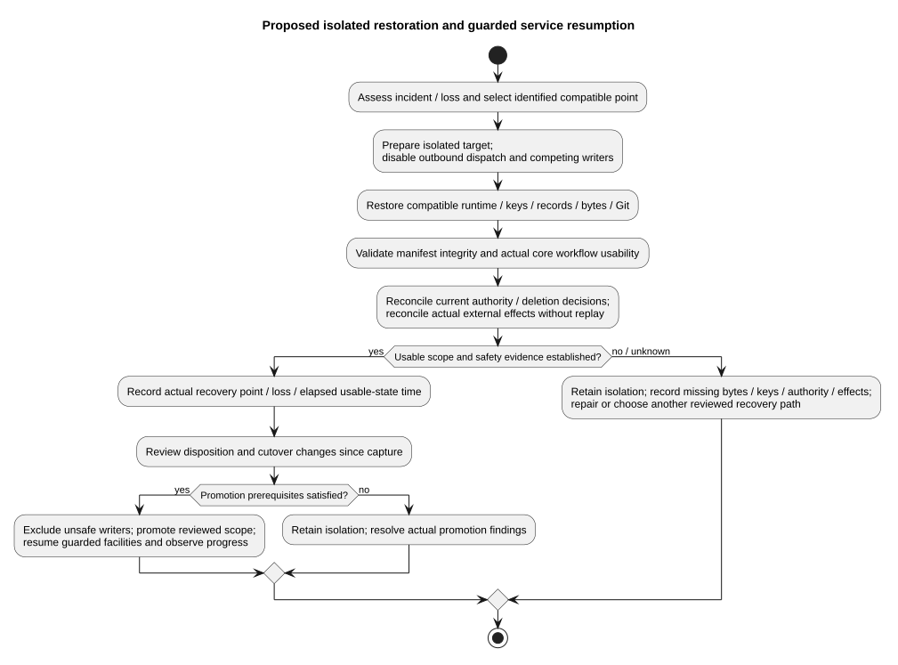

# Resumefolio — Operations, Backup, Recovery and Resilience

Current implementation choices and scope: [Baseline](../../../baseline/README.md). Runtime verification remains subject to its gates.

**Purpose:** define the operating responsibilities, recoverable state, controlled procedures and evidence required to keep the proposed product usable and recover it safely.

**Status:** proposed operating design, November 2, 2026. Backups are not set up. No supervisor, scheduler, alert, backup destination, recovery target or redundant facility is configured by this document. Procedures below require evaluated platform-specific runbooks before execution.

[Authority](#1-authority-current-inputs-and-ownership) · [Operation](#2-normal-operation-and-observation) · [Backup](#3-backup-set-consistency-and-protection) · [Recovery](#4-isolated-recovery-procedure) · [Release](#5-deployment-and-change-recovery) · [Resilience](#6-degradation-incidents-and-resilience) · [Readiness](#7-verification-and-operating-handoff)

## 1. Authority, current inputs and ownership

Use [QSR-D04/D10–D14 and Q-D26](../../02-requirements-engineering/03-requirements-specification/quality-security-and-recovery-requirements.md#resolution-q-d26), [quantitative target contracts](../../02-requirements-engineering/03-requirements-specification/quality-security-and-recovery-requirements.md#target-decision-contracts), [AFO-D09–D12](../../02-requirements-engineering/03-requirements-specification/administration-files-and-operational-behavior.md), [business lifecycle/recovery rules](../../02-requirements-engineering/03-requirements-specification/business-rules-and-data-lifecycle.md) and [analysis operating view](../../03-system-analysis/06-interfaces-security-and-quality-analysis/13-security-quality-and-operational-analysis.md). Source policy and owner disposition remain authoritative.

Farhad is the sole delivery/operations owner; all operating work fits the total 20 project hours/week. The November 1 demo reported 2 vCPU/4 GB/40 GB with Nginx/PHP/MySQL and an existing Laravel application. The limited inspected paths showed log-only mail declaration and did not establish running workers/scheduler. These dated observations are not a complete service inventory or current working-facility proof.

The owner explicitly confirmed application backups have not been set up. Q-D26's proposed daily schedule, seven-daily/four-weekly retention and recovery objectives remain proposals, not accepted targets or demonstrated capability. No paid service, host or account change is authorized through design prose.

This document owns shared operating procedures. [Files/Operations](../03-component-and-module-design/components/files-and-operations.md) owns storage/accounting/reference evidence; other components own their data/effect meaning; [deployment topology](../01-software-architecture/04-deployment-topology-nodes-and-networks.md) owns proposed placement/access zones; [security](02-security-threat-modeling-and-trust-boundaries.md) owns shared threat/control expectations. An operator title does not create a universal private-data bypass.

## 2. Normal operation and observation

### Service responsibility

Maintain a version-specific inventory of actual web ingress/PHP application, relational store, private artifact/native Git storage, queue workers, scheduler, outbound provider/mail capability and any evaluated executor/target adapter. Record owner, configuration/version, scoped runtime identity, required dependencies, start/stop/reload, safe restart conditions and diagnostics. Select supervision tools only after platform evaluation; do not infer they exist from a diagram.

Supervise required long-lived processes and verify progress, not just process presence. Scheduler configuration must establish intended job delivery and overlap/duplicate protection; multiple active schedulers cannot silently trigger duplicate effects. Workers reconstruct current authority and exact attempt inputs after restart. A queue retry or process restart never proves an uncertain send/job/deployment had no effect.

### Health and evidence

| Subject | Useful observation and interpretation |
| --- | --- |
| Web/core workflows | Reachability plus representative permitted owner/shared paths; login-page 200 alone is insufficient |
| Worker/scheduler progress | Actual heartbeat/progress, queue age, stuck/failed/unknown attempts and overlap; an empty queue may simply mean no jobs were scheduled |
| Storage/resources | CPU/memory/disk/inodes, private/Git/temp growth, active reservations and confirmed reclamation; free space alone is not safe concurrent headroom |
| Provider/mail | Actual connection/capability and attributable operation result; log output is not delivery, provider acceptance is not recipient receipt |
| Backup/recovery | Last identified consistent protected point, job failures/missing points and last usable restore evidence; file existence is not recovery proof |
| Security/configuration | Certificate expiry, restricted ingress/admin access, secret/key usability and actual configuration drift without logging secret values |

Define thresholds, observation intervals, retained evidence and actionable alert routing through reviewed target/operating decisions. No numerical default or alert recipient/channel is selected here. Any future notification must have tested delivery and actual handling responsibility; this update sends none. Bound log growth and restrict diagnostic access, avoiding raw correspondence, credentials or private payload dumps.

## 3. Backup set, consistency and protection

[Editable PlantUML](diagrams/operations-recovery-coverage.puml) · [PNG](diagrams/operations-recovery-coverage.png)

### Coverage manifest

Each recovery point needs an attributable identity, capture scope/time window, application/schema/configuration versions, component/store coverage, consistency method, protected-copy location, verification result and required key/rebuild references. Keep sensitive key values out of the ordinary manifest.

- **Relational state:** identities/grants, owned business records, revision/history manifests, protected references/accounting and pending command/attempt observations.
- **Private bytes:** admitted uploads, generated/published evidence and actual preserved materials, including all objects required by retained manifests.
- **Native repositories:** required Git objects/refs and relevant server policy/storage associations; coordinate capture with active native operations.
- **Executable/configuration provenance:** exact application/dependency/schema/configuration identity and a tested compatible rebuild recipe where reconstruction is intended.
- **Recovery keys/access:** separately recoverable, protected key/credential access sufficient for legitimate restoration, with restricted operator lifecycle and tested usability.
- **Operating evidence:** bounded necessary recovery/incident provenance under actual retention policy. Ephemeral caches/workspaces are rebuildable or safely discarded only when no unique required state/effect evidence is hidden there.

### Consistent capture and independent protection

Select an evaluated business-consistent capture method: controlled write quiescence, engine-supported consistent capture plus coordinated artifact/ref protection, or another demonstrated recovery-point protocol. Specify which writers/native refs are paused or protected, how in-flight mutations are accounted for and when normal service resumes. Unrelated database and directory copies do not establish one recoverable point.

Store protected copies outside the applicable primary failure domain, with evaluated encryption/access controls and recovery-key separation. Another directory on the same disk cannot recover that disk's loss. Evaluate resistance to compromised application/operator credentials, destructive synchronization and backup deletion; immutability/offline or equivalent separation needs actual facility evidence, not a product label.

The official [CISA StopRansomware guide](https://www.cisa.gov/sites/default/files/2023-10/StopRansomware-Guide-508C-v3_1.pdf), reviewed November 2, 2026, supports protected offline/encrypted copies and regular restoration/integrity checks. It informs the design without selecting a destination, copy count, product or paid service for this project.

### Backup job outcome and retention

Record actual started/completed/failed/partial/unknown capture, transfer and verification outcomes. Verify the intended manifest/store set and usable protected-copy/key access, not just command exit or transferred bytes. A failed point cannot replace the last valid one. Lost acknowledgments need reconciliation of the same point before deletion or a success claim.

Apply only reviewed retention rules to identified successful recovery points. Coordinate pruning, dependent incremental/base chains where used and key retention; never prune a required base/key or historical material merely because its filename is old. Backup retention and source-authorized business deletion require explicit reconciliation; restoring old copies cannot silently undo current deletion/revocation decisions. Actual schedule, destination, rotation, failure handling and capacity remain implementation gates.

## 4. Isolated recovery procedure

[Editable PlantUML](diagrams/operations-isolated-restore-route.puml) · [PNG](diagrams/operations-isolated-restore-route.png)

1. **Assess and select.** Identify incident/loss scope, intended usable service, chosen compatible recovery point and known newer state/effects. For compromise, preserve appropriate evidence and prevent continued unauthorized access; restoring into the same unresolved compromise is not recovery.
2. **Prepare isolation.** Use an authorized target with controlled ingress/egress. Disable scheduler/worker dispatch, provider sends, execution and deployment callbacks/triggers until reconciliation. Do not restore directly over the live source as an exploratory step.
3. **Restore the compatible set.** Rebuild evaluated runtime/configuration, recover required keys through restricted access, then restore the coordinated relational/artifact/Git set in its tested dependency order. Exact commands depend on selected facilities and belong in the versioned runbook.
4. **Validate integrity/usability.** Verify schema/version, manifest references, actual bytes/native refs, protected materials, accounting and key usability. Exercise permitted owner/edit/shared/history/repository paths with controlled data; separate absent/unusable objects from successful records.
5. **Reconcile current authority.** Use trusted current revocation/deletion/credential evidence and source policy. Old account/grant/link/session rows cannot automatically become effective access. If current authority cannot be established, retain restricted isolation and report the unresolved scope rather than guess permission.
6. **Reconcile external effects.** Compare restored pending/unknown sends, calendar writes, Git/executor/target attempts with actual external observations. Prevent blind replay or incompatible new effects. Restored SQL is not proof of remote rollback or process termination.
7. **Measure and review.** Record actual recovered business-consistent point/loss and elapsed time to explicitly defined usable workflows, including authority/external-state checks. Compare with actually agreed RPO/RTO contracts; report gaps and degraded scope honestly.
8. **Promote deliberately.** Obtain actual scoped disposition, handle changes made since capture/cutover and exclude unsafe competing writers. Re-enable required web/background/provider facilities in a guarded sequence and observe real progress. Preserve a defined fallback/forward-repair path and recovery evidence.

Recovery-point age is not automatically actual lost information; measure against known recoverable business state. A directory checksum alone does not prove user workflows or credentials are usable. Rehearse after material schema/storage/key/protocol changes and at the reviewed cadence. None of these steps has been executed by this documentation update.

## 5. Deployment and change recovery

Before promotion, identify exact candidate/dependencies/configuration and schema compatibility, current backup/recovery readiness, required migrations/backfill, worker/job payload compatibility, protected serving and operating checks. Define safe treatment of in-flight effects and maintenance/read/write boundaries; a process restart cannot erase unknown attempts.

Execute the reviewed release/migration procedure, record actual effects and test core permitted/denied paths plus worker/scheduler progress. Stop promotion on critical failure and preserve known target/data state. Rollback is valid only for a proven compatible reversal; an older application binary cannot undo a lossy migration, deleted bytes or remote deployment effects. Forward repair or isolated restoration may be necessary under the reviewed plan.

Product deployment targets have separate approval/authority from operating this application. Follow [Workflow/Deployment](../03-component-and-module-design/components/workflow-and-deployment.md) for exact target/artifact/recovery intent; ordinary maintenance does not grant untrusted jobs production secrets or self-approval.

## 6. Degradation, incidents and resilience

### Operation-specific response

- **Provider outage:** preserve local permitted workflows where possible, show actual capability/pending/unknown state, and reconcile before consequential repetition.
- **Queue/worker failure:** inspect real progress/effects, stop unsafe admissions and resume bounded work only after attempt/authority reconciliation; no blanket retry-all procedure.
- **Storage pressure:** enforce bounded reservations/admission, protect history/references and inspect actual temp/Git/output usage. Cleanup requires safe exclusion and confirmed reclamation, not deletion of arbitrary large files.
- **Security/secret exposure:** restrict further use through actual authority, preserve bounded evidence, revoke/rotate affected credentials and assess exposed data. Deleting logs or rolling back code cannot recall disclosed secrets.
- **Host/data loss:** use the isolated procedure and report actual recovery limits. No automatic failover is assumed.

Use bounded retries/backoff or circuit-breaking only for operations whose repetition/effect semantics support them. Reduced load does not establish remote no-effect. Define recovery from a breaker/degraded state and avoid masking a persistent failed dependency with a misleading green health check.

### Availability versus HA/DR

The proposed trusted single-environment start has a shared failure/resource domain. Supervision can restart processes; backups support defined recovery; neither creates redundant live capacity. HA/failover would require evaluated secondary capacity, data consistency, writer fencing, key/configuration access, routing and cost/operating evidence. Do not present a standby diagram or provider feature as an installed facility.

When capacity/recovery requirements exceed feasible resources or solo operating time, document the conflict and options through existing scope/resource/target decisions. Missing facilities do not authorize new spending or silent removal of accepted capability.

## 7. Verification and operating handoff

Each actual runbook needs owner/authority, exact versions/targets, prerequisites, restricted credentials/key access, ordered commands, progress/success/failure observations, abort/unknown-effect handling, safe resume/repair and sanitized evidence location. Keep secrets out of repository examples and instructions.

Planned checks include actual process/scheduler progress and duplicate prevention; log-only versus real delivery; concurrent resource pressure; complete consistent backup/copy verification; failed-point/retention safety; isolated restore with missing bytes/keys; current authority reconciliation; remote effects without replay; and schema/worker/deployment compatibility with forward/rollback limits.

Retain candidate/configuration, recovery-point manifest, actual observations, measured loss/time, unresolved findings and disposition with [review evidence](review-and-traceability) and [handoff](05-design-review-traceability-and-handoff.md). Documentation/render checks do not establish operating readiness. No live backup, restore, deletion, process change, notification, deployment or disaster-recovery test is performed here.

**Remaining gates:** actual service inventory/supervision/scheduler/delivery selection and configuration; reviewed alerts/thresholds; independent protected backup/key destination; consistent capture/retention jobs; safe isolated restore with current authority and external effects; agreed targets and measured evidence. The design is populated; application recovery remains an unfulfilled prerequisite.

FAU's deployment/operating and quality-refinement concerns inform these responsibilities; the procedures and folder layout are project adaptations. See the [reference map](../01-reference-and-coverage-map.md).

[Quality and Security home](README.md) · [Persistence/lifecycle](../04-data-design/03-persistence-caching-and-data-lifecycle.md) · [Security model](02-security-threat-modeling-and-trust-boundaries.md) · [Diagram catalog](diagrams/README.md)
