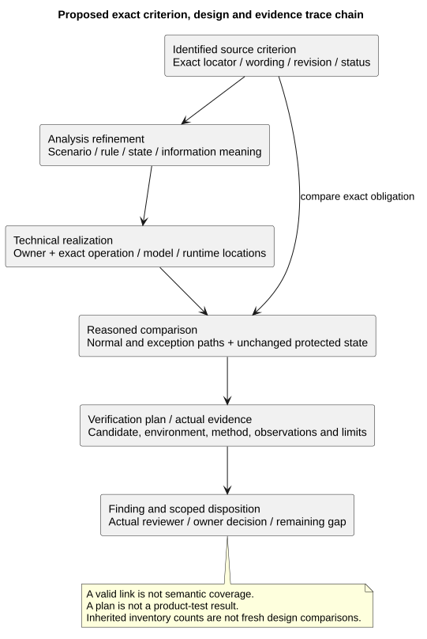
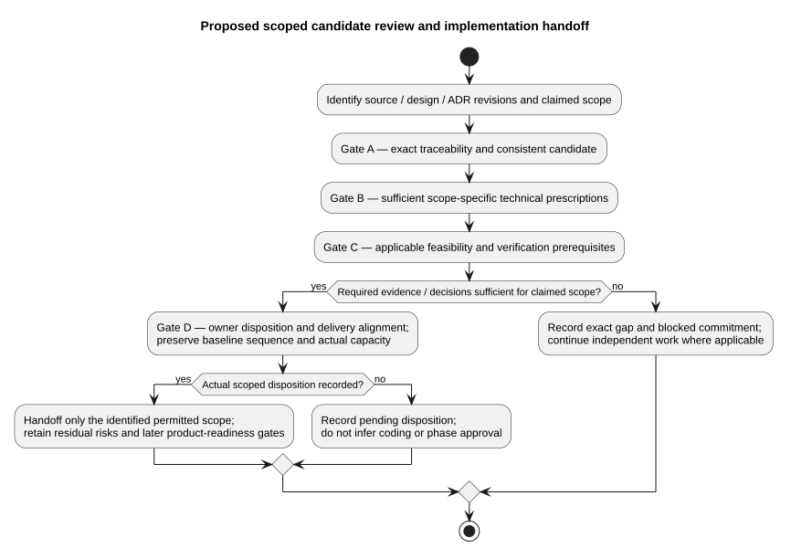

# Resumefolio — Design Review, Traceability and Implementation Handoff

Current implementation choices and scope: [Baseline](../../../baseline/README.md). Runtime verification remains subject to its gates.

**Purpose:** define how an identified design candidate is traced, inspected, evaluated and handed over without confusing populated documentation with semantic sufficiency or implementation readiness.

**Status:** populated review procedure and candidate-position summary, November 2, 2026. This update is not a completed exact-criterion review, owner disposition, accepted design baseline, product verification or release approval.

[Authority](#1-source-authority-and-current-position) · [Traceability](#2-exact-trace-record-and-coverage) · [Review](#3-cross-view-review-and-walkthroughs) · [Verification](#4-testability-and-evidence) · [Findings](#5-findings-and-disposition) · [Handoff](#6-completion-gates-and-implementation-handoff) · [Maintenance](#7-review-package-and-maintenance)

## 1. Source authority and current position

Use the [requirements traceability record](../../02-requirements-engineering/06-validation-and-traceability/requirements-traceability.md), [source inventory](../../02-requirements-engineering/06-validation-and-traceability/evidence/traceability-source-inventory.json), [criterion locators](../../02-requirements-engineering/06-validation-and-traceability/evidence/proposed-criterion-locators.json), [analysis review](../../03-system-analysis/07-review-and-design-handoff/11-model-consistency-traceability-and-review.md), [analysis handoff](../../03-system-analysis/07-review-and-design-handoff/14-feasibility-dependencies-and-design-handoff.md) and [source decisions](../../02-requirements-engineering/07-change-and-baseline/open-questions-and-decisions.md). Preserve source identity, wording, revision and acceptance status.

The existing inventories describe 157 provisional requirement identities and 470 criterion locators. Those are inherited inventory counts, not newly verified design-coverage totals. The identified analysis review reports 39 bounded current comparisons and explicitly limits the remaining comparisons; that historical scope does not become a fresh design review through linking.

The proposed design direction is modular trusted application ownership, coherent local mutations, independent publication/history and durable external attempts. [ADRs](../07-design-decisions/README.md) retain their own proposed/accepted status. Populated component/data/interface/quality documents do not close exact criterion gaps or unresolved physical/compatibility/evidence gates.

Farhad retains owner decision authority. The accepted profile-update/publication/history core is settled and must not be reopened merely to obtain a review sign-off. Detailed proposed policies, numerical targets and dependent facilities retain source status. Independent design work can continue while a prerequisite blocks its affected commitment.

## 2. Exact trace record and coverage

[Editable PlantUML](diagrams/review-trace-chain.puml) · [PNG](diagrams/review-trace-chain.png)

Maintain one attributable comparison record per exact source criterion/obligation being assessed, with links to multiple realizations where needed. A source requirement often has several criteria and one design element can serve several criteria; neither relationship implies automatic coverage.

Required trace fields:

- **Source:** inventory/requirement/criterion locator, exact document/section and identified revision/hash; source policy/acceptance status.
- **Meaning:** bounded obligation/conditions and the analysis scenario, rule, state or information element that refines it.
- **Realization:** owner, exact operation/data/runtime/interface/deployment locations and relevant ADR status, with rationale explaining how the obligation is preserved.
- **Paths and protected state:** applicable normal, denied, invalid, failure, partial, uncertain, concurrent and recovery cases; unrelated state that must remain unchanged.
- **Verification:** planned method, required environment/fixtures/authority and expected observable result; actual evidence only when performed.
- **Assessment:** specific finding, unresolved prerequisite/affected commitment, reviewer/date and scoped disposition.

Use descriptive assessment states such as **reference indexed**, **exact comparison performed**, **gap identified**, **dependent evidence pending**, and **scoped disposition recorded**. These are project review labels, not replacements for source acceptance or product-test results. Do not mark a row complete simply because every cell contains a link.

Report separate denominators for indexed candidates, indexed criteria, exact comparisons, unresolved semantic gaps, policy-dependent comparisons and actual verified results. Explain excluded/not-applicable cases with rationale. Preserve the primary inventories rather than silently allocating new FR/NFR IDs or editing criterion wording to fit a design.

## 3. Cross-view review and walkthroughs

### Consistency checks

Check source scope/constraints against [architecture](../01-software-architecture/README.md), complete [component packages](../03-component-and-module-design/README.md), [data](../04-data-design/README.md), [interfaces](../05-interface-and-api-design/README.md) and shared quality/security/operations records. Verify:

- One authoritative owner for each invariant, record family and provided/required contract; consumers do not mutate another owner's internals.
- Current authority, expected versions and operation identity agree across entry paths, handlers, jobs, native clients and callbacks.
- Revision/language/time/identifier meanings and local/remote outcomes agree across scenarios, models, manifests and API feedback.
- Transaction/reference/dispatch boundaries are explicit and do not imply atomic SQL/provider/Git/executor/target rollback.
- Implementation artifacts, placement/access zones and operating facilities match proposed—not falsely observed—capabilities.
- Significant decisions retain status/rationale, source policy is preserved and alternatives/trade-offs identify real costs.

### Required focused walkthroughs

| Walkthrough | Preservation and failure questions |
| --- | --- |
| Private reference and protected retrieval | Wrong-owner/direct/cache/range paths, stale viewer/grant state, unavailable variant and admission ordering |
| Source apply and publication | Exact comparison versions, selected changes, overrides, separate confirmation and unchanged other resumes/history |
| Actual submitted-material capture | Exact actual material/completeness, protection before consumer commit and uncertain acknowledgment |
| Quota/replacement/reclamation | Concurrent reservations, failed replacement, protected references racing deletion and actual residual accounting |
| Provider operations | Current capability, local/provider authority, acceptance versus receipt, unknown effects and no blind resend |
| Work and collaboration | Effective membership, no inherited repository access, coherent Sprint Backlog, incomplete work and independent goal/acceptance outcomes |
| Native Git review/merge | Actual client/ref authority, exact reviewed revisions, stale conflicts and native effect versus metadata reconciliation |
| Execution and deployment | Real enabling evidence, bounded secrets/resources, cancel/complete/loss/cleanup and separately approved exact target intent |
| Isolated recovery | Consistent records/bytes/refs/keys, current revocation/deletion, actual external state and no automatic replay |

Use existing [interaction realizations](../05-interface-and-api-design/03-use-case-realizations-and-interactions.md), [quality scenarios](01-quality-attributes-and-design-trade-offs.md), [threat register](02-security-threat-modeling-and-trust-boundaries.md), [recovery procedure](03-operations-backup-recovery-and-resilience.md) and [UI guidance](04-user-interface-accessibility-and-interaction-quality.md). They supply design inputs, not evidence that the walkthrough was performed.

## 4. Testability and evidence

For each assessed criterion, identify how the implementation can expose the required result without leaking secrets or adding a production bypass. Define fixtures, initial state, current grants, exact versions, permitted effects, expected result and unchanged protected state. Include timing/ordering evidence when a race or revocation guarantee is central.

### Verification layers

- **Document inspection:** source status, exact meaning, ownership, path completeness, cross-view consistency and significant assumptions.
- **Domain/handler checks:** deterministic invariants and result semantics with controlled clocks/adapters; substitutes must preserve unknown/partial/failure cases.
- **Persistence/concurrency integration:** actual constraints, conditional updates, locking, command identity, quota and reference/deletion races.
- **Boundary interoperability/security:** actual protected serving, native Git, selected provider/worker/callback and evaluated executor/target behavior in authorized environments.
- **System/quality/recovery:** representative workloads, complete accessible journeys, actual backup/key consistency and isolated usable restoration against reviewed targets.

Mocks cannot establish real provider delivery, filesystem privacy, process isolation, engine semantics or recovery. A diagram render/link check is documentation evidence only. Planned tests remain planned; previous execution results retain their original candidate/environment and cannot be relabeled as current.

Store actual sanitized evidence under [Design Review Evidence](review-and-traceability/evidence/README.md). Identify candidate/commit/configuration/source revisions, reviewer/date, method, environment, observations/raw result, limitations and disposition. Keep secrets/private correspondence out. When evidence is unavailable, record the exact missing prerequisite and the commitment it blocks, not a fictional Pass.

## 5. Findings and disposition

Every actual finding records a stable local reference, exact location/source criterion, observed discrepancy, impact/affected commitment, evidence, owner, proposed resolution and actual disposition/status. Separate defect, design gap, unresolved policy, feasibility dependency, risk and debt; use [design evolution](../02-detailed-and-object-oriented-design/05-design-evolution-refactoring-and-technical-debt.md) for change/debt handling.

Severity/priority and risk acceptance require reasoned actual review. Do not invent numeric risk scores, approved priorities, owner decisions or dates. A blocker affects the stated commitment, not automatically every independent design task. Recheck a resolved finding against its revised candidate; retain original evidence and supersession history.

Record the reviewer and scope honestly. Root-owned documentary inspection is not independent stakeholder approval, penetration testing or formal ATAM. Advisor transport was previously unavailable because its required shell launcher was absent; no independent Advisor endorsement is claimed. A future consultation or review needs its own identified result.

## 6. Completion gates and implementation handoff

[Editable PlantUML](diagrams/review-handoff-gates.puml) · [PNG](diagrams/review-handoff-gates.png)

### Gate A — Identified, traceable candidate

Package exact source/design/ADR revisions, change scope and source acceptance. Demonstrate exact comparisons for the claimed coverage; list gaps rather than inheriting analysis counts as design completion. Required models/contracts must be mutually consistent for the intended implementation scope.

### Gate B — Sufficient technical prescriptions

Specify actual component responsibilities/types/signatures, data schema/constraints, interaction algorithms, authority/transaction/reference guards, physical/runtime choices and exception/recovery behavior needed for that scope. Illustrative diagrams and templates cannot substitute for missing implementation decisions. An unresolved mechanism that changes the promised behavior remains a gate.

### Gate C — Applicable feasibility and verification prerequisites

Record the precise status of provider setup/access, native Git engine/transport, real execution containment/resource fit, actual mail/worker/scheduler facilities, independent backup/key recovery, reviewed quality/client targets and representative capacity. Evidence is due at the gate governing the affected commitment; dependent readiness cannot be claimed from plans. OAuth-not-created and backups-not-configured remain setup facts until actual evidence changes them.

### Gate D — Scoped disposition and delivery alignment

Present findings/residual risks, actual verification plan/evidence and unresolved conditions for owner disposition of the identified candidate. Preserve the agreed pre-implementation baseline sequence; do not infer implementation authorization or whole-phase acceptance from populated documentation. Reconcile estimates, dependencies, backlog and live tracking with the actual 20 total project hours/week and accepted scope before a forecast/commitment.

Possible recorded dispositions are scoped acceptance, conditional disposition with explicit blocked commitments, rework or deferred decision—only when actually made. Product release/security/recovery readiness remains separately evidenced even if a design scope is accepted.

## 7. Review package and maintenance

A concrete handoff package includes candidate/source manifest, exact trace comparisons, architecture/component/data/interface records, ADR statuses, planned verification/environment requirements, actual sanitized review evidence/findings, dependency/resource decisions and the owner's actual scoped disposition. Do not create signed-off checklists with prefilled successful outcomes.

**Current position after this update:** the review procedure is populated; exact design criterion closure, final physical/compatibility prescriptions, applicable enabling evidence and owner baseline disposition remain pending. No new exact source comparisons, product tests, restoration, purchase, live tracking update or coding authorization is reported by this document alone.

When a source/design/contract changes, identify affected trace rows and consumers, preserve historical candidate evidence and reassess the changed obligations. Update owning documents and regenerated diagrams together; distinguish routine file/render validation from semantic review and product verification.

FAU's architecture-to-component refinement and review concerns inform this approach; local gate names, trace fields and evidence layout are project adaptations. See the [reference map](../01-reference-and-coverage-map.md).

[Quality and Security home](README.md) · [System Design home](../README.md) · [Evidence guidance](review-and-traceability/evidence/README.md) · [Diagram catalog](diagrams/README.md)
