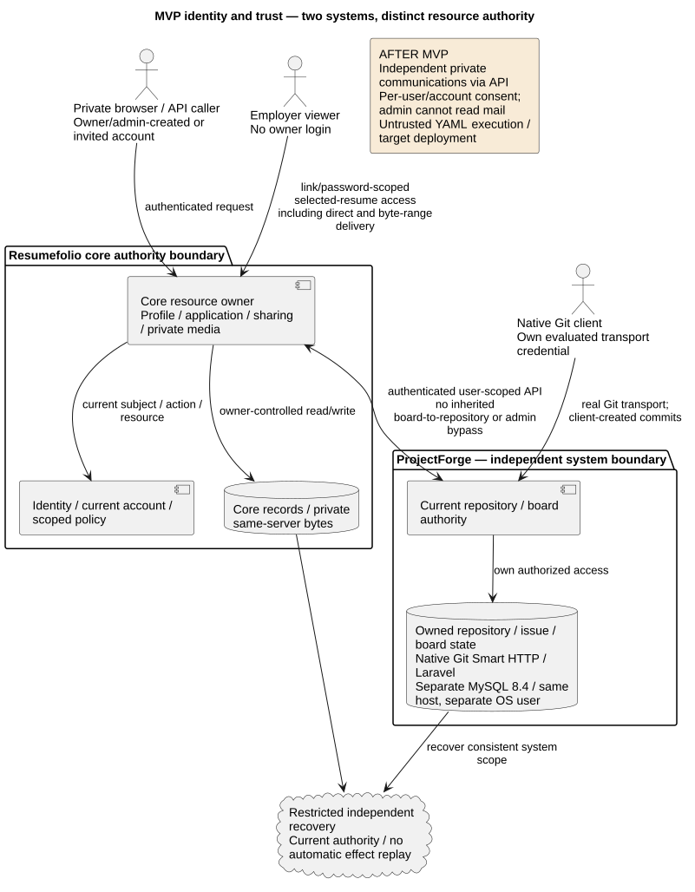
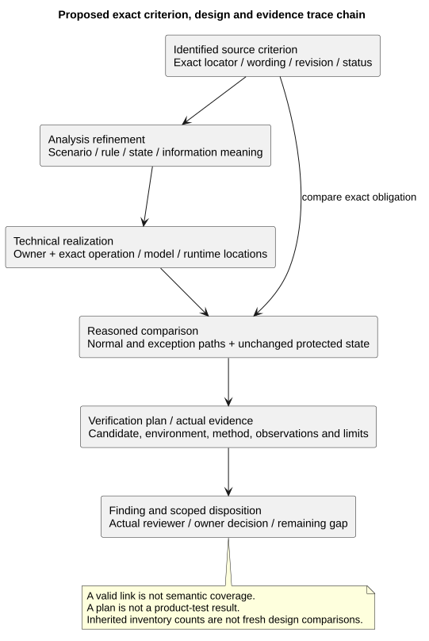

# Resumefolio — Design Quality and Security Analysis

Current implementation choices and scope: [Baseline](../../../baseline/README.md). Runtime verification remains subject to its gates.

**Use this folder to understand how the proposed design will be evaluated, protected, operated and handed over.** It owns shared quality scenarios, threat/control responsibilities, recovery procedures, interaction quality and review rules. Components retain their concrete realization and operation-specific invariants.

Owner and decision authority: Farhad. Updated November 2, 2026.

**Current position:** all five documents are populated with project-specific proposed design and ten diagrams. This is documentation completion, not a completed security assessment, measured quality result, configured backup, accessibility conformance claim, exact-criterion closure or accepted baseline.

[Reading route](#1-reading-route) · [Document guide](#2-find-the-right-record) · [Diagrams](#3-diagram-gallery-and-catalog) · [Ownership](#4-shared-responsibilities-and-boundaries) · [Readiness](#5-review-and-current-limits)

## 1. Reading route

1. Read [quality/security/recovery requirements](../../02-requirements-engineering/03-requirements-specification/quality-security-and-recovery-requirements.md), [analysis security/quality/operations](../../03-system-analysis/06-interfaces-security-and-quality-analysis/13-security-quality-and-operational-analysis.md) and [source decisions](../../02-requirements-engineering/07-change-and-baseline/open-questions-and-decisions.md) for obligations, proposed targets and authority.
2. Read [Quality Attributes and Design Trade-offs](01-quality-attributes-and-design-trade-offs.md) for seven scenario families, mechanism consequences and a lightweight evaluation procedure.
3. Read [Security, Threat Modeling and Trust Boundaries](02-security-threat-modeling-and-trust-boundaries.md) for protected assets, six trust boundaries, twelve STRIDE-informed threat records and control responsibilities.
4. Read [Operations, Backup, Recovery and Resilience](03-operations-backup-recovery-and-resilience.md) for process observation, consistent backup coverage, isolated restoration, release failure handling and operating handoff.
5. Read [User Interface, Accessibility and Interaction Quality](04-user-interface-accessibility-and-interaction-quality.md) for shared journeys, states, forms, keyboard/responsive behavior and planned accessibility verification.
6. Use [Design Review, Traceability and Implementation Handoff](05-design-review-traceability-and-handoff.md) to identify the candidate, compare exact criteria, record actual findings/evidence and assess scoped handoff gates.

Apply shared rules through [component designs](../03-component-and-module-design/README.md), [data design](../04-data-design/README.md), [interface contracts](../05-interface-and-api-design/README.md) and [runtime coordination](../01-software-architecture/03-process-view-concurrency-and-runtime-behavior.md). A shared guide does not replace the owner's concrete mechanism.

## 2. Find the right record

| Question | Owning location |
| --- | --- |
| Which quality scenarios and trade-offs should be evaluated? | [01 — Quality attributes](01-quality-attributes-and-design-trade-offs.md) |
| What assets and trust crossings need controls and threat checks? | [02 — Security model](02-security-threat-modeling-and-trust-boundaries.md) |
| How are real processes, queues and dependency health observed? | [03 — Normal operation](03-operations-backup-recovery-and-resilience.md#2-normal-operation-and-observation) |
| What must a consistent backup cover and how is usable recovery established? | [03 — Backup and restoration](03-operations-backup-recovery-and-resilience.md) |
| How should draft/publication/history, conflicts and uncertain outcomes appear? | [04 — Journey and feedback design](04-user-interface-accessibility-and-interaction-quality.md) |
| Which accessibility/client checks are proposed and what evidence is needed? | [04 — Accessibility and verification](04-user-interface-accessibility-and-interaction-quality.md#5-accessibility-and-responsive-behavior) |
| What establishes exact coverage and implementation readiness? | [05 — Traceability and gates](05-design-review-traceability-and-handoff.md) |
| Where should actual sanitized findings and measured results be stored? | [Evidence guidance](review-and-traceability/evidence/README.md) |

## 3. Diagram gallery and catalog

### Trust boundaries

[Owning security document](02-security-threat-modeling-and-trust-boundaries.md) · [PlantUML](diagrams/security-trust-boundaries.puml) · [PNG](diagrams/security-trust-boundaries.png)

This is a logical view. Module ownership, a container label or an arrow does not establish process/network isolation or demonstrated control effectiveness.

### Exact traceability

[Owning review document](05-design-review-traceability-and-handoff.md) · [PlantUML](diagrams/review-trace-chain.puml) · [PNG](diagrams/review-trace-chain.png)

A valid reference is not semantic coverage; a verification plan is not an executed result. Preserve source and candidate revisions in every actual comparison.

### Ten available views

- **Quality:** scenario/evidence map; trade-off evaluation route.
- **Security:** trust boundaries; current-authority admission sequence.
- **Operations:** recovery coverage; isolated restoration/resumption route.
- **UI/accessibility:** source apply and separate publication; truthful outcome/recovery route.
- **Review:** exact trace chain; scoped handoff gates.

The [diagram catalog](diagrams/README.md) links every SVG preview, editable PlantUML source and PNG export. Reuse the owning views and keep captions, source and exports synchronized; no extra diagram is needed merely for this index.

## 4. Shared responsibilities and boundaries

**Quality evaluation** connects reviewed scenarios/targets to mechanisms, adverse effects and actual measurements. It does not invent accepted NFRs or claim a formal ATAM workshop from a lightweight procedure.

**Security** allocates threat/control responsibility without creating a new permission matrix. Identity provides current scoped context and each resource owner applies operation/lifecycle checks. Earlier administrative powers and later proposed restrictions require exact source reconciliation; neither a universal bypass nor a silent policy replacement is assumed.

**Operations** owns actual process/backup/restore/release procedures and observations. Files owns reference/accounting/reclamation evidence; affected owners verify their recovered state. Backup completion, usable restoration and redundant live capacity are separate claims.

**Interaction quality** preserves business meaning across owner/collaborator/employer journeys, including separate source apply/publication and actual submitted material. UI affordances do not enforce backend authorization, and polished screens do not establish accessibility conformance.

**Review** identifies exact source/design revisions, compares obligations, records bounded findings/evidence and obtains actual scoped disposition. It does not convert inventory counts, populated folders or historical review results into fresh semantic closure.

## 5. Review and current limits

### Preserve these distinctions

- Proposed target versus accepted target versus measured result.
- Current resource authority versus a prior login, membership, association or callback.
- Configured download option versus exact usable rendition and permitted delivery.
- Local commit/provider acceptance versus actual external completion; unknown effects require reconciliation.
- Task completion/item acceptance/Sprint Goal outcome; run completion/cleanup/target approval.
- Logical retirement versus confirmed safe physical reclamation.
- Backup capture versus consistent protected copy versus usable isolated restoration.
- Documentation checks versus exact review versus product verification versus owner acceptance.

### Remaining prerequisites

Q-D25/Q-D26 numerical/client/accessibility/recovery proposals retain their source status. The dated small-server observation is not capacity evidence, and ten accounts do not define concurrent workload. Backups are not set up; independent destination/key access, consistent capture and usable restoration remain required evidence. Execution containment/resource fit, native Git/provider compatibility, actual mail/worker/scheduler operation, final physical prescriptions and exact criterion closure remain pending at their affected gates.

The sole owner's total project capacity is 20 hours/week, including operation and recovery work. New facilities/costs or reduced capabilities require explicit decisions through existing authority; design prose supplies neither spending approval nor baseline acceptance.

Before handoff, use document 05's four gates: identified traceable candidate; sufficient technical prescriptions; applicable feasibility/verification prerequisites; and actual scoped disposition with delivery alignment. Continue independent design work where an unresolved gate does not affect it. Store only actual evidence with candidate/environment/method/reviewer/limits; do not prefill successful checklists or invent risk acceptance.

No security scan, penetration/escape/load test, accessibility study, backup/restore, live operating change or release approval is performed by this folder's documentation updates. Advisor consultation was unavailable where recorded; no independent endorsement is claimed.

## 6. FAU basis and maintenance

FAU's architecture quality concerns, deployment and component refinement inform this coverage. STRIDE, lightweight trade-off review, accessibility references and local handoff records are project techniques, not a university-mandated folder tree or certification. See the [reference and coverage map](../01-reference-and-coverage-map.md).

When a source obligation or mechanism changes, identify affected quality scenarios, threats, operating procedures, UI journeys and trace rows. Update owning component/data/interface/runtime records and ADRs as needed, regenerate changed diagrams and preserve historical evidence with its original scope. Link/document checks support maintenance without replacing actual verification.

[System Design home](../README.md) · [Cross-cutting overview](../01-software-architecture/05-cross-cutting-concerns-overview.md) · [Diagram catalog](diagrams/README.md) · [Evidence guidance](review-and-traceability/evidence/README.md)
