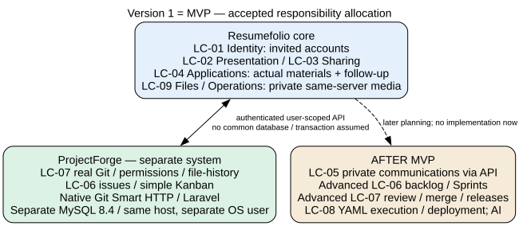

# ADR-001 — Modular Application Boundaries

## Current implementation baseline — November 4, 2026

[BL-MVP-2026-11-04.1](../../../baseline/README.md) selects the MVP technical mechanisms, numerical policies, priorities and requirement/criterion dispositions under Farhad’s explicit delegation. It supersedes earlier Proposed/pending mechanism and whole-baseline statements below for MVP design input. Future clauses and dated evidence remain separate. Runtime/actor validation, credentials, Git isolation, capacity and backup/restore still require the named implementation/Release gates; this update reports no product test Pass.

### Prior source material and rationale (superseded where this Baseline selects a different MVP choice)

| Item | Position |
| --- | --- |
| Status | **Historical proposal — common-application allocation superseded by ADR-005** |
| Prepared / updated | November 2, 2026 |
| Decision authority | Farhad |
| Record scope | Technical organization of trusted application responsibilities and external trust/integration boundaries |
| Implementation evidence | No module implementation, compatibility test or capacity result is supplied by this record |

[Context](#1-context-and-decision-drivers) · [Options](#2-options-considered) · [Proposal](#3-proposed-decision) · [Consequences](#4-consequences-and-limits) · [Validation](#5-validation-and-owner-disposition) · [Evolution](#6-revisit-and-evolution)

## November 4 disposition

The proposed placement of all nine owners in one trusted application is superseded by [ADR-005](ADR-005-owner-mvp-system-boundaries.md). The alternatives and November 2 rationale below are retained as historical proposal text, not the current boundary. Core and ProjectForge are separate systems; communications/execution are future. Explicit logical ownership remains useful within each system.

## MVP system allocation and design status

The accepted system boundary separates the Resumefolio core from ProjectForge, joined by an authenticated user-scoped API. Logical responsibilities remain useful within each system; they do not authorize a shared core/ProjectForge process, database or transaction. Core owns dashboard, invited accounts, professional presentation, protected sharing, manual applications and same-server private My Files & Media. ProjectForge MVP owns real repositories/transfers/permissions, file/history browsing, issues and simple Kanban. Its selected engine is native Git Smart HTTP behind the independent Laravel ProjectForge service, with its own MySQL 8.4 database and OS/storage boundaries on the existing host; BL-MVP-2026-11-04.1 governs implementation and evidence gates. The future communications system is independently private and API connected. Advanced Git review/releases, backlog/Sprints and execution/deployment remain deferred. Keep source, independent resume draft, explicit publication and actual submitted material identities distinct. Profile changes require preview/select/apply and cannot mutate publication or submitted history. Manual applications include status, next action and follow-up date without mail/calendar dependencies.

Authority: [OWNER-MVP-2026-11-04](../../01-project-planning/owner-mvp-decision-2026-11-04.md).

## 1. Context and decision drivers

The product combines private professional presentation, controlled sharing, manual applications, communication/calendar, work/Sprints, real Git collaboration and conditionally safe workflow execution/deployment. It must preserve current resource-specific authority and independent source/draft/publication/actual-submission meaning.

Use [accepted scope](../../01-project-planning/02-scope.md), [resource constraints](../../01-project-planning/05-resources-and-constraints.md), [architecture drivers/options](../01-software-architecture/01-design-drivers-and-solution-options.md), [analysis domain responsibilities](../../03-system-analysis/02-domain-and-information-analysis/03-domain-model-and-object-oriented-view.md) and [source decisions](../../02-requirements-engineering/07-change-and-baseline/open-questions-and-decisions.md). Laravel and object-oriented development are recorded constraints; the sole owner's 20 total project hours/week includes operations.

The dated small-server observation is an infrastructure input, not a final deployment choice or measured capacity. Initial ten-user scope and possible growth do not define concurrency. Provider access, native Git facilities, untrusted-code containment and usable recovery remain dependent evidence gates.

Evaluate organization against coherent responsibility, local integrity, current authority, testability/evolution, solo operating cost, shared-resource effects and trust separation. The choice must not silently remove accepted Version 1 capability or add paid infrastructure.

## 2. Options considered

These are qualitative comparisons against project constraints, not benchmarked scores or independently validated costs.

### A — Single application without enforced domain boundaries

Can minimize initial packaging and deployment work. Without explicit ownership/contracts, shared ORM models/controllers can obscure authority, couple unrelated changes and let publication/history/provider effects leak across responsibilities. A single deployment is not inherently defective; the rejected aspect of this candidate is ungoverned cross-domain mutation rather than colocation itself.

### B — Modular trusted application with explicit external boundaries

The historical common-application option preserved one release across all owners; ADR-005 now requires separate core and ProjectForge. Cohesive internal ownership remains useful. Local invariants can use evaluated relational transactions without introducing network calls between every module. Requires deliberate dependency/ownership enforcement and real adapters; shared runtime/host still creates contention and common failure exposure. **Historical starting proposal; its common-system extent is superseded by ADR-005.**

### C — Early independently deployed domain services

Can provide independent release, scaling and process boundaries where demonstrated needs justify them. For this initial scope it adds deployment/observation/credential management and distributed consistency/recovery work before evidence shows those benefits outweigh the solo operating cost. Service separation alone does not establish privacy, execution isolation or HA. Retain as a future option, not the default starting architecture.

## 3. Proposed decision

**Historical proposal, November 2; superseded in part by ADR-005.** The all-owner common application below is not the current system boundary.

Use a modular Laravel application for **trusted product coordination**, organized into the nine logical owners already specified by the [decomposition model](../01-software-architecture/02-system-decomposition-and-boundaries.md):

1. Identity and Access.
2. Professional Presentation.
3. Representation and Sharing.
4. Manual Applications.
5. Communication and Calendar.
6. Work Management.
7. Git Collaboration.
8. Workflow and Deployment Coordination.
9. Files and Operations.

[Owning architecture view](../01-software-architecture/02-system-decomposition-and-boundaries.md) · [Editable Graphviz](../01-software-architecture/diagrams/logical-component-ownership.dot) · [PNG](../01-software-architecture/diagrams/logical-component-ownership.png)

These are logical responsibility boundaries, not nine services, nine databases or a mandatory namespace/table tree. Keep the detailed model at its owning location rather than duplicating it in this ADR.

### Boundary rules

- Resource owners enforce their operation/lifecycle invariants. Identity supplies current scoped context without replacing owner checks or creating a universal administrative bypass.
- Consumers use explicit language-level contracts, immutable identities/revisions and permitted projections. Do not mutate another owner's private tables/models or call HTTP solely to connect in-process components.
- Shared infrastructure provides bounded persistence/storage/dispatch capability without taking ownership of domain meaning. Shared SQL can support evaluated coherent local transactions; it does not authorize arbitrary cross-module writes.
- Preserve separate selected source application, owner-confirmed publication and actual-material capture. See [ADR-002](ADR-002-explicit-publication-and-history.md).
- Provider/native Git/storage/executor/target effects cross explicit adapter and authority boundaries. Local transactions do not make external effects atomic; see [ADR-003](ADR-003-durable-external-attempts.md).
- Untrusted workflow/code execution stays outside the trusted application's authority domain behind demonstrably evaluated containment. A worker class, module or colocated container label alone is not isolation. Production deployment uses separately approved target authority.

Actual package layout, signatures, data schema/constraints, runtime facilities and physical placement require [component](../03-component-and-module-design/README.md), [data](../04-data-design/README.md), [interface](../05-interface-and-api-design/README.md) and [deployment](../01-software-architecture/04-deployment-topology-nodes-and-networks.md) prescriptions. This ADR does not select their pending technologies.

## 4. Consequences and limits

**Expected benefits:** clear ownership and test seams; fewer initial distributed consistency obligations; a smaller principal release/operating surface; and explicit later extraction points based on actual contracts. These are rationale, not measured productivity/performance results.

**Costs and risks:** boundary erosion through shared models, circular dependencies, oversized shared helpers, accidental permission inheritance and shared-host resource/failure contention. Module contracts require review and implementation checks. Independent scaling/release remains limited until facilities are separated deliberately.

**Required mitigations:** review dependency direction and ownership, keep adapters scoped, validate coherent transactions/reference guards, reconstruct current authority in jobs, observe combined workloads and preserve isolated recovery. See [modularity guidance](../03-component-and-module-design/01-modularity-dependencies-and-encapsulation.md), [runtime](../01-software-architecture/03-process-view-concurrency-and-runtime-behavior.md), [quality trade-offs](../06-design-quality-and-security-analysis/01-quality-attributes-and-design-trade-offs.md) and [security](../06-design-quality-and-security-analysis/02-security-threat-modeling-and-trust-boundaries.md).

This proposal establishes neither safe execution capacity, provider/native-client interoperability, redundant availability nor configured backups. The existing demo is not accepted as a compatible legacy foundation, and legacy migration remains outside the recorded Version 1 scope.

## 5. Validation and owner disposition

Before accepting the affected design scope, identify exact source/design revisions and verify:

- Each claimed source criterion maps to an owner/operation with sufficient normal, denied, conflict, uncertain and recovery behavior.
- Cross-component interactions preserve current authority, publication/history independence, protected artifacts and coherent work/Sprint meaning.
- Physical transactions, native ref effects and remote attempts have explicit boundaries and recoverable observations.
- Dependencies/artifacts/runtime placement respect logical ownership and separate untrusted execution/target authority.
- Measured compatibility/resource/operating evidence supports the commitments being accepted; independent work may continue where a gate does not apply.
- Estimates/backlog and operating obligations fit actual capacity, with unresolved costs/risks and scoped conditions recorded.

Use [review and handoff](../06-design-quality-and-security-analysis/05-design-review-traceability-and-handoff.md). No exact-criterion closure, product-test Pass, independent Advisor endorsement, coding authorization or owner acceptance is created by elaborating this ADR. Record actual reviewer/date/evidence and disposition only when performed.

## 6. Revisit and evolution

Reassess if observed combined-load contention, independent release needs, incompatible runtime/trust requirements or operating evidence make a specific extraction worthwhile. Compare the bounded extraction with strengthening current module boundaries; user-count growth alone is not a sufficient trigger.

Any extraction needs explicit contract/authority, data ownership, consistency, credential, observation, recovery, compatibility and operating-cost plans. Moving a module into a process does not transfer permissions automatically. Preserve uncertain external attempts and historical identities through the transition.

If an accepted decision changes, add an identified superseding ADR and retain the original rationale/status history. Use [design evolution](../02-detailed-and-object-oriented-design/05-design-evolution-refactoring-and-technical-debt.md); no irreversible migration or rollback capability is presumed here.

[Decision index](README.md) · [ADR template](ADR-template.md) · [System Design home](../README.md)
