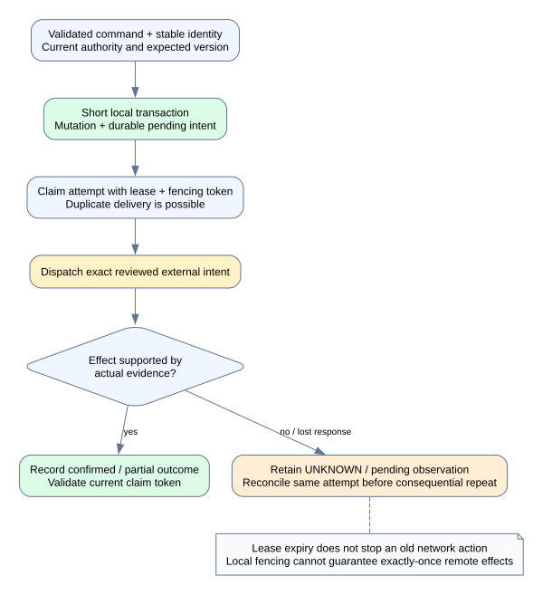

# ADR-003 — Durable External Attempts and Reconciliation

Current implementation choices and scope: [Baseline](../../../baseline/README.md). Runtime verification remains subject to its gates.

| Item | Position |
| --- | --- |
| Status | **Proposed — owner disposition pending** |
| Prepared / updated | November 2, 2026 |
| Decision authority | Farhad |
| Scope | Durable intent, attributable attempts, dispatch coordination and evidence-supported external outcomes |
| Implementation evidence | No queue, worker, provider idempotency facility, executor or target protocol is verified here |

[Context](#1-context-and-source-authority) · [Options](#2-options-considered) · [Proposal](#3-proposed-decision) · [Application](#4-operation-specific-application) · [Consequences](#5-consequences-and-limits) · [Validation](#6-validation-and-disposition) · [Evolution](#7-revisit-and-evolution)

## 1. Context and source authority

Provider sends/calendar changes, native Git mutations, artifact processing, execution and deployment can have effects outside the local relational transaction. A timeout, worker crash or lost acknowledgment can leave the effect unknown. Repeating a request after such ambiguity can duplicate a send, launch or target change; marking it failed can misrepresent actual state.

Use [runtime design](../01-software-architecture/03-process-view-concurrency-and-runtime-behavior.md), [interface requirements](../../02-requirements-engineering/03-requirements-specification/external-interface-requirements.md), [provider requirements](../../02-requirements-engineering/03-requirements-specification/email-calendar-and-google-integration.md), [workflow requirements](../../02-requirements-engineering/03-requirements-specification/yaml-workflows-and-cicd.md), [quality/recovery requirements](../../02-requirements-engineering/03-requirements-specification/quality-security-and-recovery-requirements.md) and [source decisions](../../02-requirements-engineering/07-change-and-baseline/open-questions-and-decisions.md). Detailed retry, trigger, cancellation and provider policies retain their source status.

The [modular-boundary proposal](ADR-001-modular-application-boundaries.md) and [publication/history proposal](ADR-002-explicit-publication-and-history.md) require truthful outcomes and preserved identities across owners. This record proposes technical coordination, not a new product automation policy, universal queue requirement or exactly-once guarantee.

## 2. Options considered

### A — Call an external facility inside the local transaction

Straightforward code can make the call appear coordinated with local state, but remote effects cannot generally be rolled back with SQL. Long transactions also retain local resources while waiting on the dependency. A crash after remote acceptance can still leave ambiguous local state. This is not a sufficient general correctness strategy.

### B — Commit local state, then issue an unrecorded external call

Shortens local transaction duration but risks losing required work if the process dies after commit and before dispatch. Adding a generic automatic retry can duplicate already accepted effects when the result is lost. Suitable only where the specific contract does not require durable effect coordination and its risks are explicit.

### C — Durable local intent and identified attempts with reconciliation

Commit required local state and pending intent coherently; dispatch through scoped adapters with stable identities; retain attributable observations and reconcile ambiguity before consequential repeat. Adds operating and state-model complexity while making lost intent and unknown effects explicit. **This is the proposed shared direction.**

These are qualitative assessments. Actual transactional, queue and external capabilities need evaluation; using an outbox or broker alone does not solve remote duplicate effects.

## 3. Proposed decision

Persist reviewed consequential intent and distinguish the business operation, local command, dispatch ownership and external attempt identities. Store immutable intended inputs/revisions or sufficient protected references, current eligibility requirements and actual observed outcomes. Avoid copying raw secrets/private payloads into ordinary diagnostic records.

[Owning runtime protocol](../01-software-architecture/03-process-view-concurrency-and-runtime-behavior.md#4-durable-work-dispatch-and-reconciliation) · [Editable Graphviz](../01-software-architecture/diagrams/durable-attempt-protocol.dot) · [PNG](../01-software-architecture/diagrams/durable-attempt-protocol.png)

### Local commit and dispatch

Where a local operation requires later work, commit its owned state, attributable result and pending intent atomically through an evaluated outbox or equivalent mechanism. Dispatch only committed intent. Queue deliveries may duplicate; a delivery acknowledgment is neither business completion nor proof of external acceptance.

Scope command identity to its actual actor/resource/operation contract, compare intended payload/version context and reject changed intent under the same identity. Prior-result lookup still requires current authority. A missing HTTP response after commit is not evidence of rollback. Read-only operations need no mutation/outbox record merely for uniformity.

### Claims, stale workers and current authority

Use evaluated atomic claims with bounded ownership/lease and changing claim-generation/fencing identity. Local observation/result updates validate current claim ownership so stale workers cannot overwrite a successor's state. Persistent workers reconstruct current required authority and exact attempt context rather than reuse an evergreen serialized session.

A lease expiry does **not** stop a worker already sending or executing remotely. After possible dispatch, reclaiming local ownership cannot authorize blind resend. External fencing/idempotency must be supported and actually enforced by the relevant facility before relying on it; a local token has no such power automatically.

### Evidence and repetition

Record known pending, confirmed completion, confirmed no-effect failure, partial and unknown outcomes as applicable, with attempt identity, observation provenance and actual time. Keep request acceptance, business effect, output availability and cleanup as separate facts where their meanings differ.

After ambiguity, inspect the same attributable attempt/effect through the owning adapter's actual capabilities. If reconciliation cannot establish an outcome, retain Unknown/partial context and obtain the reviewed bounded disposition; do not fabricate safe retry from absent local evidence. A permitted new retry creates a distinct attempt linked to prior intent/outcomes. Duplicate delivery of the same work is not automatically a new authorized business operation.

If a provider supports idempotency, evaluate its actual key scope, retention, payload matching, concurrent behavior and result-lookup limits. No particular provider support is asserted here. Cancellation intent is separate from confirmed prevention/stop; completion can win the race and prior effects remain observable.

## 4. Operation-specific application

| Owner/boundary | Required specialization |
| --- | --- |
| [Communication/Calendar](../03-component-and-module-design/components/communication-and-calendar.md) | Preserve reviewed send/event context and provider identity; acceptance is not recipient receipt; ambiguous writes need actual reconciliation |
| [Git](../03-component-and-module-design/components/git-collaboration.md) | Guard exact native ref intent and retain observed ref outcomes; relational metadata rollback does not undo changed refs |
| [Workflow/Deployment](../03-component-and-module-design/components/workflow-and-deployment.md) | Bind exact code/definition/executor attempt; separate launch/stop/output/cleanup and target approval/effects; no automatic relaunch/redeploy |
| [Files](../03-component-and-module-design/components/files-and-operations.md) | Coordinate staged bytes, protected consumer references and actual reclamation; unknown acknowledgment/deletion retains appropriate protection/accounting |
| [Sharing](../03-component-and-module-design/components/representation-and-sharing.md) | Bind generation to exact publication/language/render inputs; an old worker cannot make stale output current |

These boundaries do not all require the same queue or retry policy. Native synchronous operations can use durable intent/observation without becoming broker jobs; exact local algorithm and result semantics remain component-owned.

## 5. Consequences and limits

**Expected benefits:** required work remains discoverable after local commit; repeated local intent can resolve to one attributable result; uncertainty and recovery obligations remain visible. These are design rationale, not observed reliability results.

**Costs:** additional intent/attempt/claim/observation persistence, restricted status projections, worker supervision, queue-age/resource management and reconciliation procedures. Pending state consumes actual storage/operating capacity within the sole owner's total 20 project hours/week.

**Limits:** durable dispatch does not promise exactly-once execution, universal provider lookup, safe cancellation, automatic compensation or remote rollback. Backoff/circuit breaking reduces pressure but does not prove no effect. Compensation is a separate attributable authorized operation and may be impossible or irreversible.

Physical schemas, transaction/claim guards, queue/supervisor facilities, callback authentication, external duplicate/fencing semantics, retention and resumption procedures remain pending evaluation. Follow [data design](../04-data-design/README.md), [API contracts](../05-interface-and-api-design/01-api-protocols-contracts-and-compatibility.md), [security](../06-design-quality-and-security-analysis/02-security-threat-modeling-and-trust-boundaries.md) and [operations/recovery](../06-design-quality-and-security-analysis/03-operations-backup-recovery-and-resilience.md). A restored pending row cannot replay sends/jobs/deployments automatically.

## 6. Validation and disposition

For an identified candidate, exercise interruptions before local commit, after commit/before dispatch, before known dispatch, and after possible external acceptance/before observation. Require evidence-supported results, preserved owned state and no blind consequential repetition.

Also check:

- Duplicate deliveries and reused command identities with changed intent.
- Concurrent claims, lease expiry and late stale-worker results, including an old worker still performing a remote action.
- Current authority changes while work waits or reaches a consequential stage.
- Lost launch/stop/target responses and cancellation racing completion.
- Actual protected output/reference/accounting state after partial/unknown work.
- Isolated coordinator restoration reconciled with current authority and actual external effects before resumption.

Use actual persistence/concurrency and authorized adapter/provider/executor/target evidence alongside deterministic state checks. A mock returning success cannot prove duplicate protection, termination or remote no-effect. Verify actual external compatibility at selection time rather than importing a generic retry assumption.

Record exact source/design revisions, findings, limitations and actual owner disposition through [review/handoff](../06-design-quality-and-security-analysis/05-design-review-traceability-and-handoff.md). No test Pass, queue installation, execution enablement, purchase or acceptance is created by elaborating this proposed ADR.

## 7. Revisit and evolution

Reassess per-operation coordination when measured workload, external capabilities, latency/operating needs or new failure evidence change the trade-off. A simpler mechanism is acceptable only where it preserves the actual contract; a more complex broker does not justify weaker authority or effect semantics.

Schema/worker/adapter changes must preserve old pending intent and observation meaning, claim-generation safety and current authority. Define compatible migration/resumption before retiring an old format. If an accepted decision changes, add a superseding ADR and retain original rationale and actual disposition history.

[Decision index](README.md) · [ADR-001: Boundaries](ADR-001-modular-application-boundaries.md) · [ADR-002: Publication/history](ADR-002-explicit-publication-and-history.md) · [ADR template](README.md)
