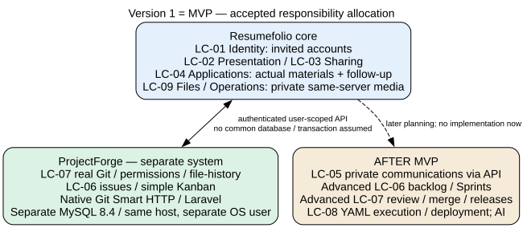

# Resumefolio — System Design

## Current implementation baseline — November 4, 2026

[BL-MVP-2026-11-04.1](../../baseline/README.md) selects the MVP technical mechanisms, numerical policies, priorities and requirement/criterion dispositions under Farhad’s explicit delegation. It supersedes earlier Proposed/pending mechanism and whole-baseline statements below for MVP design input. Future clauses and dated evidence remain separate. Runtime/actor validation, credentials, Git isolation, capacity and backup/restore still require the named implementation/Release gates; this update reports no product test Pass.

### Prior source material and rationale (superseded where this Baseline selects a different MVP choice)

**Start here to understand the proposed technical solution and find its owning design records.** This phase refines requirements and analysis into architecture, component behavior, data/contract mechanisms and a reviewable implementation handoff.

Owner and decision authority: Farhad. Updated November 2, 2026.

**Current position:** all six design topics, nine concrete component records, shared guides and three ADRs are populated with project-specific proposals and editable diagrams. The ADRs remain **Proposed**. Exact criterion closure, final physical/compatibility prescriptions, applicable enabling evidence and owner baseline disposition remain pending; documentation completion is not implementation readiness or verified product behavior.

[Reading route](#1-reading-route) · [Topic guide](#2-topic-and-document-guide) · [Candidate](#3-proposed-technical-candidate) · [Ownership](#4-record-ownership-and-diagrams) · [Readiness](#5-review-and-current-limits)

## MVP system allocation and design status

The accepted system boundary separates the Resumefolio core from ProjectForge, joined by an authenticated user-scoped API. Logical responsibilities remain useful within each system; they do not authorize a shared core/ProjectForge process, database or transaction. Core owns dashboard, invited accounts, professional presentation, protected sharing, manual applications and same-server private My Files & Media. ProjectForge MVP owns real repositories/transfers/permissions, file/history browsing, issues and simple Kanban. Its selected engine is native Git Smart HTTP behind the independent Laravel ProjectForge service, with its own MySQL 8.4 database and OS/storage boundaries on the existing host; BL-MVP-2026-11-04.1 governs implementation and evidence gates. The future communications system is independently private and API connected. Advanced Git review/releases, backlog/Sprints and execution/deployment remain deferred. Keep source, independent resume draft, explicit publication and actual submitted material identities distinct. Profile changes require preview/select/apply and cannot mutate publication or submitted history. Manual applications include status, next action and follow-up date without mail/calendar dependencies.

Authority: [OWNER-MVP-2026-11-04](../01-project-planning/owner-mvp-decision-2026-11-04.md).

## 1. Reading route

1. Read [Purpose, Scope and Approach](00-design-purpose-scope-and-approach.md) for source authority, project boundaries, working sequence and dependent gates.
2. Read [FAU References and Design Coverage](01-reference-and-coverage-map.md) for lecture provenance, viewpoint ownership and project adaptations.
3. Start the technical candidate with [architecture drivers/options](01-software-architecture/01-design-drivers-and-solution-options.md) and [system decomposition](01-software-architecture/02-system-decomposition-and-boundaries.md), then runtime and deployment views.
4. Follow the [component catalog](03-component-and-module-design/README.md) into the affected owner, using shared OO, data, interface and quality records as linked inputs.
5. Read the [decision register](07-design-decisions/README.md) for alternatives and consequences, and [review/handoff](06-design-quality-and-security-analysis/05-design-review-traceability-and-handoff.md) before claiming sufficient coverage or implementation readiness.

Requirements and analysis remain authoritative for required meaning and source status. Keep [Project Planning](../01-project-planning/README.md), [Requirements Engineering](../02-requirements-engineering/README.md) and [System Analysis](../03-system-analysis/README.md) linked rather than duplicating their specifications here.

## 2. Topic and document guide

| Topic | Read it for |
| --- | --- |
| [01 — Software Architecture](01-software-architecture/README.md) | Drivers/alternatives, logical ownership, process/concurrency, deployment and cross-cutting coordination |
| [02 — Detailed and Object-Oriented Design](02-detailed-and-object-oriented-design/README.md) | Shared design principles, justified patterns, object/dependency conventions, refactoring and technical debt |
| [03 — Component and Module Design](03-component-and-module-design/README.md) | Modularity, implementation artifacts and complete component responsibilities, classes/data, algorithms and technical scenarios |
| [04 — Data Design](04-data-design/README.md) | Logical/physical mapping, integrity, persistence, cache freshness and reference-aware lifecycle |
| [05 — Interface and API Design](05-interface-and-api-design/README.md) | Protocol/contract/result semantics, compatibility and technical use-case collaborations |
| [06 — Design Quality and Security Analysis](06-design-quality-and-security-analysis/README.md) | Quality scenarios/trade-offs, threats, operations/recovery, UI/accessibility and traceability/handoff |
| [07 — Shared Design Decisions](07-design-decisions/README.md) | Three proposed ADRs, their alternatives/consequences and the reusable decision template |

The six core topics organize documentation; the seventh folder supports shared decisions. They are neither seven services nor a prescribed international file standard. FAU architecture viewpoints and component refinement are mapped across these owners. Stable file numbering does not require creating empty documents for missing numbers.

## 3. Proposed technical candidate

The current system boundary is a Resumefolio core plus a separate ProjectForge connected through authenticated user-scoped API. A modular Laravel organization remains a core candidate, not a shared application/database mandate across systems. Core private media stays on the same server. Provider communications and execution/deployment are future designs.

[Owning architecture view](01-software-architecture/02-system-decomposition-and-boundaries.md) · [Editable Graphviz](01-software-architecture/diagrams/logical-component-ownership.dot) · [PNG](01-software-architecture/diagrams/logical-component-ownership.png)

Nine owners are specified: Identity and Access; Professional Presentation; Representation and Sharing; Manual Applications; Communication and Calendar; Work Management; Git Collaboration; Workflow and Deployment Coordination; Files and Operations. The component catalog links their actual records and provided/required responsibilities.

The proposed direction preserves:

- Current resource/action authority across browser, employer, file, native-client, worker and callback paths.
- Explicit selected source application, independent overrides, separately confirmed publication and actual submitted-material history under the [accepted owner policy](../02-requirements-engineering/07-change-and-baseline/open-questions-and-decisions.md#owner-accepted-profile-update-policy).
- Coherent work/Sprint meaning, exact revision/artifact identities and protected references.
- Truthful pending/partial/unknown external effects with reconciliation instead of blind resend/relaunch/redeploy.
- Separate untrusted-code containment and current target approval, not implied by module structure or run success.
- Isolated recovery with current authority/external-state reconciliation before resumption.

[ADR-001](07-design-decisions/ADR-001-modular-application-boundaries.md), [ADR-002](07-design-decisions/ADR-002-explicit-publication-and-history.md) and [ADR-003](07-design-decisions/ADR-003-durable-external-attempts.md) record these proposed technical choices. Accepted product behavior does not automatically accept their physical mechanisms.

## 4. Record ownership and diagrams

Shared policy belongs in its core topic; each concrete component keeps coherent responsibilities, contracts, computational data/classes, algorithms, failure/concurrency/recovery behavior and justified coding constraints. Use the [component template](03-component-and-module-design/component-template/README.md) selectively. Cross-cutting overviews navigate shared rules rather than create a competing policy source.

Requirements/analysis retain conceptual meaning and source scenarios. Data owns shared schema/storage conventions; interfaces own contract conventions; runtime owns coordination; security and operations own their respective control/procedure responsibilities. Concrete owners realize these obligations without arbitrary cross-module internal mutation.

Each topic index links its diagram catalog, editable source and SVG/PNG exports. Component diagrams remain with their owning records. Reuse existing views, keep captions/sources/exports synchronized and add diagrams only where they clarify a material relationship or behavior. A rendered diagram is not an implemented facility or atomicity proof.

## 5. Review and current limits

Use the [review/handoff record](06-design-quality-and-security-analysis/05-design-review-traceability-and-handoff.md) for exact source-to-design comparisons, cross-view walkthroughs, findings and the four scoped handoff gates. The inherited 157 requirement identities/470 criterion locators are inventory counts, not completed design coverage. Store actual sanitized results according to [evidence guidance](06-design-quality-and-security-analysis/review-and-traceability/evidence/README.md); planned checks remain planned.

Important remaining prerequisites include actual provider setup/access, native Git engine/transport interoperability, real execution containment/resource fit, working delivery/worker/scheduler facilities, independent backup/key recovery, reviewed quality/client targets and representative capacity. OAuth is not created and backups are not set up according to the existing source facts. Final schema/types, synchronization/fencing and actual external compatibility remain implementation prescriptions to complete.

Independent design can continue where a gate does not affect it; dependent readiness cannot be claimed from a plan. The dated small-server observation and initial ten-user scope are not concurrency or capacity measurements. All delivery/operation work fits the sole owner's total 20 project hours/week. AI features, automatic translation and legacy migration remain outside the recorded Version 1 scope.

Preserve the agreed pre-implementation baseline sequence and actual owner disposition. No purchase, coding authorization, live configuration, product-test Pass, security/accessibility certification, usable restoration or release approval is supplied by populated documentation or file/render checks.

## 6. Maintenance

When a source obligation or technical contract changes, identify affected owners/views/ADRs/trace rows, preserve historical evidence and reconcile compatibility and recovery consequences. Record significant choices with their actual status, update owning documents before indexes, regenerate changed diagrams and check local references. Follow the [evolution guidance](02-detailed-and-object-oriented-design/05-design-evolution-refactoring-and-technical-debt.md).

[Purpose and approach](00-design-purpose-scope-and-approach.md) · [Reference map](01-reference-and-coverage-map.md) · [Decision register](07-design-decisions/README.md) · [Review/handoff](06-design-quality-and-security-analysis/05-design-review-traceability-and-handoff.md)
