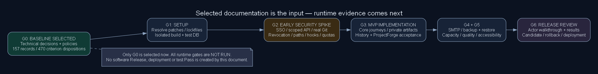

# MVP — Implementation Documentation

Status: Documentation structure prepared; product implementation not started.
Prepared November 4, 2026. Accountable owner: Farhad.

This section records how the selected Design becomes working software. The [current Baseline](../../baseline/README.md), documentation revision 1.4, remains the input. This section neither changes its scope nor proves any runtime gate.

- [Setup and local execution](01-setup-and-local-execution.md)
- [Code structure and implemented interfaces](02-code-structure-and-interfaces.md)
- [Progress and Design deviations](03-progress-and-design-deviations.md)

## Working agreement

Implement one small vertical slice at a time. Record actual file paths, commands, dependency versions, migrations and interfaces only when they exist. Link completed behavior to applicable original or supplemental acceptance criteria and real verification evidence. Keep a failed check or unresolved dependency visible.

The first slice is isolated Project Setup followed by invited-user Login and private Profile. Run the separate ProjectForge identity/native Git security spike early, before dependent Git integration. The [selected sequence and gate definitions](../../baseline/implementation-sequence.md) control order and prerequisites.

Use this section for implementation facts, the [SDD](../04-system-design/README.md) for Design rationale and the Baseline for the selected revision. A material deviation needs an attributable decision and any required Baseline revision; do not turn an implementation note into an unreviewed scope change.

No application scaffolding, dependency installation, database change, service configuration, Git commit or deployment is part of preparing these pages.
