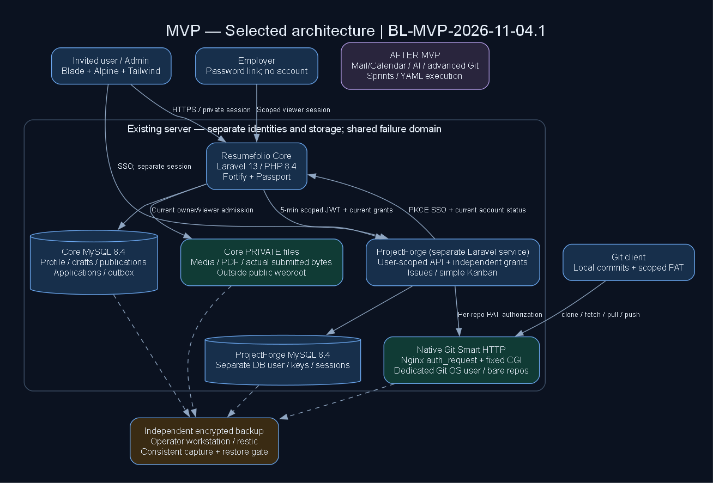

# MVP — Implementation Baseline

**Baseline: BL-MVP-2026-11-04.1 · Status: selected for implementation · Documentation revision: 1.1**

Selected on November 4, 2026 by Codex under Farhad’s explicit instruction to complete technical decisions and establish the Baseline. This is delegated design authority; no personal owner review, running implementation, deployment or product test is fabricated.

The current MVP scope is unchanged: Resumefolio core plus a separate ProjectForge system. This Baseline fixes the implementation choices, policy values, requirement applicability and start sequence. Requirements and design may now drive Project Setup; operational credentials, security spikes, user validation and release evidence remain explicit gates.

[Technical decisions](technical-decisions.md) · [Policy decisions / Q-D01–28](policy-decisions.md) · [Requirement register](requirement-register.csv) · [Criterion guide and dark diagrams](criterion-dispositions.md) · [Criterion CSV](criterion-dispositions.csv) · [Supplemental acceptance](supplemental-acceptance.md) · [Implementation sequence and gates](implementation-sequence.md) · [Sources](sources.md) · [Baseline manifest](manifest.json)

## Authority and change control

1. [Owner MVP scope](../SDLC/01-project-planning/owner-mvp-decision-2026-11-04.md) controls product scope and system boundaries.
2. This dated Baseline selects technical and numerical policy details through the current delegated instruction. Within that scope it supersedes earlier Proposed/pending mechanism and baseline-status statements. Historical reviews and future specifications retain their dates and meaning.
3. The requirement and criterion registers preserve existing IDs and distinguish selected MVP obligations, narrowed mixed obligations and deferred future work. A future clause never becomes an MVP release gate by sharing a parent record.
4. A later material choice requires an attributable change, impacted requirements/tests, compatibility/recovery analysis and a new Baseline revision. Update the manifest after review; do not edit frozen hashes to suggest an earlier snapshot contained later changes.

## What is complete and what is not

Selected: scope allocation, stack, frontend/database choices, access and integration contracts, storage/PDF/history rules, operational targets and implementation order. No further generic Frontend/Database decision is needed to start.

Not demonstrated: user acceptance, installed package compatibility, native Git containment, SMTP delivery, production capacity, live backup/restore or Release readiness. These require implementation or operational evidence; their owners and exit criteria are in the gate register. The Baseline is a design input, not an M-02/M-03 test Pass certificate.

The independent Advisor runtime could not be identified by its installed preflight; no Advisor consultation result exists. Codex performed the documented review and checks directly.

## Version meaning

Keep this folder named `MVP`. Documentation revision 1.0 and this Baseline ID do not create a Software Release. During development use 0.1.0 or a prerelease tag when an actual artifact exists. Target the first stable production contract at 1.0.0 after Release gates pass; compatible features then increment MINOR, compatible fixes PATCH and breaking public contracts MAJOR. A subsequent SDLC cycle does not automatically imply v2. No new Release folders, Git tags or Releases are created by this documentation change.
