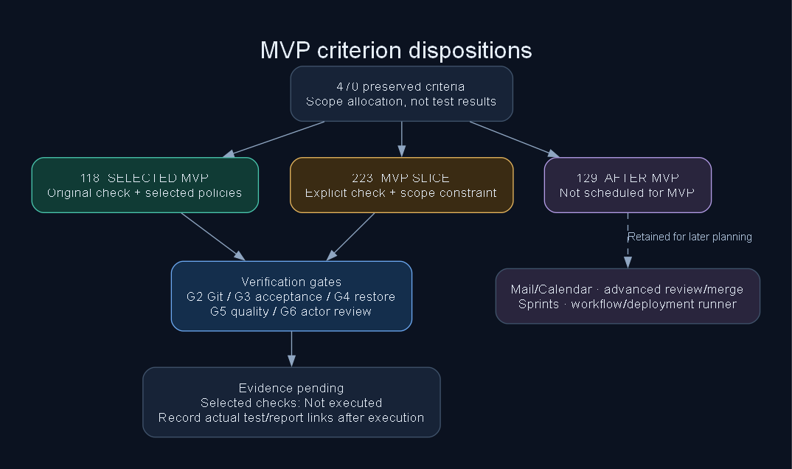

# Criterion disposition guide

Baseline BL-MVP-2026-11-04.1 · Revision 1.3 · November 4, 2026.

[Open the complete CSV register](criterion-dispositions.csv). All **470 original criterion IDs and wordings** are preserved. **118** criteria retain their selected wording, **223** apply only to the stated MVP slice, and **129** are deferred. These counts describe scope, not completed tests. The [10 supplemental MVP checks](supplemental-acceptance.md) remain separate from this 470-row population.

[Scalable SVG](diagrams/criterion-dispositions-overview.svg) · [Editable Graphviz](diagrams/criterion-dispositions-overview.dot)

## Read and filter the register

Start with `domain` and `disposition`, then read `mvp_check` together with `scope_constraint`. Filter `verification_gate` to prepare the next implementation checks. Use `source` to find the primary requirement and `policy` for the selected Q-D decisions. A semicolon separates multiple policy links or gates inside one cell. Record actual test/report paths in `evidence` only after execution; a blank cell means no evidence has been recorded.

| Disposition | Meaning |
| --- | --- |
| Selected MVP | Apply the original criterion with the selected Baseline policies |
| Selected MVP slice | Verify only `mvp_check` within `scope_constraint`; future clauses are excluded |
| Deferred | No MVP test obligation; keep the original text for future scope |

Gate fields identify the primary verification stage, not an exemption from other required security checks. G2 covers the native Git trust boundary; G3 Core/integrated acceptance; G4 operational restore; G5 measured quality; G6 actor/Release review. [Full gate definitions](implementation-sequence.md#gate-register).

## What changed in revision 1.1

- Removed blank records caused by doubled CSV line endings; retained UTF-8 and standard quoted CSV fields.
- Added domain, primary source, explicit MVP check, policy anchors, verification gate/method and evidence fields.
- Classified `DOM-D05-AC01` as deferred: it concerns Gmail/Calendar rather than a mixed Core obligation.
- Classified `USR-D09-AC02` as deferred: advanced review/merge is outside MVP. Narrowed `USR-D09-AC03` to issues and ordinary authorized Git refs; release management remains deferred.
- Narrowed time/provider/recovery clauses to actual MVP operations. Negative mail-isolation checks remain applicable without adding mail features.
- Replaced generic policy filenames with navigable Q-D decision anchors. Selected checks remain `Not executed`; deferred checks read `Not scheduled for MVP`.

The CSV contains data only; dark styling lives in the diagrams and this companion guide. It does not require a particular spreadsheet application's appearance.
