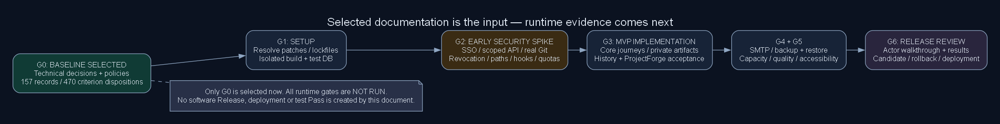

# Implementation sequence and evidence gates

Baseline selected: BL-MVP-2026-11-04.1. Accountable owner: Farhad. Implementation/test executor: the developer or Codex when separately instructed. Total project availability remains 20 hours/week including learning, documentation, tests and operations. No delivery date or full-scope effort commitment is invented.

## Ordered work packages

| Order | Work package | Definition of Done / required evidence |
| --- | --- | --- |
| 1 | Isolated Project Setup, lockfiles and test database | Laravel/PHP/MySQL/Node versions proven; clean install/build/test; no demo data mutation; no secrets in Git |
| 2 | Core invite/login/recovery/Admin TOTP/private profile | Authorized invited user completes flow; registration absent; cross-user/expired/disabled-session tests deny access; SMTP receipt demonstrated before real invitations |
| 3 (early parallel design dependency, sequential execution permitted) | Isolated ProjectForge SSO/API/native Git spike | G2 passes before dependent Git UI/integration is considered viable |
| 4 | Profile/resume draft, preview/select/apply, language variants and explicit publication | Stale edits conflict; independent overrides remain; employer sees only selected published revision; draft edits do not silently publish |
| 5 | Private library, generated/uploaded PDFs, password links and application history | Upload/private selection/range restrictions pass; submitted byte checksums survive edits, retirement and recovery |
| 6 | ProjectForge real repositories, permissions, file/history, issues/simple Kanban and Core API | Real clients transfer data; owner/writer/reader and issue boundaries pass; no core storage or cross-user leakage |
| 7 | Integrated validation, capacity, operational recovery and Release candidate | G3–G6 pass on actual target; document residual risks and user validation; only then propose deployment |

## Gate register

| Gate | Current status | Exit evidence | When / owner |
| --- | --- | --- | --- |
| G0 — Documentary Baseline | Selected | This decision package, requirement/criterion dispositions, diagrams and hash manifest | Complete for design input; Codex under delegated authority |
| G1 — Environment/dependencies | Not run | Compatible maintained versions, lockfiles, clean build/tests, isolated MySQL and license review | Setup; developer / Farhad |
| G2 — Identity/Git trust boundary | Not run | OAuth state/PKCE/redirect and token claims; current-account revocation; two users; clone/fetch/pull/push; denied/expired PAT; no anonymous/dumb access; traversal/header/env/hook isolation; concurrent quota/ref races and bounded processes | Before enabling real Git or dependent integration; developer / Farhad |
| G3 — Core acceptance/security | Not run | Requirement-linked positive/denied/stale/failure journeys; selected/unselected resume media and direct/range access; immutable actual submitted copies and retries | Before MVP acceptance; developer / Farhad |
| G4 — Operations/restore | Not run | SMTP receipt, TLS/secrets/permissions, monitoring, independent consistent backup and timed isolated restore including access revocation and no external replay | Before first production deployment; operator Farhad |
| G5 — Capacity/quality | Not run | T09 load/browser/accessibility/PDF checks and disk/quota measurements on actual host | Before Release; developer / Farhad |
| G6 — User validation/Release | Not run | Farhad and intended actor walkthrough, affected criterion results, known-risk disposition, tested migration/code rollback and data recovery procedure, actual candidate hash | Before deployment; Farhad |

Future Google credentials, mail/calendar provider restrictions, advanced merge/release behavior and YAML sandbox decisions are outside MVP and do not block G0 or Setup. Existing RF/GAP review records remain historical observations; this package does not fabricate their execution closure. If G2 fails, revise the selected integration design before continuing dependent work; do not remove real Git from the MVP without a scope decision.
