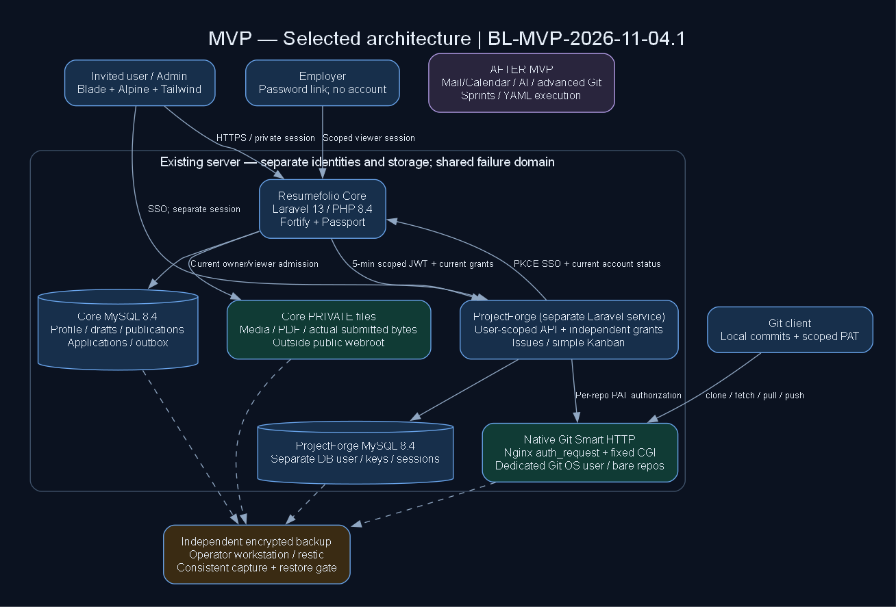

# Selected technical decisions

**BL-MVP-2026-11-04.1 — selected, November 4, 2026.** Selected on November 4, 2026 by Codex under Farhad’s explicit instruction to complete technical decisions and establish the Baseline. This is delegated design authority; no personal owner review, running implementation, deployment or product test is fabricated.

All version numbers below select supported major/minor lines. Project Setup must resolve compatible maintained patch versions, commit lockfiles and prove a clean build. No installed dependency set is claimed here. Source references: [official documentation](sources.md).

## T01 — Runtime, frontend and persistence

Select Laravel 13, PHP 8.4 on a maintained security patch, Composer 2, MySQL 8.4 LTS / InnoDB / utf8mb4, Eloquent and migrations. Use server-rendered Blade, Alpine.js 3, Tailwind CSS 4 and Vite with Node.js 24 LTS for builds. No SPA, second application state framework or Redis is required initially. Use framework-compatible Vite integration versions resolved at Setup. Laravel 13 supports PHP 8.4; an old locally installed 8.4.1 is not a production patch decision.

Both systems use this stack but have separate databases, database users, application keys, processes, sessions, storage roots and OS users. No cross-system SQL joins or transactions. Existing demo databases are not migrated automatically. A new isolated schema avoids an accidental live MySQL upgrade.

Alternatives: React SPA adds API/state/testing work without a current requirement; SQLite simplifies setup but diverges from the selected production concurrency/persistence; PostgreSQL is capable but changes the existing MySQL operating context. Revisit only with measured incompatibility or a new interaction requirement.

## T02 — Core identity and authorization

Use Laravel Fortify with registration disabled. Admin creates/invites users; single-use invitations expire in 72 hours. Email/password login, single-use recovery tokens valid 30 minutes, mandatory TOTP for Admin and optional TOTP for users. Store recovery codes securely and show them once. Password length 15–128 characters, local weak-password denylist, Argon2id initially 64 MiB / time 3 / parallelism 1, benchmarked at Setup. No undeclared external password-check service.

DB-backed sessions: 2-hour idle and 12-hour absolute lifetime; regenerate after login, revoke on account disable/password reset; sensitive admin actions need authentication within 15 minutes. Secure/HttpOnly/SameSite=Lax cookies, CSRF on writes, exact origin allowlists. Limit failed login to 5 per account per 15 minutes and 30 per IP per 15 minutes with a bounded recovery path and generic public errors.

Laravel policies enforce current actor, resource, action, ownership/grant and state on every entry point. Admin manages accounts/configuration/audit metadata; Admin does not inherit private resume/application/media or future mail access. No impersonation in MVP. Default-deny cross-user access, including guessed IDs and direct downloads.

## T03 — Separate ProjectForge identity and API

Select Laravel Passport in Core for OAuth2 authorization-code SSO with PKCE S256. ProjectForge uses the League OAuth2 Client GenericProvider with state and PKCE; validate registered exact redirect URIs and bind the local subject to `(pinned issuer, immutable Core user UUID)`, never to email alone. Provision a local ProjectForge profile only for an active invited Core user with explicit ProjectForge entitlement. Keep browser sessions independent. Tokens remain server-side, encrypted at rest, with single-use code/state and bounded callback lifetime (5 minutes). OAuth access tokens last 5 minutes, no refresh tokens in MVP; reauthorize through the still-valid Core session when needed. This is OAuth2 plus a protected user-info endpoint, not a claim to implement OpenID Connect.

Core-to-ProjectForge API calls carry short-lived RS256 JWTs through `lcobucci/jwt` 5: pinned issuer, audience `projectforge-api`, subject = current authenticated Core UUID, jti, iat/nbf/exp (maximum 5 minutes) and allowlisted action scopes. Core owns the private signing key; ProjectForge receives public keys via pinned JWKS and kid rotation with an overlap no longer than outstanding token lifetime. Reject unsigned, wrong algorithm/issuer/audience, expired or caller-selected subjects. Do not pass service-wide content-reading tokens to browsers.

ProjectForge checks local repository/issue grants AND current Core account/entitlement status through a narrow authenticated internal status endpoint on every new protected request, including native Git. No positive status cache in MVP; a failed/slow status lookup denies access with a service-unavailable response. Service credentials authorize status queries only, never user content. Existing sessions cannot outlive account disable through a stale token. Credential/key configuration is an implementation gate, not another architecture choice.

## T04 — Native Git engine and ProjectForge scope

Use the maintained OS Git 2.x engine and bare repositories, exposed through HTTPS Smart HTTP using `git-http-backend`. Nginx `auth_request` consults ProjectForge; a dedicated fcgiwrap/Git OS account runs the fixed CGI executable with a minimal environment. Only canonical server-owned UUID repository paths are accepted. The CGI location is internal; request headers cannot inject REMOTE_USER, filesystem paths or CGI variables. Git processes cannot read Core media, DB credentials, signing keys or application environments.

Disable dumb HTTP (`http.getanyfile=false`), anonymous export and arbitrary CGI access. Do not set `GIT_HTTP_EXPORT_ALL`; explicitly mark authorized served repositories. Authorize method/service combinations separately for read (`upload-pack`) and write (`receive-pack`), including discovery endpoints. Use hashed 32-byte random per-user PATs shown once, expiring after 90 days, revocable and scoped to selected repositories/read/write. OAuth browser sessions and server JWTs are not native Git PATs. Every operation rechecks current Core status and the local grant. Default deny force/non-fast-forward pushes and ref deletion. Centrally controlled hooks enforce quota/ref rules; never execute repository-provided hooks, YAML, user commands or deployment jobs. Commits are normally made by the Git client. No SSH transport in MVP.

ProjectForge owns repository grants (owner/writer/reader), file/history browsing, issues and a simple To do / In progress / Done Kanban, Low/Normal/High issue priority and optional user-timezone due date. Issue grants do not confer repository write permission. Advanced fork/review/merge/releases, milestones, general Sprint planning and workflow/deployment execution are deferred.

Alternatives: a complete Forgejo service supplies mature Git hosting but introduces an additional platform/authentication lifecycle and broader product behavior; implementing a Git object/transport engine in PHP is unjustified. Selected native Git integration has significant auth/path/process risk: before enabling it, pass G2 with real clients and adversarial fixtures. Failure means revise this decision with evidence, never silently relax security or pretend Git works. Existing sibling reference projects are read-only design references; do not copy licensed source without rights review.

## T05 — Data, publication and durable history

Use explicit application services, typed value objects and small Laravel modules, with domain-owned tables. Distinguish mutable profile source, independent resume draft, immutable publication revision and immutable actual submitted set. Applying selected source changes uses preview + version check + explicit confirmation; publication is a separate confirmed action. Optimistic row versions reject stale writes with a conflict response and retain the user's draft for reconciliation.

A short local transaction creates revisions and atomically changes the live-publication pointer. Generated/uploaded artifacts use private immutable keys, SHA-256, size/type/language/revision metadata and protected reference reservations. Reserve before linking; commit business record and durable outbox together; finalize reservation asynchronously and reconcile abandoned reservations. Garbage collection never removes referenced/reserved/history artifacts. Idempotency keys are bound to actor + operation + payload hash for 7 days; payload mismatch is a conflict. No distributed SQL or universal exactly-once claim. External failures retain truthful pending/failed/unknown outcomes.

Submission records retain exact selected bytes plus checksums and authored cover-letter/context metadata; later edits never replace them. Corrections/resubmissions append a new event/version. A URL alone is not a substitute for a captured actual submitted PDF/document. Publication may be withdrawn without deleting submitted history.

## T06 — Private media and PDF

Store My Files & Media on the existing Core server, outside its public root. No extra media server, paid object storage, editor or transcoding service. Quarantine uploads until extension + detected MIME/magic + size checks pass; decode/re-encode supported images, cap dimensions. MVP types: JPEG/PNG/WebP, PDF, plain UTF-8 TXT/Markdown, MP3/M4A/WAV and browser-playable MP4 (H.264/AAC)/WebM. Reject SVG/HTML/scripts/archives/Office executables and unsupported codecs; no promise of converting unsupported files. Sanitize Markdown to an allowlist with raw HTML disabled. Treat YouTube as an optional external embed with explicit third-party contact, not an upload destination for private media; do not server-fetch arbitrary URLs.

Selected per-file limits: video 250 MiB; audio 50 MiB; PDF 15 MiB; image 10 MiB and 12 megapixels; text 2 MiB. Per-user private storage 1 GiB, within a global Core admission budget of 5 GiB. ProjectForge admission budget 3 GiB, per-repository 512 MiB, incoming push 64 MiB, at most two concurrent Git processes. These are initial policy ceilings, not measured host capacity. Include temporary/quarantine bytes in reservations; reject concurrent over-allocation. Preserve free disk of at least max(10 GiB, 25% filesystem capacity). Reserve for DB/log/backup staging separately; reject uploads/writes safely before disk exhaustion. Operator may lower limits after capacity evidence; increases require a reviewed Baseline revision.

Use Dompdf 3 with trusted Blade templates, A4 and embedded DejaVu fonts for English/German. Disable remote resources, PHP and JavaScript; chroot assets to an allowlisted directory. No user-supplied HTML template or remote URL rendering. One PDF job at a time initially; store its immutable result privately. Test 10-page/5-MiB representative output within 30 seconds before Release.

Upload does not publish. Each resume explicitly selects media/PDF language/mode. Authorize owner or current password-protected viewer scope on every page, preview, direct URL, new download and byte-range request. Nginx internal X-Accel-Redirect serves only after authorization; no public media alias. Use no-store, nosniff and safe Content-Disposition; disable shared caching. Password/link changes revoke future admissions including ranges; already transmitted bytes cannot be recalled. A disabled link must not be bypassed by a previously copied storage URL.

## T07 — Jobs, failures and observability

Use MySQL-backed queue/cache/session stores and one supervised queue worker per application initially. Durable outbox handles retryable external effects; native Git streaming remains synchronous and bounded. API connect timeout 2 seconds / response timeout 10 seconds; identity status timeout 2 seconds and fail closed. Retry only classified retryable/idempotent operations with bounded exponential backoff (1/5/30 minutes, then dead-letter/manual recovery). Never blindly replay an uncertain destructive operation. Include correlation IDs, structured logs and health/readiness endpoints. Audit security and publication/configuration changes as append-only metadata for 180 days; no passwords, tokens, private content or personal correspondence in logs. Bound/rotate logs and monitor disk, queue age, failures and backup freshness.

## T08 — Operations, backup and Release

Use the existing Linux host, Nginx/TLS, separate PHP-FPM pools/OS users, separate MySQL credentials and systemd-managed workers. No HA promise and no extra service purchase. Verify actual CPU/RAM/disk and Nginx auth_request module support before deployment; prior host figures do not prove this stack fits. Local development may use Windows PHP and a separate MySQL 8.4 instance; an XAMPP MariaDB service is not automatically the selected database.

Select encrypted restic backups on an independently stored operator-owned workstation disk outside webroot/cloud-sync folders; pull over restricted SSH. Actual destination capacity, access and schedule must be verified before production. Daily consistent backups, retain 7 daily + 4 weekly, RPO 24 hours, target RTO 8 operator working hours. Use a coordinated maintenance capture that pauses writes in BOTH systems, drains jobs and blocks pushes while making DB dumps, immutable file/repository snapshots and configuration inventories; resume only after a coherent backup set is recorded. Encryption recovery keys are stored separately. Restore to an isolated target before first Release and monthly thereafter; verify users/grants, revoked links/PATs, actual submitted bytes, Git refs and outbox state. Do not replay external effects on restore. These are selected targets, not evidence of a working backup.

Deployment uses a reviewed candidate, verified backup, compatible migrations and atomic code switch. Define code rollback separately from data restoration; destructive migrations need a recovery plan and approval at execution. No automated product workflow runner in MVP. Developer test CI in GitHub is distinct from the deferred user YAML execution product.

## T09 — Verification and quality

Use PHPUnit/Laravel tests, real MySQL integration tests, Laravel Pint and a Laravel-13-compatible Larastan/PHPStan release resolved at Setup. Playwright covers Chromium/Firefox/WebKit user journeys; native Git fixtures exercise real clone/fetch/pull/push. Check dependency audits and package licenses before adoption. Test cross-user IDs, stale sessions/tokens, forged scopes, expired links, direct/range files, path traversal, hooks/environment isolation, quota races, stale edits, interrupted publication and restore.

Target current + previous major desktop browsers at 1280 px and mobile at 390 px, keyboard navigation, 200% zoom and WCAG 2.2 AA. Use 10 registered / 5 concurrent users, 20 resumes per user, 2 published language views, 10 media references; after 2 minutes warmup, run 15 minutes with 50% published reads / 30% private reads / 20% saves. p95 <= 2 seconds, error rate <= 1%, zero authorization leaks or lost committed data. Exclude bulk upload/Git/PDF from the page latency percentile and measure their separate bounds. Target 99% monthly availability after deployment; it cannot be proven before a measurement window. No invented capacity/test Pass.

## T10 — Release and implementation boundary

First build the identity/profile vertical slice and run the isolated native Git security spike early. Preserve the entire MVP scope in the phased backlog; a successful slice is not the full MVP. [Sequence and gates](implementation-sequence.md) defines readiness. Documentation revision and Software Release are independent; keep `MVP` folder and use software tags only for actual artifacts. Do not start implementation, install services or change infrastructure as part of this decision-writing task.
