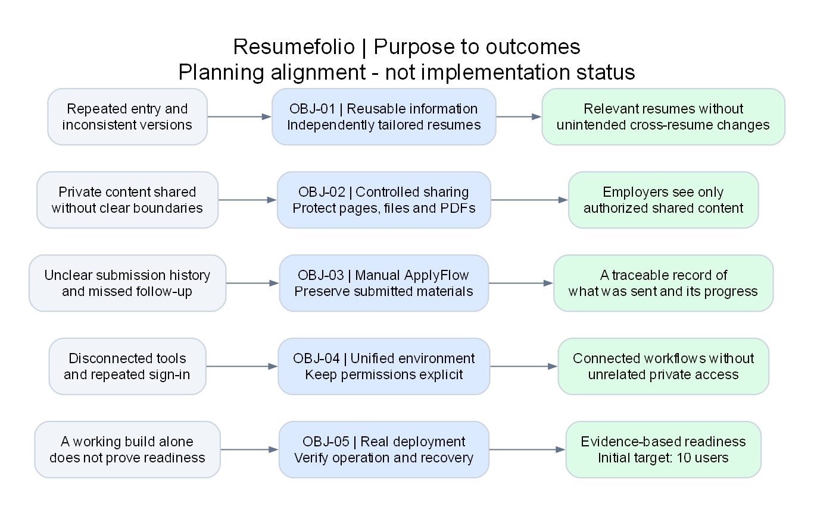
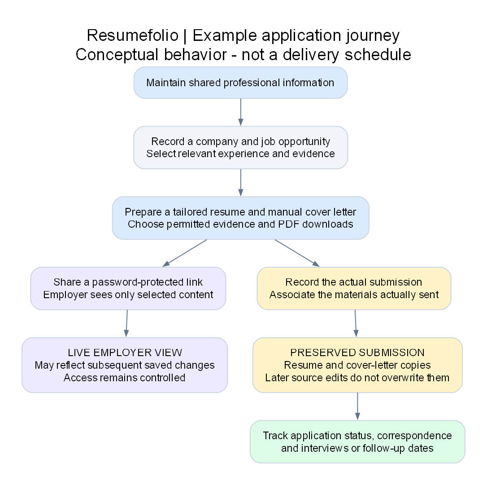

# Resumefolio — Purpose and Objectives

| Item | Current position |
|---|---|
| Project owner | Farhad Valizadegan; sole project delivery and operations owner |
| Document status | Accepted planning-level direction; presentation revised October 31, 2026 |
| Original decisions | DEC-001 through DEC-008, accepted October 29, 2026 |
| Planning baseline | Accepted with tracked follow-up under [DEC-116](10-planning-completion-criteria.md#dec-116) |
| Delivery status | Objectives describe intended outcomes; implementation and technical feasibility are not established here |

**At a glance:** Maintain reusable professional information, prepare targeted
applications, present evidence, control employer access, and keep a reliable
history of applications and related work in one consistent environment.

**Read this document for:** why Resumefolio exists, what value it should provide,
and how its five initial objectives will be evaluated. Detailed feature scope,
requirements, architecture, and delivery dates have their own authoritative documents.

[Purpose](#1-purpose) · [Problem](#2-problem-statement) · [Value](#3-intended-value)
· [Objectives](#4-objectives-and-success-criteria) · [Application journey](#5-example-application-journey)
· [Decision records](#6-purpose-problem-and-value-decisions) · [Open follow-up](#7-open-follow-up-and-boundaries)

## 1. Purpose

Build Resumefolio as a unified web application for creating and updating
professional profiles and tailored resumes from shared source information,
presenting supporting evidence of skills, and providing controlled sharing
with employers. The product is intended for real daily use.

“Unified” describes the intended user experience. It does not select a
technical architecture or narrow the agreed scope of ApplyFlow, email,
calendar, Kanban, and real Git hosting. See [Version 1 Scope](02-scope.md).

## 2. Problem Statement

Professional information and job-application activities are spread across
separate documents, repositories, email accounts, calendars, and task-management
tools. This fragmentation can create confusion, inconsistent information,
duplicated effort, and gaps in follow-up.

Users need a structured way to prepare professional, targeted applications for
each opportunity: select relevant experience and evidence, tailor resumes and
cover letters, control shared information, and record what was submitted,
when, and with what outcome.

| Planning problem | Practical consequence |
|---|---|
| Professional information is fragmented | Repeated entry and inconsistent versions |
| Applications need opportunity-specific materials | Relevant experience and evidence must be selected deliberately |
| Sharing and follow-up use separate tools | Access, correspondence, deadlines, and submitted materials are harder to track together |

These are the accepted problem statements, not measured research findings or
a claim that every user experiences each difficulty.

## 3. Intended Value

| Intended value | What it means for a user |
|---|---|
| Reuse information | Maintain shared professional information and avoid unnecessary repeated entry |
| Prepare targeted applications | Select relevant experience, evidence, and resume presentation for each opportunity |
| Control presentation and access | Share only the intended resume and supporting content with the intended viewer |
| Preserve application history | Distinguish the materials actually submitted from later edits |
| Coordinate related work | Use connected, authorized workflows across resumes, ApplyFlow, email, calendar, Kanban, and Git hosting |

A consistent experience and unified sign-in support these benefits. They are
intended outcomes, not measured improvements or guarantees of employment.

### From problem to objective



[Open scalable diagram](diagrams/purpose-objectives-alignment.svg) ·
[Editable Graphviz source](diagrams/purpose-objectives-alignment.dot)

Read each row from left to right: planning concern → objective → intended
outcome. Arrows express rationale and alignment, not a technical dependency,
implementation sequence, or evidence that the capability already exists.

## 4. Objectives and Success Criteria

The five objectives below are accepted planning-level direction. OBJ references
are navigation labels, not detailed requirements or new scope commitments.
Each objective retains its original decision identifier and rationale.

| Reference | Objective | Main evidence expected later |
|---|---|---|
| OBJ-01 | [Manage professional information](#objective-1-manage-professional-information) | Profile-to-resume workflow and independent resume-specific changes |
| OBJ-02 | [Share information with controlled access](#objective-2-share-information-with-controlled-access) | Allowed and denied access, including direct file and PDF requests |
| OBJ-03 | [Track job applications manually](#objective-3-track-job-applications-manually) | Application history with preserved submitted materials |
| OBJ-04 | [Provide a unified working environment](#objective-4-provide-a-unified-working-environment) | Connected workflows with resource-specific authorization |
| OBJ-05 | [Prepare for real deployment](#objective-5-prepare-for-real-deployment) | Target-environment checks and demonstrated backup restoration |

### Objective 1: Manage professional information

Decision ID: DEC-005
<a id="dec-005"></a>

**Outcome:** Users maintain professional profiles and create tailored resumes
with supporting project and skill evidence.

**Success criteria**
- A user can create a profile, prepare a tailored resume, and display selected supporting content.
- Changing a resume-specific selection, presentation, or content override does not unintentionally alter other resumes.
- Intended updates from shared profile information follow explicit requirements and preserve resume-specific overrides.

**Rationale:** Reuse shared information while preserving independent tailoring
for each opportunity and preventing unintended cross-resume changes.

### Objective 2: Share information with controlled access

Decision ID: DEC-004
<a id="dec-004"></a>

**Outcome:** Users share a selected resume through a password-protected employer link.

**Success criteria**
- The correct password grants access to the intended shared resume.
- An incorrect password or disabled link denies access through that link.
- Associated files and PDFs follow the same authorization boundary; direct URLs do not expose unshared content or bypass authorization.

**Rationale:** Protect the underlying content as well as the resume page.
Download controls govern product access; they cannot revoke copies already
legitimately downloaded. Detailed active-session and revocation behavior remains
in [Scope](02-scope.md) and subsequent Requirements Engineering.

### Objective 3: Track job applications manually

Decision ID: DEC-003
<a id="dec-003"></a>

**Outcome:** Users record opportunities, associate resumes, write cover letters,
and track application progress.

**Success criteria**
- A user can record a company and position, associate a resume, save a manually written cover letter, and update application status.
- The record preserves a traceable copy of the resume and cover letter actually submitted.
- Later source edits do not overwrite those submitted copies.

**Rationale:** Preserve reliable evidence of each application while allowing
ongoing editing. The archived submission is distinct from an employer's live
resume link, which can reflect subsequent saved changes under explicit rules.
Version 1 does not include AI-assisted analysis or drafting. Recording a
submission does not imply automatic submission to external job platforms.

### Objective 4: Provide a unified working environment

Decision ID: DEC-002
<a id="dec-002"></a>

**Outcome:** Resume management, ApplyFlow, email, calendar, Kanban, and real Git
hosting form one consistent product.

**Success criteria**
- A user continues agreed connected workflows across authorized sections without signing in again or re-entering information intended to be reused.
- Access to every resource and operation remains controlled by the user's role and granted permissions.
- An invited Kanban collaborator does not gain access to the owner's private email or resumes; an employer link exposes only intended shared content.

**Rationale:** Combine reusable information and a consistent experience with
explicit authorization boundaries. Unified sign-in is not unrestricted access.
Detailed workflows and permission rules belong in Requirements Engineering.

### Objective 5: Prepare for real deployment

Decision ID: DEC-001
<a id="dec-001"></a>

**Outcome:** Operate the product on the existing server within the available
budget, targeting an initial deployment for 10 users.

**Success criteria**
- Before release, agreed workflows are verified in the target environment.
- Access controls are tested and backup restoration is demonstrated.
- Performance and recovery targets are defined through subsequent requirements and design, then evaluated using actual evidence.

**Rationale:** Assess readiness on the real target infrastructure rather than
source-code existence alone. The initial user count is a planning target, not a
verified capacity result or a concurrency specification. Growth toward roughly
1,000 users informs design; support for that capacity has not been demonstrated.

## 5. Example Application Journey



[Open scalable diagram](diagrams/purpose-application-journey.svg) ·
[Editable Graphviz source](diagrams/purpose-application-journey.dot)

This example explains how OBJ-01 through OBJ-04 work together. It is a
conceptual user journey, not an implementation roadmap or an automatic job
submission workflow. The live employer view and preserved submitted materials
are deliberately shown as separate branches. OBJ-05 supplies operational
readiness for the product as a whole.

Delivery sequencing and provisional dates remain in
[Roadmap and Milestones](08-roadmap-and-milestones.md).

## 6. Purpose, Problem, and Value Decisions

The original purpose, problem, value, and all five objective decisions were
accepted by the project owner on **October 29, 2026**. The objective decisions
are retained alongside their criteria above. The following records preserve
the remaining original decision references and rationale.

### Purpose Review

Decision ID: DEC-008
<a id="dec-008"></a>

**Accepted direction:** The purpose in Section 1.

**Rationale:** Maintain reusable professional information while allowing users
to tailor its presentation, support claims with evidence, and control employer
access. “Unified” does not select an architecture or narrow the wider scope.

### Problem Statement Review

Decision ID: DEC-007
<a id="dec-007"></a>

**Accepted direction:** The problem statement in Section 2.

**Rationale:** Address fragmented information and the need for deliberate,
opportunity-specific preparation and traceable follow-up. This does not assert
measured prevalence of the problem or guaranteed employment outcomes.

### Intended Value Review

Decision ID: DEC-006
<a id="dec-006"></a>

**Accepted direction:** The intended value in Section 3.

**Rationale:** Connect the unified experience to less duplicated effort,
deliberate application preparation, and clearer follow-up. These benefits guide
evaluation; they are not measured results.

See the [Planning Decision Register](decision-register.md) for stable references.
Planning acceptance itself is recorded separately under
[DEC-116](10-planning-completion-criteria.md#dec-116).

## 7. Open Follow-up and Boundaries

| Still to define or verify | Responsible person | Review point / authoritative source |
|---|---|---|
| Detailed fields, profile propagation, PDF, sharing, and permission behavior | Project owner | Before accepting affected requirements; [Scope](02-scope.md) |
| Cross-module workflows and preservation of submitted materials | Project owner | Requirements and data design; [Assumptions and Dependencies](06-assumptions-and-dependencies.md) |
| Measurable performance, availability, and recovery targets | Project owner | Requirements and dependent design acceptance; GAP-D04 and GAP-D10 in [Planning Completion Criteria](10-planning-completion-criteria.md) |
| Server capacity, provider access, storage, and backup feasibility | Project owner | Before dependent commitments; [Validation Assignments](06-assumptions-and-dependencies.md#5-validation-assignments) |
| Effort estimates and delivery forecast | Project owner | After analysis/design and before accepting a forecast; [Roadmap](08-roadmap-and-milestones.md) |

**Completion of this planning document:** The purpose, problem, value, and five
objectives have been reviewed and accepted. Detailed requirements, product
implementation, test success, deployed capacity, and release readiness remain
separate engineering outcomes.

**Revision note — October 31, 2026:** Reorganized the accepted direction for
readability, added navigation labels and explanatory diagrams, and linked
existing follow-up. Existing DEC identifiers, original acceptance date, and
product boundaries are retained. Historical source hashes and the previously
accepted baseline remain records of the earlier revision; this editorial
revision does not silently replace that accepted Git snapshot.

## 8. Diagram Sources and Regeneration

Both diagrams use Graphviz. Keep the `.dot` source, scalable `.svg`, and `.png`
preview together under `diagrams/`. Run from the repository root in PowerShell:

```powershell
$diagramFolder = 'docs\SDLC\01-project-planning\diagrams'
$graphvizExe = 'C:\Program Files\Graphviz\bin\dot.exe'

foreach ($name in 'purpose-objectives-alignment', 'purpose-application-journey') {
    foreach ($format in 'svg', 'png') {
        & $graphvizExe "-T$format" -Gdpi=140 `
            "$diagramFolder\$name.dot" -o "$diagramFolder\$name.$format"
        if ($LASTEXITCODE -ne 0) {
            throw "Graphviz failed: $name ($format)"
        }
    }
}
```

Save DOT sources as UTF-8 without BOM. Review the rendered images whenever
source labels, grouping, or the related document changes.
