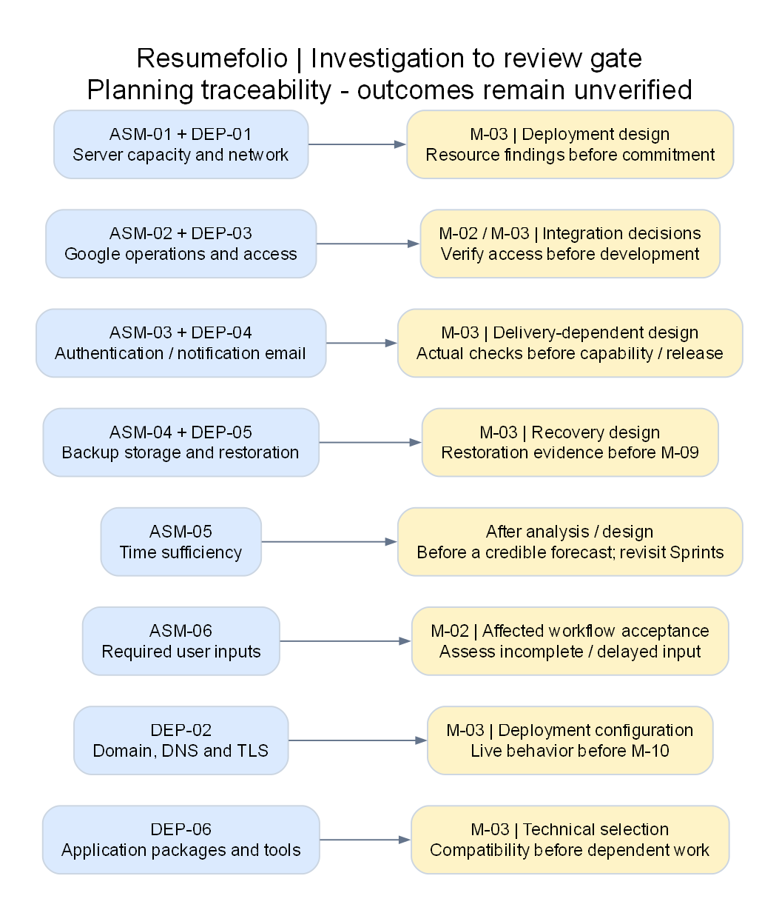
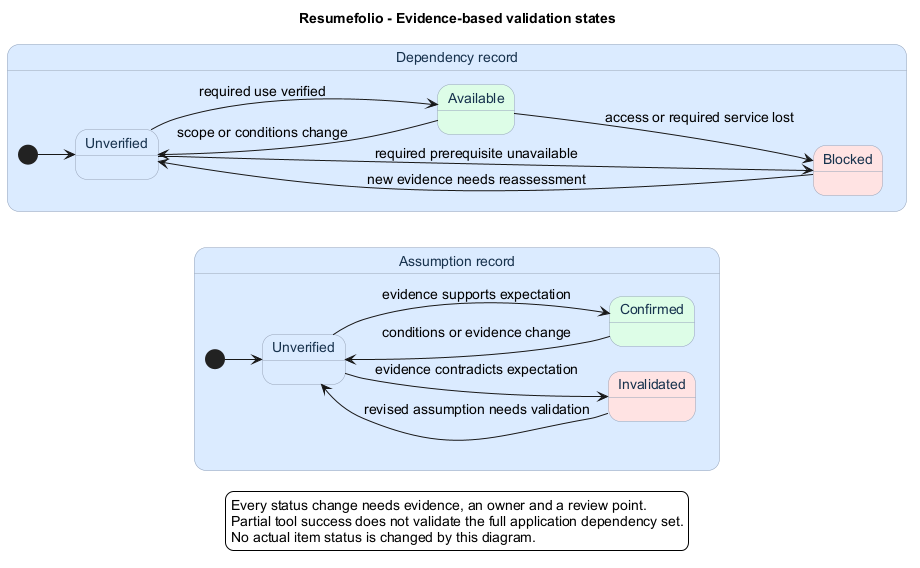

# Resumefolio — Assumptions and Dependencies

| Item | Current position |
|---|---|
| Responsible person | Farhad Valizadegan, project owner; coordinates every investigation in this document |
| Document status | Validation methods, ownership, and review points accepted; technical findings remain open |
| Original decisions | DEC-049 through DEC-061, accepted October 30–31, 2026 |
| Planning baseline | Accepted with tracked follow-up under [DEC-116](10-planning-completion-criteria.md#dec-116) |
| Presentation revision | October 31, 2026; no assumption or dependency is newly validated |

**At a glance:** Six provisional assumptions and six external dependencies
must be investigated before the decisions that rely on them. Internal
prerequisites also guide sequencing. Acceptance of an investigation method is
not confirmation of its result.

[Terms](#1-terms-and-reading-guide) · [Assumptions](#2-planning-assumptions)
· [External dependencies](#3-external-dependencies) · [Internal prerequisites](#4-internal-dependencies)
· [Assignments](#5-validation-assignments) · [Status and evidence](#6-status-tracking-and-evidence)
· [Decision records](#7-accepted-assumption-and-dependency-decisions)

## 1. Terms and Reading Guide

| Term | Meaning here | Example |
|---|---|---|
| Assumption | A provisional expectation to investigate, not a verified fact | The existing server can support the combined initial workload |
| External dependency | A resource, service, or component needed by a workflow | Hosting/network, Google access, or backup storage |
| Internal dependency | A prerequisite relationship between product decisions or capabilities | Permission rules support protected workflows |
| Review gate | The decision before which relevant findings must be reviewed | Accepting deployment design in M-03 |

A server can exist while the assumption about its capacity remains unverified.
A tool can work in isolation while the full application dependency set is still
unselected or untested. Keep those claims separate.

### Investigation-to-decision map



[Open scalable diagram](diagrams/dependency-review-map.svg) ·
[Editable Graphviz source](diagrams/dependency-review-map.dot)

Read each row as an investigation and its affected decision gate. The map is
planning traceability, not a runtime architecture, a dated schedule, or evidence
that the prerequisites have been met. Tables below retain the detailed assignments.

## 2. Planning Assumptions

**Current status: all six assumptions remain unverified.** Their validation
approach is accepted; the expected outcomes have not been established.

| ID | Provisional assumption | Validation action | Needed before | Decision |
|---|---|---|---|---|
| ASM-01 | Existing server capacity is sufficient for the initial workload within budget | Inspect resources and current workloads; define representative combined demand and evaluate it against explicit capacity/performance criteria | Accepting deployment design and dependent capacity commitments | [DEC-061](#dec-061) |
| ASM-02 | Required Google operations are available under acceptable access conditions and cost | Consult current official requirements; identify permissions, quotas and costs; test required operations | Accepting dependent integration details | [DEC-060](#dec-060) |
| ASM-03 | Suitable email delivery can support authentication and notifications | Inspect configuration, access, limits, costs and failure behavior; verify actual delivery | Dependent design commitments; verified email-dependent capability/release readiness | [DEC-059](#dec-059) |
| ASM-04 | Suitable backup storage exists within budget | Inspect location, capacity, separation, access and restoration options; demonstrate restoration and data integrity later | Accepting recovery design; actual recovery evidence before operational readiness | [DEC-057](#dec-057) |
| ASM-05 | Available development time is sufficient for the complete agreed scope | After analysis/design, decompose and estimate all engineering work; compare effort ranges, dependencies and usable capacity; revise against actual progress | Accepting a delivery forecast; revisit milestone/Sprint reviews | [DEC-055](#dec-055) |
| ASM-06 | Required user information is sufficiently complete and timely | Define required inputs and intake workflows; walk through representative, incomplete and delayed-input scenarios | Accepting affected workflows and dependent schedule commitments | [DEC-058](#dec-058) |

The current owner-stated availability is 20 total project hours/week (November 1, 2026); this does not confirm ASM-05. Likewise,
a recorded domain, existing backup file, or successful diagram render cannot
substitute for the investigation needed by another assumption.

If an assumption is invalidated, record its effects and options for the project
owner. Do not silently remove agreed scope or assume additional spending.

## 3. External Dependencies

| ID | Dependency | What depends on it | Verification required | Current position |
|---|---|---|---|---|
| DEP-01 | Hosting server and network | Availability, storage, Git hosting, and background work | Observed allocation, guest OS, free resources and active web/database/PHP services; combined demand, network limits and interruption/failure behavior still need evidence | Partially observed; suitability remains unverified |
| DEP-02 | Domain, DNS, and TLS | Resumefolio.de routing and secure browser access | Administrative control, intended DNS destination, certificate coverage/validity, configuration and renewal | Unverified |
| DEP-03 | Google services | Agreed Gmail and Google Calendar operations | Required permissions, provider conditions, quotas, costs, operation/failure and reconnection behavior | Unverified |
| DEP-04 | Email delivery | Email-dependent authentication, notifications, and relevant recovery paths | Configuration, actual delivery and relevant operational/failure checks | Unverified |
| DEP-05 | Backup storage | Recovery from server failure or data loss | Owner reports no backups set up; independent destination, separation, access, retention and restoration remain to establish | Backup setup absent by owner report; storage suitability and recovery unverified |
| DEP-06 | Software packages and development tools | Building, running, and maintaining the application | Version compatibility, licenses, maintenance/support status, runtime/resource requirements and environment checks | Application dependency set remains unverified; Git and diagram-tool workflows have been demonstrated |

Provider conditions and component information must be checked using current
primary sources at selection and implementation. No provider approval, full
application compatibility, or sufficient capacity is implied by listing a name.

For DEP-06, demonstrated subcomponents do not make the entire dependency set
Available. Select and validate the actual application components before dependent
commitments. Domain and package selection are separate investigations even
though they do not each have a matching ASM identifier.

## 4. Internal Dependencies

| Prerequisite | Dependent decision or behavior | Why the relationship matters |
|---|---|---|
| Detailed requirements and scenarios | System analysis | Model the agreed behavior rather than inventing hidden requirements |
| Analysis and resource findings | Architecture and design choices | Justify decisions against actual needs and constraints |
| Identity and permission rules | Protected workflows | Restrict resources and operations to the authorized user or viewer |
| Data ownership and lifecycle rules | Sharing, collaboration, synchronization, deletion, archives, and recovery | Prevent unintended cross-module changes or loss of submission evidence |
| CI/CD security model, isolation and resource limits | Enabling workflow execution | Control the boundary created by executing project code |
| Actual verification, deployment readiness and demonstrated restoration | Release readiness | Evaluate an identified candidate using evidence rather than file existence |

These relationships guide sequencing and change-impact review. They allow
feedback and iterative refinement; they do not require every related activity
to finish before any useful analysis can begin. Preserve the agreed initial
SDLC documentation, delivery reconciliation and pre-implementation baseline
before product coding.

## 5. Validation Assignments

This heading is retained for existing links. Assignments and review points are
accepted; actual findings remain open. **The project owner is responsible for
every row.** Record evidence before accepting the dependent commitment.

| Items | Review gate | Current status | Related accepted follow-up |
|---|---|---|---|
| ASM-01, DEP-01 | Before accepting deployment design in M-03; verify relevant operational behavior before release | DEP-01 inventory partially observed; ASM-01 combined-workload sufficiency remains unverified | GAP-D01 |
| ASM-02, DEP-03 | Before accepting integration requirements in M-02 and dependent design; verify implementation access before development | Unverified | GAP-D02 |
| ASM-03, DEP-04 | Before accepting authentication delivery design in M-03; verify delivery before dependent release | Unverified | GAP-D03 |
| ASM-04, DEP-05 | Before accepting recovery design in M-03; demonstrate restoration before M-09 acceptance | Owner reports no backup setup; actual destination/suitability and recovery not established | GAP-D04 |
| ASM-05 | After analysis/design and before accepting a forecast; revisit at milestone and Sprint reviews | Unverified; full-time availability does not demonstrate sufficiency | GAP-D05 |
| ASM-06 | During Requirements Engineering before accepting affected workflows; assess timing before dependent commitments | Unverified | GAP-D06 |
| DEP-02 | Before accepting deployment configuration in M-03; verify live configuration before M-10 | Unverified | GAP-D07 |
| DEP-06 | At related technical selection in M-03 and before dependent implementation; verify relevant compatibility before release | Application dependencies unverified; demonstrated tool subsets remain distinct | GAP-D08 |

GAP references use the accepted follow-up in
[Planning Completion Criteria](10-planning-completion-criteria.md). CI/CD
investigation also follows GAP-D09 and the execution risks in
[Risk Register](07-risks.md); measurable targets and storage policy follow GAP-D10.

## 6. Status Tracking and Evidence

### Status vocabulary

| Record type | Status | Meaning |
|---|---|---|
| Assumption | Unverified | Evidence is missing, incomplete, or insufficient to conclude |
| Assumption | Confirmed | Relevant evidence supports the stated expectation within recorded limits |
| Assumption | Invalidated | Evidence contradicts the expectation; assess the impact and options |
| Dependency | Unverified | Availability/suitability for the required use has not been established |
| Dependency | Available | Required access and suitability are supported by relevant evidence |
| Dependency | Blocked | The required resource, access, operation or prerequisite is unavailable or prevents dependent work |

Record partial findings as evidence notes without treating the entire assumption
or dependency as validated. Review status when requirements, infrastructure,
versions, provider conditions, or evidence change. A completed investigation can
still leave an item Unverified or show that it is Invalidated/Blocked.

### Evidence-based state changes



[Open scalable diagram](diagrams/validation-status-model.svg) ·
[Editable PlantUML source](diagrams/validation-status-model.puml)

These diagrams explain permitted status meanings; they do not change any
current item's status. Confirmation and availability are bounded by the
reviewed evidence and must be reconsidered when relevant conditions change.

### What a validation record contains

| Field | What to record |
|---|---|
| Reference | Existing ASM/DEP identifier and affected requirement, design, work item, or risk |
| Responsibility and timing | Project owner, investigation date, and dependent review gate |
| Evidence | Relevant official sources, inspected configuration or identified version/environment, and actual operation/check results |
| Finding and limits | What the evidence supports or contradicts; remaining unknowns and scope of the conclusion |
| Resulting status | Unverified/Confirmed/Invalidated for an assumption, or Unverified/Available/Blocked for a dependency |
| Impact and next action | Affected commitments, options, owner decision where material, and follow-up |

Use [Working Method and Change Control](09-working-method-and-change-control.md)
for significant decisions and revisions. Link unresolved consequences to
[Risk Register](07-risks.md) and the relevant work items. Evidence records must
not contain passwords, tokens, private keys or other secrets.

## 7. Accepted Assumption and Dependency Decisions

The expandable section preserves all thirteen original decisions, their dates,
IDs, rationale and investigation limits. Historical statements about separate
baseline review refer to their original stage. Planning-only acceptance was
later recorded under [DEC-116](10-planning-completion-criteria.md#dec-116).

<details>
<summary>Original assumption, dependency, validation-method and responsibility decisions</summary>

### ASM-01 Server Capacity Assumption Review

Decision ID: DEC-061
<a id="dec-061"></a>

Status: Assumption treatment and validation approach accepted;
server capacity remains unverified
Review date: October 30, 2026

Decision: Treat sufficient capacity of the existing server for the
initial application workload within budget as a provisional
assumption, not an established technical fact.

Validation: Inspect resources and current workloads, define a
representative workload, and evaluate it against explicit capacity
and performance criteria. Record evidence and whether the assumption
is confirmed, invalidated, or remains unresolved before finalizing
the deployment design. The project owner coordinates this work.

Rationale: Make a material infrastructure assumption explicit so
architecture and deployment decisions do not rest on a hidden guess.
If invalidated, record the impact and options for the project owner's
decision without silently changing scope or assuming new spending.

This review does not access or modify the server, execute load
tests, or establish capacity for either 10 or 1,000 users.

### ASM-02 Google Integration Access Review

Decision ID: DEC-060
<a id="dec-060"></a>

Status: Assumption and validation approach accepted for tracking;
provider access and suitability remain unverified
Review date: October 30, 2026

Decision: Provisionally assume required Gmail and Google Calendar
operations can be supported under acceptable access conditions,
limits, and costs. Check current provider documentation, required
permissions, API access, quotas, and costs, and test the required
operations before committing to dependent integration details.

Rationale: Avoid designing workflows around unavailable permissions
or unsuitable provider conditions. The project owner coordinates
validation; link findings to ASM-02 and DEP-03.
No provider investigation or integration test has yet been demonstrated
by this review.

### ASM-03 Email Delivery Review

Decision ID: DEC-059
<a id="dec-059"></a>

Status: Assumption and validation approach accepted for tracking;
email delivery remains unverified
Review date: October 30, 2026

Decision: Provisionally assume suitable, affordable email delivery
can support authentication and notifications. Investigate available
arrangements, required configuration, access, quotas, costs, and
failure behavior; validate actual delivery before releasing dependent
workflows and before committing to the dependent technical design.

Rationale: Authentication and notification workflows depend on
working delivery, not merely on having an email address or account.
The project owner coordinates validation;
record findings against ASM-03 and DEP-04. This does not introduce
public self-registration or a new application-submission integration.
No successful delivery test is claimed by this review.

### ASM-06 User Input Availability Review

Decision ID: DEC-058
<a id="dec-058"></a>

Status: New provisional assumption and validation approach accepted
for tracking; actual input availability remains unverified
Review date: October 30, 2026

Decision: Record the provisional expectation that information needed
from users for planned workflows is available with sufficient
completeness and timeliness. Do not treat this as a guarantee of
future user behavior or as a verified delivery dependency.

Validation: Define required inputs, forms, and intake workflows in
Requirements Engineering. Walk through a representative scenario
with suitable sample information and identify missing, delayed,
or incomplete inputs and their effects. Define handling of those
cases before accepting the affected workflows and schedules.

Rationale: Make information needs visible rather than silently
assuming all input will arrive complete and on time. The project
owner coordinates this work. This review
does not claim forms are implemented or a scenario test has run.

### ASM-04 Backup Storage Assumption Review

Decision ID: DEC-057
<a id="dec-057"></a>

Status: Assumption treatment and validation approach accepted;
storage suitability and restoration remain unverified
Review date: October 30, 2026

Decision: Treat suitable backup storage within budget as provisional.
Inspect its location, available capacity, separation from the primary
server, access arrangements, and restoration options. Record findings
before accepting recovery design; demonstrate restoration before
accepting operational readiness.

Rationale: A copy on the same primary server may not cover complete
server loss. Do not infer independent recovery capability merely
from backup-file existence. The project owner coordinates the
investigation; link evidence to ASM-04,
DEP-05, and the backup investigation work item.

This review does not establish available storage, run restoration,
or authorize purchasing services or modifying server data.

### External Google and Email Provider Dependency Review

Decision ID: DEC-056
<a id="dec-056"></a>

Status: Dependency treatment and validation approach accepted;
provider access and operating conditions remain unverified
Review date: October 30, 2026

Decision: Track Gmail and Google Calendar under DEP-03 and email
delivery under DEP-04 as external dependencies. Required access,
provider-condition changes, limits, and service interruption can
affect dependent workflows and must be addressed explicitly.

Validation: Consult current official provider sources, identify
required operations, permissions, limits, and costs, and define
appropriate operation and failure-behavior checks. Record sources,
findings, and limitations before dependent commitments, with the
project owner coordinating validation.

Rationale: Keep dependence on external services visible and testable
rather than assuming uninterrupted availability or unchanged access.
Link findings to ASM-02 and ASM-03 and the existing validation
assignments. This review does not claim provider research or
successful integration tests have already been performed.

### ASM-05 Development Time Assumption Review

Decision ID: DEC-055
<a id="dec-055"></a>

Status: Validation approach accepted by the project owner;
time sufficiency and delivery forecast remain unverified
Review date: October 31, 2026

Decision: Treat sufficient development time for the complete agreed
scope as a provisional assumption. Full-time solo availability is
confirmed, but does not establish numerical throughput or prove
that the requested delivery target is achievable.

Validation: After the initial analysis and design review, break down
work into estimable items, identify dependencies, and include learning,
implementation, testing, documentation, integration, and rework.
Compare effort ranges with available capacity, then reconcile Sprints
and milestones. During execution, revise forecasts against observed
progress and record the reasons and effects of changes.

Review point: Before accepting a schedule as a credible delivery
forecast, and again at relevant milestone and Sprint reviews. An
already recorded target date is not evidence validating the schedule.
The project owner coordinates estimation.

Rationale: Distinguish the requested target from an evidence-based
forecast and make scope/time conflicts explicit. If the assumption
is invalidated, document options for the project owner's decision;
do not silently reduce scope or claim that Agile guarantees the date.

This review records the validation method only. It does not estimate
all remaining work, revise live GitHub dates, accept the overall
planning baseline, or authorize starting implementation now.

### DEP-01 Hosting Server and Network Dependency Review

Decision ID: DEC-054
<a id="dec-054"></a>

Status: Dependency treatment and validation approach accepted;
technical characteristics and failure behavior remain unverified
Review date: October 31, 2026

Decision: Track the hosting server and network as external
infrastructure dependencies for application operation, storage,
Git hosting, and background processing. This dependency is distinct
from ASM-01, which provisionally assumes sufficient capacity.

Validation: Inspect available resources, existing workloads,
network and storage limits, and relevant access arrangements.
Define and document expected behavior during interruption or
failure, then verify relevant recovery and error-handling scenarios
before accepting dependent operational capabilities.

Review point: Evaluate findings before accepting deployment design
and dependent capacity commitments; verify operational behavior
before release. The project owner coordinates the investigation, linking findings to DEP-01 and ASM-01.

Rationale: Make reliance on infrastructure explicit and distinguish
its existence from evidence of adequate capacity and resilience.
Record limitations and unresolved findings rather than assuming
uninterrupted operation or sufficient resources.

This review does not inspect or modify the server, run load or
failure tests, or establish availability or recovery guarantees.

### DEP-02 Domain DNS and TLS Dependency Review

Decision ID: DEC-053
<a id="dec-053"></a>

Status: Dependency treatment and validation approach accepted;
current configuration and certificate arrangements remain unverified
Review date: October 31, 2026

Decision: Track the domain, DNS, and TLS arrangements as dependencies
for reaching Resumefolio.de through the intended secure connection.
Domain availability alone does not establish correct routing or
valid HTTPS configuration.

Validation: Verify administrative access to domain configuration,
relevant DNS records and their intended server destination, and
TLS certificate validity, coverage, configuration, and renewal
arrangements. Record findings without exposing credentials.

Review point: Review configuration findings before accepting the
deployment design and verify the live domain and HTTPS behavior
before deployment acceptance. The project owner coordinates this
work, recording evidence against DEP-02.

Rationale: Ensure that a deployed application can be reached through
the intended address with an appropriately configured secure
connection rather than assuming server deployment alone provides it.

This acceptance records the investigation approach. It does not
inspect or change DNS, issue or renew a certificate, access domain
administration, or establish that HTTPS currently works correctly.

### DEP-06 Software Packages and Development Tools Review

Decision ID: DEC-052
<a id="dec-052"></a>

Status: Dependency treatment and evaluation approach accepted;
individual application dependency selections remain open
Review date: October 31, 2026

Decision: Evaluate software packages and development tools against
required behavior, version compatibility, usage licenses,
maintenance and support status, and runtime and infrastructure
requirements. Document significant selection decisions, alternatives,
rationale, and material limitations.

Validation: Check current primary project or vendor documentation
and relevant release and license information when selecting a
component. Verify compatibility through appropriate checks in the
intended environment rather than relying on package availability
or prior use alone.

Review point: Evaluate before accepting the related technical
selection during analysis and design, and validate required
compatibility before dependent implementation and release.
The project owner coordinates this work.

Rationale: Reduce unsupported or unsuitable technical dependencies
and make choices defensible against actual product and resource
constraints. Reassess selections when relevant versions, requirements,
or maintenance conditions change.

Previously demonstrated Git and diagram tooling remain distinct
from unselected and unverified application dependencies. This review
does not select, install, update, or validate a new package.

### Internal Dependencies Review

Decision ID: DEC-051
<a id="dec-051"></a>

Status: Dependency relationships and their planning use accepted
by the project owner
Review date: October 31, 2026

Decision: Use requirements and scenarios as the basis for analysis
and design. Treat identity and permissions as prerequisites for
protected behavior; data ownership and lifecycle rules as inputs
to sharing, deletion, and restoration; and CI/CD security and
resource boundaries as prerequisites for enabling workflow execution.
Release readiness depends on actual verification evidence,
deployment readiness, and demonstrated recovery.

Rationale: Make the sequence of dependent decisions and the effects
of change explicit. Link the affected requirements, design decisions,
work items, and verification evidence so changes can be evaluated
across the relevant product areas.

These relationships guide work sequencing without prohibiting
feedback, iterative review, or incremental delivery. Preserve the
agreed initial documentation and baseline process before product
coding, then revise affected artifacts as evidence emerges.

This review does not claim prerequisites are already satisfied,
accept the overall planning baseline, or authorize release.

### Tracking and Review Method Acceptance

Decision ID: DEC-050
<a id="dec-050"></a>

Status: Tracking and review method accepted by the project owner;
individual validation outcomes remain unchanged
Review date: October 31, 2026

Decision: Track assumptions as unverified, confirmed, or invalidated,
and dependencies as unverified, available, or blocked. Support status
changes with evidence and a recorded responsible person and review
point. The project owner coordinates this work.

Review affected items when requirements, infrastructure, or provider
conditions change. Link unresolved consequences to the risk register
and affected work items. Never include credentials or other secrets
in repository evidence.

Rationale: Distinguish acceptance of an investigation method from
confirmation of its outcome, and keep changes traceable rather than
allowing unverified assumptions to become implicit facts.

This acceptance does not confirm a resource, complete an investigation,
change an item's technical validation status, or approve the overall
planning baseline.

### Validation Assignments Review

Decision ID: DEC-049
<a id="dec-049"></a>

Status: Responsibility assignments and review points accepted;
technical validation outcomes remain unchanged
Review date: October 31, 2026

Decision: The project owner coordinates the listed investigations.
Review Google access before committing to integration details;
server and CI/CD resources before accepting dependent designs;
backup arrangements before accepting recovery design, with actual
restoration evidence before release; time sufficiency after analysis
and design and against observed progress; and software dependencies
at selection and before dependent implementation.

Rationale: Give open questions accountable ownership and a review
point before their results are needed. Acceptance of assignments
does not confirm assumptions, complete tests, or establish resources.

</details>

## 8. Current Review and Revision Summary

All six assumptions remain unverified. External arrangements and the application
dependency set still need validation; prior tool demonstrations do not confirm
those wider outcomes. Internal prerequisite relationships, investigation
methods, ownership, status vocabulary, and review gates are accepted.

**Editorial revision — October 31, 2026:** Added a reading guide, clearer status
and evidence tables, linked review-gate assignments, and two diagrams. The
thirteen original decision records are unchanged; all ASM/DEP identifiers and
the existing Validation Assignments anchor are retained. No server inspection,
provider investigation, integration test, recovery exercise or new dependency
selection is claimed. Earlier hashes still identify their original snapshots.

## 9. Diagram Sources and Regeneration

The review map uses Graphviz; the state model uses PlantUML. Keep editable
sources, scalable `.svg` outputs and `.png` previews under `diagrams/`.
Run from the repository root in PowerShell:

```powershell
$diagramFolder = 'docs\SDLC\01-project-planning\diagrams'
$graphvizExe = 'C:\Program Files\Graphviz\bin\dot.exe'
$plantUmlJar = Join-Path $env:LOCALAPPDATA 'Resumefolio\DiagramTools\plantuml.jar'

foreach ($format in 'svg', 'png') {
    & $graphvizExe "-T$format" -Gdpi=140 `
        "$diagramFolder\dependency-review-map.dot" `
        -o "$diagramFolder\dependency-review-map.$format"
    if ($LASTEXITCODE -ne 0) { throw "Graphviz failed: $format" }

    java -jar $plantUmlJar -charset UTF-8 "-t$format" `
        "$diagramFolder\validation-status-model.puml"
    if ($LASTEXITCODE -ne 0) { throw "PlantUML failed: $format" }
}
```

Use the installed user's PlantUML JAR path when working under another account.
Save diagram sources as UTF-8 without BOM. Keep the model, state vocabulary,
assignment table and actual validation records consistent when findings change.

## November 1, 2026 — DEP-01 Inventory Evidence

Owner-supplied panel screenshots and SSH output establish a bounded current inventory; see [recorded observations and limits](../02-requirements-engineering/01-process-and-approach/02-feasibility-study.md#server-observation-2026-11-01). CPU/RAM/disk allocation, guest OS and the observed running stack are no longer wholly unknown. This is partial progress on DEP-01, not verification of ASM-01: representative combined application/media/Git/job demand, resource limits, performance and operational suitability remain unverified. All six capacity/access/recovery/time assumptions remain unverified as assumptions; no accepted GAP-D item is closed.

## November 1, 2026 — ASM-05 Capacity Input

The actual owner answer is 20 project hours/week, including learning/docs/tests. [Preliminary sizing](11-capacity-and-preliminary-sizing.md) exposes the historical target conflict but remains an unaccepted low-confidence estimate. ASM-05 sufficiency remains unverified; historical full-time wording in original decision records is preserved as history.

## November 1, 2026 — DEP-05 Owner Clarification

The owner confirmed backups have not been set up. DEP-05 now records an unmet setup dependency rather than an unknown owner answer. ASM-04 (suitable storage within budget) remains unverified: lack of configured backups does not prove that no suitable storage exists. GAP-D04 remains open with its original design/readiness gates. No new spending, provider setting, backup operation or restoration is authorized by recording this fact.
