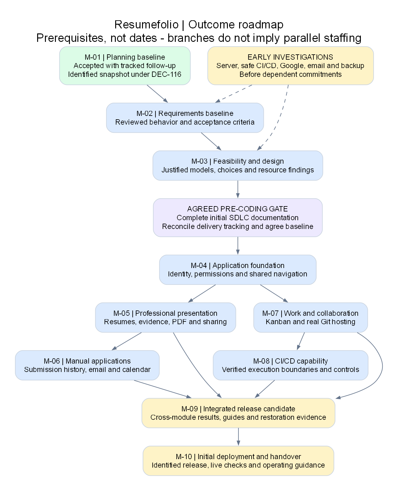
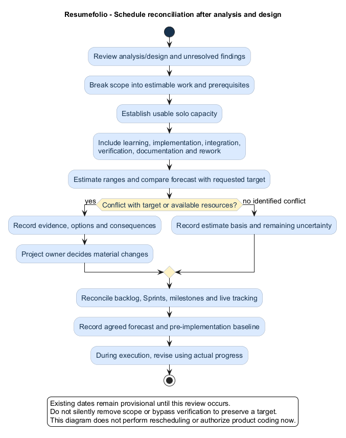

# Resumefolio — Roadmap and Milestones

| Item | Current position |
|---|---|
| Project owner | Farhad Valizadegan; sole delivery and operations owner |
| Roadmap status | Outcome definitions and review methods accepted; effort and schedule feasibility unresolved |
| Milestone acceptance | M-01 accepted with tracked follow-up under DEC-116; M-02–M-10 completion remains pending |
| Requested delivery target | Complete agreed Version 1 by November 8, 2026, Europe/Berlin; not a validated forecast |
| Original decisions | DEC-075 through DEC-089, accepted October 31, 2026 |
| Presentation revision | October 31, 2026; no historical date, Sprint assignment, or capability is changed |

**At a glance:** Milestones are evidence-based outcome checkpoints. They are
not fixed-duration work periods. The roadmap shows prerequisites and delivery
outcomes; estimates and live tracking must be reconciled after analysis/design.

[Visual roadmap](#1-outcome-based-roadmap) · [Milestones](#2-milestone-catalog)
· [Early investigation](#3-early-investigations) · [Estimation](#4-estimation-and-schedule-reconciliation)
· [Historical dates](#5-provisional-target-checkpoints) · [Reviews](#6-milestone-review-and-scope-change)
· [Decision records](#7-accepted-roadmap-decision-records)

## 1. Outcome-Based Roadmap



[Open scalable diagram](diagrams/outcome-roadmap.svg) ·
[Editable Graphviz source](diagrams/outcome-roadmap.dot)

Solid arrows show the main prerequisite relationships. Dashed arrows show early
investigations feeding dependent decisions. Branches do not imply parallel
staffing or simultaneous execution; the owner still plans feasible solo work.
This is a planning overview, not a complete task graph or a dated forecast.

Before product coding, complete the agreed initial analysis/documentation for
all SDLC phases, reconcile delivery tracking, and agree the pre-implementation
baseline. This gate does not create an extra milestone or replace M-03.

A milestone can span several Sprints. A Sprint can contribute to more than one
milestone. Relevant requirements, design, verification, and documentation evolve
iteratively; testing starts with requirement review and continues through operation.

## 2. Milestone Catalog

Definitions and completion conditions are accepted. Only a separate review of
actual outcomes establishes milestone completion. Links retain the original
milestone decisions and detailed rationale.

| ID | Reviewable outcome | Main prerequisites | Completion evidence / original decision |
|---|---|---|---|
| M-01 | Planning baseline | Planning completion criteria | Reviewed planning documents, assigned significant unknowns, and identifiable owner decision; [DEC-088](#dec-088). Accepted snapshot: [DEC-116](10-planning-completion-criteria.md#dec-116) |
| M-02 | Requirements baseline | M-01; relevant stakeholder input and integration findings | Identified requirements, scenarios, permissions, lifecycle rules and testable acceptance criteria reviewed; [DEC-087](#dec-087) |
| M-03 | Feasibility and design baseline | Relevant requirements; resource/dependency investigations | Justified architecture, data/interfaces/security, deployment and recovery design; consistent diagrams, alternatives and evidence; [DEC-086](#dec-086) |
| M-04 | Application foundation | Relevant M-02/M-03 outcomes and agreed pre-coding gate | Identity, permissions, navigation and application structure operate in an identified revision with allowed/denied-path results; [DEC-085](#dec-085) |
| M-05 | Professional presentation | Foundation; file/data lifecycle decisions | Profiles, tailored resumes, portfolio/evidence, PDFs and controlled sharing verified together, including direct-file authorization; [DEC-084](#dec-084) |
| M-06 | Manual application management | Foundation, resume workflows, validated integrations | Manual ApplyFlow, preserved submitted materials, email and calendar workflows verified together; [DEC-083](#dec-083) |
| M-07 | Work and collaboration | Foundation, permissions, Git feasibility | Kanban/backlog/Sprint workflows and agreed real Git hosting/collaboration operations verified; [DEC-082](#dec-082) |
| M-08 | CI/CD capability | Git workflows; early execution feasibility and security findings | Real YAML execution with verified isolation, permissions, secrets, limits and agreed deployment controls; [DEC-081](#dec-081) |
| M-09 | Integrated release candidate | All Version 1 capability outcomes | Cross-module and agreed quality results, aligned guides, restoration/data-integrity evidence, and release-blocker decisions; [DEC-080](#dec-080) |
| M-10 | Initial deployment and handover | M-09 and deployment readiness | Identified release deployed, live checks passed, operating guidance aligned, release decision and limitations recorded; [DEC-079](#dec-079) |

**Current acceptance:** M-01 is accepted with tracked follow-up for the identified
planning snapshot. Editorial changes being reviewed do not silently replace it.
No M-02–M-10 outcome has been accepted as complete by these planning records.
For a solo project, handover means the owner can use and operate the release
with the supplied guidance; it does not assume another delivery/operations team.

## 3. Early Investigations

Do not wait until a feature's implementation slot to discover a decisive
feasibility constraint. The project owner coordinates each investigation and
records findings before accepting dependent commitments.

| Investigation | Why it is early | Existing references / review gate |
|---|---|---|
| Combined server capacity and workloads | Affects deployment, storage, Git and job execution choices | ASM-01, DEP-01, RSK-02/RSK-08; before dependent M-03 design |
| Safe CI/CD execution | Isolation and resource limits can affect feasibility and architecture | RSK-03, GAP-D09; before execution design acceptance or enabling jobs |
| Google access and operations | Provider conditions can prevent agreed integrations | ASM-02, DEP-03, RSK-06; before dependent M-02/M-03 decisions |
| Email delivery | Authentication and notifications depend on actual delivery behavior | ASM-03, DEP-04, RSK-07; before dependent M-03 design and release checks |
| Backup storage and recovery | Recovery design needs suitable storage; release needs actual restoration | ASM-04, DEP-05, RSK-05; design in M-03, evidence before M-09 |

Use [Assumptions and Dependencies](06-assumptions-and-dependencies.md),
[Resources and Constraints](05-resources-and-constraints.md), and
[Risk Register](07-risks.md) as the authoritative investigation and risk records.
A recorded target date does not waive these gates.

## 4. Estimation and Schedule Reconciliation

The three existing dated Sprint cycles are provisional. Full-time availability
has been confirmed, but numerical capacity and delivery duration have not.
After the initial analysis and design review:
1. Decompose the reviewed scope into estimable work with clear outcomes.
2. Identify dependencies, open investigations, and usable working time.
3. Include learning, implementation, integration, verification, documentation, operational preparation, and rework.
4. Use effort ranges where uncertainty remains and record the basis of significant estimates.
5. Compare the forecast with the requested target and expose any conflict with options and consequences.
6. Reconcile product/Sprint backlogs, milestone sequencing and dates, and live tracking before accepting the forecast or starting product coding.
7. During execution, revise estimates using actual progress and record reasons for changes.

### Reconciliation flow



[Open scalable diagram](diagrams/schedule-reconciliation.svg) ·
[Editable PlantUML source](diagrams/schedule-reconciliation.puml)

This describes the agreed estimation method, not completed estimation or a new
schedule commitment. Live status and assignments remain in GitHub; local dated
tables preserve the historical plan until the agreed reconciliation review.

## 5. Provisional Target Checkpoints

These are the **original requested target checkpoints**, retained unchanged for
traceability. They are not verified forecasts, actual completion dates, or
authorization to bypass requirements, design, or evidence. Times refer to
Europe/Berlin. M-01's actual owner acceptance was recorded on October 31, 2026,
separately from its original October 30 target.

| Milestone | Historical target date |
|---|---|
| M-01 — Planning baseline | 2026-10-30 |
| M-02 — Requirements baseline | 2026-10-31 |
| M-03 — Feasibility and design baseline | 2026-11-01 |
| M-04 — Application foundation | 2026-11-01 |
| M-05 — Professional presentation | 2026-11-03 |
| M-06 — Manual application management | 2026-11-04 |
| M-07 — Work and collaboration | 2026-11-05 |
| M-08 — CI/CD capability | 2026-11-06 |
| M-09 — Integrated release candidate | 2026-11-07 |
| M-10 — Initial deployment and handover | 2026-11-08 |

[Provisional delivery plan](../../Project-Management/version-1-delivery-plan.md)
· [Product Backlog](../../Project-Management/product-backlog.md)
· [Private GitHub delivery project](https://github.com/users/Farhad-Valizadegan/projects/6)

Reaching a historical target is not evidence that an outcome is complete.
This document revision does not update remote dates, Sprint membership, or status.

## 6. Milestone Review and Scope Change

For each milestone review, record:
- Outcome, agreed completion conditions, and related requirements/deliverables.
- Identified application version or document revision and actual supporting evidence.
- Known limitations, open risks/issues, and assigned follow-up.
- The owner's dated decision, rationale, and whether more work is required.

A commit, successful build, target date, or completed task count alone does not
establish milestone acceptance. Use [Deliverables](04-deliverables.md) and
[Planning Completion Criteria](10-planning-completion-criteria.md) for the
relevant output and planning acceptance conditions.

Incremental delivery and changes to sequence do not remove agreed Version 1
capabilities. Product AI remains outside Version 1. Changes affecting scope,
cost, quality commitments, or delivery expectations require assessment, recorded
reasons/options/consequences, and the owner's decision under
[Working Method and Change Control](09-working-method-and-change-control.md).

## 7. Accepted Roadmap Decision Records

The original fifteen records below retain the roadmap method, ten milestone
definitions, investigation/estimation/review rules, and scope-change decision.
Historical Pending statements refer to their original review stage. The current
M-01 acceptance is DEC-116; definitions do not imply completion of later milestones.

<details>
<summary>Original roadmap, milestone, estimation, review, and scope-change decisions</summary>

### Outcome-Based Roadmap and Provisional Scheduling Review

Decision ID: DEC-089
<a id="dec-089"></a>

Status: Roadmap approach accepted by the project owner;
individual milestone definitions accepted in the records below; schedule revision remains pending
Review date: October 31, 2026

Decision: Define milestones by reviewable outcomes and completion
evidence rather than only dates or task counts. For example, a
requirements baseline requires reviewed requirements and explicit
acceptance criteria; document existence alone is insufficient.

Retain the existing target dates and Sprint assignments as provisional
planning records. After the agreed analysis and design work, reconcile
the product backlog, Sprint backlogs, milestones, effort estimates,
and delivery forecasts against the reviewed documentation and baseline.
Record reasons and impacts for material revisions.

Rationale: Ground sequencing and delivery expectations in actual
scope, dependencies, risks, and evidence while supporting iterative
review and incremental delivery. Do not silently remove agreed
capabilities to preserve an earlier target.

Preserve the agreed documentation-first sequence before product
implementation. This record does not revise live GitHub dates,
accept any milestone as complete, validate the requested deadline,
or approve the overall planning baseline.

### M-01 Planning Baseline Review

Decision ID: DEC-088
<a id="dec-088"></a>

Status: Milestone definition and completion criteria accepted by the project owner; milestone completion remains pending
Review date: October 31, 2026

Decision: Complete M-01 when all ten planning documents have been reviewed, the planning decisions are explicit, and significant open matters have an identified owner and review point. Assess completion against the planning completion criteria; file existence alone is insufficient.

Technical investigations may remain open where their findings are not required to accept the planning baseline, provided they are tracked and must be reviewed before the dependent commitment. An unresolved matter that prevents a sound planning agreement must be addressed before accepting M-01.

The baseline identifies a specific agreed revision. Subsequent revisions remain possible, with the reason for change and its effects recorded and reviewed.

Rationale: Establish a traceable planning agreement without presenting unresolved technical assumptions as verified facts or preventing iterative improvement.

Acceptance of this definition does not mark M-01 complete. Review of the remaining planning documents is still in progress, and this milestone does not authorize product implementation.

### M-02 Requirements Baseline Review

Decision ID: DEC-087
<a id="dec-087"></a>

Status: Milestone definition and completion criteria accepted by the project owner; milestone completion remains pending
Review date: October 31, 2026

Decision: Complete M-02 when the agreed Version 1 requirements have identifiers, scenarios, relevant access rules, and testable acceptance criteria, and have been reviewed by the project owner. Resolve ambiguities that would prevent agreement on expected behavior. Track other open matters with an owner and review point before dependent commitments.

For example, password-protected sharing requirements must specify authorized content, behavior for an incorrect password, and the effect of disabling a link. This example identifies matters to specify during Requirements Engineering; it does not replace the detailed requirements.

Identify the agreed requirements revision as the baseline. Record and review subsequent changes and their effects on related analysis, design, tests, and delivery planning.

Rationale: Give system analysis, design, and verification a clear, traceable statement of expected behavior instead of relying on assumptions or feature names alone.

Acceptance of this milestone definition does not establish the requirements baseline or mark M-02 complete. Detailed Requirements Engineering and its review remain pending.

### M-03 Feasibility and Design Baseline Review

Decision ID: DEC-086
<a id="dec-086"></a>

Status: Milestone definition and completion criteria accepted by the project owner; milestone completion remains pending
Review date: October 31, 2026

Decision: Complete M-03 when the architecture, data model, module interactions, access boundaries, deployment approach, recovery approach, and CI/CD execution isolation have been defined and reviewed against the agreed requirements and actual project resources. Include explanatory text and consistent diagrams with editable sources and rendered outputs. Document alternatives considered, selection rationale, constraints, and significant consequences.

Obtain findings for investigations that determine the feasibility of the dependent design before accepting that design, including relevant server resources and external service access. Track remaining open matters with an owner and review point. An unresolved issue that prevents a justified feasibility or design decision must be addressed before accepting the affected baseline.

Identify the agreed design revision and its supporting evidence. Record and review subsequent changes and their effects on requirements, diagrams, implementation planning, verification, deployment, and recovery documentation as applicable.

Rationale: Establish a design that covers the agreed requirements and can be supported by actual resources, rather than treating an architectural preference or an unverified technical assumption as proof of feasibility.

Acceptance of this milestone definition does not select a final architecture, verify technical capacity or integrations, mark M-03 complete, or authorize product implementation. The agreed documentation and baseline review sequence remains in effect.

### M-04 Application Foundation Review

Decision ID: DEC-085
<a id="dec-085"></a>

Status: Milestone definition and completion criteria accepted by the project owner; milestone completion remains pending
Review date: October 31, 2026

Decision: Define M-04 as the implemented and verified application foundation: user accounts, sign-in and sign-out, roles and permissions, the initial application structure, and consistent navigation between modules with unified sign-in. Detailed behavior must follow the reviewed requirements and design.

Complete this milestone when the agreed foundation capabilities operate in an identified application revision and verification results demonstrate the expected behavior, including denial of unauthorized access to information and operations. Link the verification evidence and remaining limitations to that revision. File or code existence alone is insufficient.

Rationale: Provide a shared, dependable foundation for subsequent capabilities, with identity and authorization established before dependent private workflows are accepted.

This acceptance defines a future delivery outcome. It does not claim implementation or verification has occurred, mark M-04 complete, or start product coding. Implementation remains subject to the agreed documentation-first sequence and baseline agreement.

### M-05 Professional Presentation Review

Decision ID: DEC-084
<a id="dec-084"></a>

Status: Milestone definition and completion criteria accepted by the project owner; milestone completion remains pending
Review date: October 31, 2026

Decision: Define M-05 as the implemented and verified professional presentation capabilities: professional profiles, opportunity-specific resumes, portfolio and supporting evidence, generated and uploaded PDFs, and password-protected sharing, within the agreed Version 1 scope.

Complete this milestone when an end-to-end workflow has been verified in an identified application revision: enter professional information, prepare a tailored resume, select permitted evidence and PDF downloads, and share the selected content with an employer. Verify independence of resume-specific settings, download authorization, and prevention of unauthorized access through direct file URLs against the reviewed requirements. Link actual results and remaining limitations to the application revision.

Rationale: Ensure these capabilities form a usable professional presentation workflow while preserving privacy and deliberate control over resume content and shared files.

Acceptance defines a future delivery outcome. It does not claim that implementation or verification has occurred, mark M-05 complete, or authorize product coding before the agreed documentation and baseline review sequence is complete.

### M-06 Manual Application Management Review

Decision ID: DEC-083
<a id="dec-083"></a>

Status: Milestone definition and completion criteria accepted by the project owner; milestone completion remains pending
Review date: October 31, 2026

Decision: Define M-06 as the implemented and verified manual job application management workflow, including associated email and calendar capabilities within the agreed Version 1 scope.

Complete this milestone when the connected workflow has been verified: record a company and opportunity, associate a resume, manually prepare a cover letter, record submission and application status, and follow up correspondence and interview dates. Preserve the actual submitted versions so subsequent resume edits do not alter the application history.

Verify Gmail and Google Calendar integrations against the reviewed requirements and validated provider access. Link actual verification results and remaining limitations to an identified application revision. Unavailable integration access is an unresolved dependency requiring an explicit decision, not evidence of milestone completion.

Rationale: Maintain a clear, traceable history for each application and coordinate related communications and deadlines while keeping content preparation and application decisions under user control.

Acceptance defines a future delivery outcome. It does not claim implementation, provider validation, or verification has occurred, mark M-06 complete, or authorize product coding before the agreed documentation and baseline review sequence is complete.

### M-07 Work and Collaboration Review

Decision ID: DEC-082
<a id="dec-082"></a>

Status: Milestone definition and completion criteria accepted by the project owner; milestone completion remains pending
Review date: October 31, 2026

Decision: Define M-07 as the implemented and verified work management and collaboration capabilities inside Resumefolio. Include projects, Kanban, product backlog items, Sprints, Sprint backlogs, and tasks in accordance with the reviewed requirements and agreed scope.

Complete this milestone when the agreed work management workflows and real Git hosting operations have been verified, including push and clone, branches, fork, pull requests, review and merge, issues, milestones, tags, and releases. Verify that collaborators can access only authorized resources and operations. Link actual results and remaining limitations to an identified application revision.

These product capabilities are distinct from the GitHub board used to manage development of Resumefolio. Workflow execution and CI/CD completion are assessed separately under M-08; this separation does not remove any agreed Git operations from Version 1.

Rationale: Provide traceable work planning and code collaboration within a consistent product environment while preserving resource-specific authorization boundaries.

Acceptance defines a future delivery outcome. It does not claim implementation or verification has occurred, mark M-07 complete, or authorize product coding before the agreed documentation and baseline review sequence is complete.

### M-08 CI/CD Capability Review

Decision ID: DEC-081
<a id="dec-081"></a>

Status: Milestone definition and completion criteria accepted by the project owner; milestone completion remains pending
Review date: October 31, 2026

Decision: Define M-08 as implemented and verified execution of real YAML workflows, including agreed triggers such as push, test and build execution, and reporting of results. Deployment stages must follow the reviewed authorization and approval rules.

Complete this milestone when the agreed workflow behavior and execution isolation, secret protection, permissions, and resource limits have been verified against the reviewed requirements and design. Link actual results, remaining limitations, and relevant unresolved risks to an identified application revision and execution environment.

Feasibility of the dependent execution and deployment design must have been investigated before accepting that design under M-03. The existence of YAML files or a successful build alone is insufficient evidence of M-08 completion.

Rationale: Make verification and release preparation repeatable while controlling the risks of executing project code on the available infrastructure.

Acceptance defines a future delivery outcome. It does not claim workflow execution or security verification has occurred, mark M-08 complete, or authorize product coding before the agreed documentation and baseline review sequence is complete.

### M-09 Integrated Release Candidate Review

Decision ID: DEC-080
<a id="dec-080"></a>

Status: Milestone definition and completion criteria accepted by the project owner; milestone completion remains pending
Review date: October 31, 2026

Decision: Define M-09 as an integrated, identified release candidate ready for release assessment. Complete it when connected cross-module workflows, authorization boundaries, and agreed quality criteria have been verified, and the relevant guides match that candidate revision.

Require evidence of actual backup restoration in a separate environment, including checks of restored data integrity. Link actual test results, defects, remaining risks, and recovery evidence to identified revisions and environments. Resolve release-blocking matters in accordance with the agreed acceptance and release criteria.

Rationale: Successful checks of individual components alone do not establish that the complete product works correctly across module boundaries or can be recovered after failure.

Acceptance defines a future delivery outcome. It does not claim integration testing or restoration has occurred, mark M-09 complete, approve production deployment, or authorize product coding before the agreed documentation and baseline review sequence is complete.

### M-10 Initial Deployment and Handover Review

Decision ID: DEC-079
<a id="dec-079"></a>

Status: Milestone definition and completion criteria accepted by the project owner; milestone completion remains pending
Review date: October 31, 2026

Decision: Define M-10 as deployment of an identified release to the target server and readiness for actual use and maintenance. Complete it when the release decision has been recorded against M-09 evidence, deployment has been performed, and the agreed initial checks in the live environment have passed with recorded results.

Ensure operating, update, rollback, backup, and maintenance guidance matches the deployed revision. Record the deployed version, environment, known limitations, and release decision without exposing secrets.

Handover means that the project owner, currently the sole person carrying out the project and its operations, can use and operate the product with the supporting guidance. Do not assume a separate delivery team or operations team.

Rationale: Deliver a product that is usable and maintainable in its actual environment, beyond merely having executable source code.

Acceptance defines a future delivery outcome. It does not claim deployment or live verification has occurred, mark M-10 complete, authorize deployment now, or authorize product coding before the agreed documentation and baseline review sequence is complete.

### Early Feasibility Investigations Review

Decision ID: DEC-078
<a id="dec-078"></a>

Status: Investigation approach accepted by the project owner; technical investigations remain pending
Review date: October 31, 2026

Decision: Investigate server capacity and competing workloads, CI/CD execution feasibility and isolation, required Google access, email delivery arrangements, and backup storage and restoration options before accepting dependent design decisions. Do not defer a decisive feasibility investigation until implementation of the affected capability is due.

Link findings and supporting evidence to the relevant ASM, DEP, and RSK identifiers. Record unresolved matters and their effects on dependent design and scheduling decisions.

Rationale: Prevent design and delivery commitments from relying on hidden or unvalidated assumptions, and expose constraints while meaningful design alternatives can still be evaluated.

Acceptance concerns the investigation approach. It does not claim these investigations have been performed or that technical feasibility has been established.

### Estimation and Scheduling Method Review

Decision ID: DEC-077
<a id="dec-077"></a>

Status: Estimation and scheduling method accepted by the project owner; effort estimates and schedule feasibility remain unresolved
Review date: October 31, 2026

Decision: After the agreed analysis and design work, divide delivery outcomes into estimable work and account for dependencies, learning, testing, documentation, and rework as well as implementation. Use estimate ranges where uncertainty remains, record the basis of significant estimates, and revise them against observed progress.

Retain November 8, 2026 as the requested delivery target. Existing Sprint and milestone dates remain provisional until reconciliation with the reviewed work and estimates. If the forecast conflicts with that target, explicitly document the conflict, options, and consequences for the project owner's decision without silently removing agreed scope or assuming additional spending.

Rationale: Base the delivery plan on the full engineering workload and actual progress, making uncertainty and conflicts visible rather than treating a requested date as a verified forecast.

Acceptance concerns the planning method. It does not validate the deadline, establish an effort estimate, or change live GitHub dates or Sprint assignments.

### Milestone Review Method Acceptance

Decision ID: DEC-076
<a id="dec-076"></a>

Status: Milestone review method accepted by the project owner; milestone completion decisions remain pending
Review date: October 31, 2026

Decision: For each milestone review, record the outcome and agreed completion criteria, related requirements and deliverables, the reviewed application version or document revision, actual supporting evidence, known limitations, and open risks, issues, and follow-up work. Record the project owner's decision to accept the outcome or require further work, with the basis for that decision.

Reaching a target date or finishing a number of tasks alone does not establish milestone completion. Acceptance of milestone definitions during planning is distinct from acceptance of completed outcomes.

Rationale: Make it possible to identify which outcome was accepted, in which revision, and on what evidence, while retaining visibility of remaining limitations and responsibilities.

This acceptance records the review method only. It does not mark any milestone complete or approve the overall planning baseline.

### Roadmap and Scope Change Review

Decision ID: DEC-075
<a id="dec-075"></a>

Status: Scope change rule accepted by the project owner
Review date: October 31, 2026

Decision: Incremental delivery and changes to work sequencing do not automatically remove agreed Version 1 capabilities. For changes affecting scope, cost, quality commitments, or delivery expectations, document the reasons, options, and consequences for the project owner's decision. AI capabilities remain outside Version 1 as agreed.

Rationale: Keep changes to delivery planning transparent and prevent the agreed product scope from changing without an explicit decision.

</details>

## 8. Current Review and Revision Summary

Milestone definitions and planning methods are accepted. M-01 has a recorded
planning-only acceptance with tracked follow-up; M-02–M-10 remain pending actual
completion review. Resource feasibility, detailed estimates and schedule
reconciliation remain unresolved at the assigned gates.

**Editorial revision — October 31, 2026:** Added a prerequisite roadmap and
schedule-reconciliation flow, separated milestone outcomes from historical
target dates, and clarified current acceptance. All fifteen original decisions,
ten milestone IDs, and ten historical dates are retained. No milestone is newly
closed, no delivery estimate is invented, and no remote tracking is changed.
Earlier baseline hashes continue to identify the original source snapshots.

## 9. Diagram Sources and Regeneration

The outcome roadmap uses Graphviz; the reconciliation flow uses PlantUML.
Retain editable sources, scalable `.svg` outputs and `.png` previews under
`diagrams/`. Run from the repository root in PowerShell:

```powershell
$diagramFolder = 'docs\SDLC\01-project-planning\diagrams'
$graphvizExe = 'C:\Program Files\Graphviz\bin\dot.exe'
$plantUmlJar = Join-Path $env:LOCALAPPDATA 'Resumefolio\DiagramTools\plantuml.jar'

foreach ($format in 'svg', 'png') {
    & $graphvizExe "-T$format" -Gdpi=140 `
        "$diagramFolder\outcome-roadmap.dot" -o "$diagramFolder\outcome-roadmap.$format"
    if ($LASTEXITCODE -ne 0) { throw "Graphviz failed: $format" }

    java -jar $plantUmlJar -charset UTF-8 "-t$format" `
        "$diagramFolder\schedule-reconciliation.puml"
    if ($LASTEXITCODE -ne 0) { throw "PlantUML failed: $format" }
}
```

Use the installed user's PlantUML JAR path under another account. Save source
files as UTF-8 without BOM and review the diagrams alongside milestone records
when prerequisites, definitions or planning decisions change.
