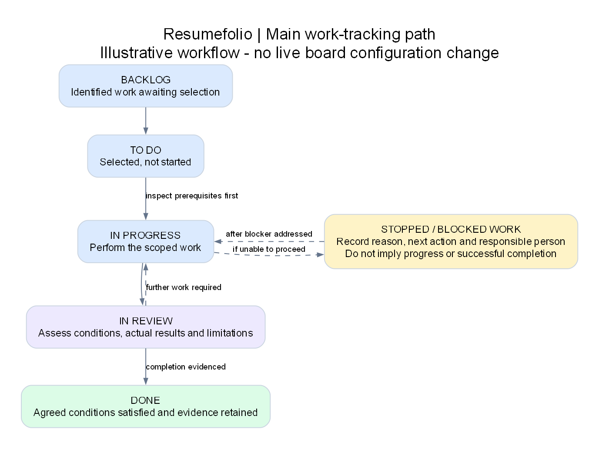
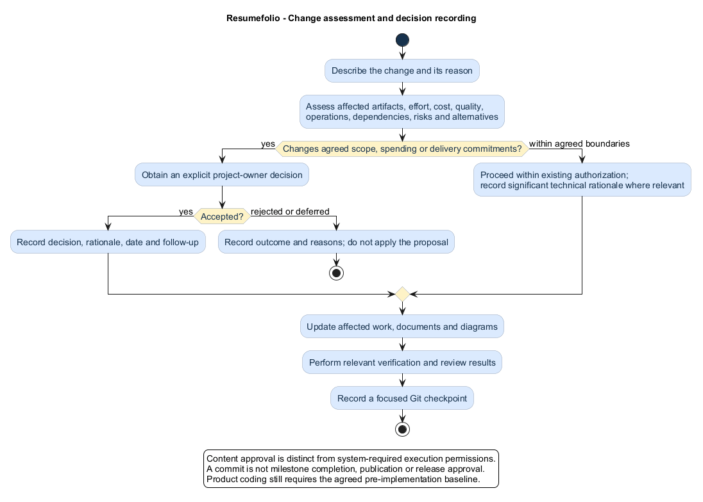

# Resumefolio — Working Method and Change Control

| Item | Current position |
|---|---|
| Responsible person / decision-maker | Farhad Valizadegan, project owner; sole delivery and operations owner |
| Method status | Working method, iterative/incremental approach, and change-control rules accepted |
| Original decisions | DEC-090–DEC-096 and DEC-115; accepted/confirmed October 30–31, 2026 |
| Planning baseline | Accepted with tracked follow-up under [DEC-116](10-planning-completion-criteria.md#dec-116) |
| Presentation revision | October 31, 2026; no Sprint date, board configuration, or product scope is changed |

**At a glance:** Work in understandable, reviewable steps. Keep requirements,
work tracking, decisions, evidence, and diagrams connected. Make material
changes explicit without asking again for routine work already authorized.

[Agreement](#1-working-agreement) · [Information ownership](#2-organizing-work-and-authoritative-records)
· [Incremental work](#3-iterative-and-incremental-work) · [Sprints](#4-sprint-planning-and-review)
· [Changes](#5-change-assessment) · [Decisions](#6-decision-records)
· [Completion](#7-completion-and-review) · [Accepted records](#8-accepted-working-method-decisions)

## 1. Working Agreement

The shared agreement is maintained in
[Stakeholders and Responsibilities](03-stakeholders-and-responsibilities.md#73-working-agreement).
This document explains how to apply it to work tracking and changes.

| Rule | Practical application |
|---|---|
| Step-by-step PowerShell work | Explain command purpose and expected result, inspect real output, then take dependent steps |
| Reviewable evidence | Keep proposals, accepted decisions, assumptions and demonstrated findings distinct |
| Focused approval | Reuse content approval already given; request a new decision when material new information or a proposed change requires it |
| Clear persistence state | Distinguish saved local edits, committed changes and pushed changes |
| Traceable reasoning | Record important choices, alternatives, consequences and reasons for later revisions |
| Consistent artifacts | Keep text, diagram sources/images, requirements, tests and operating guidance aligned |

System-required file or execution permissions remain separate from content
approval; the working method does not bypass those controls. Routine work
within the agreed boundaries does not require repeated content approval.

## 2. Organizing Work and Authoritative Records

| Information | Authoritative home | Relationship to other records |
|---|---|---|
| Requirements, User Stories, Job Stories, scenarios and acceptance criteria | Requirements Engineering documentation | Link backlog items and later verification to stable requirement references |
| Work descriptions, dependencies, acceptance evidence and issue follow-up | GitHub issues | Reference relevant requirements, decisions, risks and milestones |
| Live workflow status, priorities, target dates and Sprint assignments | GitHub delivery project and linked issues | Treat local dated tables as provisional snapshots, not competing live status records |
| Product Backlog index | [Product Backlog](../../Project-Management/product-backlog.md) | Durable navigation to work items and Sprint references |
| Significant decision rationale | Affected authoritative document or linked decision record | Stable DEC reference, status, original context and replacement history |
| Milestone/release acceptance | Relevant reviewed output and acceptance record | Identified revision plus actual evidence and owner decision |

Include features, defects, investigations, documentation, and technical work
in the backlog where appropriate. Each work item needs an identifier, intended
outcome, priority, status and completion conditions. Link selected work to
relevant requirements, milestones and risks.

The existing GitHub project is the documented delivery tracker. This editorial
revision does not query its live configuration or validate current assignments.
Detailed tracking reconciliation remains at the agreed review point.

## 3. Iterative and Incremental Work

### Entry condition for product implementation

Complete the agreed initial analysis and documentation for all SDLC phases,
reconcile backlog/Sprints/milestones with the reviewed work, and agree the
pre-implementation baseline before product coding. Planning-only acceptance
under DEC-116 is not that final coding authorization.

Documentation and design can be refined iteratively now. During implementation,
choose a manageable increment with a clear outcome and use this cycle:

| Step | Activity | Reviewable result |
|---|---|---|
| 1 | Clarify relevant requirements, dependencies and completion conditions | Agreed outcome and explicit unresolved prerequisites |
| 2 | Analyze and design the affected behavior | Reasoned design and consistent models/diagrams |
| 3 | Implement the scoped change | Identifiable source/application change |
| 4 | Perform appropriate verification | Actual results with version/environment and limitations |
| 5 | Update affected documents and diagram sources/images | Aligned requirement, design, evidence and guidance records |
| 6 | Review outcome, defects, risks and follow-up | Completion assessment and next actions |
| 7 | Record a focused Git checkpoint | Traceable change history; not automatic feature or release acceptance |

Repeat relevant activities as evidence changes. Iteration supports learning and
revision; an increment adds integrated, verified capability. Agile does not
imply a separate team, guaranteed delivery date, or every Scrum ceremony.

### Main work-tracking path



[Open scalable diagram](diagrams/work-tracking-flow.svg) ·
[Editable Graphviz source](diagrams/work-tracking-flow.dot)

This illustrates the documented main path, not a live board snapshot or a
request to add/remove columns. To Do means selected but not started. Check
prerequisites before beginning work. Record stopped work with its blocker and
next action; its existing board representation is not changed by this diagram.

## 4. Sprint Planning and Review

| Activity | What to record or inspect |
|---|---|
| Set the goal | A clear Sprint Goal and intended outcome |
| Select work | Realistic scope for available time, current capacity and dependencies |
| Maintain one Sprint Backlog | Sprint Goal, selected backlog items and the plan/tasks for delivering them |
| Adapt during work | Update tasks as understanding improves; keep changes and effects visible |
| Review the result | Actual delivered outcome, evidence, limitations and remaining work |
| Improve the next cycle | Lessons and practical working-method improvements |

A **Sprint** is a work period; a **Milestone** is an outcome checkpoint.
One Sprint can contribute to several milestones, and a milestone can need
several Sprints. Assignment is not an effort estimate or proof of completion.

The three dated Sprint backlogs in the
[provisional delivery plan](../../Project-Management/version-1-delivery-plan.md)
cover the original October 29–November 8 target window. They remain historical
planning snapshots until reconciliation after analysis/design. Do not infer a
validated capacity, measured velocity or accepted outcome from those dates.

## 5. Change Assessment

### Required assessment for a significant proposal

| Field | What the record must explain |
|---|---|
| Change and reason | What is requested and why |
| Affected artifacts | Requirements, documents, diagrams, milestones and related work |
| Expected effects | Effort, schedule, cost, quality and operations |
| Dependencies and alternatives | Relevant prerequisites, risks, options and their consequences |
| Decision and follow-up | Outcome, decision-maker, date, rationale, responsible person and next actions |

Changes to agreed scope, spending or delivery commitments require an explicit
project-owner decision. Significant technical choices still need documented
reasoning even if they stay within those boundaries. Routine corrections and
implementation choices within agreed scope do not need separate approval for
every step.

### Change-assessment flow



[Open scalable diagram](diagrams/change-assessment-flow.svg) ·
[Editable PlantUML source](diagrams/change-assessment-flow.puml)

Assess new evidence and impacts before changing commitments. Updating a date,
removing scope, or assuming new spending is not a substitute for that decision.
Keep affected records consistent and preserve the reason for any revision.

## 6. Decision Records

The [Planning Decision Register](decision-register.md) indexes significant
accepted decisions. Keep the decision content in its authoritative source;
the register supplies stable references instead of duplicating the rationale.

| Decision status | Meaning |
|---|---|
| Proposed | Presented for review; not yet accepted |
| Accepted | Explicitly agreed within its stated scope and limitations |
| Rejected | Not selected; retain the reason |
| Superseded | Replaced by another recorded decision; retain the replacement reference and history |

Use stable DEC identifiers and never reuse an existing identifier for another
choice. Record the subject, options considered, selection rationale and material
consequences. When a decision changes, identify what it replaces and why.

Git history shows text changes; it does not replace the rationale for a product
or technical decision. Acceptance of a validation method is distinct from
confirmation of an assumption, completion of a capability or release approval.

## 7. Completion and Review

Work is complete when its agreed conditions are satisfied and supporting
evidence is available. Record unperformed checks, unresolved defects and known
limitations. Do not report an unexecuted test as successful.

Use [Deliverables](04-deliverables.md) for output criteria,
[Roadmap and Milestones](08-roadmap-and-milestones.md) for milestone outcomes,
and [Planning Completion Criteria](10-planning-completion-criteria.md) for the
planning baseline decision. Milestone and release decisions remain separate
from routine Git commits and pushes.

Current delivery/operations responsibilities remain with the project owner;
no independent review team or continuous operational coverage is assumed.
See [Stakeholders and Responsibilities](03-stakeholders-and-responsibilities.md).

## 8. Accepted Working Method Decisions

The original Agile-direction confirmation and seven working-method records
below retain their accepted wording, dates, IDs and rationale. Statements about
pending review refer to their original stage; later planning-only acceptance is
[DEC-116](10-planning-completion-criteria.md#dec-116). That acceptance does not
complete future work items or authorize product coding.

<details>
<summary>Original Agile direction and working-method decisions</summary>

## 9. Confirmed Agile Direction

Decision ID: DEC-115
<a id="dec-115"></a>

Status: Iterative and incremental approach confirmed by the project owner
Review date: October 30, 2026

Use iterations for feedback, learning, and revision, and deliver
integrated, verified product increments during implementation.
Keep decision rationale and subsequent revisions documented.

The initial documentation-first review and agreed baseline precede
product coding. This is not a freeze on later changes: update
requirements, designs, tests, and delivery tracking as evidence emerges.
Agile does not imply additional staff, a guaranteed release date,
or automatic adoption of every Scrum ceremony.

Rationale: Support incremental progress and controlled adaptation
without abandoning traceability or the actual solo-delivery constraints.
The completed document review is recorded in the Document Review Summary below.

### Working Agreement Review

Decision ID: DEC-096
<a id="dec-096"></a>

Status: Working method accepted by the project owner
Review date: October 31, 2026

Decision: Proceed step by step through PowerShell. Explain the purpose of commands before execution, inspect actual results, and review changes before recording a Git checkpoint. Distinguish saved local changes from committed and pushed changes. Do not repeatedly request content approval for an accepted decision unless new information or a material proposed change requires further review.

Maintain consistency with the shared working agreement in the stakeholders and responsibilities document. Preserve the agreed documentation-first sequence and baseline agreement before product implementation.

Rationale: Keep the work understandable and traceable while preserving the project owner's control and avoiding redundant approval requests.

This acceptance records the working method; it does not establish completion of the remaining document review or approve the overall planning baseline.

### Work Organization Review

Decision ID: DEC-095
<a id="dec-095"></a>

Status: Work organization method accepted by the project owner
Review date: October 31, 2026

Decision: Maintain authoritative requirements, scenarios, and acceptance criteria in Requirements Engineering documentation, and link relevant backlog items to those definitions. Include defects, technical investigations, and documentation work in the backlog where appropriate.

Give each work item an identifier, intended outcome, priority, status, and completion conditions. Link relevant items to milestones and risks. Maintain live status and Sprint and milestone assignments in GitHub issues and the delivery project, using the repository product backlog as an index rather than maintaining competing live status tables.

Rationale: Distinguish the definition of expected product behavior from tracking its execution, preserve traceability between them, and avoid contradictory parallel records.

This acceptance defines the organization method. It does not claim that all existing items have been reconciled with future requirements or that the current Sprint assignments constitute a validated delivery forecast.

### Iterative and Incremental Development Review

Decision ID: DEC-094
<a id="dec-094"></a>

Status: Development method accepted by the project owner; product implementation has not been authorized by this review
Review date: October 31, 2026

Decision: After completing the agreed initial documentation and reaching baseline agreement, select a manageable increment with a clear outcome. Review relevant requirements, completion conditions, dependencies, and design; implement the scoped work; perform appropriate verification; update affected documentation and diagrams; review actual results, limitations, and follow-up work; and record a focused Git checkpoint.

Repeat relevant activities as findings emerge. Document the rationale and effects of revised decisions and keep the product, evidence, and documentation consistent. A successful commit or push alone does not establish capability completion.

Rationale: Support iterative learning and incremental delivery without allowing implementation, verification evidence, and documentation to diverge.

This acceptance defines the future development method. It does not start product implementation, complete an increment, or approve the overall baseline.

### Sprint Planning and Review Acceptance

Decision ID: DEC-093
<a id="dec-093"></a>

Status: Sprint planning and review method accepted by the project owner; existing schedule remains provisional
Review date: October 31, 2026

Decision: Define a clear Sprint Goal and select realistic work according to available time, capacity, and dependencies. Maintain one Sprint Backlog containing the goal, selected backlog items, and the plan for delivering them. Update tasks as understanding improves while keeping changes and their effects visible.

At the end of the Sprint, review the actual outcome and supporting verification evidence, and record lessons and working-method improvements for the next Sprint. Distinguish a Sprint, which is a work period, from a milestone, which is an outcome checkpoint. A Sprint may contribute to several milestones.

Retain the three existing Sprint schedules as provisional until reconciliation after the agreed analysis and design work. Assignment to a Sprint does not demonstrate capacity or capability completion.

Rationale: Give each work period a coherent goal, base selection on realistic constraints, and use evidence and feedback to improve subsequent delivery.

This acceptance records the method only; it does not revise live dates, assignments, or completion status, or authorize product implementation before baseline agreement.

### Change Assessment Method Review

Decision ID: DEC-092
<a id="dec-092"></a>

Status: Change assessment method accepted by the project owner
Review date: October 31, 2026

Decision: For a significant proposed change, record what changes and why; affected requirements, documents, diagrams, and milestones; expected effects on effort, schedule, cost, quality, and operations; relevant dependencies, risks, and alternatives; and the final decision, decision-maker, date, and follow-up actions.

Changes to agreed scope, spending, or delivery commitments require an explicit project-owner decision. Routine corrections and implementation choices within the agreed boundaries do not require separate content approval at every step. This distinction does not bypass applicable filesystem or execution permissions.

Rationale: Preserve informed control and traceability for material changes without slowing routine authorized work through redundant approval requests.

Acceptance records the assessment method. It does not approve an unspecified change, revise existing delivery commitments, or authorize implementation before the agreed baseline.

### Decision Records Method Review

Decision ID: DEC-091
<a id="dec-091"></a>

Status: Decision recording method accepted by the project owner
Review date: October 31, 2026

Decision: Record significant decisions in the affected authoritative document or a linked decision record. Give each significant decision a stable identifier, such as DEC-001, and state the subject, alternatives considered, selection rationale, and consequences. Distinguish proposed, accepted, rejected, and superseded decisions.

When a decision changes, preserve its history and identify the replacement decision, the earlier decision it supersedes, and the reason for the change. Git history records text changes but does not replace explicit documentation of decision rationale.

Rationale: Make important product and technical choices understandable and traceable over time, including the basis for revising earlier decisions.

This acceptance records the method. It does not claim that all existing review entries have already been reconciled with a stable decision identifier scheme or approve an unspecified technical decision.

### Completion and Review Rule Acceptance

Decision ID: DEC-090
<a id="dec-090"></a>

Status: Completion and review rule accepted by the project owner
Review date: October 31, 2026

Decision: Treat work as complete when its agreed completion conditions are satisfied and supporting review or verification evidence is available. Explicitly record unperformed checks, unresolved defects, and known limitations. Do not report an unexecuted test as successful.

Milestone completion and release decisions must use their own agreed criteria and remain distinct from routine Git commits and pushes.

Rationale: Make Done represent an evidenced, reviewable outcome rather than merely a recorded source change.

This acceptance defines the completion rule; it does not mark existing work items or milestones complete or establish release readiness.

</details>

## 9. Current Review and Revision Summary

The step-by-step working agreement, information ownership, iterative/incremental
method, Sprint approach, change assessment, decision records and evidence-based
completion rules are accepted. Existing schedules and delivery tracking still
require the agreed reconciliation before product implementation.

**Editorial revision — October 31, 2026:** Added clear method/reference tables,
a main work-tracking diagram and a change-assessment flow. All eight original
decisions are preserved, including DEC-115. No work item, Sprint, milestone,
remote board configuration or date is changed. Earlier baseline hashes remain
references to their original snapshots.

## 10. Diagram Sources and Regeneration

The work-tracking diagram uses Graphviz; the change-assessment flow uses PlantUML.
Retain sources, scalable `.svg` outputs and `.png` previews under `diagrams/`.
Run from the repository root in PowerShell:

```powershell
$diagramFolder = 'docs\SDLC\01-project-planning\diagrams'
$graphvizExe = 'C:\Program Files\Graphviz\bin\dot.exe'
$plantUmlJar = Join-Path $env:LOCALAPPDATA 'Resumefolio\DiagramTools\plantuml.jar'

foreach ($format in 'svg', 'png') {
    & $graphvizExe "-T$format" -Gdpi=140 `
        "$diagramFolder\work-tracking-flow.dot" -o "$diagramFolder\work-tracking-flow.$format"
    if ($LASTEXITCODE -ne 0) { throw "Graphviz failed: $format" }

    java -jar $plantUmlJar -charset UTF-8 "-t$format" `
        "$diagramFolder\change-assessment-flow.puml"
    if ($LASTEXITCODE -ne 0) { throw "PlantUML failed: $format" }
}
```

Use the installed user's PlantUML JAR path when working under another account.
Save sources as UTF-8 without BOM. Review the diagrams and related rules together
when a working-method decision changes.
