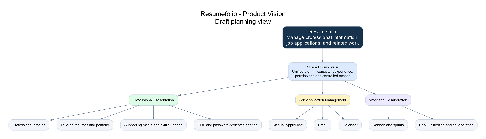
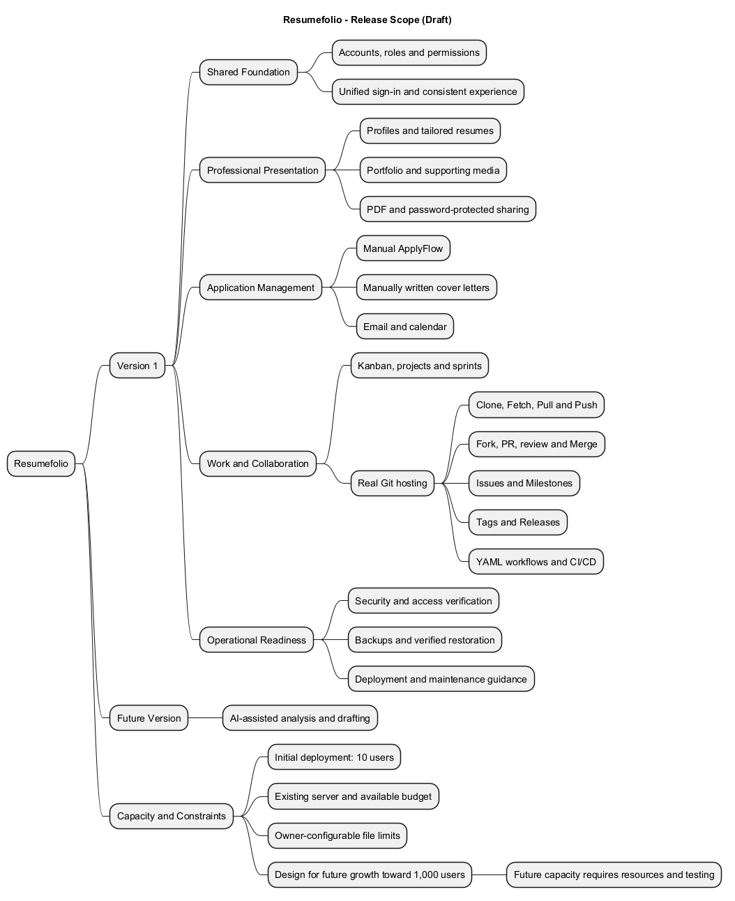

# Resumefolio - Project Planning

Status: Draft in progress
Project owner: Farhad Valizadegan

Each topic has one primary document. File existence does not imply approval
or completion. See each document for its status.

## Planning Documents

- [Purpose and Objectives](01-purpose-and-objectives.md)
- [Version 1 Scope](02-scope.md)
- [Stakeholders and Responsibilities](03-stakeholders-and-responsibilities.md)
- [Deliverables](04-deliverables.md)
- [Resources and Constraints](05-resources-and-constraints.md)
- [Assumptions and Dependencies](06-assumptions-and-dependencies.md)
- [Risks](07-risks.md)
- [Roadmap and Milestones](08-roadmap-and-milestones.md)
- [Working Method and Change Control](09-working-method-and-change-control.md)
- [Planning Completion Criteria](10-planning-completion-criteria.md)

## Planning Diagrams

### Product Vision

Editable source: [Graphviz DOT](diagrams/product-vision.dot).

This diagram groups product capabilities.
Its arrows represent grouping, not data flow or execution order.
It does not define technical architecture.

### Version 1 Scope

Editable source: [PlantUML](diagrams/version-1-scope.puml).

This diagram shows planned scope, not completed functionality.
Manual ApplyFlow is included in version 1; AI is deferred.
The initial deployment targets 10 users on the existing server.
Growth toward 1,000 users requires future capacity verification.

Detailed requirements, acceptance criteria, delivery milestones,
and technical architecture will be developed separately.
