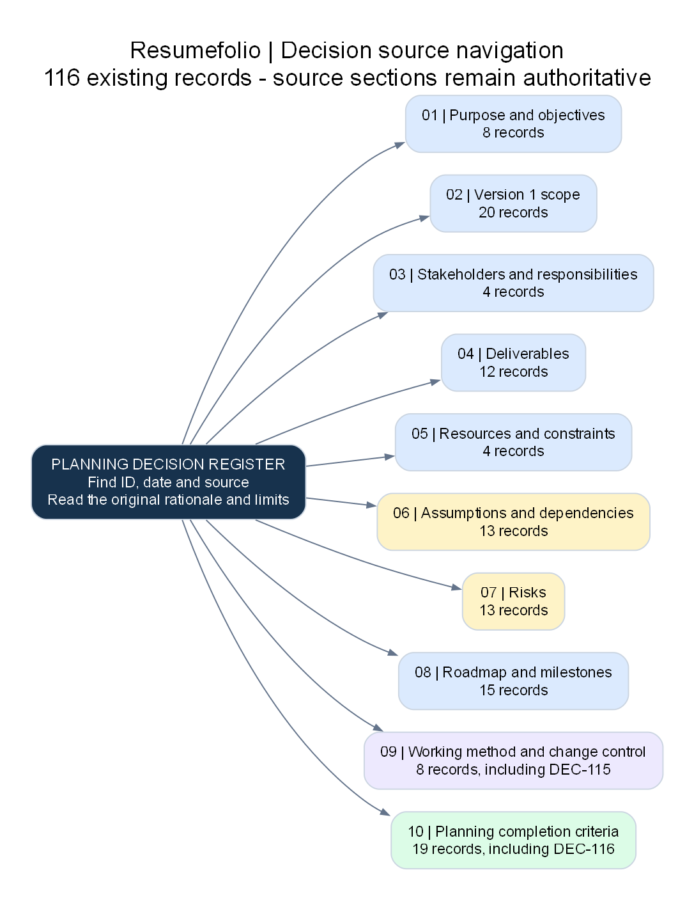
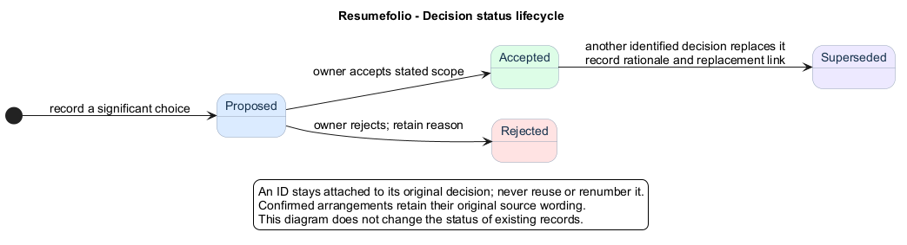

# Resumefolio — Planning Decision Register

| Item | Current position |
|---|---|
| Register purpose | Navigation to significant planning decisions and confirmed arrangements |
| Responsible person / decision-maker | Farhad Valizadegan, project owner |
| Existing references | 116 unique records, DEC-001 through DEC-116 |
| Planning acceptance | [DEC-116](10-planning-completion-criteria.md#dec-116): accepted with tracked follow-up for the identified planning snapshot |
| Next unused identifier | DEC-117; allocate only when recording a new significant decision or proposal |
| Presentation revision | October 31, 2026; no source decision or acceptance status is changed |

**At a glance:** Find a decision here, then open its source for the actual
choice, rationale, original review date, conditions, alternatives and follow-up.
The source section is authoritative; this register does not duplicate or replace it.

[How to read](#1-how-to-use-this-register) · [Source index](#2-source-document-index)
· [Decision groups](#3-decisions-by-source-document) · [Status lifecycle](#4-decision-status-and-history)
· [Maintenance](#5-maintaining-the-register) · [Verification](#6-current-review-and-revision-summary)

## 1. How to Use This Register

1. Choose a topic in the source-document index or search for a DEC identifier.
2. Open the Source link for the full decision and rationale. Some source records are in expandable history sections.
3. Read the decision's scope, limits and evidence references before relying on it.
4. If the choice must change, preserve its history and follow the agreed change-control method.

IDs are stable references, not dates, priorities, task numbers, or proof of
implementation. Most initial IDs were assigned retrospectively to already
accepted records. Their numerical order does not represent review chronology.

**Acceptance scope matters:** An accepted output definition is not a completed
output. An accepted validation method is not a confirmed assumption. A recorded
working arrangement is not an independently staffed team. Planning-only baseline
acceptance does not authorize product coding or release.

## 2. Source Document Index



[Open scalable diagram](diagrams/decision-source-map.svg) ·
[Editable Graphviz source](diagrams/decision-source-map.dot)

Arrows represent navigation from the register to source records, not runtime
relationships, organizational reporting lines, or delivery dependencies.

| Topic | Existing identifiers | Records | Source |
|---|---|---|---|
| Purpose and objectives | DEC-001–DEC-008 | 8 | [Document](01-purpose-and-objectives.md) |
| Version 1 scope | DEC-009–DEC-028 | 20 | [Document](02-scope.md) |
| Stakeholders and responsibilities | DEC-029–DEC-032 | 4 | [Document](03-stakeholders-and-responsibilities.md) |
| Deliverables | DEC-033–DEC-044 | 12 | [Document](04-deliverables.md) |
| Resources and constraints | DEC-045–DEC-048 | 4 | [Document](05-resources-and-constraints.md) |
| Assumptions and dependencies | DEC-049–DEC-061 | 13 | [Document](06-assumptions-and-dependencies.md) |
| Risks | DEC-062–DEC-074 | 13 | [Document](07-risks.md) |
| Roadmap and milestones | DEC-075–DEC-089 | 15 | [Document](08-roadmap-and-milestones.md) |
| Working method and change control | DEC-090–DEC-096; DEC-115 | 8 | [Document](09-working-method-and-change-control.md) |
| Planning completion criteria | DEC-097–DEC-114; DEC-116 | 19 | [Document](10-planning-completion-criteria.md) |

## 3. Decisions by Source Document

Dates below are original owner acceptance/confirmation dates, not completion dates for implementation or investigations. Accepted refers to the recorded definition, method or boundary unless the row explicitly identifies a confirmed arrangement or the planning baseline outcome.

### Purpose and objectives

| Decision ID | Original decision or arrangement | Source acceptance | Review date | Source |
|---|---|---|---|---|
| DEC-001 | Objective 5: Prepare for real deployment | Accepted (recorded scope) | October 29, 2026 | [Source](01-purpose-and-objectives.md#dec-001) |
| DEC-002 | Objective 4: Provide a unified working environment | Accepted (recorded scope) | October 29, 2026 | [Source](01-purpose-and-objectives.md#dec-002) |
| DEC-003 | Objective 3: Track job applications manually | Accepted (recorded scope) | October 29, 2026 | [Source](01-purpose-and-objectives.md#dec-003) |
| DEC-004 | Objective 2: Share information with controlled access | Accepted (recorded scope) | October 29, 2026 | [Source](01-purpose-and-objectives.md#dec-004) |
| DEC-005 | Objective 1: Manage professional information | Accepted (recorded scope) | October 29, 2026 | [Source](01-purpose-and-objectives.md#dec-005) |
| DEC-006 | Intended Value Review | Accepted (recorded scope) | October 29, 2026 | [Source](01-purpose-and-objectives.md#dec-006) |
| DEC-007 | Problem Statement Review | Accepted (recorded scope) | October 29, 2026 | [Source](01-purpose-and-objectives.md#dec-007) |
| DEC-008 | Purpose Review | Accepted (recorded scope) | October 29, 2026 | [Source](01-purpose-and-objectives.md#dec-008) |

### Version 1 scope

| Decision ID | Original decision or arrangement | Source acceptance | Review date | Source |
|---|---|---|---|---|
| DEC-009 | Open Definitions and Follow-up Review | Accepted (recorded scope) | October 30, 2026 | [Source](02-scope.md#dec-009) |
| DEC-010 | Requirements Detail and Controlled Scope Change Review | Accepted (recorded scope) | October 30, 2026 | [Source](02-scope.md#dec-010) |
| DEC-011 | Existing Reference Projects Boundary Review | Accepted (recorded scope) | October 30, 2026 | [Source](02-scope.md#dec-011) |
| DEC-012 | Budget and Additional Spending Boundary Review | Accepted (recorded scope) | October 30, 2026 | [Source](02-scope.md#dec-012) |
| DEC-013 | Initial Capacity and Growth Boundary Review | Accepted (recorded scope) | October 30, 2026 | [Source](02-scope.md#dec-013) |
| DEC-014 | Existing Demo Migration Exclusion Review | Accepted (recorded scope) | October 30, 2026 | [Source](02-scope.md#dec-014) |
| DEC-015 | Automatic Translation Exclusion Review | Accepted (recorded scope) | October 30, 2026 | [Source](02-scope.md#dec-015) |
| DEC-016 | AI Capabilities Exclusion Review | Accepted (recorded scope) | October 30, 2026 | [Source](02-scope.md#dec-016) |
| DEC-017 | Deployment and Operational Readiness Review | Accepted (recorded scope) | October 30, 2026 | [Source](02-scope.md#dec-017) |
| DEC-018 | Owner-Configurable File Limits Review | Accepted (recorded scope) | October 30, 2026 | [Source](02-scope.md#dec-018) |
| DEC-019 | YAML Workflows and CI/CD Review | Accepted (recorded scope) | October 30, 2026 | [Source](02-scope.md#dec-019) |
| DEC-020 | Real Git Hosting and Collaboration Review | Accepted (recorded scope) | October 30, 2026 | [Source](02-scope.md#dec-020) |
| DEC-021 | Kanban and Work Management Review | Accepted (recorded scope) | October 30, 2026 | [Source](02-scope.md#dec-021) |
| DEC-022 | Email and Calendar Review | Accepted (recorded scope) | October 30, 2026 | [Source](02-scope.md#dec-022) |
| DEC-023 | Manual ApplyFlow Review | Accepted (recorded scope) | October 29, 2026 | [Source](02-scope.md#dec-023) |
| DEC-024 | Password-Protected Resume Sharing Review | Accepted (recorded scope) | October 29, 2026 | [Source](02-scope.md#dec-024) |
| DEC-025 | Generated and Uploaded Resume PDFs Review | Accepted (recorded scope) | October 29, 2026 | [Source](02-scope.md#dec-025) |
| DEC-026 | Portfolio and Supporting Evidence Review | Accepted (recorded scope) | October 29, 2026 | [Source](02-scope.md#dec-026) |
| DEC-027 | Professional Profiles and Tailored Resumes Review | Accepted (recorded scope) | October 29, 2026 | [Source](02-scope.md#dec-027) |
| DEC-028 | Accounts, Roles, Permissions, and Unified Sign-in Review | Accepted (recorded scope) | October 29, 2026 | [Source](02-scope.md#dec-028) |

### Stakeholders and responsibilities

| Decision ID | Original decision or arrangement | Source acceptance | Review date | Source |
|---|---|---|---|---|
| DEC-029 | Requirements Engineering Boundary Review | Accepted (recorded scope) | October 30, 2026 | [Source](03-stakeholders-and-responsibilities.md#dec-029) |
| DEC-030 | Working Agreement Review | Accepted (recorded scope) | October 30, 2026 | [Source](03-stakeholders-and-responsibilities.md#dec-030) |
| DEC-031 | Current Solo Delivery Arrangement | Confirmed solo arrangement | October 30, 2026 | [Source](03-stakeholders-and-responsibilities.md#dec-031) |
| DEC-032 | Stakeholder Classification Review | Accepted (recorded scope) | October 30, 2026 | [Source](03-stakeholders-and-responsibilities.md#dec-032) |

### Deliverables

| Decision ID | Original decision or arrangement | Source acceptance | Review date | Source |
|---|---|---|---|---|
| DEC-033 | Incremental Delivery Review | Accepted (recorded scope) | October 30, 2026 | [Source](04-deliverables.md#dec-033) |
| DEC-034 | Shared Completion Rules Review | Accepted (recorded scope) | October 30, 2026 | [Source](04-deliverables.md#dec-034) |
| DEC-035 | DEL-10 Maintenance and Operations Guide Review | Accepted (recorded scope) | October 30, 2026 | [Source](04-deliverables.md#dec-035) |
| DEC-036 | DEL-09 Release Record Review | Accepted (recorded scope) | October 30, 2026 | [Source](04-deliverables.md#dec-036) |
| DEC-037 | DEL-08 User and Administrator Guidance Review | Accepted (recorded scope) | October 30, 2026 | [Source](04-deliverables.md#dec-037) |
| DEC-038 | DEL-07 Backup and Recovery Guide Review | Accepted (recorded scope) | October 30, 2026 | [Source](04-deliverables.md#dec-038) |
| DEC-039 | DEL-06 Deployment Guide Review | Accepted (recorded scope) | October 30, 2026 | [Source](04-deliverables.md#dec-039) |
| DEC-040 | DEL-05 Test Documentation and Evidence Review | Accepted (recorded scope) | October 30, 2026 | [Source](04-deliverables.md#dec-040) |
| DEC-041 | DEL-04 Version 1 Application and Source Code Review | Accepted (recorded scope) | October 30, 2026 | [Source](04-deliverables.md#dec-041) |
| DEC-042 | DEL-03 System Analysis and Design Review | Accepted (recorded scope) | October 30, 2026 | [Source](04-deliverables.md#dec-042) |
| DEC-043 | DEL-02 Requirements Specification Review | Accepted (recorded scope) | October 30, 2026 | [Source](04-deliverables.md#dec-043) |
| DEC-044 | DEL-01 Project Plan Review | Accepted (recorded scope) | October 30, 2026 | [Source](04-deliverables.md#dec-044) |

### Resources and constraints

| Decision ID | Original decision or arrangement | Source acceptance | Review date | Source |
|---|---|---|---|---|
| DEC-045 | Resource Conflicts and Planning Implications Review | Accepted (recorded scope) | October 30, 2026 | [Source](05-resources-and-constraints.md#dec-045) |
| DEC-046 | Unverified Resource Details Review | Accepted (recorded scope) | October 30, 2026 | [Source](05-resources-and-constraints.md#dec-046) |
| DEC-047 | Delivery Time and Agile Approach Review | Accepted (recorded scope) | October 30, 2026 | [Source](05-resources-and-constraints.md#dec-047) |
| DEC-048 | Known Resources and Confirmed Constraints Review | Accepted (recorded scope) | October 30, 2026 | [Source](05-resources-and-constraints.md#dec-048) |

### Assumptions and dependencies

| Decision ID | Original decision or arrangement | Source acceptance | Review date | Source |
|---|---|---|---|---|
| DEC-049 | Validation Assignments Review | Accepted (recorded scope) | October 31, 2026 | [Source](06-assumptions-and-dependencies.md#dec-049) |
| DEC-050 | Tracking and Review Method Acceptance | Accepted (recorded scope) | October 31, 2026 | [Source](06-assumptions-and-dependencies.md#dec-050) |
| DEC-051 | Internal Dependencies Review | Accepted (recorded scope) | October 31, 2026 | [Source](06-assumptions-and-dependencies.md#dec-051) |
| DEC-052 | DEP-06 Software Packages and Development Tools Review | Accepted (recorded scope) | October 31, 2026 | [Source](06-assumptions-and-dependencies.md#dec-052) |
| DEC-053 | DEP-02 Domain DNS and TLS Dependency Review | Accepted (recorded scope) | October 31, 2026 | [Source](06-assumptions-and-dependencies.md#dec-053) |
| DEC-054 | DEP-01 Hosting Server and Network Dependency Review | Accepted (recorded scope) | October 31, 2026 | [Source](06-assumptions-and-dependencies.md#dec-054) |
| DEC-055 | ASM-05 Development Time Assumption Review | Accepted (recorded scope) | October 31, 2026 | [Source](06-assumptions-and-dependencies.md#dec-055) |
| DEC-056 | External Google and Email Provider Dependency Review | Accepted (recorded scope) | October 30, 2026 | [Source](06-assumptions-and-dependencies.md#dec-056) |
| DEC-057 | ASM-04 Backup Storage Assumption Review | Accepted (recorded scope) | October 30, 2026 | [Source](06-assumptions-and-dependencies.md#dec-057) |
| DEC-058 | ASM-06 User Input Availability Review | Accepted (recorded scope) | October 30, 2026 | [Source](06-assumptions-and-dependencies.md#dec-058) |
| DEC-059 | ASM-03 Email Delivery Review | Accepted (recorded scope) | October 30, 2026 | [Source](06-assumptions-and-dependencies.md#dec-059) |
| DEC-060 | ASM-02 Google Integration Access Review | Accepted (recorded scope) | October 30, 2026 | [Source](06-assumptions-and-dependencies.md#dec-060) |
| DEC-061 | ASM-01 Server Capacity Assumption Review | Accepted (recorded scope) | October 30, 2026 | [Source](06-assumptions-and-dependencies.md#dec-061) |

### Risks

| Decision ID | Original decision or arrangement | Source acceptance | Review date | Source |
|---|---|---|---|---|
| DEC-062 | Issue Handling and Risk Closure Review | Accepted (recorded scope) | October 31, 2026 | [Source](07-risks.md#dec-062) |
| DEC-063 | Risk Ownership and Review Method Acceptance | Accepted (recorded scope) | October 31, 2026 | [Source](07-risks.md#dec-063) |
| DEC-064 | Shared Risk Assessment Rules Review | Accepted (recorded scope) | October 31, 2026 | [Source](07-risks.md#dec-064) |
| DEC-065 | RSK-10 Solo Maintenance Capacity Review | Accepted (recorded scope) | October 31, 2026 | [Source](07-risks.md#dec-065) |
| DEC-066 | RSK-09 Cross-Module Data Lifecycle Review | Accepted (recorded scope) | October 31, 2026 | [Source](07-risks.md#dec-066) |
| DEC-067 | RSK-08 Upload and Storage Exhaustion Review | Accepted (recorded scope) | October 31, 2026 | [Source](07-risks.md#dec-067) |
| DEC-068 | RSK-07 Email Delivery Delay and Failure Review | Accepted (recorded scope) | October 31, 2026 | [Source](07-risks.md#dec-068) |
| DEC-069 | RSK-06 Google Integration Restrictions and Failure Review | Accepted (recorded scope) | October 31, 2026 | [Source](07-risks.md#dec-069) |
| DEC-070 | RSK-05 Data Loss and Unrecoverable Failure Review | Accepted (recorded scope) | October 31, 2026 | [Source](07-risks.md#dec-070) |
| DEC-071 | RSK-04 Authorization and Private Data Exposure Review | Accepted (recorded scope) | October 31, 2026 | [Source](07-risks.md#dec-071) |
| DEC-072 | RSK-03 CI/CD Execution Security Review | Accepted (recorded scope) | October 31, 2026 | [Source](07-risks.md#dec-072) |
| DEC-073 | RSK-02 Combined Server Workload Review | Accepted (recorded scope) | October 31, 2026 | [Source](07-risks.md#dec-073) |
| DEC-074 | RSK-01 Scope and Development Time Review | Accepted (recorded scope) | October 31, 2026 | [Source](07-risks.md#dec-074) |

### Roadmap and milestones

| Decision ID | Original decision or arrangement | Source acceptance | Review date | Source |
|---|---|---|---|---|
| DEC-075 | Roadmap and Scope Change Review | Accepted (recorded scope) | October 31, 2026 | [Source](08-roadmap-and-milestones.md#dec-075) |
| DEC-076 | Milestone Review Method Acceptance | Accepted (recorded scope) | October 31, 2026 | [Source](08-roadmap-and-milestones.md#dec-076) |
| DEC-077 | Estimation and Scheduling Method Review | Accepted (recorded scope) | October 31, 2026 | [Source](08-roadmap-and-milestones.md#dec-077) |
| DEC-078 | Early Feasibility Investigations Review | Accepted (recorded scope) | October 31, 2026 | [Source](08-roadmap-and-milestones.md#dec-078) |
| DEC-079 | M-10 Initial Deployment and Handover Review | Accepted (recorded scope) | October 31, 2026 | [Source](08-roadmap-and-milestones.md#dec-079) |
| DEC-080 | M-09 Integrated Release Candidate Review | Accepted (recorded scope) | October 31, 2026 | [Source](08-roadmap-and-milestones.md#dec-080) |
| DEC-081 | M-08 CI/CD Capability Review | Accepted (recorded scope) | October 31, 2026 | [Source](08-roadmap-and-milestones.md#dec-081) |
| DEC-082 | M-07 Work and Collaboration Review | Accepted (recorded scope) | October 31, 2026 | [Source](08-roadmap-and-milestones.md#dec-082) |
| DEC-083 | M-06 Manual Application Management Review | Accepted (recorded scope) | October 31, 2026 | [Source](08-roadmap-and-milestones.md#dec-083) |
| DEC-084 | M-05 Professional Presentation Review | Accepted (recorded scope) | October 31, 2026 | [Source](08-roadmap-and-milestones.md#dec-084) |
| DEC-085 | M-04 Application Foundation Review | Accepted (recorded scope) | October 31, 2026 | [Source](08-roadmap-and-milestones.md#dec-085) |
| DEC-086 | M-03 Feasibility and Design Baseline Review | Accepted (recorded scope) | October 31, 2026 | [Source](08-roadmap-and-milestones.md#dec-086) |
| DEC-087 | M-02 Requirements Baseline Review | Accepted (recorded scope) | October 31, 2026 | [Source](08-roadmap-and-milestones.md#dec-087) |
| DEC-088 | M-01 Planning Baseline Review | Accepted (recorded scope) | October 31, 2026 | [Source](08-roadmap-and-milestones.md#dec-088) |
| DEC-089 | Outcome-Based Roadmap and Provisional Scheduling Review | Accepted (recorded scope) | October 31, 2026 | [Source](08-roadmap-and-milestones.md#dec-089) |

### Working method and change control

| Decision ID | Original decision or arrangement | Source acceptance | Review date | Source |
|---|---|---|---|---|
| DEC-090 | Completion and Review Rule Acceptance | Accepted (recorded scope) | October 31, 2026 | [Source](09-working-method-and-change-control.md#dec-090) |
| DEC-091 | Decision Records Method Review | Accepted (recorded scope) | October 31, 2026 | [Source](09-working-method-and-change-control.md#dec-091) |
| DEC-092 | Change Assessment Method Review | Accepted (recorded scope) | October 31, 2026 | [Source](09-working-method-and-change-control.md#dec-092) |
| DEC-093 | Sprint Planning and Review Acceptance | Accepted (recorded scope) | October 31, 2026 | [Source](09-working-method-and-change-control.md#dec-093) |
| DEC-094 | Iterative and Incremental Development Review | Accepted (recorded scope) | October 31, 2026 | [Source](09-working-method-and-change-control.md#dec-094) |
| DEC-095 | Work Organization Review | Accepted (recorded scope) | October 31, 2026 | [Source](09-working-method-and-change-control.md#dec-095) |
| DEC-096 | Working Agreement Review | Accepted (recorded scope) | October 31, 2026 | [Source](09-working-method-and-change-control.md#dec-096) |
| DEC-115 | 9. Confirmed Agile Direction | Confirmed Agile direction | October 30, 2026 | [Source](09-working-method-and-change-control.md#dec-115) |

### Planning completion criteria

| Decision ID | Original decision or arrangement | Source acceptance | Review date | Source |
|---|---|---|---|---|
| DEC-097 | PC-12 Specific Deferrals Acceptance and Reassessment | Accepted (recorded scope) | October 31, 2026 | [Source](10-planning-completion-criteria.md#dec-097) |
| DEC-098 | Baseline Review Record Structure Acceptance | Accepted (recorded scope) | October 31, 2026 | [Source](10-planning-completion-criteria.md#dec-098) |
| DEC-099 | Planning Review Outcomes Acceptance | Accepted (recorded scope) | October 31, 2026 | [Source](10-planning-completion-criteria.md#dec-099) |
| DEC-100 | Open Questions and Deferral Rule Review | Accepted (recorded scope) | October 31, 2026 | [Source](10-planning-completion-criteria.md#dec-100) |
| DEC-101 | PC-13 Identifiable Planning Revision Criterion Review | Accepted (recorded scope) | October 31, 2026 | [Source](10-planning-completion-criteria.md#dec-101) |
| DEC-102 | PC-12 Remaining Gaps Classification Criterion Review | Accepted (recorded scope) | October 31, 2026 | [Source](10-planning-completion-criteria.md#dec-102) |
| DEC-103 | PC-11 Documentation and Diagram Consistency Criterion Review | Accepted (recorded scope) | October 31, 2026 | [Source](10-planning-completion-criteria.md#dec-103) |
| DEC-104 | PC-10 Work Tracking and Next Activities Criterion Review | Accepted (recorded scope) | October 31, 2026 | [Source](10-planning-completion-criteria.md#dec-104) |
| DEC-105 | PC-09 Available Time and Estimation Criterion Review | Accepted (recorded scope) | October 31, 2026 | [Source](10-planning-completion-criteria.md#dec-105) |
| DEC-106 | PC-08 Milestone Sequence and Dependencies Criterion Review | Accepted (recorded scope) | October 31, 2026 | [Source](10-planning-completion-criteria.md#dec-106) |
| DEC-107 | PC-07 Initial Risk Assessment Criterion Review | Accepted (recorded scope) | October 31, 2026 | [Source](10-planning-completion-criteria.md#dec-107) |
| DEC-108 | PC-06 Assumptions and Dependencies Criterion Review | Accepted (recorded scope) | October 31, 2026 | [Source](10-planning-completion-criteria.md#dec-108) |
| DEC-109 | PC-05 Resources and Constraints Criterion Review | Accepted (recorded scope) | October 31, 2026 | [Source](10-planning-completion-criteria.md#dec-109) |
| DEC-110 | PC-04 Deliverables and Completion Evidence Criterion Review | Accepted (recorded scope) | October 31, 2026 | [Source](10-planning-completion-criteria.md#dec-110) |
| DEC-111 | PC-03 Stakeholders and Responsibilities Criterion Review | Accepted (recorded scope) | October 31, 2026 | [Source](10-planning-completion-criteria.md#dec-111) |
| DEC-112 | PC-02 Version 1 Scope Criterion Review | Accepted (recorded scope) | October 31, 2026 | [Source](10-planning-completion-criteria.md#dec-112) |
| DEC-113 | PC-01 Purpose and Objectives Criterion Review | Accepted (recorded scope) | October 31, 2026 | [Source](10-planning-completion-criteria.md#dec-113) |
| DEC-114 | Planning Baseline Purpose Review | Accepted (recorded scope) | October 31, 2026 | [Source](10-planning-completion-criteria.md#dec-114) |
| DEC-116 | Planning Baseline Acceptance Decision | Accepted with tracked follow-up | October 31, 2026 | [Source](10-planning-completion-criteria.md#dec-116) |

## 4. Decision Status and History

| Status | Meaning |
|---|---|
| Proposed | A choice has been recorded for review; it is not accepted |
| Accepted | The owner agreed the stated choice within its documented scope and limitations |
| Rejected | The option was not selected; preserve the reason |
| Superseded | A later recorded decision replaces it; preserve both identifiers and the reason for replacement |

Confirmed arrangements in the index retain their source wording rather than
being converted into claims about completed technical work. DEC-116 retains its
specific Accepted with tracked follow-up outcome. No record in this revision
is newly rejected, superseded or accepted.

### Decision lifecycle



[Open scalable diagram](diagrams/decision-status-lifecycle.svg) ·
[Editable PlantUML source](diagrams/decision-status-lifecycle.puml)

This is the status vocabulary, not a report that existing decisions have changed.
A replacement needs its own traceable record and rationale. Keep prior choices
and their context; do not erase history or reuse an identifier.

## 5. Maintaining the Register

| Situation | Required handling |
|---|---|
| Record a new significant proposal | Use the next unused DEC ID; state subject, options, rationale and expected effects in the authoritative document |
| Record an owner decision | Update the source's actual outcome, decision-maker and date; keep the register summary consistent |
| Replace a decision | Create/link the replacement record; identify what it supersedes and why; preserve the original |
| Correct wording or presentation | Preserve identity and meaning; document substantive effects if any; do not invent a new approval |
| Reorganize documents | Keep stable explicit anchors or update every affected reference; verify links afterwards |
| Update evidence or feasibility | Use the relevant ASM/DEP/RSK and verification records; accepted decision status alone does not validate the outcome |

Never renumber, recycle, or silently change the meaning of an existing ID.
Search existing source records before allocating the next identifier; do not
infer chronological order from an ID. Keep the register an index rather than
a second source of decision rationale or live delivery status.

Refer to [Working Method and Change Control](09-working-method-and-change-control.md)
for material change assessment. Current editorial revisions to planning files
do not silently replace the previously accepted Git snapshot.

## 6. Current Review and Revision Summary

**Editorial revision — October 31, 2026:** Grouped all 116 existing references
by their ten source documents; added original review dates, acceptance labels,
source navigation and two diagrams. All original identifier/title/source triples
are retained. No new DEC identifier was allocated and no source decision changed.

Original dates come from the source review records. DEC-001 through DEC-008
use the common October 29 acceptance date stated in Purpose and Objectives.
The next currently unused identifier is DEC-117.

## 7. Diagram Sources and Regeneration

The source map uses Graphviz; the status lifecycle uses PlantUML. Retain editable
sources, scalable `.svg` outputs and `.png` previews under `diagrams/`.
Run from the repository root in PowerShell:

```powershell
$diagramFolder = 'docs\SDLC\01-project-planning\diagrams'
$graphvizExe = 'C:\Program Files\Graphviz\bin\dot.exe'
$plantUmlJar = Join-Path $env:LOCALAPPDATA 'Resumefolio\DiagramTools\plantuml.jar'

foreach ($format in 'svg', 'png') {
    & $graphvizExe "-T$format" -Gdpi=140 `
        "$diagramFolder\decision-source-map.dot" -o "$diagramFolder\decision-source-map.$format"
    if ($LASTEXITCODE -ne 0) { throw "Graphviz failed: $format" }

    java -jar $plantUmlJar -charset UTF-8 "-t$format" `
        "$diagramFolder\decision-status-lifecycle.puml"
    if ($LASTEXITCODE -ne 0) { throw "PlantUML failed: $format" }
}
```

Use the installed user's PlantUML JAR path under another account. Save sources
as UTF-8 without BOM and update the source map counts when the register grows.
