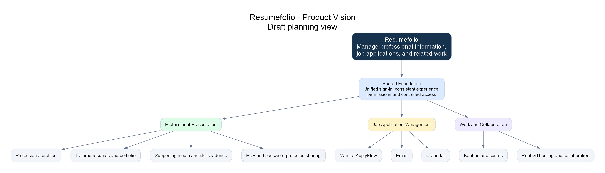
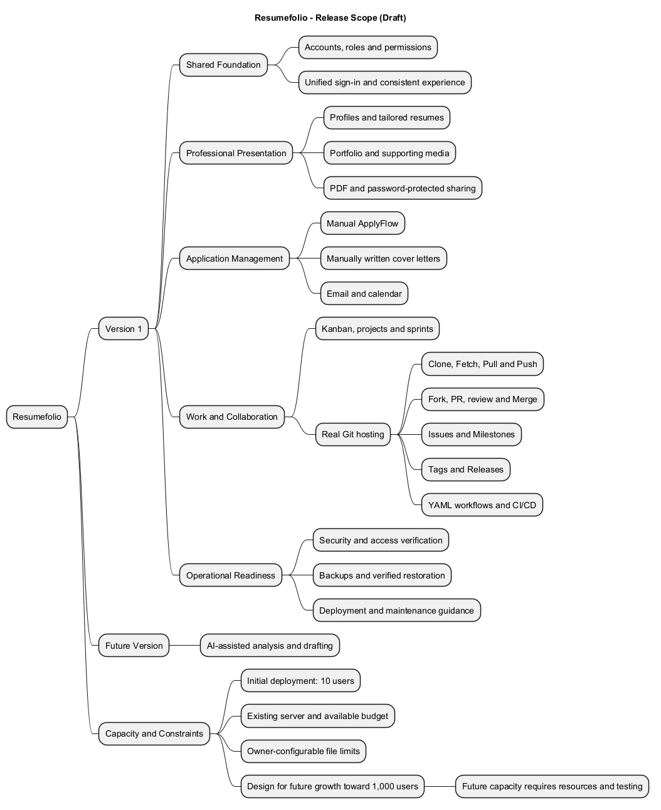

# Resumefolio - Project Planning

Status: Draft
Project owner: Farhad Valizadegan

## 1. Purpose

Build Resumefolio as a unified web application for managing
professional information, presenting evidence of skills,
and organizing job applications and related work.

The product will be deployed for real daily use.

## 2. Problem Statement

Professional information and activities are spread across
separate documents, repositories, email accounts, calendars,
and task-management tools.

This makes it difficult to:
- Prepare a tailored resume for each job opportunity.
- Present projects and skills with supporting evidence.
- Control employer access to personal information.
- Keep track of applications and related correspondence.
- Coordinate tasks, projects, code, and schedules.

## 3. Intended Value

Resumefolio will bring these activities into a consistent
user experience with unified sign-in and controlled access.

Users should be able to manage related professional work
without repeatedly entering the same information across tools.

## 4. Objectives and Success Criteria

Status: Proposed for review

### Objective 1: Manage professional information

Users can maintain professional profiles and create tailored
resumes with supporting project and skill evidence.

Success criterion:
A user can create a profile, prepare a tailored resume,
and display the selected supporting content.

### Objective 2: Share information with controlled access

Users can share a selected resume with an employer through
a password-protected link.

Success criterion:
The employer can access the intended resume with the correct
password. Access is denied with an incorrect password or
after the link is disabled.

### Objective 3: Track job applications manually

Users can record job opportunities, associate resumes,
write cover letters, and track application progress.

Success criterion:
A user can record a company and position, associate a resume,
save a manually written cover letter, and update the status.
AI is outside the scope of version 1.

### Objective 4: Provide a unified working environment

Resume management, ApplyFlow, email, calendar, Kanban,
and real Git hosting form one consistent product.

Success criterion:
A user can access the authorized sections through unified
sign-in and complete the agreed core workflows in each.
Detailed workflows will be defined in Requirements Engineering.

### Objective 5: Prepare for real deployment

The product runs on the existing server within the available
budget, initially supporting 10 users.

Success criterion:
Before release, agreed workflows are verified in the target
environment, access controls are tested, and backup restoration
is demonstrated.

Performance targets and recovery targets remain to be defined.
Growth toward approximately 1,000 users is a design consideration,
not a capacity claim verified for the initial server.

## 5. Planning Diagrams

### Product Vision

Editable source: [Graphviz DOT](diagrams/product-vision.dot).

This diagram groups product capabilities.
Its arrows represent grouping, not data flow or execution order.
It does not define technical architecture.

### Version 1 Scope

Editable source: [PlantUML](diagrams/version-1-scope.puml).

This diagram shows planned scope, not completed functionality.
Manual ApplyFlow is included in version 1; AI is deferred.
The initial deployment targets 10 users on the existing server.
Growth toward 1,000 users requires future capacity verification.

Detailed requirements, acceptance criteria, delivery milestones,
and technical architecture will be developed separately.

## 6. Version 1 Scope

Status: Draft based on the agreed product direction

### 6.1 In Scope

- Accounts, roles, permissions, and unified sign-in.
- Professional profiles and tailored resumes.
- Portfolio content and supporting media.
- PDF generation and uploaded resume PDFs.
- Password-protected resume sharing.
- Manual ApplyFlow for recording opportunities, associating
  resumes, writing cover letters, and tracking progress.
- Email and calendar capabilities with agreed integrations.
- Kanban, projects, boards, tasks, collaboration, and sprints.
- Real Git hosting, including Git transfer, Fork, Pull Requests,
  review, Merge, Issues, Milestones, Tags, and Releases.
- YAML workflows and CI/CD execution, subject to security
  and resource analysis before implementation.
- Owner-configurable file limits within infrastructure capacity.
- Deployment, operational guidance, backups, recovery,
  and verification of agreed workflows.

### 6.2 Out of Scope for Version 1

- AI-assisted analysis, recommendations, or content generation.
- Automatic translation of resume content.
- Migration of accounts and data from the existing demo.

### 6.3 Planning Boundaries

- Initial deployment targets 10 users on the existing server.
- Growth toward approximately 1,000 users informs design;
  that capacity is not verified for the initial deployment.
- Paid services, paid AI APIs, and additional infrastructure
  are not assumed within the available budget.
- Existing reference projects remain unchanged.
- Feature depth and acceptance criteria will be specified
  in Requirements Engineering.
- Delivery milestones organize implementation without
  silently removing agreed version 1 capabilities.

### 6.4 Matters Requiring Further Definition

- Detailed email and calendar operations.
- Kanban workflows, reporting, and automation.
- Supported YAML workflow syntax and CI/CD execution limits.
- File types, storage quotas, and upload limits.
- Performance, backup, recovery, and availability targets.

These matters require analysis and explicit decisions.
Their inclusion here does not mean they are already resolved.

## 7. Stakeholders and Responsibilities

Status: Draft for review

### 7.1 Stakeholders

| Stakeholder | Main interest |
|---|---|
| Project owner: Farhad Valizadegan | Product direction, delivery, budget, and long-term operation |
| Platform owner | Overall administration and operational control |
| Administrators | Account management and authorized content administration |
| Registered users | Professional presentation, applications, and related work |
| Invited collaborators | Authorized collaboration on projects, boards, and repositories |
| Employers and resume viewers | Access to the specific resume and evidence shared with them |

One person may hold multiple roles.
Project ownership and platform permissions are distinct concepts.

External dependencies include the hosting provider, Google
integrations, and email delivery services. Their availability,
limits, and connection requirements must be considered.

### 7.2 Project Responsibilities

| Activity | Responsibility |
|---|---|
| Product goals and business decisions | Project owner |
| Scope, priorities, and budget decisions | Project owner, supported by analysis and recommendations |
| Planning and requirements documentation | Developed with the project owner through guided, reviewable steps |
| Technical analysis and design | Prepared with assistant support and evaluated against requirements, resources, and constraints |
| Implementation | Project owner, using assistant support for development and explanation |
| Verification | Review requirements, execute relevant checks, and retain evidence of actual results |
| Deployment and operation | Project owner or an explicitly designated operator |
| Release decisions | Project owner, informed by verification and operational readiness |

Assistant support does not imply a separate staffed team
or continuous monitoring of the deployed product.

### 7.3 Working Agreement

- Progress step by step through PowerShell.
- Explain each command and its expected result.
- Review actual output before dependent steps.
- Keep confirmed decisions, proposals, assumptions, and
  unresolved matters clearly distinguished.
- Record important decisions and their impact.
- Keep planning documents and diagrams consistent.
- Preserve project progress through focused Git commits.
- Group related questions and discuss significant decisions.
- Reflect the project owner's ownership in project materials.

### 7.4 Boundary with Requirements Engineering

This section identifies stakeholders and delivery responsibilities.
Detailed permissions, role restrictions, invitation behavior,
and account lifecycle rules belong in Requirements Engineering.
