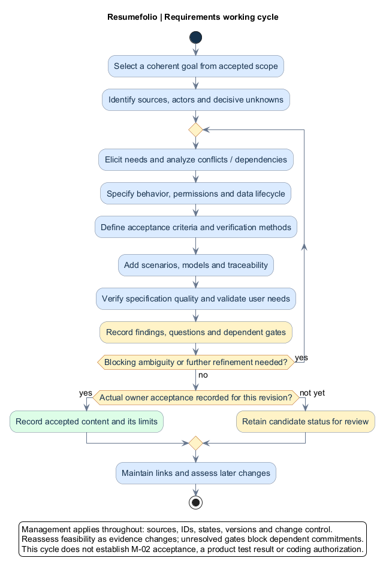
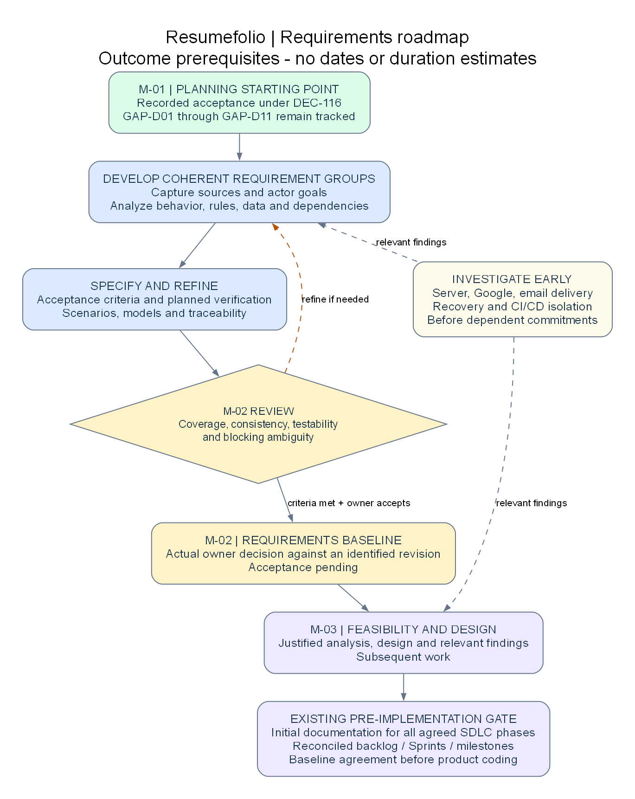

# Resumefolio — Requirements Approach

| Item | Current position |
|---|---|
| Document purpose | Explain how requirements are discovered, developed, reviewed and maintained |
| Project owner | Farhad Valizadegan; sole delivery and operations owner |
| Document status | Proposed approach — pending owner review |
| Planning basis | M-01 accepted with tracked follow-up under DEC-116; this document does not replace that baseline |
| Requirements baseline | M-02 acceptance pending; detailed requirement records remain to be developed |
| Revision | October 31, 2026 |

**At a glance:** Use iterative requirements engineering with written specifications,
scenario walkthroughs and visual models. Begin with accepted planning decisions,
investigate decisive unknowns early, and refine one coherent group of needs at a
time. Keep the source, required behavior, acceptance criteria and later evidence
connected throughout development.

**Read this document for:** the overall method and its rationale. The linked
activity documents explain individual activities; domain documents own the actual
product requirements. This is a completed approach draft, not a completed
feasibility study or an accepted requirements baseline.

[Approach](#1-approach-and-rationale) · [Inputs](#2-starting-information-and-boundaries)
· [Activities](#3-activities-and-outputs) · [Working cycle](#4-working-cycle-for-a-requirement-group)
· [Roadmap](#5-roadmap-and-review-gates) · [Records](#6-records-and-traceability)
· [Responsibilities](#7-responsibilities-and-tools) · [Quality](#8-review-quality-and-completion)
· [Open work](#9-current-position-and-next-work) · [Sources](#10-authoritative-project-references)
· [Diagrams](#11-diagram-maintenance)

## 1. Approach and Rationale

Combine a reviewed initial baseline with iterative and incremental refinement.
Iterations support learning and revision; requirements are developed in manageable
groups. During later implementation, increments add verified product capability.
A documentation iteration is not evidence that a running feature was delivered.

| Practice | Why it fits this project | Practical application |
|---|---|---|
| Start from accepted planning | Preserve the agreed product direction and avoid repeated decisions | Reference Scope, objectives and DEC records; record material changes explicitly |
| Refine iteratively | Cross-module rules and external constraints need investigation | Revisit affected needs when scenarios, resource findings or review feedback expose gaps |
| Keep written specifications | Permissions, lifecycle and failure behavior need precision | Use stable requirement records and observable acceptance criteria |
| Use scenarios and models | Relationships and exceptional paths are easier to inspect visually | Add use-case, activity, state or relationship models where they answer a concrete question |
| Investigate feasibility early | Existing-server capacity, Google access and safe CI/CD can affect commitments | Obtain relevant evidence before accepting the dependent requirement or design |
| Keep one authoritative home | Repeated copies can diverge | Link requirements, work tracking, decisions and verification instead of copying live status |

These practices complement each other. They do not select a final software
architecture, require a paid requirements tool, or imply a fully staffed Scrum
team. The existing agreement to prepare the initial SDLC documentation and agree
the pre-implementation baseline before product coding remains in effect.

## 2. Starting Information and Boundaries

| Input | How to use it | Evidence boundary |
|---|---|---|
| [Purpose and objectives](../../01-project-planning/01-purpose-and-objectives.md) | Derive business outcomes and user value | Intended benefits are not measured product results |
| [Version 1 Scope](../../01-project-planning/02-scope.md) | Identify inclusions, exclusions and unresolved detail | Inclusion does not prove technical feasibility or completed implementation |
| [Stakeholders and responsibilities](../../01-project-planning/03-stakeholders-and-responsibilities.md) | Identify actor groups and decision authority | Product roles do not imply additional delivery staff or a complete permission model |
| [Assumptions and dependencies](../../01-project-planning/06-assumptions-and-dependencies.md) and [risks](../../01-project-planning/07-risks.md) | Identify investigations and review gates | Accepted investigation methods do not confirm their results |
| [Source register and elicitation log](../02-stakeholders-and-elicitation/elicitation-log.md) | Preserve exact source references and distinguish raw needs from interpretations | Historical suggestions may be superseded; record actual dates and participants only |
| Reference projects | Compare observed workflows and prior experience under DEC-011 | Their features are not automatically Resumefolio requirements; preserve the original projects |

Keep the full agreed Version 1 scope visible, including manual ApplyFlow,
email/calendar, work management, real Git hosting and conditional YAML/CI/CD
execution. Product AI, automatic translation and automatic old-demo migration
remain excluded. Manually entered English/German content remains included.

The initial 10-user target and growth direction toward roughly 1,000 users do not
define concurrency or demonstrate capacity. Numerical quality, file-policy and
recovery targets need explicit scenarios, resource evidence and review. Keep
unresolved questions visible rather than inventing limits or silently removing scope.

## 3. Activities and Outputs

The six activities overlap and repeat. Requirements management runs throughout;
feasibility is revisited when evidence or constraints change. Their numbering is
a reading order, not six irreversible handoffs.

| Activity | Key question | Expected output and review |
|---|---|---|
| [Feasibility](02-feasibility-study.md) | Can the intended outcomes be supported within actual constraints? | Findings, options, costs and uncertainty; review before dependent commitments |
| [Elicitation](03-requirements-elicitation.md) | Who needs what, in which situation, and why? | Sourced needs, actor goals, interpretations and open questions |
| [Analysis and negotiation](04-analysis-and-negotiation.md) | Are needs clear, compatible, feasible and appropriately prioritized? | Classified and decomposed candidates, dependencies, conflict resolutions and rationale |
| [Specification](05-requirements-specification.md) | What behavior and quality must hold? | Identified requirements, rules, scenarios, data definitions and acceptance criteria |
| [Verification and validation](06-requirements-verification-and-validation.md) | Are requirements well formed, and do they address intended use? | Review findings, scenario feedback, dispositions and actual review outcome |
| [Management](07-requirements-management.md) | What changed, why, and what else is affected? | Stable references, states, traceability, change records and identified baselines |

## 4. Working Cycle for a Requirement Group



[Scalable SVG](../diagrams/requirements-approach-cycle.svg) ·
[Editable PlantUML](../diagrams/requirements-approach-cycle.puml)

Blue activities develop the content; amber identifies questions or conflicts;
green identifies a review outcome. The loop represents refinement, not an
implemented workflow or automatic approval. Management applies to every step.

1. **Choose a coherent goal.** Select a user outcome or related rules from accepted scope; identify actors, source decisions and affected modules.
2. **Check decisive unknowns.** Identify the feasibility findings needed for this group. Independent clarification can continue while dependent commitments remain unresolved.
3. **Capture and analyze.** Record source needs, separate assumptions from facts, resolve terminology and identify conflicts, missing inputs and dependencies.
4. **Specify behavior.** Describe normal, alternative, failure and unauthorized paths; define ownership, resulting state and cross-module effects.
5. **Define acceptance.** Write observable criteria and planned verification methods; propose measurable targets with their rationale where needed.
6. **Review together.** Walk through scenarios and check the text, diagrams, permissions and data definitions for agreement. Record actual findings and dispositions.
7. **Record the outcome.** Keep candidates under review until blocking ambiguity is resolved. Record accepted content only after an actual owner decision against an identified revision.
8. **Maintain links.** Connect accepted records to work items and later design/verification. Assess changes without erasing earlier decisions or evidence.

For example, a protected-resume group must cover the intended shared content,
wrong passwords, disabled links, direct PDF/file requests and session-revocation
questions. The [draft use-case walkthrough](../04-scenarios-and-models/user-stories-and-scenarios.md#9-draft-walkthrough-view-a-protected-resume)
provides starting material; it is not a validated product test or accepted policy.

## 5. Roadmap and Review Gates



[Scalable SVG](../diagrams/requirements-approach-roadmap.svg) ·
[Editable Graphviz](../diagrams/requirements-approach-roadmap.dot)

Green marks the recorded planning starting point; blue shows requirements work;
amber marks evidence-dependent review gates; purple shows subsequent engineering
and the existing pre-coding agreement. Arrows show prerequisites, not dates,
duration estimates, parallel staffing or current completion of future work.

| Checkpoint | What must be established | Status / boundary |
|---|---|---|
| Planning starting point — M-01 | Accepted planning snapshot and assigned GAP-D01–GAP-D11 follow-up | Recorded under DEC-116; later edits do not automatically replace that snapshot |
| Candidate requirement groups | Sources, actors, behavior, rules, criteria, scenarios and relevant feasibility findings | Develop and review iteratively; not a new milestone |
| Requirements baseline — M-02 | Agreed scope coverage, testable records, consistent models and traceability; blocking ambiguities resolved | Owner decision pending; use the [baseline checklist](../07-change-and-baseline/requirements-review-and-baseline-criteria.md) |
| Feasibility and design — M-03 | Justified analysis/design with relevant resource, provider, security and recovery findings | Subsequent work; requirements can be refined through controlled feedback |
| Existing pre-implementation gate | Initial documentation for all agreed SDLC phases, reconciled backlog/Sprints/milestones and agreed baseline | Required before product coding; M-02 alone does not satisfy this gate |

The [Roadmap and Milestones](../../01-project-planning/08-roadmap-and-milestones.md)
owns milestone definitions and historical target dates. This roadmap introduces
no replacement dates. November 8, 2026 remains a requested target, not an
evidence-based forecast. Investigate server capacity, Google access, email
delivery, recovery and execution isolation before their dependent commitments.

## 6. Records and Traceability

Keep the [distributed SRS](../03-requirements-specification/requirements-specification.md)
as the entry point to business, user, functional, quality, domain and interface
requirements. Domain documents own their detailed records. Use the
[glossary](../05-data-definitions/glossary.md) and
[data dictionary](../05-data-definitions/data-dictionary.md) consistently.

| Record | Minimum useful content |
|---|---|
| [Requirement](../templates/requirement-template.md) | Identifier, source, rationale, actor/permission boundary, behavior, conditions, lifecycle, failures, priority, status, dependencies, acceptance criteria and planned verification |
| [Scenario](../templates/scenario-template.md) / use case | Goal, trigger, actors, preconditions, steps, alternatives, exceptions, postconditions, relevant rules and requirement links |
| [User story](../templates/story-template.md) | Role, capability and value, linked to detailed behavior and acceptance criteria; a story alone is not a full specification |
| [Review finding](../06-validation-and-traceability/review-plan-and-findings.md) | Reviewed revision, actual method/reviewer/date, finding, owner, disposition and evidence |
| [Open question or change](../07-change-and-baseline/open-questions-and-decisions.md) | Affected records, uncertainty, owner, next action and review gate; use [change control](../07-change-and-baseline/change-control.md) for material revisions |

Maintain the chain in both directions:
**source / objective / scope → requirement and rule → scenario and acceptance
criterion → backlog item → design → later verification evidence**.
The [traceability matrix](../06-validation-and-traceability/requirements-traceability.md)
provides the index. Empty links are coverage gaps, not evidence of completion.

The proposed identifier families and states are described in
[Requirements Management](07-requirements-management.md). Final notation remains
to be reviewed before allocation. Never recycle retired identifiers or record
acceptance that has not occurred. New significant decisions use the existing
decision-register convention; this approach draft allocates no DEC identifiers.

## 7. Responsibilities and Tools

**Farhad Valizadegan is responsible for the current delivery and review work.**
Writing, reviewing, deciding and operating are distinct activities carried by
the same person; they do not imply an independent review team. Record other
participants only when they actually contribute. User feedback can inform later
validation without inventing stakeholder research or completed sessions.

| Tool / location | Role |
|---|---|
| Repository Markdown and Git | Authoritative written records, editable models and revision history |
| Graphviz, PlantUML and rendered SVG/PNG | Explain relationships and behavior with synchronized sources and images |
| GitHub issues and delivery project | Work descriptions and live delivery tracking; link to requirements rather than duplicating their authoritative text |
| Scenario walkthroughs and suitable prototypes | Clarify workflows and validate interpretations where uncertainty warrants them |

Use structured owner discussion and document analysis first. Choose observation,
prototypes, workshops or surveys only where a real question and suitable
participants justify them; see the [elicitation plan](../02-stakeholders-and-elicitation/elicitation-plan-and-techniques.md).
Keep secrets, tokens and private operational data out of repository examples,
screenshots and evidence. No additional paid tool or unattended monitoring is
introduced by this document.

## 8. Review Quality and Completion

### Requirement-group review

- [ ] The need has a precise source, rationale and link to agreed scope or an explicit change proposal.
- [ ] Each requirement expresses a clear, individually reviewable obligation with consistent terminology.
- [ ] Actors, resource/action permissions, normal and denied-access behavior are explicit.
- [ ] Alternatives, failures, missing inputs, resulting state and data-lifecycle effects are covered where relevant.
- [ ] Acceptance criteria are observable; planned verification methods and evidence needs are stated.
- [ ] Feasibility, dependencies, conflicts and numerical targets have evidence or an explicitly assigned review gate before dependent commitments.
- [ ] Text, scenarios, diagrams, dictionary entries and traceability agree.
- [ ] Review findings have actual dispositions; unresolved blockers are visible.

**Verification of requirements** checks specification quality and consistency.
**Validation of requirements** checks fitness for actual user goals and intended
use. Later product verification checks implemented behavior against those
requirements. A planned test, successful diagram render or document review is not
proof that the running product satisfies a requirement.

### Approach document and baseline completion

This document is ready for its own review when the method, rationale, inputs,
outputs, responsibilities, gates and maintenance rules are understandable and
its diagrams and links agree. Accepting the approach does not accept every
requirement or complete feasibility. M-02 acceptance uses its separate checklist,
identified revision and actual owner decision. Do not infer acceptance from file
existence, Git history or this completed draft.

## 9. Current Position and Next Work

| Item | Current position / next action |
|---|---|
| Approach | Expanded draft ready for owner review; no acceptance date or decision is claimed |
| Feasibility | Continue the [feasibility study](02-feasibility-study.md) using existing ASM/DEP/RSK and GAP follow-up; record findings before dependent decisions |
| Product detail | Develop sourced requirement groups, actor permissions, lifecycle rules, scenarios and acceptance criteria |
| Numerical quality targets | Define workload, measurable criteria and resource rationale; no capacity or recovery promise is established here |
| Identifier convention | Review the proposed notation before allocating detailed records |
| Baseline and coding | M-02 and the wider pre-implementation agreement remain pending |

**Revision note — October 31, 2026:** Expanded the existing approach without
changing accepted scope or planning decisions. Added working-cycle and roadmap
diagrams, record ownership, review criteria and navigation. The revised approach
remains proposed; no research session, technical investigation, product test,
milestone completion or release decision is reported as performed.

## 10. Authoritative Project References

- [Requirements Engineering index](../README.md) — document structure and current phase status.
- [Process and Approach index](README.md) — the six linked activities and this overview.
- [Planning acceptance DEC-116](../../01-project-planning/10-planning-completion-criteria.md#dec-116) — accepted snapshot and tracked follow-up.
- [Working Method and Change Control](../../01-project-planning/09-working-method-and-change-control.md) — agreed delivery and decision practices.
- [Planning Decision Register](../../01-project-planning/decision-register.md) — source decisions and rationale.

## 11. Diagram Maintenance

| Diagram | Meaning | Editable source | Rendered outputs |
|---|---|---|---|
| Requirements working cycle | Repeated clarification, specification and review | [PlantUML](../diagrams/requirements-approach-cycle.puml) | [SVG](../diagrams/requirements-approach-cycle.svg), [PNG](../diagrams/requirements-approach-cycle.png) |
| Requirements roadmap | Outcome prerequisites and the later pre-coding gate | [Graphviz](../diagrams/requirements-approach-roadmap.dot) | [SVG](../diagrams/requirements-approach-roadmap.svg), [PNG](../diagrams/requirements-approach-roadmap.png) |

Keep sources, rendered images, captions and this explanation together. Color is
supplementary: labels and shapes also explain each role. Update the diagrams when
the method changes and inspect every render for readability and clipped labels.
Run from the repository root in PowerShell using the installed tool paths:

```powershell
$diagramFolder = 'docs\SDLC\02-requirements-engineering\diagrams'
$graphvizExe = 'C:\Program Files\Graphviz\bin\dot.exe'
$plantUmlJar = 'C:\Users\fvali\AppData\Local\Resumefolio\DiagramTools\plantuml.jar'

foreach ($format in 'svg', 'png') {
    & $graphvizExe "-T$format" -Gdpi=140 `
        "$diagramFolder\requirements-approach-roadmap.dot" `
        -o "$diagramFolder\requirements-approach-roadmap.$format"
    if ($LASTEXITCODE -ne 0) { throw "Graphviz failed: $format" }

    java '-Djava.awt.headless=true' -jar $plantUmlJar -charset UTF-8 "-t$format" `
        "$diagramFolder\requirements-approach-cycle.puml"
    if ($LASTEXITCODE -ne 0) { throw "PlantUML failed: $format" }
}
```

Use UTF-8 without BOM. Under another account, substitute the actual installed
PlantUML JAR path. Verify local file/section links after moving documents and
retain SVG/PNG outputs with their sources in version control.
