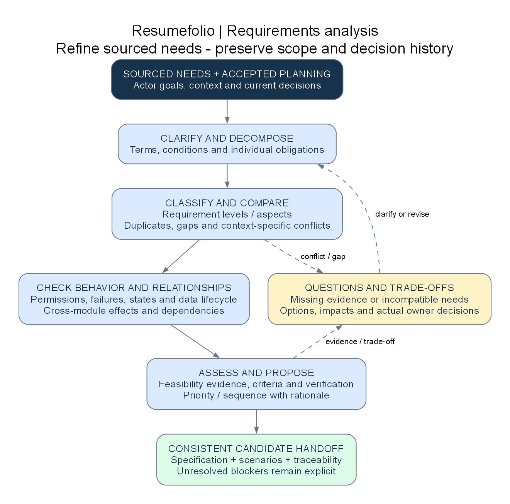
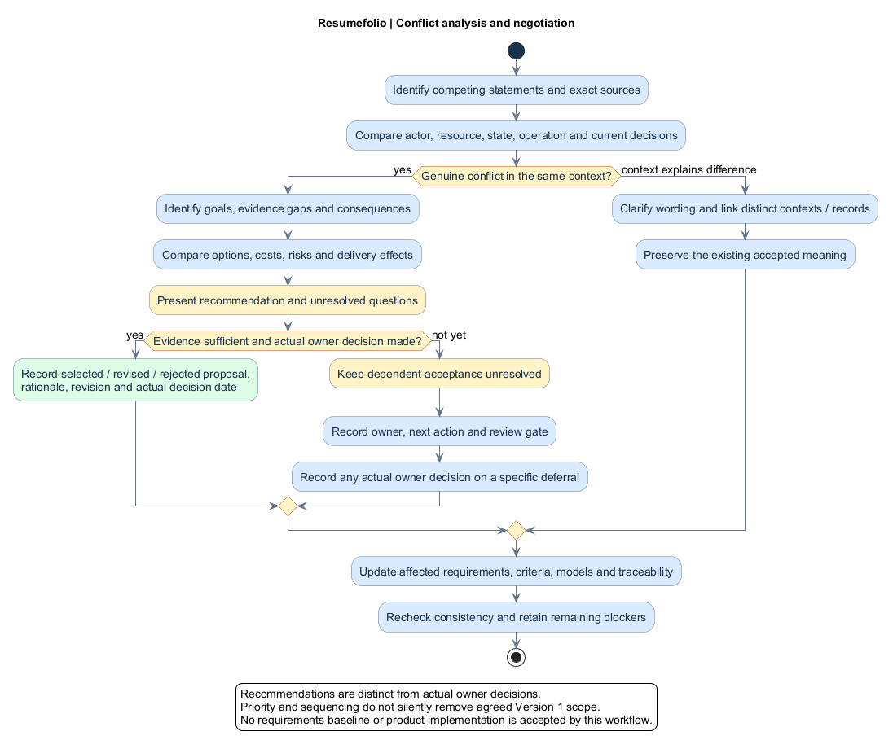

# Resumefolio — Requirements Analysis and Negotiation

| Item | Current position |
|---|---|
| Purpose | Turn sourced needs into clear, consistent, feasible and reviewable requirement candidates |
| Responsible person / decision-maker | Farhad Valizadegan; sole delivery and operations owner |
| Document status | Proposed analysis and negotiation method — ready for review |
| Actual analysis outcomes | No completed requirement-group analysis or new conflict-resolution decision is recorded here |
| Baseline boundary | Candidate refinement and recommendations do not establish M-02 acceptance |
| Revision | October 31, 2026 |

**At a glance:** Start with sourced needs. Clarify meaning, classify each need,
separate compound obligations and examine the related permissions, data states,
failure paths and dependencies. Resolve contradictions with evidence and explicit
decisions. Propose an order of work using value, risk, dependencies and effort;
preserve the full agreed scope when sequencing delivery.

**Read this document for:** the method, review questions, priority rationale and
conflict-handling workflow. The actual requirements, open questions, change
records and decision rationale remain in their authoritative linked documents.

[Inputs](#1-inputs-and-working-boundaries) · [Classification](#2-classify-without-losing-context)
· [Analysis](#3-analysis-workflow-and-checks) · [Models](#4-models-and-cross-module-consistency)
· [Priority](#5-priority-and-dependency-analysis) · [Negotiation](#6-conflict-analysis-and-negotiation)
· [Examples](#7-worked-examples) · [Records](#8-records-and-handoff)
· [Review](#9-quality-and-completion-checklist) · [Next work](#10-current-position-and-next-work)
· [Diagrams](#11-diagram-maintenance)

## 1. Inputs and Working Boundaries

| Input | Analysis use | Boundary to retain |
|---|---|---|
| [Elicitation records](../02-stakeholders-and-elicitation/elicitation-log.md) | Inspect raw needs, source context, interpretations and missing perspectives | Capturing a statement does not make it an accepted requirement |
| [Purpose/objectives](../../01-project-planning/01-purpose-and-objectives.md) and [Scope](../../01-project-planning/02-scope.md) | Check value, scope coverage, inclusions and exclusions | Do not silently add features, remove agreed scope or reopen an accepted decision without a reason |
| [Actors](../02-stakeholders-and-elicitation/actors-and-system-context.md) and [scenarios](../04-scenarios-and-models/user-stories-and-scenarios.md) | Identify goals, interactions, exceptional paths and authorization context | Actor labels are not complete permission grants; draft scenarios need review |
| [Feasibility plan](02-feasibility-study.md), assumptions, dependencies and risks | Identify evidence needed before dependent commitments | A preferred design, expected provider access or requested date is not proof of feasibility |
| [SRS domain documents](../03-requirements-specification/requirements-specification.md), glossary and dictionary | Compare existing candidates and meanings across modules | Keep one authoritative record per need; models and indexes reference it |
| [Decision register](../../01-project-planning/decision-register.md) and [change control](../07-change-and-baseline/change-control.md) | Preserve accepted decisions, replacement history and material impacts | New significant decisions need actual context, outcome and owner authority |

Analyze one coherent actor goal or related rule group at a time, while keeping
cross-module effects visible. Requirements analysis clarifies **what must hold**;
later system analysis/design develops the detailed system model and technical
solution. Investigate feasibility as needed now without treating analysis as
permission to start product implementation.

Farhad currently performs the work alone. Negotiation still matters because user
goals, privacy, operational capacity, cost and delivery expectations can compete.
Do not invent a separate review team, stakeholder attendance or consensus.

## 2. Classify Without Losing Context

Classification helps expose missing detail and locate the authoritative record.
The categories below mix requirement levels and aspects intentionally: a
user-level need can lead to functional, quality and interface requirements that
are also subject to domain rules and constraints. They are not mutually exclusive
labels, and the same text need not be copied into several files.

| Level or aspect | Question | Resumefolio illustration / destination |
|---|---|---|
| Business | Why is the outcome valuable? | Controlled professional presentation and traceable applications; [business requirements](../03-requirements-specification/business-requirements.md) |
| User | What goal must an actor achieve? | A resume owner prepares opportunity-specific content; [user requirements](../03-requirements-specification/user-requirements.md) |
| Functional | What observable behavior must the product provide? | Owner disables a sharing link; detail in the relevant domain document |
| Quality | Under which measurable quality conditions must behavior hold? | Authorization, response behavior under defined load, usability or recovery targets; [quality requirements](../03-requirements-specification/quality-security-and-recovery-requirements.md) |
| Interface | What interaction contract is required at a boundary? | Required Google operations, Git transport, file retrieval and failure responses; [external interfaces](../03-requirements-specification/external-interface-requirements.md) |
| Domain / business rule | Which policy or invariant governs behavior? | Preserved submitted materials must not be overwritten by later source edits; [business rules and lifecycle](../03-requirements-specification/business-rules-and-data-lifecycle.md) |
| Imposed constraint | Which choice or limit is genuinely mandated, and by whom? | Accepted Laravel/OOP and resource boundaries; [domain requirements and constraints](../03-requirements-specification/domain-requirements-and-constraints.md) with planning source |

Track assumptions, examples, solution suggestions and unresolved questions as
such. Do not turn “the server should be enough” into confirmed capacity or treat
every preferred technology as a domain rule. A requirement may be constrained by
the environment, but its source and implications must remain clear.

## 3. Analysis Workflow and Checks



[Scalable SVG](../diagrams/requirements-analysis-map.svg) ·
[Editable Graphviz](../diagrams/requirements-analysis-map.dot)

Blue identifies analysis work; amber marks issues requiring resolution or evidence;
green marks the candidate handoff. Arrows describe refinement and feedback, not
implemented product behavior or automatic requirement acceptance.

1. **Establish provenance and scope.** Identify the source, actor goal, rationale and relevant OBJ/SCP/DEC references; flag uncertain interpretations.
2. **Clarify terminology and conditions.** Replace ambiguous words with observable meaning. Record trigger, preconditions, permitted actor/resource context and resulting state.
3. **Separate obligations.** Split statements containing independently reviewable behaviors or quality conditions. Preserve their parent goal and links so decomposition does not lose meaning.
4. **Compare related records.** Find duplicates, conflicting rules, differing terms and uncovered scope. Consolidate genuine duplicates while retaining all relevant sources; preserve IDs/history under change control if records already exist.
5. **Explore behavior and data.** Check success, alternative, failure, unauthorized and recovery paths, required inputs, ownership, state transitions and cross-module consequences.
6. **Analyze dependencies and feasibility.** Identify prerequisite rules, capabilities and external findings; distinguish hard dependencies from convenient sequencing preferences.
7. **Propose criteria and priority.** Develop observable acceptance conditions and verification needs; explain ordering using the factors in Section 5.
8. **Resolve or route issues.** Correct routine ambiguity within existing authority; record material choices and conflicts for the owner's actual decision. Unresolved blockers prevent dependent acceptance.
9. **Hand off the candidate group.** Update the authoritative requirement/scenario/data records and traceability, retaining review findings and open questions for specification and validation.

| Check | Questions to ask | Expected correction or record |
|---|---|---|
| Ambiguity | Do terms such as fast, secure, automatic or user have a clear meaning here? | Specify conditions and observable outcomes, or record a bounded question |
| Compound statements | Can the clauses fail or be accepted independently? | Split into linked obligations where useful; retain shared context |
| Duplication | Do two records express the same obligation, or merely relate to the same goal? | Reference a single authoritative record; retain distinct complementary requirements |
| Contradiction | Can both statements hold for the same actor, resource, state and operation? | Check context first; negotiate genuine conflicts with options and impacts |
| Completeness for the group | Are key actors, missing inputs, failures, denial paths and lifecycle effects covered? | Add sourced candidate detail or an explicit gap; do not invent user decisions |
| Feasibility | What evidence is required for the dependent commitment, and is it available? | Link the investigation and gate; retain unknowns until supported |
| Testability | Could a reviewer objectively distinguish success from failure? | Write criteria and planned inspection/analysis/demonstration/test methods |
| Necessity and design freedom | Does the statement serve a goal or genuine constraint? | Remove accidental design prescription or record its actual authority |

## 4. Models and Cross-Module Consistency

Choose a model to answer a specific analysis question. Use consistent terms and
stable links to requirements. Models complement the text; their existence does
not prove completeness or select an implementation architecture.

| Model or view | Analysis question | Example focus |
|---|---|---|
| Context / actor view | Who interacts with the system and across which boundary? | Employer sharing versus private user workspace |
| Use case / activity flow | What steps, alternatives and failures lead to an outcome? | Protected resume viewing and direct PDF retrieval |
| State model | Which transitions are valid, and what follows from each state? | Application progress, disabled links or membership changes |
| Conceptual relationship model | Who owns the information, what refers to it, and what must remain distinct? | Shared profile, tailored live resume and preserved submitted copy |
| Permission matrix | Which actor may perform which operation on which resource/state? | Invited collaborator versus owner's private email |
| Dependency view | What evidence or capability must exist before a dependent commitment? | Isolation findings before accepting workflow execution design |

Review changes across profiles/resumes, sharing, submitted materials, email/calendar,
work management and Git/CI where relevant. For each edit, delete, disconnect,
revocation or restore operation ask what changes, remains preserved, stops or
requires manual reactivation. A local workflow must not silently violate another
module's ownership, access or history rules.

Retain open policy details as questions rather than resolving them through an
unreviewed database schema or session mechanism. Architecture, concrete schemas,
runner technology and implementation contracts are later design outputs unless
an explicit source imposes a choice.

## 5. Priority and Dependency Analysis

Priority expresses the proposed order or urgency of attention, not whether an
agreed Version 1 capability can disappear. Requirements priority, investigation
urgency and implementation order can differ: a high-impact uncertainty may need
early investigation even when its feature will be implemented later.

| Factor | Evidence or rationale to record |
|---|---|
| User/business value | Actor outcome, related objective and consequence of leaving the need unmet |
| Risk and uncertainty | Privacy, data-loss, feasibility or operational exposure; reason for early clarification |
| Dependencies | What the item requires and what it enables; distinguish mandatory prerequisites from preferences |
| Effort and resource demand | Available estimate range and its basis, or Unknown where not yet estimated |
| Time sensitivity | Real external deadline or cost of delay; distinguish the requested delivery target from a validated forecast |
| Scope and obligations | Accepted inclusion or imposed constraint; changes require an explicit decision |

Use the project's existing tracking conventions for priority and state; this
document introduces no new mandatory score or priority vocabulary. If a scoring
method is later chosen, document its scale, evidence, weighting and limitations.
Avoid precise-looking totals built from unknown estimates or unmeasured likelihoods.

Maintain dependency links between actual records and inspect cycles. If A requires
B and B requires A, determine whether the work needs decomposition, a shared
prerequisite, incremental refinement or clarification of a mistaken dependency.
Do not assume listing both in a Sprint solves the dependency.

GitHub issues and the delivery project own live delivery priorities and assignments.
Requirements records retain their own rationale and status; link them rather than
maintaining competing live schedules. Reconcile work and forecasts after the
agreed analysis/design review and before product coding. See the
[working method](../../01-project-planning/09-working-method-and-change-control.md)
and [roadmap](../../01-project-planning/08-roadmap-and-milestones.md).

## 6. Conflict Analysis and Negotiation



[Scalable SVG](../diagrams/requirements-negotiation-flow.svg) ·
[Editable PlantUML](../diagrams/requirements-negotiation-flow.puml)

First test whether the statements actually conflict in the same context. Different
data versions or actor permissions can explain apparent contradictions. For a
genuine conflict, understand the underlying goals before comparing solutions.

| Step | What to record |
|---|---|
| Describe the conflict | Exact competing statements, sources, current status and affected actor/resource/state |
| Establish consequences | User value, privacy/security, data lifecycle, interfaces, cost, effort, schedule and operation effects |
| Identify evidence gaps | Missing provider/resource findings, assumptions or unanswered policy questions |
| Compare meaningful options | What each option preserves, changes or fails to meet, with rationale and limitations |
| Recommend a response | Preferred option and why; distinguish a recommendation from acceptance |
| Obtain the actual decision | Decision-maker, outcome, date, reviewed revision, reasons and accepted conditions or deferrals |
| Update and recheck | Affected requirements, criteria, scenarios, models, dictionary, traceability and linked work |

The owner decides material scope, spending and delivery changes. Routine wording
clarification consistent with accepted direction can proceed within existing
authorization; significant technical reasoning remains documented. Refer material
proposals to [Requirements Change Control](../07-change-and-baseline/change-control.md).

Possible responses include selecting an option, revising the proposal, rejecting
it, or deferring a dependent decision with an owner/action/gate. A deferral is not
proof that conflicting needs are compatible. A known blocker remains a blocker
until resolved at its relevant acceptance gate. Record residual-risk acceptance
explicitly when applicable; never infer it from silence or a target date.

## 7. Worked Examples

These examples explain the method using existing planning direction. They do not
report new elicitation sessions, accepted detailed requirements or executed tests.

### Example A: live changes and preserved submission history

| Analysis element | Interpretation based on existing scope |
|---|---|
| Apparent conflict | A resume can change after saving, while the materials actually submitted must remain preserved |
| Context check | A live employer view and a preserved submitted copy serve different purposes |
| Existing authority | [DEC-023](../../01-project-planning/02-scope.md#dec-023), [DEC-024](../../01-project-planning/02-scope.md#dec-024) and Scope's application-history distinction |
| Analysis result for preparation | Model the two information contexts separately; specify modification and retrieval behavior without prescribing storage technology |
| Questions still to refine | Capture trigger, included artifacts, access after later edits/deletion and relevant failure/restore paths |
| Handoff | Business/lifecycle rules, scenarios and observable criteria in the relevant domain documents |

The apparent contradiction can be clarified using existing direction. The
remaining detailed policies still need sourced records and review; this example
does not allocate requirement IDs or settle every archive rule.

### Example B: agreed CI/CD scope and unverified resource limits

| Analysis element | Proposed handling |
|---|---|
| Tension | Actual YAML execution is included conditionally, but safe execution and combined-server capacity remain unverified |
| Existing authority | [DEC-019](../../01-project-planning/02-scope.md#dec-019), RSK-03 and GAP-D09 |
| Early action | Clarify required execution behavior and obtain the relevant feasibility/security findings before accepting dependent design or enabling jobs |
| Priority rationale | Investigate early because a finding may affect architecture, cost and delivery; no measured probability or effort is invented |
| If evidence reveals a conflict | Present real alternatives and their consequences; obtain the owner's decision for material scope, spending or delivery changes |
| Boundary | Do not replace actual execution with ordinary Git checks and label the agreed capability complete |

No option is selected and no execution safety is established by this example.
The investigation remains governed by the [feasibility study](02-feasibility-study.md)
and existing review gates.

## 8. Records and Handoff

Keep decisions and analysis outcomes close to the affected authoritative record.
Do not create a parallel acceptance register inside this method document.

| Output | Destination / required links |
|---|---|
| Clear requirement candidates and criteria | [SRS](../03-requirements-specification/requirements-specification.md), using the [requirement template](../templates/requirement-template.md); retain source, rationale and status |
| Scenario, permission and lifecycle refinements | Relevant domain records and [use cases/scenarios](../04-scenarios-and-models/user-stories-and-scenarios.md); preserve exceptional and denied paths |
| Terms and data meaning | [Glossary](../05-data-definitions/glossary.md) and [Data Dictionary](../05-data-definitions/data-dictionary.md) |
| Unresolved conflict, question or dependency | [Open Questions and Decisions](../07-change-and-baseline/open-questions-and-decisions.md), with sources, impacts, owner, next action and gate |
| Material change and actual decision | [Change Control](../07-change-and-baseline/change-control.md) and authoritative decision source; preserve previous meaning/history |
| Review findings | [Review Plan and Findings](../06-validation-and-traceability/review-plan-and-findings.md), identifying actual revision, review and disposition |
| Coverage and dependency links | [Traceability](../06-validation-and-traceability/requirements-traceability.md), linked backlog records and later design/verification references |

A useful analysis handoff identifies the group, inspected sources/revision,
clarifications/decomposition, candidate records, dependency and priority rationale,
actual decisions, unresolved blockers and next review. Do not invent reviewer
participation, dates, estimates or approvals. Preserve provenance when wording is
merged or split and follow the agreed identifier convention before allocation.

## 9. Quality and Completion Checklist

For a coherent candidate group:

- [ ] Sources, scope links, actor goals and rationale are explicit.
- [ ] Ambiguous terms and compound obligations have been clarified or explicitly tracked.
- [ ] Classification supports navigation without duplicating the authoritative requirement.
- [ ] Duplicate and contradictory statements have been compared in the same actor/resource/state context.
- [ ] Relevant permissions, normal/alternative/failure paths, data lifecycle and cross-module effects are covered.
- [ ] Dependencies, cycles and decisive feasibility unknowns are identified with evidence or appropriate gates.
- [ ] Acceptance criteria are observable; proposed numerical targets have a rationale and review status.
- [ ] Priority and sequencing proposals have reasons; unknown effort or likelihood is not presented as measured fact.
- [ ] Material trade-offs have actual owner decisions, or remain visible unresolved proposals/blockers.
- [ ] Text, models, terms, traceability and linked work agree after revisions.
- [ ] Review results, limits, remaining gaps and handoff ownership are recorded.

The group is ready for further specification/review when these checks are
sufficiently addressed for that next activity. Acceptance of a dependent baseline
still requires resolution of its blockers and an actual decision against an
identified revision. Analysis and negotiation can repeat as new evidence appears.

## 10. Current Position and Next Work

| Item | Current position / next action |
|---|---|
| Analysis and negotiation method | Expanded proposed draft ready for owner review |
| Product-specific analysis records | Develop actual group records from sourced elicitation inputs; no completed analysis group is claimed here |
| Priority and estimates | Apply existing tracking conventions with recorded reasons; no new ordering, numerical estimate or schedule is accepted here |
| Conflicts and decisions | Record actual conflicts/options/outcomes in their authoritative locations; examples above are explanatory |
| Immediate next activity | Select a coherent sourced group, clarify its terms and obligations, map dependencies and prepare criteria plus genuine open choices |
| M-02 and implementation | Requirements acceptance and the wider pre-implementation gate remain separate and pending |

**Revision note — October 31, 2026:** Expanded the original outline with
classification, analysis checks, models, dependency/priority rationale, negotiation
records, worked examples and a completion checklist. Added two diagrams. No new
scope decision, priority assignment, feasibility finding, executed test, baseline
acceptance or product implementation is reported.

## 11. Diagram Maintenance

| Diagram | Editable source | Scalable view | Preview |
|---|---|---|---|
| Analysis and candidate handoff | [Graphviz](../diagrams/requirements-analysis-map.dot) | [SVG](../diagrams/requirements-analysis-map.svg) | [PNG](../diagrams/requirements-analysis-map.png) |
| Conflict resolution workflow | [PlantUML](../diagrams/requirements-negotiation-flow.puml) | [SVG](../diagrams/requirements-negotiation-flow.svg) | [PNG](../diagrams/requirements-negotiation-flow.png) |

Keep sources, renders, captions and related text synchronized. Color complements
labels and shapes. Inspect every render for readable labels, correct arrows and
clipping, and verify links after changes. Run from the repository root:

```powershell
$diagramFolder = 'docs\SDLC\02-requirements-engineering\diagrams'
$graphvizExe = 'C:\Program Files\Graphviz\bin\dot.exe'
$plantUmlJar = 'C:\Users\fvali\AppData\Local\Resumefolio\DiagramTools\plantuml.jar'

foreach ($format in 'svg', 'png') {
    & $graphvizExe "-T$format" -Gdpi=140 `
        "$diagramFolder\requirements-analysis-map.dot" `
        -o "$diagramFolder\requirements-analysis-map.$format"
    if ($LASTEXITCODE -ne 0) { throw "Graphviz failed: $format" }

    java '-Djava.awt.headless=true' -jar $plantUmlJar -charset UTF-8 "-t$format" `
        "$diagramFolder\requirements-negotiation-flow.puml"
    if ($LASTEXITCODE -ne 0) { throw "PlantUML failed: $format" }
}
```

Save sources as UTF-8 without BOM. Under another account, substitute the actual
installed JAR path. Retain sources and SVG/PNG outputs in version control.

[Requirements Approach](01-requirements-approach.md) · [Elicitation](03-requirements-elicitation.md)
· [Process index](README.md) · [Requirements index](../README.md)
