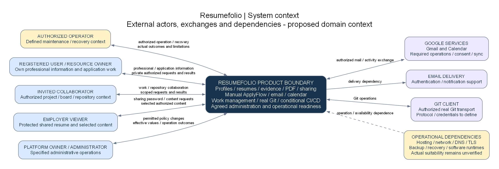
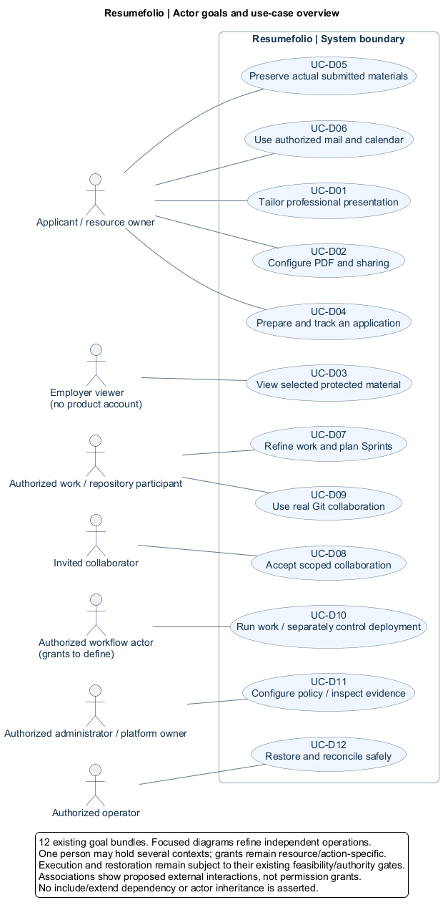

# Resumefolio — Actors and System Context

| Item | Current position |
|---|---|
| Purpose | Identify stakeholder interests, interacting actors, system boundaries and external dependencies |
| Project owner | Farhad Valizadegan; sole delivery and operations owner |
| Document status | Proposed actor/context model derived from accepted planning direction |
| Authority | Scope and stakeholder decisions retain their accepted meaning; detailed permissions remain under development |
| Baseline position | M-02 acceptance pending; diagrams do not establish implementation or provider access |
| Revision | October 31, 2026 |

**At a glance:** Resumefolio serves registered users, invited collaborators and
employer viewers, with defined platform-owner and administrator responsibilities.
Their interactions differ by goal, resource and access context. Google services,
email delivery and Git clients cross external boundaries; hosting/domain/backup
arrangements support operation. A unified experience does not grant universal
access or select a single technical architecture.

**Read this document for:** who needs what, what lies inside/outside the product,
which boundaries must be clarified and where detailed rules belong. Use the
[permission matrix](../03-requirements-specification/accounts-authentication-and-permissions.md#7-role-resource-and-operation-matrix)
for the existing role/resource/action starting point; this document does not
replace that authoritative permission specification.

[Terms](#1-stakeholders-actors-and-delivery-responsibilities) · [Context](#2-product-boundary-and-system-context)
· [Actors](#3-human-actor-and-stakeholder-catalog) · [Goals](#4-actor-goals-and-use-case-context)
· [External interactions](#5-external-systems-clients-and-operational-dependencies)
· [Boundaries](#6-access-data-and-lifecycle-boundaries) · [Questions](#7-elicitation-coverage-and-open-questions)
· [Review](#8-review-checklist-and-current-position) · [Diagrams](#9-diagram-maintenance)

## 1. Stakeholders, Actors and Delivery Responsibilities

| Perspective | Meaning | Important distinction |
|---|---|---|
| Stakeholder | Person/group with an interest in the product or its outcomes | Not every stakeholder directly interacts with a product function |
| Actor | Role or external system participating in an interaction with the system of interest | A role is not necessarily a separate person or a complete permission set |
| Resource-owner context | Responsibility/access relationship to a particular resume, project, repository or other resource | It is contextual, not a universal administrator role |
| Delivery/operations responsibility | Work needed to define, build, verify, deploy and operate Resumefolio | Currently carried by Farhad alone; no separate team is assumed |

The project owner decides scope, budget and release direction. The platform owner
is an administrative role inside the product. One person may hold both, but project
ownership is not itself a complete application-authorization specification.

A registered user may act as a resume owner in one interaction and as an invited
collaborator on another resource. Evaluate the current actor/resource/action/state
context rather than inferring a role hierarchy or inherited privileges. No new
actor identifiers or role assignments are allocated here.

Source: [Stakeholders and Responsibilities](../../01-project-planning/03-stakeholders-and-responsibilities.md),
DEC-029–DEC-032, and [Scope](../../01-project-planning/02-scope.md), DEC-028.

## 2. Product Boundary and System Context



[Scalable SVG](../diagrams/actors-system-context.svg) ·
[Editable Graphviz](../diagrams/actors-system-context.dot)

Blue identifies human interaction contexts; purple identifies external services
and clients; amber identifies operational dependencies. Labeled lines describe
conceptual interactions/dependence, not network protocols, data ownership grants,
deployment topology or demonstrated integration access.

| Boundary | Included context | Detail / limitation |
|---|---|---|
| Professional presentation | Profiles, tailored resumes, selected supporting evidence, generated/uploaded PDFs and protected sharing | Owner control and direct-file authorization; exact fields and lifecycle rules remain to be specified |
| Application work | Manual ApplyFlow, preserved submitted materials, Gmail and calendar integration | User-directed preparation/progress; no automatic external submission is implied |
| Work/code collaboration | Projects, Kanban, backlogs, Sprints/tasks and real Git hosting/collaboration | Resource-specific membership and operation permissions |
| Workflow execution | Agreed YAML/CI/CD capability, including controlled deployment stages where specified | Conditional on relevant feasibility, isolation, secrets and resource findings |
| Administration/operation | Agreed platform configuration, setup, maintenance, backup and recovery readiness | Administrative powers and actual operating procedures need explicit requirements/design |
| Outside Version 1 | Product AI, automatic translation and automatic old-demo migration | Manually entered English/German content remains included; preserve existing demo/reference projects |

The authoritative [Version 1 Scope](../../01-project-planning/02-scope.md) supplies
the detailed inclusion/exclusion boundaries. Existing reference projects and the
GitHub tools used to develop Resumefolio are not automatically runtime product
components. Internal module names express capability groups, not deployed services.

## 3. Human Actor and Stakeholder Catalog

The catalog derives goals from accepted planning. It does not grant all candidate
operations or claim research with actual representatives. Exact permissions,
states and exceptional paths require detailed records and review.

| Role / perspective | Goal and relevant interactions | Existing boundary | Questions still to specify |
|---|---|---|---|
| Registered user / job applicant | Maintain professional information, tailor presentation, manage manual applications and related communication/schedules | Individual account and resource-specific access; no unrelated private data from sign-in alone | Onboarding, required inputs, recovery, account states, languages and complete workflows |
| Resume/resource owner | Select content, customize a resume, control PDF downloads and employer sharing | Independent resume-specific settings; owner can change sharing password or disable link | Propagation, override precedence, link/session policy, lifecycle and sensitive-operation checks |
| Invited collaborator | Participate in authorized project/board/repository work | Invitation alone does not expose private email, unrelated resumes or repositories | Invite/accept/revoke paths, read/write/review/merge rights and membership-change consequences |
| Employer viewer | View intended resume/evidence and retrieve permitted files/PDFs | No viewer account required; protected access limited to selected content | Valid access/session lifetime, wrong-password handling, language/download cases and revocation feedback |
| Administrator | Perform specified account and content administration | Only authorized administrative operations; role name is not unrestricted access | Exact view/edit/suspend/delete/restore powers, reasons, audit and recovery behavior |
| Platform owner | Administer the platform and configure upload/storage policy | Effective policy respects actual infrastructure capacity | Scope of powers, limits, private-data separation, sensitive checks and operational visibility |
| Project owner / operator | Decide product commitments and perform feasible solo deployment/maintenance/recovery | Governance and operational responsibilities do not establish an independent product role or team | Actual procedures, access arrangements, recurring workload, incident handling and recovery evidence |

Source relationships: profiles/evidence DEC-027/DEC-026; PDFs/sharing DEC-025/DEC-024;
manual applications DEC-023; email/calendar DEC-022; work management DEC-021;
Git/CI DEC-020/DEC-019; file policy DEC-018; operating readiness DEC-017. Open
permission detail is owned by [Accounts and Permissions](../03-requirements-specification/accounts-authentication-and-permissions.md).

## 4. Actor Goals and Use-Case Context



[Scalable SVG](../diagrams/actors-goal-overview.svg) ·
[Editable PlantUML](../diagrams/actors-goal-overview.puml)

The associations identify interests and candidate interactions within accepted
scope, not complete permissions or accepted detailed use cases. No actor inheritance,
mandatory login mechanism, include/extend relationship or implementation sequence
is selected. Governance and external operational responsibilities are covered in
the catalog and context map rather than modeled as universal product privileges.

| Interaction group | Primary goal / actor context | Coverage to develop |
|---|---|---|
| Profile to tailored presentation | Registered user acting on owned professional information/resume | Required/missing inputs, independent overrides, evidence selection, language handling |
| Configure and consume protected sharing | Resume owner and employer viewer | Correct/wrong password, disabled link, selected/unselected content and authorized direct file/PDF retrieval |
| Manual application and submission history | Registered user/job applicant | Opportunity, manually authored cover letter, actual submitted materials, progress and later source edits |
| Communication and scheduling | Authorized user with provider connection where needed | Required Gmail/Calendar operations, consent, conflicts, retries/disconnect and activity access |
| Work/code collaboration | Authorized resource owner or invited participant | Board/backlog/Sprint/task actions, Git transport, fork/review/merge and membership changes |
| Controlled workflow execution | Authorized repository/execution participant | Supported workflow behavior, triggering authority, run/output visibility, secret/isolation limits and deployment controls |
| Administration | Platform owner or administrator within specified powers | Allowed/denied operations, impact on users/content, audit and recovery paths |

Use [Stories and Scenarios](../04-scenarios-and-models/user-stories-and-scenarios.md)
for individual goal records and paths. Keep a single source for each detailed
interaction; this overview points to that work rather than duplicating the catalog.

## 5. External Systems, Clients and Operational Dependencies

External systems are supporting interaction participants; infrastructure and
providers can also be operational dependencies. Being listed here does not prove
access, capacity, approval or a final integration design.

| External participant / dependency | Required interaction or support | Boundary and evidence still needed | Existing reference |
|---|---|---|---|
| Google Gmail | Agreed email reading, composition, sending and replies | Actual permissions/access, required operations, quotas/costs, provider/local data authority and failure/reconnection behavior | ASM-02, DEP-03, GAP-D02; DEC-022 |
| Google Calendar | Agreed calendar integration | Required operations, selection/direction, conflicts, reconnect, deletion and actual provider access | ASM-02, DEP-03, GAP-D02; DEC-022 |
| Authentication/notification email delivery | Support email-dependent authentication/notification requirements | Actual delivery/receipt, limits, costs, retries/failures and permitted recovery; no new provider selected | ASM-03, DEP-04, GAP-D03 |
| Browser / device | Human access to product workflows and controlled shared content | Supported device/browser/accessibility behavior and notification constraints require definition | Relevant UI/quality requirements; GAP-D10 |
| Git client | Real Git transport against authorized hosted repositories | Supported protocols, credentials, allowed operations, error responses and resource limits require requirements/design | DEC-020; relevant interface/Git requirements |
| Existing hosting/network | Run application, storage, Git and background/execution workloads | Resource inventory, competing demand, isolation, failure behavior and actual capacity | ASM-01, DEP-01, GAP-D01/D09 |
| Domain, DNS and TLS | Intended secure address and routing | Administrative control, actual configuration, certificate/renewal arrangements and live checks | DEP-02, GAP-D07 |
| Backup storage and recovery environment | Preserve relevant data and demonstrate usable restoration | Separation, coverage, access, capacity, retention, costs and restoration/integrity evidence | ASM-04, DEP-05, GAP-D04 |
| Software packages/runtimes | Build and operate the eventual application | Actual selections, licensing, compatibility, support and realistic solo upkeep | DEP-06, GAP-D08 |

See [Assumptions and Dependencies](../../01-project-planning/06-assumptions-and-dependencies.md)
and [Feasibility Study](../01-process-and-approach/02-feasibility-study.md) for
investigation methods/gates. Exact interaction requirements belong in
[External Interfaces](../03-requirements-specification/external-interface-requirements.md)
and the affected domain specifications. Do not assume a separate SSO server,
third-party Git engine, CI runner or paid service from this context view.

## 6. Access, Data and Lifecycle Boundaries

| Boundary | Existing direction | Detailed review needed |
|---|---|---|
| Sign-in versus resource authority | Unified sign-in does not grant unrelated access | Actor/resource/action/state rules across normal and direct requests |
| Owner versus collaborator | Collaboration is limited to authorized resources/operations | Membership roles, invitations, revocation and cross-module effects |
| Shared viewer versus private workspace | Employer sees only selected content through protected access | Session eligibility/revocation, direct retrieval, language availability and denial feedback |
| Administrator versus private user content | Only explicitly authorized administration | Exact powers, sensitive checks, audit obligations and recovery authority |
| Live information versus submitted materials | Later source edits must not overwrite preserved submitted copies | Capture, allowed access, correction/deletion and restoration rules |
| Local information versus external provider state | Agreed integrations must have explicit rules | Property ownership, synchronization conflicts, retries, consent loss and disconnect effects |
| Stored code versus execution authority | Git hosting does not itself authorize arbitrary workloads or deployment | Runner isolation, secrets, triggers, output access, cleanup/resource limits and explicit deployment controls |
| Operational access versus evidence sharing | Private operational information is protected | Sanitized documentation/evidence, actual maintenance access and backup protection |

Use the [Data Definitions](../05-data-definitions/README.md) and
[Business Rules/Lifecycle](../03-requirements-specification/business-rules-and-data-lifecycle.md)
for conceptual meaning and authoritative behavior. Do not infer automatic
reactivation, deletion cascades, retention periods, session duration or quota values
from this overview. Explore unauthorized and cross-user requests as review paths
without treating an untrusted requester as an authorized product role.

## 7. Elicitation Coverage and Open Questions

This section identifies questions to develop; it is not a new decision log. Link
actual questions to sources/affected requirements in the shared
[Open Questions register](../07-change-and-baseline/open-questions-and-decisions.md).
Farhad coordinates follow-up under the existing solo arrangement.

| Topic | Clarification needed | Review point |
|---|---|---|
| Account and role lifecycle | Onboarding policy, exact roles/powers, account-state effects and recovery | Before accepting affected account/permission requirements |
| Resource ownership and membership | Creation, transfer if required, invitations, revocation and allowed operations | Before accepting affected collaboration/data requirements |
| Employer access | Correct/incorrect password, link/session lifecycle, content selection and direct file/PDF paths | Before accepting sharing/permission criteria |
| Professional data and applications | Required inputs, override/propagation, submission capture and preservation | Before accepting affected workflow/lifecycle requirements |
| External communication/schedules | Required operations, consent, synchronization direction/conflicts, disconnect and reminder behavior | Before dependent requirements/design acceptance; actual access before dependent development |
| Git and execution | Visibility/transport/collaboration permissions, supported workflows and execution/deployment authority | Before accepting dependent design or enabling jobs |
| Operational suitability | Resource/cost limits, solo procedures, recovery and measurable quality targets | Relevant M-02/M-03 gates and actual later readiness checks |
| Missing perspectives | Which user/collaborator/employer views are represented only through owner assumptions? | During elicitation/validation; record actual feedback and limitations |

Use [Elicitation Plan](elicitation-plan-and-techniques.md),
[Elicitation Log](elicitation-log.md) and the
[elicitation process](../01-process-and-approach/03-requirements-elicitation.md).
Reuse accepted decisions; ask about genuinely missing detail and material choices.
Record actual participants, dates, observations and interpretations without
inventing research, interviews or consensus.

## 8. Review Checklist and Current Position

- [ ] Actor goals and external interactions are traceable to Scope, objectives or actual elicitation sources.
- [ ] Product roles, resource ownership and solo project responsibilities are distinguishable.
- [ ] The system boundary preserves all agreed inclusions/exclusions without prescribing architecture.
- [ ] Resource permissions are linked to their authoritative matrix/domain requirements rather than inferred from actor labels.
- [ ] Normal, denied, failed and lifecycle-changing paths are represented in the relevant scenarios.
- [ ] External participants/dependencies have open access, capacity and failure questions assigned before dependent commitments.
- [ ] Text, conceptual models, glossary/dictionary and traceability agree.
- [ ] Missing perspectives, proposed details and unresolved questions remain explicit.
- [ ] Actual review outcome is recorded against an identified revision before declaring acceptance.

| Item | Current position |
|---|---|
| Actor/context coverage | Expanded proposed model based on accepted planning sources |
| Detailed permissions | Initial matrix exists; complete action/state rules remain to be developed |
| External access/capacity | Unverified at existing investigation gates |
| Scenario/requirement allocation | Develop actual records and criteria in their authoritative locations |
| Actual review decision | Pending; no acceptance date or outcome recorded by this revision |
| Next useful work | Review actor goals and genuine gaps, then develop one coherent interaction and its allowed/denied/failure paths |

**Revision note — October 31, 2026:** Expanded the scaffold with stakeholder/actor
distinctions, goal catalog, product boundary, external participants/dependencies,
data/access boundaries and elicitation questions. Added two conceptual diagrams.
No new role grant, accepted detailed permission, provider connection, technical
architecture, product test or requirements baseline is established.

## 9. Diagram Maintenance

| Diagram | Editable source | Scalable view | Preview |
|---|---|---|---|
| System context | [Graphviz](../diagrams/actors-system-context.dot) | [SVG](../diagrams/actors-system-context.svg) | [PNG](../diagrams/actors-system-context.png) |
| Actor goals | [PlantUML](../diagrams/actors-goal-overview.puml) | [SVG](../diagrams/actors-goal-overview.svg) | [PNG](../diagrams/actors-goal-overview.png) |

Keep text, captions, editable sources and renders synchronized. Colors supplement
labels and shapes. Inspect readable labels/arrows and verify local file/section
links after edits. Run from the repository root:

```powershell
$diagramFolder = 'docs\SDLC\02-requirements-engineering\diagrams'
$graphvizExe = 'C:\Program Files\Graphviz\bin\dot.exe'
$plantUmlJar = 'C:\Users\fvali\AppData\Local\Resumefolio\DiagramTools\plantuml.jar'

foreach ($format in 'svg', 'png') {
    & $graphvizExe "-T$format" -Gdpi=140 `
        "$diagramFolder\actors-system-context.dot" `
        -o "$diagramFolder\actors-system-context.$format"
    if ($LASTEXITCODE -ne 0) { throw "Graphviz failed: $format" }
    java '-Djava.awt.headless=true' -jar $plantUmlJar -charset UTF-8 "-t$format" `
        "$diagramFolder\actors-goal-overview.puml"
    if ($LASTEXITCODE -ne 0) { throw "PlantUML failed: $format" }
}
```

Save sources as UTF-8 without BOM. Under another account, use the actual installed
JAR path. Retain sources and SVG/PNG outputs in version control.

[Stakeholders and Elicitation index](README.md) · [Requirements index](../README.md)
· [Specification](../03-requirements-specification/requirements-specification.md)

## Updated Requirements Use-Case Views — November 1, 2026

The context diagram now identifies input/output meanings at the product boundary and an explicit authorized operator context. It remains a conceptual context map, not a quantitative flow specification or an implemented access model.

The overview links all twelve existing goal bundles to their actor contexts, including conditional execution and recovery. Five focused views show all sixteen operation-specific refinements from the revised scenario text. Fetch/Pull is also shown from the existing parent Git capability; no new child identifier is allocated. All associations are proposed requirements-model links, not accepted roles or permissions. No include/extend relationship is inferred from a shared business topic.

| Focused view | Editable source | Preview | Scalable |
|---|---|---|---|
| Mail and calendar | [PlantUML](../diagrams/use-cases-mail-and-calendar.puml) | [PNG](../diagrams/use-cases-mail-and-calendar.png) | [SVG](../diagrams/use-cases-mail-and-calendar.svg) |
| Work and Sprints | [PlantUML](../diagrams/use-cases-work-and-sprints.puml) | [PNG](../diagrams/use-cases-work-and-sprints.png) | [SVG](../diagrams/use-cases-work-and-sprints.svg) |
| Git transfer and collaboration | [PlantUML](../diagrams/use-cases-git-collaboration.puml) | [PNG](../diagrams/use-cases-git-collaboration.png) | [SVG](../diagrams/use-cases-git-collaboration.svg) |
| Conditional execution and deployment | [PlantUML](../diagrams/use-cases-execution-and-deployment.puml) | [PNG](../diagrams/use-cases-execution-and-deployment.png) | [SVG](../diagrams/use-cases-execution-and-deployment.svg) |
| Policy and operational evidence | [PlantUML](../diagrams/use-cases-administration.puml) | [PNG](../diagrams/use-cases-administration.png) | [SVG](../diagrams/use-cases-administration.svg) |

Read these with the [external scenario narratives](../04-scenarios-and-models/user-stories-and-scenarios.md#8-operation-specific-external-use-cases--proposed-refinements). The overview is deliberately at goal-bundle level; focused views are not exhaustive detailed coverage of every domain or criterion. Open policy/feasibility gates and M-02 status are unchanged.

Regenerate every PlantUML file using the existing Java/PlantUML command above with the corresponding source filename; render both SVG and PNG. Graphviz renders the context DOT. Retain sources and inspect renders together after changes.
