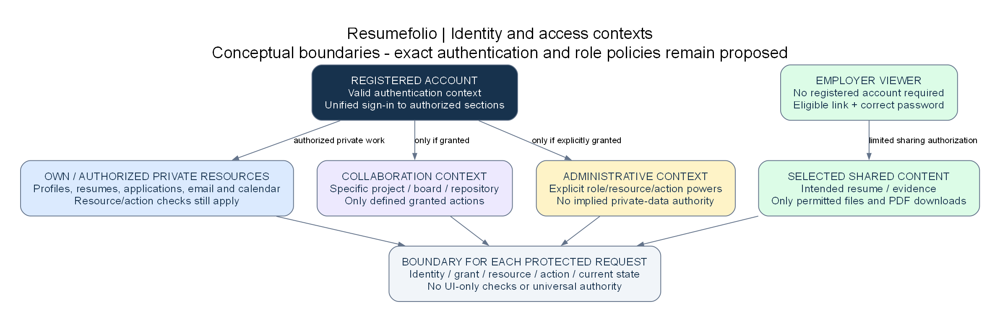
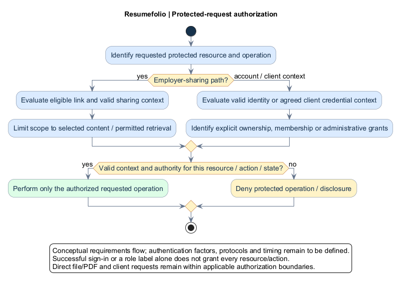

# Resumefolio — Accounts, Authentication and Permissions

| Item | Current position |
|---|---|
| Purpose | Specify identity, sign-in and resource-access behavior across Resumefolio |
| Responsible person | Farhad Valizadegan; sole delivery and operations owner |
| Document status | Product requirements draft — proposed for owner review |
| Source authority | Accepted planning boundaries are referenced below; detailed requirements and policy choices remain proposed |
| Identifier status | ACC-D01–ACC-D12 are provisional document-local draft references, not allocation of the final FR/NFR convention |
| Baseline / implementation | M-02 acceptance pending; no implemented authentication or permission test results are reported |
| Revision | October 31, 2026 |

**At a glance:** A user account identifies a private product user. Unified sign-in
supports a consistent experience, while authorization determines access to each
resource and operation. Collaborator invitations and employer links grant limited
access contexts. Administrative roles require explicit powers; they do not imply
unrestricted access to private information.

**Read this document for:** proposed obligations, observable criteria and role/resource
boundaries. Authentication factors, signup policy, detailed role powers, session
timing and recovery policy are explicitly unresolved. This draft is ready for
review of those choices; it is not an accepted security design or complete account
lifecycle baseline.

[Basis](#1-scope-sources-and-boundaries) · [Concepts](#2-identity-and-access-contexts)
· [Requirements](#3-proposed-requirements-and-acceptance-criteria) · [Lifecycles](#4-account-session-and-membership-lifecycle)
· [Data](#5-information-and-sensitive-data-boundaries) · [Review paths](#6-scenarios-and-verification-plan)
· [Permission matrix](#7-role-resource-and-operation-matrix) · [Open decisions](#8-open-policy-decisions-and-dependent-gates)
· [Review](#9-traceability-review-and-current-position) · [Diagrams](#10-diagram-maintenance)

## 1. Scope, Sources and Boundaries

| Source | Direction retained | Detail not settled by the source |
|---|---|---|
| [DEC-028](../../01-project-planning/02-scope.md#dec-028) / [EXT-003](../02-stakeholders-and-elicitation/elicitation-log.md#ext-003-unified-sign-in-and-resource-permissions) | Individual accounts, roles, resource/operation permissions and unified sign-in across authorized sections | Role hierarchy, account lifecycle, authentication flows and detailed criteria |
| [OBJ-04](../../01-project-planning/01-purpose-and-objectives.md#objective-4-provide-a-unified-working-environment) | Connected workflows without repeated sign-in or unintended private access | Concrete authentication/session architecture |
| [DEC-024](../../01-project-planning/02-scope.md#dec-024) / [DEC-025](../../01-project-planning/02-scope.md#dec-025) | Employer access without a viewer account, password protection, selected content, owner password/link controls and protected file/PDF retrieval | Session revocation timing, link lifecycle, feedback and retry policy |
| [DEC-021](../../01-project-planning/02-scope.md#dec-021) / [DEC-020](../../01-project-planning/02-scope.md#dec-020) | Authorized work/repository collaboration | Read/write/invite/review/merge roles and credential protocols |
| [DEC-029–DEC-032](../../01-project-planning/03-stakeholders-and-responsibilities.md) / [DEC-018](../../01-project-planning/02-scope.md#dec-018) | Product roles distinct from delivery ownership; permitted administration and configurable file policy | Exact administrator/platform-owner powers and sensitive-operation checks |
| [Risk Register](../../01-project-planning/07-risks.md), RSK-03/RSK-04/RSK-07/RSK-09 | Execution boundaries, allowed/denied requests, email-dependent authentication and lifecycle need explicit controls/evidence | Risk responses are not implemented mechanisms or completed tests |

Scope includes the identity/access foundation and its use by professional
presentation, manual applications, communication/calendar, work management and
Git/conditional CI/CD. Do not infer public self-registration, social login,
mandatory MFA, a specific password/OTP scheme or a separate SSO server from the
phrase “unified sign-in.” Existing planning sources do not settle those policies.

The [Actors and Context](../02-stakeholders-and-elicitation/actors-and-system-context.md)
document owns stakeholder goals; this file owns detailed permission expectations.
The [sharing domain](pdf-and-controlled-sharing.md) and other module specifications
must reference compatible rules rather than establishing contradictory access paths.

## 2. Identity and Access Contexts



[Scalable SVG](../diagrams/accounts-access-contexts.svg) ·
[Editable Graphviz](../diagrams/accounts-access-contexts.dot)

Blue groups account/private-resource context, purple groups limited collaboration,
green groups protected shared viewing and amber groups administration. All paths
remain limited by their applicable authority. The map is conceptual; it selects
no token, cookie, database, provider or role-inheritance design.

| Concept | Required distinction |
|---|---|
| Authentication | Establish a valid account access context under the authentication policy once agreed |
| Authorization | Check whether this actor/context may perform this action on this resource in its current state |
| Resource ownership | Context-specific responsibility/authority, not universal platform power |
| Membership or invitation | Defined collaboration scope; not general access to the owner's private workspace |
| Employer access | Limited password-protected sharing context without requiring a registered viewer account |
| Administrative authority | Explicit operations on specified resources/states; project-owner identity alone is not a complete product permission rule |

One person may use several contexts. Do not infer that account ownership,
project membership or an administrative role grants every operation. Unknown
permissions remain unresolved and must not be treated as granted.

## 3. Proposed Requirements and Acceptance Criteria

### Shared record metadata

All ACC-D records below are **Proposed**, coordinated by the project owner and
pending actual owner review. The references are local draft locators and must be
reconciled with the final identifier convention before baseline allocation.
No review date, acceptance or fixed priority is assigned. Prioritize with the
existing value/risk/dependency method; these records do not change live tracking.

Each record states its source/rationale, actor/context, required behavior, criteria,
verification and unresolved dependencies. Data meaning is linked to the
[dictionary](../05-data-definitions/data-dictionary.md). Detailed execution evidence
will later identify the candidate/environment; none is claimed here.

### ACC-D01: Individual Account Context

**Source / rationale:** DEC-028; support identifiable private user workflows.
**Actor / conditions:** A person accesses account-bound product functions.

**Proposed obligation:** The system shall associate private user operations with
the authenticated account context required by the agreed account policy, and shall
not treat one user's successful sign-in as another user's identity.

**Acceptance criteria**
- Given two distinct test accounts, when each performs a permitted own-account operation, the operation is attributed to the corresponding account context.
- Given no valid account context, when an account-protected operation is requested, that operation does not execute as an authenticated user.
- Given account A's valid context, when a request supplies account B's identity as input, that input alone does not change the authenticated actor to B.

**Planned verification:** Integration tests of account-bound operations and direct
identity-manipulation requests; inspect actor attribution using controlled data.
**Dependencies / open detail:** Signup/provisioning, identifiers, account states and
authentication mechanism: Section 8. These must be specified before affected acceptance.

### ACC-D02: Unified Sign-in Across Authorized Sections

**Source / rationale:** DEC-028 and OBJ-04; reduce repeated sign-in while preserving permissions.
**Actor / conditions:** Registered user with a currently valid account context.

**Proposed obligation:** While the agreed account access context remains valid,
the system shall let the user continue between authorized product sections
without a separate sign-in solely because the section changes.

**Acceptance criteria**
- Given valid access and permission to two sections, when the user navigates between them, the user is not required to sign in again only for that navigation.
- Given a valid account context but no authority for the destination resource/action, navigation or a direct request does not grant that authority.

**Planned verification:** A browser journey across representative authorized
sections plus denied direct requests. **Open detail:** Context lifetime, sensitive
reauthentication and technical architecture remain separate decisions; this record
does not promise indefinite sessions.

### ACC-D03: Resource and Operation Authorization

**Source / rationale:** DEC-028; RSK-04 response. Protect private operations at request boundaries.
**Actor / conditions:** Any account or shared-view context requests a protected resource/action.

**Proposed obligation:** The system shall enforce the applicable actor/resource/action
permission for the request rather than relying only on visible navigation or controls.

**Acceptance criteria**
- Given an actor with read permission but no modification permission in the agreed matrix, a direct modification request does not change the protected resource.
- Given no permission to a private resource, direct read/list/download requests do not disclose its protected content.
- Hiding a control or changing a request's resource identifier does not substitute for authorization of the requested operation.

**Planned verification:** Integration tests covering agreed allowed/denied action
pairs and direct requests. **Open detail:** Exact matrix, denied-response conventions
and any permitted resource-existence disclosure need specification before acceptance.

### ACC-D04: Cross-user Private-data Isolation

**Source / rationale:** DEC-028, OBJ-04 and RSK-04; preserve private-data boundaries.
**Actor / conditions:** Registered user requests another user's private resource.

**Proposed obligation:** The system shall deny access or modification outside an
explicitly granted resource context, including when an authenticated user supplies
another user's resource reference.

**Acceptance criteria**
- Given A and B with separate private resumes/email/application records and no grant between them, A cannot retrieve or modify B's protected content through direct requests.
- List/search/navigation in A's private context does not expose B's protected content merely because B's identifiers are supplied or guessed.
- A legitimate collaboration or employer-sharing grant exposes only its defined scope, not unrelated resources.

**Planned verification:** Controlled two-user integration cases across affected
modules and related list/search/file paths. **Open detail:** Enumerate covered
resources/actions in each module; limited testing does not prove universal isolation.

### ACC-D05: Limited Collaboration Authority

**Source / rationale:** DEC-028, DEC-021 and DEC-020; allow collaboration without private-workspace disclosure.
**Actor / conditions:** Invited participant has the collaboration authority defined for a resource.

**Proposed obligation:** The system shall limit collaborator operations to the
specific resources and actions granted by the agreed membership/invitation rules.

**Acceptance criteria**
- Given a valid board-specific grant, the participant can perform the actions actually granted for that board and cannot perform actions outside that grant.
- The board invitation alone grants no access to the owner's private email, unrelated resumes or repositories.
- A request for a different project/board/repository must have its own applicable authority; membership in one is insufficient by itself.

**Planned verification:** Permission-matrix tests using owner, invited participant
and unrelated user contexts. **Open detail:** Invitation acceptance, roles,
revocation timing, ownership transfer and existing-session/job effects: Section 8.

### ACC-D06: Employer Access Without a Viewer Account

**Source / rationale:** DEC-024; straightforward protected access to selected professional content.
**Actor / conditions:** Employer viewer opens an eligible resume link.

**Proposed obligation:** The system shall support password-protected viewing of
the intended shared resume/content without requiring the employer viewer to
create a registered product account.

**Acceptance criteria**
- Given an eligible active link and correct password, the viewer can access its selected shared content without registering/signing in to a user workspace.
- Given no valid sharing authorization or an incorrect password, the protected content is not disclosed.
- Successful sharing access does not create access to the private user workspace, other resumes, email or collaboration resources.

**Planned verification:** Browser/integration cases for correct/incorrect/no
sharing authorization and unrelated-resource requests. **Open detail:** Password
policy, attempt limits, validity/expiry, feedback and viewer-session behavior.

### ACC-D07: Protected Shared File and PDF Retrieval

**Source / rationale:** DEC-024/DEC-025; underlying content follows the shared authorization boundary.
**Actor / conditions:** Viewer requests a file/PDF associated with a shared resume.

**Proposed obligation:** The system shall authorize file/PDF retrieval for the
specific shared resource and its configured availability, including direct URLs.

**Acceptance criteria**
- Without valid authorization for the protected file/PDF, direct retrieval does not disclose its protected contents.
- With valid sharing access, only the selected content and download options available for that resume/language can be retrieved.
- Substituting an unshared or unrelated file reference does not disclose that content.

**Planned verification:** Direct retrieval tests, cross-resource references and
language/download combinations. **Dependencies:** [PDF/Sharing](pdf-and-controlled-sharing.md)
defines availability detail; this record must remain consistent with it.

### ACC-D08: Owner Control of Employer-link Access

**Source / rationale:** DEC-024; preserve owner control over future sharing access.
**Actor / conditions:** Authorized resume owner changes a link password or disables the link.

**Proposed obligation:** The system shall permit the authorized owner to change
the sharing password or disable the link, and shall deny a new unauthenticated
viewer's attempt to gain content access through a disabled link.

**Acceptance criteria**
- An unrelated user cannot change another owner's sharing password or link state through a direct request.
- After the owner disables a link, a fresh viewer context using that link is denied protected content.
- For a fresh viewer context after a password change, the previous password does not newly authorize sharing access and the current password works only while the link is eligible.

**Planned verification:** Owner/non-owner modification cases and fresh-viewer
access checks. **Explicit gap:** Already authorized sessions, cached responses and
in-flight requests need a separately agreed revocation policy; these criteria do
not settle that policy or revoke legitimately downloaded copies.

### ACC-D09: Explicit Administrative Powers

**Source / rationale:** DEC-029–DEC-032 and DEC-018; separate project governance from product privileges.
**Actor / conditions:** Administrator or platform-owner context requests an administrative operation.

**Proposed obligation:** The system shall enforce an explicit administrative
resource/action/state grant before performing an administrative operation.

**Acceptance criteria**
- For an administrative action agreed in the matrix, an actor without the required grant cannot perform it through UI or direct requests.
- The actor with that agreed grant can perform it only within its stated scope and resource/state conditions.
- Merely identifying a person as project owner or assigning an unrelated product role does not bypass the specified product grant.

**Planned verification:** Allowed/denied administrative-operation tests once powers
are defined. **Open detail:** Content view/edit/delete/restore, account suspension,
quota configuration, additional checks, reasons, audit and recovery rights remain open.

### ACC-D10: Authorization of Access-grant Changes

**Source / rationale:** Proposed refinement of DEC-028/RSK-04; prevent unauthorized privilege changes.
**Actor / conditions:** A request changes roles, membership, invitations or permissions.

**Proposed obligation:** The system shall require the authority defined for the
specific access-management action and shall not allow an unauthorized caller to
assign privileges to themselves or others by modifying request data.

**Acceptance criteria**
- A caller lacking a defined role/membership-management grant cannot increase their own permissions or another account's permissions through a direct request.
- A granted action respects the allowed target resource and permission scope; it does not grant authority outside that scope.

**Planned verification:** Direct privilege-change requests with authorized and
unauthorized contexts. **Open detail:** Who may invite/promote/revoke, bootstrap
the platform owner, and manage recovery of privileged access requires an actual decision.

### ACC-D11: No Authentication Bypass on Delivery/Provider Failure

**Source / rationale:** RSK-07 and ASM-03/DEP-04; proposed failure-behavior refinement.
**Actor / conditions:** Authentication/recovery depends on email or another service under the eventual agreed mechanism.

**Proposed obligation:** Failure, delay or unavailability of a required external
authentication/recovery step shall not by itself establish successful authentication
or bypass a required check.

**Acceptance criteria**
- Given a required verification step has not successfully completed because delivery/service is unavailable, a protected request is not treated as successfully authenticated on that basis.
- Failure handling exposes no secret verification value in ordinary user-facing feedback or shared evidence.

**Planned verification:** Controlled failure/delay cases after the mechanism and
recovery rules are selected. **Open detail:** Observable feedback, resend/rate limits,
validity and alternative verified recovery paths; actual email delivery remains unverified.

### ACC-D12: End-of-access and Lifecycle Enforcement

**Source / rationale:** M-04 sign-in/sign-out definition; RSK-04/RSK-09; proposed lifecycle refinement.
**Actor / conditions:** A user ends access, or an account/membership/link changes state under agreed policy.

**Proposed obligation:** The system shall apply the agreed end-of-access and
state-transition rules to subsequent protected operations rather than treating a
previous successful authorization as permanent authority.

**Acceptance criteria requiring policy completion**
- Once the scope/effective point of sign-out is agreed, a request using only the ended context is denied the access that sign-out removes.
- Once the effect/effective point of account or membership revocation is agreed, subsequent requests outside remaining authority are denied.
- Other still-valid contexts are affected only as explicitly specified by the selected policy.

**Planned verification:** Session/context replay, membership/account transitions
and related direct requests. **Acceptance blocker:** Sign-out scope, effective timing,
other devices/sessions, provider tokens, Git credentials and in-flight jobs remain
undefined. This candidate is not ready for acceptance until those conditions are resolved.

## 4. Account, Session and Membership Lifecycle



[Scalable SVG](../diagrams/accounts-request-authorization.svg) ·
[Editable PlantUML](../diagrams/accounts-request-authorization.puml)

The flow describes required boundary questions, not a selected authentication
implementation. Blue evaluates context; amber identifies denial or unresolved
authority; green permits only the requested authorized operation. It does not
grant unspecified rights or settle timing of state changes.

| Lifecycle area | Behavior to specify | Current boundary |
|---|---|---|
| Account provisioning | Who may create/invite accounts, what information is required and how duplicate/ineligible inputs behave | Individual accounts included; public self-registration not established |
| Authentication | Identifiers, factors/credentials, validation, success/failure and sensitive reauthentication | Mechanism and numerical policies open |
| Active context | Validity, idle/absolute lifetime, concurrent sessions, devices and safe continuation | Unified sign-in applies only while context is valid under agreed policy |
| Sign-out / credential change | Local/global sign-out, replay, credential changes and existing contexts | Required behavior must have explicit scope/effective point |
| Account suspension/deletion/recovery | Actors, eligibility, effects on existing access, restoration and verified recovery | No final state enumeration, cascade, retention period or recovery power assigned here |
| Invitation/membership | Creation, acceptance, expiry if required, role change and revocation | Collaboration remains resource/action-limited; detailed transitions open |
| Provider / Git / execution access | Consent/credential revocation, reconnect, jobs and deployment authority | Browser sign-in alone does not imply all external/client/execution authority |
| Employer-link change | Fresh and active viewer contexts, downloads and content availability | Fresh disabled-link/old-password denial covered; active/in-flight/caching policy open |

Do not infer automatic reactivation of links, reminders, sync or jobs after account
or content restoration. Resolve the relevant lifecycle effects before accepting
affected requirements and dependent data/security design.

## 5. Information and Sensitive-data Boundaries

Use the [Data Dictionary](../05-data-definitions/data-dictionary.md) for account,
grant, connection and shared-link meanings; define behavior here and in the
appropriate domain. No actual private data or secrets belong in examples/evidence.

| Information | Required clarification |
|---|---|
| Account identity/contact data | Required/optional fields, verification, update rights, duplicates and lifecycle |
| Role/grant/membership data | Grantor/recipient/resource/action/state, permitted changes, history and revocation meaning |
| Authentication/recovery values | Required confidentiality, exposure boundaries, validity/reuse and eventual secure handling design |
| Provider/Git credentials | Issuance/consent, scope, visibility, revocation and disconnect effects; no protocol/storage design selected |
| Link credentials/viewer context | Separate from main-account credentials; access limited to selected shared resources |
| Audit and security events | Which events/actor/time/result are required, who may inspect them, integrity and retention; no duration invented |

Exact credential-storage algorithms, session mechanisms and implementation controls
belong to security design with relevant authoritative technical review. This draft
does not prescribe a new cryptographic scheme or claim security from wording alone.

## 6. Scenarios and Verification Plan

The following is a proposed coverage plan, not executed tests or allocated scenario
IDs. All checks use controlled data and an explicitly authorized environment.

| Scenario group | Candidate references | Minimum paths to develop |
|---|---|---|
| Account context and navigation | ACC-D01/D02 | Valid and absent/invalid context, cross-section continuation, unauthorized destination |
| Direct resource requests | ACC-D03/D04 | Allowed read/write pairs, cross-user identifiers, list/search/file paths and denied modification |
| Collaboration and grant changes | ACC-D05/D10 | Valid limited membership, unrelated resources, unauthorized self-promotion and membership lifecycle once defined |
| Employer viewing/retrieval | ACC-D06/D07/D08 | No viewer account, correct/wrong password, disabled link, direct file/PDF, unselected content and fresh-context password change |
| Administration | ACC-D09/D10 | Defined powers versus ungranted actions, target-resource/state restrictions and sensitive-operation criteria once decided |
| Failure and ended access | ACC-D11/D12 | Required external-step failure, sign-out/replay, credential/account/membership state changes after policy completion |

Inspect requirement text and semantic coverage first. Later integration/browser
checks must identify application revision, environment, actor/grant fixtures,
expected/actual results, evidence and limits. A successful login is not proof of
cross-module authorization; a green build or hidden button is not a denied-path test.

## 7. Role, resource and operation matrix

This section retains the existing stable anchor and initial source boundaries.
It summarizes policy scope; detailed allowed/denied action/state rules still need
development. It is not a complete role hierarchy or an unconditional grant.

| Actor / role | Resource and operation | Existing boundary | Detail still to specify | Source |
|---|---|---|---|---|
| Registered resource owner | Create and maintain own professional profiles, tailored resumes and selected evidence | Own-data workflows are included; no access to another user's private content follows from sign-in | Field/action permissions, account states and propagation rules | DEC-027, DEC-026, DEC-028 |
| Resume owner | Configure downloads, change sharing password or disable employer link | Sharing applies only to the selected resume and content; direct PDFs/files follow the same boundary | Sensitive-action checks, active-session revocation and link lifecycle | DEC-025, DEC-024 |
| Employer viewer | View selected shared resume/evidence and retrieve permitted PDFs/files | No viewer account required; valid protected-link access is required; no private workspace or unrelated content access | Session validity, wrong-password behavior, revocation and language/download cases | DEC-024, DEC-025 |
| Invited collaborator | Access authorized project/board/repository operations | Invitation alone must not expose private email, unrelated resumes or repositories | Read/write/invite/review/merge rights per resource and effect of membership changes | DEC-028, DEC-021, DEC-020 |
| Registered user | Use private email, calendar and application records | Operations remain subject to resource-specific permissions; collaboration grants no unrelated private access | Account linking, delegated access if any, disconnect and lifecycle rules | DEC-022, DEC-023, DEC-028 |
| Administrator | Account and content administration | Only authorized administrative operations; role name does not imply unrestricted access | Exact view/edit/suspend/delete/restore rights and audit obligations | DEC-032, DEC-029 |
| Platform owner | Configure platform upload/storage policy and administration | Policy must respect infrastructure limits; project ownership is distinct from product permissions | Administrative powers, sensitive operations and separation from private user content | DEC-018, DEC-032 |

Decision locators: [Scope](../../01-project-planning/02-scope.md) and
[Stakeholders](../../01-project-planning/03-stakeholders-and-responsibilities.md).
Unspecified permissions remain unresolved and must not be inferred as allowed.
Split the summary into actual resource/action rules when policies are reviewed;
include denied direct/cross-user requests and current resource/account states.

## 8. Open Policy Decisions and Dependent Gates

These are document-local question topics, not claimed entries in the shared
question register. The project owner coordinates each; link actual question/decision
IDs when recorded in [Open Questions](../07-change-and-baseline/open-questions-and-decisions.md).

| Topic | Decision/detail needed | Affected drafts / gate |
|---|---|---|
| Provisioning and account identity | Public registration, invitation/admin creation, initial privileged account, identifiers/contact verification and duplicate/ineligible input | ACC-D01/D09/D10; before affected requirement/design acceptance |
| Authentication factors | Password, email verification/OTP, Authenticator/MFA or other supported mechanism, required steps and sensitive reauthentication | ACC-D01/D02/D11; do not infer a choice from unified sign-in |
| Session policy | Lifetime/expiry, devices/concurrency, sign-out scope, credential change and server-side context revocation | ACC-D02/D12; before session requirements/security design acceptance |
| Account recovery | Identity proof, loss of factors/email, allowed administrator involvement, abuse prevention and observable outcomes | ACC-D01/D09/D11/D12; before recovery requirements/design acceptance |
| Membership and administrative powers | Exact action/state matrix, invitation acceptance, allowed privilege changes, suspension/deletion/restoration and any ownership transfer | ACC-D03/D05/D09/D10/D12; before affected access/lifecycle acceptance |
| Employer sessions and link controls | Active-session revocation timing, cache/in-flight handling, link lifecycle, password attempts/feedback and expiry if required | ACC-D06–D08; before accepting the full sharing/revocation policy |
| Provider/Git/execution authority | Token/consent/credential scope, removal/reconnect, active runs and deployment approvals | ACC-D03/D05/D10/D12 and related domains; relevant M-03/M-08 gates |
| Security events and sensitive operations | Required audit events, visibility, retention, reauthentication, notifications and privacy-safe feedback | Relevant records and administration/quality domain acceptance |
| Delivery and measurable limits | Actual email access/delivery, failure/retry/recovery paths, rate/attempt/validity limits and resource evidence | ACC-D11; ASM-03/DEP-04/GAP-D03 plus affected quality gates |

Use current authoritative sources and actual investigations when choosing technical
mechanisms later. Do not turn an unresolved policy, example number or previous
unreconciled suggestion into an accepted rule. Material changes follow the existing
change/decision process; scope boundaries already accepted need not be re-approved.

## 9. Traceability, Review and Current Position

| Draft group | Source / supporting record | Intended downstream links |
|---|---|---|
| ACC-D01–D05 | DEC-028, OBJ-04, EXT-003 and actor catalog | Account/permission scenarios, data definitions, foundation work and later allowed/denied checks |
| ACC-D06–D08 | DEC-024/DEC-025, EXT-001 and sharing domain | Employer use cases, PDF/file rules, sharing work and later direct-retrieval checks |
| ACC-D09/D10 | DEC-029–DEC-032, DEC-018 and RSK-04 | Administrative powers, grant-management scenarios, audit/quality rules and later operation checks |
| ACC-D11/D12 | RSK-07/RSK-09, delivery dependencies and M-04 outcome definition | Failure/recovery/session lifecycle decisions, integration evidence and later context-replay checks |

Populate the [Traceability Matrix](../06-validation-and-traceability/requirements-traceability.md)
with actual allocated records, backlog/design links and future evidence as produced.
This table is source mapping, not completion evidence. Use
[Review Plan and Findings](../06-validation-and-traceability/review-plan-and-findings.md)
for actual review/recheck outcomes.

- [ ] Reconcile provisional ACC-D references with the final requirement notation before allocation/baselining.
- [ ] Review source-derived obligations separately from proposed refinements and unresolved policies.
- [ ] Complete account/authentication/recovery/session choices and the action/state matrix where acceptance depends on them.
- [ ] Ensure each applicable acceptance criterion has resolved conditions and a planned verification method.
- [ ] Check sharing, collaboration, provider/Git/CI and administration rules agree across domains.
- [ ] Preserve original matrix links, glossary/data meaning, scenarios and open-question ownership.
- [ ] Record actual decisions/revision and remaining blockers; do not report planned tests as passed.

**Current outcome:** Draft for owner review. No candidate accepted, detailed policy
approved, authentication mechanism selected or product test executed by this
revision. The document is materially populated, but unresolved policies prevent
claiming a complete accepted identity/access specification.

**Revision note — October 31, 2026:** Replaced the generic scaffold with twelve
provisional draft records and observable criteria, source mapping, lifecycle/data
boundaries, coverage and open decisions. Preserved the original permission matrix
and anchor. Added conceptual context and request-evaluation diagrams. Accepted
scope and planning history remain unchanged.

## 10. Diagram Maintenance

| Diagram | Editable source | Scalable view | Preview |
|---|---|---|---|
| Access contexts | [Graphviz](../diagrams/accounts-access-contexts.dot) | [SVG](../diagrams/accounts-access-contexts.svg) | [PNG](../diagrams/accounts-access-contexts.png) |
| Request authorization | [PlantUML](../diagrams/accounts-request-authorization.puml) | [SVG](../diagrams/accounts-request-authorization.svg) | [PNG](../diagrams/accounts-request-authorization.png) |

Keep text, sources, captions and renders synchronized. Color supplements labels.
Inspect readable arrows/labels and verify local file/section links after changes.
Run from the repository root:

```powershell
$diagramFolder = 'docs\SDLC\02-requirements-engineering\diagrams'
$graphvizExe = 'C:\Program Files\Graphviz\bin\dot.exe'
$plantUmlJar = 'C:\Users\fvali\AppData\Local\Resumefolio\DiagramTools\plantuml.jar'
foreach ($format in 'svg', 'png') {
    & $graphvizExe "-T$format" -Gdpi=140 `
        "$diagramFolder\accounts-access-contexts.dot" `
        -o "$diagramFolder\accounts-access-contexts.$format"
    if ($LASTEXITCODE -ne 0) { throw "Graphviz failed: $format" }
    java '-Djava.awt.headless=true' -jar $plantUmlJar -charset UTF-8 "-t$format" `
        "$diagramFolder\accounts-request-authorization.puml"
    if ($LASTEXITCODE -ne 0) { throw "PlantUML failed: $format" }
}
```

Save as UTF-8 without BOM. Under another account, use the actual installed JAR path.
Retain sources and SVG/PNG outputs in version control.

[Specification index](README.md) · [SRS entry point](requirements-specification.md)
· [Requirements index](../README.md)

## Course-Aligned Priority Review

Actual approved priority remains unassigned. See the [per-candidate proposed priority and readiness register](requirements-priority-and-readiness.md) for a sourced proposal, its limits and the course's SMART checks. A proposed Must is not acceptance of unresolved detail. Primary obligations, candidate IDs and criterion wording are unchanged by that register.

## Proposed Answers for Detailed Requirements Review — November 1, 2026

The owner requested completion of the outstanding questions. The sections below supply concrete **proposed** answers rather than infer approval of previously unspecified policy. They supersede the absence of a proposal in earlier open-detail paragraphs, not accepted scope or historical decisions. Their fields, limits and behavior require review before affected requirement acceptance; no implementation or product-test Pass is reported. Existing candidate IDs and primary obligations are retained. See the [review package](../07-change-and-baseline/requirements-answer-review.md) for authority, evidence gates and cross-document navigation.

<a id="resolution-q-d03"></a>
### Proposed answer Q-D03: Account lifecycle and authentication

**Affected records:** ACC-D01/D02/D11/D12; QSR-D05/D06. **Disposition:** Answer proposed; owner acceptance pending.

1. Propose administrator-invited onboarding for the initial user cohort; public self-registration is not inferred from accepted scope. An invitation identifies one recipient, expires after 72 hours, is single-use and grants no resource membership by itself. Pending invitation, active, suspended and deletion-pending are distinct account states.

2. Propose email plus password sign-in, verified control of the invited address before activation, and no social-login dependency. Support password-manager paste and at least 64-character input capacity; propose minimum 15 characters for account passwords, checking against known-compromised/common values without logging the supplied secret. No arbitrary periodic rotation; change after compromise or user request.

3. Require a second authentication factor for platform-administration actions; offer enrollment for ordinary accounts. The factor mechanism and library are a System Design selection. Recovery must not bypass suspension or administrative authority; recovery failure leaves the account inaccessible, not silently verified.

4. Propose single-use password reset links valid for 30 minutes; generic outward responses to unknown addresses; five failed sign-in attempts in 15 minutes per account plus source-based throttling, with increasing delay rather than permanent attacker-triggered lockout. Administrative recovery requires recorded identity/authority verification; no emailed plaintext passwords.

**Assessable review cases:** [RC-Q03-01 through RC-Q03-03](../04-scenarios-and-models/user-stories-and-scenarios.md#review-q-d03). These are planned checks, not executed results.

**Remaining evidence / acceptance condition:** Onboarding, factor and timing values are new proposals. Actual notification-delivery credentials/receipt and secure recovery mechanism remain design/operational gates; no account or secret is changed.

<a id="resolution-q-d04"></a>
### Proposed answer Q-D04: Resource grants and administrative boundaries

**Affected records:** ACC-D03–D05/D09/D10; PKS-D06; GIT-D02; AFO-D. **Disposition:** Answer proposed; owner acceptance pending.

1. Default every private resource to its owner. Evaluate actor, resource, operation and current state for every page/API/file/Git action; identifiers or unified sign-in are not grants. A platform administrator may manage account state, effective quotas and service status, but gets no routine ability to read another user's resume, mail, files or repository.

2. Propose separate project roles: owner manages project/grants, editor creates/updates work and participates in Sprints, viewer reads only the granted project. Only owners invite/remove members or transfer ownership. Assignment requires current membership. Invitation is not effective membership until accepted by the intended account.

3. Propose separate repository roles: owner/admin manage repository settings/grants/protected refs, writer updates permitted branches and opens requests, reviewer reads and reviews, reader clones/views. A project grant does not automatically grant repository access or vice versa. Private profile/mail/application resources are not project-shared.

4. Ownership transfer requires an active accepting recipient and must preserve an owner; no deletion or last-owner removal may orphan a resource. Operational emergency access must be separately authorized, time-bounded and recorded; the default administrator role is not an implicit emergency grant.

**Assessable review cases:** [RC-Q04-01 through RC-Q04-03](../04-scenarios-and-models/user-stories-and-scenarios.md#review-q-d04). These are planned checks, not executed results.

**Remaining evidence / acceptance condition:** Owner review of the proposed rule and its affected criteria is required; no product test is reported.

<a id="resolution-q-d05"></a>
### Proposed answer Q-D05: Revocation and active access

**Affected records:** ACC-D08/D12; PDF-D05/D06; EGC-D11; GIT-D02. **Disposition:** Answer proposed; owner acceptance pending.

1. Once a revocation operation reports completion, any subsequent authorization decision must use the updated account/grant/link/credential state. Existing sharing sessions cannot obtain new protected responses merely because they authenticated before a link was disabled or its password changed.

2. Sign-out ends the current account session; explicit sign-out-all and successful account password reset invalidate existing account sessions. Account suspension blocks fresh and existing account contexts on their next protected request. Membership removal affects its resource grant, not unrelated owned resources.

3. A response/transfer already authorized and emitting bytes before revocation may finish; bytes already delivered or downloaded cannot be recalled. A subsequent range request or file request requires current authorization. The UI must explain this boundary rather than promise removal of already displayed material.

4. Private and sharing responses must not become reusable public-cache content. Client-visible expired/revoked access has a clear re-authentication/denial outcome. Propose account-session idle timeout 30 minutes and absolute lifetime 12 hours; employer session idle timeout 15 minutes and absolute lifetime 8 hours; no persistence beyond these bounds without re-authentication. Mechanisms belong to design.

**Assessable review cases:** [RC-Q05-01 through RC-Q05-03](../04-scenarios-and-models/user-stories-and-scenarios.md#review-q-d05). These are planned checks, not executed results.

**Remaining evidence / acceptance condition:** Owner review of the proposed rule and its affected criteria is required; no product test is reported.
