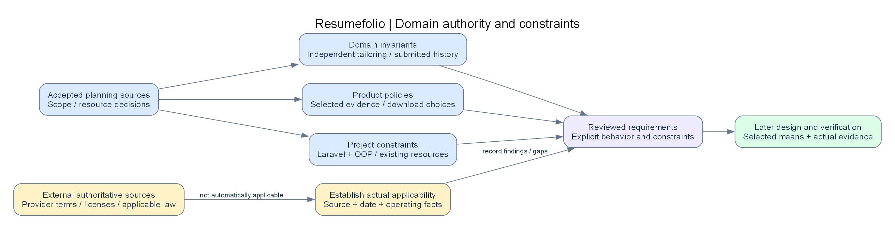
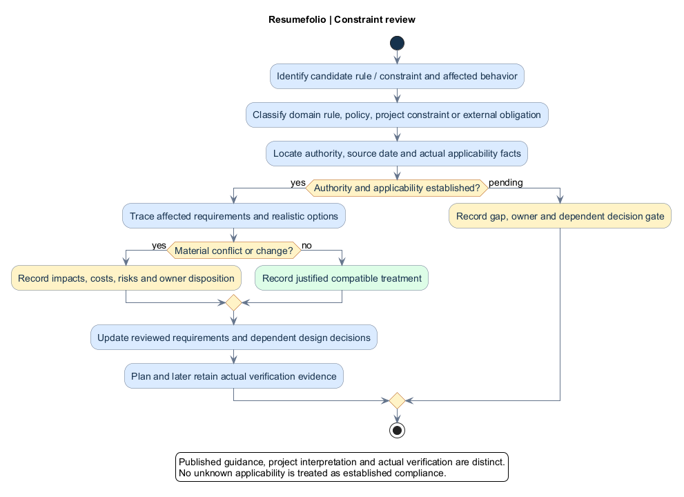

# Resumefolio — Domain Requirements and Constraints

| Item | Current position |
|---|---|
| Owner | Farhad Valizadegan; sole delivery and operations owner |
| Status | Proposed domain specification — review and applicability findings pending |
| References | DOM-D01–DOM-D08 are provisional document-local references; final global IDs remain unallocated |
| Priority | Unassigned; document order does not establish delivery priority |
| Revision | October 31, 2026 |

**At a glance:** Preserve professional-information, application-history and
resource-access meaning while working within accepted project constraints.
Investigate external obligations against the actual operating model. A technical
preference, a project mandate and a legal obligation have different authority.

[Classification](#1-classification-and-authority) · [Candidates](#2-proposed-domain-requirements)
· [Constraints](#3-accepted-project-constraints-and-open-evidence)
· [Review roadmap](#5-constraint-review-roadmap) · [Completion](#6-review-and-traceability)

## 1. Classification and Authority

Use [Version 1 Scope](../../01-project-planning/02-scope.md),
[Resources and Constraints](../../01-project-planning/05-resources-and-constraints.md)
and [Planning Completion Criteria](../../01-project-planning/10-planning-completion-criteria.md)
as planning authority. This document derives proposed detailed requirements and
organizes investigations; it does not reopen accepted decisions or record a new baseline.

| Category | Meaning | Example / authority |
|---|---|---|
| Domain invariant | Meaning that must remain consistent across capabilities | Actual submitted materials differ from editable source; DEC-023 |
| Product policy | Deliberate product behavior within the domain | Owner-selected evidence and PDF availability; DEC-026/025 |
| Project constraint | Agreed restriction on delivery or operation | Laravel/OOP and existing resources; accepted resource decisions |
| External obligation | Provider, license or applicable legal restriction | Establish current source and actual applicability before treating it as binding |
| Design choice | Means of satisfying requirements | Frontend, database, synchronization mechanism; not selected by this document |

[Scalable SVG](../diagrams/domain-authority-map.svg) ·
[Editable Graphviz](../diagrams/domain-authority-map.dot)

Arrows classify evidence and authority; they do not define a software architecture.
Labels carry the meaning independently of color.

## 2. Proposed Domain Requirements

Every record below has owner **Farhad**, status **Proposed**, and priority
**Unassigned**. Acceptance criteria describe future checks; no product verification
or legal/provider compliance conclusion is recorded.

### DOM-D01: Consistent Professional-information Meaning

**Source / rationale:** DEC-027/026/025 and the
[Data Dictionary](../05-data-definitions/data-dictionary.md); consistent terms
prevent resume, evidence and file rules drifting between modules.

**Proposed obligation:** Profile information, tailored resumes, evidence and PDF
variants shall retain their reviewed domain meanings across affected workflows.

**Acceptance criteria**
- A reviewed example distinguishes reusable profile content, resume-specific selection/override, evidence selection and a PDF rendition.
- Domain documents use the same term for the same concept, or explicitly record a justified distinction.
- Changing a resume-specific choice does not silently change unrelated resumes.

**Planned verification:** Dictionary/document walkthrough and later cross-resume
examples. **Open:** Exact fields, required values, propagation and rendition revision.

### DOM-D02: Application History Represents Actual Submitted Material

**Source / rationale:** DEC-023; historical application evidence must not be
confused with current editable content or a live employer view.

**Proposed obligation:** Application history shall distinguish actual submitted
resume/cover-letter material from later source changes and current shared views.

**Acceptance criteria**
- After capture and later source edits, preserved actual submitted material remains distinguishable and is not overwritten by those edits.
- Recording application progress does not imply automatic submission to a job platform or proof an employer received/read it.
- Correction, resubmission and deletion cases follow explicit history policies once reviewed.

**Planned verification:** Submission/source-edit walkthrough and later history
checks. **Open:** Capture/artifact boundaries, provenance, correction and retention;
see [Business Rules and Lifecycle](business-rules-and-data-lifecycle.md).

### DOM-D03: Authorization Follows the Resource and Operation

**Source / rationale:** DEC-028/024/025/021/020; unified sign-in and collaboration
must preserve unrelated private contexts.

**Proposed obligation:** Access shall remain bounded by applicable actor, resource,
operation and state, including direct file/PDF retrieval and provider operations.

**Acceptance criteria**
- Board membership grants no unrelated private email, resume or repository access.
- Employer access exposes only the intended resume and selected permitted material.
- Altered references or direct requests do not bypass denied operations.

**Planned verification:** Later cross-user/action matrix checks.
**Open:** Exact roles/grants and lifecycle effects; the
[Accounts matrix](accounts-authentication-and-permissions.md#7-role-resource-and-operation-matrix)
remains the permission specification entry point.

### DOM-D04: Explicit Human-authored Language and Application Work

**Source / rationale:** DEC-016/015 and DEC-023; preserve Version 1 exclusions.

**Proposed obligation:** Version 1 professional content and application work shall
support the agreed manual workflows without depending on product AI, automatic
translation or automatic external application submission.

**Acceptance criteria**
- Required workflows allow manually entered/reviewed English and German content under defined availability rules.
- A missing translation is handled by an explicit policy rather than an assumed automatic translation step.
- Scope/requirements do not make an excluded AI or submission service a prerequisite.

**Planned verification:** Scope review and later manual journeys.
**Open:** Language completeness and fallback; no ATS, hiring or productivity outcome is guaranteed.

### DOM-D05: Explicit External-service Applicability

**Source / rationale:** DEC-022, ASM-02/DEP-03/GAP-D02 and proposed external-interface
refinement; provider capability alone does not establish usable project access.

**Proposed obligation:** Each required external operation shall have an operation,
permission, account/audience, policy, resource and cost assessment before dependent
integration commitments are accepted.

**Acceptance criteria**
- Gmail/Calendar operations map to justified access and a dated official-source assessment.
- Applicable verification, restrictions, limits and unresolved costs/exceptions are recorded against the actual deployment model.
- A blocked required operation produces an explicit owner decision path, not silent scope removal or a feasibility claim.

**Planned verification:** Assessment record inspection and later authorized operation
checks. **Open:** Actual project credentials/configuration, access findings and
costs; see [Google Integration](email-calendar-and-google-integration.md).

### DOM-D06: Establish Information-handling Applicability

**Source / rationale:** Proposed privacy/lifecycle investigation for personal,
professional, communication and collaboration information in accepted scope.

**Proposed obligation:** Before affected operating requirements are accepted, the
project shall document its actual information flows and applicable handling
obligations, with unresolved questions and decision owners visible.

**Acceptance criteria**
- The assessment identifies data categories, purpose, access recipients, provider/hosting flows, retention/deletion questions and backup implications.
- Each asserted external obligation identifies an authoritative source, date, applicability rationale and affected requirement.
- Unknown controller/processor, user-location, contractual or legal questions remain explicit rather than becoming an unsupported compliance statement.

**Planned verification:** Review actual operating model and evidence; obtain
appropriate clarification where necessary. **Open:** Actual roles/jurisdictions,
notices, rights handling, service terms and retention obligations. Server location
alone is not a completed applicability assessment. No legal conclusion is made here.

### DOM-D07: Verify Reuse and Licensing Before Adoption

**Source / rationale:** DEC-011/014 and DEP-06/GAP-D08, with proposed licensing
refinement; references are not automatic scope or permission to reuse.

**Proposed obligation:** Proposed dependencies, templates, assets and reused code
shall have documented provenance, applicable license/terms and compatibility
findings before adoption; existing reference projects shall remain preserved.

**Acceptance criteria**
- A selected component/asset has a specific version/source, actual license/terms, obligations and review disposition.
- Unknown or conflicting reuse rights remain blockers for affected adoption until resolved.
- No automatic demo migration or reference-project modification is introduced as an implicit requirement.

**Planned verification:** Later component/asset inventory and license inspection.
**Open:** Actual selections, attribution/distribution duties and compatibility;
no component license or ownership claim is invented.

### DOM-D08: Evidence-based Operation Within Constraints

**Source / rationale:** DEC-019/018/017/013/012 and accepted resource constraints;
combined workloads, recovery and solo maintenance must be feasible in reality.

**Proposed obligation:** Design and readiness decisions shall respect accepted
resource/development constraints and retain actual evidence for required capacity,
execution safety and recovery outcomes.

**Acceptance criteria**
- Selected options identify how they satisfy Laravel/OOP and actual resource/budget constraints.
- Initial 10-user checks specify workload/concurrency; approximately 1,000 users remain a growth direction until separately demonstrated.
- CI/CD enabling depends on reviewed feasibility/security limits, and recovery acceptance depends on actual restoration evidence.

**Planned verification:** Design review, resource findings and later bounded
capacity/execution/recovery checks. **Open:** Numerical limits, architecture,
RPO/RTO, cost allowance and actual forecast; no new purchase is assumed.

## 3. Accepted Project Constraints and Open Evidence

| Constraint / basis | Preserve | Evidence still required |
|---|---|---|
| Laravel and object-oriented development | Mandated approach | Selected runtime/components and compatibility; no frontend/database selection implied |
| Existing server/resources and available budget | No assumed paid services or added infrastructure | Inventory, competing demand, costs and explicit owner spending decisions |
| Full-time solo delivery/operation | Farhad owns the work | Actual usable capacity, learning, integration and maintenance effort |
| 10 initial users; growth toward roughly 1,000 | Distinguish account population from concurrent workload | Representative load model, combined-workload findings and scaling options |
| Requested November 8, 2026 target | Requested date, not validated forecast | Analysis/design, effort ranges, dependency findings and reconciliation |
| Reference projects preserved | No automatic migration or inherited feature set | Specific adoption/provenance decisions |
| Required Gmail/Calendar and real Git | Retain accepted inclusions | Provider access and actual operation evidence; product Git differs from development GitHub |
| Conditional YAML/CI/CD | Retain feasibility/security gates | Isolation, permissions, secrets, limits, cleanup and controlled deployment |
| Operational readiness | Guidance, backups and demonstrated restoration | Actual procedures, coverage, integrity and access recovery evidence |

See the linked resource/planning records for authority. This table is a reading
aid, not a new decision register or a positive feasibility result.

## 4. External-obligation Evidence Record

For each candidate obligation, record: local reference, category, authoritative
publisher/source, version/date checked, exact relevant clause or concise finding,
actual operating facts, applicability rationale, affected requirements/design,
evidence limitations, owner, status and next gate. Separate a provider statement
from the project's interpretation and from actual access verification.

The [Google integration source notes](email-calendar-and-google-integration.md#7-official-provider-source-notes)
provide a limited dated documentation check. They do not resolve the actual
project's verification/assessment applicability or establish Google access.
Privacy/legal, hosting and selected-component licensing assessments remain open.

## 5. Constraint Review Roadmap

[Scalable SVG](../diagrams/domain-constraint-review.svg) ·
[Editable PlantUML](../diagrams/domain-constraint-review.puml)

Review sequence: classify → establish authority/applicability → trace affected
behavior → compare options → record disposition → verify later. Investigate
high-impact blockers early; the diagram is not a dated delivery schedule.
Unknown applicability remains a gap. Material scope, cost or delivery changes
require an owner decision under [Change Control](../07-change-and-baseline/change-control.md).

## 6. Review and Traceability

| Group | Related records / gate |
|---|---|
| DOM-D01–D04 | Dictionary, business rules and domain scenarios before affected M-02 acceptance |
| DOM-D05 | ASM-02/DEP-03/GAP-D02; actual access before dependent development |
| DOM-D06/D07 | Actual applicability/licensing evidence before affected operating/component adoption decisions |
| DOM-D08 | GAP-D01/D04/D05/D08/D09/D10; dependent design, forecast and readiness gates |

- [ ] Reconcile provisional IDs, priorities and exact source links.
- [ ] Review source-derived boundaries separately from proposed refinements.
- [ ] Resolve critical applicability and operation evidence before dependent acceptance.
- [ ] Reconcile provider, privacy, licensing, lifecycle and resource constraints across documents.
- [ ] Record reviewed revision, actual owner decisions, unresolved blockers and later verification evidence.

Use [Questions and Decisions](../07-change-and-baseline/open-questions-and-decisions.md),
[Traceability](../06-validation-and-traceability/requirements-traceability.md) and
[Review Findings](../06-validation-and-traceability/review-plan-and-findings.md).
No global question IDs, accepted legal obligations, product Pass results or new
baseline acceptance are allocated by this revision. M-02 remains pending.

## 7. Diagram Maintenance

| Diagram | Source | SVG | PNG |
|---|---|---|---|
| Domain authority map | [DOT](../diagrams/domain-authority-map.dot) | [SVG](../diagrams/domain-authority-map.svg) | [PNG](../diagrams/domain-authority-map.png) |
| Constraint review | [PlantUML](../diagrams/domain-constraint-review.puml) | [SVG](../diagrams/domain-constraint-review.svg) | [PNG](../diagrams/domain-constraint-review.png) |

Keep editable sources and renders synchronized; follow the
[diagram guide](../diagrams/README.md). Colors supplement labels. Check readable
arrows, render output and file/section links after changes. Save UTF-8 without BOM.

[Specification index](README.md) · [SRS entry point](requirements-specification.md)
· [Requirements index](../README.md)

## Course-Aligned Priority Review

Actual approved priority remains unassigned. See the [per-candidate proposed priority and readiness register](requirements-priority-and-readiness.md) for a sourced proposal, its limits and the course's SMART checks. A proposed Must is not acceptance of unresolved detail. Primary obligations, candidate IDs and criterion wording are unchanged by that register.

## Proposed Answers for Detailed Requirements Review — November 1, 2026

The owner requested completion of the outstanding questions. The sections below supply concrete **proposed** answers rather than infer approval of previously unspecified policy. They supersede the absence of a proposal in earlier open-detail paragraphs, not accepted scope or historical decisions. Their fields, limits and behavior require review before affected requirement acceptance; no implementation or product-test Pass is reported. Existing candidate IDs and primary obligations are retained. See the [review package](../07-change-and-baseline/requirements-answer-review.md) for authority, evidence gates and cross-document navigation.

### Proposed answer Q-D27: Operating dependencies and maintainability

**Affected records:** DOM-D05–DOM-D08; QSR-D06/D13/D14; GAP-D03/D07/D08. **Disposition:** Evidence-gated investigation with a complete proposal.

1. Fresh read-only evidence confirms PHP CLI 8.3.6, Nginx 1.24.0, MySQL server/client 8.0.46-0ubuntu0.24.04.4, and laravel/framework v12.61.0 in the deployed composer.lock. This identifies the existing deployment; it does not select versions/engine for all new capabilities or prove installed dependency integrity.

2. A GET of the login URL from the server returned HTTP 200 with successful TLS verification at the check time. This supports that request only; renewal, external client reachability, DNS/domain account control and authenticated application health remain separate checks. No package, service or certificate was changed.

3. Propose staging-first updates with dependency/license/support review, backups, data-compatible recovery plan, maintenance notice and post-update core workflow checks. Security patches get prompt risk-based triage; do not silently run a major OS/framework upgrade. Keep operator inventory and recovery/runbook evidence versioned without credentials.

4. Inspect actual notification-delivery account/credentials, DNS/TLS renewal configuration, queue/scheduler setup, dependency licenses and provider/privacy/data-handling applicability before dependent acceptance. A root-crontab search found no artisan schedule entry and named queue/supervisor units were absent in one enumeration; other users, timers, process managers or external schedulers were not excluded.

**Assessable review cases:** [RC-Q27-01 through RC-Q27-03](../04-scenarios-and-models/user-stories-and-scenarios.md#review-q-d27). These are planned checks, not executed results.

**Remaining evidence / acceptance condition:** Actual delivery configuration, renewal/scheduler/worker operation, dependency license/applicability review and maintenance/recovery demonstrations remain external or operational evidence gates.

## November 1, 2026 — Q-D27 Operating Findings

The [bounded operating assessment](../06-validation-and-traceability/remaining-gate-assessment.md) and [sanitized observations](../06-validation-and-traceability/evidence/operating-check-2026-11-01.json) now establish the inspected mail/OAuth declarations, absence of matching workers/cron in the checked paths, current certificate dates, enabled renewal timer and selected tool/license metadata. No cached config file was found. These are facts about the existing deployment, not proof of absent external accounts/backups or acceptance of that deployment as the future design. Actual delivery, renewal execution, background processing, complete license/applicability review and recovery remain gated.
