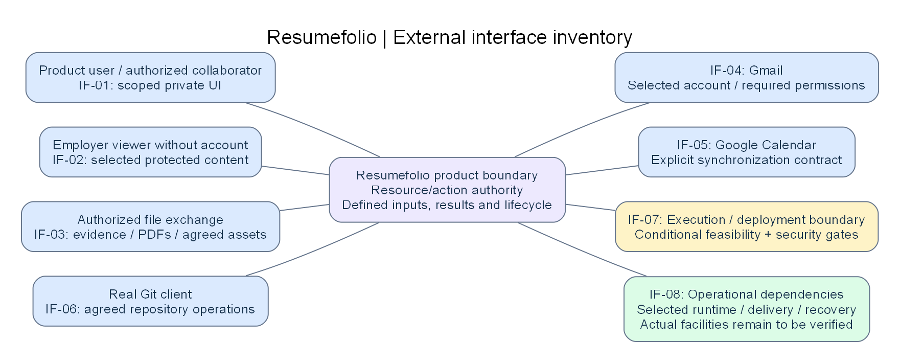
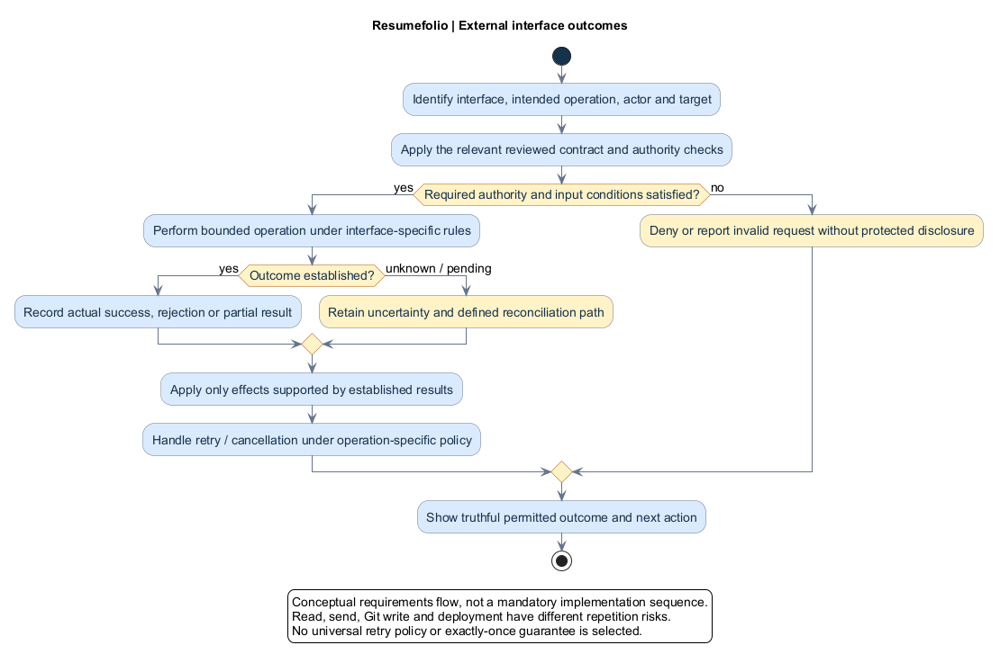

# Resumefolio — External Interface Requirements

| Item | Current position |
|---|---|
| Owner | Farhad Valizadegan; sole delivery and operations owner |
| Status | Proposed specification — interface contracts and acceptance pending |
| Candidate references | EIF-D01–EIF-D10 are provisional document-local references, not allocated global requirement IDs |
| Priority | Unassigned; record order is not delivery priority |
| Revision | October 31, 2026 |

**At a glance:** Define what crosses the product boundary, who may request it,
which information is exchanged and how success, denial and uncertainty appear.
Keep browser interaction, protected files, Google operations, real Git access and
conditional execution boundaries consistent. No endpoint, transport selection,
public API or new external service is established by this document.

[Inventory](#2-interface-inventory) · [Requirements](#3-proposed-interface-requirements)
· [Contracts](#4-interface-contract-record) · [Outcomes](#5-interaction-and-failure-roadmap)
· [Gates](#7-open-decisions-and-gates) · [Review](#8-traceability-and-review-readiness)

## 1. Purpose and Authority

Specify externally observable interaction contracts without selecting the internal
architecture. External means outside the product boundary: a person using its
interface, a Git client, a connected provider or an operational dependency.
Internal module calls and database schemas belong in later analysis/design.

The accepted basis is [Version 1 Scope](../../01-project-planning/02-scope.md)
DEC-028–DEC-017, subject to [Resources and Constraints](../../01-project-planning/05-resources-and-constraints.md)
and [Planning Completion Criteria](../../01-project-planning/10-planning-completion-criteria.md).
Detailed contracts below remain proposed. Scope inclusion does not prove access,
compatibility, capacity, deployment or acceptance.

Use [Actors and System Context](../02-stakeholders-and-elicitation/actors-and-system-context.md)
for actor definitions, [Domain Constraints](domain-requirements-and-constraints.md)
for authority/applicability and the [Data Dictionary](../05-data-definitions/data-dictionary.md)
for information meanings. The domain requirements remain responsible for business
behavior; this document specifies how their boundaries must be made explicit.

## 2. Interface Inventory

The IF labels below are local inventory references, not new product requirement IDs.

| Ref. / boundary | Participants and exchange | Source / detail owner | Unresolved contract |
|---|---|---|---|
| IF-01 Private user interface | Product user; professional, application, communication and work actions/results | DEC-028 and domain scope; [Accounts](accounts-authentication-and-permissions.md) | Supported clients, views, input/feedback, session behavior and accessibility criteria |
| IF-02 Employer interface | Viewer without product account; password-protected selected resume/evidence/PDF retrieval | DEC-024/025/026; [PDF and Sharing](pdf-and-controlled-sharing.md) | Link/session changes, live revisions, download/language availability |
| IF-03 File exchange | Authorized upload/replacement/retrieval of evidence, PDFs and agreed assets | DEC-026/025/018; [Files and Operations](administration-files-and-operational-behavior.md) | Formats, metadata, size/quota semantics, processing and failures |
| IF-04 Gmail | Connected user/account; read, compose, send and reply operations/results | DEC-022; [Google Integration](email-calendar-and-google-integration.md) | Required access, account selection, message/draft contract and uncertain sends |
| IF-05 Google Calendar | Selected authorized calendar; agreed activity operations and synchronization | DEC-022; [Google Integration](email-calendar-and-google-integration.md) | Direction, mapping, time semantics, conflicts, deletion and reconnect |
| IF-06 Git clients | Authorized clients/users; real Clone/Fetch/Pull/Push and related repository access | DEC-020; [Git Hosting](git-hosting-and-collaboration.md) | Transport(s), credentials, client/version support, refs, limits and rejected operations |
| IF-07 Execution/deployment boundary | Authorized workflow inputs, permissions/secrets, outputs and approved targets | DEC-019, conditional; [YAML and CI/CD](yaml-workflows-and-cicd.md) | Isolation, triggers, syntax, network/target authority, logs/artifacts, limits and approval |
| IF-08 Operational dependencies | Authorized operator and selected runtime, notification delivery, backup/restore facilities | DEC-017; resource DEP-01–DEP-06; [Quality and Recovery](quality-security-and-recovery-requirements.md) | Actual facilities, delivery/access contracts, configuration, coverage and procedure evidence |



[Scalable SVG](../diagrams/external-interface-context.svg) ·
[Editable Graphviz](../diagrams/external-interface-context.dot)

Lines group conceptual exchanges, not internal services, chosen protocols or
automatic data flows. IF-07 remains conditional on feasibility/security gates.
IF-08 does not assume a backup provider, email service or new purchase.
Colors supplement labels.

## 3. Proposed Interface Requirements

Every record has owner **Farhad**, status **Proposed**, priority **Unassigned**.
Acceptance criteria describe planned observations. Numerical limits, client
versions and policies referenced by conditional criteria must be decided before
affected acceptance. No product tests have been executed for these records.

### EIF-D01: Reviewable Interface Contracts

**Source / rationale:** Proposed refinement of the accepted integrations and
external interactions; incomplete contracts hide incompatible assumptions.

**Proposed obligation:** Each required interface shall have a reviewed contract
identifying participants, operations, information, authority and observable outcomes.

**Acceptance criteria**
- Each applicable IF-01–IF-08 entry maps to a contract using section 4, with an explicit owner/status and linked requirements.
- Required inputs, outputs, validity conditions and success/denial/failure examples are defined or marked as blocking questions.
- A documented interface version/change identifies affected consumers and compatibility consequences rather than silently promising universal support.

**Planned verification:** Contract inspection and later consumer/provider checks.
**Open:** Final IDs, exact schemas/protocols/versions and compatibility policy;
this does not create a public developer API or backward-compatibility guarantee.

### EIF-D02: Clear, Operable User Interaction

**Source / rationale:** Proposed usability refinement for agreed user/employer
workflows, DEC-028/024 and operational readiness.

**Proposed obligation:** Supported user interfaces shall expose relevant context,
valid actions, input errors and operation outcomes using reviewed usability and
accessibility criteria.

**Acceptance criteria**
- Representative agreed workflows identify the relevant resource/account and available operation without implying unauthorized capability.
- Required-field errors identify the affected input and recoverable next action; loading, empty, incomplete, success and failure states are distinguishable.
- Agreed keyboard, focus, labels, contrast and layout cases pass in the explicitly supported client/viewport matrix once criteria are defined.

**Planned verification:** Later task walkthroughs and selected accessibility/client
checks. **Open:** Target browsers/devices, responsive behavior, interface language,
accessibility standard/level and measurable criteria. No mobile app, browser
version list or formal accessibility conformance is claimed.

### EIF-D03: Consistent Authorization Across Entry Paths

**Source / rationale:** DEC-028/024/025; alternative entry paths cannot bypass
resource-specific access boundaries.

**Proposed obligation:** Each protected interface operation shall enforce the
applicable actor/resource/action/state authority, including direct retrieval and
non-browser clients.

**Acceptance criteria**
- Cross-user/direct-reference requests cannot retrieve or mutate unrelated protected resources.
- Employer access is limited to the intended resume and selected available material; board membership grants no private mail access.
- Denied access and grant-change behavior follow the reviewed contract without disclosing protected content or secrets.

**Planned verification:** Later allowed/denied path matrix, direct files, provider
references and Git-client cases. **Open:** Role/action matrix, session/grant-change
timing and credential methods; see [Accounts](accounts-authentication-and-permissions.md).

### EIF-D04: Protected File and PDF Exchange

**Source / rationale:** DEC-026/025/024/018; file transfer is a business/security
boundary, not merely a visible download button.

**Proposed obligation:** File upload, processing, replacement and retrieval shall
follow defined format, availability, authorization and quota contracts with
truthful completion outcomes.

**Acceptance criteria**
- Agreed valid/invalid file and size/quota cases produce the reviewed result with explicit units/boundaries.
- Generated/uploaded PDF and language availability choices apply to direct retrieval as well as the displayed controls.
- Interrupted processing/transfer or failed replacement does not appear as completed usable content or overwrite preserved submitted material through a source edit.

**Planned verification:** Later admission/retrieval/failure and preserved-history
checks. **Open:** Formats, metadata, content validation, processing, safe serving,
limits, cancellation and replacement/reference policy; no numeric quota is invented.

### EIF-D05: Explicit Google Provider Contracts

**Source / rationale:** DEC-022, ASM-02/DEP-03/GAP-D02; provider-granted access and
product authority are distinct prerequisites.

**Proposed obligation:** Required Gmail/Calendar exchanges shall use the reviewed
operation, account/calendar, permission, data and lifecycle contracts, with actual
access findings before dependent development.

**Acceptance criteria**
- Each agreed provider operation maps to justified access, selected account/calendar and defined request/result meaning.
- Consent denial, missing/revoked grants and provider rejection do not appear as successful authorized operations.
- Synchronization scope, conflicts, deletion, disconnect and reconnect follow explicitly reviewed rules rather than an assumed direction or source of truth.

**Planned verification:** Contract/applicability review and later controlled provider
operations. **Open:** Actual project access, mechanism/scopes, verification conditions,
limits/costs and full synchronization contract; [Google Integration](email-calendar-and-google-integration.md)
contains the dated official-source notes. No provider capability is newly verified here.

### EIF-D06: Real Git-client Interoperability

**Source / rationale:** DEC-020; actual repository hosting must work with agreed
Git clients rather than only a browser simulation or external repository link.

**Proposed obligation:** The selected Git access interface shall support agreed
authorized Clone/Fetch/Pull/Push behavior with explicit transport, credential,
repository/ref and outcome rules.

**Acceptance criteria**
- Later checks with supported real clients demonstrate agreed authorized transfer operations and corresponding repository content/history results.
- Unauthorized repository/ref changes and rejected/conflicting operations produce the defined result without an interface bypass.
- Failed/interrupted/repeated transfers have observable client/product outcomes consistent with the reviewed repository integrity rules.

**Planned verification:** Later isolated real-client compatibility, permission and
failure cases. **Open:** Transport(s), credential lifetime/revocation, clients/versions,
protected refs, object/transfer limits and concurrency. Neither SSH nor HTTPS nor a
Git engine is selected; development GitHub is not product-hosting evidence.

### EIF-D07: Bounded Workflow and Deployment Interfaces

**Source / rationale:** DEC-019 and conditional execution follow-up; untrusted
workflow input must not imply unrestricted host or deployment authority.

**Proposed obligation:** Before enabling execution, workflow inputs, permitted
actions, credentials/secrets, target authority and outputs shall follow a reviewed
supported contract and feasibility/security gates.

**Acceptance criteria**
- Supported/unsupported YAML examples produce the defined validation result rather than an assumed compatibility with every external workflow ecosystem.
- Execution/deployment actions without required authority/approval cannot use the protected target or unrelated secrets.
- Later controlled output/log/artifact cases enforce defined access, secret handling and resource limits; failures are distinguishable from successful deployment.

**Planned verification:** Later isolated validation/execution/security checks after
the enabling gate. **Open:** Syntax, triggers, runner/isolation, network access,
output retention, approvals and numerical limits. No webhook, marketplace action,
arbitrary remote target or actual execution is introduced by this draft.

### EIF-D08: Operation-specific Failure and Repetition Semantics

**Source / rationale:** Proposed cross-interface reliability refinement, particularly
DEC-022/020/019; an uncertain external effect is not a safe invitation to repeat it.

**Proposed obligation:** Each interface shall define invalid, denied, failed,
partial, pending and unknown outcomes as applicable, including recovery and safe
repetition rules for externally consequential operations.

**Acceptance criteria**
- Relevant timeout, disconnect, limit and provider rejection cases yield distinguishable truthful outcomes and permitted next actions.
- A send/deployment outcome supported only as unknown is not reported as success or blindly repeated contrary to the reviewed policy.
- Error/diagnostic information identifies useful context without exposing secrets or unrelated private content.

**Planned verification:** Later controlled failure, ambiguous-effect and retry
scenarios per interface. **Open:** Timeout/backoff, cancellation, reconciliation,
deduplication and evidence; no global retry policy or exactly-once guarantee.

### EIF-D09: Operational Configuration and Recovery Boundaries

**Source / rationale:** DEC-017, DEP-01–DEP-06 and accepted resource constraints;
runtime, delivery and recovery dependencies need explicit usable contracts.

**Proposed obligation:** Selected operational interfaces shall document effective
configuration/access, failure feedback, responsibility and recovery coverage with
version/environment-specific procedures and later evidence.

**Acceptance criteria**
- Operational guidance identifies selected dependencies, required non-secret configuration, compatibility and responsible operator.
- Notification/delivery attempts are not confused with confirmed receipt, and a user Gmail connection is not assumed to provide authentication/recovery mail.
- Later restoration evidence checks required records/artifacts/relationships and restored access against the agreed coverage; backup-file existence alone is not a recovery Pass.

**Planned verification:** Later configuration/procedure inspection and authorized
delivery/isolated restore checks. **Open:** Actual services, deployment/network/TLS
arrangements, notification channel, backup access/coverage and RPO/RTO; no extra
infrastructure or custom hardware interface is assumed.

### EIF-D10: Consistent Exchange Meaning and Lifecycle

**Source / rationale:** DEC-027/025/023/022 and proposed interoperability detail;
external representations must not change domain meaning or history.

**Proposed obligation:** Interface contracts shall define applicable language,
encoding, time, identity, version/reference and deletion semantics consistently
with the reviewed dictionary and lifecycle rules.

**Acceptance criteria**
- Agreed English/German text and file examples preserve intended content under the selected representation without automatic translation.
- Relevant time-zone/all-day and source-revision examples have the defined meaning across local/provider/file views.
- Interface replacement/deletion/synchronization does not silently overwrite preserved actual submitted copies or remove unrelated referenced data.

**Planned verification:** Later round-trip, time/language, reference/removal and
history checks. **Open:** Exact representations, field optionality, mapping,
version compatibility and retention; [Business Rules and Lifecycle](business-rules-and-data-lifecycle.md)
remain the cross-module invariant reference. No schema/export format is selected.

## 4. Interface Contract Record

Complete one record per relevant operation family; not every field applies to
every boundary. Mark genuinely inapplicable fields with rationale rather than
silently leaving an incomplete contract.

| Field | Required definition |
|---|---|
| Identity and authority | Local ref, purpose/source, owner/status, actor/client/provider and applicable grants |
| Scope and direction | Operation, initiator, intended recipient/target, data read versus external effect |
| Connection | Selected mechanism/protocol/version, endpoint/transport reference and supported client matrix when decided |
| Inputs and outputs | Meaning, representation/format, required/optional values, identifiers/revisions, language/time/units and examples |
| Preconditions | Authentication, authorization, consent, valid resource state, validation and configured limits |
| Result contract | Observable success, denial, invalid, partial/pending/unknown and failure semantics as applicable |
| Repetition and concurrency | Conflict, duplicate/ambiguous effects, retry/backoff, cancellation and safe reconciliation |
| Lifecycle and privacy | Authority/source of truth, retention, reference/deletion, disconnect, secret-safe diagnostics and recovery |
| Capacity and compatibility | Payload/workload boundaries, response/freshness expectations, actual provider limits and version-change impact |
| Evidence and acceptance | Scenario/requirement links, actual findings, unresolved blockers, reviewed revision and later test evidence |

These are contract-definition fields, not selected endpoints or database columns.
Do not place real credentials, private messages or operational secret values in
examples. Public REST APIs, arbitrary import/export, webhooks and compatibility
with every client/service are not added by this checklist.

## 5. Interaction and Failure Roadmap



[Scalable SVG](../diagrams/external-interface-outcomes.svg) ·
[Editable PlantUML](../diagrams/external-interface-outcomes.puml)

The diagram expresses requirements logic rather than mandatory implementation
ordering or a universal middleware chain. Browser reads, mail sends, Git writes
and deployment actions have different external effects and repetition rules.
Only effects supported by actual outcomes may be reported/applied as established.

## 6. Planned Verification Coverage

| Scenario family | Candidate coverage | Evidence to develop later |
|---|---|---|
| Supported UI/client | EIF-D01/D02/D10 | Agreed browser/viewport/keyboard/language matrix and actual task outcomes |
| Trust boundary | EIF-D03/D04/D05/D06/D07 | Allowed/denied actors, direct paths, changed grants and protected outputs |
| Files/history | EIF-D04/D10 | Valid/invalid formats, availability, interruption, source replacement and preserved copies |
| Provider | EIF-D05/D08 | Actual selected-account access, conflict, revoke, limits and ambiguous send |
| Real Git | EIF-D06/D08 | Selected clients/transports, transfer/history, rejection and interruption |
| Conditional execution | EIF-D07/D08 | Supported YAML, denied actions/targets, secret/output boundary and failed deployment |
| Operations/recovery | EIF-D09/D10 | Actual dependency configuration, delivery outcomes and isolated consistent restoration |

Each later run records contract/policy revision, candidate/environment, actor/grants,
initial state/input, expected/actual outcome and evidence limits. Use authorized,
controlled test data/recipients/targets. A successful browser page does not prove
direct-file protection, provider access, Git-client compatibility or recoverability.
No real provider, host, Git transport or deployment operation is performed here.

## 7. Open Decisions and Gates

| Topic | Decision/evidence required | Gate |
|---|---|---|
| User interface/client support | Tasks/views, supported browsers/devices, accessibility and measurable usability criteria | Affected M-02 acceptance and later compatibility verification |
| Access/credentials | Complete actor/resource/action matrix; browser, viewer, provider and Git credential lifecycles | Affected requirements/security design |
| Files/representations | Formats, revisions, time/language, effective limits, safe serving and reference consequences | M-02/M-03; relevant enforcement/history checks before acceptance |
| Google | Operation contracts, justified permissions, actual audience/access/conditions/cost findings | GAP-D02; access before dependent development |
| Git | Real transports/clients, credentials, refs, integrity, transfer limits and failures | Before dependent Git design/implementation; actual client evidence before capability acceptance |
| YAML/execution | Supported syntax/triggers, isolation, network/secret/target authority and limits | GAP-D09; before enabling execution/design acceptance |
| Infrastructure/delivery | Actual capacity, TLS/domain, notification service and operation outcomes | GAP-D01/D03/D07/D08/D10; dependent design and readiness gates |
| Recovery/change | Coverage, reconciliation, compatibility/migration impacts and procedure evidence | GAP-D04/D08; affected design and actual restoration before M-09 acceptance |

Farhad coordinates all topics. Local rows do not claim new shared question IDs
or completed investigations. Record real findings in [Questions and Decisions](../07-change-and-baseline/open-questions-and-decisions.md)
and use [Change Control](../07-change-and-baseline/change-control.md) for material
scope/cost/delivery effects. Retain existing gates; missing details neither prove
feasibility nor silently remove agreed scope.

## 8. Traceability and Review Readiness

| Source group | Candidates / detailed specification |
|---|---|
| DEC-028/024/025/026 | EIF-D02/D03/D04; account matrix, presentation and controlled-sharing rules |
| DEC-022 and access follow-up | EIF-D05/D08/D10; EGC-D provider operation/synchronization candidates |
| DEC-020 | EIF-D06/D08; detailed Git requirements and later actual client contracts |
| DEC-019 | EIF-D07/D08; execution feasibility and later supported workflow/target contract |
| DEC-018/017 and resource constraints | EIF-D04/D09; file policy, quality/recovery and actual resource findings |
| Proposed cross-interface refinements | EIF-D01/D02/D08/D10; reviewed contracts, representation and failure criteria |

Maintain allocated links in [Traceability](../06-validation-and-traceability/requirements-traceability.md)
and real inspection outcomes in [Review Findings](../06-validation-and-traceability/review-plan-and-findings.md).

- [ ] Reconcile provisional IDs and justify priorities.
- [ ] Review accepted boundary sources separately from proposed interface detail.
- [ ] Complete required operation/contract matrices and resolve acceptance-blocking questions.
- [ ] Reconcile domain meanings, permissions, provider/Git/file/execution and recovery behavior.
- [ ] Decide measurable client/format/limit/compatibility criteria using evidence.
- [ ] Record actual owner review and later verification without inventing Pass results.

**Current outcome:** Proposed interface specification; exact contracts, selections
and critical evidence remain pending. No EIF candidate is accepted, no production
interface is configured and M-02 is not completed by this revision.

## 9. Diagram Maintenance

| Diagram | Source | SVG | PNG |
|---|---|---|---|
| External interface context | [DOT](../diagrams/external-interface-context.dot) | [SVG](../diagrams/external-interface-context.svg) | [PNG](../diagrams/external-interface-context.png) |
| Interaction outcomes | [PlantUML](../diagrams/external-interface-outcomes.puml) | [SVG](../diagrams/external-interface-outcomes.svg) | [PNG](../diagrams/external-interface-outcomes.png) |

Follow the [diagram guide](../diagrams/README.md). Keep sources, captions and renders
synchronized; inspect arrows/labels and verify file/section links. From repo root:

```powershell
$diagramFolder = 'docs\SDLC\02-requirements-engineering\diagrams'
$graphvizExe = 'C:\Program Files\Graphviz\bin\dot.exe'
$plantUmlJar = 'C:\Users\fvali\AppData\Local\Resumefolio\DiagramTools\plantuml.jar'
foreach ($format in 'svg', 'png') {
    & $graphvizExe "-T$format" -Gdpi=140 "$diagramFolder\external-interface-context.dot" -o "$diagramFolder\external-interface-context.$format"
    if ($LASTEXITCODE -ne 0) { throw "Graphviz failed: $format" }
    java '-Djava.awt.headless=true' -jar $plantUmlJar -charset UTF-8 "-t$format" "$diagramFolder\external-interface-outcomes.puml"
    if ($LASTEXITCODE -ne 0) { throw "PlantUML failed: $format" }
}
```

Use actual installed tool paths on other machines; save UTF-8 without BOM.

[Specification index](README.md) · [SRS entry point](requirements-specification.md)
· [Requirements index](../README.md)

## Course-Aligned Priority Review

Actual approved priority remains unassigned. See the [per-candidate proposed priority and readiness register](requirements-priority-and-readiness.md) for a sourced proposal, its limits and the course's SMART checks. A proposed Must is not acceptance of unresolved detail. Primary obligations, candidate IDs and criterion wording are unchanged by that register.
