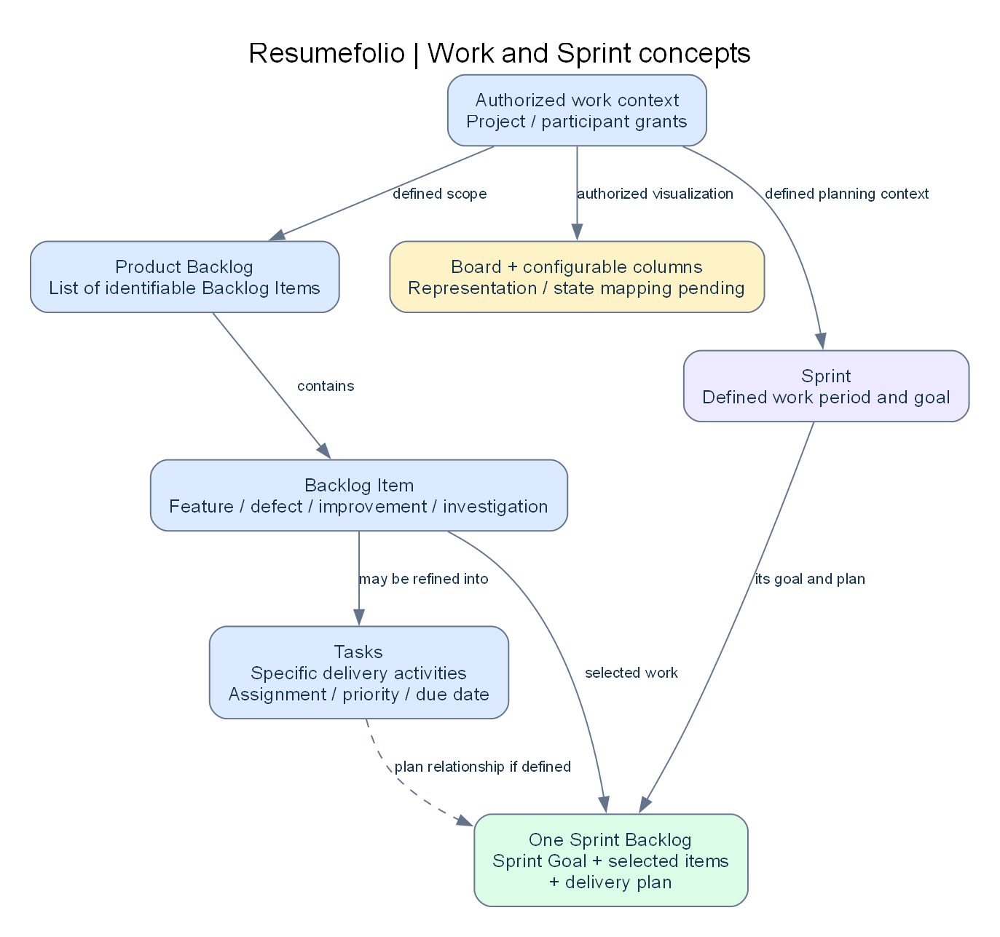
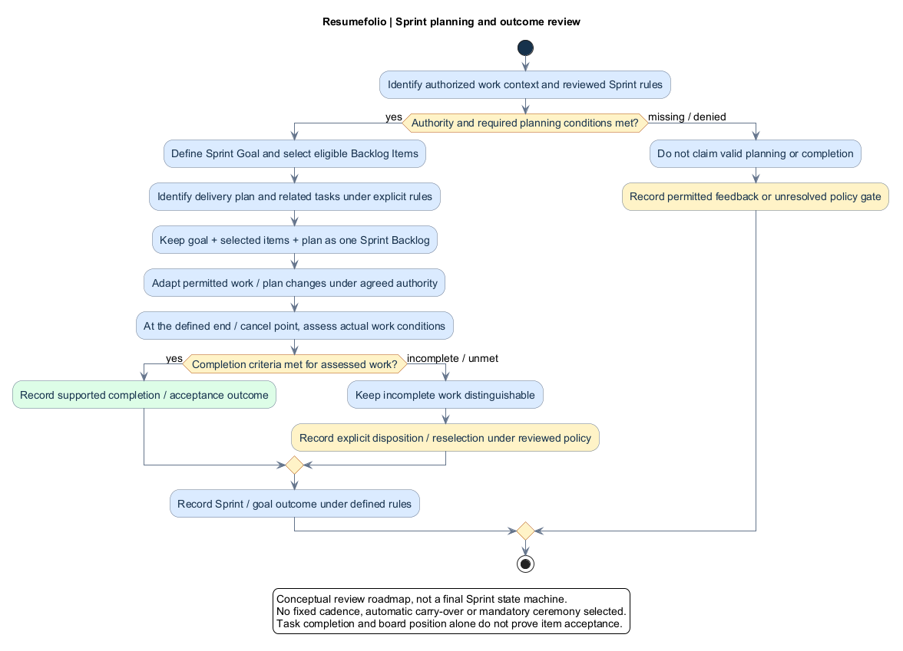

# Resumefolio — Projects, Kanban and Sprints

| Item | Current position |
|---|---|
| Owner | Farhad Valizadegan; sole project delivery and operations owner |
| Status | Proposed product specification — detailed workflows and acceptance pending |
| Planning basis | DEC-021/028; related DEC-022/020/017 and GAP-D06 |
| Candidate references | PKS-D01–PKS-D11 are provisional document-local references, not allocated global requirement IDs |
| Priority | Unassigned; document order is not delivery priority |
| Revision | October 31, 2026 |

**At a glance:** Organize authorized work through projects, boards, configurable
columns, tasks, Product Backlogs and Sprints. A Backlog Item may be refined into
tasks; the concepts are not interchangeable. Each Sprint has one Sprint Backlog
comprising its goal, selected Backlog Items and delivery plan. Exact relationships,
states and completion policies remain review decisions.

[Basis](#1-purpose-and-accepted-boundary) · [Concepts](#2-concepts-and-relationship-boundaries)
· [Requirements](#3-proposed-requirements) · [Models](#4-work-and-sprint-models)
· [Scenarios](#5-planned-verification) · [Decisions](#6-open-decisions-and-gates)
· [Review](#7-traceability-and-review-readiness)

## 1. Purpose and Accepted Boundary

[Scope DEC-021](../../01-project-planning/02-scope.md#dec-021) includes projects,
boards, configurable columns, tasks, assignments, priorities, due dates,
authorized collaboration, Product Backlogs, Backlog Items, Sprints and Sprint
Backlogs within Resumefolio. Backlog Items can represent features, defects,
technical improvements or investigations and may be refined into smaller tasks.
For a Sprint, its goal, selected items and delivery plan form one Sprint Backlog.

This is product functionality. The GitHub board/backlog used to build Resumefolio
does not establish implementation or dictate the product's workflows. Farhad is
the sole current project delivery owner; product collaboration does not imply
additional delivery staff, mandatory Scrum ceremonies or fixed team roles.

Accepted scope leaves item relationships, workflow rules and completion criteria
for Requirements Engineering. This document proposes those obligations while
keeping undecided policies explicit. It selects no architecture, drag-and-drop
library, reporting tool, database structure or automation engine.

| Related document | Consistency responsibility |
|---|---|
| [Accounts and Permissions](accounts-authentication-and-permissions.md) | Resource/action grants, collaboration invitations and revoked access |
| [Data Dictionary](../05-data-definitions/data-dictionary.md) / [Glossary](../05-data-definitions/glossary.md) | Work-management terms, responsibility and conceptual information |
| [Business Lifecycle](business-rules-and-data-lifecycle.md) | References, deletion, concurrency, time and recovery |
| [Google Integration](email-calendar-and-google-integration.md) | Explicit activity/reminder/provider relationships |
| [Git Hosting](git-hosting-and-collaboration.md) | Repository issues/milestones, PRs and separate repository permissions |
| [External Interfaces](external-interface-requirements.md) | Supported user interaction, accessibility and truthful outcomes |
| [Quality and Recovery](quality-security-and-recovery-requirements.md) | Later measurable quality and restoration criteria |

Related drafts are working references, not accepted policies or verified capabilities.

## 2. Concepts and Relationship Boundaries

| Concept | Scope-supported meaning | Relationship/detail to decide |
|---|---|---|
| Project | Context for organized work and authorized participants | Ownership, visibility, hierarchy and board/backlog/Sprint scope |
| Board / column | Work visualization and configurable workflow grouping | What a card represents, ordering, column/state mapping and moves |
| Product Backlog | List of Backlog Items | Scope, ordering/priority, membership and permitted refinement |
| Backlog Item | Feature, defect, improvement, investigation or other agreed work | Fields, types, acceptance/completion conditions and task refinement |
| Task | Specific activity contributing to delivery | Parent relationship if any, assignment, priority, due date and status |
| Sprint | Work period with a goal and selected work | Dates, selection, permitted changes, lifecycle and incomplete work |
| Sprint Backlog | One composite of Sprint Goal, selected items and delivery plan | Content changes, task plan and distinction from a board view |
| Participant/grant | Authorized collaboration context | Invite/accept/remove, roles, assignment eligibility and operation scope |

### Required Semantic Distinctions

- An item is not necessarily one task; completing a task does not automatically prove its parent item meets acceptance criteria.
- A board column is not automatically a universal business status or proof of completion.
- A Sprint Backlog includes the goal and delivery plan, not only a filtered list of cards.
- A due date is not proof of completion, capacity or an achievable delivery forecast.
- A portfolio project, work-management project and Git repository are not automatically one shared record.
- A repository issue/milestone and a Product Backlog Item/Sprint need explicit relationships if linked; similarity does not establish equivalence.

These distinctions constrain meaning, not database cardinalities. Project-to-board,
backlog-to-project, item-to-task and item-to-Sprint cardinalities remain open.

## 3. Proposed Requirements

Every candidate has owner **Farhad**, status **Proposed**, priority **Unassigned**.
Actor/condition descriptions are scenario contexts, not new grants. Conditional
criteria cannot be accepted until the referenced fields/workflows are decided.

### PKS-D01: Project and Board Context

**Source / rationale:** DEC-021; users need identifiable work contexts and boards.

**Actor / conditions:** Authorized user creates or changes a project/board.

**Proposed obligation:** Users shall create and manage agreed project/board
information under explicit ownership, relationship and validation rules.

**Acceptance criteria**
- A valid project/board is identifiable in its intended authorized work context.
- Missing/invalid required data or failed creation has defined feedback rather than false usable completion.
- Selecting/changing one work context does not silently modify unrelated project/board information.

**Planned verification:** Later create/select/edit/validation and isolation cases.
**Open detail:** Fields, naming, hierarchy, board count, defaults, visibility,
ownership transfer and initial workflow; no public-project model is chosen.

### PKS-D02: Configurable Columns and Valid Work Movement

**Source / rationale:** DEC-021; configurable columns need deliberate work-state semantics.

**Actor / conditions:** Authorized participant configures columns or moves/reorders work.

**Proposed obligation:** Board column configuration, ordering and item movement
shall follow explicit authority, relationship and state-transition rules.

**Acceptance criteria**
- An authorized valid configuration displays the intended columns/order without silently losing represented work.
- A permitted move produces the reviewed card/location/state outcome; denied/invalid moves do not appear completed.
- Renaming/removing a column containing work follows explicit mapping/reference rules rather than an assumed destructive cascade.

**Planned verification:** Later column edits, moves/reordering, occupied-column
removal and denied/conflicting changes. **Open detail:** Card types, column/state
mapping, cross-board moves, WIP limits if adopted, concurrent order changes and
non-pointer interaction; no fixed columns, WIP number or drag-only UI is selected.

### PKS-D03: Product Backlog and Item Definition

**Source / rationale:** DEC-021; planned outcomes include more than implementation tasks.

**Actor / conditions:** Authorized participant records or refines Product Backlog Items.

**Proposed obligation:** The product shall maintain Product Backlogs of identifiable
items with reviewed descriptions, type, ordering/priority and completion information.

**Acceptance criteria**
- Representative feature, defect, improvement and investigation examples retain their intended work meaning without being forced to be one implementation task.
- Valid authorized edits/order changes produce the agreed list state; invalid or denied changes have defined feedback.
- Item identity and relevant context remain distinguishable when represented on boards or selected for a Sprint.

**Planned verification:** Later item-type/field/order and cross-view consistency cases.
**Open detail:** Exact fields/types, required acceptance criteria, ordering versus
priority values, dependencies, backlog scope and item lifecycle.

### PKS-D04: Item Refinement and Task Relationships

**Source / rationale:** DEC-021; a Backlog Item may be refined into smaller tasks.

**Actor / conditions:** Authorized participant creates/changes a task or its item relationship.

**Proposed obligation:** Task refinement shall preserve explicit item/task meaning,
relationship and completion rules without silently equating their states.

**Acceptance criteria**
- A representative item can be refined into agreed smaller tasks while retaining the intended item identity and delivery context.
- Reparenting/removing a task follows the reviewed relationship policy without silently deleting unrelated work.
- Task completion alone does not mark the item accepted unless the explicit completion policy's conditions are satisfied.

**Planned verification:** Later item-with-tasks, incomplete/complete child work and
relationship-change cases. **Open detail:** Standalone tasks, cardinality, nesting,
multiple parents, dependency links, split/merge and completion aggregation; no schema chosen.

### PKS-D05: Assignment, Priority and Due-date Handling

**Source / rationale:** DEC-021; coordination needs valid responsibility and timing data.

**Actor / conditions:** Authorized participant assigns or prioritizes work or changes its due date.

**Proposed obligation:** Assignments, priorities and due dates shall follow reviewed
eligibility, validation and time rules in the correct work context.

**Acceptance criteria**
- Valid assignment targets only participants eligible under the selected policy and does not itself grant unrelated access.
- Defined priority/due-date examples preserve the intended value/time meaning; invalid inputs yield explicit feedback.
- Member removal or work-context changes produce the agreed assignment/reminder result rather than silently targeting an unauthorized person.

**Planned verification:** Later eligible/ineligible assignment, priority/date boundary
and membership-change examples. **Open detail:** Assignable entity types, assignee
count, unassigned state, priority scale, time zones, overdue meaning and reminders;
no numerical priority scale or automatic notification channel is assumed.

### PKS-D06: Scoped Collaboration and Membership Changes

**Source / rationale:** DEC-021/028; invited collaborators are limited to authorized resources.

**Actor / conditions:** A user manages membership or a participant requests a work operation.

**Proposed obligation:** Collaboration invitations, membership and work operations
shall require explicit resource/action authority and defined change/revocation effects.

**Acceptance criteria**
- Allowed participants can perform only their reviewed project/board/item/task actions.
- Altered references/direct requests cannot expose or mutate unrelated private work, mail, resumes or repositories.
- A caller without grant-management authority cannot add themselves or escalate another participant's permissions.

**Planned verification:** Later allowed/denied direct operations, invitation and
changed-membership cases. **Open detail:** Roles, invite/accept/expiry states,
project-versus-board grants, ownership transfer, existing sessions/in-flight work
and administrative powers; no role hierarchy or expiry duration is invented.

### PKS-D07: Sprint Goal and Selected Backlog Items

**Source / rationale:** DEC-021; a Sprint is goal-directed selected work, not merely a label.

**Actor / conditions:** Authorized participant creates a Sprint or selects/changes its work.

**Proposed obligation:** Each Sprint shall identify its reviewed goal, selected
Backlog Items and time/work context under explicit selection and lifecycle rules.

**Acceptance criteria**
- A representative Sprint identifies the intended goal and selected item identities without silently changing the Product Backlog source.
- Invalid or unauthorized selection/date/state changes produce defined feedback.
- Defined work additions/removals or goal/date changes produce the reviewed Sprint context/history outcome rather than an assumed fixed or unrestricted policy.

**Planned verification:** Later goal/selection/date validation and changed-plan cases.
**Open detail:** Sprint duration/dates, concurrent Sprints, item eligibility,
multi-Sprint selection, start/end/cancel states, goal editing and time-zone rules;
no fixed cadence, mandatory team size or selection count is established.

### PKS-D08: One Coherent Sprint Backlog

**Source / rationale:** DEC-021; selected items, Sprint Goal and delivery plan form one Sprint Backlog.

**Actor / conditions:** Authorized participant views or adapts a Sprint delivery plan.

**Proposed obligation:** The product shall represent each Sprint Backlog as its
goal, selected items and plan for delivering them, keeping these components coherent.

**Acceptance criteria**
- A representative Sprint Backlog makes its goal, selected items and agreed delivery-plan information identifiable together.
- Agreed task refinements/plan changes remain associated with the correct Sprint/item context.
- A board view or item list alone is not presented as the complete Sprint Backlog when goal or required plan information is missing.

**Planned verification:** Later composite-view walkthrough and changed-plan/selected-item
consistency checks. **Open detail:** Delivery-plan structure, task inclusion,
editing authority, views and response to removed/changed item relationships;
one conceptual Sprint Backlog does not mandate one database table or screen.

### PKS-D09: Explicit Completion and Sprint-end Outcomes

**Source / rationale:** DEC-021 and proposed workflow refinement; moving cards must not fabricate acceptance.

**Actor / conditions:** Participant marks work complete or ends/cancels a Sprint.

**Proposed obligation:** Item/task completion and Sprint-end handling shall follow
reviewed conditions, preserving distinguishable completed, incomplete and accepted
outcomes as applicable.

**Acceptance criteria**
- Defined completion examples evaluate the applicable task/item acceptance conditions rather than only column position or due date.
- Incomplete Sprint work remains identifiable with an explicit disposition; ending a Sprint does not silently erase or accept it.
- If carry-over/reselection is permitted, it follows the reviewed policy without duplicate/conflicting work relationships or a false original completion claim.

**Planned verification:** Later incomplete-child, unmet-item-criteria, Sprint-end,
cancel and carry-over examples. **Open detail:** Completion/acceptance authority,
evidence, goal outcome, reopen/correction, end conditions and carry-over policy;
no automatic roll-over or Definition of Done content is silently imposed.

### PKS-D10: Deliberate Cross-module Links, Reports and Automation

**Source / rationale:** DEC-021/022/020 and open workflow/reporting/automation definitions;
related concepts must not create hidden access or behavior.

**Actor / conditions:** User requests an agreed link, activity, report or automated work action.

**Proposed obligation:** Any agreed cross-module relationship, report or automation
shall define its inputs, authority, meaning, trigger and outcome before acceptance.

**Acceptance criteria**
- Defined project/task-to-calendar or item-to-repository examples retain correct identity and independent permissions.
- An agreed report identifies its population, filters/time meaning and calculation rules; missing/incomplete data is not presented as proven delivery performance.
- If an automation is accepted, its authorized trigger/action and failure/repetition effects match the reviewed rule without silently sending messages or deploying code.

**Planned verification:** Later selected relationship, calculation/example and
automation trigger/denial/failure checks. **Open detail:** Which links/reports/
automation rules are actually required, provider synchronization/reminders,
history and duplicate handling. No burndown, velocity target, webhook, scheduling
engine or arbitrary automation capability is added by this conditional proposal.

### PKS-D11: Truthful Changes, Retirement and Recovery

**Source / rationale:** DEC-017/028 and proposed lifecycle/reliability refinement;
shared work must remain coherent under failure and removal.

**Actor / conditions:** Authorized user/operator edits, archives, removes or restores work data.

**Proposed obligation:** Work changes and lifecycle operations shall follow explicit
validation, conflict, reference, retention and recovery rules with truthful outcomes.

**Acceptance criteria**
- Interrupted/failed/conflicting changes do not appear as completed moves, assignments or plan updates contrary to the reviewed policy.
- Removing a project/board/column/item/Sprint follows defined reference consequences rather than an invented universal cascade.
- Later isolated restoration checks required work relationships, order/state and access; partial data or stale grants are not reported as complete safe recovery.

**Planned verification:** Later concurrent/failure, referenced deletion/archive and
isolated consistency/access restoration cases. **Open detail:** Version/history
requirements, retry policy, archive/delete authority, account closure, retention,
backup coverage, RPO/RTO and restored reminders/grants; no duration or recovery result claimed.

## 4. Work and Sprint Models



[Scalable SVG](../diagrams/kanban-sprint-concept-map.svg) ·
[Editable Graphviz](../diagrams/kanban-sprint-concept-map.dot)

Arrows express conceptual relationships, not storage cardinalities or mandatory
screen layouts. The board's represented entities and state mapping remain open.
Colors supplement labels. Work-management project grants do not automatically
grant repository, email or professional-profile access.



[Scalable SVG](../diagrams/sprint-planning-review-flow.svg) ·
[Editable PlantUML](../diagrams/sprint-planning-review-flow.puml)

This is a requirements roadmap, not the final Sprint state machine, a dated
schedule or required ceremony sequence. Rules for start/end/cancel, allowed plan
changes and incomplete work need explicit decisions. No automatic carry-over is selected.

## 5. Planned Verification

| Family | Candidates | Cases to develop |
|---|---|---|
| Context/board | PKS-D01/D02 | Valid/invalid creation, configured columns, denied moves and occupied-column removal |
| Backlog/refinement | PKS-D03/D04 | Item types/order, one item refined into tasks, changed parent and incomplete children |
| Coordination/access | PKS-D05/D06 | Eligibility, priority/date meaning, changed membership and cross-user direct operations |
| Sprint composite | PKS-D07/D08 | Goal, selected item identities, delivery plan and changed-plan consistency |
| Completion | PKS-D09 | Unmet criteria, Sprint end/cancel, incomplete work and deliberate reselection |
| Links/reporting | PKS-D10 | Only agreed links/reports/automations; permission/filter/time and failure cases |
| Lifecycle | PKS-D11 | Concurrent/failed change, reference-aware removal and isolated restoration |

A later end-to-end example can create a project/board, refine a feature item into
tasks, assign eligible participants and select the item for a goal-directed
Sprint. Change a task's column and compare task versus item completion, then end
the Sprint with incomplete work and inspect its explicit disposition. Include
unauthorized requests and a changed-membership case.

Each later run records candidate/policy revision, actor/grants, work identities,
initial state, operations, expected/actual outcomes and evidence limits. Use
synthetic controlled work data. The project's current GitHub board is not product
test evidence, and no product scenario above is recorded as Pass.

## 6. Open Decisions and Gates

| Topic | Decisions/evidence needed | Dependent gate |
|---|---|---|
| Structure/relationships | Project/board/backlog scope, represented card types, item/task/Sprint cardinalities | Affected M-02 acceptance; GAP-D06 |
| Columns/workflow | State mapping, move/order, invalid transitions, occupied-column removal and concurrent changes | Before accepting workflow criteria/data design |
| Backlog/task fields | Required fields, types/order, refinement, dependencies and completion aggregation | Affected dictionary/requirements review |
| Collaboration | Role/action matrix, invites, assignment eligibility, ownership and revoked access | Access requirements/security design |
| Sprint planning | Goal/dates, eligible work, plan representation, allowed changes, concurrent Sprints | Before accepting Sprint behavior/design |
| Completion/end | Criteria/evidence/authority, goal outcome, incomplete work, correction and carry-over | Before accepting completion/history behavior |
| Calendar/Git/reports/automation | Actual required links/rules/views, time/calculation meaning, authority and side effects | Related requirements; GAP-D02 for provider-dependent access |
| Failure/lifecycle/recovery | Conflicts/retries, reference effects, retention, backup coverage and restored access | Lifecycle/design; GAP-D04 and actual restoration before M-09 |

Farhad coordinates all topics. These are local review topics, not allocated shared
question IDs or accepted policies. Use [Questions and Decisions](../07-change-and-baseline/open-questions-and-decisions.md),
retain [Planning Gates](../../01-project-planning/10-planning-completion-criteria.md)
and route material changes through [Change Control](../07-change-and-baseline/change-control.md).
Missing detail does not silently remove an agreed capability or prove feasibility.

## 7. Traceability and Review Readiness

| Candidate group | Source basis | Related records |
|---|---|---|
| PKS-D01–D05 | DEC-021 | Dictionary work concepts, interface interaction and BRL-D validation/time |
| PKS-D06 | DEC-021/028 | ACC-D grants, explicit action matrix and revoked membership |
| PKS-D07–D09 | DEC-021 plus proposed detailed planning/completion refinements | Backlog/item/task/Sprint definitions and completion scenarios |
| PKS-D10 | DEC-021/022/020 and open reporting/automation definitions | EGC-D calendar/reminders, GIT-D08 issue distinction, explicit refinements |
| PKS-D11 | DEC-017/028 plus proposed lifecycle/failure detail | BRL-D retirement/recovery and quality requirements |

Use the [requirement template](../templates/requirement-template.md) when allocating
final IDs. Maintain actual links in [Traceability](../06-validation-and-traceability/requirements-traceability.md)
and real review outcomes in [Review Findings](../06-validation-and-traceability/review-plan-and-findings.md).

- [ ] Reconcile provisional PKS IDs and assign justified priorities.
- [ ] Review source-derived semantics separately from proposed workflow refinements.
- [ ] Decide relationships, fields, permissions, transitions and completion policies blocking criteria.
- [ ] Verify goal, selected items and delivery plan remain one coherent Sprint Backlog.
- [ ] Reconcile provider/repository relationships, task/item completion and lifecycle effects.
- [ ] Record owner decision, reviewed revision and later actual evidence without invented Pass results.

**Current outcome:** Proposed product specification; no PKS candidate is accepted,
no workflow/role scheme or numerical limit is newly decided, and no product test
result is recorded. M-02 and the wider pre-implementation agreement remain
pending. This revision changes no live project/board/Sprint or accepted scope.

## 8. Diagram Maintenance

| Diagram | Source | SVG | PNG |
|---|---|---|---|
| Work and Sprint concepts | [Graphviz](../diagrams/kanban-sprint-concept-map.dot) | [SVG](../diagrams/kanban-sprint-concept-map.svg) | [PNG](../diagrams/kanban-sprint-concept-map.png) |
| Sprint planning review | [PlantUML](../diagrams/sprint-planning-review-flow.puml) | [SVG](../diagrams/sprint-planning-review-flow.svg) | [PNG](../diagrams/sprint-planning-review-flow.png) |

Keep text, captions, sources and renders synchronized. Follow the
[diagram guide](../diagrams/README.md); inspect readable arrows/labels and verify
file/section links after changes. Run from the repository root:

```powershell
$diagramFolder = 'docs\SDLC\02-requirements-engineering\diagrams'
$graphvizExe = 'C:\Program Files\Graphviz\bin\dot.exe'
$plantUmlJar = 'C:\Users\fvali\AppData\Local\Resumefolio\DiagramTools\plantuml.jar'
foreach ($format in 'svg', 'png') {
    & $graphvizExe "-T$format" -Gdpi=140 "$diagramFolder\kanban-sprint-concept-map.dot" -o "$diagramFolder\kanban-sprint-concept-map.$format"
    if ($LASTEXITCODE -ne 0) { throw "Graphviz failed: $format" }
    java '-Djava.awt.headless=true' -jar $plantUmlJar -charset UTF-8 "-t$format" "$diagramFolder\sprint-planning-review-flow.puml"
    if ($LASTEXITCODE -ne 0) { throw "PlantUML failed: $format" }
}
```

Use actual installed paths on other machines; save UTF-8 without BOM.

[Specification index](README.md) · [SRS entry point](requirements-specification.md)
· [Requirements index](../README.md)

## Course-Aligned Priority Review

Actual approved priority remains unassigned. See the [per-candidate proposed priority and readiness register](requirements-priority-and-readiness.md) for a sourced proposal, its limits and the course's SMART checks. A proposed Must is not acceptance of unresolved detail. Primary obligations, candidate IDs and criterion wording are unchanged by that register.

## Proposed Answers for Detailed Requirements Review — November 1, 2026

The owner requested completion of the outstanding questions. The sections below supply concrete **proposed** answers rather than infer approval of previously unspecified policy. They supersede the absence of a proposal in earlier open-detail paragraphs, not accepted scope or historical decisions. Their fields, limits and behavior require review before affected requirement acceptance; no implementation or product-test Pass is reported. Existing candidate IDs and primary obligations are retained. See the [review package](../07-change-and-baseline/requirements-answer-review.md) for authority, evidence gates and cross-document navigation.

<a id="resolution-q-d18"></a>
### Proposed answer Q-D18: Work structures and workflow

**Affected records:** PKS-D01–PKS-D06; dictionary project-board/backlog-item/task. **Disposition:** Answer proposed; owner acceptance pending.

1. Propose one Product Backlog per work project, any number of project boards and Sprints, and no implicit relationship to a portfolio project or Git repository. A Backlog Item belongs to one project/backlog and may contain tasks; a task has at most one parent item and may be an explicitly standalone project task.

2. Require item title and type (feature, defect, improvement or investigation); require acceptance criteria before an item is marked Ready. Task requires title, status and optional eligible assignee/due date. Priority values are Must/Should/Could/Won't with independent explicit ordering; Won't is a reviewed exclusion for that planning horizon, not silent deletion of accepted Version 1 scope.

3. Use canonical work states To do, In progress and Done; permit configured board columns to map to these states. A card represents a selected item or task explicitly. Column names/order are presentation; Done requires the item's acceptance or task's completion check, not just drag-and-drop.

4. Project owners/editors can manage work under grants; viewers cannot. Removing an occupied column requires a confirmed target mapping for its cards. Concurrent item movement/save checks the known revision and reports conflicts. Removal of a member clears/reassigns active assignments explicitly while preserving history.

**Assessable review cases:** [RC-Q18-01 through RC-Q18-03](../04-scenarios-and-models/user-stories-and-scenarios.md#review-q-d18). These are planned checks, not executed results.

**Remaining evidence / acceptance condition:** Owner review of the proposed rule and its affected criteria is required; no product test is reported.

<a id="resolution-q-d19"></a>
### Proposed answer Q-D19: Sprint Backlog and incomplete work

**Affected records:** PKS-D07–PKS-D09/D11; UC-D07. **Disposition:** Answer proposed; owner acceptance pending.

1. One Sprint Backlog comprises a required Sprint Goal, selected Backlog Items and delivery plan/tasks. A board is a view, not a second Sprint Backlog. Sprint has project, label, start/end and state Planned/Active/Completed/Cancelled; end must follow start. Propose at most one Active Sprint per project.

2. Project owner starts/ends/cancels a Sprint; editors refine its plan under grants. Changes to goal/selected scope during Active require explicit owner confirmation with reason and retained history. No mandatory fixed cadence is inferred; propose two-week planning as an optional initial working choice, not a product invariant.

3. Item completion requires its reviewed criteria and authorized acceptance, even if all tasks are marked done; project owner accepts items, editors may submit completion for review. Sprint completion records actual outcome against goal and item status; the elapsed date does not imply success.

4. On end/cancel, retain the historical Sprint Goal, selected items/plan and actual outcomes. Incomplete items return to the Product Backlog with their current state and history. Moving them into another Sprint is explicit selection; no automatic carry-over or rewriting of the earlier Sprint.

**Assessable review cases:** [RC-Q19-01 through RC-Q19-03](../04-scenarios-and-models/user-stories-and-scenarios.md#review-q-d19). These are planned checks, not executed results.

**Remaining evidence / acceptance condition:** Owner review of the proposed rule and its affected criteria is required; no product test is reported.

<a id="resolution-q-d20"></a>
### Proposed answer Q-D20: Cross-module associations and bounded reporting

**Affected records:** PKS-D10; EGC-D09/D10; GIT-D08; EIF-D. **Disposition:** Answer proposed; owner acceptance pending.

1. Provide explicit links between an application and permitted work items/calendar/correspondence, and between a work item and permitted repository issue/request/commit. Link meaning is association, not ownership transfer, content copying or access grant. Keep professional project, work project and Git repository identities separate.

2. Propose bounded views: applications by recorded progress/deadline; project items by state/priority/assignee; Sprint goal/outcome and completed/incomplete counts. Define counts on distinct authorized records, preserve filters/time zone and label unknown/missing data; do not count tasks as accepted items.

3. Only explicit scoped reminders and separately defined workflow triggers automate action. A link, due date, commit or email alone does not send mail, alter application progress, mark work complete or deploy. A generic automation/report-builder is not introduced by these requirements.

4. Handle deleted/inaccessible link targets as unavailable without disclosing their private metadata. Re-evaluate resource authority on follow-through and report partial views when dependencies are unavailable rather than inventing a complete count.

**Assessable review cases:** [RC-Q20-01 through RC-Q20-03](../04-scenarios-and-models/user-stories-and-scenarios.md#review-q-d20). These are planned checks, not executed results.

**Remaining evidence / acceptance condition:** Owner review of the proposed rule and its affected criteria is required; no product test is reported.
