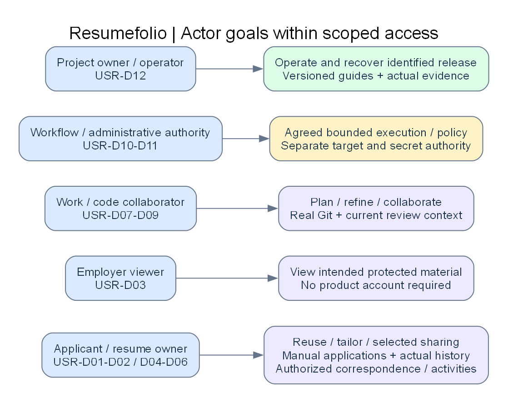
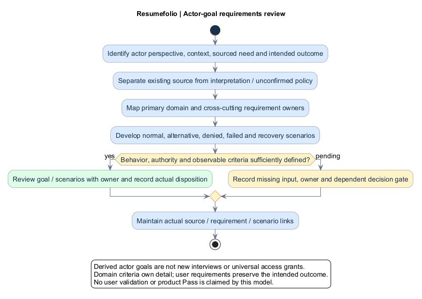

# Resumefolio — User Requirements

| Item | Current position |
|---|---|
| Owner | Farhad Valizadegan; sole delivery and operations owner |
| Status | Proposed product specification — detailed policy and acceptance pending |
| Planning basis | Accepted scope DEC-028–DEC-017 and stakeholder perspectives |
| Candidate references | USR-D01–USR-D12 are provisional document-local references, not allocated global requirement IDs |
| Priority | Unassigned; document order is not delivery priority |
| Revision | October 31, 2026 |

**At a glance:** Describe what each actor needs to achieve in user language. These goals are derived from planning sources, not new interviews or universal permission grants. Detailed behavior stays in domain specifications; quality and exceptional paths apply across journeys.

[Basis](#1-purpose-and-accepted-boundary) · [Inventory](#2-capability-and-information-inventory)
· [Requirements](#3-proposed-requirements) · [Models](#4-behavior-and-boundary-models)
· [Scenarios](#5-planned-verification) · [Decisions](#6-open-decisions-and-gates)
· [Review](#7-traceability-and-review-readiness)

## 1. Purpose and Accepted Boundary

Use [Actors and Context](../02-stakeholders-and-elicitation/actors-and-system-context.md)
and [Stakeholders](../../01-project-planning/03-stakeholders-and-responsibilities.md)
for perspectives, and [Scope](../../01-project-planning/02-scope.md) for accepted
inclusions/exclusions. A person may act as applicant, resource owner and collaborator
in different contexts; this is not a hierarchy of inherited permissions.

No new user research, stakeholder answers or detailed policy acceptance is recorded.
The [elicitation log](../02-stakeholders-and-elicitation/elicitation-log.md) distinguishes
actual documentary extraction from interpretation. No outcome implies AI, automatic
translation or automatic legacy migration, which remain excluded in Version 1.

## 2. Capability and Information Inventory

| Perspective | Intended outcome | Primary detail owner |
|---|---|---|
| Registered applicant / resume owner | Reuse, tailor, disclose deliberately and preserve actual application materials | PRP-D, PDF-D, APP-D, EGC-D |
| Employer viewer | Understand intended professional material without an account | PDF-D, ACC-D, EIF-D |
| Invited work/code collaborator | Perform permitted work and repository actions | PKS-D, GIT-D, ACC-D |
| Workflow author / deployment authority | Run supported work and control consequential targets separately | YML-D, EIF-D, QSR-D |
| Administrator / platform owner | Configure explicitly permitted policy and inspect authorized outcomes | AFO-D, ACC-D |
| Project owner / operator | Make commitments and operate a maintainable recoverable release | QSR-D, AFO-D, planning decisions |

The [account permission matrix](accounts-authentication-and-permissions.md#7-role-resource-and-operation-matrix)
owns detailed grants. A role name or user goal does not authorize all possible
view/edit/delete/restore actions. Supported client/accessibility/language criteria
remain in the interface and quality specifications, not assumptions about users.

## 3. Proposed Requirements

Every candidate is **Proposed**, owner **Farhad**, priority **Unassigned**. Criteria
are user-observable assessment examples; dependent policies must be decided before
acceptance. No interview validation or product Pass result is implied.

### USR-D01: Reuse and Tailor Professional Information

**Source / rationale:** DEC-027/026; derived applicant goal, not a newly conducted interview.

**Actor / conditions:** Registered user preparing resumes for different opportunities.

**Proposed obligation:** The user shall be able to maintain reusable professional information and create independently tailored resumes with relevant selected evidence.

**Acceptance criteria**
- A representative user can select shared information without re-entering it for every resume.
- Two opportunity-specific resumes retain their independent selections, layouts and overrides after changes under the agreed source-update policy.
- The user can select evidence for each resume without exposing their entire private evidence collection.

**Planned verification:** Later two-opportunity task walkthrough; PRP-D01–D06 and related scenarios.

**Open detail:** Required fields, propagation triggers, override precedence, supported evidence and presentation rules; no productivity benefit has been measured.

### USR-D02: Control PDF and Employer Sharing

**Source / rationale:** DEC-025/024; derived resume-owner goal and documentary EXT-001.

**Actor / conditions:** Resume owner chooses what a particular employer may view/download.

**Proposed obligation:** The owner shall be able to control selected shared content, permitted generated/uploaded PDF variants and language-specific uploaded availability through protected links.

**Acceptance criteria**
- The owner can configure generated, uploaded, both or neither for each resume and the permitted uploaded language variants.
- Only the intended selected material is retrievable in the employer context, including direct file/PDF paths.
- The owner can change the sharing password or disable the link under the reviewed access-change policy.

**Planned verification:** Later owner configuration and allowed/denied retrieval walkthrough; PDF-D and ACC-D.

**Open detail:** Link/session lifecycle, missing-language behavior, active/cached/in-flight access and owner preview; disabling retrieval cannot recall a downloaded copy.

### USR-D03: View Intended Professional Material Without an Account

**Source / rationale:** DEC-024/025/026; derived employer-viewer perspective, not employer research.

**Actor / conditions:** Employer viewer receives an eligible password-protected link.

**Proposed obligation:** The viewer shall be able to view the intended shared resume/evidence and retrieve permitted available PDFs without registering a product account.

**Acceptance criteria**
- A fresh viewer with the correct password can reach eligible selected content without product registration.
- Wrong/missing password, disabled link and unselected/disabled file requests do not disclose protected material.
- Language/variant unavailability and relevant access failure have defined understandable outcomes rather than unrelated private content.

**Planned verification:** Later viewer valid/invalid/missing-variant/direct-request examples; PDF-D04–D06 and EIF-D02.

**Open detail:** Supported clients, accessibility, wording, session lifetime and language fallback; possession of a password does not prove employer identity.

### USR-D04: Prepare and Track Applications Manually

**Source / rationale:** DEC-023/016; applicant retains analysis and authorship.

**Actor / conditions:** Registered applicant prepares and tracks a job application.

**Proposed obligation:** The applicant shall be able to record company/position, associate a relevant resume, manually write a cover letter and record progress under explicit state rules.

**Acceptance criteria**
- A representative application retains the intended company/position and allowed resume association.
- The applicant can prepare cover-letter content manually and distinguish save failure from completed persistence.
- Progress follows reviewed transitions without implying automatic external submission or employer receipt.

**Planned verification:** Later preparation/state/validation walkthrough; APP-D01–D05.

**Open detail:** Fields, statuses, corrections, dates and incomplete records; no AI drafting or automatic external application submission is added.

### USR-D05: Keep a Trustworthy Record of Actual Submitted Materials

**Source / rationale:** DEC-023 and EXT-002; later edits must not rewrite what the applicant recorded as sent.

**Actor / conditions:** Applicant records actual submitted resume and cover-letter material, then changes sources.

**Proposed obligation:** The applicant shall be able to identify and retain actual submitted materials separately from current editable content and live sharing.

**Acceptance criteria**
- Captured actual submitted material remains distinguishable after later source edits/replacement.
- Incomplete/failed preservation is distinguishable from a completed historical set.
- Corrections/resubmissions follow a reviewed policy rather than silently substituting a new set for the original.

**Planned verification:** Later actual-material/capture/source-edit comparison; APP-D05–D09 and BRL-D05.

**Open detail:** Capture trigger/artifact/provenance, repeated sets, deletion and retention; history is neither an indefinite archive nor a backup guarantee.

### USR-D06: Coordinate Correspondence and Activities

**Source / rationale:** DEC-022/028; user-controlled communication in an authorized context.

**Actor / conditions:** Connected user works with Gmail and relevant calendar activities.

**Proposed obligation:** The user shall be able to read, compose, send and reply in the intended Gmail context and coordinate agreed activities with Google Calendar integration under explicit rules.

**Acceptance criteria**
- Representative permitted mail operations use the intended selected account and expose truthful outcomes.
- Agreed activities and application relationships preserve intended time/context and independent private access.
- Access loss, conflict, unavailable data and uncertain outbound effects are distinguishable with defined next actions.

**Planned verification:** Later controlled account/activity/denial/failure walkthrough; EGC-D.

**Open detail:** Actual provider access, permissions, views, synchronization, reminders and delivery limits; no operation has been proven or sent here.

### USR-D07: Plan and Adapt Authorized Work

**Source / rationale:** DEC-021; project/work participant goal.

**Actor / conditions:** Authorized user organizes work through projects, boards, backlogs and Sprints.

**Proposed obligation:** The user shall be able to organize and prioritize work, refine items into tasks and maintain a Sprint Backlog comprising goal, selected items and delivery plan.

**Acceptance criteria**
- Representative work retains distinct Backlog Item/task meanings and valid assignment/priority/due dates.
- The Sprint view/plan identifies goal, selected work and delivery plan together under reviewed change rules.
- Incomplete work remains identifiable at Sprint end; board movement alone is not item acceptance.

**Planned verification:** Later planning/refinement/Sprint-end task walkthrough; PKS-D.

**Open detail:** Relationships, workflow/roles, completion and carry-over, reporting/automation scope; no mandatory ceremonies or additional staff assumed.

### USR-D08: Collaborate Within Invited Resource Boundaries

**Source / rationale:** DEC-028/021/020; collaborator goals differ from owner privileges.

**Actor / conditions:** Invited collaborator participates in a specific authorized board/project/repository.

**Proposed obligation:** The collaborator shall be able to perform granted work/repository actions while remaining outside unrelated private contexts.

**Acceptance criteria**
- An accepted applicable grant permits only the reviewed actions on its intended resources.
- An invitation or board membership alone does not expose private mail, unrelated resumes or repositories.
- Changed/revoked membership has the defined subsequent operation outcome and cannot be bypassed by direct references.

**Planned verification:** Later invited/denied/revoked context walkthrough; ACC-D, PKS-D06 and GIT-D02.

**Open detail:** Invitation states, role/action matrix, resource scope, existing sessions and ownership transfer; actor labels are not universal grants.

### USR-D09: Use Real Repository Collaboration

**Source / rationale:** DEC-020; code contributor/reviewer goal.

**Actor / conditions:** Authorized repository user/client performs agreed Git and collaboration work.

**Proposed obligation:** The user shall be able to work with actual hosted repositories through real Git clients and agreed branch, history, fork, request, review, merge and tracking/release capabilities.

**Acceptance criteria**
- Supported real-client examples demonstrate intended Clone/Fetch/Pull/Push outcomes in the authorized repository.
- A review/merge example identifies source/target revisions and handles conflicts or changed state under reviewed rules.
- Repository issues/milestones/tags/releases retain their intended context without implying deployment.

**Planned verification:** Later real-client and review/release journeys; GIT-D and EIF-D06.

**Open detail:** Client/transports, credentials, grants, merge/release/lifecycle policy; development GitHub is not evidence of product hosting.

### USR-D10: Run Agreed Checks and Control Deployment Separately

**Source / rationale:** DEC-019; conditional workflow-author/operator goal.

**Actor / conditions:** Authorized actor uses a reviewed supported workflow after feasibility/security gates.

**Proposed obligation:** The actor shall be able to request agreed repeatable checks/builds and inspect permitted results, with separately controlled deployment authority.

**Acceptance criteria**
- Supported/unsupported definitions have explicit validation outcomes.
- Authorized runs have identifiable definitions/revisions and truthful result/log/artifact access.
- Push/merge/run success does not inherently authorize a protected deployment target or unrelated secrets.

**Planned verification:** Later isolated supported-workflow, denied action and controlled target journeys; YML-D.

**Open detail:** Execution feasibility, syntax/triggers, isolation, limits, approvals and actual evidence; no general GitHub Actions compatibility promised.

### USR-D11: Administer Explicit Policy and Understand Failures

**Source / rationale:** DEC-018/028 and stakeholder responsibilities; platform-owner/admin perspective.

**Actor / conditions:** Actor with defined administrative authority configures policy or investigates an operation.

**Proposed obligation:** The actor shall be able to manage agreed effective policies and inspect permitted operational outcomes without inferring unrestricted access to user content.

**Acceptance criteria**
- A permitted policy edit follows explicit ranges/infrastructure limits and reports the effective outcome.
- Unauthorized policy/content/audit operations are denied across direct paths.
- Relevant incomplete/failed/quota outcomes are distinguishable without exposing secrets/unrelated private data.

**Planned verification:** Later allowed/denied policy and output walkthrough; AFO-D and ACC-D09.

**Open detail:** Exact administrative actions, audit visibility, thresholds and sensitive-operation rules; project governance alone grants no product superuser power.

### USR-D12: Operate and Recover an Identified Release

**Source / rationale:** DEC-017 and sole-owner resources; operator goal rather than a claim of an additional team.

**Actor / conditions:** Farhad operates, maintains or later restores the product using authorized procedures.

**Proposed obligation:** The operator shall have version/environment-specific guidance and evidence to deploy, maintain, diagnose and recover the required workflows within agreed constraints.

**Acceptance criteria**
- Guidance identifies dependencies, non-secret configuration, responsibility and actual checked versus unperformed steps.
- Later isolated restoration checks required artifacts/relationships/workflows and safe restored access against decided targets.
- Failures, limitations and pending external actions remain explicit rather than an untested successful recovery or rollback claim.

**Planned verification:** Later procedure walkthrough and isolated recovery evidence; QSR-D10–D14 and AFO-D12.

**Open detail:** Actual infrastructure/storage, workload, targets, maintenance effort, keys/access and upgrade recovery; no successful deployment or recovery recorded.

## 4. Behavior and Boundary Models



[Scalable SVG](../diagrams/user-goal-map.svg) · [Graphviz source](../diagrams/user-goal-map.dot)

Connections group goals, not role inheritance or technical services. External
systems are dependencies/interfaces, not substitutes for the human outcomes.



[Scalable SVG](../diagrams/user-requirement-review.svg) · [PlantUML source](../diagrams/user-requirement-review.puml)

The flow is a review roadmap, not evidence that users have validated the goals.
Colors supplement labels. Resolve normal, alternative, denied, failure and recovery
paths in the relevant domain/scenario records, without duplicating competing rules.

## 5. Planned Verification

| Journey family | Candidates | Normal and exceptional examples |
|---|---|---|
| Presentation/sharing | USR-D01–D03 | Two resumes, language/variant availability, selected evidence and denied direct requests |
| Applications/communication | USR-D04–D06 | Manual preparation, actual materials, later source edits, provider rejection/disconnect |
| Work/repository | USR-D07–D09 | Item/task distinction, incomplete Sprint work, revoked invite, real client and conflicting merge |
| Execution/administration | USR-D10/D11 | Unsupported definition, unauthorized target/secret/policy action and truthful failed outcome |
| Operation/recovery | USR-D12 | Versioned procedure, incomplete backup/restore, old access and pending external effects |

Before later walkthroughs, record the actor, context/grants, initial data, intent,
steps, expected observable outcome and relevant criteria. Retain actual participant,
candidate/environment, result and limits only when a real activity occurs. No
scenarios or interviews above have been executed in the product.

## 6. Open Decisions and Gates

| Topic | Definition/evidence needed | Gate |
|---|---|---|
| Goal validation | Review derived goals, missing perspectives, priorities and actual research needs | Before accepting affected user requirements |
| Journeys | Required inputs, states, language/accessibility, normal/denied/failure/recovery paths | Affected M-02 acceptance |
| Grants and lifecycle | Roles/actions, active/revoked contexts, source/history and deletion effects | Related domain/security design |
| Dependencies | Actual provider access, combined resource and execution safety findings | Existing planning gates before dependent commitments/development |
| Evidence | Actual review, traceability, measurable criteria and later operation/recovery results | M-02 versus later separate capability/readiness gates |

Farhad coordinates clarification in [Questions](../07-change-and-baseline/open-questions-and-decisions.md)
and [Scenarios](../04-scenarios-and-models/user-stories-and-scenarios.md). Local topics
are not newly allocated shared decisions. Preserve [Planning Gates](../../01-project-planning/10-planning-completion-criteria.md)
and [Change Control](../07-change-and-baseline/change-control.md) for material impacts.

## 7. Traceability and Review Readiness

USR-D01–D12 link the scope-derived actor goals to the domain prefixes listed
in section 2 and in each verification plan. The [SRS](requirements-specification.md)
coordinates levels; user outcomes complement detailed functional, interface,
quality and lifecycle criteria rather than replacing them.

Use the [requirement template](../templates/requirement-template.md) when allocating
final IDs. Link allocated records/scenarios and actual evidence in
[Traceability](../06-validation-and-traceability/requirements-traceability.md).
Record actual inspection outcomes in [Review Findings](../06-validation-and-traceability/review-plan-and-findings.md).

- [ ] Reconcile provisional USR-D references and assign justified priorities.
- [ ] Review source-derived boundaries separately from proposed supporting detail.
- [ ] Resolve policy/state/permission questions blocking affected acceptance.
- [ ] Reconcile dictionary, lifecycle, interface and related domain specifications.
- [ ] Complete normal, denied, failure, concurrent and recovery scenarios where applicable.
- [ ] Record actual owner decision, reviewed revision, evidence and remaining blockers.

**Current outcome:** Proposed specification; no candidate is accepted and no product
test result is recorded. Conditional criteria are not acceptance-ready until their
referenced policies are decided. M-02 and the wider pre-implementation agreement
remain pending. This revision changes no accepted scope and performs no live
repository, application-submission, sharing, file or provider operation.

## 8. Diagram Maintenance

| Diagram | Source | SVG | PNG |
|---|---|---|---|
| Actor goal map | [Graphviz](../diagrams/user-goal-map.dot) | [SVG](../diagrams/user-goal-map.svg) | [PNG](../diagrams/user-goal-map.png) |
| User requirement review | [PlantUML](../diagrams/user-requirement-review.puml) | [SVG](../diagrams/user-requirement-review.svg) | [PNG](../diagrams/user-requirement-review.png) |

Keep sources, captions and renders synchronized. Colors supplement labels. Follow
the [diagram guide](../diagrams/README.md); inspect readable arrows/labels and check
file/section links after changes. From repository root:

```powershell
$diagramFolder = 'docs\SDLC\02-requirements-engineering\diagrams'
$graphvizExe = 'C:\Program Files\Graphviz\bin\dot.exe'
$plantUmlJar = 'C:\Users\fvali\AppData\Local\Resumefolio\DiagramTools\plantuml.jar'
foreach ($format in 'svg', 'png') {
    & $graphvizExe "-T$format" -Gdpi=140 "$diagramFolder\user-goal-map.dot" -o "$diagramFolder\user-goal-map.$format"
    if ($LASTEXITCODE -ne 0) { throw "Graphviz failed: $format" }
    java '-Djava.awt.headless=true' -jar $plantUmlJar -charset UTF-8 "-t$format" "$diagramFolder\user-requirement-review.puml"
    if ($LASTEXITCODE -ne 0) { throw "PlantUML failed: $format" }
}
```

Use actual tool paths on other machines; save UTF-8 without BOM.

[Specification index](README.md) · [SRS entry point](requirements-specification.md)
· [Requirements index](../README.md)

## Course-Aligned Priority Review

Actual approved priority remains unassigned. See the [per-candidate proposed priority and readiness register](requirements-priority-and-readiness.md) for a sourced proposal, its limits and the course's SMART checks. A proposed Must is not acceptance of unresolved detail. Primary obligations, candidate IDs and criterion wording are unchanged by that register.

## Proposed Answers for Detailed Requirements Review — November 1, 2026

The owner requested completion of the outstanding questions. The sections below supply concrete **proposed** answers rather than infer approval of previously unspecified policy. They supersede the absence of a proposal in earlier open-detail paragraphs, not accepted scope or historical decisions. Their fields, limits and behavior require review before affected requirement acceptance; no implementation or product-test Pass is reported. Existing candidate IDs and primary obligations are retained. See the [review package](../07-change-and-baseline/requirements-answer-review.md) for authority, evidence gates and cross-document navigation.

<a id="resolution-q-d02"></a>
### Proposed answer Q-D02: Actor outcomes and validation

**Affected records:** USR-D01–USR-D12; RF-D05. **Disposition:** Evidence-gated investigation with a complete proposal.

1. Retain applicant/resource owner, employer viewer, invited collaborator and explicit platform-administration contexts. A person may act in more than one context, but each request uses only the authority of that context.

2. Validate twelve goal bundles against the accepted scope with synthetic actors A (owner), B (unrelated user), C (invited collaborator) and V (employer viewer). For every goal record normal, denied, failure/uncertain and recovery expectations. Do not present Codex extraction as a stakeholder interview.

3. Provide the owner a versioned review package containing these proposals, the scenario examples and remaining evidence gates. Record actual participant, date, version and acceptance/correction per group only after review. Employer/collaborator perspectives still require explicit confirmation or an acknowledged evidence limitation.

**Assessable review cases:** [RC-Q02-01 through RC-Q02-03](../04-scenarios-and-models/user-stories-and-scenarios.md#review-q-d02). These are planned checks, not executed results.

**Remaining evidence / acceptance condition:** An actual owner/actor review has not occurred in this task. Proposed outcomes are ready to review; validation evidence remains required.
