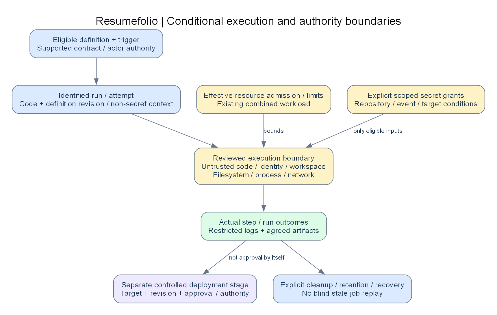
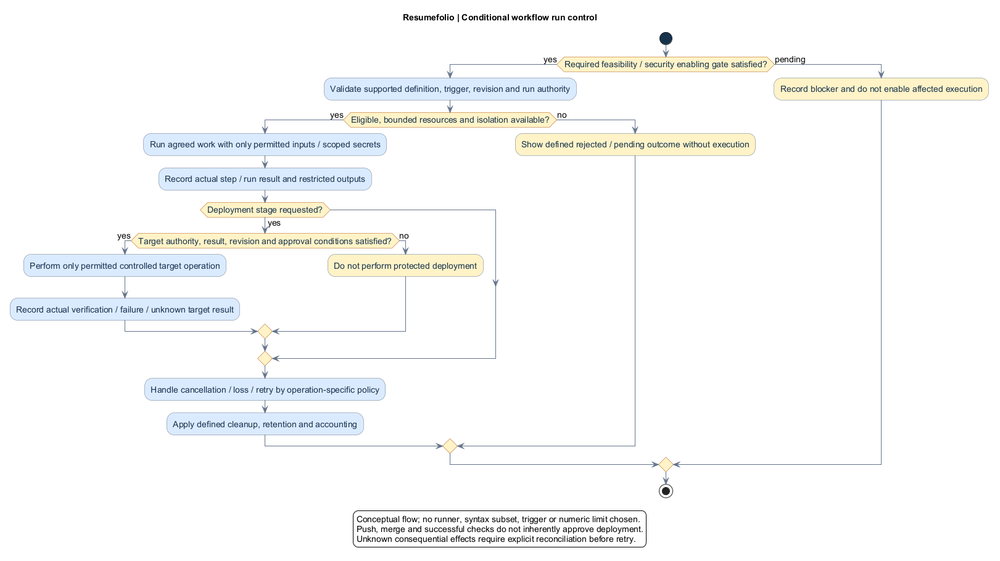

# Resumefolio — YAML Workflows and CI/CD

| Item | Current position |
|---|---|
| Owner | Farhad Valizadegan; sole delivery and operations owner |
| Status | Proposed product specification — detailed policy and acceptance pending |
| Planning basis | DEC-019/028/018/017; GAP-D09 and resource follow-up |
| Candidate references | YML-D01–YML-D12 are provisional document-local references, not allocated global requirement IDs |
| Priority | Unassigned; document order is not delivery priority |
| Revision | October 31, 2026 |

**At a glance:** Provide agreed real workflow execution, not only YAML validation or Git integrity checks. Define supported behavior, untrusted-code isolation, secrets, limits and outputs; deployment authority stays separate. Execution remains conditional on evidence-based feasibility/security gates.

[Basis](#1-purpose-and-accepted-boundary) · [Inventory](#2-capability-and-information-inventory)
· [Requirements](#3-proposed-requirements) · [Models](#4-behavior-and-boundary-models)
· [Scenarios](#5-planned-verification) · [Decisions](#6-open-decisions-and-gates)
· [Review](#7-traceability-and-review-readiness)

## 1. Purpose and Accepted Boundary

[Scope DEC-019](../../01-project-planning/02-scope.md#dec-019) includes YAML-defined
repeatable checks, tests, builds and actual results/logs, with deployment as a
separately controlled stage where defined. It requires isolation, authorization,
secrets, cleanup and resource analysis before implementation. Compatibility with
every GitHub Actions workflow is not implied.

The capability is part of Resumefolio; using CI to build Resumefolio elsewhere
does not demonstrate it. [Git Hosting](git-hosting-and-collaboration.md) is a separate
capability, and Push/merge/release does not inherently authorize production deployment.
No workflow engine, runner, container/VM, command syntax, event trigger or public
interface is selected. No actual job/deployment is launched by this revision.

Use [Accounts](accounts-authentication-and-permissions.md),
[Interfaces](external-interface-requirements.md),
[Files/Operations](administration-files-and-operational-behavior.md),
[Quality/Recovery](quality-security-and-recovery-requirements.md) and
[Business Lifecycle](business-rules-and-data-lifecycle.md) for cross-module invariants.

## 2. Capability and Information Inventory

| Subject | Required contract | Open selection |
|---|---|---|
| Definition | Supported syntax, inputs, actions/steps, version and validation | No arbitrary YAML or ecosystem compatibility assumed |
| Trigger/run | Eligible initiator/event, code/definition revision, authority and attempt | Trigger types, state model, deduplication and concurrency |
| Execution | Isolated work context, allowed identity/network/resources and secret scope | Runner mechanism, environment/dependencies and limits |
| Results | Step/run outcomes, permitted logs and any agreed artifacts | Aggregation, safe display, retention and unknown outcomes |
| Deployment | Explicit target authority/approval, artifact/revision and verification | Targets, approver rules, failure and data-compatible recovery |
| Operations | Cancellation, runner loss, cleanup/accounting, guidance and restoration | Exact procedures and actual control/resource evidence |

For each supported action, specify inputs, permissions, preconditions, allowed
effects, output/result meaning, limits, failure/repetition and evidence. Treat
repository code, definitions and outputs as untrusted within the reviewed threat
model. Authorized authorship does not grant host, other-tenant or arbitrary network access.

## 3. Proposed Requirements

Every record is **Proposed**, owner **Farhad**, priority **Unassigned**. All execution
criteria are future controlled checks after the applicable prerequisites. No
requirement below establishes that the existing server can safely run jobs.

### YML-D01: Defined Supported Workflow Contract

**Source / rationale:** DEC-019; YAML definitions need an explicit supported meaning.

**Actor / conditions:** Authorized author supplies a workflow definition for an eligible repository/context.

**Proposed obligation:** The product shall validate agreed workflow syntax/structure and supported behavior before it is eligible for execution.

**Acceptance criteria**
- Supported examples identify intended checks/build steps, inputs and relevant configuration.
- Malformed/unsupported definitions produce defined validation feedback rather than silently executing unrecognized behavior.
- The effective definition/version is distinguishable from an arbitrary unreviewed latest file.

**Planned verification:** Later supported/unsupported/invalid examples and definition-version inspection.

**Open detail:** YAML subset/schema, file location, actions/commands/dependencies, expressions, step ordering, inputs and compatibility/version policy; no GitHub Actions parity or unrestricted command model selected.

### YML-D02: Explicit Triggers and Run Authority

**Source / rationale:** DEC-019/028; a code event is not inherently unlimited execution authority.

**Actor / conditions:** User or selected event requests a run.

**Proposed obligation:** Only agreed eligible triggers and actors shall create execution work under the applicable repository/workflow/run authority.

**Acceptance criteria**
- Selected trigger examples create only the intended permitted work.
- Unauthorized actors, altered repository references and ineligible events cannot start protected execution.
- Repeated/concurrent trigger events follow explicit deduplication/admission rules with distinguishable results.

**Planned verification:** Later controlled allowed/denied/manual/event cases after trigger selection.

**Open detail:** Manual/event triggers, branch/fork policy, webhook if selected, scheduling, re-runs and duplicate semantics; no event type or unattended job configured here.

### YML-D03: Run Identity and Reproducible Context

**Source / rationale:** DEC-019 and proposed traceability refinement; results must relate to the evaluated code/definition.

**Actor / conditions:** An eligible run is accepted or inspected.

**Proposed obligation:** Each run shall identify its repository/ref resolution, evaluated revision, effective definition and relevant non-secret execution context.

**Acceptance criteria**
- A later branch change does not silently relabel an existing run as having evaluated different code.
- Permitted result inspection distinguishes separate attempts and their defined relationship to a rerun.
- Evidence identifies environment/input limits without exposing secret values.

**Planned verification:** Later fixed-revision, changed-ref and rerun context comparisons.

**Open detail:** Ref resolution point, environment/dependency capture, run/attempt identifiers and reproducibility scope; no byte-identical build guarantee.

### YML-D04: Isolation and Untrusted-code Boundary

**Source / rationale:** DEC-019/GAP-D09; hosted code and workflow definitions can act with unintended authority.

**Actor / conditions:** A run is prepared/executed in the selected isolated environment after feasibility review.

**Proposed obligation:** Execution shall enforce reviewed filesystem/process/network/identity boundaries protecting the host, unrelated tenants/resources and operational control plane.

**Acceptance criteria**
- Later controlled attempts cannot access unrelated private repository/user/host data beyond permitted inputs.
- Allowed execution cannot gain administrative/host authority merely through crafted code or definition inputs.
- Isolation failure or inability to establish required controls blocks enabling the affected execution capability.

**Planned verification:** Later bounded isolated security checks in an authorized environment.

**Open detail:** Threat scenarios, runner/isolation mechanism, privilege/network policy, workspace/dependency handling and control evidence; no container/VM or safe-host result selected/claimed.

### YML-D05: Scoped Secrets and Credentials

**Source / rationale:** DEC-019/028 and resource credential constraints; a run grant is not a grant to every secret.

**Actor / conditions:** Run requires an explicitly permitted secret/credential or produces output.

**Proposed obligation:** Secret access shall be scoped to reviewed actor/repository/event/target conditions with protected handling and output rules.

**Acceptance criteria**
- An ineligible run/fork/event cannot obtain a protected secret through normal or altered requests.
- Ordinary log/artifact/status examples do not expose secret values under the defined handling policy.
- Credential change/revocation and failed secret availability have explicit outcomes rather than an authorization bypass.

**Planned verification:** Later controlled synthetic-secret allowed/denied/output/revocation cases.

**Open detail:** Secret creation/view/update authority, storage/injection/lifetime, output protection, untrusted forks, rotation and deployment credentials; no universal perfect redaction guarantee.

### YML-D06: Resource Admission and Limits

**Source / rationale:** DEC-019/018 and existing-server constraints; execution competes with the product workload.

**Actor / conditions:** A run requests execution/storage/network resources.

**Proposed obligation:** Run admission and execution shall respect explicit effective resource/concurrency/time/output limits justified against actual combined capacity.

**Acceptance criteria**
- Defined eligible/over-limit requests produce reviewed admitted/pending/rejected outcomes.
- Later controlled limit-exceeding runs have distinguishable terminated/failed outcomes and defined cleanup/accounting.
- Combined-workload findings evaluate impact on other required workflows; a user count alone is not execution capacity evidence.

**Planned verification:** Later bounded resource/admission/combined-load cases.

**Open detail:** CPU/memory/storage/network, concurrency/queue/time/output limits, fair use, warning thresholds and reservations; no numerical limits or extra runner server assumed.

### YML-D07: Truthful Run and Step Outcomes

**Source / rationale:** DEC-019 and proposed reliability refinement; queued work or a partial build is not successful completion.

**Actor / conditions:** An authorized user monitors a run/check/build and its permitted outputs.

**Proposed obligation:** The product shall expose reviewed run/step state and completion semantics tied to actual execution outcomes.

**Acceptance criteria**
- Pending/running/completed/failed/cancelled or equivalent selected states are distinguishable under the final state model.
- A required step failure, missing output or interrupted execution cannot produce a false successful overall result.
- Unavailable/unknown runner state is reported/reconciled under the defined policy rather than invented success.

**Planned verification:** Later controlled success/failure/interruption and required-step aggregation cases.

**Open detail:** Final state machine, dependency/skip/continue behavior, exit/result meaning, timing and detection; example states do not establish the final model.

### YML-D08: Restricted Logs and Artifacts

**Source / rationale:** DEC-019 with proposed output/interface refinement; execution outputs can carry private or unsafe data.

**Actor / conditions:** Actor requests run logs/results or agreed artifacts.

**Proposed obligation:** Outputs shall retain run/revision context and follow reviewed access, content, size and lifecycle policies across UI/direct retrieval.

**Acceptance criteria**
- Authorized inspection shows intended run/attempt output without mixing another user/repository context.
- Unauthorized direct log/artifact requests cannot bypass repository/run/output authority.
- Partial/truncated/unavailable outputs are distinguishable; defined active/unsafe content is not served contrary to reviewed policy.

**Planned verification:** Later run-context/direct access/unsafe-output and incomplete-output cases.

**Open detail:** Artifact support/types, access after repository changes, retention, truncation, safe serving, download, size and deletion; no unlimited logs or universal upload policy assumed.

### YML-D09: Cancellation, Retry and Runner-loss Recovery

**Source / rationale:** Proposed reliability detail for DEC-019; repetition may repeat external effects.

**Actor / conditions:** Authorized actor cancels/retries, or a runner fails/disconnects.

**Proposed obligation:** Cancellation, retry and orphaned-run reconciliation shall have explicit authority, actual-state and side-effect policies.

**Acceptance criteria**
- Cancellation request and confirmed execution termination are distinguishable under the reviewed state rules.
- Runner loss leaves an observable unresolved/failed state with defined reconciliation, not false success.
- Rerunning a deployment/send/other consequential step follows its explicit approval/reconciliation policy rather than blind automatic replay.

**Planned verification:** Later isolated cancellation/runner-loss/retry and ambiguous-effect cases.

**Open detail:** Cancellation scope, cleanup timing, orphan detection, retry eligibility, duplicate handling and confirmed termination evidence; no exactly-once promise.

### YML-D10: Separate Controlled Deployment Stage

**Source / rationale:** DEC-019; Push does not inherently authorize production deployment.

**Actor / conditions:** A workflow proposes a change to an explicitly permitted deployment target.

**Proposed obligation:** Deployment shall require reviewed target authority/approval and conditions separate from code Push, merge or check success.

**Acceptance criteria**
- A Push/merge/successful check alone cannot use an otherwise unauthorized deployment target/credential.
- A permitted deployment identifies intended code/artifact revision, target and applicable approval context.
- Rejected/failed/unknown target outcomes are distinguishable from successful usable deployment; recovery follows reviewed version/data compatibility rules.

**Planned verification:** Later isolated authorized/denied target, changed revision and failure/recovery cases.

**Open detail:** Targets, approver identity/action/effective revision, environment restrictions, verification, rollback/forward recovery and migration consequences; no live deployment authorized here.

### YML-D11: Workspace Cleanup and Retained Evidence

**Source / rationale:** DEC-019/018/017 and proposed lifecycle refinement; leftovers can leak secrets or exhaust storage.

**Actor / conditions:** Run completes/fails/is cancelled or retained execution material becomes eligible for removal.

**Proposed obligation:** Workspace/temporary/output cleanup shall follow explicit eligibility/reference/retention rules with secret protection and truthful accounting.

**Acceptance criteria**
- A later run cannot read a prior run's protected workspace/secret residue contrary to isolation policy.
- Required retained evidence/artifacts are not deleted merely because temporary work is eligible for cleanup.
- Partial cleanup or accounting failure is distinguishable from complete reclamation and does not silently remove unrelated data.

**Planned verification:** Later isolated successive-run, eligible/ineligible cleanup and failure cases.

**Open detail:** Timing, manual/automatic procedure, cache reuse, artifact/log retention, quarantine/recovery and quota release; no cleanup schedule or retention period set.

### YML-D12: Feasibility, Operational Guidance and Enabling Gate

**Source / rationale:** DEC-019/017, GAP-D09/D01/D08; inclusion does not prove executable infrastructure.

**Actor / conditions:** Owner evaluates execution design or enables/accepts the capability.

**Proposed obligation:** Dependent execution commitments shall retain actual isolation/resource/access findings, supported-contract decisions, operational guidance and later control evidence before enabling/acceptance.

**Acceptance criteria**
- The evaluation identifies selected environment, combined workload, supported operations, control checks, costs and unresolved blockers.
- Required security/resource blockers prevent treating execution as enabled/accepted merely because YAML parsing or Git hosting works.
- Guidance covers versioned setup, failure/cancellation/cleanup, updates and recovery without replaying stale work or exposing secrets.

**Planned verification:** Later evidence/design/procedure review and controlled end-to-end run checks before relevant acceptance.

**Open detail:** Actual infrastructure/configuration, mechanism/licensing, targets, solo workload, backup/restore and costs; no feasibility conclusion or successful run recorded.

## 4. Behavior and Boundary Models



[Scalable SVG](../diagrams/workflow-execution-boundaries.svg) · [Graphviz source](../diagrams/workflow-execution-boundaries.dot)

Connections express requirements relationships, not selected services or network
topology. Secrets, output retrieval and deployment targets have distinct authority.



[Scalable SVG](../diagrams/workflow-run-control-flow.svg) · [PlantUML source](../diagrams/workflow-run-control-flow.puml)

The flow is conceptual, not a final run state machine or a live command sequence.
Re-evaluate mutable grants, code/definition revisions and target conditions as
required by later design. Colors supplement labels; no automatic deployment is implied.

## 5. Planned Verification

| Family | Candidates | Cases to develop |
|---|---|---|
| Definition/authority | YML-D01–D03 | Supported/invalid definitions, denied triggers, fixed code/revision and reruns |
| Trust/resources | YML-D04–D06 | Isolated cross-context attempts, synthetic-secret scope, saturation and admission |
| Outcome/output | YML-D07/D08 | Required step failure, unknown state, direct protected output and unsafe/partial artifact |
| Recovery/side effects | YML-D09/D10 | Cancel versus termination, runner loss, changed target/revision, approval and failed deployment |
| Lifecycle/readiness | YML-D11/D12 | Successive-run residue, reference-aware cleanup, procedure and actual enabling evidence |

Later checks use authorized isolated infrastructure, synthetic secrets and controlled
targets. Record candidate/configuration, code/definition/attempt, grants, input,
limits, expected/actual effects, evidence and cleanup outcome. Never expose real
secrets or execute unbounded hostile workloads against existing services. These
are evidence-plan constraints, not authorization for operations in this documentation task.

## 6. Open Decisions and Gates

| Topic | Decisions/evidence needed | Gate |
|---|---|---|
| Execution feasibility | Combined server demand, isolation/control findings, actual access and solo operation | GAP-D09/D01; before execution design acceptance/enabling |
| Syntax/triggers | Supported definition contract, versioned ref resolution, event/manual rules and duplicates | Affected M-02 acceptance and M-03 design |
| Trust/secrets | Actor/ref/fork scope, identity, filesystem/process/network, credentials and protected output | Before dependent implementation/enabling; actual control evidence before M-08 |
| Resource/outcome | Effective limits, admission, state/aggregation, cancel/loss/retry and output access | Before accepting detailed behavior/design |
| Target deployment | Target approval, revision/artifact, permission changes, verification and recovery | Before enabling any deployment stage |
| Lifecycle/operation | Workspace/cache/output retention, accounting, cleanup, update and safe restored state | Design/readiness; relevant actual evidence for M-08/M-09 |

Farhad coordinates [Questions](../07-change-and-baseline/open-questions-and-decisions.md)
and [Feasibility](../01-process-and-approach/02-feasibility-study.md). Preserve
[Planning Gates](../../01-project-planning/10-planning-completion-criteria.md) and
explicit [Change Control](../07-change-and-baseline/change-control.md). A blocker
does not silently remove accepted scope or authorize buying another runner/service.

## 7. Traceability and Review Readiness

YML-D01–D12 derive from DEC-019 and explicitly proposed detailed control/lifecycle
refinements. Reconcile GIT-D real repository context, ACC-D grants, EIF-D07
execution interfaces, AFO-D accounting/cleanup, BRL-D recovery and QSR-D07/D12
untrusted execution/restored external-state rules. Actual M-08 acceptance is separate.

Use the [requirement template](../templates/requirement-template.md) when allocating
final IDs. Link allocated records/scenarios and actual evidence in
[Traceability](../06-validation-and-traceability/requirements-traceability.md).
Record actual inspection outcomes in [Review Findings](../06-validation-and-traceability/review-plan-and-findings.md).

- [ ] Reconcile provisional YML-D references and assign justified priorities.
- [ ] Review source-derived boundaries separately from proposed supporting detail.
- [ ] Resolve policy/state/permission questions blocking affected acceptance.
- [ ] Reconcile dictionary, lifecycle, interface and related domain specifications.
- [ ] Complete normal, denied, failure, concurrent and recovery scenarios where applicable.
- [ ] Record actual owner decision, reviewed revision, evidence and remaining blockers.

**Current outcome:** Proposed specification; no candidate is accepted and no product
test result is recorded. Conditional criteria are not acceptance-ready until their
referenced policies are decided. M-02 and the wider pre-implementation agreement
remain pending. This revision changes no accepted scope and performs no live
repository, application-submission, sharing, file or provider operation.

## 8. Diagram Maintenance

| Diagram | Source | SVG | PNG |
|---|---|---|---|
| Execution boundaries | [Graphviz](../diagrams/workflow-execution-boundaries.dot) | [SVG](../diagrams/workflow-execution-boundaries.svg) | [PNG](../diagrams/workflow-execution-boundaries.png) |
| Controlled run flow | [PlantUML](../diagrams/workflow-run-control-flow.puml) | [SVG](../diagrams/workflow-run-control-flow.svg) | [PNG](../diagrams/workflow-run-control-flow.png) |

Keep sources, captions and renders synchronized. Colors supplement labels. Follow
the [diagram guide](../diagrams/README.md); inspect readable arrows/labels and check
file/section links after changes. From repository root:

```powershell
$diagramFolder = 'docs\SDLC\02-requirements-engineering\diagrams'
$graphvizExe = 'C:\Program Files\Graphviz\bin\dot.exe'
$plantUmlJar = 'C:\Users\fvali\AppData\Local\Resumefolio\DiagramTools\plantuml.jar'
foreach ($format in 'svg', 'png') {
    & $graphvizExe "-T$format" -Gdpi=140 "$diagramFolder\workflow-execution-boundaries.dot" -o "$diagramFolder\workflow-execution-boundaries.$format"
    if ($LASTEXITCODE -ne 0) { throw "Graphviz failed: $format" }
    java '-Djava.awt.headless=true' -jar $plantUmlJar -charset UTF-8 "-t$format" "$diagramFolder\workflow-run-control-flow.puml"
    if ($LASTEXITCODE -ne 0) { throw "PlantUML failed: $format" }
}
```

Use actual tool paths on other machines; save UTF-8 without BOM.

[Specification index](README.md) · [SRS entry point](requirements-specification.md)
· [Requirements index](../README.md)

## Course-Aligned Priority Review

Actual approved priority remains unassigned. See the [per-candidate proposed priority and readiness register](requirements-priority-and-readiness.md) for a sourced proposal, its limits and the course's SMART checks. A proposed Must is not acceptance of unresolved detail. Primary obligations, candidate IDs and criterion wording are unchanged by that register.

## Proposed Answers for Detailed Requirements Review — November 1, 2026

The owner requested completion of the outstanding questions. The sections below supply concrete **proposed** answers rather than infer approval of previously unspecified policy. They supersede the absence of a proposal in earlier open-detail paragraphs, not accepted scope or historical decisions. Their fields, limits and behavior require review before affected requirement acceptance; no implementation or product-test Pass is reported. Existing candidate IDs and primary obligations are retained. See the [review package](../07-change-and-baseline/requirements-answer-review.md) for authority, evidence gates and cross-document navigation.

<a id="resolution-q-d23"></a>
### Proposed answer Q-D23: Workflow contract and enabling gate

**Affected records:** YML-D01–YML-D12; QSR-D07/D12; GAP-D09. **Disposition:** Evidence-gated investigation with a complete proposal.

1. Propose versioned YAML contract: schema_version, workflow name, allowed triggers, repository revision, jobs, ordered command steps, per-step/job timeout and declared artifact paths. Reject unknown executable keys/unsupported expressions. Initial triggers are explicit manual run and authorized push; never silently claim GitHub Actions parity.

2. Each run/attempt binds immutable code/definition revision, initiator, granted resources and result states Queued/Running/Succeeded/Failed/Cancelled/Unknown. Retry is a new attempt with explicit authority; runner loss is Unknown until reconciled. Logs/artifacts are scoped private outputs with secret redaction and HTML-safe display.

3. Execution environment must prevent access to host/admin interfaces, production data/credentials, other users/jobs and unauthorized network destinations; no privileged mode, host paths or Docker socket exposure. Dependency/network access is explicitly allowlisted. Destruction/recreation between jobs and denial/escape/resource tests are evidence gates, not assumed properties of using containers.

4. Propose one job at a time, 512 MiB job memory, 0.5 vCPU budget, 1 GiB temporary workspace, 10-minute job timeout, 1 MiB log output and 20 MiB artifact cap as evaluation candidates only. These are not a claim that required builds fit or isolation is safe on the shared 4-GB server. If evidence cannot support agreed real execution within resources/budget, escalate the conflict; do not silently drop execution or add a paid server.

5. Deployment is a separately approved stage naming target, exact artifact/revision, authority and compatible data/recovery plan. Untrusted job code cannot receive production secrets or approve its own deployment. The product may record/validate definitions while execution remains disabled pending controls, but validation alone cannot satisfy the agreed execution capability.

**Assessable review cases:** [RC-Q23-01 through RC-Q23-03](../04-scenarios-and-models/user-stories-and-scenarios.md#review-q-d23). These are planned checks, not executed results.

**Remaining evidence / acceptance condition:** Actual isolation mechanism, capacity fit, budget-compatible option, cleanup and escape/control evidence are missing. This is a hard dependent-design/enabling gate, not completed feasibility.
