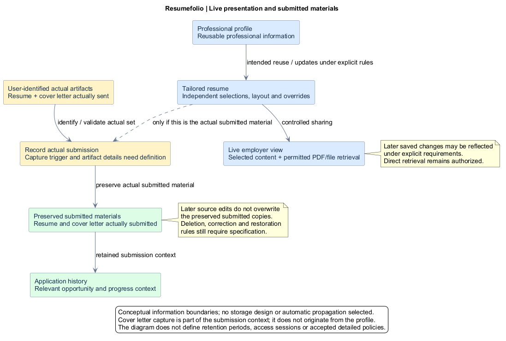
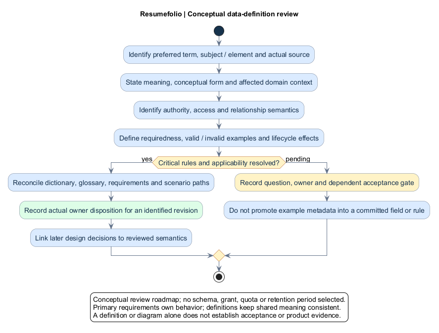

# Resumefolio — Data Dictionary

| Item | Current position |
|---|---|
| Purpose | Define conceptual information used in requirements, including meaning, responsibility and applicable boundaries |
| Owner | Farhad Valizadegan |
| Status | Proposed conceptual definitions — detailed fields and rules pending review |
| Design boundary | No database tables, keys, storage types, endpoints or implementation cardinalities are selected |
| Inventory | 34 conceptual subject groups; 24 proposed cross-cutting element definitions; fields/cardinalities/policies not finalized |
| Revision | October 31, 2026 |

**At a glance:** This dictionary is a reviewable conceptual inventory, reconciled with
the accepted scope and current proposed requirements. It separates known planning boundaries from detailed
validation, access and lifecycle questions that remain open. Use the
[Glossary](glossary.md) for terminology and the domain requirements for primary
behavioral wording; those detailed drafts still await acceptance.

[Conventions](#1-record-conventions) · [Access](#2-accounts-and-access)
· [Presentation](#3-professional-presentation-and-sharing) · [Applications](#4-applications-and-communication)
· [Collaboration](#5-work-management-and-git) · [Operations](#6-execution-and-operational-information)
· [History boundary](#7-live-information-and-submitted-materials) · [Open rules](#8-rules-to-complete-during-requirements-review)
· [Elements](#10-cross-cutting-element-definitions) · [Trace links](#11-requirement-and-scenario-cross-references)
· [Maintenance](#9-maintenance-and-review)

## 1. Record Conventions

Entries below are conceptual data subjects with proposed descriptive keys for
navigation. Keys are not allocated FR/BR/SCN identifiers, accepted schema fields
or implementation names. Conceptual descriptions do not imply all listed
attributes are mandatory or stored independently. Unknown rules remain open.

For each subject, refine a full record as requirements develop:

| Record field | What to define |
|---|---|
| Key and preferred term | Stable dictionary reference and glossary term |
| Meaning and purpose | What the information represents and which actor outcome it supports |
| Source and status | Exact Scope/DEC, elicitation source and requirement references; actual review status |
| Responsibility and authority | Who supplies/manages it and which record is authoritative for each relevant property |
| Conceptual representation | Text, choice, time, quantity, relationship, file or other semantic form; not a database type |
| Required/optional and validation | Conditions requiring the value; permitted values, units, languages and consistency rules |
| Access and sensitivity | Who can read/change/share/delete it; relevant owner/member/viewer context |
| Lifecycle | Creation, change, versioning, synchronization, archive, deletion, retention and restoration effects |
| Links and unresolved matters | Related records, requirement/scenario references, owner, next action and review gate |

For the tables below, **private context** means resource-specific access is required;
it is not an invented legal data classification or complete permission policy.
Farhad coordinates all unresolved definition work. Link gaps to the shared
[question register](../07-change-and-baseline/open-questions-and-decisions.md) before
accepting affected requirements. No numerical limits or retention periods are set here.

## 2. Accounts and Access

Basis: Scope DEC-028/DEC-024 and [Stakeholders](../../01-project-planning/03-stakeholders-and-responsibilities.md).
Detailed records belong in [Accounts and Permissions](../03-requirements-specification/accounts-authentication-and-permissions.md).

| Proposed key / subject | Meaning and conceptual information | Responsibility / access boundary | Detail still to define |
|---|---|---|---|
| account — User account | Individual product identity and relevant account state | User account plus authorized administrative operations; sign-in does not grant unrelated access | Identity/contact fields, account states, onboarding, suspension/deletion and recovery rules |
| role-permission — Role and permission | Product role and allowed operation in a resource context | Granted scope and actor/resource state determine authority | Exact role/grant model, actions, state-dependent checks and sensitive-operation rules; no hierarchy assumed |
| collaboration-grant — Invitation or membership | Defined collaboration relationship for a project, board or repository | Only authorized resources/operations; no unrelated private access | Invitation lifecycle, membership roles, revocation, transfer and affected jobs/reminders |
| provider-connection — External account connection | Authorized association with an external service and its relevant account | Connected user's private context and provider-granted scope | Required identifiers, consent/access state, reconnect, disconnect and local data consequences |

Credentials, passwords and access tokens are not ordinary example data. Their
required behavior belongs in security/interface requirements and later design;
do not populate repository records with actual secret values.

## 3. Professional Presentation and Sharing

Basis: [Scope](../../01-project-planning/02-scope.md) DEC-027–DEC-024 and DEC-015.
Sources define capability boundaries, not all individual field rules.

| Proposed key / subject | Meaning and conceptual information | Responsibility / access boundary | Detail still to define |
|---|---|---|---|
| professional-profile — Profile | Reusable experience, education, skills and other agreed professional information | User-owned; exposure depends on explicit presentation/sharing rules | Exact elements, required inputs, validation, profile/resume relationship and propagation |
| tailored-resume — Resume | Opportunity-specific selections, presentation and content overrides | Resume owner controls tailoring and sharing; unrelated resumes remain independent | Required fields, source references, override precedence, save/publish behavior and lifecycle |
| professional-evidence — Supporting evidence | Explanatory text, images, video, files, diagrams and relevant links associated with skills/projects | Owner selects evidence for each resume; unselected material is not implicitly shared | Supported formats, metadata, display, accessibility, link behavior and removal effects |
| content-language — Language-specific content | Manually entered/reviewed English or German professional content | Managed in the relevant profile/resume context | Which elements vary by language, completeness, default selection and missing-content behavior |
| generated-pdf — Generated resume PDF | Portable rendition produced from authored resume content | Retrieval follows resume authorization and download availability | Generation trigger, represented revision, templates, pagination, fonts, failure and regeneration behavior |
| uploaded-pdf — Uploaded resume PDF | Independently prepared PDF, with separately provided English/German options | Resume owner manages availability; direct retrieval still requires authorization | Language metadata, replacement/versioning, validation and absent-language behavior |
| download-choice — PDF download availability | Generated, uploaded, both or neither for a resume, subject to language-specific availability | Configured by the resume owner; no entitlement to other content | Combinations, language handling, validation and changes during an active session |
| employer-link — Protected sharing link | Access path to the intended resume and selected content using a password | Owner can change password or disable access; viewer receives no private workspace access | Link count/identity, password/session policy, revocation timing, lifecycle and error responses |

**Known boundary:** Resume-specific selections, layouts and overrides remain
independent; intended shared-profile updates follow explicit rules. This dictionary
does not choose automatic propagation or a database copying strategy.

## 4. Applications and Communication

Basis: Scope DEC-023/DEC-022. See [Manual Applications](../03-requirements-specification/manual-application-management.md)
and [Email/Calendar](../03-requirements-specification/email-calendar-and-google-integration.md).

| Proposed key / subject | Meaning and conceptual information | Responsibility / access boundary | Detail still to define |
|---|---|---|---|
| company-opportunity — Company and opportunity | Organization and position information supporting a considered application | User-directed entry and association in private application context | Required fields, reuse/deduplication, source links and removal behavior |
| application-record — Application | Association of opportunity, selected resume, cover letter and progress | User-directed manual ApplyFlow; no automatic external submission implied | Creation/submission recording, timestamps, complete state model and history rules |
| cover-letter — Cover letter | Manually authored application text and the relevant version | User-managed application material | Required content/format, draft editing and submitted-copy capture |
| submitted-materials — Submitted copies | Preserved resume and cover-letter material actually submitted | Preserved application-history context; later source edits do not overwrite it | Capture trigger, completeness, artifact boundaries, permitted access, correction, deletion and restore rules |
| application-progress — Status/history | Application stage and relevant recorded progress | Explicitly authorized application operations | Final allowed values, transitions, actor/time attribution and corrections |
| email-message — Email | Required Gmail communication content, associated account and relevant provider references | Connected user's authorized operations; collaboration does not grant private email access | Local/provider authority, attachments, actions, synchronization, disconnect/deletion and failure rules |
| calendar-activity — Calendar event | Interview, deadline, follow-up or other agreed personal/project schedule information | User/resource-specific permissions and any authorized provider connection | Time/time-zone meaning, recurrence if required, direction, selection, conflicts and deletion |
| activity-reminder — Reminder | Notification associated with an agreed activity | Limited to authorized recipients and activity access | Channels, timing, delivery evidence, cancellation, retries and permission-change effects |

Times need explicit event meaning and time-zone handling in requirements and
design. Recording a time does not establish its representation, precision or
storage format. Provider content and local relationships also need property-level
authority rules; a connection alone does not define synchronization behavior.

## 5. Work Management and Git

Basis: Scope DEC-021/DEC-020. These are **product capabilities**; the GitHub board
and repository used to develop Resumefolio are separate delivery tools.

| Proposed key / subject | Meaning and conceptual information | Responsibility / access boundary | Detail still to define |
|---|---|---|---|
| project-board — Project, board and column | Work context and workflow organization for authorized collaboration | Defined project/board ownership and membership | Hierarchy/cardinality, column semantics, movement, ordering and deletion effects |
| backlog-item — Backlog item | Planned outcome/work with rationale, priority and state | Authorized work-management context | Item/task relationships, allowed types, ordering, dependencies and completion criteria |
| task — Task | Specific activity contributing to work completion, with relevant assignment/deadline | Authorized participant operations | Required fields, assignment rules, state transitions and related notifications |
| sprint-plan — Sprint and Sprint Backlog | Work period, goal, selected items and delivery plan | Relevant authorized work context as defined in requirements; no extra team assumed | Dates, membership, selection/carry-over and calendar-change effects |
| git-repository — Repository | Hosted version-controlled content/history and associated collaboration context | Repository-specific read/write/collaboration permissions | Visibility, ownership, credentials, quotas, fork lineage and lifecycle |
| git-reference — Branch and tag | Named repository development line or reference to a chosen Git state | Repository and operation-specific permissions | Protection, creation/deletion, naming and history behavior |
| pull-request — Pull request/review | Proposed integration of changes, discussion, review and merge context | Authorized repository participants | Source/target relationships, review states, conflicts, cross-fork rules and merge permissions |
| repository-planning — Issue and milestone | Repository work/discussion record and outcome checkpoint | Defined repository collaboration access | State/assignment rules, item relationships and distinction from project-level work records |
| release-record — Repository release | Identified release information associated with versioned project content | Explicit publication/management permissions | Tag relationship, assets, visibility, edits/deletion and actual release decision rules |

The key names group concepts for review; they do not decide whether these concepts
are stored in one table, several records or another service. Do not infer complete
Git/CI behavior from this inventory.

## 6. Execution and Operational Information

Basis: Scope DEC-019/DEC-018/DEC-017 and existing security/recovery follow-up.

| Proposed key / subject | Meaning and conceptual information | Responsibility / access boundary | Detail still to define |
|---|---|---|---|
| workflow-definition — YAML workflow | Definition of agreed execution steps and relevant trigger/context | Repository/execution permissions; code content is not inherently trusted | Supported syntax, version/reference, triggers, limits, secrets and deployment gates |
| workflow-run — Run, result and outputs | One execution instance, state, results, logs and artifacts | Authorized run/output access with isolation and secret protection | States, cancellation, retries, resource accounting, retention, cleanup and failure evidence |
| file-policy — Upload/storage policy | Owner-configurable upload and storage consumption limits | Authorized platform configuration within actual infrastructure capacity | Units, quota scope, types, numerical defaults, changing limits and full-storage behavior |
| audit-event — Audit information | Record of specified sensitive/administrative operations | Audit visibility and mutation rights require explicit requirements | Events, actor/time/result fields, integrity, retention and access restrictions |
| backup-record — Backup/recovery information | Information needed to identify backup coverage and evaluate restoration | Authorized operational context; backup access must protect private data | Coverage, separation, schedules, retention, required configuration/keys, RPO/RTO and actual restoration checks |

Audit information is included as a definition topic for security/administration
refinement, not a fully specified or newly accepted logging policy. No retention
duration, successful recovery result or execution isolation claim is made here.

## 7. Live Information and Submitted Materials

[Scalable SVG](../diagrams/data-submission-boundaries.svg) ·
[Editable PlantUML](../diagrams/data-submission-boundaries.puml)

Blue shows editable professional information and live presentation; green shows
preserved submitted materials; amber marks the capture details requiring definition.
The diagram explains the accepted distinction. It does not select storage,
automatic propagation or exact capture/versioning behavior.

| Boundary | Known planning direction | Remaining definition |
|---|---|---|
| Profile to tailored resume | Reuse professional information while preserving independent resume selections, layouts and overrides | Which values propagate, when and under which conditions |
| Live resume to employer view | Only intended shared content is accessible; later saved changes may be reflected under explicit rules | Effective revision, session/revocation behavior and language/download rules |
| Application to submitted materials | Preserve what was actually submitted; later source edits must not overwrite those copies | Capture evidence, included artifacts and correction/deletion/access rules |
| PDF and other files | Direct retrieval follows the relevant authorization boundary | Exact association with live revisions or submitted artifacts, generation/replacement and lifecycle |
| Backup to restored data | Recovery must later be demonstrated with integrity/consistency evidence | Coverage, access after restoration and achieved results against agreed targets |

## 8. Rules to Complete During Requirements Review

For every affected subject, resolve or explicitly track:

- Required/optional values, lengths, choices, units, allowed formats and invalid/missing-input behavior.
- Relationships, cardinalities and ownership/authority for each relevant operation or property.
- Role/resource/state permissions, sharing selection and direct access checks.
- Language completeness, default/fallback behavior and supported PDF/file content.
- Creation/edit/publication states, version identity, conflict and concurrent-update behavior.
- Local/provider synchronization, retries, reconnect and deletion/disconnect consequences.
- Retention, deletion, restoration, archived-copy treatment and audit expectations.
- Workload, numerical quotas, recovery and performance criteria backed by relevant resource findings.

Source these decisions from real elicitation/analysis and the relevant domain
requirements. Do not promote an example to a mandatory field or reuse an old
conversation's policy without checking its current authority. Record the owner,
next action and gate in [Open Questions](../07-change-and-baseline/open-questions-and-decisions.md),
and retain links to related feasibility ASM/DEP/RSK/GAP records.

## 9. Maintenance and Review

1. Refine conceptual entries as requirement records are allocated; add exact requirement/scenario references rather than invented IDs.
2. Keep detailed behavioral rules in the domain specification and link them here.
3. When meaning changes, assess effects on permissions, lifecycle, interfaces, models, criteria and delivery records.
4. Preserve dictionary references and earlier accepted meanings through controlled change; document actual review status/revision.
5. Check glossary, dictionary, diagrams and traceability together before declaring a group ready.

**Current review outcome:** Pending. No dictionary baseline or detailed data policy
is accepted by this revision. The entries are a populated conceptual draft, not
evidence that product storage, interfaces or access controls have been implemented.

**Revision note — October 31, 2026:** Retained all 34 subject keys and existing
section links, added stable subject anchors, proposed element semantics and
current requirement/scenario references. Detailed field constraints and policies
remain open; no physical schema, new grant or retention value is introduced.

## 10. Cross-cutting Element Definitions

The subject tables deliberately group concepts. The following 24 proposed element
definitions refine their semantics without creating mandatory schema fields.
E01–E24 are local table references, not formal requirement IDs or implementation
names. **Requiredness, representation and constraints remain undecided unless an
accepted source explicitly establishes the boundary.** Candidate examples must
not become default product fields by accident.

| Local ref. / element | Meaning | Conceptual form | Applies to / detail owner | Validation/lifecycle decision still needed |
|---|---|---|---|---|
| E01 — Subject identity | Identifier distinguishing the intended conceptual resource/record | Identity/reference, not a selected key format | Each applicable subject; ACC/EIF domain grants | Which objects need stable identity, uniqueness scope, rename and duplicate handling |
| E02 — Ownership/control context | Who supplies or controls the relevant resource operation | Actor/resource relationship | account, tailored-resume, project-board, git-repository | Ownership count, transfer, closure and exact action authority; governance is not superuser access |
| E03 — Association/reference | Meaning of a relationship to another subject | Relationship/reference | Evidence selection, application resume, task/item, provider mapping | Allowed source/target kinds, cardinality, access and removal effects; no foreign-key design |
| E04 — Content revision | The version of content represented or evaluated | Revision identity/reference | generated-pdf, submitted-materials, pull-request, workflow-run | Revision capture/resolution point, mutable refs, stale output and comparison rules |
| E05 — Selection/override | Resume-specific inclusion, presentation or content adjustment | Choice/ordering/content rule | tailored-resume and professional-evidence | Granularity, precedence, omissions, reset and shared-source propagation; no automatic overwrite |
| E06 — Language context | Which manually maintained language a content/artifact variant represents | Language choice; applicable fields unresolved | content-language, uploaded-pdf, professional-profile | Shared versus language-dependent fields, English/German completeness and fallback |
| E07 — Download availability | Generated, uploaded, both or neither employer-download choice | Choice plus eligible variant conditions | download-choice and relevant PDF artifacts | Absent artifact/language behavior, effective changes and owner preview; choice is not authorization |
| E08 — Sharing eligibility | Whether the link/context is eligible for protected retrieval | Access-state/condition | employer-link and selected resources | Link states, password/session changes, cached/in-flight behavior; do not store password examples |
| E09 — Actual submitted set | Resume/cover-letter material identified as actually submitted | Historical artifact/content references | submitted-materials and application-record | Capture trigger, completeness, provenance, correction/resubmission, access and retention |
| E10 — Provenance/source context | Who/what supplied the information and what claim it supports | Source/actor/reference context | Application capture, external content, provider data and engineering evidence | Required attribution, reliability, user attestation and correction; recorded assertion is not receipt proof |
| E11 — Business state/transition | Current domain condition and allowed change | State choice and transition rule | application-progress, task, sprint-plan, workflow-run | Separate state sets/actors/preconditions per domain; column position is not universal completion |
| E12 — Assignment/priority/order | Responsibility, relative importance and displayed/list order | Actor relationship / reviewed choice / order | backlog-item, task, project-board | Eligible assignee/count, priority scale, ordering/concurrency and notifications; these are distinct meanings |
| E13 — Event/recorded time | When something happened versus when it was recorded | Time meaning, not a database type | Application progress, messages, run results and selected audit events | Required distinction, zone, precision, attribution and correction; client display is not source authority |
| E14 — Due/calendar time | Intended deadline or scheduled activity time | Date/time/time-zone or all-day semantics if selected | task, calendar-activity and activity-reminder | Allowed intervals, all-day/daylight-saving, recurrence if required and changed reminders |
| E15 — Sprint composite | Goal, selected Backlog Items and delivery plan forming one Sprint Backlog | Composite conceptual information | sprint-plan with backlog-item/task context | Plan representation, dates, allowed changes, incomplete work and carry-over; not one required table |
| E16 — Provider account/item mapping | Correspondence between selected local and provider contexts | External identity/reference | provider-connection, email-message, calendar-activity | Selected account/calendar, mapping authority, scope, reconnect and duplicate reconciliation |
| E17 — Synchronization authority/outcome | Which property/action is authoritative and what actually synchronized | Per-category direction/conflict/result semantics | Provider-linked subjects and local relationships | Direction, freshness, deletion, partial result and retries; no global source of truth |
| E18 — Repository/ref/review context | Code history and source/target context for a Git operation or review | Repository/ref/revision relationships | git-repository, git-reference, pull-request, release-record | Ref resolution/protection, fork lineage, stale review, merge and release mutation policy |
| E19 — Run/attempt/target context | Which definition/code/environment and attempt produced which effect | Execution/revision/target references | workflow-definition and workflow-run | Attempt lineage, trigger, result aggregation, separate target approval and unknown effects |
| E20 — Result/evidence locator | Where an actual bounded observation/output is identified | Outcome plus protected evidence/reference | workflow-run, audit-event, backup-record; later engineering evidence | Actual versus planned state, expected/actual, truncation/access, candidate and limitations |
| E21 — Size/usage/limit | Meaning of resource consumption and configured allowed boundary | Quantity/unit/boundary/accounting scope | file-policy, files/PDFs, repositories and run outputs | Units, byte conventions, original/generated/retained usage, concurrency/reservations and limit-change effects |
| E22 — Retention/removal eligibility | When a subject/reference/artifact may be archived, unlinked or reclaimed | Lifecycle condition and policy reference | All retained subjects as applicable | Per-category trigger/duration, valid references, account closure, provider deletion and quota release; no period selected |
| E23 — Recovery point/coverage | Which recoverable state and related material a scenario covers | Recovery-event/point/coverage context | backup-record and dependent data/artifacts/configuration | Consistent point, include/reconstruct/exclude decisions, required keys, isolation and restored access |
| E24 — RPO/RTO measurement | Permitted data-loss and time-to-defined-usable-state objectives | Scenario-specific measure/unit/threshold | backup-record and actual later recovery evidence | Owner-decided targets and measurement boundaries; backup frequency/job duration alone does not prove attainment |

For each adopted element, complete required/optional conditions, exact values or
ranges, units/precision, examples and counterexamples, edit authority, state
effects and failure/recovery outcomes in its primary specification. Keep sensitive
values out of examples. “Secret” identifies a protected category, not permission
to place actual passwords/tokens/keys in this dictionary.

### Worked Semantic Example: Actual Submitted Material

A synthetic application AP1 identifies resume material M1 and letter C1 as the
actual submitted set. Its source resume R1 later changes to R2. The dictionary
distinguishes **identity** (AP1/M1/C1), **revision** (what material was captured),
**provenance** (the user-reported actual submission context) and **live source**
(R1/R2). This example imposes no identifier format, storage copy strategy, hash,
timestamp field or legal-proof claim. APP-D05–D07 decide the detailed capture and
correction rules; later source edits must not overwrite actual submitted copies.

### Worked Semantic Example: Work and Repository Contexts

A Backlog Item BI1 can be refined into tasks T1/T2 and selected for a Sprint with
goal G and a delivery plan. That does not equate BI1 with a task, a repository
issue or a board column. A portfolio project may describe the work and a repository
may hold code, but the links are explicit relationships, not a shared identity or
automatic access grant. The project/board/backlog/Sprint cardinalities are undecided.

## 11. Requirement and Scenario Cross-references

Prefixes below identify proposed records in primary files, not accepted data
policies. Scenario links refer to proposed bundles/paths, not executed evidence.
All subjects retain the accepted scope basis recorded in sections 2–6.

| Subject group / stable key examples | Primary behavior / candidate references | Scenario context |
|---|---|---|
| Accounts/grants: [account](#account), [role-permission](#role-permission), [collaboration-grant](#collaboration-grant) | [ACC-D](../03-requirements-specification/accounts-authentication-and-permissions.md); PKS-D06/GIT-D02 scoped collaboration | [UC-D08](../04-scenarios-and-models/user-stories-and-scenarios.md#uc-d08) |
| Professional content: [professional-profile](#professional-profile), [tailored-resume](#tailored-resume), [professional-evidence](#professional-evidence), [content-language](#content-language) | [PRP-D](../03-requirements-specification/profiles-resumes-and-portfolio.md); BRL-D02 propagation | [UC-D01](../04-scenarios-and-models/user-stories-and-scenarios.md#uc-d01) |
| PDFs/sharing: [generated-pdf](#generated-pdf), [uploaded-pdf](#uploaded-pdf), [download-choice](#download-choice), [employer-link](#employer-link) | [PDF-D](../03-requirements-specification/pdf-and-controlled-sharing.md); ACC-D direct retrieval/owner controls | [UC-D02](../04-scenarios-and-models/user-stories-and-scenarios.md#uc-d02), [UC-D03](../04-scenarios-and-models/user-stories-and-scenarios.md#uc-d03) |
| Applications: [company-opportunity](#company-opportunity), [application-record](#application-record), [cover-letter](#cover-letter), [submitted-materials](#submitted-materials), [application-progress](#application-progress) | [APP-D](../03-requirements-specification/manual-application-management.md); BRL-D05 preserved actual materials | [UC-D04](../04-scenarios-and-models/user-stories-and-scenarios.md#uc-d04), [UC-D05](../04-scenarios-and-models/user-stories-and-scenarios.md#uc-d05) |
| Provider/activities: [provider-connection](#provider-connection), [email-message](#email-message), [calendar-activity](#calendar-activity), [activity-reminder](#activity-reminder) | [EGC-D](../03-requirements-specification/email-calendar-and-google-integration.md); BRL-D07 synchronization | [UC-D06](../04-scenarios-and-models/user-stories-and-scenarios.md#uc-d06) |
| Work planning: [project-board](#project-board), [backlog-item](#backlog-item), [task](#task), [sprint-plan](#sprint-plan) | [PKS-D](../03-requirements-specification/projects-kanban-and-sprints.md); item/task/goal/plan meanings | [UC-D07](../04-scenarios-and-models/user-stories-and-scenarios.md#uc-d07) |
| Git: [git-repository](#git-repository), [git-reference](#git-reference), [pull-request](#pull-request), [repository-planning](#repository-planning), [release-record](#release-record) | [GIT-D](../03-requirements-specification/git-hosting-and-collaboration.md); EIF-D06 real-client context | [UC-D09](../04-scenarios-and-models/user-stories-and-scenarios.md#uc-d09) |
| Execution: [workflow-definition](#workflow-definition), [workflow-run](#workflow-run) | [YML-D](../03-requirements-specification/yaml-workflows-and-cicd.md); QSR-D07/D12 execution/restored effects | [UC-D10](../04-scenarios-and-models/user-stories-and-scenarios.md#uc-d10) |
| Operations: [file-policy](#file-policy), [audit-event](#audit-event), [backup-record](#backup-record) | [AFO-D](../03-requirements-specification/administration-files-and-operational-behavior.md) and [QSR-D](../03-requirements-specification/quality-security-and-recovery-requirements.md) | [UC-D11](../04-scenarios-and-models/user-stories-and-scenarios.md#uc-d11), [UC-D12](../04-scenarios-and-models/user-stories-and-scenarios.md#uc-d12) |

Cross-cutting [BRL-D](../03-requirements-specification/business-rules-and-data-lifecycle.md),
[DOM-D](../03-requirements-specification/domain-requirements-and-constraints.md) and
[EIF-D](../03-requirements-specification/external-interface-requirements.md) apply
where relevant. Keep formal source/requirement/scenario links in
[Traceability](../06-validation-and-traceability/requirements-traceability.md);
this navigation table is not a claim that the register is populated or coverage complete.

[Scalable SVG](../diagrams/data-definition-review-flow.svg) ·
[Editable PlantUML](../diagrams/data-definition-review-flow.puml)

This is a refinement roadmap. It does not select a schema or accept a definition.
Resolve critical requiredness, validation, authority and lifecycle questions before
the affected requirement/design is accepted. A detailed data-design decision later
needs traceability back to these semantics and the actual owner-reviewed rules.

[Data Definitions index](README.md) · [Glossary](glossary.md)
· [Requirements index](../README.md)

## Proposed Definition Refinements — November 1, 2026

The [answer package](../07-change-and-baseline/requirements-answer-review.md) supplies concrete proposed field/lifecycle/relationship semantics. Earlier dictionary unknowns remain unaccepted choices, but no longer lack a proposal. Do not treat these as implemented schema or owner-approved cardinalities.

| Subject | Proposed semantic refinement | Source answer |
|---|---|---|
| Profile/resume | One reusable profile per account; independent resume identity/selection/overrides; incomplete private drafts versus reviewed published revision | [Q-D06/Q-D07](../03-requirements-specification/profiles-resumes-and-portfolio.md#resolution-q-d06) |
| Content language | Shared names/dates/identifiers; manually authored English/German wording; no silent missing-language substitution | [Q-D09](../03-requirements-specification/profiles-resumes-and-portfolio.md#resolution-q-d09) |
| Artifact/submission | Distinct generated/uploaded representation, revision/language, checksum/provenance and incomplete-versus-preserved submitted set | [Q-D10](../03-requirements-specification/pdf-and-controlled-sharing.md#resolution-q-d10) / [Q-D13](../03-requirements-specification/manual-application-management.md#resolution-q-d13) |
| Access | Resource/action/state authority; post-revocation next-request denial; already-emitted bytes remain outside recall | [Q-D04/Q-D05](../03-requirements-specification/accounts-authentication-and-permissions.md#resolution-q-d04) |
| Work | Project/backlog ownership, item/task distinction, board-column state mapping and one composite Sprint Backlog | [Q-D18/Q-D19](../03-requirements-specification/projects-kanban-and-sprints.md#resolution-q-d18) |
| External correspondence/event | Provider identity/confirmation, uncertain send, selected calendar mapping, version conflict and disconnected stale local copy | [Q-D16/Q-D17](../03-requirements-specification/email-calendar-and-google-integration.md#resolution-q-d16) |

Validate field names, units, requiredness and limits against the source proposal before baseline adoption; do not copy numbers into schema by inference. Proposed retention and restore never resurrect revoked grants or replay external effects automatically.
