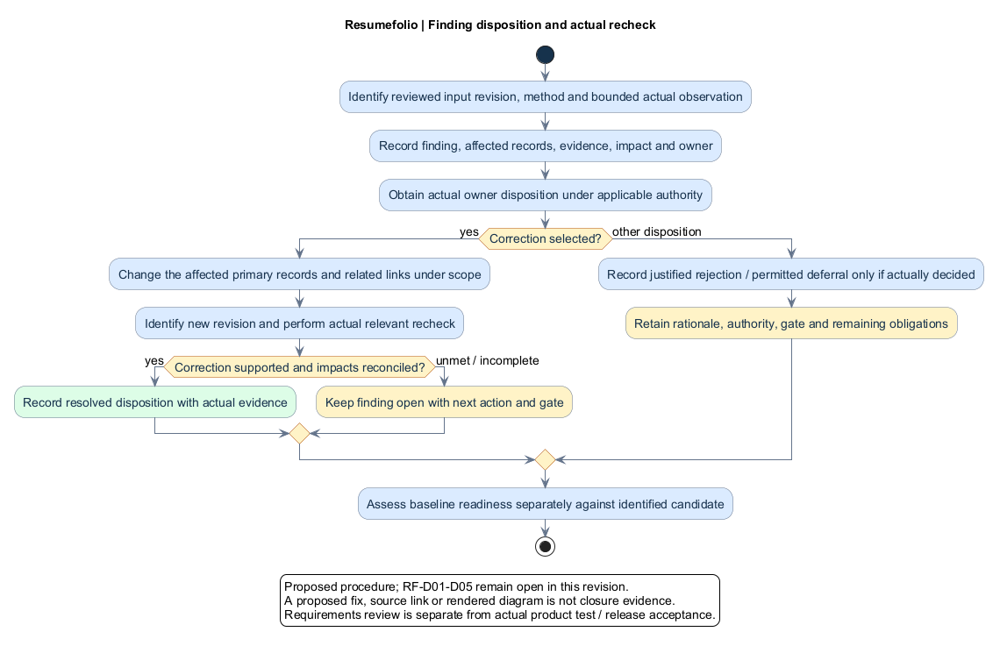

# Resumefolio — Review Plan and Findings

| Item | Current position |
|---|---|
| Owner / decision authority | Farhad Valizadegan; sole delivery and operations owner |
| Plan status | Proposed review program — owner scheduling/priorities pending |
| Actual activity | RV-D01: bounded documentary inventory and citation inspection by Codex, October 31, 2026 |
| Actual product testing / actor validation | None recorded by this activity |
| Baseline | M-02 pending; no owner acceptance decision recorded here |
| References | RV-D01 and RF-D01–RF-D05 are provisional local activity/finding references, not final global IDs |

**At a glance:** Review requirements for clarity, consistency, testability and
traceability, and validate intended outcomes with the appropriate actor/owner
perspective. Keep actual findings separate from the planned review work and later
running-product evidence. RV-D01 establishes only the documentary observations below.

[Plan](#1-proposed-review-plan) · [Checks](#2-review-method-and-evidence-contract)
· [Actual inspection](#3-actual-review-activity-rv-d01) · [Findings](#4-findings-register)
· [Disposition](#5-disposition-and-recheck-roadmap) · [Readiness](#6-readiness-and-limits)

## 1. Proposed Review Plan

Review coherent groups with their cross-cutting rules. The order below is a
suggested dependency route, not a committed schedule or an extra delivery team.
Farhad coordinates all groups; Codex assistance does not constitute independent
stakeholder approval or a second human reviewer.

| Group | Planned inputs / coverage | Method and intended output | Status / gate |
|---|---|---|---|
| Source and actor outcomes | Scope, objectives, BIZ-D/USR-D and actual elicitation sources | Source/goal reconciliation; identify missing perspectives, unjustified refinements and unresolved intent | Semantic/owner review pending; affected M-02 acceptance |
| Identity and disclosure | ACC-D, PRP-D, PDF-D, BRL-D; direct paths, source updates and owner controls | Actor/action matrix and scenario walkthroughs; resolve fields/grants/propagation/session policies | Pending; dependent access/content design |
| Applications/provider | APP-D, EGC-D and actual access findings; actual submitted history versus live source | Capture/transition/conflict/failure walkthroughs; separate user assertion, provider acceptance and actual material | Pending; GAP-D02 and affected requirements/design |
| Work/repositories | PKS-D/GIT-D; items/tasks/Sprints, real clients, current review/merge | Relationship/state and denied/concurrent-path inspection; define concrete accepted behavior | Pending; GAP-D06 and Git design/interoperability |
| Conditional execution | YML-D/EIF-D/QSR-D; isolated run, scoped secrets, limits and target approvals | Threat/control/resource and contract review; actual bounded findings later before enabling | Pending; GAP-D09 and dependent design/M-08 |
| Operation/quality/recovery | AFO-D/QSR-D/DOM-D; actual constraints, targets, coverage and restored access | Measurement/coverage/procedure review; later isolated actual verification/restoration evidence | Pending; GAP-D01/D04/D08/D10, M-03 then relevant readiness |
| Cross-set traceability | Dictionary/glossary/scenarios, IDs, exact sources and downstream artifacts | Inspect coverage/consistency and actual links; record gaps and rechecks | RV-D01 completed only for bounded structure/citations; semantic and downstream mapping pending |
| M-02 disposition | Identified candidate, resolved findings and justified follow-up | Apply baseline criteria; actual owner decision against revision | Pending; separate from code/product/release acceptance |

Use [Verification and Validation method](../01-process-and-approach/06-requirements-verification-and-validation.md),
[Baseline Criteria](../07-change-and-baseline/requirements-review-and-baseline-criteria.md)
and [Planning Gates](../../01-project-planning/10-planning-completion-criteria.md).
Inspect decisive dependency blockers early; do not wait for a linear review slot.

## 2. Review Method and Evidence Contract

| Review lens | Questions / evidence to retain |
|---|---|
| Correct source and authority | Is accepted scope distinguished from proposed detail? Are the source/date and actual actor/owner input identified? |
| Clear behavior | Are actor/context, conditions, operation and observable result explicit? Are terms consistent with the dictionary? |
| Complete relevant paths | Are normal, alternative, denied, concurrent, partial/unknown and recovery effects defined where needed? |
| Assessable quality | Are workload/environment, units, thresholds and method defined where quantitative criteria apply? |
| Authority/lifecycle | Do direct paths, references, source/history, revoked grants and retained/restored data agree? |
| Feasibility/applicability | Are actual provider/resource/license/operating findings available at the dependent gate rather than assumed? |
| Traceability/change | Can exact sources, criteria, paths and real downstream artifacts be followed both ways? What changes if the record changes? |

An actual review activity records local/final ID, purpose, input candidate/revisions,
method, actual reviewer/date, criteria, observations, evidence/limitations,
findings and responsible next action. A finding additionally needs affected record,
impact/gate, proposed response, actual disposition and recheck evidence. Do not
assign Pass, owner approval or a resolved finding because a fix is merely proposed.

## 3. Actual Review Activity: RV-D01

| Field | Actual record |
|---|---|
| Date / reviewer | October 31, 2026; Codex document inspection; no new human interview, workshop or product-test participant |
| Purpose | Populate traceability from actual primary records and explicit bundle citations; identify documentation gaps without inventing downstream evidence |
| Inputs | Current working copies of 16 specification documents, scenario set, supporting definitions, selected planning sources, baseline criteria and local backlog index |
| Revision locator | Source paths and SHA-256 byte hashes in [source inventory](evidence/traceability-source-inventory.json); no committed Git revision verified for this inspection |
| Structural method | Inspect candidate headings, source/criterion/method markers; count actual criterion bullets; parse explicit source/trace citations and scenario anchors |
| Observed inventory | 157 unique candidate records in 15 detailed drafts; 470 criterion bullets; 12 use-case/story bundles and 60 unique path anchors |
| Observed citations | 123 candidates explicitly named by bundle source/trace text; 34 not explicitly cited; broad ranges remain coarse associations |
| Focused source inspection | Local backlog states GitHub issues/board are live tracking authority; candidate IDs are provisional and detailed policies/targets remain open in primary records |
| Output | [Traceability matrix](requirements-traceability.md#7-traceability-matrix), per-file counts and local RF-D01–RF-D05 findings below |
| Not inspected / not claimed | Full semantic correctness, exhaustive source coverage, all criterion-to-path mappings, live GitHub state, design/code coverage, actual provider/server access, threat/control validation, product tests or restoration |
| Owner review / baseline | Not recorded; M-02 pending |

The JSON inventory is the durable documentary evidence locator. Its hashes
identify bytes inspected, not a frozen future working copy or replacement for
accepted planning history. The count of criteria includes conditional bullets;
presence is not acceptance-readiness. Formatting/link/diagram checks for these
new documents are editorial checks, not product verification.

## 4. Findings Register

Impact labels below identify dependent review work; they are not owner-approved
severity rankings, dates or deferrals. All findings have owner **Farhad** and
actual disposition **Open — owner decision/recheck pending**.

| Local finding | Affected records / revision | Actual method / finding | Impact / next action | Disposition / evidence |
|---|---|---|---|---|
| RF-D01 — Citation gaps | 34 candidates marked “Not explicitly cited” in the [matrix](requirements-traceability.md#7-traceability-matrix); RV-D01 source hashes | Explicit-citation inventory found no bundle source/trace citation for these candidates; not a claim they are invalid or have no possible method | Review each uncited candidate; add appropriate actual path, analysis or review linkage with rationale before claiming complete trace coverage | Open; exact records/citations in [JSON inventory](evidence/traceability-source-inventory.json) |
| RF-D02 — Coarse criterion/path mapping | 123 cited candidates and 60 broad path drafts; RV-D01 source hashes | Cited ranges associate whole candidates with bundles, not each of the 470 criterion bullets with concrete path inputs/results | Refine multi-operation bundles and allocate criterion-level links/data; assess normal/denied/failure/recovery sufficiency instead of reporting a coverage percentage | Open; [matrix semantics](requirements-traceability.md#1-purpose-and-link-semantics) and primary path/criteria text |
| RF-D03 — Provisional IDs and unresolved policies | Primary metadata/open-detail fields and local UC/ST/SCN references; RV-D01 | Source inspection confirms provisional IDs, unassigned priorities and conditional fields/grants/states/targets/lifecycle policies; structure alone cannot finalize them | Resolve acceptance-blocking policy, identity and measurable target decisions; record explicit owner disposition/gates for affected requirements | Open; [SRS gaps](../03-requirements-specification/requirements-specification.md#7-open-definitions-and-dependent-gates) and primary records |
| RF-D04 — Unassigned downstream trace links | Exact per-candidate backlog/design/code/actual product-result relationships | The local backlog describes live authority elsewhere; this activity verified no exact per-candidate downstream artifact mapping and assigned none | Inspect authoritative actual artifacts before populating PBI/design/implementation/result links; do not infer from similar names or a planning PBI mention | Open; [downstream state](requirements-traceability.md#5-backlog-design-and-verification-links) and [backlog index](../../../Project-Management/product-backlog.md) |
| RF-D05 — Acceptance and capability evidence absent from this activity | M-02 and later provider/capacity/execution/recovery/readiness decisions | RV-D01 is a documentary inspection; no actual owner baseline decision, actor validation or running-product result was performed/recorded here | Complete appropriate semantic/owner reviews and retain actual dependency/capability/restoration evidence at their separate gates | Open; RV-D01 limits and [baseline criteria](../07-change-and-baseline/requirements-review-and-baseline-criteria.md) |

RF-D03–RF-D05 consolidate already explicit pending work into review findings;
they are not newly discovered implemented defects. No finding claims all policies
were semantically audited or all product evidence searched exhaustively. Broader
semantic inspection may produce additional findings.

## 5. Disposition and Recheck Roadmap

[Scalable SVG](../diagrams/review-finding-disposition.svg) ·
[Editable PlantUML](../diagrams/review-finding-disposition.puml)

The flow is a proposed review procedure, not evidence that any current finding is
closed. A response may be correction, justified rejection or an explicit gated
deferral where permitted; each needs actual rationale/authority. Material scope,
resource/cost/delivery changes follow [Change Control](../07-change-and-baseline/change-control.md).

For a recheck, identify the changed primary record/revision, original finding,
method and actual new evidence. Confirm the intended correction and affected
cross-document impacts before recording resolution. A later owner acceptance of
known risk/deferral is not the same as a corrected technical defect.

## 6. Readiness and Limits

- [ ] Complete semantic reviews for affected requirement groups and actor goals.
- [ ] Resolve exact IDs/priorities, acceptance-blocking policies and dependency findings.
- [ ] Refine uncited/coarse coverage and actual downstream traceability.
- [ ] Record owner dispositions and actual rechecks for RF-D01–RF-D05.
- [ ] Identify the candidate and apply M-02 criteria; retain later capability/security/recovery evidence separately.

No checklist item is checked by creating these files. [Open Questions](../07-change-and-baseline/open-questions-and-decisions.md)
owns actual policy decisions, [Traceability](requirements-traceability.md) owns the
relationship map and this file owns actual review observations/dispositions.
The current activity neither approves a baseline nor authorizes product coding.

## 7. Diagram Maintenance

Keep [PlantUML](../diagrams/review-finding-disposition.puml),
[SVG](../diagrams/review-finding-disposition.svg) and
[PNG](../diagrams/review-finding-disposition.png) synchronized. Colors supplement
labels. Follow the [diagram guide](../diagrams/README.md), inspect readable flows
and verify file/section/evidence links. Save UTF-8 without BOM.

[Validation guide](README.md) · [Traceability](requirements-traceability.md)
· [Requirements index](../README.md)

## Actual Course-Alignment Review and Refinement — RV-D02

Date: November 1, 2026. Reviewer/editor: Codex. Owner: Farhad. Authority: user requested checking Requirements Engineering against the supplied course and then authorized corrections. No owner acceptance of detailed priorities or numerical policy is implied.

Inputs: extracted text of all 72 pages of FAU V02 Requirements Engineering; project SRS, primary candidate inventory, quality records, scenario narratives, elicitation log, management and baseline/readiness records. Method: course-to-document comparison, fresh candidate-ID inventory, focused semantic inspection of normal paths and open quantitative criteria, then bounded documentation refinement. This is not an exhaustive semantic audit of all 157 primary obligations or all diagrams.

Actual observations: priorities were unassigned; quantitative targets remained undefined; some normal narratives used checking instructions; mail/calendar, Sprint, Git and execution bundles combined independently refinable goals. Unique candidate IDs already existed and should be preserved. Historical RV-D01 citation counts were not a fresh semantic coverage result.

Corrections: per-candidate proposed priority/readiness view; explicit target-decision contracts with owner-confirmed absence of prior targets; rewritten normal external narratives for all 12 existing bundles; 16 operation-specific refinements; refreshed structural trace supplement. Sources/criteria and all original UC/ST/SCN identifiers are retained. Future product checks remain separate from user narratives.

Remaining: individual priority approval, exact numerical targets and behavior/security/lifecycle policies, criterion-level semantic coverage, detailed exception sufficiency, actual feasibility findings and owner baseline disposition. RF-D01–RF-D05 remain open; these edits do not automatically close them. Missing future code or executed product tests is not by itself a requirements-stage defect.

Validation evidence: [current structural refinement evidence](evidence/course-alignment-refinement.json). Historical source inventory remains unchanged. No numerical targets, product Pass, server/provider access or baseline acceptance claimed.

## Focused Documentary Recheck — RV-D03

Date: November 1, 2026. Reviewer/editor: Codex. Actual authority: the user requested correction after reviewing the UC-D02 inconsistency in this conversation.

Observed defect: UC-D02's trigger and successful result included link disablement, but its normal steps only saved PDF settings and explicitly treated link actions as separate. That narrative could not establish its stated result.

Correction: the normal configuration trigger, steps and successful result now agree. A separately triggered owner link-disable path is explicitly described inside the existing bundle, with source references, authority/preconditions, observable completion/fresh-access denial and denied/failed outcomes. No automatic coupling or new session-revocation policy is introduced. Existing diagram overview remains a goal-bundle view covering both independent actions; no diagram association or case inventory changed.

Actual recheck: inspect trigger/step/postcondition alignment, the PDF-D03/PDF-D06/ACC-D08 source obligations and preservation of existing anchors; validate local file/section links. This resolves the specific narrative mismatch in the edited working copy. It does not close broader RF findings, resolve active-session policy, execute a product test or accept the requirements baseline.

## RV-D04 — Incorporate Owner-supplied Infrastructure Observations

Date: November 1, 2026. Reviewer/editor: Codex. Inputs: owner-supplied Hetzner screenshots and SSH output in this conversation; current resource/dependency, feasibility, quality and question records. Method: extract limited observed facts, preserve units/provenance, and check that affected documents distinguish observed inventory from unverified suitability and undecided policy. Source record: [LOG-002](../02-stakeholders-and-elicitation/elicitation-log.md#log-002-owner-supplied-server-observation-record); [sanitized evidence](evidence/server-observation-2026-11-01.json).

Result: allocated resources, observed guest software and the existing deployment are documented; DEP-01 and Q-D24–Q-D27 now identify what is known and what remains. Review source links and saved-file hashes as part of this update's validation. RF-D01–RF-D05, ASM-01 capacity sufficiency, full feasibility and M-02/M-03 remain open. No fresh server access, performance test, provider check or restore was performed. Previously observed data is not claimed to remain current indefinitely.

## RV-D05 — Complete Answer Proposals and Recheck Evidence

Date: November 1, 2026. Reviewer/editor: Codex. Authority: owner requested the remaining questions be fixed/completed. Method: source-linked proposal drafting across all Q-D groups, explicit normal/denied/failure/conflict review cases, exact identifier/criterion preservation checks, current read-only SSH observations, official-source review and local-link consistency checks. Advisor preflight was unavailable; no consultation result is used.

Outputs: [review package](../07-change-and-baseline/requirements-answer-review.md), [fresh server observations](evidence/server-readonly-check-2026-11-01.json), [470 proposed criterion locators](evidence/proposed-criterion-locators.json) and 84 unexecuted review cases. All 157 priorities now have proposals; approved priorities remain Unassigned. Twenty-two questions are Answer proposed; six are Under investigation with explicit evidence gates. Parent questions and RF-D01–RF-D05 are not accepted as resolved. Core policies/targets require actual owner review; criterion-level semantic sufficiency and cross-view diagram updates remain required. No load, product-security, OAuth operation or restoration test was performed.

## RV-D06 — Operating Follow-up, Documentary Walkthrough and Capacity

November 1, 2026; Codex. Actual method: read-only SSH presence/status/metadata queries, verified public TLS, current official-source review, local backlog inspection, attempted GitHub reads, six-topic textual consistency walkthrough and actual user capacity input. Sources: [operating evidence](evidence/operating-check-2026-11-01.json), [gate assessment](remaining-gate-assessment.md) and [capacity/sizing](../../01-project-planning/11-capacity-and-preliminary-sizing.md). No mail sent, credential changed, package installed, runner enabled or restore performed. Advisor availability check remained unavailable; no advisor result is claimed.

Results narrow Q-D15/Q-D23/Q-D26/Q-D27 and answer the numerical weekly-capacity input of Q-D28. Stage mapping prevents treating an unperformed future restore/control test as a requirements draft result or requiring it to exist merely to write a requirement. Proposed policies still need actual owner review; six investigation parents and RF-D01–RF-D05 remain unclosed. The root-owned documentary walkthrough is not stakeholder validation or an exhaustive 470-criterion review. Review local links, original criterion preservation and saved hashes for this revision.

## RV-D07 — Readiness to Continue System Analysis

November 1, 2026; Codex documentary review authorized by the request to review/check/verify before continuing System Analysis. Actual work: fresh local-reference/identifier checks, source/criterion inventory checks, scope-to-context comparison, selected access/source/history/PDF boundaries, existing Q-D/gate status and current Git working state. Outputs: [bounded analysis review](../../03-system-analysis/11-model-consistency-traceability-and-review.md), [full context](../../03-system-analysis/02-system-context-and-boundaries.md) and [identified input evidence](../../03-system-analysis/evidence/context-input-review-2026-11-01.json).

Disposition: Partial; sufficient for provisional analysis continuation, not M-02/M-03 acceptance. All twelve scope catalog areas and eight interface inventory areas appear in the context; exact criterion sufficiency and remaining views are incomplete. Two context diagrams are provided with editable/rendered artifacts. No requirement IDs, primary criterion wording, Q-D parent disposition, RF closure, owner acceptance, actual service access or production setting was changed by this review. Existing policy proposals and dependency gates remain explicit.
