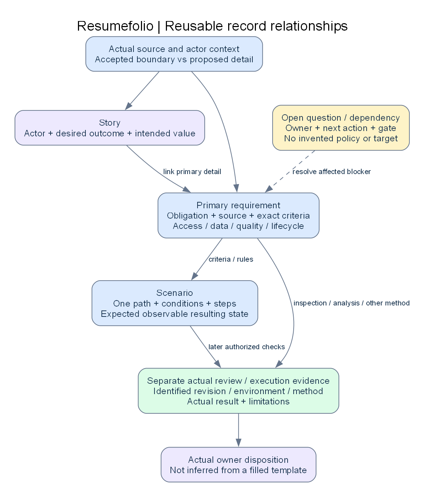

# User Story Record Template

**Status: Template only — not an allocated story, accepted requirement or completed task.**

Copy and replace `{brace placeholders}` with actual sourced information. Keep the
story centered on actor value, and link detailed behavior rather than duplicating
competing rules. A story is not automatically one task, one requirement or one test.

## 1. Story Identity and User Value

| Field | Value to complete |
|---|---|
| Story reference / title | `{final allocated reference or explicitly provisional local reference}` / `{actor outcome}` |
| Owner / actual state | `{responsible person}` / `{actual proposed/in-review/etc. state}` |
| Priority / rationale | `{justified reviewed priority or unassigned}` |
| Source / authority | `{scope/objective/DEC/user goal/actual elicitation source and exact locator; accepted boundary versus proposed interpretation}` |
| Context / beneficiary | `{actor perspective, resource context, intended value and limits}` |
| Revision | `{exact story and referenced requirement revision; no invented commit}` |

**As a** `{actor in a defined context}`, **I want** `{capability or outcome}`,
**so that** `{concrete intended value}`.

**Rationale / outcome limits:** `{problem addressed; do not claim measured productivity, hiring, delivery or business benefit without actual evidence}`

A role/perspective is not a permission set. Distinguish applicant, owner, invited
collaborator, employer viewer, administrator and operator context as appropriate;
do not invent extra staff, universal administrator powers or actor validation.

## 2. Scope and Detailed Record Links

| Relationship | Actual link or open mapping |
|---|---|
| Business/user outcome | `{exact BIZ/USR or other reviewed source reference}` |
| Primary behavior and criteria | `{exact requirement/criterion references; label coarse or unassigned mappings}` |
| Use case / scenario paths | `{goal and applicable normal/alternative/denied/failure/recovery path references}` |
| Access/lifecycle/quality/interface | `{applicable primary rules, data meaning and measurable contracts}` |
| Boundaries/exclusions | `{what the accepted source includes/conditions/excludes; changes require actual disposition}` |
| Backlog/design/implementation | `{actual verified artifact/revision or unassigned; title similarity is not traceability}` |

Stories complement the [primary specification](../03-requirements-specification/README.md).
Use the [scenario template](scenario-template.md) to elaborate paths and the
[requirement template](requirement-template.md) for detailed obligations/criteria.
Split independent outcomes if a story becomes a general module checklist.

## 3. Acceptance Criteria

Describe the observable user outcome and the relevant authority/failure boundary.
Reuse exact primary criterion references; if proposing a new criterion, mark it
proposed and reconcile it in the primary record before treating it as accepted.

| Criterion reference / source | Context / stimulus | Observable expected outcome | Related scenario / unresolved blocker |
|---|---|---|---|
| `{existing exact criterion or clearly proposed reference}` | `{Given conditions; When action/event}` | `{Then user-visible result/state or justified other observable form}` | `{particular path/analysis; undecided policy/value/owner/gate}` |

Choose relevant normal, alternative, denied, failed and recovery/correction
outcomes. Do not add invented target values or assume a single normal example
establishes coverage. Preserve actual submitted history, direct-file authority,
scoped membership and separate execution/deployment approval where applicable.

## 4. Dependencies, Questions and Refinement

| Topic | Affected outcome/criterion | Evidence / next action | Owner / gate | Actual status / decision |
|---|---|---|---|---|
| `{real Q/ASM/DEP/GAP or clearly provisional topic}` | `{missing rule, external access, resource or measurement dependency}` | `{specific clarification or controlled finding needed}` | `{person and dependent gate, not invented due date}` | `{open/proposed answer or actual disposition/evidence}` |

**Refinement needed:** `{split goals, exact fields/states/grants, variant paths, dictionary meaning and criterion granularity}`

**Planned assessment:** `{appropriate inspection/analysis/walkthrough/later test; conditions, evidence and limits}`

A scoped product inclusion is not proof of actual provider access, capacity,
safe execution or recovery. Keep dependency gates and accepted exclusions intact.
Unanswered policy questions remain acceptance blockers where they prevent a
clear assessable outcome; they are not automatic accepted deferrals.

## 5. Actual Review, Decision and Later Evidence

| Record | Actual information or explicit absence |
|---|---|
| Actual actor/owner review | `{participants/date/method/identified revision and observations; or not recorded}` |
| Findings / response / recheck | `{actual finding, owner disposition and recheck evidence; or pending}` |
| Requirement/story decision | `{actual owner outcome/rationale/revision/conditions/date; or pending}` |
| Actual product assessment | `{separate executed candidate/environment/criteria/results/evidence/limits; or not performed}` |
| Changed/superseded history | `{actual change/source, previous reference, new wording/revision and impact}` |

Completing a task, moving a card, estimating a story or rendering its diagram is
not automatic story/requirement acceptance. A proposed outcome or planned test is
not actual actor feedback or a Pass result. Requirement acceptance is separate
from release and the wider pre-implementation agreement.

## 6. Author Check and Reuse Guidance

- [ ] Actor, intended capability and value are concrete and sourced.
- [ ] Permission/resource context and relevant scope limits are explicit.
- [ ] Primary requirements/criteria and particular scenario paths are linked or visibly unassigned.
- [ ] Open questions have owner/action/gate; values, research and decisions are not invented.
- [ ] Planned assessment, actual review, product results and owner acceptance remain distinct.
- [ ] Unused placeholders are removed or justified as inapplicable before review.

[Scalable SVG](../diagrams/template-record-relationships.svg) ·
[Graphviz source](../diagrams/template-record-relationships.dot)

The reusable model imposes no one-to-one story/requirement/task relationship.
Colors supplement labels. An applicable diagram can be linked with editable source
and actual SVG/PNG output; do not invent a filename or add a model that conveys no
additional meaning.

[Requirement template](requirement-template.md) · [Scenario template](scenario-template.md)
· [User requirements](../03-requirements-specification/user-requirements.md)
· [Traceability](../06-validation-and-traceability/requirements-traceability.md)
· [Change control](../07-change-and-baseline/change-control.md)
· [Requirements index](../README.md)
