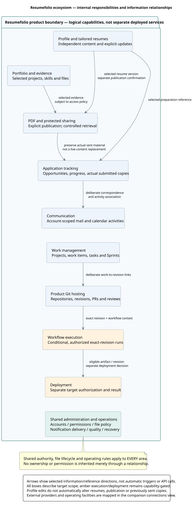
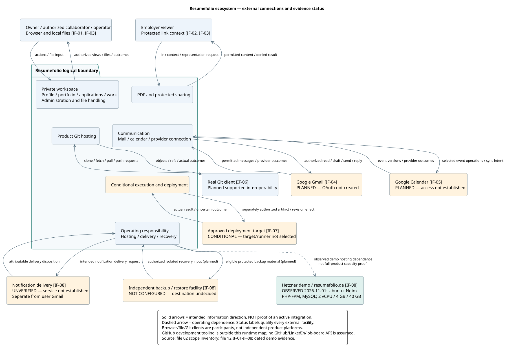
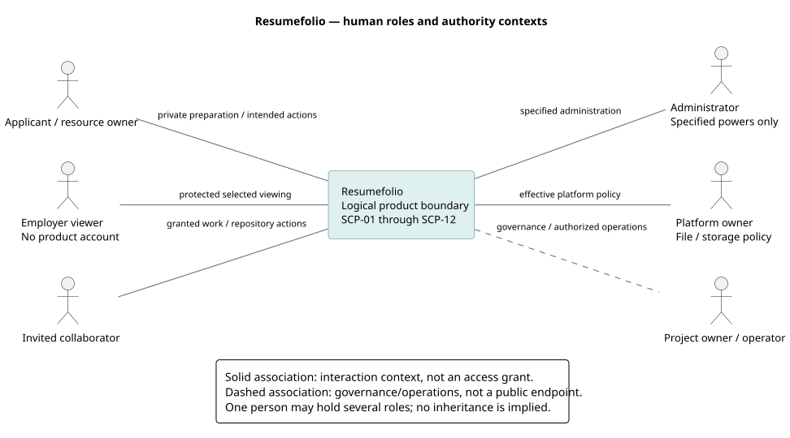
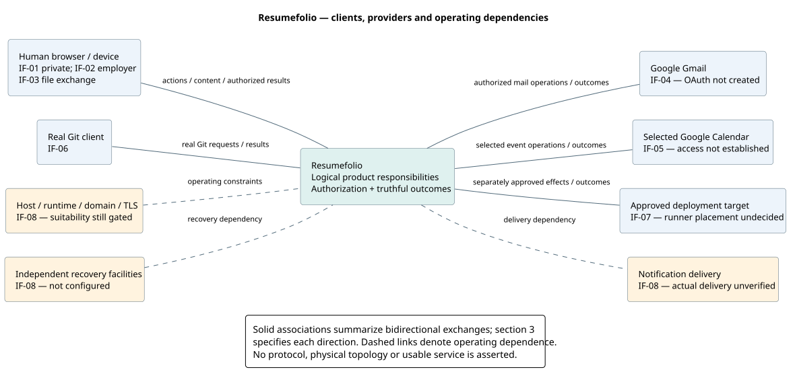
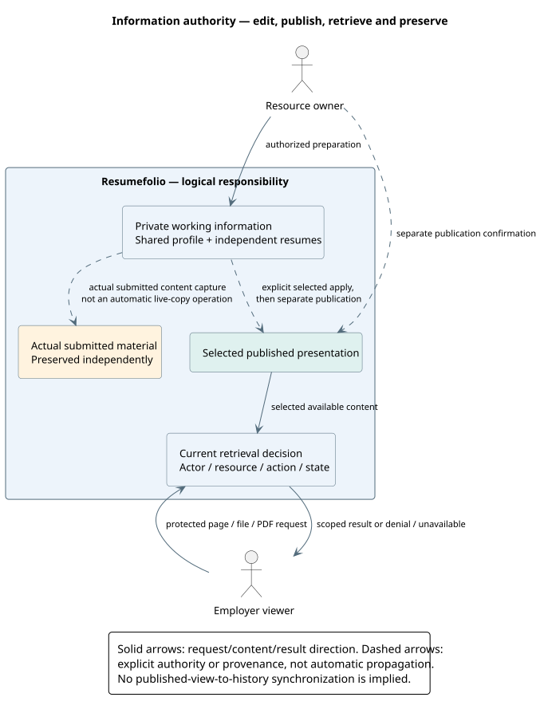
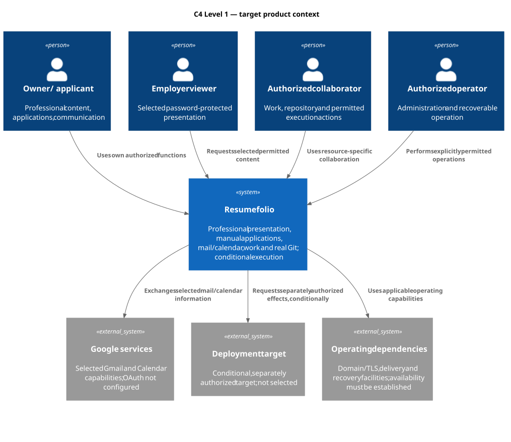
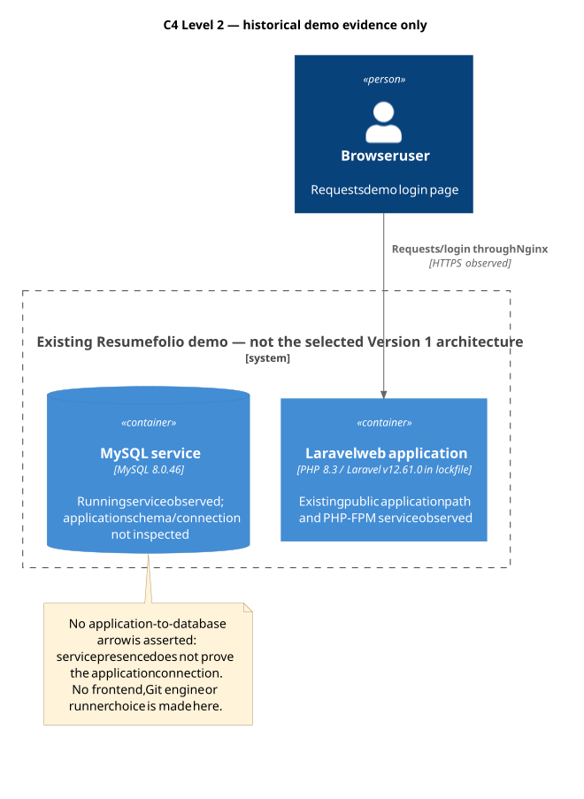

# Resumefolio — System Context and Boundaries

[Diagram types and reading guide](#diagram-types-and-reading-guide) · [Full diagram catalog](diagrams/README.md)

Owner: Farhad Valizadegan. Revision: November 1, 2026.
Status: populated full-product logical context model, with accepted scope and accepted core profile policy distinguished from proposed detailed contracts. Whole-model review and phase acceptance remain pending. This document does not establish deployment architecture or runtime access.

**Read this document for:** the product responsibility boundary, interacting roles, external exchanges, information authority and dependency limits. Use [the analysis approach](01-analysis-purpose-scope-and-approach.md) for work order and [the domain model](03-domain-model-and-object-oriented-view.md) for internal concepts.

## Ecosystem and Connected Platforms

These two coordinated views provide the whole-product map without forcing internal relationships and external exchanges into one crowded diagram. Internal areas are logical product capabilities, not separately deployed platforms. External participants include clients and operating facilities as well as provider platforms.

### Internal areas and relationships

[PlantUML source](diagrams/ecosystem-overview.puml) · [PNG](diagrams/ecosystem-overview.png)

The overview covers profile/resume, portfolio/evidence, PDF/sharing, applications, communication, work/Sprints, Git, execution, deployment and shared administration/operations. Relationship arrows show selected references or information movement; they do not create automatic synchronization or authorization. Actual submitted materials remain independent of later live changes. Shared access and lifecycle rules apply to every area, including those without a drawn cross-cutting arrow.

### External connections and current evidence

[PlantUML source](diagrams/ecosystem-platform-connections.puml) · [PNG](diagrams/ecosystem-platform-connections.png)

| Product area / participant | Detailed interface and connection status |
|---|---|
| Private workspace, administration and local files | [IF-01](12-interfaces-and-external-interactions.md#if-01), [IF-03](12-interfaces-and-external-interactions.md#if-03): intended browser/file exchanges; full Version 1 implementation is not established. |
| Employer access to selected resume, evidence and PDF | [IF-02](12-interfaces-and-external-interactions.md#if-02), [IF-03](12-interfaces-and-external-interactions.md#if-03): protected representation requests and permitted/denied results. |
| Application correspondence through communication | [IF-04](12-interfaces-and-external-interactions.md#if-04): Gmail operations and outcomes; OAuth not created. Application association does not automatically send messages. |
| Selected activities through communication | [IF-05](12-interfaces-and-external-interactions.md#if-05): Calendar operations and event/version outcomes; access not established. Local-only activities remain possible. |
| Work-linked repositories and real Git clients | [IF-06](12-interfaces-and-external-interactions.md#if-06): authorized Git exchange is planned; engine/transport is not selected. GitHub used for project development is not the product Git-hosting implementation. |
| Exact-revision execution and separate deployment | [IF-07](12-interfaces-and-external-interactions.md#if-07): conditional execution capability and independently approved target; neither runner placement nor target is selected. |
| Hosting and domain/TLS operation | [IF-08](12-interfaces-and-external-interactions.md#if-08): Hetzner demo and domain are dated observations, not validated whole-product capacity or security. |
| System notification delivery | [IF-08](12-interfaces-and-external-interactions.md#if-08): actual delivery facility unverified; do not equate it with a user's connected Gmail account. |
| Backup and isolated recovery | [IF-08](12-interfaces-and-external-interactions.md#if-08): not configured; destination and usable recovery evidence remain unresolved. No existing HA/failover is implied. |

**Source and interpretation:** the [scope inventory](#scope-coverage), the eight primary interface families carried into [file 12](12-interfaces-and-external-interactions.md#1-interface-inventory), and the [dated server observation](../02-requirements-engineering/06-validation-and-traceability/evidence/server-readonly-check-2026-11-01.json). Planned means included in the target analysis, not configured. Conditional means the dependent capability requires its gate to be satisfied. Observed means the dated demo fact only. Unknown provider choices stay unknown; no LinkedIn, job-board, GitHub or GitLab product integration is introduced by this map.

## 1. System of Interest

Resumefolio supports private professional information and independent tailored resumes, selected portfolio/evidence, generated/uploaded PDFs and protected employer sharing; manual application work with actual submitted-material history; authorized Gmail/calendar operations; work management/Sprints and real Git collaboration; conditional real YAML execution; effective file policy and recoverable operation. These capabilities are logically inside the product responsibility boundary even when a later design uses external components.

### Scope-to-responsibility Coverage

| Accepted catalog reference | Product responsibility | Exact source locators | Required distinction |
|---|---|---|---|
| SCP-01 | Identity and resource authority | DEC-028; [ACC-D01](../02-requirements-engineering/03-requirements-specification/accounts-authentication-and-permissions.md#acc-d01-individual-account-context), [ACC-D03](../02-requirements-engineering/03-requirements-specification/accounts-authentication-and-permissions.md#acc-d03-resource-and-operation-authorization), [ACC-D04](../02-requirements-engineering/03-requirements-specification/accounts-authentication-and-permissions.md#acc-d04-cross-user-private-data-isolation) | Account/private/collaboration contexts; sign-in is not a universal grant |
| SCP-02 | Shared profile and independent tailored resumes | DEC-027; [PRP-D01](../02-requirements-engineering/03-requirements-specification/profiles-resumes-and-portfolio.md#prp-d01-reusable-professional-information), [PRP-D02](../02-requirements-engineering/03-requirements-specification/profiles-resumes-and-portfolio.md#prp-d02-opportunity-specific-resume-composition), [PRP-D03](../02-requirements-engineering/03-requirements-specification/profiles-resumes-and-portfolio.md#prp-d03-independent-selections-layouts-and-overrides), [PRP-D04](../02-requirements-engineering/03-requirements-specification/profiles-resumes-and-portfolio.md#prp-d04-explicit-shared-source-update-rules) | Source information, selections/overrides and resume revisions stay distinct |
| SCP-03 | Portfolio/supporting evidence | DEC-026; [PRP-D05](../02-requirements-engineering/03-requirements-specification/profiles-resumes-and-portfolio.md#prp-d05-skill-and-project-evidence-management), [PRP-D06](../02-requirements-engineering/03-requirements-specification/profiles-resumes-and-portfolio.md#prp-d06-per-resume-evidence-selection-and-disclosure), [PRP-D09](../02-requirements-engineering/03-requirements-specification/profiles-resumes-and-portfolio.md#prp-d09-safe-content-admission-and-truthful-save-outcomes) | Externally authored content, per-resume selection and safe admission |
| SCP-04 | Generated/uploaded PDF representations | DEC-025; [PDF-D01](../02-requirements-engineering/03-requirements-specification/pdf-and-controlled-sharing.md#pdf-d01-generated-resume-pdf), [PDF-D02](../02-requirements-engineering/03-requirements-specification/pdf-and-controlled-sharing.md#pdf-d02-uploaded-pdf-and-language-identity), [PDF-D03](../02-requirements-engineering/03-requirements-specification/pdf-and-controlled-sharing.md#pdf-d03-per-resume-download-choices) | Representation provenance, language and availability are separate |
| SCP-05 | Protected employer sharing | DEC-024; [PDF-D04](../02-requirements-engineering/03-requirements-specification/pdf-and-controlled-sharing.md#pdf-d04-scoped-password-protected-employer-access), [PDF-D05](../02-requirements-engineering/03-requirements-specification/pdf-and-controlled-sharing.md#pdf-d05-direct-file-and-pdf-authorization), [PDF-D06](../02-requirements-engineering/03-requirements-specification/pdf-and-controlled-sharing.md#pdf-d06-owner-password-and-link-controls) | No viewer account; current scoped access and protected direct paths |
| SCP-06 | Manual applications and actual submitted history | DEC-023; [APP-D01](../02-requirements-engineering/03-requirements-specification/manual-application-management.md#app-d01-company-and-opportunity-context), [APP-D03](../02-requirements-engineering/03-requirements-specification/manual-application-management.md#app-d03-manually-authored-cover-letter), [APP-D05](../02-requirements-engineering/03-requirements-specification/manual-application-management.md#app-d05-user-directed-submission-recording), [APP-D06](../02-requirements-engineering/03-requirements-specification/manual-application-management.md#app-d06-preserved-actual-submitted-copies) | Manual preparation/progress; preserved actual materials are not current live views |
| SCP-07 | Gmail/calendar operations and selected synchronization | DEC-022; [EGC-D01](../02-requirements-engineering/03-requirements-specification/email-calendar-and-google-integration.md#egc-d01-authorized-connection-and-account-context), [EGC-D05](../02-requirements-engineering/03-requirements-specification/email-calendar-and-google-integration.md#egc-d05-deliberate-send-and-truthful-outcome), [EGC-D08](../02-requirements-engineering/03-requirements-specification/email-calendar-and-google-integration.md#egc-d08-explicit-synchronization-contract), [EGC-D11](../02-requirements-engineering/03-requirements-specification/email-calendar-and-google-integration.md#egc-d11-disconnect-revocation-and-reconnect) | Connected user/provider account, explicit sends, time and reconnect boundaries |
| SCP-08 | Projects, boards, items/tasks and Sprint Backlog | DEC-021; [PKS-D01](../02-requirements-engineering/03-requirements-specification/projects-kanban-and-sprints.md#pks-d01-project-and-board-context), [PKS-D03](../02-requirements-engineering/03-requirements-specification/projects-kanban-and-sprints.md#pks-d03-product-backlog-and-item-definition), [PKS-D07](../02-requirements-engineering/03-requirements-specification/projects-kanban-and-sprints.md#pks-d07-sprint-goal-and-selected-backlog-items), [PKS-D08](../02-requirements-engineering/03-requirements-specification/projects-kanban-and-sprints.md#pks-d08-one-coherent-sprint-backlog) | Resource grants; item/task distinction; one composite Sprint Backlog |
| SCP-09 | Real Git hosting and collaboration | DEC-020; [GIT-D01](../02-requirements-engineering/03-requirements-specification/git-hosting-and-collaboration.md#git-d01-repository-creation-and-ownership), [GIT-D03](../02-requirements-engineering/03-requirements-specification/git-hosting-and-collaboration.md#git-d03-real-clone-fetch-pull-and-push), [GIT-D06](../02-requirements-engineering/03-requirements-specification/git-hosting-and-collaboration.md#git-d06-pull-requests-comments-and-review), [GIT-D07](../02-requirements-engineering/03-requirements-specification/git-hosting-and-collaboration.md#git-d07-controlled-merge-and-conflict-outcomes) | Real client operations, object/ref state, review and merge |
| SCP-10 | Real YAML workflow execution and controlled deployment | DEC-019; [YML-D01](../02-requirements-engineering/03-requirements-specification/yaml-workflows-and-cicd.md#yml-d01-defined-supported-workflow-contract), [YML-D04](../02-requirements-engineering/03-requirements-specification/yaml-workflows-and-cicd.md#yml-d04-isolation-and-untrusted-code-boundary), [YML-D10](../02-requirements-engineering/03-requirements-specification/yaml-workflows-and-cicd.md#yml-d10-separate-controlled-deployment-stage), [YML-D12](../02-requirements-engineering/03-requirements-specification/yaml-workflows-and-cicd.md#yml-d12-feasibility-operational-guidance-and-enabling-gate) | Feasibility/isolation/resource gates; validation alone is not execution |
| SCP-11 | Configurable effective file/storage policy | DEC-018; [AFO-D01](../02-requirements-engineering/03-requirements-specification/administration-files-and-operational-behavior.md#afo-d01-owner-configurable-upload-and-storage-policy), [AFO-D03](../02-requirements-engineering/03-requirements-specification/administration-files-and-operational-behavior.md#afo-d03-per-file-admission-limit), [AFO-D04](../02-requirements-engineering/03-requirements-specification/administration-files-and-operational-behavior.md#afo-d04-aggregate-quota-and-concurrent-admission) | Permitted administrative changes, accounting and actual resource envelope |
| SCP-12 | Deployment and recoverable operation | DEC-017; [AFO-D12](../02-requirements-engineering/03-requirements-specification/administration-files-and-operational-behavior.md#afo-d12-version-specific-operational-guidance-and-readiness), [QSR-D10](../02-requirements-engineering/03-requirements-specification/quality-security-and-recovery-requirements.md#qsr-d10-defined-protected-and-observable-backups), [QSR-D11](../02-requirements-engineering/03-requirements-specification/quality-security-and-recovery-requirements.md#qsr-d11-demonstrated-restoration-and-recovery-targets), [QSR-D12](../02-requirements-engineering/03-requirements-specification/quality-security-and-recovery-requirements.md#qsr-d12-safe-restored-access-and-external-state-reconciliation) | Actual operating/recovery evidence at its gate; no existing backup implied |

SCP/DEC sources are in [accepted scope](../01-project-planning/02-scope.md#2-in-scope-capability-catalog). Detailed candidate requirements retain their recorded statuses; the accepted core profile-update policy is identified below. A source association is not criterion-level coverage proof or whole-specification acceptance.

## 2. Human Actors and Authority Boundaries

[PNG](diagrams/system-context-human.png) · [Editable PlantUML](diagrams/system-context-human.puml)

| Context | Requests / supplied information | Responses / result meaning | Authority limit |
|---|---|---|---|
| Registered applicant acting as resource owner | Professional content, tailoring/selection, application/cover-letter/progress, communication/work requests | Saved/denied/conflicted outcomes, own authorized views and attributable submission history | Sign-in never grants unrelated private resources; source/overrides/history are independent meanings |
| Employer viewer | Protected link/password and intended page/file/PDF requests | Only selected permitted content and available allowed representations, or denial/unavailability | No product account required; no private workspace/mail/repository rights; password is not verified employer identity |
| Invited collaborator | Authorized project/item/task/repository/review actions | Scoped work/repository results and denied/conflict outcomes | An invitation or project grant is not a private mail/resume/repository grant; evaluate the specific resource |
| Administrator | Explicit permitted account/lifecycle/operational actions | Actual administrative result and bounded attributable evidence | Role name is not a universal private-content grant; exact action matrix remains proposed |
| Platform owner | Effective file/storage policy and specified platform administration | Validated effective policy, usage/capacity feedback and denied/failed outcome | Cannot assume physical capacity or unreviewed private-data access from platform ownership |
| Project owner / operator | Governance decisions and authorized setup/maintenance/recovery work | Identified decisions, operating status and later actual verification evidence | Governance/host access is not an application role hierarchy; no extra delivery team assumed |

Source: [actor catalog](../02-requirements-engineering/02-stakeholders-and-elicitation/actors-and-system-context.md), DEC-029–DEC-032, [ACC-D03](../02-requirements-engineering/03-requirements-specification/accounts-authentication-and-permissions.md#acc-d03-resource-and-operation-authorization), [ACC-D04](../02-requirements-engineering/03-requirements-specification/accounts-authentication-and-permissions.md#acc-d04-cross-user-private-data-isolation), [ACC-D05](../02-requirements-engineering/03-requirements-specification/accounts-authentication-and-permissions.md#acc-d05-limited-collaboration-authority), [ACC-D09](../02-requirements-engineering/03-requirements-specification/accounts-authentication-and-permissions.md#acc-d09-explicit-administrative-powers), [ACC-D10](../02-requirements-engineering/03-requirements-specification/accounts-authentication-and-permissions.md#acc-d10-authorization-of-access-grant-changes). One person can hold several contexts. Diagram association lines show interaction contexts, not grants, successful execution, response direction or inherited roles. The operator's dashed relation is an operational/governance relationship, not an added public product endpoint.

## 3. External Participants, Exchanges and Dependencies

[PNG](diagrams/system-context-external.png) · [Editable PlantUML](diagrams/system-context-external.puml)

| Existing interface | Participant / boundary | Into Resumefolio | Out of Resumefolio | Source / open contract |
|---|---|---|---|---|
| IF-01 | Browser/device for human interactions | User actions and supplied content in an actor/resource context | Authorized views, validation, actual result/denial/conflict | [EIF-D01](../02-requirements-engineering/03-requirements-specification/external-interface-requirements.md#eif-d01-reviewable-interface-contracts), [EIF-D02](../02-requirements-engineering/03-requirements-specification/external-interface-requirements.md#eif-d02-clear-operable-user-interaction), [ACC-D03](../02-requirements-engineering/03-requirements-specification/accounts-authentication-and-permissions.md#acc-d03-resource-and-operation-authorization); supported clients/session rules proposed |
| IF-02 | Employer browser context | Link/password, language and content/retrieval request | Selected permitted view/artifact or denied/unavailable | [PDF-D03](../02-requirements-engineering/03-requirements-specification/pdf-and-controlled-sharing.md#pdf-d03-per-resume-download-choices), [PDF-D04](../02-requirements-engineering/03-requirements-specification/pdf-and-controlled-sharing.md#pdf-d04-scoped-password-protected-employer-access), [PDF-D05](../02-requirements-engineering/03-requirements-specification/pdf-and-controlled-sharing.md#pdf-d05-direct-file-and-pdf-authorization), [PDF-D06](../02-requirements-engineering/03-requirements-specification/pdf-and-controlled-sharing.md#pdf-d06-owner-password-and-link-controls); Q-D05/Q-D09–Q-D11 |
| IF-03 | Authorized file transfer | Evidence/PDF/asset input, metadata and replacement intent | Admission/processing state, protected retrieval and availability | [AFO-D03](../02-requirements-engineering/03-requirements-specification/administration-files-and-operational-behavior.md#afo-d03-per-file-admission-limit), [AFO-D04](../02-requirements-engineering/03-requirements-specification/administration-files-and-operational-behavior.md#afo-d04-aggregate-quota-and-concurrent-admission), [AFO-D05](../02-requirements-engineering/03-requirements-specification/administration-files-and-operational-behavior.md#afo-d05-supported-content-and-validation), [AFO-D06](../02-requirements-engineering/03-requirements-specification/administration-files-and-operational-behavior.md#afo-d06-file-resource-authorization-and-isolation), [AFO-D07](../02-requirements-engineering/03-requirements-specification/administration-files-and-operational-behavior.md#afo-d07-truthful-completion-and-interrupted-operation-handling); actual limits not inferred from disk free space |
| IF-04 | Google Gmail account/provider | Permitted message/draft data, provider confirmations/errors and access changes | Explicit authorized read/search/draft/send/reply requests | [EGC-D01](../02-requirements-engineering/03-requirements-specification/email-calendar-and-google-integration.md#egc-d01-authorized-connection-and-account-context), [EGC-D03](../02-requirements-engineering/03-requirements-specification/email-calendar-and-google-integration.md#egc-d03-read-authorized-correspondence), [EGC-D04](../02-requirements-engineering/03-requirements-specification/email-calendar-and-google-integration.md#egc-d04-manual-compose-and-draft-handling), [EGC-D05](../02-requirements-engineering/03-requirements-specification/email-calendar-and-google-integration.md#egc-d05-deliberate-send-and-truthful-outcome), [EGC-D06](../02-requirements-engineering/03-requirements-specification/email-calendar-and-google-integration.md#egc-d06-reply-context-and-conversation-association), [EGC-D11](../02-requirements-engineering/03-requirements-specification/email-calendar-and-google-integration.md#egc-d11-disconnect-revocation-and-reconnect); OAuth not created, access not established |
| IF-05 | Selected Google Calendar | Authorized event/version/time/change data and provider outcomes | Authorized selected event operations/synchronization intent | [EGC-D07](../02-requirements-engineering/03-requirements-specification/email-calendar-and-google-integration.md#egc-d07-calendar-activities-and-time-meaning), [EGC-D08](../02-requirements-engineering/03-requirements-specification/email-calendar-and-google-integration.md#egc-d08-explicit-synchronization-contract), [EGC-D11](../02-requirements-engineering/03-requirements-specification/email-calendar-and-google-integration.md#egc-d11-disconnect-revocation-and-reconnect); mapping/conflict/disconnect proposals pending review |
| IF-06 | Real Git clients | Authorized clone/fetch/pull/push and object/ref operations | Permitted repository objects/refs and rejection/conflict/completion outcomes | [GIT-D02](../02-requirements-engineering/03-requirements-specification/git-hosting-and-collaboration.md#git-d02-repository-and-ref-authorization), [GIT-D03](../02-requirements-engineering/03-requirements-specification/git-hosting-and-collaboration.md#git-d03-real-clone-fetch-pull-and-push), [EIF-D06](../02-requirements-engineering/03-requirements-specification/external-interface-requirements.md#eif-d06-real-git-client-interoperability); transport proposal is not a selected engine |
| IF-07 | Authorized execution inputs and approved deployment target | Definition/code revision, scoped authorization, target/outcome evidence where defined | Scoped run/attempt outputs and separately approved deployment effects | [YML-D01](../02-requirements-engineering/03-requirements-specification/yaml-workflows-and-cicd.md#yml-d01-defined-supported-workflow-contract), [YML-D03](../02-requirements-engineering/03-requirements-specification/yaml-workflows-and-cicd.md#yml-d03-run-identity-and-reproducible-context), [YML-D04](../02-requirements-engineering/03-requirements-specification/yaml-workflows-and-cicd.md#yml-d04-isolation-and-untrusted-code-boundary), [YML-D10](../02-requirements-engineering/03-requirements-specification/yaml-workflows-and-cicd.md#yml-d10-separate-controlled-deployment-stage), [YML-D12](../02-requirements-engineering/03-requirements-specification/yaml-workflows-and-cicd.md#yml-d12-feasibility-operational-guidance-and-enabling-gate); runner location/mechanism remains design work |
| IF-08 | Host/runtime, domain/TLS, notification delivery and independent backup facilities | Operating constraints, delivery outcomes and authorized recovery inputs | Bounded notifications/operating actions and recoverable data under defined authority | [EIF-D09](../02-requirements-engineering/03-requirements-specification/external-interface-requirements.md#eif-d09-operational-configuration-and-recovery-boundaries), [QSR-D10](../02-requirements-engineering/03-requirements-specification/quality-security-and-recovery-requirements.md#qsr-d10-defined-protected-and-observable-backups), [QSR-D11](../02-requirements-engineering/03-requirements-specification/quality-security-and-recovery-requirements.md#qsr-d11-demonstrated-restoration-and-recovery-targets), [AFO-D12](../02-requirements-engineering/03-requirements-specification/administration-files-and-operational-behavior.md#afo-d12-version-specific-operational-guidance-and-readiness); actual service/destination/operating readiness remains gated |

IF references reuse the [external interface inventory](../02-requirements-engineering/03-requirements-specification/external-interface-requirements.md); they are not newly allocated requirements. Diagram solid undirected lines summarize bidirectional domain exchanges; the table specifies each direction. Dashed lines denote operational dependence, not data flow, architecture, network paths or existing facilities. Browser/file contexts are summarized together for readability; the table retains their separate authority checks. The execution capability stays inside logical product responsibility; drawing an approved target outside does not decide where runners run.

## 4. Information Authority and Observable Outcome Rules

| Boundary / invariant | Why it matters | Source criterion / model link |
|---|---|---|
| Account context and permission remain distinct | A valid session cannot disclose unrelated private data | ACC-D03-AC01, ACC-D04-AC01; [domain model](03-domain-model-and-object-oriented-view.md) |
| Shared profile source, independent resume content and published view remain distinct | Accepted core: profile edits do not automatically change resumes or live views; preview and explicit selected application precede separately confirmed publication; preserve resume-specific content and actual submitted documents | PRP-D04-AC01; [owner-accepted policy](../02-requirements-engineering/07-change-and-baseline/open-questions-and-decisions.md#owner-accepted-profile-update-policy); other Q-D06/Q-D07 details remain proposed |
| Generated/uploaded PDFs have intended revision/language and current availability | Download mode is not authorization or proof an artifact exists | PDF-D01-AC01, PDF-D02-AC01, PDF-D03-AC01, PDF-D05-AC01 |
| Live sharing and preserved actual submitted artifacts are separate | Current source is not proof of historical submission; downloaded bytes cannot be recalled | APP-D06-AC01, PDF-D08-AC01; Q-D13/Q-D14 |
| Provider acceptance, delivery/read and unknown result remain distinct | A timeout or API success cannot silently imply an external outcome or safe resend | EGC-D05-AC01, EIF-D08-AC01 |
| Backlog item, task and composite Sprint Backlog are different | Finishing tasks or moving a card does not prove item acceptance or Sprint success | PKS-D04-AC01, PKS-D08-AC01; Q-D18/Q-D19 |
| Development GitHub tools are external delivery tools | They do not implement product Kanban/Git hosting or establish product permissions | GIT-D03-AC01; SCP-08/SCP-09 |
| Requested execution, usable isolation and target deployment are separate authorities | A push/merge or YAML validation does not grant production execution/deployment | YML-D04-AC01, YML-D10-AC01; Q-D23 |

Criterion suffixes are the existing [proposed criterion locators](../02-requirements-engineering/06-validation-and-traceability/evidence/proposed-criterion-locators.json); they identify exact primary bullets, not executed checks or finalized global numbering. Similarity of model terms alone does not establish coverage.

## 5. Exclusions, Uncertainty and Working Gates

Outside Version 1: product AI, automatic translation and automatic old-demo migration. Externally authored evidence remains supported, without an in-product video/diagram editor. Manual application recording is not automatic job-platform submission. Workflow support is not every GitHub Actions workflow. Existing demo/reference projects remain preserved and are not assumed to define the new design.

| Topic | Verified current knowledge / proposal status | Effect on continuation |
|---|---|---|
| Capacity | Owner stated 20 project hours/week; observed hosting/runtime facts have dated evidence | Continue domain analysis; do not infer workload sufficiency, numerical service promises or a final forecast |
| OAuth | Owner confirmed not created | Model provider boundary and disconnected/failure states; preserve access gate for affected acceptance/development |
| Backups | Owner confirmed not set up | Model coverage/restored-access responsibilities; actual independent storage/recovery design and later restore evidence remain required |
| Core source-update behavior | Owner accepted preview/selected apply, separate publication and preservation of resume-specific content and actual submitted materials | Use this decision directly; do not request the same acceptance again |
| Other sharing, source, language and history details | Remaining Q-D03–Q-D14 details retain their own proposal/open status; Q-D07 is only partially resolved | Do not infer acceptance of source-removal behavior, cardinalities, access powers or exact revocation timing |
| Git/CI | Real capability remains included; isolation/resource suitability is not demonstrated | Describe logical responsibilities and denied/unknown outcomes; do not enable jobs or pick a runner in this context |
| Analysis completion | Context now populated; class/data/behavior views are partial or scaffolded | Next bounded work: refine core presentation domain/data and operation/state views; cross-view completion still pending |

See [questions](../02-requirements-engineering/07-change-and-baseline/open-questions-and-decisions.md), [latest gate findings](../02-requirements-engineering/06-validation-and-traceability/remaining-gate-assessment.md) and [review evidence](11-model-consistency-traceability-and-review.md). This context has no authority to close an unresolved requirement, accepted GAP, baseline or release gate.

## 6. Logical Responsibility and Disclosure Boundaries

[PNG](diagrams/system-context-information-boundaries.png) · [Editable PlantUML](diagrams/system-context-information-boundaries.puml)

This is an information-authority view, not a database or network diagram. The enclosing box denotes product responsibilities. Internal groups are logical distinctions, not separately deployed components. Solid arrows show selected-content, request or result direction; dashed arrows identify explicit authority or captured-content provenance. They do not mean automatic propagation. Colors supplement the labels.

| Boundary | Inside product responsibility | Outside responsibility / limit |
|---|---|---|
| Private workspace → selected presentation | Maintain private content, independent tailoring, explicit publication and selected disclosure | An employer does not receive the entire profile, workspace, correspondence or repository merely by opening a link |
| Presentation → file/PDF retrieval | Check permitted resource, representation, language and availability for the current request, including direct paths | Possession of a storage URL must not substitute for the required access decision; actual transport/storage design is later work |
| Application record → actual submitted materials | Retain the identity/content of what the user actually submitted, distinct from a later live resume | Recording an application does not prove that an external platform accepted it or an employer read it |
| Connected account → provider | Submit authorized operations and describe provider-confirmed, failed or uncertain results truthfully | Product sign-in is not Google consent; provider acceptance is not recipient delivery or reading |
| Collaboration → repository/work resource | Evaluate grants for the specific project, item, repository and operation | Membership in one context does not expose unrelated resumes, mail or repositories |
| Workflow definition/code → execution authority | Treat supplied code as untrusted; define permitted effects, limits and outcomes; preserve separate deployment approval | A valid YAML file, push or successful build does not authorize privileged execution or deployment |
| Application role → operating environment | Define supported administrative powers and accountable operational responsibilities | A product role is not an SSH account; host/root access is not evidence of a product permission hierarchy |
| Running system → independent recovery | Define recoverable data, coverage and reconciliation responsibilities | A disk, snapshot label or backup schedule alone does not demonstrate independent recoverability or successful restoration |

### Accepted Profile Boundary Example

1. The owner edits shared professional information in the private workspace.
2. Existing resumes and published views remain unchanged by that edit alone.
3. The owner previews and selects which changes to apply to a particular resume. Resume-specific content is preserved.
4. Applying/saving those changes is distinct from separately confirming publication.
5. Later editing or publication does not replace actual previously submitted documents.

These five steps express the [accepted core decision](../02-requirements-engineering/07-change-and-baseline/open-questions-and-decisions.md#owner-accepted-profile-update-policy). They do not settle source deletion, exact concurrent-edit handling or all revision-retention details. Model those consequences in documents 03, 05, 06, 07 and 10 without relabeling the accepted core as a proposal.

## 7. Boundary Walkthroughs and Observable Results

The following are analysis review examples, not executed tests or newly accepted detailed policies. They show which boundary must be respected. Exact timing, retry and session rules remain owned by the primary requirements and decisions.

| Interaction | Entry and authority context | Expected boundary behavior | Related interface / next model |
|---|---|---|---|
| Owner changes PDF download settings | Authorized owner requests a setting change for one resume | Report the actual setting outcome; do not treat that operation as an implicit request to disable its sharing link | IF-01/IF-02; scenario and operation contracts |
| Owner disables an employer link | Separate authorized link-control request | Evaluate subsequent access against the link state; previously downloaded bytes cannot be recalled; treatment of already open sessions remains a policy detail | IF-02/IF-03; sharing state and rules |
| Viewer requests an unavailable German PDF | Protected viewer context with requested language/representation | Do not imply that a missing artifact exists or that automatic translation is available; expose an appropriate unavailable/denied result without unrelated content | IF-02/IF-03; representation/data and decision views |
| Collaborator requests private applicant mail | Project/repository membership with no corresponding mail authority | Deny unrelated private access; collaboration membership is insufficient | IF-01/IF-04; actor/resource permission rules |
| User sends mail and provider response is uncertain | Connected account, explicit send intent, interrupted/unknown outcome | Preserve uncertainty; do not assert delivery or blindly equate a retry with a safe new send | IF-04; interaction and provider-operation states |
| User pushes code that contains a workflow | Authorized repository operation followed by a possible execution trigger | Keep repository authorization, workflow execution authority and target deployment approval distinct | IF-06/IF-07; execution state and operation contracts |
| File admission reaches a policy/resource limit | Authorized upload plus effective file/quota constraints | Return a truthful admission/processing outcome; free disk space does not itself define the permitted upload size | IF-03/IF-08; quota rules and concurrent-operation analysis |
| Operator restores an earlier dataset | Authorized recovery action using a candidate recovery source | Review restored access, secrets and provider state before claiming safe recovery; avoid silently replaying external effects | IF-08; recovery analysis and design handoff |

## 8. Context Review, Downstream Links and Remaining Work

| Context output | Downstream use | Completion limit |
|---|---|---|
| Twelve scope responsibilities | [03 Domain model](03-domain-model-and-object-oriented-view.md), [04 Functions](04-function-oriented-view.md), [05 Data](05-data-oriented-view.md) | Inclusion is established; detailed relationships and transformations still need modeling |
| Six human authority contexts | [06 Scenarios](06-scenario-based-view.md), [09 Rules](09-rule-based-view.md), [10 Contracts](10-domain-constraints-and-operation-contracts.md) | Interaction lines do not replace the detailed permission matrix |
| Eight external-interface references | [12 Interface analysis](12-interfaces-and-external-interactions.md) | Logical exchanges do not select protocols, schemas, service purchases or runner location |
| Information and lifecycle boundaries | [07 States](07-state-based-view.md), [08 Control flow](08-control-flow-based-view.md), [13 Cross-cutting analysis](13-security-quality-and-operational-analysis.md) | Detailed transitions, error handling and operational evidence remain to be completed |
| Explicit gates and uncertainty | [11 Consistency review](11-model-consistency-traceability-and-review.md), [14 Handoff](14-feasibility-dependencies-and-design-handoff.md) | Findings need exact dispositions; context completion does not close baseline or release gates |

Review this context again when scope, an interacting participant, an authority boundary or an external exchange changes. Update the primary record first where appropriate, then synchronize tables and diagrams. Internal implementation refactoring does not automatically change this logical boundary.

**Current disposition:** the context inventory, source links, information-boundary interpretation and walkthroughs are populated. The accepted profile policy is incorporated. Remaining work concerns detailed permissions and lifecycle policies, provider/operational evidence at dependent gates, downstream model consistency and owner disposition of the complete model. No live server changes, OAuth setup, backup configuration or product implementation are performed by this document.

## Review Position

- [x] Populate full-product responsibility, actor, exchange and exclusion inventory with source references.
- [x] Check all twelve SCP and eight IF inventory entries are represented without adopting architecture.
- [x] Incorporate the accepted core profile-update policy without extending acceptance to unresolved details.
- [x] Document logical disclosure/authority boundaries and concrete boundary walkthroughs.
- [ ] Obtain whole-model owner disposition and reconcile remaining detailed policy choices.
- [ ] Complete domain/data/behavior models and exact criterion-level semantic coverage.

[System Analysis index](README.md)

## Diagram Types and Reading Guide

The first diagram models target scope. The second is an explicitly historical, partial demo container inventory, not the final product architecture. [C4 containers](https://c4model.com/diagrams/container) represent applications/data stores; deployment nodes are separate. Technology/service observations come from the [dated server record](../02-requirements-engineering/06-validation-and-traceability/evidence/server-readonly-check-2026-11-01.json). A complete target container design belongs to the design handoff; unobserved connections are not invented.

[Editable source](diagrams/c4-system-context.puml) · [PNG](diagrams/c4-system-context.png)

[Editable source](diagrams/c4-observed-demo-containers.puml) · [PNG](diagrams/c4-observed-demo-containers.png)
