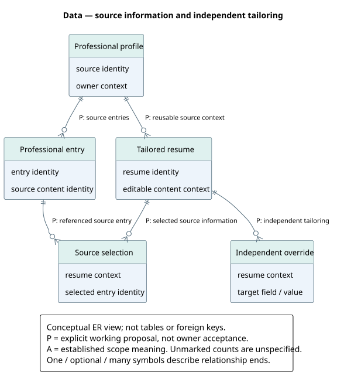
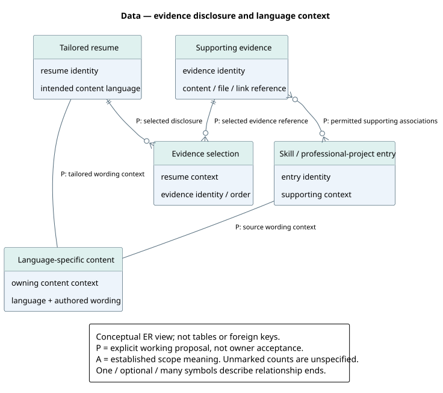
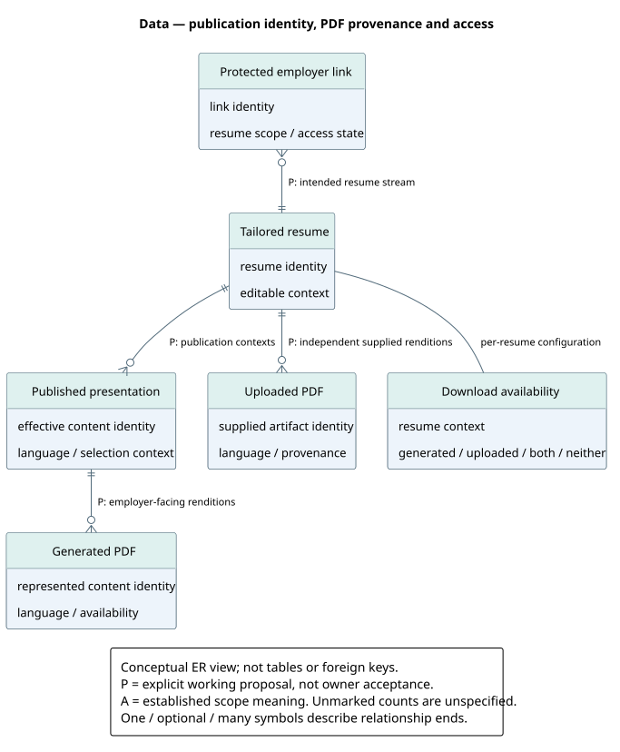
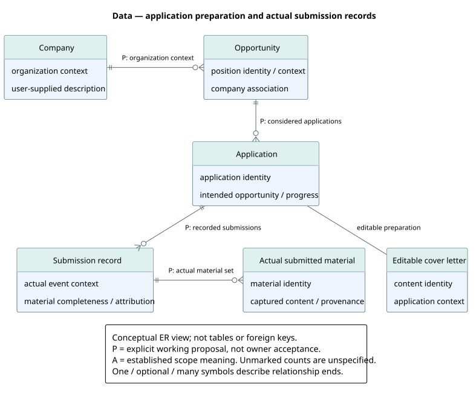
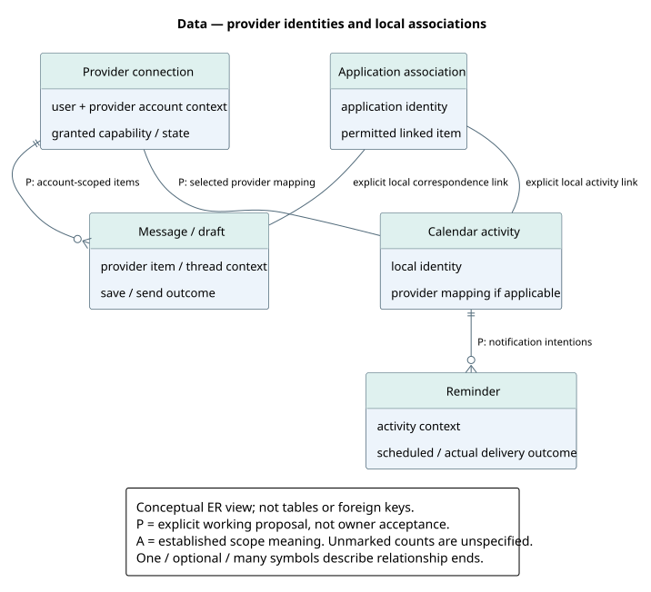
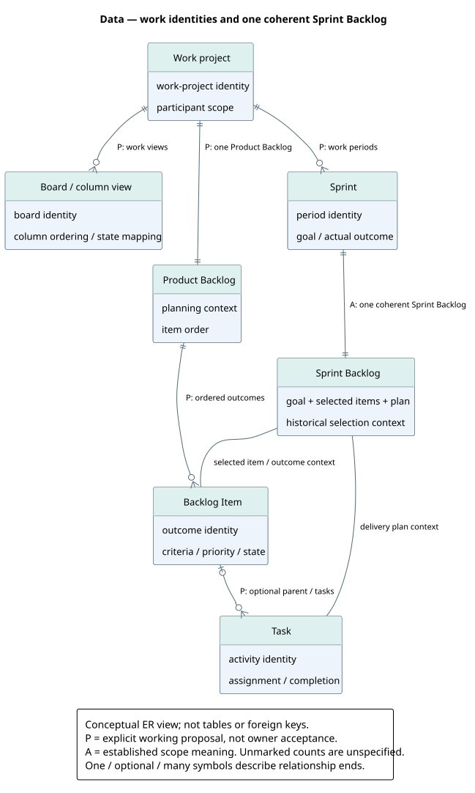
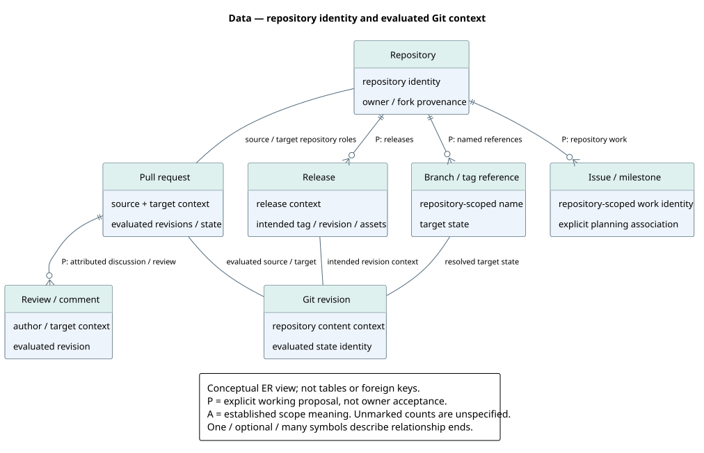
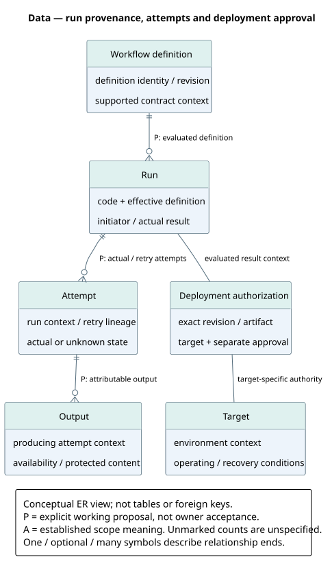
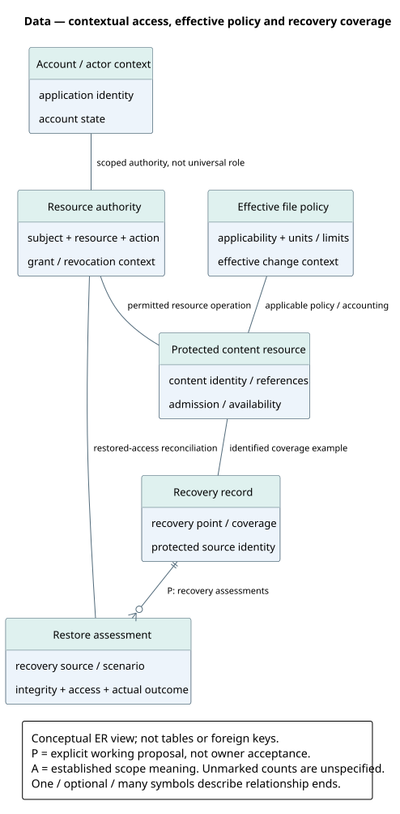

# Resumefolio — Data-Oriented View

[Diagram types and reading guide](#diagram-types-and-reading-guide) · [Full diagram catalog](diagrams/README.md)

Owner: Farhad Valizadegan. Revision: November 1, 2026.
Status: populated full-product conceptual data model. Accepted boundaries, proposed relationship bounds and dependent evidence gates are distinguished. This is not a physical schema or an accepted phase baseline.

**Purpose:** Explain what information must be distinguishable, who supplies or controls it, which relationships make it meaningful, and what must survive change. Document 03 describes domain responsibility; this view develops identity, requiredness, authority, provenance and lifecycle.

## 1. Purpose and Sources

Use the [data dictionary](../02-requirements-engineering/05-data-definitions/data-dictionary.md) and [glossary](../02-requirements-engineering/05-data-definitions/glossary.md) as terminology authorities; [document 03](03-domain-model-and-object-oriented-view.md) for the concept/responsibility model; [system context](02-system-context-and-boundaries.md) for boundaries; and [accepted scope](../01-project-planning/02-scope.md) for all twelve included areas. Exact primary requirement links accompany the catalog and ER views.

The [owner-accepted profile policy](../02-requirements-engineering/07-change-and-baseline/open-questions-and-decisions.md#owner-accepted-profile-update-policy) is settled: source edits do not automatically change existing resumes or live views; selected application is explicit and preserves independent content; publication is separately confirmed; actual submitted documents remain preserved. Earlier dictionary paragraphs listing generic propagation questions do not reopen these four accepted behaviors. Remaining details retain their status in the [question register](../02-requirements-engineering/07-change-and-baseline/open-questions-and-decisions.md) and [answer package](../02-requirements-engineering/07-change-and-baseline/requirements-answer-review.md).

Local references `DA-Sxx`, `DA-Fxx` and `DA-Ixx` identify this analysis catalog, information exchanges and integrity checks. They do not allocate primary requirements or prescribe implementation names. [Source hashes and mapping evidence](evidence/data-oriented-review-2026-11-01.json) identify this revision.

## 2. Conceptual Entity-Relationship Model

### 2.1 Reading the ER Notation and Proposal Status

| Notation / status | Interpretation |
|---|---|
| Entity rectangle | Conceptual information subject, not a mandatory relational table or persisted class |
| Two bars at an association end | Exactly one |
| Circle and bar at an association end | Zero or one |
| Circle and crow-foot at an association end | Zero or many |
| A-labeled association | Established scope meaning: one coherent Sprint Backlog per Sprint |
| P-labeled counts | Explicit working cardinality proposal from the linked answer; not owner acceptance |
| Plain association without endpoint counts | Bounds remain unspecified; absence of symbols does not imply one-to-one |
| Attributes inside an entity | Semantic properties needed for reasoning; no PK/FK, SQL type, index, identifier format or storage engine is selected |

P counts instantiate existing proposals so their consequences can be reviewed. Some zero minima interpret the proposed incomplete-draft or not-yet-executed lifecycle; these are working interpretations, not newly accepted defaults. Each figure explains its boundary. A many-ended relationship permits distinguishable associations; it does not promise unlimited quota, indefinite retention or a fixed row-per-object design.

### 2.2 source information and independent tailoring

[PNG](diagrams/data-profile-and-tailoring.png) · [Editable PlantUML](diagrams/data-profile-and-tailoring.puml)

The resume has independent identity and editable content. Source selection describes provenance; it is not permission to read a changed source value automatically. Override values belong to the intended resume. The diagram does not prescribe copying, normalization or event storage.

**Bounds and status:** P uses the Q-D06 single-profile/multiple-resume proposal. Zero selection/override rows allow an incomplete draft in the working model. Entry/selection identity and exact granularity remain proposed. Accepted Q-D07 rules prohibit automatic draft/live changes and protect independent content regardless of representation.

**Primary basis:** [PRP-D01](../02-requirements-engineering/03-requirements-specification/profiles-resumes-and-portfolio.md#prp-d01-reusable-professional-information), [PRP-D02](../02-requirements-engineering/03-requirements-specification/profiles-resumes-and-portfolio.md#prp-d02-opportunity-specific-resume-composition), [PRP-D03](../02-requirements-engineering/03-requirements-specification/profiles-resumes-and-portfolio.md#prp-d03-independent-selections-layouts-and-overrides), [PRP-D04](../02-requirements-engineering/03-requirements-specification/profiles-resumes-and-portfolio.md#prp-d04-explicit-shared-source-update-rules).

### 2.3 evidence disclosure and language context

[PNG](diagrams/data-evidence-language-and-selection.png) · [Editable PlantUML](diagrams/data-evidence-language-and-selection.puml)

Evidence existence, professional association and per-resume disclosure are separate information. Content can be text, a permitted file or a link; no file is mandatory for every evidence item. Each language value belongs to a clearly identified content context rather than a global translation record.

**Bounds and status:** P follows Q-D08/Q-D09. Several supporting associations and per-resume inclusion/order are proposed. Language-owning context is exclusive per value: the two context lines are alternatives, not a requirement to belong to both entry and resume. Their exact counts are intentionally unspecified. Missing wording/artifact is never fabricated.

**Primary basis:** [PRP-D05](../02-requirements-engineering/03-requirements-specification/profiles-resumes-and-portfolio.md#prp-d05-skill-and-project-evidence-management), [PRP-D06](../02-requirements-engineering/03-requirements-specification/profiles-resumes-and-portfolio.md#prp-d06-per-resume-evidence-selection-and-disclosure), [PRP-D07](../02-requirements-engineering/03-requirements-specification/profiles-resumes-and-portfolio.md#prp-d07-manually-maintained-english-and-german-content), [PRP-D09](../02-requirements-engineering/03-requirements-specification/profiles-resumes-and-portfolio.md#prp-d09-safe-content-admission-and-truthful-save-outcomes).

### 2.4 publication identity, PDF provenance and access

[PNG](diagrams/data-publication-pdf-and-sharing.png) · [Editable PlantUML](diagrams/data-publication-pdf-and-sharing.puml)

A link targets the intended resume/published presentation context; it is not hard-pinned to an actual submitted document. Effective publication and language are resolved under reviewed rules at retrieval. Employer-facing generated PDFs identify represented published content. Clearly labeled private draft previews can have separate draft provenance under Q-D10; this picture does not exclude them.

**Bounds and status:** P refines Q-D10/Q-D11. Zero published contexts allow never-published drafts; many denotes distinguishable publication events, not mandatory permanent retention. The diagram does not choose an effective-publication pointer or a universal single current language revision. Link multiplicity, expiry, configuration initialization and historical retention remain proposed. No extra grant follows a configuration or artifact association.

**Primary basis:** [PRP-D04](../02-requirements-engineering/03-requirements-specification/profiles-resumes-and-portfolio.md#prp-d04-explicit-shared-source-update-rules), [PRP-D08](../02-requirements-engineering/03-requirements-specification/profiles-resumes-and-portfolio.md#prp-d08-clear-presentation-and-rendition-boundaries), [PDF-D01](../02-requirements-engineering/03-requirements-specification/pdf-and-controlled-sharing.md#pdf-d01-generated-resume-pdf), [PDF-D02](../02-requirements-engineering/03-requirements-specification/pdf-and-controlled-sharing.md#pdf-d02-uploaded-pdf-and-language-identity), [PDF-D03](../02-requirements-engineering/03-requirements-specification/pdf-and-controlled-sharing.md#pdf-d03-per-resume-download-choices), [PDF-D04](../02-requirements-engineering/03-requirements-specification/pdf-and-controlled-sharing.md#pdf-d04-scoped-password-protected-employer-access), [PDF-D05](../02-requirements-engineering/03-requirements-specification/pdf-and-controlled-sharing.md#pdf-d05-direct-file-and-pdf-authorization), [PDF-D07](../02-requirements-engineering/03-requirements-specification/pdf-and-controlled-sharing.md#pdf-d07-explicit-live-revision-and-rendition-behavior).

### 2.5 application preparation and actual submission records

[PNG](diagrams/data-applications-and-actual-material.png) · [Editable PlantUML](diagrams/data-applications-and-actual-material.puml)

An application can refer to its intended editable resume/cover letter, but the submitted set identifies actual material. User-recorded submission, complete captured material and external receipt are different claims. Material provenance may be an actual upload or the exact generated rendition confirmed as submitted.

**Bounds and status:** P follows Q-D12–Q-D14. Multiple submission events/corrections are distinguishable; zero captured materials permits an explicitly incomplete record, never a successful preserved-copy claim. Cover-letter identity/count and optional association during drafts remain under primary policy. Captured bytes or exact preserved content cannot later resolve through a mutable current-resume link.

**Primary basis:** [APP-D01](../02-requirements-engineering/03-requirements-specification/manual-application-management.md#app-d01-company-and-opportunity-context), [APP-D02](../02-requirements-engineering/03-requirements-specification/manual-application-management.md#app-d02-relevant-resume-association), [APP-D03](../02-requirements-engineering/03-requirements-specification/manual-application-management.md#app-d03-manually-authored-cover-letter), [APP-D04](../02-requirements-engineering/03-requirements-specification/manual-application-management.md#app-d04-explicit-progress-states-and-transitions), [APP-D05](../02-requirements-engineering/03-requirements-specification/manual-application-management.md#app-d05-user-directed-submission-recording), [APP-D06](../02-requirements-engineering/03-requirements-specification/manual-application-management.md#app-d06-preserved-actual-submitted-copies), [APP-D07](../02-requirements-engineering/03-requirements-specification/manual-application-management.md#app-d07-correction-and-repeated-submissions), [APP-D09](../02-requirements-engineering/03-requirements-specification/manual-application-management.md#app-d09-private-access-archive-and-recovery).

### 2.6 provider identities and local associations

[PNG](diagrams/data-provider-and-calendar-context.png) · [Editable PlantUML](diagrams/data-provider-and-calendar-context.puml)

Provider item identity is scoped to its intended provider/account/type. Local notes and application associations are not provider-owned fields or access grants. Local-only activities have no invented provider identity. A request outcome may remain unknown after a timeout; absence of confirmation is not proof of a failed external effect.

**Bounds and status:** P follows Q-D15–Q-D17. Selected calendar mapping, local/provider field authority, reconnect and retention rules remain proposed. No one-to-one provider mapping is asserted where not decided. OAuth is not created; no real token, message or provider access is established by this view.

**Primary basis:** [EGC-D01](../02-requirements-engineering/03-requirements-specification/email-calendar-and-google-integration.md#egc-d01-authorized-connection-and-account-context), [EGC-D02](../02-requirements-engineering/03-requirements-specification/email-calendar-and-google-integration.md#egc-d02-justified-permissions-and-private-resource-isolation), [EGC-D05](../02-requirements-engineering/03-requirements-specification/email-calendar-and-google-integration.md#egc-d05-deliberate-send-and-truthful-outcome), [EGC-D07](../02-requirements-engineering/03-requirements-specification/email-calendar-and-google-integration.md#egc-d07-calendar-activities-and-time-meaning), [EGC-D08](../02-requirements-engineering/03-requirements-specification/email-calendar-and-google-integration.md#egc-d08-explicit-synchronization-contract), [EGC-D09](../02-requirements-engineering/03-requirements-specification/email-calendar-and-google-integration.md#egc-d09-application-relationships-preserve-boundaries), [EGC-D10](../02-requirements-engineering/03-requirements-specification/email-calendar-and-google-integration.md#egc-d10-reminders-and-notification-outcomes), [EGC-D11](../02-requirements-engineering/03-requirements-specification/email-calendar-and-google-integration.md#egc-d11-disconnect-revocation-and-reconnect), [EGC-D12](../02-requirements-engineering/03-requirements-specification/email-calendar-and-google-integration.md#egc-d12-bounded-failures-recovery-and-feasibility-evidence).

### 2.7 work identities and one coherent Sprint Backlog

[PNG](diagrams/data-work-and-sprint-planning.png) · [Editable PlantUML](diagrams/data-work-and-sprint-planning.puml)

Item identity and Sprint selection/history are distinct. Historical selection must not be reconstructed solely from whichever Sprint currently displays the item. A board/column is a view organization; its label does not establish item acceptance. Sprint Goal, selected outcomes and plan comprise one Sprint Backlog, not three competing backlogs.

**Bounds and status:** A preserves DEC-021. P follows Q-D18/Q-D19: one Product Backlog per work project, optional standalone tasks and a single parent item per task. Selection across repeated Sprints is modeled as contextual history, so no unsupported global item-to-Sprint cardinality is drawn. Fixed cadence and active-Sprint count are not accepted here.

**Primary basis:** [PKS-D01](../02-requirements-engineering/03-requirements-specification/projects-kanban-and-sprints.md#pks-d01-project-and-board-context), [PKS-D02](../02-requirements-engineering/03-requirements-specification/projects-kanban-and-sprints.md#pks-d02-configurable-columns-and-valid-work-movement), [PKS-D03](../02-requirements-engineering/03-requirements-specification/projects-kanban-and-sprints.md#pks-d03-product-backlog-and-item-definition), [PKS-D04](../02-requirements-engineering/03-requirements-specification/projects-kanban-and-sprints.md#pks-d04-item-refinement-and-task-relationships), [PKS-D05](../02-requirements-engineering/03-requirements-specification/projects-kanban-and-sprints.md#pks-d05-assignment-priority-and-due-date-handling), [PKS-D07](../02-requirements-engineering/03-requirements-specification/projects-kanban-and-sprints.md#pks-d07-sprint-goal-and-selected-backlog-items), [PKS-D08](../02-requirements-engineering/03-requirements-specification/projects-kanban-and-sprints.md#pks-d08-one-coherent-sprint-backlog), [PKS-D09](../02-requirements-engineering/03-requirements-specification/projects-kanban-and-sprints.md#pks-d09-explicit-completion-and-sprint-end-outcomes), [PKS-D10](../02-requirements-engineering/03-requirements-specification/projects-kanban-and-sprints.md#pks-d10-deliberate-cross-module-links-reports-and-automation).

### 2.8 repository identity and evaluated Git context

[PNG](diagrams/data-git-revisions-and-collaboration.png) · [Editable PlantUML](diagrams/data-git-revisions-and-collaboration.puml)

A ref name and an evaluated content revision are different data. Source and target role names must retain repository and revision context; a name alone cannot identify a reviewed change. Issue/milestone are grouped only to keep this conceptual picture compact; their separate meanings and domain IDs remain in document 03.

**Bounds and status:** P follows Q-D21/Q-D22. Fork is an explicitly related repository, not implicit shared permission. Review validity after a source/target change and release mutation are detailed policy. No Git object schema, engine, transport, revision-string format or physical duplication strategy is selected.

**Primary basis:** [GIT-D01](../02-requirements-engineering/03-requirements-specification/git-hosting-and-collaboration.md#git-d01-repository-creation-and-ownership), [GIT-D02](../02-requirements-engineering/03-requirements-specification/git-hosting-and-collaboration.md#git-d02-repository-and-ref-authorization), [GIT-D04](../02-requirements-engineering/03-requirements-specification/git-hosting-and-collaboration.md#git-d04-branches-files-and-history-browsing), [GIT-D05](../02-requirements-engineering/03-requirements-specification/git-hosting-and-collaboration.md#git-d05-fork-provenance-and-permission-boundaries), [GIT-D06](../02-requirements-engineering/03-requirements-specification/git-hosting-and-collaboration.md#git-d06-pull-requests-comments-and-review), [GIT-D07](../02-requirements-engineering/03-requirements-specification/git-hosting-and-collaboration.md#git-d07-controlled-merge-and-conflict-outcomes), [GIT-D08](../02-requirements-engineering/03-requirements-specification/git-hosting-and-collaboration.md#git-d08-issues-and-milestones), [GIT-D09](../02-requirements-engineering/03-requirements-specification/git-hosting-and-collaboration.md#git-d09-tags-and-releases), [GIT-D10](../02-requirements-engineering/03-requirements-specification/git-hosting-and-collaboration.md#git-d10-lifecycle-capacity-and-recovery).

### 2.9 run provenance, attempts and deployment approval

[PNG](diagrams/data-execution-provenance-and-targets.png) · [Editable PlantUML](diagrams/data-execution-provenance-and-targets.puml)

Code revision and definition revision are identified at the evaluated execution context, not by later reading a moving branch. Request, attempt, output availability and external deployment effect remain distinct information. Secret-use scope may be recorded as protected authority metadata; no secret values belong in this document or ordinary logs.

**Bounds and status:** P follows the Q-D23 proposal; a queued request can have no started attempt and an attempt can have no usable output. Retry lineage does not erase earlier unknown outcomes. Exact attempt/job/step decomposition and approval counts remain design/policy work. Isolation and capacity are not established by these relationships.

**Primary basis:** [YML-D01](../02-requirements-engineering/03-requirements-specification/yaml-workflows-and-cicd.md#yml-d01-defined-supported-workflow-contract), [YML-D02](../02-requirements-engineering/03-requirements-specification/yaml-workflows-and-cicd.md#yml-d02-explicit-triggers-and-run-authority), [YML-D03](../02-requirements-engineering/03-requirements-specification/yaml-workflows-and-cicd.md#yml-d03-run-identity-and-reproducible-context), [YML-D05](../02-requirements-engineering/03-requirements-specification/yaml-workflows-and-cicd.md#yml-d05-scoped-secrets-and-credentials), [YML-D07](../02-requirements-engineering/03-requirements-specification/yaml-workflows-and-cicd.md#yml-d07-truthful-run-and-step-outcomes), [YML-D08](../02-requirements-engineering/03-requirements-specification/yaml-workflows-and-cicd.md#yml-d08-restricted-logs-and-artifacts), [YML-D09](../02-requirements-engineering/03-requirements-specification/yaml-workflows-and-cicd.md#yml-d09-cancellation-retry-and-runner-loss-recovery), [YML-D10](../02-requirements-engineering/03-requirements-specification/yaml-workflows-and-cicd.md#yml-d10-separate-controlled-deployment-stage), [YML-D11](../02-requirements-engineering/03-requirements-specification/yaml-workflows-and-cicd.md#yml-d11-workspace-cleanup-and-retained-evidence), [YML-D12](../02-requirements-engineering/03-requirements-specification/yaml-workflows-and-cicd.md#yml-d12-feasibility-operational-guidance-and-enabling-gate).

### 2.10 contextual access, effective policy and recovery coverage

[PNG](diagrams/data-authority-policy-and-recovery.png) · [Editable PlantUML](diagrams/data-authority-policy-and-recovery.puml)

Authority is contextual information rather than a universal owner/admin hierarchy. Protected file/content is a logical meaning; repositories, mail attachments, job outputs and resume media need their own applicability/accounting. Recovery coverage includes related records, repositories, files and required configuration, not only the file example drawn.

**Bounds and status:** P refines Q-D24/Q-D26. No universal grant-count, quota pool, retention duration or backup topology is inferred. A recovery record is not proof of a usable restore; current access/deletion decisions and external-state effects must be reconciled. Backups are not configured.

**Primary basis:** [ACC-D03](../02-requirements-engineering/03-requirements-specification/accounts-authentication-and-permissions.md#acc-d03-resource-and-operation-authorization), [ACC-D04](../02-requirements-engineering/03-requirements-specification/accounts-authentication-and-permissions.md#acc-d04-cross-user-private-data-isolation), [ACC-D05](../02-requirements-engineering/03-requirements-specification/accounts-authentication-and-permissions.md#acc-d05-limited-collaboration-authority), [ACC-D09](../02-requirements-engineering/03-requirements-specification/accounts-authentication-and-permissions.md#acc-d09-explicit-administrative-powers), [ACC-D10](../02-requirements-engineering/03-requirements-specification/accounts-authentication-and-permissions.md#acc-d10-authorization-of-access-grant-changes), [ACC-D12](../02-requirements-engineering/03-requirements-specification/accounts-authentication-and-permissions.md#acc-d12-end-of-access-and-lifecycle-enforcement), [AFO-D01](../02-requirements-engineering/03-requirements-specification/administration-files-and-operational-behavior.md#afo-d01-owner-configurable-upload-and-storage-policy), [AFO-D02](../02-requirements-engineering/03-requirements-specification/administration-files-and-operational-behavior.md#afo-d02-policy-consistent-with-evaluated-infrastructure), [AFO-D04](../02-requirements-engineering/03-requirements-specification/administration-files-and-operational-behavior.md#afo-d04-aggregate-quota-and-concurrent-admission), [AFO-D06](../02-requirements-engineering/03-requirements-specification/administration-files-and-operational-behavior.md#afo-d06-file-resource-authorization-and-isolation), [AFO-D07](../02-requirements-engineering/03-requirements-specification/administration-files-and-operational-behavior.md#afo-d07-truthful-completion-and-interrupted-operation-handling), [AFO-D08](../02-requirements-engineering/03-requirements-specification/administration-files-and-operational-behavior.md#afo-d08-safe-replacement-and-lifecycle-effects), [QSR-D10](../02-requirements-engineering/03-requirements-specification/quality-security-and-recovery-requirements.md#qsr-d10-defined-protected-and-observable-backups), [QSR-D11](../02-requirements-engineering/03-requirements-specification/quality-security-and-recovery-requirements.md#qsr-d11-demonstrated-restoration-and-recovery-targets), [QSR-D12](../02-requirements-engineering/03-requirements-specification/quality-security-and-recovery-requirements.md#qsr-d12-safe-restored-access-and-external-state-reconciliation), [QSR-D13](../02-requirements-engineering/03-requirements-specification/quality-security-and-recovery-requirements.md#qsr-d13-useful-restricted-operational-evidence).

## 3. Data Catalogue and Flow Meaning

### 3.1 Dictionary-to-Domain Reconciliation

All 34 existing dictionary subject keys map to all 53 concepts in document 03. Grouping is deliberate: one dictionary subject can refine into several information subjects, while a domain concept can have contextual representations. This is not a one-class/one-table mapping. Application-progress, for example, refines information carried in application history without requiring a new domain class.

The catalog identifies semantic information, not a mandatory field list. Requiredness and authority depend on the claim/lifecycle in sections 4–6. Dictionary links retain each subject's primary meaning; the local IDs only support navigation within this view.

| Local subject / dictionary authority | Conceptual information and identity context | Domain references / exact primary basis |
|---|---|---|
| DA-S01 — [User account](../02-requirements-engineering/05-data-definitions/data-dictionary.md#account) | Identity context; access state. Subject identity is distinguished from mutable names, revisions and authority under section 4. | [DM-C47](03-domain-model-and-object-oriented-view.md#dm-c47); [ACC-D01](../02-requirements-engineering/03-requirements-specification/accounts-authentication-and-permissions.md#acc-d01-individual-account-context), [ACC-D02](../02-requirements-engineering/03-requirements-specification/accounts-authentication-and-permissions.md#acc-d02-unified-sign-in-across-authorized-sections), [ACC-D12](../02-requirements-engineering/03-requirements-specification/accounts-authentication-and-permissions.md#acc-d12-end-of-access-and-lifecycle-enforcement) |
| DA-S02 — [Role and permission](../02-requirements-engineering/05-data-definitions/data-dictionary.md#role-permission) | Subject; resource; allowed action/state. Subject identity is distinguished from mutable names, revisions and authority under section 4. | [DM-C48](03-domain-model-and-object-oriented-view.md#dm-c48); [ACC-D03](../02-requirements-engineering/03-requirements-specification/accounts-authentication-and-permissions.md#acc-d03-resource-and-operation-authorization), [ACC-D05](../02-requirements-engineering/03-requirements-specification/accounts-authentication-and-permissions.md#acc-d05-limited-collaboration-authority), [ACC-D09](../02-requirements-engineering/03-requirements-specification/accounts-authentication-and-permissions.md#acc-d09-explicit-administrative-powers), [ACC-D10](../02-requirements-engineering/03-requirements-specification/accounts-authentication-and-permissions.md#acc-d10-authorization-of-access-grant-changes) |
| DA-S03 — [Invitation or membership](../02-requirements-engineering/05-data-definitions/data-dictionary.md#collaboration-grant) | Subject; resource; allowed action/state. Subject identity is distinguished from mutable names, revisions and authority under section 4. | [DM-C48](03-domain-model-and-object-oriented-view.md#dm-c48); [ACC-D03](../02-requirements-engineering/03-requirements-specification/accounts-authentication-and-permissions.md#acc-d03-resource-and-operation-authorization), [ACC-D05](../02-requirements-engineering/03-requirements-specification/accounts-authentication-and-permissions.md#acc-d05-limited-collaboration-authority), [ACC-D09](../02-requirements-engineering/03-requirements-specification/accounts-authentication-and-permissions.md#acc-d09-explicit-administrative-powers), [ACC-D10](../02-requirements-engineering/03-requirements-specification/accounts-authentication-and-permissions.md#acc-d10-authorization-of-access-grant-changes) |
| DA-S04 — [External account connection](../02-requirements-engineering/05-data-definitions/data-dictionary.md#provider-connection) | Provider identity; access state. Subject identity is distinguished from mutable names, revisions and authority under section 4. | [DM-C20](03-domain-model-and-object-oriented-view.md#dm-c20); [EGC-D01](../02-requirements-engineering/03-requirements-specification/email-calendar-and-google-integration.md#egc-d01-authorized-connection-and-account-context), [EGC-D02](../02-requirements-engineering/03-requirements-specification/email-calendar-and-google-integration.md#egc-d02-justified-permissions-and-private-resource-isolation), [EGC-D11](../02-requirements-engineering/03-requirements-specification/email-calendar-and-google-integration.md#egc-d11-disconnect-revocation-and-reconnect) |
| DA-S05 — [Profile](../02-requirements-engineering/05-data-definitions/data-dictionary.md#professional-profile) | Professional sections; source context; Category; professional meaning. Subject identity is distinguished from mutable names, revisions and authority under section 4. | [DM-C01](03-domain-model-and-object-oriented-view.md#dm-c01), [DM-C02](03-domain-model-and-object-oriented-view.md#dm-c02); [PRP-D01](../02-requirements-engineering/03-requirements-specification/profiles-resumes-and-portfolio.md#prp-d01-reusable-professional-information), [PRP-D04](../02-requirements-engineering/03-requirements-specification/profiles-resumes-and-portfolio.md#prp-d04-explicit-shared-source-update-rules), [PRP-D05](../02-requirements-engineering/03-requirements-specification/profiles-resumes-and-portfolio.md#prp-d05-skill-and-project-evidence-management) |
| DA-S06 — [Resume](../02-requirements-engineering/05-data-definitions/data-dictionary.md#tailored-resume) | Content selection; layout; tailoring context; Source reference; inclusion/order; Target content; independent value; Effective content/revision context. Subject identity is distinguished from mutable names, revisions and authority under section 4. | [DM-C03](03-domain-model-and-object-oriented-view.md#dm-c03), [DM-C04](03-domain-model-and-object-oriented-view.md#dm-c04), [DM-C05](03-domain-model-and-object-oriented-view.md#dm-c05), [DM-C09](03-domain-model-and-object-oriented-view.md#dm-c09); [PRP-D02](../02-requirements-engineering/03-requirements-specification/profiles-resumes-and-portfolio.md#prp-d02-opportunity-specific-resume-composition), [PRP-D03](../02-requirements-engineering/03-requirements-specification/profiles-resumes-and-portfolio.md#prp-d03-independent-selections-layouts-and-overrides), [PRP-D04](../02-requirements-engineering/03-requirements-specification/profiles-resumes-and-portfolio.md#prp-d04-explicit-shared-source-update-rules), [PRP-D08](../02-requirements-engineering/03-requirements-specification/profiles-resumes-and-portfolio.md#prp-d08-clear-presentation-and-rendition-boundaries), [PDF-D07](../02-requirements-engineering/03-requirements-specification/pdf-and-controlled-sharing.md#pdf-d07-explicit-live-revision-and-rendition-behavior) |
| DA-S07 — [Supporting evidence](../02-requirements-engineering/05-data-definitions/data-dictionary.md#professional-evidence) | Category; supporting association; content reference; Selected evidence; disclosure intent. Subject identity is distinguished from mutable names, revisions and authority under section 4. | [DM-C06](03-domain-model-and-object-oriented-view.md#dm-c06), [DM-C07](03-domain-model-and-object-oriented-view.md#dm-c07); [PRP-D05](../02-requirements-engineering/03-requirements-specification/profiles-resumes-and-portfolio.md#prp-d05-skill-and-project-evidence-management), [PRP-D09](../02-requirements-engineering/03-requirements-specification/profiles-resumes-and-portfolio.md#prp-d09-safe-content-admission-and-truthful-save-outcomes), [PRP-D06](../02-requirements-engineering/03-requirements-specification/profiles-resumes-and-portfolio.md#prp-d06-per-resume-evidence-selection-and-disclosure) |
| DA-S08 — [Language-specific content](../02-requirements-engineering/05-data-definitions/data-dictionary.md#content-language) | Language; authored text; context. Subject identity is distinguished from mutable names, revisions and authority under section 4. | [DM-C08](03-domain-model-and-object-oriented-view.md#dm-c08); [PRP-D07](../02-requirements-engineering/03-requirements-specification/profiles-resumes-and-portfolio.md#prp-d07-manually-maintained-english-and-german-content) |
| DA-S09 — [Generated resume PDF](../02-requirements-engineering/05-data-definitions/data-dictionary.md#generated-pdf) | Represented content; language; availability. Subject identity is distinguished from mutable names, revisions and authority under section 4. | [DM-C10](03-domain-model-and-object-oriented-view.md#dm-c10); [PDF-D01](../02-requirements-engineering/03-requirements-specification/pdf-and-controlled-sharing.md#pdf-d01-generated-resume-pdf), [PDF-D07](../02-requirements-engineering/03-requirements-specification/pdf-and-controlled-sharing.md#pdf-d07-explicit-live-revision-and-rendition-behavior) |
| DA-S10 — [Uploaded resume PDF](../02-requirements-engineering/05-data-definitions/data-dictionary.md#uploaded-pdf) | Artifact identity; language; availability. Subject identity is distinguished from mutable names, revisions and authority under section 4. | [DM-C11](03-domain-model-and-object-oriented-view.md#dm-c11); [PDF-D02](../02-requirements-engineering/03-requirements-specification/pdf-and-controlled-sharing.md#pdf-d02-uploaded-pdf-and-language-identity), [PDF-D09](../02-requirements-engineering/03-requirements-specification/pdf-and-controlled-sharing.md#pdf-d09-failure-safe-processing-and-content-handling) |
| DA-S11 — [PDF download availability](../02-requirements-engineering/05-data-definitions/data-dictionary.md#download-choice) | Mode; language eligibility. Subject identity is distinguished from mutable names, revisions and authority under section 4. | [DM-C12](03-domain-model-and-object-oriented-view.md#dm-c12); [PDF-D03](../02-requirements-engineering/03-requirements-specification/pdf-and-controlled-sharing.md#pdf-d03-per-resume-download-choices) |
| DA-S12 — [Protected sharing link](../02-requirements-engineering/05-data-definitions/data-dictionary.md#employer-link) | Target context; access state; credential control. Subject identity is distinguished from mutable names, revisions and authority under section 4. | [DM-C13](03-domain-model-and-object-oriented-view.md#dm-c13); [PDF-D04](../02-requirements-engineering/03-requirements-specification/pdf-and-controlled-sharing.md#pdf-d04-scoped-password-protected-employer-access), [PDF-D06](../02-requirements-engineering/03-requirements-specification/pdf-and-controlled-sharing.md#pdf-d06-owner-password-and-link-controls) |
| DA-S13 — [Company and opportunity](../02-requirements-engineering/05-data-definitions/data-dictionary.md#company-opportunity) | Organization context; supplied details; Role context; source/deadline details. Subject identity is distinguished from mutable names, revisions and authority under section 4. | [DM-C14](03-domain-model-and-object-oriented-view.md#dm-c14), [DM-C15](03-domain-model-and-object-oriented-view.md#dm-c15); [APP-D01](../02-requirements-engineering/03-requirements-specification/manual-application-management.md#app-d01-company-and-opportunity-context) |
| DA-S14 — [Application](../02-requirements-engineering/05-data-definitions/data-dictionary.md#application-record) | Progress; intended material associations. Subject identity is distinguished from mutable names, revisions and authority under section 4. | [DM-C16](03-domain-model-and-object-oriented-view.md#dm-c16); [APP-D02](../02-requirements-engineering/03-requirements-specification/manual-application-management.md#app-d02-relevant-resume-association), [APP-D04](../02-requirements-engineering/03-requirements-specification/manual-application-management.md#app-d04-explicit-progress-states-and-transitions), [APP-D05](../02-requirements-engineering/03-requirements-specification/manual-application-management.md#app-d05-user-directed-submission-recording) |
| DA-S15 — [Cover letter](../02-requirements-engineering/05-data-definitions/data-dictionary.md#cover-letter) | Authored text; revision context. Subject identity is distinguished from mutable names, revisions and authority under section 4. | [DM-C17](03-domain-model-and-object-oriented-view.md#dm-c17); [APP-D03](../02-requirements-engineering/03-requirements-specification/manual-application-management.md#app-d03-manually-authored-cover-letter) |
| DA-S16 — [Submitted copies](../02-requirements-engineering/05-data-definitions/data-dictionary.md#submitted-materials) | Actual event context; capture completeness; Actual content/artifact; provenance. Subject identity is distinguished from mutable names, revisions and authority under section 4. | [DM-C18](03-domain-model-and-object-oriented-view.md#dm-c18), [DM-C19](03-domain-model-and-object-oriented-view.md#dm-c19); [APP-D05](../02-requirements-engineering/03-requirements-specification/manual-application-management.md#app-d05-user-directed-submission-recording), [APP-D07](../02-requirements-engineering/03-requirements-specification/manual-application-management.md#app-d07-correction-and-repeated-submissions), [APP-D06](../02-requirements-engineering/03-requirements-specification/manual-application-management.md#app-d06-preserved-actual-submitted-copies), [PDF-D08](../02-requirements-engineering/03-requirements-specification/pdf-and-controlled-sharing.md#pdf-d08-downloaded-copy-and-submission-distinctions) |
| DA-S17 — [Status/history](../02-requirements-engineering/05-data-definitions/data-dictionary.md#application-progress) | Progress; intended material associations. Subject identity is distinguished from mutable names, revisions and authority under section 4. | [DM-C16](03-domain-model-and-object-oriented-view.md#dm-c16); [APP-D02](../02-requirements-engineering/03-requirements-specification/manual-application-management.md#app-d02-relevant-resume-association), [APP-D04](../02-requirements-engineering/03-requirements-specification/manual-application-management.md#app-d04-explicit-progress-states-and-transitions), [APP-D05](../02-requirements-engineering/03-requirements-specification/manual-application-management.md#app-d05-user-directed-submission-recording) |
| DA-S18 — [Email](../02-requirements-engineering/05-data-definitions/data-dictionary.md#email-message) | Message/thread context; content; outcome. Subject identity is distinguished from mutable names, revisions and authority under section 4. | [DM-C21](03-domain-model-and-object-oriented-view.md#dm-c21); [EGC-D03](../02-requirements-engineering/03-requirements-specification/email-calendar-and-google-integration.md#egc-d03-read-authorized-correspondence), [EGC-D04](../02-requirements-engineering/03-requirements-specification/email-calendar-and-google-integration.md#egc-d04-manual-compose-and-draft-handling), [EGC-D05](../02-requirements-engineering/03-requirements-specification/email-calendar-and-google-integration.md#egc-d05-deliberate-send-and-truthful-outcome), [EGC-D06](../02-requirements-engineering/03-requirements-specification/email-calendar-and-google-integration.md#egc-d06-reply-context-and-conversation-association) |
| DA-S19 — [Calendar event](../02-requirements-engineering/05-data-definitions/data-dictionary.md#calendar-activity) | Time/zone; provider mapping if applicable. Subject identity is distinguished from mutable names, revisions and authority under section 4. | [DM-C22](03-domain-model-and-object-oriented-view.md#dm-c22); [EGC-D07](../02-requirements-engineering/03-requirements-specification/email-calendar-and-google-integration.md#egc-d07-calendar-activities-and-time-meaning), [EGC-D08](../02-requirements-engineering/03-requirements-specification/email-calendar-and-google-integration.md#egc-d08-explicit-synchronization-contract) |
| DA-S20 — [Reminder](../02-requirements-engineering/05-data-definitions/data-dictionary.md#activity-reminder) | Activity; recipient/time; outcome. Subject identity is distinguished from mutable names, revisions and authority under section 4. | [DM-C23](03-domain-model-and-object-oriented-view.md#dm-c23); [EGC-D10](../02-requirements-engineering/03-requirements-specification/email-calendar-and-google-integration.md#egc-d10-reminders-and-notification-outcomes) |
| DA-S21 — [Project, board and column](../02-requirements-engineering/05-data-definitions/data-dictionary.md#project-board) | Work identity; participant context; Displayed work; column arrangement; Label/order; state mapping meaning. Subject identity is distinguished from mutable names, revisions and authority under section 4. | [DM-C24](03-domain-model-and-object-oriented-view.md#dm-c24), [DM-C25](03-domain-model-and-object-oriented-view.md#dm-c25), [DM-C26](03-domain-model-and-object-oriented-view.md#dm-c26); [PKS-D01](../02-requirements-engineering/03-requirements-specification/projects-kanban-and-sprints.md#pks-d01-project-and-board-context), [PKS-D06](../02-requirements-engineering/03-requirements-specification/projects-kanban-and-sprints.md#pks-d06-scoped-collaboration-and-membership-changes), [PKS-D02](../02-requirements-engineering/03-requirements-specification/projects-kanban-and-sprints.md#pks-d02-configurable-columns-and-valid-work-movement) |
| DA-S22 — [Backlog item](../02-requirements-engineering/05-data-definitions/data-dictionary.md#backlog-item) | Item ordering; planning context; Outcome; priority; criteria; state. Subject identity is distinguished from mutable names, revisions and authority under section 4. | [DM-C27](03-domain-model-and-object-oriented-view.md#dm-c27), [DM-C28](03-domain-model-and-object-oriented-view.md#dm-c28); [PKS-D03](../02-requirements-engineering/03-requirements-specification/projects-kanban-and-sprints.md#pks-d03-product-backlog-and-item-definition), [PKS-D04](../02-requirements-engineering/03-requirements-specification/projects-kanban-and-sprints.md#pks-d04-item-refinement-and-task-relationships), [PKS-D09](../02-requirements-engineering/03-requirements-specification/projects-kanban-and-sprints.md#pks-d09-explicit-completion-and-sprint-end-outcomes) |
| DA-S23 — [Task](../02-requirements-engineering/05-data-definitions/data-dictionary.md#task) | Activity; assignment; due/state context. Subject identity is distinguished from mutable names, revisions and authority under section 4. | [DM-C29](03-domain-model-and-object-oriented-view.md#dm-c29); [PKS-D04](../02-requirements-engineering/03-requirements-specification/projects-kanban-and-sprints.md#pks-d04-item-refinement-and-task-relationships), [PKS-D05](../02-requirements-engineering/03-requirements-specification/projects-kanban-and-sprints.md#pks-d05-assignment-priority-and-due-date-handling) |
| DA-S24 — [Sprint and Sprint Backlog](../02-requirements-engineering/05-data-definitions/data-dictionary.md#sprint-plan) | Period; lifecycle; outcome; Goal + selected items + plan. Subject identity is distinguished from mutable names, revisions and authority under section 4. | [DM-C30](03-domain-model-and-object-oriented-view.md#dm-c30), [DM-C31](03-domain-model-and-object-oriented-view.md#dm-c31); [PKS-D07](../02-requirements-engineering/03-requirements-specification/projects-kanban-and-sprints.md#pks-d07-sprint-goal-and-selected-backlog-items), [PKS-D09](../02-requirements-engineering/03-requirements-specification/projects-kanban-and-sprints.md#pks-d09-explicit-completion-and-sprint-end-outcomes), [PKS-D08](../02-requirements-engineering/03-requirements-specification/projects-kanban-and-sprints.md#pks-d08-one-coherent-sprint-backlog) |
| DA-S25 — [Repository](../02-requirements-engineering/05-data-definitions/data-dictionary.md#git-repository) | Repository identity; owner context; refs. Subject identity is distinguished from mutable names, revisions and authority under section 4. | [DM-C32](03-domain-model-and-object-oriented-view.md#dm-c32); [GIT-D01](../02-requirements-engineering/03-requirements-specification/git-hosting-and-collaboration.md#git-d01-repository-creation-and-ownership), [GIT-D02](../02-requirements-engineering/03-requirements-specification/git-hosting-and-collaboration.md#git-d02-repository-and-ref-authorization), [GIT-D03](../02-requirements-engineering/03-requirements-specification/git-hosting-and-collaboration.md#git-d03-real-clone-fetch-pull-and-push) |
| DA-S26 — [Branch and tag](../02-requirements-engineering/05-data-definitions/data-dictionary.md#git-reference) | Name/kind; target state; Revision identity; content/history. Subject identity is distinguished from mutable names, revisions and authority under section 4. | [DM-C34](03-domain-model-and-object-oriented-view.md#dm-c34), [DM-C33](03-domain-model-and-object-oriented-view.md#dm-c33); [GIT-D02](../02-requirements-engineering/03-requirements-specification/git-hosting-and-collaboration.md#git-d02-repository-and-ref-authorization), [GIT-D04](../02-requirements-engineering/03-requirements-specification/git-hosting-and-collaboration.md#git-d04-branches-files-and-history-browsing), [GIT-D09](../02-requirements-engineering/03-requirements-specification/git-hosting-and-collaboration.md#git-d09-tags-and-releases), [YML-D03](../02-requirements-engineering/03-requirements-specification/yaml-workflows-and-cicd.md#yml-d03-run-identity-and-reproducible-context) |
| DA-S27 — [Pull request/review](../02-requirements-engineering/05-data-definitions/data-dictionary.md#pull-request) | Source/target; evaluation context; state; Author; reviewed context; decision/content. Subject identity is distinguished from mutable names, revisions and authority under section 4. | [DM-C35](03-domain-model-and-object-oriented-view.md#dm-c35), [DM-C36](03-domain-model-and-object-oriented-view.md#dm-c36); [GIT-D06](../02-requirements-engineering/03-requirements-specification/git-hosting-and-collaboration.md#git-d06-pull-requests-comments-and-review), [GIT-D07](../02-requirements-engineering/03-requirements-specification/git-hosting-and-collaboration.md#git-d07-controlled-merge-and-conflict-outcomes) |
| DA-S28 — [Issue and milestone](../02-requirements-engineering/05-data-definitions/data-dictionary.md#repository-planning) | Repository context; issue state; Checkpoint; related issue context. Subject identity is distinguished from mutable names, revisions and authority under section 4. | [DM-C37](03-domain-model-and-object-oriented-view.md#dm-c37), [DM-C38](03-domain-model-and-object-oriented-view.md#dm-c38); [GIT-D08](../02-requirements-engineering/03-requirements-specification/git-hosting-and-collaboration.md#git-d08-issues-and-milestones) |
| DA-S29 — [Repository release](../02-requirements-engineering/05-data-definitions/data-dictionary.md#release-record) | Revision/tag context; release assets. Subject identity is distinguished from mutable names, revisions and authority under section 4. | [DM-C39](03-domain-model-and-object-oriented-view.md#dm-c39); [GIT-D09](../02-requirements-engineering/03-requirements-specification/git-hosting-and-collaboration.md#git-d09-tags-and-releases) |
| DA-S30 — [YAML workflow](../02-requirements-engineering/05-data-definitions/data-dictionary.md#workflow-definition) | Definition identity; trigger/steps. Subject identity is distinguished from mutable names, revisions and authority under section 4. | [DM-C40](03-domain-model-and-object-oriented-view.md#dm-c40); [YML-D01](../02-requirements-engineering/03-requirements-specification/yaml-workflows-and-cicd.md#yml-d01-defined-supported-workflow-contract), [YML-D02](../02-requirements-engineering/03-requirements-specification/yaml-workflows-and-cicd.md#yml-d02-explicit-triggers-and-run-authority) |
| DA-S31 — [Run, result and outputs](../02-requirements-engineering/05-data-definitions/data-dictionary.md#workflow-run) | Revision/definition; initiator; result; Attempt context; state; resource use; Producing context; availability; content; Permitted use context; restriction; Target; artifact/revision; approval context; Target identity; operating constraints. Subject identity is distinguished from mutable names, revisions and authority under section 4. | [DM-C41](03-domain-model-and-object-oriented-view.md#dm-c41), [DM-C42](03-domain-model-and-object-oriented-view.md#dm-c42), [DM-C43](03-domain-model-and-object-oriented-view.md#dm-c43), [DM-C44](03-domain-model-and-object-oriented-view.md#dm-c44), [DM-C45](03-domain-model-and-object-oriented-view.md#dm-c45), [DM-C46](03-domain-model-and-object-oriented-view.md#dm-c46); [YML-D02](../02-requirements-engineering/03-requirements-specification/yaml-workflows-and-cicd.md#yml-d02-explicit-triggers-and-run-authority), [YML-D03](../02-requirements-engineering/03-requirements-specification/yaml-workflows-and-cicd.md#yml-d03-run-identity-and-reproducible-context), [YML-D07](../02-requirements-engineering/03-requirements-specification/yaml-workflows-and-cicd.md#yml-d07-truthful-run-and-step-outcomes), [YML-D09](../02-requirements-engineering/03-requirements-specification/yaml-workflows-and-cicd.md#yml-d09-cancellation-retry-and-runner-loss-recovery), [YML-D08](../02-requirements-engineering/03-requirements-specification/yaml-workflows-and-cicd.md#yml-d08-restricted-logs-and-artifacts), [YML-D11](../02-requirements-engineering/03-requirements-specification/yaml-workflows-and-cicd.md#yml-d11-workspace-cleanup-and-retained-evidence), [YML-D05](../02-requirements-engineering/03-requirements-specification/yaml-workflows-and-cicd.md#yml-d05-scoped-secrets-and-credentials), [YML-D10](../02-requirements-engineering/03-requirements-specification/yaml-workflows-and-cicd.md#yml-d10-separate-controlled-deployment-stage), [YML-D12](../02-requirements-engineering/03-requirements-specification/yaml-workflows-and-cicd.md#yml-d12-feasibility-operational-guidance-and-enabling-gate) |
| DA-S32 — [Upload/storage policy](../02-requirements-engineering/05-data-definitions/data-dictionary.md#file-policy) | Applicability; units/limits; effective context; Content identity; availability; references. Subject identity is distinguished from mutable names, revisions and authority under section 4. | [DM-C50](03-domain-model-and-object-oriented-view.md#dm-c50), [DM-C49](03-domain-model-and-object-oriented-view.md#dm-c49); [AFO-D01](../02-requirements-engineering/03-requirements-specification/administration-files-and-operational-behavior.md#afo-d01-owner-configurable-upload-and-storage-policy), [AFO-D02](../02-requirements-engineering/03-requirements-specification/administration-files-and-operational-behavior.md#afo-d02-policy-consistent-with-evaluated-infrastructure), [AFO-D04](../02-requirements-engineering/03-requirements-specification/administration-files-and-operational-behavior.md#afo-d04-aggregate-quota-and-concurrent-admission), [AFO-D03](../02-requirements-engineering/03-requirements-specification/administration-files-and-operational-behavior.md#afo-d03-per-file-admission-limit), [AFO-D05](../02-requirements-engineering/03-requirements-specification/administration-files-and-operational-behavior.md#afo-d05-supported-content-and-validation), [AFO-D06](../02-requirements-engineering/03-requirements-specification/administration-files-and-operational-behavior.md#afo-d06-file-resource-authorization-and-isolation), [AFO-D07](../02-requirements-engineering/03-requirements-specification/administration-files-and-operational-behavior.md#afo-d07-truthful-completion-and-interrupted-operation-handling) |
| DA-S33 — [Audit information](../02-requirements-engineering/05-data-definitions/data-dictionary.md#audit-event) | Actor/context; result; visibility. Subject identity is distinguished from mutable names, revisions and authority under section 4. | [DM-C51](03-domain-model-and-object-oriented-view.md#dm-c51); [AFO-D10](../02-requirements-engineering/03-requirements-specification/administration-files-and-operational-behavior.md#afo-d10-administrative-operation-evidence), [QSR-D13](../02-requirements-engineering/03-requirements-specification/quality-security-and-recovery-requirements.md#qsr-d13-useful-restricted-operational-evidence) |
| DA-S34 — [Backup/recovery information](../02-requirements-engineering/05-data-definitions/data-dictionary.md#backup-record) | Recovery point; coverage; result; Recovery source; findings; outcome. Subject identity is distinguished from mutable names, revisions and authority under section 4. | [DM-C52](03-domain-model-and-object-oriented-view.md#dm-c52), [DM-C53](03-domain-model-and-object-oriented-view.md#dm-c53); [QSR-D10](../02-requirements-engineering/03-requirements-specification/quality-security-and-recovery-requirements.md#qsr-d10-defined-protected-and-observable-backups), [QSR-D11](../02-requirements-engineering/03-requirements-specification/quality-security-and-recovery-requirements.md#qsr-d11-demonstrated-restoration-and-recovery-targets), [QSR-D12](../02-requirements-engineering/03-requirements-specification/quality-security-and-recovery-requirements.md#qsr-d12-safe-restored-access-and-external-state-reconciliation) |

### 3.2 Information Exchanges to Reconcile with Functions and Interfaces

This is an information-meaning inventory, not a balanced Data Flow Diagram. [Document 04](04-function-oriented-view.md) still needs its function decomposition/DFD work. IF labels reuse the existing interface inventory; an exchange name is not an endpoint or message schema.

| Local flow | Producer / input | Retained or consumed meaning | Output / consumer and boundary |
|---|---|---|---|
| DA-F01 Source edit | Authorized owner supplies shared information | Source content and actual save result | Saved/denied/conflict result; existing resumes/live views stay independent |
| DA-F02 Selected application | Owner previews source changes for intended resume | Selected source context plus independent content to preserve | Intended draft change only; publication remains separate |
| DA-F03 Publication | Separate owner confirmation of intended content | Effective presentation/language/selection identity | Authorized view resolves the intended published context |
| DA-F04 Admission | Authorized actual file and intended context; IF-03 | Resource/language, admission state and actual content identity | Usable availability or explicit rejected/processing/failed result |
| DA-F05 Retrieval | Protected viewer page/file/PDF request; IF-02/03 | Current authority, selected disclosure, mode/language and availability | Scoped content or denied/unavailable result; no unrelated private data |
| DA-F06 Actual capture | Owner identifies actual submission event/material | Completeness and preserved actual content/provenance | Honest history record, not proof of employer receipt/read |
| DA-F07 Gmail operation | Connected account plus explicit read/draft/send/reply intent; IF-04 | Account/item/thread, intended content and provider outcome | Permitted data or confirmed/failed/unknown result; no blind resend inference |
| DA-F08 Calendar exchange | Local intent or selected provider change; IF-05 | Time/zone, mapping, freshness/version/conflict | Identified authorized outcome; no implicit whole-account mirroring |
| DA-F09 Work update | Authorized participant changes item/task/selection | Distinct work identity, ordering/state and historical Sprint context | Actual work outcome; task/column movement is not item acceptance |
| DA-F10 Git operation | Authorized browser/client action; IF-06 | Repository/ref/evaluated revisions, source/target and actual result | Correct history/review context or rejection/conflict; no implicit deploy |
| DA-F11 Execution | Eligible authorized trigger with evaluated code/definition; IF-07 | Run/attempt, scoped resources and actual/unknown result | Restricted outputs plus separate deployment-approval context |
| DA-F12 Policy/accounting | Authorized policy change or admitted growth/removal | Effective policy and actual referenced usage | Truthful allowance/rejection/usage; no automatic history deletion for space |
| DA-F13 Recovery | Authorized candidate source and recovery scenario; IF-08 | Covered data/configuration, integrity, current access and external state | Actual restore assessment against defined expectations; no automatic replay |

## 4. Identity, Requiredness and Validation Meaning

### 4.1 Identity and Uniqueness

Keep conceptual identity separate from mutable name, revision, provenance, ownership and credentials. Human-readable titles are not assumed unique. Renaming does not silently create a different application, resume, repository or work item. Key generation/encoding and database uniqueness enforcement belong in System Design.

| Family | Identity scope / candidate uniqueness | Important counterexample or limit |
|---|---|---|
| Professional information | Profile/entry identity; resume identity independent of title/source; selection in its resume context | Two similarly named resumes remain distinct; source removal must not silently erase independent preserved content |
| Language value | Owning content context + intended language + relevant field meaning | English cannot be relabeled German; proper names need not be fabricated translations |
| File/PDF rendition | Actual content identity plus intended resume/language/provenance | Filename or language alone cannot distinguish replacement versions; a proposed checksum is not a chosen key |
| Publication | Identified effective content and selected disclosure | Current draft/live link is not the actual historical submitted document |
| Actual history | Application plus distinguishable actual event/material and correction context | Repeated company/role labels must not overwrite separate submissions |
| Provider data | Provider + selected account + item type/identifier; local association is distinct | Same raw identifier in another account/type is not the same authorized message |
| Work/Sprint | Project/item/task/Sprint identities; selected work in historical context | Card, task, item and issue are not one record; current membership does not reconstruct historical selection |
| Git | Repository/ref context, evaluated revision, explicit source/target roles | Branch name can point to changed content; issue numbers in different repositories are distinct |
| Execution | Run/attempt identity, code/definition and producing output context | Retrying does not prove the earlier unknown attempt had no effect |
| Access/recovery | Actor/resource/action context; recovery point/coverage versus restore result | Role, password, backup filename or schedule is not universal authority or recovery success |

### 4.2 Requiredness Depends on the Claim and Lifecycle

These are analytical obligations or source-backed working proposals, not a newly accepted mandatory field list. Incomplete private drafts can exist under current proposals; missing data cannot silently support a stronger publication/completion/recovery claim. Exact fields/validation follow their primary records.

| Claim / stage | Information needed to make that claim meaningful | Missing/invalid information / status |
|---|---|---|
| Saved private draft | Intended owner/subject and actual saved content state | Do not claim publication/submission; minimum fields remain Q-D06/Q-D12 proposals |
| Applied source change | Intended resume, selected preview context and independent content to preserve | Reconcile stale/conflicting input before reporting applied; accepted preservation applies |
| Published presentation | Intended separately confirmed content, language and disclosure | Do not infer confirmation from save/apply; exact completeness remains proposed |
| Available generated PDF | Represented content/revision, language, actual successful rendition and access context | Distinguish missing/processing/stale/failed; draft preview cannot masquerade as published rendition |
| Available uploaded PDF | Actual admitted file, intended resume/language and usable association | Do not fabricate absent variants or a successful failed replacement |
| Complete actual submitted set | Actual event and confirmed material with sufficient provenance | Q-D13 proposes incomplete records if files are missing; they do not satisfy preserved-copy completion |
| Provider success | Intended account/action/item and actual provider confirmation where supplied | Timeout may stay unknown; accepted request is not proof of delivery/read |
| Calendar time | Event meaning, precision and applicable zone/date context | Do not invent missing precision or unstated date/time conversions; exact semantics remain Q-D17 proposals |
| Accepted item / Sprint outcome | Criteria/acceptance and actual goal/selected-work/plan context | Completed tasks and elapsed dates cannot replace missing outcome evidence |
| Evaluated merge/run/deploy | Correct evaluated revisions/definition, actual results and separate target authority | Moving names, missing checks and unknown results are insufficient |
| Valid admission/accounting | Applicable effective policy, quantity/unit and actual references/usage | Free disk is not a safe quota; temporary/reserved/durable categories retain Q-D24 status |
| Demonstrated recovery | Identified coverage/source plus actual integrity/access/external-state findings | Backup existence/schedule is insufficient; RPO/RTO targets and evidence retain their gates |

### 4.3 Cross-cutting Dictionary Elements

| Elements | Application in this view |
|---|---|
| E01–E04 Identity, ownership, references, revision | Catalog and ER roles separate identity/control/context from mutable content |
| E05–E08 Selection, language, downloads, eligibility | Independent selection, explicit publication and current retrieval filters remain separate |
| E09–E12 Actual set, provenance, state, assignment/order | Actual material and attributed work/history cannot be reconstructed from unrelated live values |
| E13–E16 Event/recorded time, calendar time, Sprint composite, provider mapping | Preserve time/selection/mapping meaning without choosing storage representation |
| E17–E20 Sync authority, Git context, run/target context, evidence | Property/action-level authority and actual evaluated outcomes remain attributable |
| E21–E24 Usage/limits, retention, recovery coverage, RPO/RTO | Accounting, retained references and demonstrated recovery are distinct claims |

See the [24 element definitions](../02-requirements-engineering/05-data-definitions/data-dictionary.md#10-cross-cutting-element-definitions). No field length, quota value, retention period, storage type or secret value is introduced here.

## 5. Data Authority, Revision and Provenance

Authority is scoped to the information/property/action being evaluated; there is no universal source of truth for every property.

| Information | Authority / producer | Independent meaning preserved | Primary boundary |
|---|---|---|---|
| Shared information | Authorized profile owner for source content | Draft tailoring and publication do not change automatically | Accepted Q-D07 core |
| Resume tailoring | Authorized owner in intended resume context | Other resumes and independent overrides remain protected | PRP-D03/D04; accepted core plus details |
| Published view | Separate confirmation of intended presentation | Editable source/draft and actual submitted history differ | Accepted core; PDF-D07/Q-D10 details |
| Rendition | Identified generation context or actual supplied artifact | Provenance, language, availability and authority differ | PDF-D01–D03/D07; Q-D10 |
| Actual material | Identified actual content and user-recorded provenance | Later live changes do not replace it; receipt is not inferred | APP-D05–D07; accepted preservation |
| Provider fields | Selected account/provider response under reviewed mapping | Local notes/associations and permissions stay separate | EGC-D08/D09/D11; Q-D16/Q-D17 |
| Work state/selection | Authorized change and actual acceptance/outcome | Board display, task completion and historical Sprint meaning differ | PKS-D02/D04/D08/D09 |
| Git/review context | Actual repository state plus evaluation of correct revisions | Moving names cannot silently revalidate stale review | GIT-D04/D06/D07; Q-D22 |
| Run/output/deploy | Actual evaluated attempt/result plus separate target authority | Requested, started, completed and externally effective differ | YML-D03/D07–D10; Q-D23 |
| Policy/usage/recovery | Authorized effective policy and bounded observed outcome | Observation is not unlimited administrative access or future capacity proof | AFO-D02/D04; QSR-D10–D12 |

### Worked Example: Source, Draft, Live and Actual History

The labels below are synthetic navigation examples, not key formats or a storage-copy strategy.

| Event | Shared source | Resume A / Resume B | Published B | Actual submitted material |
|---|---|---|---|---|
| Initial context | Source content is identifiable | Independent content/selections exist | Prior presentation is identifiable | Actual documents are preserved |
| Owner edits source | Source changes | No automatic change | No automatic change | Unchanged |
| Owner previews changes for B | Edited source remains identifiable | Preview does not apply a change | Unchanged | Unchanged |
| Owner applies selected change to B | Applying does not edit the source | B changes as selected; A and independent text stay protected | Unchanged | Unchanged |
| Owner separately confirms publication | No automatic source effect | Draft remains distinguishable | Intended reviewed presentation becomes effective | Unchanged |
| Another actual submission is recorded | No historical replacement | Editable content stays distinct | Live view is not proof of submitted bytes | Distinguishable new event/material under Q-D13/Q-D14 proposal |

Independence is accepted; byte-copying, immutable-object storage, revision tables, retention duration and conflict algorithms are detail/design choices. They do not follow automatically from the word preserved.

## 6. Lifecycle, Access and Data Integrity

### 6.1 Reference-Aware Change and Recovery

| Operation | Data effect to analyze | Boundary that must survive | Remaining detail |
|---|---|---|---|
| Edit/rename | Change intended content/label without conflating identity | Independent tailoring, references and actual history | Validation and rename uniqueness scope |
| Unselect/unlink | Remove the intended association | Target data and unrelated selections/grants are not automatically deleted | Shared-reference/publication consequences |
| Replace file/content | Identify new admitted content and actual association outcome | Required usable/history material in other contexts | Failed replacement, stale output and retirement |
| Remove source | Evaluate references and intended state | Accepted independent resume/submitted-material preservation applies | Exact remaining Q-D07 removal rules |
| Archive/delete/purge | Distinguish visibility, references and reclamation | No unreviewed cascade or automatic history deletion for space | Q-D14/Q-D24/Q-D27 policy/applicability |
| Revoke/disconnect | Change relevant authority/capability and stale-copy status | A retained link/reference/cache does not grant access | Q-D05/Q-D11/Q-D17 session/reconnect detail |
| End Sprint/move work | Retain actual outcome/selection context | Earlier goal/items/plan are not inferred solely from current membership | Q-D19 carry-over/history proposal |
| Retry/reconcile | Distinguish attempts and actual/unknown external effects | Unknown cannot silently become no effect | Q-D16/Q-D17/Q-D23 repetition contract |
| Back up/restore | Identify point/coverage and actual findings | Current restrictions/history/external-state decisions need reconciliation | Q-D26/Q-D27 destination, targets and evidence |

Relationships do not prescribe cascade deletion, ownership transfer or wider permission. Protected direct retrieval must use current applicable authority. Legitimately delivered bytes cannot be recalled by removing a live reference. Retention/removal eligibility is not decided solely by whether a UI list still displays an item.

### 6.2 Integrity Review Conditions

These are source-derived analysis checks, not new primary requirements or executed software tests.

| Local check | Condition / review example |
|---|---|
| DA-I01 | Editing a source shared by two resumes leaves both existing drafts and live views unchanged automatically |
| DA-I02 | Selected apply and separately confirmed publication differ; independent overrides survive |
| DA-I03 | Actual submitted content/provenance does not resolve through whichever live revision exists later |
| DA-I04 | Artifact/wording retains intended owner context, language and provenance; missing content is not relabeled |
| DA-I05 | Link, membership, selection and filename do not grant unrelated resource access |
| DA-I06 | Download configuration does not imply artifact existence or request authorization |
| DA-I07 | Correction/repeated submission distinguishes prior/new context; missing material remains explicit |
| DA-I08 | Provider mapping retains account/type context and field authority; disconnect/restore does not blindly replay effects |
| DA-I09 | Effective time, recorded time, due date and precision differ; unknown precision is not fabricated |
| DA-I10 | Backlog Item, Task, Board view and Sprint outcome differ; one coherent Sprint Backlog retains context |
| DA-I11 | Review/check/run/output retain evaluated repository/revision context, not only moving ref names |
| DA-I12 | Run, attempt and target approval remain distinguishable through retry/cancellation/runner loss |
| DA-I13 | Quota/cleanup considers actual references, temporary work and retained content before claiming freed capacity |
| DA-I14 | Recovery coverage, completed backup and demonstrated safe restoration are distinct facts |

For competing source/override changes, publish/replacement, revoke/retrieval, capture/correction, provider timeout, Sprint-end movement, ref/merge changes and cleanup/restore, reuse the [domain concurrency cases](03-domain-model-and-object-oriented-view.md#5-candidate-invariants-and-concurrency-review) and develop exact pre/postconditions in [document 10](10-domain-constraints-and-operation-contracts.md). No transaction, lock, database engine or automatic conflict winner is selected here.

## 7. Coverage and Review Questions

| Accepted scope | Main information | Local coverage |
|---|---|---|
| SCP-01 Accounts/access | Account, authority, collaboration/sharing context | DA-S01–S04/S12; access/recovery ER |
| SCP-02 Profiles/resumes | Source, entry, selection, override and publication | DA-S05/S06; profile/publication ER |
| SCP-03 Evidence | Supporting material and per-resume disclosure | DA-S07; evidence ER |
| SCP-04 PDFs/language | Manual wording, generated/uploaded artifacts and mode | DA-S08–S11; evidence/publication ER |
| SCP-05 Sharing | Link scope, current authority, selected retrieval | DA-S12; publication/access ER |
| SCP-06 Applications/history | Organization/role, application, letter, progress, actual set | DA-S13–S17; application ER |
| SCP-07 Communication | Account/item mapping, message, activity, reminder | DA-S04/S18–S20; provider ER |
| SCP-08 Work | Project/board, item/task, Sprint/selection/plan | DA-S21–S24; work ER |
| SCP-09 Git | Repository, ref/revision, review, issue/milestone, release | DA-S25–S29; Git ER |
| SCP-10 Execution | Definition, code context, run/attempt/output and target authority | DA-S30/S31; execution ER |
| SCP-11 File policy | Effective policy, resource and accounting meaning | DA-S32; access/policy ER |
| SCP-12 Recovery | Specified evidence, coverage, point and restore assessment | DA-S33/S34; recovery ER |

### Actual Bounded Review Position

- [x] Populate nine locally rendered PlantUML conceptual ER views.
- [x] Map all 34 dictionary subjects to all 53 existing domain concepts, preserving primary IDs.
- [x] Distinguish accepted behavior, working cardinality proposals and unspecified counts.
- [x] Define identity/requiredness, authority/provenance, lifecycle and integrity checks.
- [x] Preserve source/draft/publication/actual-history independence in the model.
- [ ] Complete balanced function/DFD reconciliation in document 04; the exchange inventory alone does not prove balanced flows.
- [ ] Reconcile exact operation/state/rule outcomes with documents 06–10 as they are populated.
- [ ] Record owner disposition of proposed fields, cardinalities and lifecycle policies at the affected gates.
- [ ] Complete criterion-level cross-view traceability and actual dependent evidence.

Known facts remain known: OAuth is not created; backups are not configured; the observed host has 2 vCPU, 4 GB RAM and 40 GB local disk; availability is 20 project hours/week. These facts permit conceptual modeling but do not establish tested capacity, safe execution or successful recovery. Numerical file/performance/recovery proposals are not accepted by creating this view.

## 8. Handoff and Maintenance

This file is populated for analysis/review. It does not select a relational schema, physical keys, indexes, migrations, cascade strategy, blob store, provider cache, Git engine or execution topology. System Design must justify those choices against these semantics and the actual relevant constraints.

Continue with [functions/data flows](04-function-oriented-view.md), [scenarios](06-scenario-based-view.md), [states](07-state-based-view.md), [activities](08-control-flow-based-view.md), [rules](09-rule-based-view.md) and [contracts](10-domain-constraints-and-operation-contracts.md). Track findings in [11](11-model-consistency-traceability-and-review.md); interfaces and quality/operations remain in [12](12-interfaces-and-external-interactions.md) and [13](13-security-quality-and-operational-analysis.md), with qualified handoff in [14](14-feasibility-dependencies-and-design-handoff.md).

When an actual decision changes, update the primary dictionary/requirement, affected ER role/bound, identity/requiredness/provenance/lifecycle meaning and downstream references together. Do not silently accept a proposal by copying it into a diagram.

[System Analysis index](README.md) · [Domain model](03-domain-model-and-object-oriented-view.md) · [Diagram catalog](diagrams/README.md)

## Diagram Types and Reading Guide

Existing ER diagrams use explicit crow-foot relationship ends and mark proposed versus established meaning. Identity attributes are conceptual identifiers, not invented SQL primary/foreign keys. Physical tables, indexes and database-specific types remain design work. This satisfies the ERD option in the requested mapping without falsely labeling a conceptual model physical.
