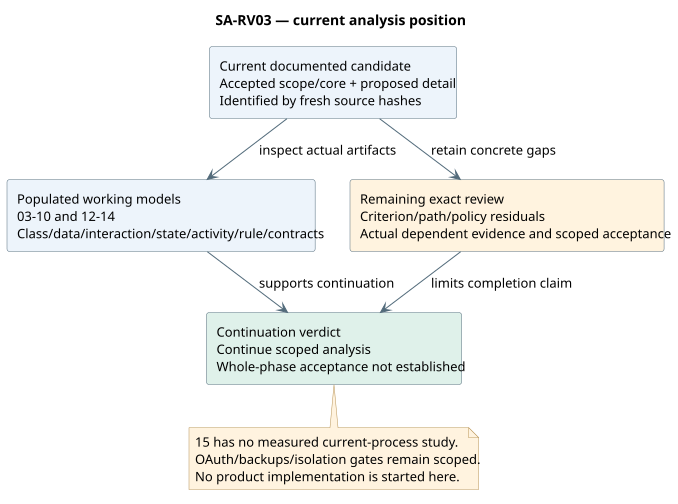
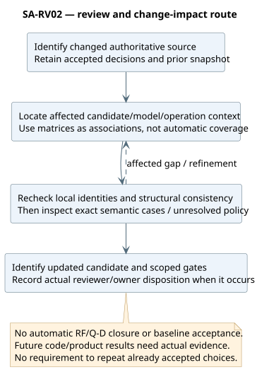
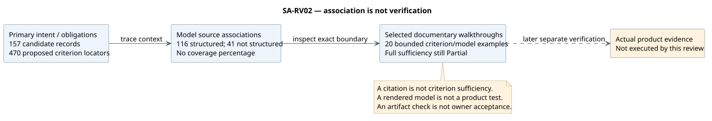
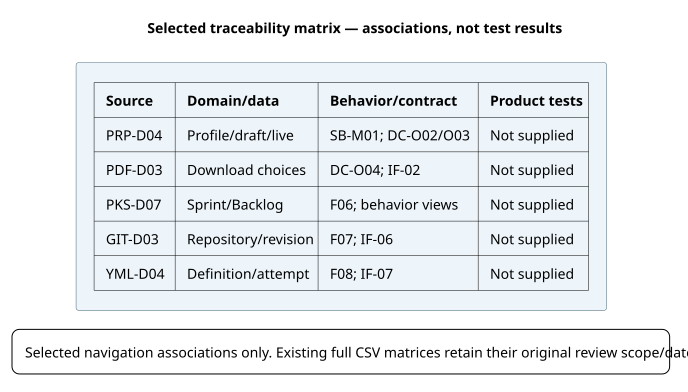

# Resumefolio — Model Consistency, Traceability and Review

Owner: Farhad Valizadegan. Review: **SA-RV03**, November 1, 2026.
Reviewer: Codex, root-owned documentary review. This is not an independent stakeholder review, security test or owner baseline acceptance.

[Current inventory](#current-model-inventory-versus-remaining-files) · [Findings](#3-material-findings-and-gates) · [Current trace register](evidence/current-criterion-trace-register-2026-11-01.csv) · [39 exact comparisons](evidence/current-selected-criterion-comparisons-2026-11-01.md)

## 1. Continuation Verdict and Limits

**Continue from the populated analysis; do not restart the folders.** All numbered documents 00–15 contain analysis content. The previous claim that 04/12–14 remained empty is superseded. Remaining work concerns exact semantic sufficiency, explicit policy and enabling evidence, not missing scaffold text.

The [accepted profile policy](../02-requirements-engineering/07-change-and-baseline/open-questions-and-decisions.md#owner-accepted-profile-update-policy) remains accepted: source edits, selected apply, separate publication and actual history are distinct. Initial planning acceptance belongs to its identified historical candidate, not later unreviewed changes. No new M-02/M-03 or product-readiness decision is made here.

## 2. Checks Performed and Result

| Check | Current result |
|---|---|
| Numbered files | All sixteen files 00–15 exist; README provides the entry point |
| Domain diagrams | Ten class views and one package view are embedded in 03 |
| Use Case ownership | 06 embeds the RE-owned overview and links all five detailed RE-owned diagrams; no duplicate authoritative Use Case source |
| Criterion source identity | All 470 locator/candidate/source/text records copied exactly from the authoritative inventory |
| Current reference indexing | 157/157 candidates explicitly linked in inspected numbered analysis documents; document references only |
| Exact current comparisons | 39 bounded documentary comparisons; each records actual model locations, a specific finding and remaining gap |
| Other criteria | 431 current source-context rows; no claim that an exact semantic comparison was performed for them in this revision |
| Prior walkthroughs | 20 preserved historical comparisons; not counted as newly performed or full coverage |
| Source protection | No primary requirement, criterion, policy or acceptance record changed |

Local links, diagram rendering and source hashes are checked for this candidate; exact totals are in [current review evidence](evidence/current-analysis-review-2026-11-01.json). Earlier state-reachability, activity-termination and rule-partition results remain historical; they were not rerun or relabeled as fresh here. No runtime, server, OAuth, load, isolation or recovery test was executed.

### Current model inventory versus remaining files

| Documents | Current position |
|---|---|
| 00–02 | Populated guide/scope/context; target context is separate from observed demo inventory |
| 03 | 53 concepts; ten UML class views and one logical package view |
| 04 | Nine function families, context/Level 1 DFDs, logical stores and selected Level 2 refinement |
| 05 | 34 data subjects and nine conceptual ER diagrams |
| 06 | 16 sequences; 12 parent and 16 operation-specific Use Case references; authoritative diagram links |
| 07–09 | State, activity and decision models populated; exact cross-view sufficiency remains bounded |
| 10 | 18 typed constraints, 39 selected contracts and eleven diagrams; long tables reformatted |
| 11 | Current source/reference review and explicit exact-criterion residuals |
| 12 | Eight interface families and 27 interaction cases; technical endpoint choices remain design work |
| 13 | 24 conditional authority records, 12 threat cases, 14 quality scenarios, nine recovery subjects and ten diagrams; no implemented HA/DR claim |
| 14 | Conditional handoff populated; earlier handoff fingerprint remains historical |
| 15 | Source-based process analysis and conditional target model; no observed As-Is business-task baseline or measured gain |

## 3. Material Findings and Gates

Local findings do not replace RF/Q-D/ASM/DEP authority. Updating a documentary description does not close a parent finding or accept a proposed policy.

### SA-F01 — Population finding superseded; semantic review remains

**Evidence:** 04 now has functional decomposition and balanced DFDs; 12 has interface contracts; 13 has authority/trust/quality/recovery views; 14 has conditional handoff. 15 is populated source-based analysis but no observed business-task baseline.

**Next action:** Review exact cross-view meaning; do not describe these documents as empty or infer actual measured bottlenecks.

**Parent context:** RF-D02 RF-D03 RF-D05.

### SA-F02 — Current reference inventory refreshed

**Evidence:** 157 of 157 candidates have an explicit primary-candidate link in inspected numbered analysis documents excluding this review. This is a document-reference inventory, not the older structured-model association metric.

**Next action:** Use current criterion register to locate sources; do not equate document references with semantic coverage or compare this number directly with historical 116/41.

**Parent context:** RF-D01 RF-D02.

### SA-F03 — Exact semantic sufficiency remains explicitly partial

**Evidence:** All 470 exact locators are indexed against current source references. Thirty-nine criteria have current bounded documentary comparisons with a named residual. Twenty earlier walkthroughs are retained as historical evidence, not silently revalidated.

**Next action:** Complete remaining exact comparisons and residual cases; see the current trace register. No row is product-verified or fully closed.

**Parent context:** RF-D02 RF-D04 RF-D05.

### SA-F04 — Accepted core retained; source wording scope unchanged

**Evidence:** Explicit source/apply/publication/history behavior remains accepted. This review does not reissue primary source wording or accept proposed source-removal/concurrency details.

**Next action:** Resolve any conflicting primary wording through its authoritative change process; do not re-ask acceptance of the bounded core.

**Parent context:** RF-D03 Q-D07.

### SA-F05 — Concrete path/policy gaps retained

**Evidence:** Password rotation lacks a complete dedicated contract for fresh old/current-password behavior; in-flight/session treatment remains open. Git-client conflict paths, concurrent quota interleavings and category-specific lifecycle cases retain explicit limits.

**Next action:** Use exact residuals in current criterion comparisons; no invented role, timeout, retention period, execution technology or automatic retry.

**Parent context:** RF-D02 RF-D03 Q-D05 Q-D11 Q-D14 Q-D18.

### SA-F06 — Dependent evidence gates retained

**Evidence:** Owner inputs remain 20 hours/week, OAuth not created and backups not configured. Historical demo resources do not prove HA/DR, load capacity, isolation or usable recovery.

**Next action:** Continue independent design work; obtain affected enabling evidence before claiming dependent capability readiness.

**Parent context:** RF-D05 Q-D15 Q-D23 Q-D25 Q-D26 Q-D27.

### SA-F07 — Historical source identities explicitly separated

**Evidence:** Earlier derivation/review/handoff hashes identify their original inputs, not this revised folder. This review records current input and output identities without overwriting those snapshots.

**Next action:** Use the new review snapshot for this revision and preserve old evidence as historical; actual owner acceptance is separate.

**Parent context:** RBC-D01.

### SA-F08 — Stale current-state report corrected locally

**Evidence:** SA-RV02 report and diagram described files 04/12–14 as scaffolds. The main report and position diagram now reflect populated artifacts.

**Next action:** Use SA-RV03 and its bounded checks; no parent finding, milestone or owner decision is automatically closed.

**Parent context:** RF-D05.

[PlantUML](diagrams/review-current-position.puml) · [PNG](diagrams/review-current-position.png)

## 4. Context Trace Examples

The [current selected comparisons](evidence/current-selected-criterion-comparisons-2026-11-01.md) identify 39 exact criteria from permissions/privacy, file admission, real Git, PDF/sharing, accepted profile behavior, backup/recovery and execution isolation. Every comparison retains a specific residual. For example, PDF-D06-AC03 exposes the missing dedicated password-rotation contract; a broad threat case alone does not satisfy it.

### Reading the downloadable matrices

- [Current 470-row criterion register](evidence/current-criterion-trace-register-2026-11-01.csv): exact text, current candidate-document references, selected model locations where reviewed, disposition and residual.
- [Current 39 exact comparisons](evidence/current-selected-criterion-comparisons-2026-11-01.md): readable record of findings and gaps.
- [Historical 157-candidate model matrix](evidence/requirements-to-analysis-associations-2026-11-01.csv): earlier structured model associations; its 116/41 counts are not current counts.
- [Historical 470-row context matrix](evidence/criterion-review-context-2026-11-01.csv): earlier 20 walkthroughs and 450 context-only entries.
- [Historical 39-contract matrix](evidence/contract-cross-view-associations-2026-11-01.csv): original selected associations and their limits.

No design-component, implementation or test-result link is invented. Current document references are mechanically located explicit citations, not automatic semantic matches. All product-result cells remain unexecuted.

### Historical walkthrough locators retained

The following SA-W locators preserve earlier review navigation. Their statements are historical documentary findings, not new test results. Consult the current register where a current comparison overlaps the same criterion.

**SA-W01 — PRP-D04-AC01**; [PRP-D04](../02-requirements-engineering/03-requirements-specification/profiles-resumes-and-portfolio.md#prp-d04-explicit-shared-source-update-rules)

**Historical model context:** [SB-M01](06-scenario-based-view.md#sb-m01), [SM-M01](07-state-based-view.md#sm-m01), [CF-M01](08-control-flow-based-view.md#cf-m01), [RB-D02](09-rule-based-view.md#rb-d02); [DC-O01](10-domain-constraints-and-operation-contracts.md#dc-o01), [DC-O02](10-domain-constraints-and-operation-contracts.md#dc-o02), [DC-O03](10-domain-constraints-and-operation-contracts.md#dc-o03)

**Historical documentary finding:** Source edit, selected draft application and separate publication stay distinct; accepted core is not reopened.

**Historical remaining limit:** Concurrent/source-removal detail remains scoped proposed policy; no product execution.

**SA-W02 — PRP-D04-AC03**; [PRP-D04](../02-requirements-engineering/03-requirements-specification/profiles-resumes-and-portfolio.md#prp-d04-explicit-shared-source-update-rules)

**Historical model context:** [SB-M01](06-scenario-based-view.md#sb-m01), [SM-M07](07-state-based-view.md#sm-m07), [CF-M06](08-control-flow-based-view.md#cf-m06), [RB-D06](09-rule-based-view.md#rb-d06); [DC-O02](10-domain-constraints-and-operation-contracts.md#dc-o02), [DC-O09](10-domain-constraints-and-operation-contracts.md#dc-o09)

**Historical documentary finding:** No automatic addition to other resumes; actual sent content stays independent of later edits.

**Historical remaining limit:** Selection omission, reference/correction and physical preservation need actual criterion cases.

**SA-W03 — ACC-D04-AC03**; [ACC-D04](../02-requirements-engineering/03-requirements-specification/accounts-authentication-and-permissions.md#acc-d04-cross-user-private-data-isolation)

**Historical model context:** [SB-M10](06-scenario-based-view.md#sb-m10), [SM-M03](07-state-based-view.md#sm-m03), [CF-M10](08-control-flow-based-view.md#cf-m10), [RB-D01](09-rule-based-view.md#rb-d01); [DC-O20](10-domain-constraints-and-operation-contracts.md#dc-o20), [DC-O21](10-domain-constraints-and-operation-contracts.md#dc-o21)

**Historical documentary finding:** Grant scope does not confer unrelated private/mail/repository/secret authority.

**Historical remaining limit:** Complete actor/resource/action/state matrix and direct adversarial cases remain in 13/primary review.

**SA-W04 — PDF-D03-AC01**; [PDF-D03](../02-requirements-engineering/03-requirements-specification/pdf-and-controlled-sharing.md#pdf-d03-per-resume-download-choices)

**Historical model context:** [SB-M02](06-scenario-based-view.md#sb-m02), [SB-M04](06-scenario-based-view.md#sb-m04), [SM-M04](07-state-based-view.md#sm-m04), [SM-M05](07-state-based-view.md#sm-m05), [CF-M02](08-control-flow-based-view.md#cf-m02), [CF-M04](08-control-flow-based-view.md#cf-m04), [RB-D03](09-rule-based-view.md#rb-d03), [RB-D04](09-rule-based-view.md#rb-d04); [DC-O04](10-domain-constraints-and-operation-contracts.md#dc-o04), [DC-O06](10-domain-constraints-and-operation-contracts.md#dc-o06)

**Historical documentary finding:** Four download modes × two requested categories are enumerated; actual selected availability/access checked separately.

**Historical remaining limit:** Language/revision/current access and actual retrieval cases still need product verification.

**SA-W05 — PDF-D06-AC02**; [PDF-D06](../02-requirements-engineering/03-requirements-specification/pdf-and-controlled-sharing.md#pdf-d06-owner-password-and-link-controls)

**Historical model context:** [SB-M03](06-scenario-based-view.md#sb-m03), [SM-M04](07-state-based-view.md#sm-m04), [CF-M03](08-control-flow-based-view.md#cf-m03), [RB-D05](09-rule-based-view.md#rb-d05); [DC-O05](10-domain-constraints-and-operation-contracts.md#dc-o05), [DC-O06](10-domain-constraints-and-operation-contracts.md#dc-o06)

**Historical documentary finding:** Confirmed disablement blocks fresh protected access; PDF mode is not changed by disablement.

**Historical remaining limit:** Existing/in-flight/cached-session semantics remain separate proposals; no delivered-copy recall.

**SA-W06 — PDF-D06-AC03**; [PDF-D06](../02-requirements-engineering/03-requirements-specification/pdf-and-controlled-sharing.md#pdf-d06-owner-password-and-link-controls)

**Historical model context:** [SB-M04](06-scenario-based-view.md#sb-m04), [SM-M04](07-state-based-view.md#sm-m04), [CF-M04](08-control-flow-based-view.md#cf-m04), [RB-D05](09-rule-based-view.md#rb-d05); [DC-O06](10-domain-constraints-and-operation-contracts.md#dc-o06)

**Historical documentary finding:** Current credential context is required for fresh eligible access.

**Historical remaining limit:** A dedicated credential-rotation contract is not one of the 39 selected operations; exact rotation/session policy remains to refine.

**SA-W07 — APP-D06-AC02**; [APP-D06](../02-requirements-engineering/03-requirements-specification/manual-application-management.md#app-d06-preserved-actual-submitted-copies)

**Historical model context:** [SB-M06](06-scenario-based-view.md#sb-m06), [SM-M07](07-state-based-view.md#sm-m07), [CF-M06](08-control-flow-based-view.md#cf-m06), [RB-D06](09-rule-based-view.md#rb-d06); [DC-O09](10-domain-constraints-and-operation-contracts.md#dc-o09), [DC-O10](10-domain-constraints-and-operation-contracts.md#dc-o10)

**Historical documentary finding:** Actual user-identified sent components are not replaced by whichever live PDF exists later.

**Historical remaining limit:** Provenance/completeness/correction/retrieval and retained-material cases remain proposed/untested.

**SA-W08 — APP-D07-AC02**; [APP-D07](../02-requirements-engineering/03-requirements-specification/manual-application-management.md#app-d07-correction-and-repeated-submissions)

**Historical model context:** [SB-M06](06-scenario-based-view.md#sb-m06), [SM-M07](07-state-based-view.md#sm-m07), [CF-M06](08-control-flow-based-view.md#cf-m06), [RB-D06](09-rule-based-view.md#rb-d06); [DC-O10](10-domain-constraints-and-operation-contracts.md#dc-o10)

**Historical documentary finding:** New actual submission/correction remains distinguishable from earlier represented actual context.

**Historical remaining limit:** Supporting lifecycle contract is not a complete activity/state correction route; verify explicit cases.

**SA-W09 — EGC-D12-AC02**; [EGC-D12](../02-requirements-engineering/03-requirements-specification/email-calendar-and-google-integration.md#egc-d12-bounded-failures-recovery-and-feasibility-evidence)

**Historical model context:** [SB-M07](06-scenario-based-view.md#sb-m07), [SM-M09](07-state-based-view.md#sm-m09), [CF-M07](08-control-flow-based-view.md#cf-m07), [RB-D07](09-rule-based-view.md#rb-d07), [RB-D18](09-rule-based-view.md#rb-d18); [DC-O12](10-domain-constraints-and-operation-contracts.md#dc-o12), [DC-O38](10-domain-constraints-and-operation-contracts.md#dc-o38)

**Historical documentary finding:** Unknown acceptance requires same-attempt reconciliation before a separately eligible retry; no blind resend.

**Historical remaining limit:** OAuth absent; provider evidence, actual safe repetition and scope enforcement not demonstrated.

**SA-W10 — BRL-D07-AC03**; [BRL-D07](../02-requirements-engineering/03-requirements-specification/business-rules-and-data-lifecycle.md#brl-d07-explicit-provider-synchronization-authority)

**Historical model context:** [SB-M08](06-scenario-based-view.md#sb-m08), [SM-M08](07-state-based-view.md#sm-m08), [SM-M10](07-state-based-view.md#sm-m10), [CF-M08](08-control-flow-based-view.md#cf-m08), [RB-D08](09-rule-based-view.md#rb-d08); [DC-O14](10-domain-constraints-and-operation-contracts.md#dc-o14), [DC-O15](10-domain-constraints-and-operation-contracts.md#dc-o15)

**Historical documentary finding:** Local unlink/provider mutation/disconnect are different; unlink needs no active provider write capability.

**Historical remaining limit:** Disconnect/retained-copy/pending-work contracts are not exhaustive; provider policy/operation evidence remain.

**SA-W11 — PKS-D09-AC01**; [PKS-D09](../02-requirements-engineering/03-requirements-specification/projects-kanban-and-sprints.md#pks-d09-explicit-completion-and-sprint-end-outcomes)

**Historical model context:** [SM-M11](07-state-based-view.md#sm-m11), [CF-M09](08-control-flow-based-view.md#cf-m09), [RB-D09](09-rule-based-view.md#rb-d09); [DC-O16](10-domain-constraints-and-operation-contracts.md#dc-o16), [DC-O17](10-domain-constraints-and-operation-contracts.md#dc-o17)

**Historical documentary finding:** Task progress/board column alone does not establish item acceptance.

**Historical remaining limit:** Readiness/progress ambiguity and exact criteria/acceptance roles still need primary policy alignment.

**SA-W12 — PKS-D09-AC02**; [PKS-D09](../02-requirements-engineering/03-requirements-specification/projects-kanban-and-sprints.md#pks-d09-explicit-completion-and-sprint-end-outcomes)

**Historical model context:** [SB-M09](06-scenario-based-view.md#sb-m09), [SM-M12](07-state-based-view.md#sm-m12), [CF-M09](08-control-flow-based-view.md#cf-m09), [RB-D10](09-rule-based-view.md#rb-d10); [DC-O19](10-domain-constraints-and-operation-contracts.md#dc-o19)

**Historical documentary finding:** Sprint end records actual goal/item result and explicit incomplete-work disposition without automatic acceptance.

**Historical remaining limit:** Detailed permitted end/carryover/concurrency cases remain proposed; no product result.

**SA-W13 — GIT-D07-AC03**; [GIT-D07](../02-requirements-engineering/03-requirements-specification/git-hosting-and-collaboration.md#git-d07-controlled-merge-and-conflict-outcomes)

**Historical model context:** [SB-M12](06-scenario-based-view.md#sb-m12), [SM-M13](07-state-based-view.md#sm-m13), [CF-M12](08-control-flow-based-view.md#cf-m12), [RB-D11](09-rule-based-view.md#rb-d11); [DC-O26](10-domain-constraints-and-operation-contracts.md#dc-o26)

**Historical documentary finding:** Changed source/target requires current revision-specific recheck; merge does not grant deploy permission.

**Historical remaining limit:** Merge policy/review validity/real ref behavior still needs exact contract sufficiency and actual interoperability tests.

**SA-W14 — YML-D07-AC03**; [YML-D07](../02-requirements-engineering/03-requirements-specification/yaml-workflows-and-cicd.md#yml-d07-truthful-run-and-step-outcomes)

**Historical model context:** [SB-M13](06-scenario-based-view.md#sb-m13), [SM-M14](07-state-based-view.md#sm-m14), [CF-M13](08-control-flow-based-view.md#cf-m13), [RB-D18](09-rule-based-view.md#rb-d18); [DC-O27](10-domain-constraints-and-operation-contracts.md#dc-o27), [DC-O28](10-domain-constraints-and-operation-contracts.md#dc-o28), [DC-O38](10-domain-constraints-and-operation-contracts.md#dc-o38)

**Historical documentary finding:** Known running/pending, confirmed terminal and lost runner result are distinct; cancellation request is not termination.

**Historical remaining limit:** Safe execution environment and actual lost-runner/reconciliation behavior not demonstrated.

**SA-W15 — YML-D10-AC01**; [YML-D10](../02-requirements-engineering/03-requirements-specification/yaml-workflows-and-cicd.md#yml-d10-separate-controlled-deployment-stage)

**Historical model context:** [SB-M14](06-scenario-based-view.md#sb-m14), [SM-M15](07-state-based-view.md#sm-m15), [CF-M14](08-control-flow-based-view.md#cf-m14), [RB-D13](09-rule-based-view.md#rb-d13); [DC-O30](10-domain-constraints-and-operation-contracts.md#dc-o30)

**Historical documentary finding:** Target authority is independent of push/merge/successful checks.

**Historical remaining limit:** Exact target controls/approvals/resources remain gated; no live deployment.

**SA-W16 — AFO-D07-AC01**; [AFO-D07](../02-requirements-engineering/03-requirements-specification/administration-files-and-operational-behavior.md#afo-d07-truthful-completion-and-interrupted-operation-handling)

**Historical model context:** [SB-M15](06-scenario-based-view.md#sb-m15), [SM-M05](07-state-based-view.md#sm-m05), [CF-M15](08-control-flow-based-view.md#cf-m15), [RB-D14](09-rule-based-view.md#rb-d14), [RB-D18](09-rule-based-view.md#rb-d18); [DC-O32](10-domain-constraints-and-operation-contracts.md#dc-o32)

**Historical documentary finding:** Candidate admission/processing is not usable completion; interrupted/failed work cannot claim complete usable file.

**Historical remaining limit:** Actual processing/replacement/concurrent-admission failure behavior not tested.

**SA-W17 — AFO-D11-AC02**; [AFO-D11](../02-requirements-engineering/03-requirements-specification/administration-files-and-operational-behavior.md#afo-d11-bounded-cleanup-and-storage-reclamation)

**Historical model context:** [SM-M16](07-state-based-view.md#sm-m16), [RB-D15](09-rule-based-view.md#rb-d15); [DC-O34](10-domain-constraints-and-operation-contracts.md#dc-o34), [DC-O35](10-domain-constraints-and-operation-contracts.md#dc-o35)

**Historical documentary finding:** Protected actual references and required shared content constrain reclamation; source/association changes are not purge authority.

**Historical remaining limit:** Supporting category lifecycle contracts lack complete dedicated activity paths; exact category retention/reference cases remain.

**SA-W18 — AFO-D11-AC03**; [AFO-D11](../02-requirements-engineering/03-requirements-specification/administration-files-and-operational-behavior.md#afo-d11-bounded-cleanup-and-storage-reclamation)

**Historical model context:** [SM-M16](07-state-based-view.md#sm-m16), [SM-M18](07-state-based-view.md#sm-m18), [RB-D15](09-rule-based-view.md#rb-d15), [RB-D18](09-rule-based-view.md#rb-d18); [DC-O35](10-domain-constraints-and-operation-contracts.md#dc-o35), [DC-O38](10-domain-constraints-and-operation-contracts.md#dc-o38)

**Historical documentary finding:** Partial cleanup cannot claim complete reclamation or freed capacity.

**Historical remaining limit:** Actual cleanup/accounting policy and operation evidence required; no automatic global rollback guarantee.

**SA-W19 — QSR-D11-AC02**; [QSR-D11](../02-requirements-engineering/03-requirements-specification/quality-security-and-recovery-requirements.md#qsr-d11-demonstrated-restoration-and-recovery-targets)

**Historical model context:** [SB-M16](06-scenario-based-view.md#sb-m16), [SM-M17](07-state-based-view.md#sm-m17), [CF-M16](08-control-flow-based-view.md#cf-m16), [RB-D16](09-rule-based-view.md#rb-d16); [DC-O37](10-domain-constraints-and-operation-contracts.md#dc-o37)

**Historical documentary finding:** Restored candidate is assessed for actual scoped integrity/access/usability rather than just extraction/startup.

**Historical remaining limit:** Backups absent; actual required core-workflow restoration checks unperformed.

**SA-W20 — QSR-D11-AC03**; [QSR-D11](../02-requirements-engineering/03-requirements-specification/quality-security-and-recovery-requirements.md#qsr-d11-demonstrated-restoration-and-recovery-targets)

**Historical model context:** [SM-M17](07-state-based-view.md#sm-m17), [CF-M16](08-control-flow-based-view.md#cf-m16), [RB-D16](09-rule-based-view.md#rb-d16); [DC-O37](10-domain-constraints-and-operation-contracts.md#dc-o37)

**Historical documentary finding:** Actual measured results/limits must be compared with defined targets; unavailable evidence is not Pass.

**Historical remaining limit:** RPO/RTO/coverage criteria and actual measurements remain unestablished; no invented numeric target.

## 5. Cross-View Completion Checklist

- [x] Replace stale scaffold descriptions with current populated-file status.
- [x] Correct domain diagram counts and provide five detailed Use Case diagram links.
- [x] Retain all 470 exact criterion identities and source wording in a current trace register.
- [x] Record 39 bounded exact comparisons with explicit residuals and preserve earlier evidence.
- [ ] Complete the other 431 current exact comparisons and resolve applicable residuals; no coverage percentage is inferred from links.
- [ ] Review and accept the concrete dependent policy/design decisions at their actual gates.
- [ ] Record actual owner disposition for an identified scoped candidate; no automatic baseline acceptance.

## 6. Next Coherent Work

1. Work from the current register, beginning with concrete password-rotation, quota concurrency, Git-client conflict and lifecycle gaps.
2. Refine affected operation/state/activity/rule meanings together; preserve accepted profile behavior.
3. Carry unresolved policy and enabling evidence into the appropriate design decision. Independent design need not wait for unrelated future operational tests.
4. Refresh candidate identity after material changes; obtain acceptance only for the actual reviewed scope. No folder restart or new blanket gate is introduced.

## 7. Evidence Identity, Historical Review and Known Inputs

[SA-RV02 archived report](evidence/sa-rv02-report-before-current-refresh-2026-11-01.md) and [its original evidence](evidence/model-consistency-review-2026-11-01.json) identify earlier review work. The new JSON also preserves the exact previous report text/hash. Earlier provenance assertions, association counts and handoff fingerprints are not assertions about this entire current folder.

The [SA-RV03 evidence](evidence/current-analysis-review-2026-11-01.json) records current inspected inputs and revised outputs. Known owner inputs remain 20 total project hours/week, OAuth not created and backups not configured. Historical demo resources do not establish current capacity, safe code execution, HA/DR or usable restoration. No secret or live server access is involved.

## 8. Maintenance and Review Route

[PlantUML](diagrams/review-change-impact-route.puml) · [PNG](diagrams/review-change-impact-route.png)

Trace changed source meaning to affected models and exact criteria. Distinguish document edits, evidence observations, product tests and owner decisions. Preserve old snapshots instead of relabeling their counts as current.

## Diagram Types and Reading Guide

[PlantUML](diagrams/review-trace-evidence-levels.puml) · [PNG](diagrams/review-trace-evidence-levels.png)

[PlantUML](diagrams/traceability-selected-matrix.puml) · [PNG](diagrams/traceability-selected-matrix.png)

These graphs show documentary relationships, not executed tests or full semantic coverage.

[System Analysis index](README.md) · [Diagram catalog](diagrams/README.md)
