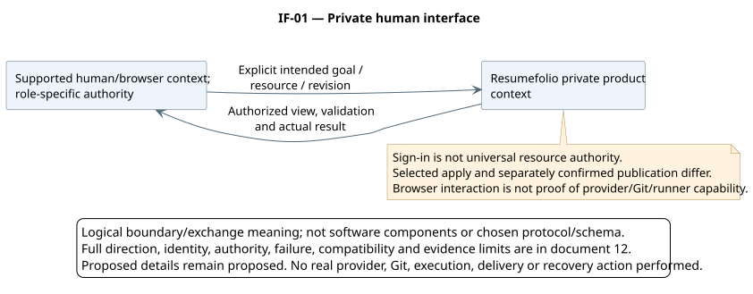
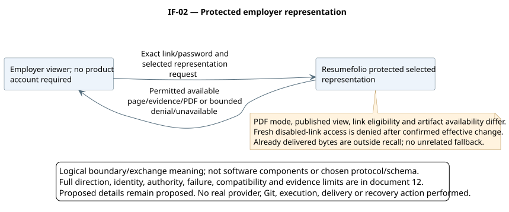
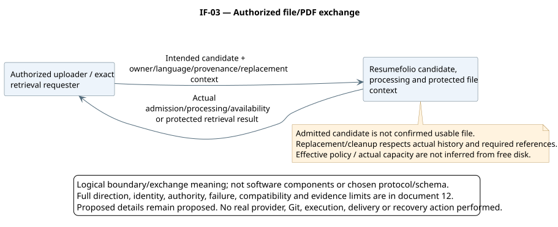
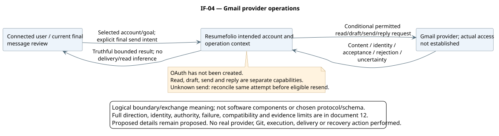
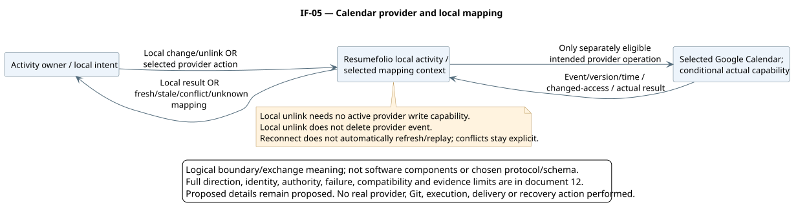
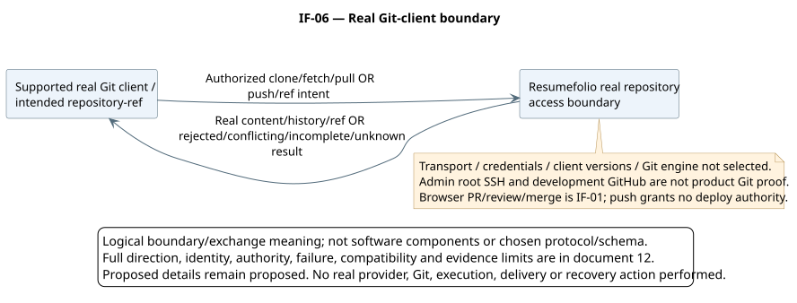
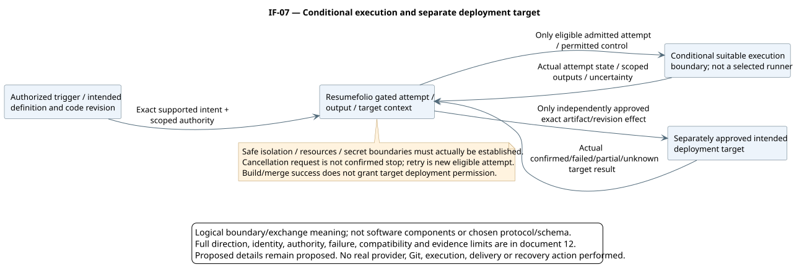
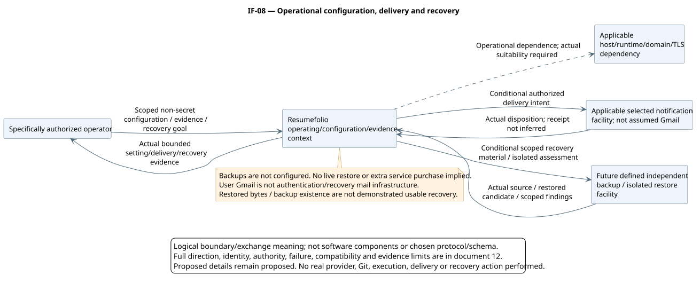
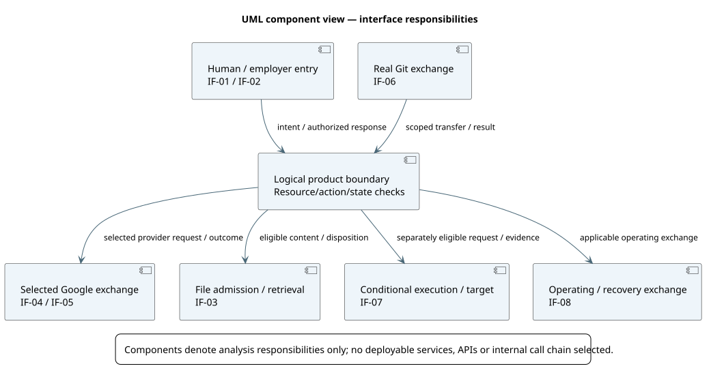
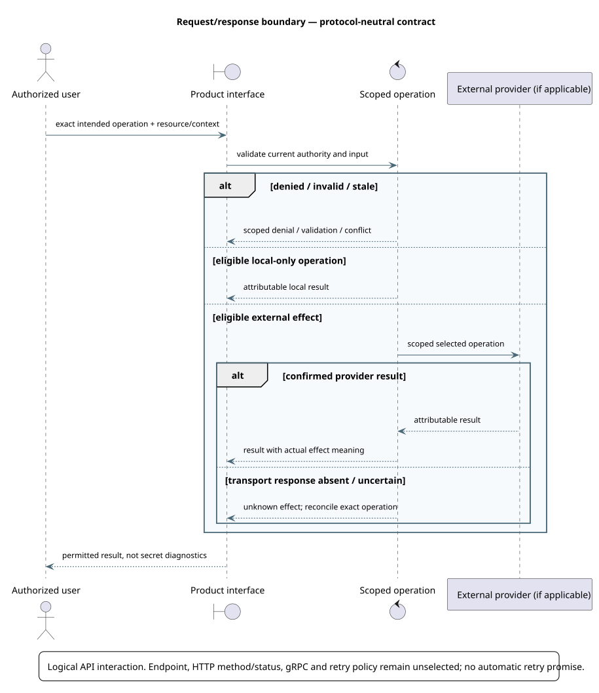

# Resumefolio — Interfaces and External Interactions

[Diagram types and reading guide](#diagram-types-and-reading-guide) · [Full diagram catalog](diagrams/README.md)

Owner: Farhad Valizadegan. Revision: November 1, 2026.
Status: Populated logical interface working view: eight existing IF families, 27 bounded interaction cases and eight focused diagrams. Primary proposed detail and actual enabling evidence retain their recorded status.

## Authoritative Inputs

- [Accepted scope](../01-project-planning/02-scope.md), [external interface specification](../02-requirements-engineering/03-requirements-specification/external-interface-requirements.md) and domain source requirements linked per family.
- [Dictionary](../02-requirements-engineering/05-data-definitions/data-dictionary.md), [business/lifecycle rules](../02-requirements-engineering/03-requirements-specification/business-rules-and-data-lifecycle.md) and [decisions/proposals](../02-requirements-engineering/07-change-and-baseline/open-questions-and-decisions.md).
- [Logical context 02](02-system-context-and-boundaries.md), [domain 03](03-domain-model-and-object-oriented-view.md), [data 05](05-data-oriented-view.md), [scenarios 06](06-scenario-based-view.md), [states 07](07-state-based-view.md), [activities 08](08-control-flow-based-view.md), [rules 09](09-rule-based-view.md), [operation contracts 10](10-domain-constraints-and-operation-contracts.md) and [bounded review 11](11-model-consistency-traceability-and-review.md).

**Authority and scope:** IF-01–IF-08 are reused local inventory references from the primary interface specification/context, not new requirements. IX-Xxx are document-local interaction-case locators. A logical boundary describes participants, information and authority; it is not a selected service, adapter, endpoint or wire schema. The [accepted profile-update core](../02-requirements-engineering/07-change-and-baseline/open-questions-and-decisions.md#owner-accepted-profile-update-policy) remains accepted; detailed provider/session/retention/compatibility policy remains proposed where its source says so.

## Ecosystem Navigation

Start with the [whole-product ecosystem and connected-platform map](02-system-context-and-boundaries.md#ecosystem-and-connected-platforms). Its arrows summarize the eight interface families below; each family supplies authority, input/output meaning, failure handling and links to its focused diagram. External status is qualified in the map: a planned exchange is not an active connection. Internal product relationships are distinct from external provider operations.

## 1. Interface inventory

| Existing family | Participants / boundary | Direction and conceptual exchange |
|---|---|---|
| [IF-01](#if-01) — Private human interface | Owner/applicant, authorized work/Git collaborator/reviewer and specifically authorized operator using a supported browser/device context. | Actor to product: intended goal, supplied content and exact resource/revision context. Product to actor: only authorized views, validation and actual operation result. |
| [IF-02](#if-02) — Protected employer representation | Employer viewer without a product account; resume owner controls link/password separately in private context. | Viewer to product: exact link/password context and requested selected page/evidence/PDF/language. Product to viewer: permitted exact representation or bounded denied/unavailable result. |
| [IF-03](#if-03) — Authorized file/PDF exchange | Authorized uploader/requester, intended content owner/resource and product processing/retrieval responsibility; employer retrieval also applies IF-02. | Into product: intended evidence/PDF/asset bytes plus owner/resource/language/provenance/replacement intent. Out: truthful admission/processing/availability and permitted exact retrieval result. |
| [IF-04](#if-04) — Gmail provider operations | Connected user, selected intended Google account and Gmail provider, under conditional actual access. | Product to provider: explicitly authorized read/search/draft/send/reply intent for exact account/context. Provider to product: permitted content, identifiers and attributable acceptance/rejection/limit/access-loss/uncertain result. |
| [IF-05](#if-05) — Calendar provider and local mapping | Activity owner, selected intended account/calendar and Google Calendar provider; local-only goals are compared explicitly. | Product/provider: only selected authorized event operations and relevant event/version/time result. User/product local branch: local activity or association-only unlink, without implied provider mutation. |
| [IF-06](#if-06) — Real Git-client boundary | Actually supported real Git client/user and intended product-hosted repository/ref. Browser PR/review/merge management is IF-01 context, not an invented Git wire operation. | Client to product: intended authorized clone/fetch/pull or push/ref-change context. Product to client: real repository content/history/ref or explicit rejection/conflict/incomplete/unknown result. |
| [IF-07](#if-07) — Conditional execution and separate deployment target | Authorized trigger/actor, defined workflow/code context, conceptual execution boundary and separately approved intended deployment target. | Into execution: supported exact definition/revision, scoped authority/resources/secrets and permitted trigger. Back: attributable actual attempt/output/state. Separate target exchange: independently authorized artifact/revision effect and target outcome. |
| [IF-08](#if-08) — Operational configuration, delivery and recovery | Explicitly authorized operator and selected applicable runtime/domain/TLS, notification delivery and independent backup/recovery facilities; the grouping is not one service. | Into product/operation: permitted configuration/constraints, delivery disposition and actual protected recovery sources. Out: bounded operational requests/evidence, attributable notification attempt, eligible backup material and isolated restore findings as applicable. |

Private user and employer contexts are separate. File/PDF direct entry is an authorization boundary, not merely a download button. User Gmail and calendar capability are separate from product sign-in and operational mail. Real Git hosting is not a browser simulation. Execution and target deployment have separate powers. IF-08 groups operational dependencies, not a required single facility or new purchase.

## 2. Interaction contracts

### Common record interpretation

| Contract field | Current logical definition / limit |
|---|---|
| Identity / ownership / status | Owner Farhad; exact existing IF reference, conceptual participants, proposed logical detail and source links per record |
| Initiator / direction / effect | Explicit direction and 27 bounded cases below; local-only alternatives are labeled and do not create a provider exchange |
| Connection / mechanism | Product browser/file/provider/Git/execution/operating boundary identified; exact endpoint/transport/mechanism/version not selected unless an authoritative later design does so |
| Inputs / outputs | Conceptual required meanings and identity/revision/language/time/resource context; primary dictionary and selected operation contract govern validity, not an invented JSON shape or field set |
| Preconditions | Applicable current product/resource/action/state authority, selected provider capability where needed, supported input and actual configured policy/resources |
| Result / actual effect | Confirmed, denied/invalid/unavailable/conflict, definite failed, bounded partial, confirmed pending and unknown are distinct as applicable |
| Repetition / concurrency | Specific operation identity/current context governs conflict/reconciliation; no exactly-once, universal retry/backoff, resumability or automatic rollback promise |
| Lifecycle / privacy | Current access, actual source of truth, reference/history/provenance, retention and disconnect semantics remain separate; credentials/private content excluded from examples/diagnostics |
| Capacity / compatibility | Applicable workload, payload/units, latency/freshness, supported consumer/provider/version and changes require actual scoped decisions/evidence; no universal compatibility |
| Verification / acceptance | Exact source and model links are associations; later consumer/provider tests and actual owner disposition remain separate evidence |

This record completes the logical contract fields while making undecided technical representations explicit. A transport/version cannot be marked inapplicable merely because it has not been chosen. Provider mutation is genuinely inapplicable to a local-only activity/unlink; Gmail capability is inapplicable as assumed authority for authentication/recovery delivery. Read-only operations have no invented domain mutation transition.

### Per-family contract records

### IF-01 — Private human interface

**Owner / status:** Farhad; Proposed logical interface refinement; accepted profile core retained where applicable.

**Participants / direction:** Owner/applicant, authorized work/Git collaborator/reviewer and specifically authorized operator using a supported browser/device context. Actor to product: intended goal, supplied content and exact resource/revision context. Product to actor: only authorized views, validation and actual operation result.

**Identity / authority / preconditions:** Product sign-in is not a universal grant. Check exact actor/resource/action/current state, including direct references and administrative powers. Employer context is IF-02, not implicit access to the private workspace.

**Information / result meaning:** Required/optional conceptual inputs follow the target operation and dictionary. Source/draft/live/actual material, task/item/Sprint, account/provider context and current versus stale evidence are distinguishable. English/German content is manual; time meaning follows relevant domain.

**Lifecycle / privacy / frame:** No automatic source propagation, publication, sending, progress inference, acceptance, deployment or physical reclamation from navigation/save alone. Restrict diagnostic context; no secret/private-content examples.

**Failure / concurrency / repetition:** Re-evaluate changed authority/revision. Unknown consequential save/action uses exact-operation reconciliation before repeat; browser refresh/back/duplicate submission is not a universal idempotency promise.

**Capacity / workload / limits:** Supported workloads, input limits and responsiveness/accessibility measures need scoped 13/primary criteria; no fixed number is inferred from demo resources.

**Mechanism / representation / compatibility:** Browser/device/viewport, keyboard/focus/labels/contrast, representation and supported language matrix remain to be reviewed; no native mobile app, public API or universal browser compatibility is introduced.

**Evidence and scoped gates:** Exact UI/client matrix, full action/state permissions and quantitative interaction criteria remain proposed. Accepted explicit apply/publication is not reopened.

**Primary basis:** [EIF-D01](../02-requirements-engineering/03-requirements-specification/external-interface-requirements.md#eif-d01-reviewable-interface-contracts), [EIF-D02](../02-requirements-engineering/03-requirements-specification/external-interface-requirements.md#eif-d02-clear-operable-user-interaction), [EIF-D03](../02-requirements-engineering/03-requirements-specification/external-interface-requirements.md#eif-d03-consistent-authorization-across-entry-paths), [EIF-D08](../02-requirements-engineering/03-requirements-specification/external-interface-requirements.md#eif-d08-operation-specific-failure-and-repetition-semantics), [EIF-D10](../02-requirements-engineering/03-requirements-specification/external-interface-requirements.md#eif-d10-consistent-exchange-meaning-and-lifecycle), [ACC-D03](../02-requirements-engineering/03-requirements-specification/accounts-authentication-and-permissions.md#acc-d03-resource-and-operation-authorization), [ACC-D04](../02-requirements-engineering/03-requirements-specification/accounts-authentication-and-permissions.md#acc-d04-cross-user-private-data-isolation), [ACC-D10](../02-requirements-engineering/03-requirements-specification/accounts-authentication-and-permissions.md#acc-d10-authorization-of-access-grant-changes), [PRP-D04](../02-requirements-engineering/03-requirements-specification/profiles-resumes-and-portfolio.md#prp-d04-explicit-shared-source-update-rules), [PKS-D10](../02-requirements-engineering/03-requirements-specification/projects-kanban-and-sprints.md#pks-d10-deliberate-cross-module-links-reports-and-automation)

**Concepts:** [DM-C47](03-domain-model-and-object-oriented-view.md#dm-c47), [DM-C48](03-domain-model-and-object-oriented-view.md#dm-c48), [DM-C01](03-domain-model-and-object-oriented-view.md#dm-c01), [DM-C03](03-domain-model-and-object-oriented-view.md#dm-c03), [DM-C16](03-domain-model-and-object-oriented-view.md#dm-c16), [DM-C28](03-domain-model-and-object-oriented-view.md#dm-c28), [DM-C29](03-domain-model-and-object-oriented-view.md#dm-c29), [DM-C30](03-domain-model-and-object-oriented-view.md#dm-c30), [DM-C35](03-domain-model-and-object-oriented-view.md#dm-c35)

**Related operation contracts:** [DC-O01](10-domain-constraints-and-operation-contracts.md#dc-o01), [DC-O02](10-domain-constraints-and-operation-contracts.md#dc-o02), [DC-O03](10-domain-constraints-and-operation-contracts.md#dc-o03), [DC-O07](10-domain-constraints-and-operation-contracts.md#dc-o07), [DC-O08](10-domain-constraints-and-operation-contracts.md#dc-o08), [DC-O16](10-domain-constraints-and-operation-contracts.md#dc-o16), [DC-O17](10-domain-constraints-and-operation-contracts.md#dc-o17), [DC-O18](10-domain-constraints-and-operation-contracts.md#dc-o18), [DC-O19](10-domain-constraints-and-operation-contracts.md#dc-o19), [DC-O20](10-domain-constraints-and-operation-contracts.md#dc-o20), [DC-O21](10-domain-constraints-and-operation-contracts.md#dc-o21), [DC-O24](10-domain-constraints-and-operation-contracts.md#dc-o24), [DC-O25](10-domain-constraints-and-operation-contracts.md#dc-o25), [DC-O26](10-domain-constraints-and-operation-contracts.md#dc-o26), [DC-O31](10-domain-constraints-and-operation-contracts.md#dc-o31), [DC-O33](10-domain-constraints-and-operation-contracts.md#dc-o33), [DC-O39](10-domain-constraints-and-operation-contracts.md#dc-o39)

**Related selected models:** [SB-M01](06-scenario-based-view.md#sb-m01), [SB-M05](06-scenario-based-view.md#sb-m05), [SB-M09](06-scenario-based-view.md#sb-m09), [SB-M10](06-scenario-based-view.md#sb-m10), [SB-M12](06-scenario-based-view.md#sb-m12), [CF-M01](08-control-flow-based-view.md#cf-m01), [CF-M05](08-control-flow-based-view.md#cf-m05), [CF-M09](08-control-flow-based-view.md#cf-m09), [CF-M10](08-control-flow-based-view.md#cf-m10), [CF-M12](08-control-flow-based-view.md#cf-m12), [RB-D01](09-rule-based-view.md#rb-d01)

[Editable PlantUML](diagrams/interface-private-human-context.puml) · [PNG](diagrams/interface-private-human-context.png)

Arrows identify the exchange direction in this bounded family, not automatic propagation, permission inherited across arrows or a mandatory internal component chain. Conditional facilities/operations are not claims that they exist or have been exercised.

### IF-02 — Protected employer representation

**Owner / status:** Farhad; Proposed logical interface refinement; accepted profile core retained where applicable.

**Participants / direction:** Employer viewer without a product account; resume owner controls link/password separately in private context. Viewer to product: exact link/password context and requested selected page/evidence/PDF/language. Product to viewer: permitted exact representation or bounded denied/unavailable result.

**Identity / authority / preconditions:** Current applicable link/password/optional adopted expiry and exact selected resource rules govern every entry path, including direct file/PDF references. No viewer account or private workspace authority is invented.

**Information / result meaning:** Published presentation, effective PDF mode, generated/uploaded variant, uploaded language identity and actual artifact availability are separate. Neither mode does not disable page/link; missing language cannot silently become private/unrelated fallback.

**Lifecycle / privacy / frame:** Confirmed link disablement prevents fresh protected access. Already downloaded bytes are outside recall. Actual submitted material is not whichever live view the employer later opens.

**Failure / concurrency / repetition:** Fresh password/link checks and existing/in-flight/cached contexts follow separately reviewed policy. Interrupted retrieval is not complete; safe repeated read does not grant access after revocation or imply content immutability.

**Capacity / workload / limits:** Representation size/processing/retrieval expectations need actual agreed limits/conditions; no download/session/expiry duration invented.

**Mechanism / representation / compatibility:** Exact presentation/encoding/content-serving/client details remain design/acceptance work; selected PDF categories are scope, not proof every variant exists.

**Evidence and scoped gates:** Credential rotation is a source/state policy with proposed details, not an exhaustively modeled new operation contract. Session/cache/in-flight/language/rendition policy remains scoped.

**Primary basis:** [EIF-D01](../02-requirements-engineering/03-requirements-specification/external-interface-requirements.md#eif-d01-reviewable-interface-contracts), [EIF-D02](../02-requirements-engineering/03-requirements-specification/external-interface-requirements.md#eif-d02-clear-operable-user-interaction), [EIF-D03](../02-requirements-engineering/03-requirements-specification/external-interface-requirements.md#eif-d03-consistent-authorization-across-entry-paths), [EIF-D04](../02-requirements-engineering/03-requirements-specification/external-interface-requirements.md#eif-d04-protected-file-and-pdf-exchange), [EIF-D08](../02-requirements-engineering/03-requirements-specification/external-interface-requirements.md#eif-d08-operation-specific-failure-and-repetition-semantics), [EIF-D10](../02-requirements-engineering/03-requirements-specification/external-interface-requirements.md#eif-d10-consistent-exchange-meaning-and-lifecycle), [PDF-D02](../02-requirements-engineering/03-requirements-specification/pdf-and-controlled-sharing.md#pdf-d02-uploaded-pdf-and-language-identity), [PDF-D03](../02-requirements-engineering/03-requirements-specification/pdf-and-controlled-sharing.md#pdf-d03-per-resume-download-choices), [PDF-D04](../02-requirements-engineering/03-requirements-specification/pdf-and-controlled-sharing.md#pdf-d04-scoped-password-protected-employer-access), [PDF-D05](../02-requirements-engineering/03-requirements-specification/pdf-and-controlled-sharing.md#pdf-d05-direct-file-and-pdf-authorization), [PDF-D06](../02-requirements-engineering/03-requirements-specification/pdf-and-controlled-sharing.md#pdf-d06-owner-password-and-link-controls), [PDF-D07](../02-requirements-engineering/03-requirements-specification/pdf-and-controlled-sharing.md#pdf-d07-explicit-live-revision-and-rendition-behavior), [ACC-D06](../02-requirements-engineering/03-requirements-specification/accounts-authentication-and-permissions.md#acc-d06-employer-access-without-a-viewer-account), [ACC-D07](../02-requirements-engineering/03-requirements-specification/accounts-authentication-and-permissions.md#acc-d07-protected-shared-file-and-pdf-retrieval), [ACC-D08](../02-requirements-engineering/03-requirements-specification/accounts-authentication-and-permissions.md#acc-d08-owner-control-of-employer-link-access)

**Concepts:** [DM-C13](03-domain-model-and-object-oriented-view.md#dm-c13), [DM-C48](03-domain-model-and-object-oriented-view.md#dm-c48), [DM-C09](03-domain-model-and-object-oriented-view.md#dm-c09), [DM-C12](03-domain-model-and-object-oriented-view.md#dm-c12), [DM-C10](03-domain-model-and-object-oriented-view.md#dm-c10), [DM-C11](03-domain-model-and-object-oriented-view.md#dm-c11), [DM-C07](03-domain-model-and-object-oriented-view.md#dm-c07), [DM-C08](03-domain-model-and-object-oriented-view.md#dm-c08)

**Related operation contracts:** [DC-O04](10-domain-constraints-and-operation-contracts.md#dc-o04), [DC-O05](10-domain-constraints-and-operation-contracts.md#dc-o05), [DC-O06](10-domain-constraints-and-operation-contracts.md#dc-o06)

**Related selected models:** [SB-M02](06-scenario-based-view.md#sb-m02), [SB-M03](06-scenario-based-view.md#sb-m03), [SB-M04](06-scenario-based-view.md#sb-m04), [SM-M04](07-state-based-view.md#sm-m04), [SM-M05](07-state-based-view.md#sm-m05), [CF-M02](08-control-flow-based-view.md#cf-m02), [CF-M03](08-control-flow-based-view.md#cf-m03), [CF-M04](08-control-flow-based-view.md#cf-m04), [RB-D03](09-rule-based-view.md#rb-d03), [RB-D04](09-rule-based-view.md#rb-d04), [RB-D05](09-rule-based-view.md#rb-d05)

[Editable PlantUML](diagrams/interface-employer-protected-representation.puml) · [PNG](diagrams/interface-employer-protected-representation.png)

Arrows identify the exchange direction in this bounded family, not automatic propagation, permission inherited across arrows or a mandatory internal component chain. Conditional facilities/operations are not claims that they exist or have been exercised.

### IF-03 — Authorized file/PDF exchange

**Owner / status:** Farhad; Proposed logical interface refinement; accepted profile core retained where applicable.

**Participants / direction:** Authorized uploader/requester, intended content owner/resource and product processing/retrieval responsibility; employer retrieval also applies IF-02. Into product: intended evidence/PDF/asset bytes plus owner/resource/language/provenance/replacement intent. Out: truthful admission/processing/availability and permitted exact retrieval result.

**Identity / authority / preconditions:** Upload, replacement, association, retrieval, cleanup and administration are separate powers. Actual effective policy/content/reference/current capacity conditions govern intended candidate; resource reference/filename is not permission.

**Information / result meaning:** Byte candidate versus admitted versus usable content are distinguishable. File identity, actual submitted-set provenance, language/variant and association survive interpretation; client metadata is not proof of valid type or historical equivalence.

**Lifecycle / privacy / frame:** A new candidate or failed replacement cannot silently destroy required prior/actual material. Source replacement does not rewrite actual sent history; cleanup and quota release need reference-aware eligibility and actual effect.

**Failure / concurrency / repetition:** Concurrent growth/replacement/changed policy require reviewed current capacity and reference semantics. Partial/unknown upload/processing is not usable success; no universal resumable-transfer/retry guarantee is chosen.

**Capacity / workload / limits:** Format/content validation, byte/aggregate units, current growth/temp/retained accounting and processing limits require reviewed values. Idle free disk is not a concurrent-admission proof.

**Mechanism / representation / compatibility:** Exact accepted representations/formats/encoding/metadata fields, transfer mechanism and safe-serving behavior remain design/criteria work; no arbitrary import/export or general file hosting is added.

**Evidence and scoped gates:** No quotas, whitelist, content-handling technology, storage backend, cleanup schedule or universal cancellation behavior is selected.

**Primary basis:** [EIF-D01](../02-requirements-engineering/03-requirements-specification/external-interface-requirements.md#eif-d01-reviewable-interface-contracts), [EIF-D03](../02-requirements-engineering/03-requirements-specification/external-interface-requirements.md#eif-d03-consistent-authorization-across-entry-paths), [EIF-D04](../02-requirements-engineering/03-requirements-specification/external-interface-requirements.md#eif-d04-protected-file-and-pdf-exchange), [EIF-D08](../02-requirements-engineering/03-requirements-specification/external-interface-requirements.md#eif-d08-operation-specific-failure-and-repetition-semantics), [EIF-D10](../02-requirements-engineering/03-requirements-specification/external-interface-requirements.md#eif-d10-consistent-exchange-meaning-and-lifecycle), [AFO-D03](../02-requirements-engineering/03-requirements-specification/administration-files-and-operational-behavior.md#afo-d03-per-file-admission-limit), [AFO-D04](../02-requirements-engineering/03-requirements-specification/administration-files-and-operational-behavior.md#afo-d04-aggregate-quota-and-concurrent-admission), [AFO-D05](../02-requirements-engineering/03-requirements-specification/administration-files-and-operational-behavior.md#afo-d05-supported-content-and-validation), [AFO-D06](../02-requirements-engineering/03-requirements-specification/administration-files-and-operational-behavior.md#afo-d06-file-resource-authorization-and-isolation), [AFO-D07](../02-requirements-engineering/03-requirements-specification/administration-files-and-operational-behavior.md#afo-d07-truthful-completion-and-interrupted-operation-handling), [AFO-D08](../02-requirements-engineering/03-requirements-specification/administration-files-and-operational-behavior.md#afo-d08-safe-replacement-and-lifecycle-effects), [AFO-D11](../02-requirements-engineering/03-requirements-specification/administration-files-and-operational-behavior.md#afo-d11-bounded-cleanup-and-storage-reclamation), [APP-D06](../02-requirements-engineering/03-requirements-specification/manual-application-management.md#app-d06-preserved-actual-submitted-copies), [PDF-D02](../02-requirements-engineering/03-requirements-specification/pdf-and-controlled-sharing.md#pdf-d02-uploaded-pdf-and-language-identity), [PDF-D09](../02-requirements-engineering/03-requirements-specification/pdf-and-controlled-sharing.md#pdf-d09-failure-safe-processing-and-content-handling)

**Concepts:** [DM-C49](03-domain-model-and-object-oriented-view.md#dm-c49), [DM-C50](03-domain-model-and-object-oriented-view.md#dm-c50), [DM-C10](03-domain-model-and-object-oriented-view.md#dm-c10), [DM-C11](03-domain-model-and-object-oriented-view.md#dm-c11), [DM-C19](03-domain-model-and-object-oriented-view.md#dm-c19), [DM-C18](03-domain-model-and-object-oriented-view.md#dm-c18), [DM-C08](03-domain-model-and-object-oriented-view.md#dm-c08)

**Related operation contracts:** [DC-O06](10-domain-constraints-and-operation-contracts.md#dc-o06), [DC-O09](10-domain-constraints-and-operation-contracts.md#dc-o09), [DC-O10](10-domain-constraints-and-operation-contracts.md#dc-o10), [DC-O32](10-domain-constraints-and-operation-contracts.md#dc-o32), [DC-O34](10-domain-constraints-and-operation-contracts.md#dc-o34), [DC-O35](10-domain-constraints-and-operation-contracts.md#dc-o35), [DC-O36](10-domain-constraints-and-operation-contracts.md#dc-o36)

**Related selected models:** [SB-M04](06-scenario-based-view.md#sb-m04), [SB-M06](06-scenario-based-view.md#sb-m06), [SB-M15](06-scenario-based-view.md#sb-m15), [SM-M05](07-state-based-view.md#sm-m05), [SM-M07](07-state-based-view.md#sm-m07), [SM-M16](07-state-based-view.md#sm-m16), [CF-M06](08-control-flow-based-view.md#cf-m06), [CF-M15](08-control-flow-based-view.md#cf-m15), [RB-D06](09-rule-based-view.md#rb-d06), [RB-D14](09-rule-based-view.md#rb-d14), [RB-D15](09-rule-based-view.md#rb-d15)

[Editable PlantUML](diagrams/interface-file-candidate-result.puml) · [PNG](diagrams/interface-file-candidate-result.png)

Arrows identify the exchange direction in this bounded family, not automatic propagation, permission inherited across arrows or a mandatory internal component chain. Conditional facilities/operations are not claims that they exist or have been exercised.

### IF-04 — Gmail provider operations

**Owner / status:** Farhad; Proposed logical interface refinement; accepted profile core retained where applicable.

**Participants / direction:** Connected user, selected intended Google account and Gmail provider, under conditional actual access. Product to provider: explicitly authorized read/search/draft/send/reply intent for exact account/context. Provider to product: permitted content, identifiers and attributable acceptance/rejection/limit/access-loss/uncertain result.

**Identity / authority / preconditions:** Product session/grants and actual selected-account provider capabilities are different prerequisites. Reading, composing/persisting drafts, sending and replying are not one implicit permission.

**Information / result meaning:** Provider/account/message/conversation/draft identity and current sender/recipient/body/attachment/reply context remain attributable. Final confirmation must match actual intended send content; acceptance is not recipient delivery/read.

**Lifecycle / privacy / frame:** Disconnect stops new dependent provider action under reviewed rules; retained local copies and draft ownership need explicit policy. Do not expose credentials/private mailbox through general project membership, logs or examples.

**Failure / concurrency / repetition:** Changed reviewed content requires renewed confirmation. Unknown send requires same-attempt reconciliation before separately eligible resend; reconnect does not blindly replay pending sends. Draft create/update/retry semantics need their own exact contract.

**Capacity / workload / limits:** Actual provider access, limits/cost/applicability and supported operation constraints need evidence. No polling, timeout/backoff, volume or quota values are invented.

**Mechanism / representation / compatibility:** Exact mechanism/scopes/representation/version and access/verification conditions are not chosen or newly verified here. Provider compatibility requires later applicable findings; no support for arbitrary mail providers is added.

**Evidence and scoped gates:** OAuth has not been created. User Gmail capability is not an authentication/recovery notification channel. Draft and connect/disconnect contracts are source-derived families, not falsely claimed among the 39 selected operations.

**Primary basis:** [EIF-D01](../02-requirements-engineering/03-requirements-specification/external-interface-requirements.md#eif-d01-reviewable-interface-contracts), [EIF-D03](../02-requirements-engineering/03-requirements-specification/external-interface-requirements.md#eif-d03-consistent-authorization-across-entry-paths), [EIF-D05](../02-requirements-engineering/03-requirements-specification/external-interface-requirements.md#eif-d05-explicit-google-provider-contracts), [EIF-D08](../02-requirements-engineering/03-requirements-specification/external-interface-requirements.md#eif-d08-operation-specific-failure-and-repetition-semantics), [EIF-D10](../02-requirements-engineering/03-requirements-specification/external-interface-requirements.md#eif-d10-consistent-exchange-meaning-and-lifecycle), [EGC-D01](../02-requirements-engineering/03-requirements-specification/email-calendar-and-google-integration.md#egc-d01-authorized-connection-and-account-context), [EGC-D02](../02-requirements-engineering/03-requirements-specification/email-calendar-and-google-integration.md#egc-d02-justified-permissions-and-private-resource-isolation), [EGC-D03](../02-requirements-engineering/03-requirements-specification/email-calendar-and-google-integration.md#egc-d03-read-authorized-correspondence), [EGC-D04](../02-requirements-engineering/03-requirements-specification/email-calendar-and-google-integration.md#egc-d04-manual-compose-and-draft-handling), [EGC-D05](../02-requirements-engineering/03-requirements-specification/email-calendar-and-google-integration.md#egc-d05-deliberate-send-and-truthful-outcome), [EGC-D06](../02-requirements-engineering/03-requirements-specification/email-calendar-and-google-integration.md#egc-d06-reply-context-and-conversation-association), [EGC-D11](../02-requirements-engineering/03-requirements-specification/email-calendar-and-google-integration.md#egc-d11-disconnect-revocation-and-reconnect), [EGC-D12](../02-requirements-engineering/03-requirements-specification/email-calendar-and-google-integration.md#egc-d12-bounded-failures-recovery-and-feasibility-evidence)

**Concepts:** [DM-C20](03-domain-model-and-object-oriented-view.md#dm-c20), [DM-C21](03-domain-model-and-object-oriented-view.md#dm-c21), [DM-C48](03-domain-model-and-object-oriented-view.md#dm-c48)

**Related operation contracts:** [DC-O11](10-domain-constraints-and-operation-contracts.md#dc-o11), [DC-O12](10-domain-constraints-and-operation-contracts.md#dc-o12), [DC-O38](10-domain-constraints-and-operation-contracts.md#dc-o38)

**Related selected models:** [SB-M07](06-scenario-based-view.md#sb-m07), [SM-M08](07-state-based-view.md#sm-m08), [SM-M09](07-state-based-view.md#sm-m09), [CF-M07](08-control-flow-based-view.md#cf-m07), [RB-D07](09-rule-based-view.md#rb-d07), [RB-D18](09-rule-based-view.md#rb-d18)

[Editable PlantUML](diagrams/interface-gmail-reviewed-effects.puml) · [PNG](diagrams/interface-gmail-reviewed-effects.png)

Arrows identify the exchange direction in this bounded family, not automatic propagation, permission inherited across arrows or a mandatory internal component chain. Conditional facilities/operations are not claims that they exist or have been exercised.

### IF-05 — Calendar provider and local mapping

**Owner / status:** Farhad; Proposed logical interface refinement; accepted profile core retained where applicable.

**Participants / direction:** Activity owner, selected intended account/calendar and Google Calendar provider; local-only goals are compared explicitly. Product/provider: only selected authorized event operations and relevant event/version/time result. User/product local branch: local activity or association-only unlink, without implied provider mutation.

**Identity / authority / preconditions:** Local operation authority differs from provider write capability. Exact account/calendar/mapping/action and field authority are established before dependent provider action; local unlink does not need active provider write access.

**Information / result meaning:** Local/provider identity, optional mapping, selected authoritative fields, relevant local/provider versions, all-day/time-zone meaning and freshness/conflict state are distinguishable. Local notes and application associations are not provider-owned grants.

**Lifecycle / privacy / frame:** Local unlink does not delete provider event; provider removal is a distinct observed external change. Disconnect/reconnect does not delete/recreate/replay local/provider state by default. Reminders need separate actually available delivery capability.

**Failure / concurrency / repetition:** Concurrent local/provider changes remain conflicts/stale until explicit reviewed resolution. Ambiguous provider mutation is reconciled against same intended object; reconnect alone does not make mapping Fresh.

**Capacity / workload / limits:** Actual provider limits, freshness/latency/workload and reminder-delivery conditions require defined evidence; no timing or automatic sync direction is invented.

**Mechanism / representation / compatibility:** Exact time representation, fields, event identity/mapping, mutation mechanism and compatibility/version policy remain scoped design/acceptance work; no bidirectional or last-write-wins default.

**Evidence and scoped gates:** OAuth absent. Direction/time/conflict/deletion/reconnect policy remains proposed; local-only paths can still be specified without a configured provider.

**Primary basis:** [EIF-D01](../02-requirements-engineering/03-requirements-specification/external-interface-requirements.md#eif-d01-reviewable-interface-contracts), [EIF-D03](../02-requirements-engineering/03-requirements-specification/external-interface-requirements.md#eif-d03-consistent-authorization-across-entry-paths), [EIF-D05](../02-requirements-engineering/03-requirements-specification/external-interface-requirements.md#eif-d05-explicit-google-provider-contracts), [EIF-D08](../02-requirements-engineering/03-requirements-specification/external-interface-requirements.md#eif-d08-operation-specific-failure-and-repetition-semantics), [EIF-D10](../02-requirements-engineering/03-requirements-specification/external-interface-requirements.md#eif-d10-consistent-exchange-meaning-and-lifecycle), [EGC-D07](../02-requirements-engineering/03-requirements-specification/email-calendar-and-google-integration.md#egc-d07-calendar-activities-and-time-meaning), [EGC-D08](../02-requirements-engineering/03-requirements-specification/email-calendar-and-google-integration.md#egc-d08-explicit-synchronization-contract), [EGC-D09](../02-requirements-engineering/03-requirements-specification/email-calendar-and-google-integration.md#egc-d09-application-relationships-preserve-boundaries), [EGC-D10](../02-requirements-engineering/03-requirements-specification/email-calendar-and-google-integration.md#egc-d10-reminders-and-notification-outcomes), [EGC-D11](../02-requirements-engineering/03-requirements-specification/email-calendar-and-google-integration.md#egc-d11-disconnect-revocation-and-reconnect), [EGC-D12](../02-requirements-engineering/03-requirements-specification/email-calendar-and-google-integration.md#egc-d12-bounded-failures-recovery-and-feasibility-evidence), [BRL-D07](../02-requirements-engineering/03-requirements-specification/business-rules-and-data-lifecycle.md#brl-d07-explicit-provider-synchronization-authority), [BRL-D10](../02-requirements-engineering/03-requirements-specification/business-rules-and-data-lifecycle.md#brl-d10-defined-language-and-time-meaning)

**Concepts:** [DM-C20](03-domain-model-and-object-oriented-view.md#dm-c20), [DM-C22](03-domain-model-and-object-oriented-view.md#dm-c22), [DM-C23](03-domain-model-and-object-oriented-view.md#dm-c23), [DM-C16](03-domain-model-and-object-oriented-view.md#dm-c16), [DM-C48](03-domain-model-and-object-oriented-view.md#dm-c48)

**Related operation contracts:** [DC-O13](10-domain-constraints-and-operation-contracts.md#dc-o13), [DC-O14](10-domain-constraints-and-operation-contracts.md#dc-o14), [DC-O15](10-domain-constraints-and-operation-contracts.md#dc-o15), [DC-O38](10-domain-constraints-and-operation-contracts.md#dc-o38)

**Related selected models:** [SB-M08](06-scenario-based-view.md#sb-m08), [SM-M08](07-state-based-view.md#sm-m08), [SM-M10](07-state-based-view.md#sm-m10), [CF-M08](08-control-flow-based-view.md#cf-m08), [RB-D08](09-rule-based-view.md#rb-d08), [RB-D17](09-rule-based-view.md#rb-d17)

[Editable PlantUML](diagrams/interface-calendar-local-provider.puml) · [PNG](diagrams/interface-calendar-local-provider.png)

Arrows identify the exchange direction in this bounded family, not automatic propagation, permission inherited across arrows or a mandatory internal component chain. Conditional facilities/operations are not claims that they exist or have been exercised.

### IF-06 — Real Git-client boundary

**Owner / status:** Farhad; Proposed logical interface refinement; accepted profile core retained where applicable.

**Participants / direction:** Actually supported real Git client/user and intended product-hosted repository/ref. Browser PR/review/merge management is IF-01 context, not an invented Git wire operation. Client to product: intended authorized clone/fetch/pull or push/ref-change context. Product to client: real repository content/history/ref or explicit rejection/conflict/incomplete/unknown result.

**Identity / authority / preconditions:** Repository read, ref write/protected-ref, review/merge and target deploy authority remain separate. Exact current intended repository/ref permission and expected/evaluated revision context apply to non-browser entry.

**Information / result meaning:** Repository/ref/object/revision meaning is real Git domain content, not a browser simulation. Moving ref names are not immutable evaluated review/check identities. Client transfer outcome and actual ref state require attributable evidence.

**Lifecycle / privacy / frame:** Rejected/stale/unknown ref changes do not imply an unchanged target or completed rollback. Required history/references and retention/recovery need repository-specific contracts, not a universal file purge.

**Failure / concurrency / repetition:** Interrupted read transfer is incomplete; unknown push needs actual intended ref reconciliation before consequential repetition. Changed source/target/reviews require re-evaluation for merge in IF-01.

**Capacity / workload / limits:** Object/transfer/history growth and real client compatibility/resource behavior need scoped conditions/evidence; no size, connection or client/version limit invented.

**Mechanism / representation / compatibility:** Neither SSH nor HTTPS transport nor Git engine is selected. Administrative root SSH previously used to inspect the demo host is not evidence of product Git-client authentication/interoperability; development GitHub is not product hosting proof.

**Evidence and scoped gates:** Actual supported client/transport/credential/protection/recovery choices remain proposed or unverified. No new public developer API, webhook or universal Git-client compatibility.

**Primary basis:** [EIF-D01](../02-requirements-engineering/03-requirements-specification/external-interface-requirements.md#eif-d01-reviewable-interface-contracts), [EIF-D03](../02-requirements-engineering/03-requirements-specification/external-interface-requirements.md#eif-d03-consistent-authorization-across-entry-paths), [EIF-D06](../02-requirements-engineering/03-requirements-specification/external-interface-requirements.md#eif-d06-real-git-client-interoperability), [EIF-D08](../02-requirements-engineering/03-requirements-specification/external-interface-requirements.md#eif-d08-operation-specific-failure-and-repetition-semantics), [EIF-D10](../02-requirements-engineering/03-requirements-specification/external-interface-requirements.md#eif-d10-consistent-exchange-meaning-and-lifecycle), [GIT-D02](../02-requirements-engineering/03-requirements-specification/git-hosting-and-collaboration.md#git-d02-repository-and-ref-authorization), [GIT-D03](../02-requirements-engineering/03-requirements-specification/git-hosting-and-collaboration.md#git-d03-real-clone-fetch-pull-and-push), [GIT-D04](../02-requirements-engineering/03-requirements-specification/git-hosting-and-collaboration.md#git-d04-branches-files-and-history-browsing), [GIT-D05](../02-requirements-engineering/03-requirements-specification/git-hosting-and-collaboration.md#git-d05-fork-provenance-and-permission-boundaries), [GIT-D06](../02-requirements-engineering/03-requirements-specification/git-hosting-and-collaboration.md#git-d06-pull-requests-comments-and-review), [GIT-D07](../02-requirements-engineering/03-requirements-specification/git-hosting-and-collaboration.md#git-d07-controlled-merge-and-conflict-outcomes), [GIT-D10](../02-requirements-engineering/03-requirements-specification/git-hosting-and-collaboration.md#git-d10-lifecycle-capacity-and-recovery)

**Concepts:** [DM-C32](03-domain-model-and-object-oriented-view.md#dm-c32), [DM-C34](03-domain-model-and-object-oriented-view.md#dm-c34), [DM-C33](03-domain-model-and-object-oriented-view.md#dm-c33), [DM-C35](03-domain-model-and-object-oriented-view.md#dm-c35), [DM-C36](03-domain-model-and-object-oriented-view.md#dm-c36), [DM-C48](03-domain-model-and-object-oriented-view.md#dm-c48)

**Related operation contracts:** [DC-O22](10-domain-constraints-and-operation-contracts.md#dc-o22), [DC-O23](10-domain-constraints-and-operation-contracts.md#dc-o23), [DC-O24](10-domain-constraints-and-operation-contracts.md#dc-o24), [DC-O25](10-domain-constraints-and-operation-contracts.md#dc-o25), [DC-O26](10-domain-constraints-and-operation-contracts.md#dc-o26), [DC-O38](10-domain-constraints-and-operation-contracts.md#dc-o38)

**Related selected models:** [SB-M11](06-scenario-based-view.md#sb-m11), [SB-M12](06-scenario-based-view.md#sb-m12), [SM-M13](07-state-based-view.md#sm-m13), [CF-M11](08-control-flow-based-view.md#cf-m11), [CF-M12](08-control-flow-based-view.md#cf-m12), [RB-D11](09-rule-based-view.md#rb-d11)

[Editable PlantUML](diagrams/interface-real-git-client.puml) · [PNG](diagrams/interface-real-git-client.png)

Arrows identify the exchange direction in this bounded family, not automatic propagation, permission inherited across arrows or a mandatory internal component chain. Conditional facilities/operations are not claims that they exist or have been exercised.

### IF-07 — Conditional execution and separate deployment target

**Owner / status:** Farhad; Proposed logical interface refinement; accepted profile core retained where applicable.

**Participants / direction:** Authorized trigger/actor, defined workflow/code context, conceptual execution boundary and separately approved intended deployment target. Into execution: supported exact definition/revision, scoped authority/resources/secrets and permitted trigger. Back: attributable actual attempt/output/state. Separate target exchange: independently authorized artifact/revision effect and target outcome.

**Identity / authority / preconditions:** Execution requires actual enabling isolation/resource/security evidence. No arbitrary YAML/code/secret/network/host access follows repository permission. Deployment requires current exact target authority/approval and valid artifact/data/recovery conditions.

**Information / result meaning:** Definition/evaluated revision, run/attempt, output identity, cancellation-request versus stop, actual terminal versus unknown and target effect are different. Logs/artifacts require separate bounded access; build/merge/release is not deploy permission.

**Lifecycle / privacy / frame:** Do not expose secrets through inputs/results/diagnostics or recover old authority by replay. Output retention/cleanup is scoped and reference-aware; failed work does not automatically remove required evidence or reverse target effects.

**Failure / concurrency / repetition:** Queue cancellation versus running stop is distinguished; completion can win cancellation race. Retry is a separately eligible new attempt after prior effect assessment; unknown target is reconciled before consequential retry/recovery.

**Capacity / workload / limits:** Suitable isolation, limits on actual resources/output/concurrency/cleanup and target readiness require actual evidence. Existing 2-vCPU/4-GB/40-GB demo/idle readings do not prove safe untrusted execution.

**Mechanism / representation / compatibility:** Supported workflow syntax/triggers/features, runner/isolation, output representation, target mechanism and compatibility are not chosen. No universal external CI ecosystem compatibility, marketplace actions or arbitrary remote target capability is promised.

**Evidence and scoped gates:** No demonstrated suitable execution environment or approved live target is created here; conditional logical boundary only, not execution authorization.

**Primary basis:** [EIF-D01](../02-requirements-engineering/03-requirements-specification/external-interface-requirements.md#eif-d01-reviewable-interface-contracts), [EIF-D03](../02-requirements-engineering/03-requirements-specification/external-interface-requirements.md#eif-d03-consistent-authorization-across-entry-paths), [EIF-D07](../02-requirements-engineering/03-requirements-specification/external-interface-requirements.md#eif-d07-bounded-workflow-and-deployment-interfaces), [EIF-D08](../02-requirements-engineering/03-requirements-specification/external-interface-requirements.md#eif-d08-operation-specific-failure-and-repetition-semantics), [EIF-D10](../02-requirements-engineering/03-requirements-specification/external-interface-requirements.md#eif-d10-consistent-exchange-meaning-and-lifecycle), [YML-D01](../02-requirements-engineering/03-requirements-specification/yaml-workflows-and-cicd.md#yml-d01-defined-supported-workflow-contract), [YML-D02](../02-requirements-engineering/03-requirements-specification/yaml-workflows-and-cicd.md#yml-d02-explicit-triggers-and-run-authority), [YML-D03](../02-requirements-engineering/03-requirements-specification/yaml-workflows-and-cicd.md#yml-d03-run-identity-and-reproducible-context), [YML-D04](../02-requirements-engineering/03-requirements-specification/yaml-workflows-and-cicd.md#yml-d04-isolation-and-untrusted-code-boundary), [YML-D05](../02-requirements-engineering/03-requirements-specification/yaml-workflows-and-cicd.md#yml-d05-scoped-secrets-and-credentials), [YML-D06](../02-requirements-engineering/03-requirements-specification/yaml-workflows-and-cicd.md#yml-d06-resource-admission-and-limits), [YML-D07](../02-requirements-engineering/03-requirements-specification/yaml-workflows-and-cicd.md#yml-d07-truthful-run-and-step-outcomes), [YML-D08](../02-requirements-engineering/03-requirements-specification/yaml-workflows-and-cicd.md#yml-d08-restricted-logs-and-artifacts), [YML-D09](../02-requirements-engineering/03-requirements-specification/yaml-workflows-and-cicd.md#yml-d09-cancellation-retry-and-runner-loss-recovery), [YML-D10](../02-requirements-engineering/03-requirements-specification/yaml-workflows-and-cicd.md#yml-d10-separate-controlled-deployment-stage), [YML-D11](../02-requirements-engineering/03-requirements-specification/yaml-workflows-and-cicd.md#yml-d11-workspace-cleanup-and-retained-evidence), [YML-D12](../02-requirements-engineering/03-requirements-specification/yaml-workflows-and-cicd.md#yml-d12-feasibility-operational-guidance-and-enabling-gate)

**Concepts:** [DM-C40](03-domain-model-and-object-oriented-view.md#dm-c40), [DM-C33](03-domain-model-and-object-oriented-view.md#dm-c33), [DM-C41](03-domain-model-and-object-oriented-view.md#dm-c41), [DM-C42](03-domain-model-and-object-oriented-view.md#dm-c42), [DM-C43](03-domain-model-and-object-oriented-view.md#dm-c43), [DM-C44](03-domain-model-and-object-oriented-view.md#dm-c44), [DM-C45](03-domain-model-and-object-oriented-view.md#dm-c45), [DM-C46](03-domain-model-and-object-oriented-view.md#dm-c46)

**Related operation contracts:** [DC-O27](10-domain-constraints-and-operation-contracts.md#dc-o27), [DC-O28](10-domain-constraints-and-operation-contracts.md#dc-o28), [DC-O29](10-domain-constraints-and-operation-contracts.md#dc-o29), [DC-O30](10-domain-constraints-and-operation-contracts.md#dc-o30), [DC-O33](10-domain-constraints-and-operation-contracts.md#dc-o33), [DC-O38](10-domain-constraints-and-operation-contracts.md#dc-o38)

**Related selected models:** [SB-M13](06-scenario-based-view.md#sb-m13), [SB-M14](06-scenario-based-view.md#sb-m14), [SM-M14](07-state-based-view.md#sm-m14), [SM-M15](07-state-based-view.md#sm-m15), [CF-M13](08-control-flow-based-view.md#cf-m13), [CF-M14](08-control-flow-based-view.md#cf-m14), [RB-D12](09-rule-based-view.md#rb-d12), [RB-D13](09-rule-based-view.md#rb-d13)

[Editable PlantUML](diagrams/interface-execution-separate-target.puml) · [PNG](diagrams/interface-execution-separate-target.png)

Arrows identify the exchange direction in this bounded family, not automatic propagation, permission inherited across arrows or a mandatory internal component chain. Conditional facilities/operations are not claims that they exist or have been exercised.

### IF-08 — Operational configuration, delivery and recovery

**Owner / status:** Farhad; Proposed logical interface refinement; accepted profile core retained where applicable.

**Participants / direction:** Explicitly authorized operator and selected applicable runtime/domain/TLS, notification delivery and independent backup/recovery facilities; the grouping is not one service. Into product/operation: permitted configuration/constraints, delivery disposition and actual protected recovery sources. Out: bounded operational requests/evidence, attributable notification attempt, eligible backup material and isolated restore findings as applicable.

**Identity / authority / preconditions:** Configuration/evidence access, delivery credentials and recovery source/target powers are separate. A connected Gmail account is not assumed to provide identity/recovery mail. Restoration must re-evaluate current access/external effects.

**Information / result meaning:** Actual effective configuration, compatibility and measured operating result are distinct from planned setup. Delivery attempt/acceptance/receipt differ. Backup artifact/completed backup/restored bytes/scoped usable recovery are distinct evidence levels.

**Lifecycle / privacy / frame:** No credential/config secrets in documentation/examples; backup coverage includes whatever required data/artifacts/relationships/configuration/keys are actually defined, not assumed. Restore does not resurrect old grants or resend/deploy by default.

**Failure / concurrency / repetition:** Ambiguous delivery does not justify blind duplicate notification. Restore is explicitly authorized/isolated and same-candidate reconciliation precedes further effects; maintenance interruption and current environment must be identified.

**Capacity / workload / limits:** Actual backup/delivery/runtime suitability, coverage/retention and workload/recovery targets need scoped evidence. No RPO/RTO, extra infrastructure purchase, notification provider or backup schedule is invented.

**Mechanism / representation / compatibility:** Existing Ubuntu/Laravel demo software/resources are observations, not final technology selection or proof of current dependency health. Exact non-secret configuration/procedure/versions/TLS/delivery/recovery interfaces remain later justified design/operating work.

**Evidence and scoped gates:** Backups are not configured; no usable recovery demonstrated. Notification/runtime configuration evidence is not inferred from Gmail access or a working login page; no fresh host/provider operation is performed.

**Primary basis:** [EIF-D01](../02-requirements-engineering/03-requirements-specification/external-interface-requirements.md#eif-d01-reviewable-interface-contracts), [EIF-D03](../02-requirements-engineering/03-requirements-specification/external-interface-requirements.md#eif-d03-consistent-authorization-across-entry-paths), [EIF-D08](../02-requirements-engineering/03-requirements-specification/external-interface-requirements.md#eif-d08-operation-specific-failure-and-repetition-semantics), [EIF-D09](../02-requirements-engineering/03-requirements-specification/external-interface-requirements.md#eif-d09-operational-configuration-and-recovery-boundaries), [EIF-D10](../02-requirements-engineering/03-requirements-specification/external-interface-requirements.md#eif-d10-consistent-exchange-meaning-and-lifecycle), [QSR-D10](../02-requirements-engineering/03-requirements-specification/quality-security-and-recovery-requirements.md#qsr-d10-defined-protected-and-observable-backups), [QSR-D11](../02-requirements-engineering/03-requirements-specification/quality-security-and-recovery-requirements.md#qsr-d11-demonstrated-restoration-and-recovery-targets), [QSR-D12](../02-requirements-engineering/03-requirements-specification/quality-security-and-recovery-requirements.md#qsr-d12-safe-restored-access-and-external-state-reconciliation), [QSR-D14](../02-requirements-engineering/03-requirements-specification/quality-security-and-recovery-requirements.md#qsr-d14-maintainable-verifiable-and-recoverable-changes), [AFO-D09](../02-requirements-engineering/03-requirements-specification/administration-files-and-operational-behavior.md#afo-d09-operational-outcomes-and-capacity-warnings), [AFO-D10](../02-requirements-engineering/03-requirements-specification/administration-files-and-operational-behavior.md#afo-d10-administrative-operation-evidence), [AFO-D12](../02-requirements-engineering/03-requirements-specification/administration-files-and-operational-behavior.md#afo-d12-version-specific-operational-guidance-and-readiness), [DOM-D08](../02-requirements-engineering/03-requirements-specification/domain-requirements-and-constraints.md#dom-d08-evidence-based-operation-within-constraints)

**Concepts:** [DM-C50](03-domain-model-and-object-oriented-view.md#dm-c50), [DM-C51](03-domain-model-and-object-oriented-view.md#dm-c51), [DM-C52](03-domain-model-and-object-oriented-view.md#dm-c52), [DM-C53](03-domain-model-and-object-oriented-view.md#dm-c53), [DM-C48](03-domain-model-and-object-oriented-view.md#dm-c48), [DM-C49](03-domain-model-and-object-oriented-view.md#dm-c49)

**Related operation contracts:** [DC-O30](10-domain-constraints-and-operation-contracts.md#dc-o30), [DC-O31](10-domain-constraints-and-operation-contracts.md#dc-o31), [DC-O33](10-domain-constraints-and-operation-contracts.md#dc-o33), [DC-O37](10-domain-constraints-and-operation-contracts.md#dc-o37), [DC-O38](10-domain-constraints-and-operation-contracts.md#dc-o38)

**Related selected models:** [SB-M15](06-scenario-based-view.md#sb-m15), [SB-M16](06-scenario-based-view.md#sb-m16), [SM-M17](07-state-based-view.md#sm-m17), [SM-M18](07-state-based-view.md#sm-m18), [CF-M15](08-control-flow-based-view.md#cf-m15), [CF-M16](08-control-flow-based-view.md#cf-m16), [RB-D16](09-rule-based-view.md#rb-d16), [RB-D18](09-rule-based-view.md#rb-d18)

[Editable PlantUML](diagrams/interface-operating-delivery-recovery.puml) · [PNG](diagrams/interface-operating-delivery-recovery.png)

Arrows identify the exchange direction in this bounded family, not automatic propagation, permission inherited across arrows or a mandatory internal component chain. Conditional facilities/operations are not claims that they exist or have been exercised.

### Bounded interaction cases

The 27 cases include local-only alternatives and operation families. They are not 27 APIs, transport commands, implemented features or complete external schemas. Contract links are deliberately bounded; draft persistence, connection lifecycle, output retrieval, operational delivery and backup capture are not falsely claimed exhaustively defined among the 39 selected operations.

| Case / family / kind | Request / target meaning | Allowed actual result | Exceptional / repeat meaning | Contract association and limit |
|---|---|---|---|---|
| **IX-X01 — Request a private authorized view/input context**; [IF-01](#if-01); Human/product read or validation | Exact actor/resource/action and intended display/edit context. | Only permitted view, valid choices, field errors and current/pending/empty/actual result context. | Denied reference cannot leak unrelated content; missing/loading/incomplete is not complete success. **Repeat:** Refresh/back/duplicate action re-evaluates current context; no blanket repeat guarantee. | Source-defined family; no exhaustive dedicated operation contract claimed. Generic private-view rendering is a source interface obligation, not a dedicated operation among the selected 39. |
| **IX-X02 — Apply selected source changes**; [IF-01](#if-01); Consequential draft mutation | Explicit selected changes, intended resume and reviewed source/draft context. | Only actual confirmed selected draft update; no implicit publication. | Denied/stale/failed/partial/unknown apply not claimed saved; preserve independent content. **Repeat:** Reconcile actual draft before consequential repeat; source changes do not silently overwrite current draft. | [DC-O01](10-domain-constraints-and-operation-contracts.md#dc-o01), [DC-O02](10-domain-constraints-and-operation-contracts.md#dc-o02). Selected association only; not exhaustive criterion/path sufficiency |
| **IX-X03 — Publish separately confirmed presentation**; [IF-01](#if-01); Consequential publication | Separate owner confirmation matching intended current presentation. | Actual confirmed intended live presentation; PDF availability remains separate. | No confirmation means no request; uncertain publication does not prove old or new live state. **Repeat:** Re-evaluate current content/authority; reconcile same publication before retry. | [DC-O03](10-domain-constraints-and-operation-contracts.md#dc-o03). Selected association only; not exhaustive criterion/path sufficiency |
| **IX-X04 — Save manual preparation or record progress**; [IF-01](#if-01); Local domain mutation | Explicit intended preparation or actual application event and selected resource context. | Only corresponding confirmed preparation/progress, distinguishable from actual-set completeness/receipt. | Invalid/denied/stale/unknown record cannot claim intended new state. **Repeat:** Correction/repetition needs distinguishable actual event/current context, not automatic inference from Gmail. | [DC-O07](10-domain-constraints-and-operation-contracts.md#dc-o07), [DC-O08](10-domain-constraints-and-operation-contracts.md#dc-o08). Selected association only; not exhaustive criterion/path sufficiency |
| **IX-X05 — Work/collaboration or browser Git-management goal**; [IF-01](#if-01); Scoped human/product mutation | Explicit supported item/task/Sprint/grant or browser request/review/merge goal. | Only exact permitted confirmed result; item acceptance, Sprint outcome and merge authority remain distinct. | Unsupported goal rejected before dispatch; denied/stale/conflicting work not reported complete. **Repeat:** Current grant/revision/state checks apply; no automatic carryover/deploy or universal administrator rights. | [DC-O16](10-domain-constraints-and-operation-contracts.md#dc-o16), [DC-O17](10-domain-constraints-and-operation-contracts.md#dc-o17), [DC-O18](10-domain-constraints-and-operation-contracts.md#dc-o18), [DC-O19](10-domain-constraints-and-operation-contracts.md#dc-o19), [DC-O20](10-domain-constraints-and-operation-contracts.md#dc-o20), [DC-O21](10-domain-constraints-and-operation-contracts.md#dc-o21), [DC-O24](10-domain-constraints-and-operation-contracts.md#dc-o24), [DC-O25](10-domain-constraints-and-operation-contracts.md#dc-o25), [DC-O26](10-domain-constraints-and-operation-contracts.md#dc-o26), [DC-O39](10-domain-constraints-and-operation-contracts.md#dc-o39). Selected association only; not exhaustive criterion/path sufficiency |
| **IX-X06 — Retrieve selected published page/evidence**; [IF-02](#if-02); Protected read | Exact link/password context and selected intended representation. | Only permitted currently selected available published content. | Wrong/disabled/unselected/direct-reference bypass denied without private fallback. **Repeat:** Current applicable request policy governs repeated read; delivered bytes cannot be recalled. | [DC-O05](10-domain-constraints-and-operation-contracts.md#dc-o05), [DC-O06](10-domain-constraints-and-operation-contracts.md#dc-o06). Selected association only; not exhaustive criterion/path sufficiency |
| **IX-X07 — Retrieve permitted PDF variant/language**; [IF-02](#if-02); Protected artifact read | Exact requested generated/uploaded category and language in intended published context. | Mode-enabled, selected, actually available and authorized exact variant, or unavailable. | Neither mode means no PDF choices, not link/page disable; missing language not relabeled. **Repeat:** Recheck mode, access and actual eligible artifact; interrupted output not complete. | [DC-O04](10-domain-constraints-and-operation-contracts.md#dc-o04), [DC-O06](10-domain-constraints-and-operation-contracts.md#dc-o06). Selected association only; not exhaustive criterion/path sufficiency |
| **IX-X08 — Upload/admit/process candidate**; [IF-03](#if-03); File candidate mutation | Candidate bytes and intended owner/resource/language/provenance under effective policy. | Admitted/pending/usable/failed actual result; admission is not usable completion. | Invalid content/limit/authority rejected; interrupted processing not complete. **Repeat:** Concurrent growth/limits and same-candidate result require scoped current checks. | [DC-O32](10-domain-constraints-and-operation-contracts.md#dc-o32). Selected association only; not exhaustive criterion/path sufficiency |
| **IX-X09 — Replace an intended source file/association**; [IF-03](#if-03); Reference-aware file mutation | Explicit replacement candidate and exact source/association/reference context. | Only actual eligible confirmed new usable association under reviewed replacement policy. | Failed replacement does not authorize destroying required prior/actual material. **Repeat:** Re-evaluate changed references/current candidate and reconcile actual effect. | [DC-O32](10-domain-constraints-and-operation-contracts.md#dc-o32), [DC-O34](10-domain-constraints-and-operation-contracts.md#dc-o34), [DC-O35](10-domain-constraints-and-operation-contracts.md#dc-o35). Replacement association is supporting contract context; detailed category-specific path/semantics still require explicit review. |
| **IX-X10 — Identify/preserve actual submitted material**; [IF-03](#if-03); Historical material capture | Actual user-identified sent components and event/provenance, including external variants. | Confirmed actual set with truthful completeness, independent of current live content. | Missing/failed capture incomplete; no latest-live substitution. **Repeat:** New/corrected actual set stays distinguishable; reconcile prior capture before correction. | [DC-O09](10-domain-constraints-and-operation-contracts.md#dc-o09), [DC-O10](10-domain-constraints-and-operation-contracts.md#dc-o10). Selected association only; not exhaustive criterion/path sufficiency |
| **IX-X11 — Read/search intended mailbox content**; [IF-04](#if-04); Provider read | Exact selected account, permitted content scope and actual read capability. | Only actual permitted attributable provider result with freshness/context. | Missing/revoked/wrong-account/provider failure not a successful fresh fetch. **Repeat:** Recheck capability; no silently fresh label on retained stale copy. | [DC-O11](10-domain-constraints-and-operation-contracts.md#dc-o11). Selected association only; not exhaustive criterion/path sufficiency |
| **IX-X12 — Compose/persist or discard an intended draft**; [IF-04](#if-04); Local/provider draft family | Human-authored draft and exact selected draft/account/field-authority context. | Only actual local/provider draft result for requested scope; unsent is not accepted send. | Failed/unknown persistence not saved/sent; unrelated draft not overwritten. **Repeat:** Draft identity/current version and operation-specific repetition must be defined. | Source-defined family; no exhaustive dedicated operation contract claimed. Primary EGC-D04 source family; no dedicated complete draft-persistence/discard contract is claimed among 39 selected operations. |
| **IX-X13 — Submit one reviewed send/reply**; [IF-04](#if-04); Provider consequential send | Current final sender/recipients/body/attachment/reply confirmation and exact attempt. | Provider acceptance/rejection/unknown only as actually evidenced; no delivery/read inference. | Changed final content blocks stale consent; ambiguous response remains unknown. **Repeat:** Same-attempt reconciliation before separately authorized resend; no blind duplicate. | [DC-O12](10-domain-constraints-and-operation-contracts.md#dc-o12), [DC-O38](10-domain-constraints-and-operation-contracts.md#dc-o38). Selected association only; not exhaustive criterion/path sufficiency |
| **IX-X14 — Connect/disconnect/reconcile intended account capability**; [IF-04](#if-04); Provider capability lifecycle | Explicit selected intended account/capability goal and actual consent/access findings. | Only confirmed current capability/disconnect/reconnect context; retained copies and pending work distinct. | Consent/access loss not active capability; reconnect does not silently send/replay. **Repeat:** Reassess actual account/capability and pending effect; no default purge/provider delete. | Source-defined family; no exhaustive dedicated operation contract claimed. Source/state lifecycle obligation; exact connection/credential contracts remain proposed and are not falsely claimed implemented. |
| **IX-X15 — Save local calendar activity**; [IF-05](#if-05); Local-only branch; provider comparison context | Intended local time/association change under local authority. | Only confirmed local result; no provider mutation or reminder delivery inferred. | Invalid/ambiguous time or failed save remains explicit. **Repeat:** Local current-context/repetition contract; provider access is not a local-write prerequisite. | [DC-O13](10-domain-constraints-and-operation-contracts.md#dc-o13). Selected association only; not exhaustive criterion/path sufficiency |
| **IX-X16 — Unlink local provider association**; [IF-05](#if-05); Local-only branch; provider comparison context | Exact local association and explicit permitted unlink request. | Confirmed local unlink only; provider event not deleted. | Denied/unknown unlink not completed; missing provider capability is not an invented local gate. **Repeat:** Recheck actual association; do not delete a newly linked unrelated provider object. | [DC-O14](10-domain-constraints-and-operation-contracts.md#dc-o14). Selected association only; not exhaustive criterion/path sufficiency |
| **IX-X17 — Perform selected provider event action/sync**; [IF-05](#if-05); Provider consequential mapping/mutation | Exact account/calendar/mapping/action, relevant versions/time and field authority. | Only confirmed applicable fresh/removed/mapped result, or explicit stale/conflict/unknown state. | Conflict not silently overwritten; provider deletion is distinct from local unlink. **Repeat:** Reconcile actual object/version effect and resolve explicitly; reconnect is not replay/freshness. | [DC-O15](10-domain-constraints-and-operation-contracts.md#dc-o15), [DC-O38](10-domain-constraints-and-operation-contracts.md#dc-o38). Selected association only; not exhaustive criterion/path sufficiency |
| **IX-X18 — Real clone/fetch/pull read transfer**; [IF-06](#if-06); Real Git-client read | Intended real repository/ref and actually supported permitted client/transport. | Actual permitted repository/history transfer result. | Wrong repository grant denied; interrupted transfer not complete; browser view is not proof. **Repeat:** Recheck applicable context on repeat; real compatibility needs actual controlled tests. | [DC-O22](10-domain-constraints-and-operation-contracts.md#dc-o22). Selected association only; not exhaustive criterion/path sufficiency |
| **IX-X19 — Real push/ref change**; [IF-06](#if-06); Real Git-client mutation | Proposed intended ref update and expected current repository/ref context. | Only actual intended ref effect or truthful rejection/conflict/unknown result. | Protected/stale/denied update rejected; unknown effect does not prove unchanged ref. **Repeat:** Reconcile actual intended ref before retry; no inherited merge/deploy rights. | [DC-O23](10-domain-constraints-and-operation-contracts.md#dc-o23), [DC-O38](10-domain-constraints-and-operation-contracts.md#dc-o38). Selected association only; not exhaustive criterion/path sufficiency |
| **IX-X20 — Validate/admit supported execution attempt**; [IF-07](#if-07); Conditional execution admission | Supported definition/evaluated revision/trigger plus scoped actual enabling evidence. | Attributable admitted/pending/started/result context only when actually confirmed. | Missing safe isolation/resources/authority or unsupported definition blocks execution. **Repeat:** Re-evaluate current definition/authority and actual prior attempt before a distinguishable retry. | [DC-O27](10-domain-constraints-and-operation-contracts.md#dc-o27), [DC-O29](10-domain-constraints-and-operation-contracts.md#dc-o29). Selected association only; not exhaustive criterion/path sufficiency |
| **IX-X21 — Observe/cancel exact admitted attempt**; [IF-07](#if-07); Conditional execution control | Current exact attempt and explicit permitted cancellation/observation intent. | Known running/pending, actual stop, completion-won-race or unknown state remain distinct. | Cancel request not termination; lost result not success/failed by guess. **Repeat:** Observe/reconcile same actual attempt without duplicate launch. | [DC-O28](10-domain-constraints-and-operation-contracts.md#dc-o28), [DC-O38](10-domain-constraints-and-operation-contracts.md#dc-o38). Selected association only; not exhaustive criterion/path sufficiency |
| **IX-X22 — Retrieve permitted output/log/artifact evidence**; [IF-07](#if-07); Conditional output access | Exact run/attempt/output/evaluated revision and separate bounded output-read permission. | Only actual available scoped output/evidence; secrets and unrelated content excluded. | Successful run does not prove all outputs exist/readable; pending/missing/denied distinct. **Repeat:** Current authority/retention/current output identity governs repeat; no replay implied. | [DC-O27](10-domain-constraints-and-operation-contracts.md#dc-o27), [DC-O33](10-domain-constraints-and-operation-contracts.md#dc-o33). Run attribution and bounded evidence are related contracts, not an exhaustive dedicated workflow-output retrieval contract. |
| **IX-X23 — Attempt separately approved target effect**; [IF-07](#if-07); Conditional deployment mutation | Exact target/artifact/revision and separate current approval/data/recovery conditions. | Actual scoped confirmed/failed/partial/unknown target result. | Build/merge/release alone insufficient; no universal rollback on failure. **Repeat:** Reconcile actual target state before consequential redeploy/recovery. | [DC-O30](10-domain-constraints-and-operation-contracts.md#dc-o30), [DC-O38](10-domain-constraints-and-operation-contracts.md#dc-o38). Selected association only; not exhaustive criterion/path sufficiency |
| **IX-X24 — Inspect/change bounded operational configuration**; [IF-08](#if-08); Operator/runtime dependency | Exact authorized non-secret environment/setting/evidence question. | Actual effective permitted setting/evidence with explicit environment/limits. | General admin/healthy page does not prove every dependency/control; secrets not exposed. **Repeat:** Recheck current effective configuration; unknown change not established new setting. | [DC-O31](10-domain-constraints-and-operation-contracts.md#dc-o31), [DC-O33](10-domain-constraints-and-operation-contracts.md#dc-o33). Selected association only; not exhaustive criterion/path sufficiency |
| **IX-X25 — Attempt selected operational notification delivery**; [IF-08](#if-08); Conditional delivery facility | Explicit intended notification/recipient/channel context and applicable actual delivery capability. | Actual attempted/accepted/failed/unknown disposition only; receipt not inferred. | User Gmail permission is not authentication/recovery mail infrastructure. **Repeat:** Unknown delivery requires channel/operation-specific safe reconciliation, not global blind resend. | Source-defined family; no exhaustive dedicated operation contract claimed. Primary EIF-D09/QSR operating boundary; no chosen notification channel or complete delivery operation contract is claimed. |
| **IX-X26 — Produce/protect defined recovery material**; [IF-08](#if-08); Conditional backup facility | Actually defined eligible source/coverage, required records/artifacts/configuration and scoped backup access. | Only actual completed protected recovery material/coverage evidence if produced. | Planned source or file existence is not complete usable backup/recovery; secrets protected. **Repeat:** Snapshot consistency, retention/reference/accounting and repetition need defined scope/evidence. | Source-defined family; no exhaustive dedicated operation contract claimed. Backups not configured; capture/transfer/protection is a primary recovery obligation, not a performed backup or new public export capability. |
| **IX-X27 — Perform authorized isolated restore/assessment**; [IF-08](#if-08); Conditional recovery facility | Actual protected source, suitable isolated target, scenario/coverage/checks and operator authority. | Actual scoped integrity/access/external-disposition/measurement result; demonstrated usability only if criteria pass. | No source blocks drill; missing/corrupt/unknown result not usable recovery; no live overwrite. **Repeat:** Reconcile same isolated candidate; no old-right resurrection/provider resend/deployment replay. | [DC-O37](10-domain-constraints-and-operation-contracts.md#dc-o37), [DC-O38](10-domain-constraints-and-operation-contracts.md#dc-o38). Selected association only; not exhaustive criterion/path sufficiency |

### Synthetic meaning examples

| Example | Required interpretation |
|---|---|
| Intended resume A, independent draft D, published presentation P, actual sent set H | A selected draft apply may affect D; separately confirmed publication may affect P; neither rewrites H or another resume |
| Uploaded German variant absent; generated category disabled | Requested variant is unavailable/not permitted as applicable; do not silently relabel another language or expose private source |
| Provider account A, message intent M, attempt T with response lost | T remains attributable and unknown until actual evidence; composing M or a product login is not send permission |
| Local activity L linked to provider event E; connection disconnected | Authorized local unlink can remove L↔E association without provider write access or deleting E |
| Repository R, moving ref B, evaluated revision V | Expected/evaluated V must remain identifiable; observing B later does not prove the same review/check context |
| Run attempt T, artifact A and target Z | Successful T is not proof A is available/readable, and neither authorizes a target effect on Z |

These labels are explanatory placeholders, not selected identifier syntax, payload formats, field names, real account data or credentials. Exact representation choices must preserve these meanings.

## 3. Provider authority and synchronization

| Authority / meaning | Gmail | Calendar | Operational delivery/recovery |
|---|---|---|---|
| Product authority | Current own/scoped mailbox goal required; project membership not private mailbox access | Current local/provider activity goal required | Explicit operator/evidence/delivery/recovery powers; no universal admin access |
| External capability | Intended account and separately permitted read/draft/send/reply operation | Exact selected account/calendar/action/mapping | Actual selected facility/configuration/access; user Gmail is not the notification facility |
| Source of truth | Provider-owned message identity/result versus local compose/review intent/draft ownership under reviewed contract | Selected authoritative fields and version/time meaning; local notes/associations not implicitly provider-owned | Actual effective configuration, delivery disposition, protected source and restored assessment evidence |
| Local-only alternative | Unsent intent/draft can exist under its reviewed local contract, without claiming provider persistence | Local change/unlink requires no invented active-provider-write prerequisite | No actual configured backup/delivery capability may be inferred from a plan or existing file |
| Conflict / stale evidence | Changed final content invalidates stale send review; uncertain prior effect must be reconciled | Relevant concurrent edits remain conflict/stale; missing evidence not conflict-free | Missing/contradictory configuration/delivery/recovery evidence remains unresolved |
| Disconnect / reconnect | No new dependent fetch/send under lost capability; no blind replay or default purge | Retained mapping can be stale; reconnect does not make Fresh or recreate/delete provider events automatically | Restored old access/credentials require current review; no automatic resend/deploy or rights resurrection |

No synchronization direction, polling period, field precedence, token lifetime, provider scope name or exactly-once mechanism is selected here. Existing primary provider notes own their dated applicability findings; this task does not perform a fresh provider-policy lookup or verify access. Q-D15/Q-D16/Q-D17 and dependent operating questions remain scoped to their actual decisions/evidence.

## 4. Failures and repetition

| Observed category | Required interface meaning | Permitted next-action boundary |
|---|---|---|
| Unsupported / invalid input | Intended operation/representation is outside supported contract or required validity | Explain permitted bounded corrective context; no fallback to another resource or unreviewed operation |
| Denied / changed authority | Applicable exact grant/state/capability does not permit intended effect | No protected disclosure/effect; recheck only under legitimately established current authority |
| Unavailable / absent variant | Intended selected artifact/language/content is not available | Report actual unavailable state; no private/unrelated substitution or fabricated content |
| Conflict / stale context | Relevant version/ref/mapping/current state differs or conflicts | Re-evaluate/resolve explicit intended context; no silent overwrite or automatic acceptance |
| Definite failure | Evidence establishes failed disposition and any known effects | Report actual limits; do not universally promise old state or rollback |
| Bounded partial effects | Some required effects/bytes/material are known completed; remainder is not full success | Preserve attributable known state and review scoped reconciliation/recovery, not blanket retry |
| Confirmed pending / running | Same operation/attempt actually remains pending/in progress | Observe same context without duplicate launch; ending a UI observation is not cancellation |
| Unknown / contradictory | Missing/ambiguous/inconsistent evidence does not establish actual effect | Reconcile exact original context with permitted evidence before consequential retry; no blind resend/redeploy/relaunch |

These meanings agree with [SM-M18](07-state-based-view.md#sm-m18), [CF-M17](08-control-flow-based-view.md#cf-m17), [RB-D18](09-rule-based-view.md#rb-d18) and [DC-O38](10-domain-constraints-and-operation-contracts.md#dc-o38). Domain consequences remain operation-specific: provider acceptance is not delivery/read; admission is not a usable file; eligible reclamation is not freed bytes; restored bytes are not demonstrated usable recovery.

For each consequential request, retain conceptual operation/attempt/target/evaluated context and actual known result. Do not assume that a correlation label chooses an idempotency mechanism or proves safe repetition. Cancellation and timeout/backoff are not one global cross-interface policy; in-flight/session effects remain explicitly scoped proposals. Diagnostic feedback must be useful without exposing unrelated resource existence/content or secrets.

## 5. Design handoff

| Topic to resolve for affected design | Logical constraint already stated | Actual decision/evidence needed |
|---|---|---|
| Consumer/client matrix | Relevant resource/action/context, usable feedback and supported input/outcome states | Actual browser/device/viewport/keyboard/language and accessibility criteria; selected later tests |
| Endpoint / protocol / transport / version | Exact identity, authority, direction, representation and side-effect meaning | Justified selected mechanism/schema/protocol/version and consumer impact; no public API or universal support assumed |
| Google account/capability | Product authority and actual selected external access remain distinct | Actual access/applicability/operation findings; OAuth not created is known, not a repeated owner question |
| Git clients/hosting | Real transfers/ref/history and non-browser access must obey exact current authority | Supported transport/credentials/client versions/protection and actual isolated interoperability evidence |
| Execution/deployment | Supported exact definition/revision, safe enabling evidence and separate target approval | Actual isolation/resource/secret/network/output/target controls and supported syntax/features before enablement |
| File/processing/representation | Actual mode/selection/language/provenance/current effective policy/reference-aware handling | Defined valid formats/metadata/safe serving, workload/units/limits and actual failure/compatibility cases |
| Delivery and recovery | Actual accepted delivery not receipt; backup/restoration evidence levels separate | Selected applicable facilities, non-secret configuration, actual coverage/retention/target measurements and authorized isolated checks |
| Interface change compatibility | Identify affected actor/consumer, meaning and changed lifecycle/outcome | A later change record needs exact supported old/new contract and tests; no automatic backward compatibility guarantee |

A future interface contract change should identify the IF family/operation, affected participants, authoritative field/identity/time/side-effect changes, changed preconditions and outcome/repetition meaning, compatibility impact and required evidence. This is a change-definition checklist, not a selected schema-version scheme or migration procedure.

## 6. Cross-view consistency and coverage

| Check | Required agreement |
|---|---|
| IX-C01 Scope reuse | IF-01–08 match the existing primary/context inventory; no arbitrary service/provider/public API added |
| IX-C02 Accepted professional boundary | Source/apply/publication/history distinction is retained across private UI, employer view and file exchange |
| IX-C03 Direct entry | A direct file/PDF/provider/Git reference cannot bypass applicable current resource/action authority |
| IX-C04 Provider capabilities | Gmail read/draft/send/reply, local activity/unlink, provider sync and operational delivery have distinct powers/results |
| IX-C05 Git meaning | Real Git transport is distinct from browser PR/review/merge and demo administrative SSH |
| IX-C06 Run/target | Execution admission/start/output/stop/retry and separately approved target effect remain different claims |
| IX-C07 Policy/history | Effective limit, candidate processing, protected history, actual cleanup and retained restoration are not conflated |
| IX-C08 Result evidence | Confirmed, partial, pending and unknown remain consistent with shared observation models; no universal retry/rollback |

Primary EIF-D01–EIF-D10 all have explicit family source associations in the review record. Association is not full semantic criterion coverage. Draft lifecycle, account connections, credential rotation, workflow-output retrieval, notification delivery and backup capture still need exact operation/path details at their own contract/design gates; related links are not fabricated complete mappings.

Scope associations: SCP-01 accounts/access → IF-01/02; SCP-02 profiles/resumes → IF-01/02/03; SCP-03 portfolio/evidence → IF-01/02/03; SCP-04 PDFs → IF-02/03; SCP-05 protected sharing → IF-02; SCP-06 ApplyFlow → IF-01/03; SCP-07 Gmail/calendar → IF-04/05; SCP-08 work management → IF-01; SCP-09 Git → IF-01/06; SCP-10 workflows/CI/CD → IF-07; SCP-11 file/storage policy → IF-01/03/08; SCP-12 operations/recovery → IF-08 and separate target context in IF-07.

## 7. Planned verification cases

| Case | Expected bounded observation |
|---|---|
| IX-V01 Product sign-in or board membership with unrelated private resource reference | IF-01/02/03/06 deny exact unauthorized entry; no universal grant |
| IX-V02 Apply selected source update without publication | IF-01 draft-only result; live/history/other resumes remain independent |
| IX-V03 Neither PDF mode, disabled link, unavailable German variant or direct private file | IF-02/03 evaluate mode/access/selection/availability separately; no unrelated fallback |
| IX-V04 Interrupted candidate/replacement and concurrent usage growth | IF-03 no usable success/freed-space claim or unauthorized destruction of protected history |
| IX-V05 Compose draft versus changed final send attachment | IF-04 unsent/draft result and renewed exact final review remain distinct |
| IX-V06 Provider consent denied/revoked or send response lost | IF-04 capability/unknown actual effect truthful; no blind resend/delivery claim |
| IX-V07 Disconnected calendar with permitted local unlink | IF-05 local association removal only, no provider write prerequisite/delete |
| IX-V08 Concurrent local/provider time/version changes and reconnect | IF-05 explicit stale/conflict/reconciliation, no silent replay or Fresh assumption |
| IX-V09 Real client read/push with protected or changed ref | IF-06 actual compatible transfer/ref result, explicit rejection/conflict/unknown; browser demo insufficient |
| IX-V10 Unsupported workflow or missing safe execution evidence | IF-07 no dependent execution, unrestricted host/secret/network access or universal syntax support |
| IX-V11 Cancel requested while attempt completes; output unavailable | IF-07 actual completion/stop/pending/unknown result; no false cancellation/output readiness |
| IX-V12 Successful build without target approval or ambiguous target effect | IF-07 no inherited deploy authority; reconcile actual target before retry |
| IX-V13 User Gmail connection but no established operational delivery facility | IF-08 no inferred authentication/recovery-mail capability or recipient receipt |
| IX-V14 Backup absent or restored integrity/current access incomplete | IF-08 no drill/readiness/usable-recovery claim or old-right resurrection |
| IX-V15 Relevant consumer/provider contract version or meaning changes | Identify affected participants, compatibility consequences and actual applicable test matrix; no silent universal compatibility |

These are review/test-design inputs, not executed provider/client/product tests. Later runs require exact contract/source revision, supported environment/consumer, actor/capability, initial state/input, expected/actual result and evidence limits using authorized controlled data/targets.

## 8. Review Status

The former scaffold is now populated for all eight existing interface families, with 27 bounded interaction cases, eight locally rendered PlantUML views, conceptual request/result/authority/lifecycle/failure/repetition meanings and explicit design/evidence limits. [The interaction matrix](evidence/interface-interaction-matrix-2026-11-01.csv) and [review record](evidence/interface-review-2026-11-01.json) preserve source/model associations and actual document checks.

Known facts remain: owner availability is 20 total project hours/week; OAuth not created; backups not configured; the existing Ubuntu Laravel demo has 2 vCPU, 4 GB RAM and 40 GB disk. Prior idle observations are not fresh capacity/isolation/recovery proof. No host/provider access, external message, upload, Git transfer, execution, deployment, backup or restore is performed by this documentation.

The earlier SA-RV02 report/matrices in 11 describe their identified input snapshot, where 12 was still a scaffold. This revision supersedes that placeholder finding for file 12 only; it does not retroactively rewrite the 116/41 source-association counts, close RF/Q-D parents or prove full criterion sufficiency. Refresh the cross-view review when the remaining affected models are reconciled.

Continue [quality/operations 13](13-security-quality-and-operational-analysis.md) and [qualified design handoff 14](14-feasibility-dependencies-and-design-handoff.md), with [function view 04](04-function-oriented-view.md) and exact semantic trace work still required. [15](15-current-processes-and-bottleneck-analysis.md) remains an unperformed current-process study; no observed bottleneck is invented. Whole System Analysis/Requirements baseline acceptance remains separate.

[Diagram catalog](diagrams/README.md) · [System Analysis index](README.md)

## Diagram Types and Reading Guide

The component view locates existing IF-01–IF-08 responsibilities. The sequence makes request/response and uncertainty explicit without inventing HTTP/gRPC decisions. These are logical contract views; concrete endpoint/schema/version and protocol choices remain design deliverables. Existing per-family sequences supply the specialized cases.

[Editable source](diagrams/interface-logical-components.puml) · [PNG](diagrams/interface-logical-components.png)

[Editable source](diagrams/interface-request-response-contract.puml) · [PNG](diagrams/interface-request-response-contract.png)
