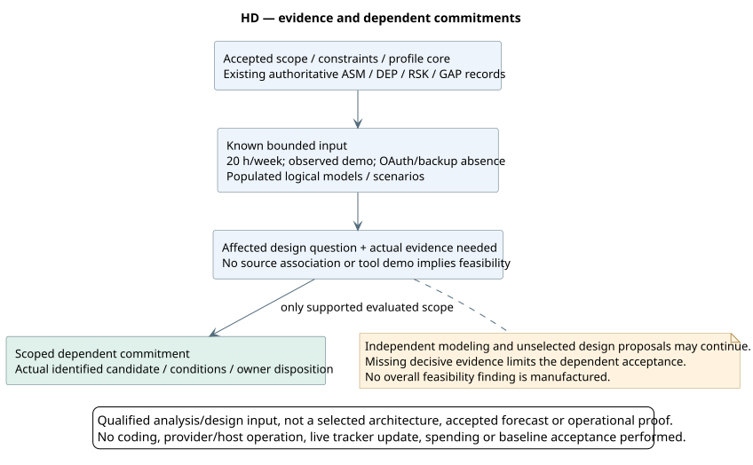
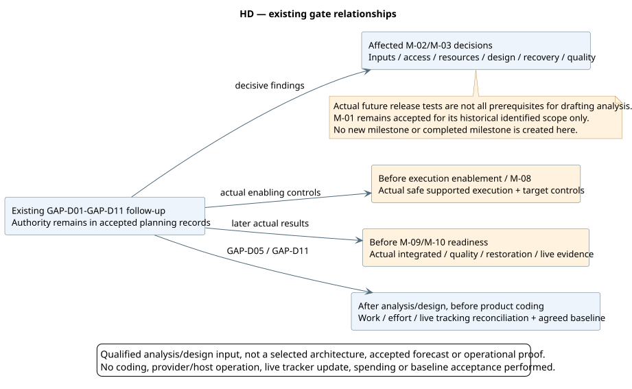
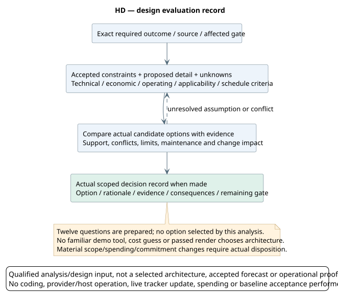
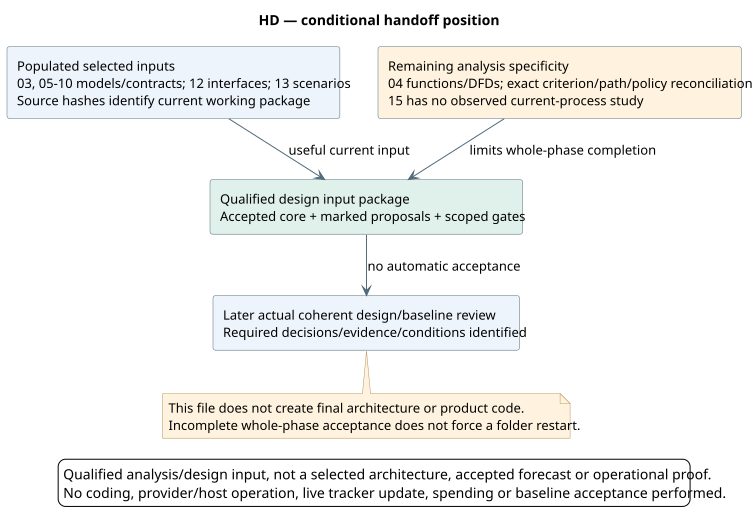
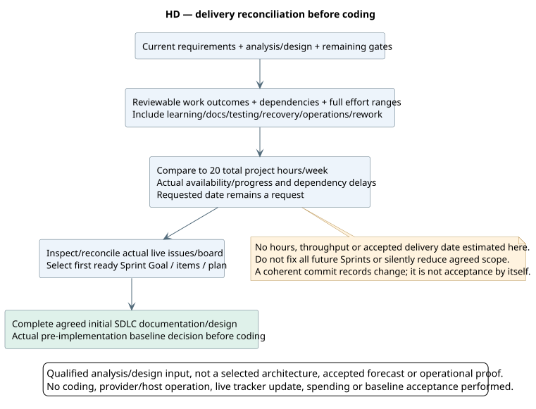
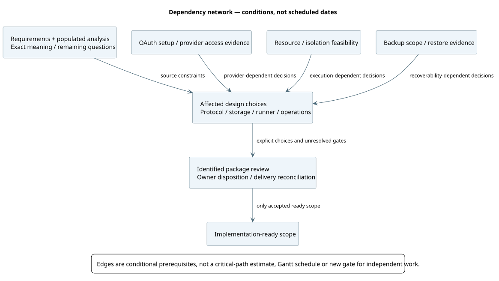

# Resumefolio — Feasibility, Dependencies and Design Handoff

> **Notation-alignment revision:** File 04 now contains functional decomposition and balanced DFDs. Earlier review findings/counts and their JSON/CSV evidence remain dated snapshots; references to an empty 04 describe that earlier candidate. Population does not automatically establish semantic sufficiency or close authoritative findings.

[Diagram types and reading guide](#diagram-types-and-reading-guide) · [Full diagram catalog](diagrams/README.md)

Owner: Farhad Valizadegan; sole delivery and operations owner. Revision: November 1, 2026.
Status: Populated conditional handoff working package. Five feasibility dimensions, eleven existing-gate mappings, twelve unselected design questions and twelve package assessments are recorded. Full feasibility, whole-analysis/design acceptance and product readiness are not established.

## Authoritative Inputs

- [Accepted scope](../01-project-planning/02-scope.md), [resources/constraints](../01-project-planning/05-resources-and-constraints.md), [ASM/DEP authority](../01-project-planning/06-assumptions-and-dependencies.md), [RSK authority](../01-project-planning/07-risks.md) and [GAP/accepted planning snapshot](../01-project-planning/10-planning-completion-criteria.md).
- [Feasibility study](../02-requirements-engineering/01-process-and-approach/02-feasibility-study.md), [SRS](../02-requirements-engineering/03-requirements-specification/requirements-specification.md), [questions/decisions](../02-requirements-engineering/07-change-and-baseline/open-questions-and-decisions.md), [baseline criteria](../02-requirements-engineering/07-change-and-baseline/requirements-review-and-baseline-criteria.md) and [shared findings](../02-requirements-engineering/06-validation-and-traceability/review-plan-and-findings.md).
- [Analysis guide](00-start-here.md), populated [domain](03-domain-model-and-object-oriented-view.md), [data](05-data-oriented-view.md), [scenarios](06-scenario-based-view.md), [states](07-state-based-view.md), [activities](08-control-flow-based-view.md), [rules](09-rule-based-view.md), [contracts](10-domain-constraints-and-operation-contracts.md), [review](11-model-consistency-traceability-and-review.md), [interfaces](12-interfaces-and-external-interactions.md) and [security/quality/operations](13-security-quality-and-operational-analysis.md).
- [Roadmap](../01-project-planning/08-roadmap-and-milestones.md), [agreed working method](../01-project-planning/09-working-method-and-change-control.md) and [local backlog index](../../Project-Management/product-backlog.md).

**Decision boundary:** This file prepares useful identified design inputs and states which commitments depend on what evidence. It does not select architecture/database/frontend/Git engine/runner, create a System Design package, change scope/spending, mark issues complete or authorize product coding. HD-F/G/D/P/W references are local analysis locators; existing ASM/DEP/RSK/GAP/RF/Q-D/PBI authority is retained.

## 1. Existing investigation authority

The requirements feasibility study says full feasibility is not established; its investigation framework and the accepted planning follow-up govern the work. Bounded observations elsewhere are useful evidence, not a reason to promote an entire dependency to Available or an assumption to Confirmed. This handoff does not create a competing risk/technical-findings/owner-decision register.

**Accepted inputs retained:** M-01 acceptance belongs to the identified historical candidate `511093e788b32dd9b68fb86ff5fff2ac21140672` under DEC-116, not every later working copy. The [accepted profile-update policy](../02-requirements-engineering/07-change-and-baseline/open-questions-and-decisions.md#owner-accepted-profile-update-policy) remains accepted: source edits do not update existing resumes automatically; selected apply and separately confirmed publication differ; independent text/other resumes/actual submitted material are preserved. No reacceptance of that bounded core is requested.

**Resource/scope constraints retained:** Laravel and OOP, one owner at 20 total project hours/week, existing server/available means, no assumed additional paid services, initial 10-user direction with workload still to define, future roughly 1,000-user direction without capacity proof. Preserve the existing demo/reference projects. Product AI, automatic translation and automatic old-demo migration are excluded as stated by source scope; no silent feature cut or newly added capability is made here.

| Dimension | Bounded known input | Missing assessment evidence | Current conclusion / limit |
|---|---|---|---|
| **HD-F01 — Economic** | Existing server/available-means constraint; no additional server or paid service assumed. | Actual permitted spend, recurring/storage/delivery/component costs, alternatives and solo maintenance cost/effort with source/date. | No supported whole-option affordability conclusion; do not quote a current price or approve spending from a screenshot/name. |
| **HD-F02 — Technical** | Populated logical models/contracts; dated 2-vCPU/4-GB/40-GB Ubuntu Laravel demo/service observations. | Combined workload, applicable provider access, real Git compatibility, actual execution boundaries, component compatibility and recovery design evidence. | Inventory and model structure support bounded design questions, not operational capacity or full-scope technical feasibility. |
| **HD-F03 — Operational** | One owner, 20 total project hours/week; interface/quality/recovery scenario definitions now populated. | Actual feasible maintenance/delivery/recovery procedures, dependencies, protected source/coverage and later scoped demonstrations. | No proven sustainable operation or usable restoration; avoid new facilities/on-call promises or workload outside available time. |
| **HD-F04 — Legal / contractual applicability** | Existing source asks for scoped provider/license/content/privacy/hosting applicability investigations. | Applicable current primary sources and actual intended data/service/content/component use, with source/date and needed specialist clarification. | No jurisdictional legal conclusion, policy approval or compliance certification made by this document. |
| **HD-F05 — Schedule** | Requested November 8, 2026 target and current 20 total project hours/week are known; local dates/Sprints are historical snapshots. | Full decomposed engineering effort ranges, dependencies, learning/testing/documentation/operations/rework and actual progress, then live tracking reconciliation. | No supported delivery forecast or target-feasibility result; neither silently compress verification nor reduce agreed scope. |

[Editable PlantUML](diagrams/handoff-evidence-dependent-commitment.puml) · [PNG](diagrams/handoff-evidence-dependent-commitment.png)

There is no averaged feasibility score. A technically plausible option can still fail budget, access, protection, maintenance or schedule constraints. Record actual source/date/method, evaluated scope, findings, limits, affected commitment and real disposition at its authoritative location. Provider/component/applicability terms need current authoritative investigation when selecting actual use; no fresh external policy/license/legal conclusion is claimed by this documentation.

## 2. Analysis dependencies

The following rows restate the existing GAP-D01–D11 follow-up with current bounded input. They do not change the parent status, move its gate or replace accepted planning wording. Farhad coordinates each row. An investigation plan is not a successful investigation.

| Local / existing parent | Existing context and current input | Needed for affected commitment | Existing dependent gate / independent work | Local work provenance |
|---|---|---|---|---|
| **HD-G01 / GAP-D01 — Server / combined workload / actual budget** | ASM-01, DEP-01, RSK-02, RSK-08. Existing allocation/guest/services partly observed; suitability unverified. | Actual workload/data/concurrency/resource/network/cost findings and defined performance/admission criteria. | **Gate:** Before accepting dependent resource/deployment design in M-03; actual relevant capacity/limits before capability/release acceptance. **May continue:** Define logical responsibilities and quality/resource measurement candidates without claiming the host supports the whole workload. | PBI-002, PBI-009, PBI-026 in [the local index](../../Project-Management/product-backlog.md) |
| **HD-G02 / GAP-D02 — Gmail / Calendar access and applicability** | ASM-02, DEP-03, RSK-06. OAuth not created; logical read/draft/send/calendar/local/sync boundaries specified. | Actual required account/operation capability/applicability/limits/cost and failure/reconnect findings. | **Gate:** Before accepting dependent M-02 integration requirements / M-03 design; verify required access before dependent development. **May continue:** Model local/provider roles, intended identities, selected operations and actual/unknown outcomes conditionally. | PBI-004, PBI-017, PBI-018 in [the local index](../../Project-Management/product-backlog.md) |
| **HD-G03 / GAP-D03 — Authentication / notification delivery** | ASM-03, DEP-04, RSK-07. Operational delivery is separate from user Gmail; actual suitability unverified. | Selected applicable delivery/configuration/access/limits/cost/failure/recovery evidence and later actual behavior. | **Gate:** Before accepting authentication delivery design in M-03; actual verification before affected capability/release acceptance. **May continue:** Define intended delivery/recipient/outcome and failure semantics without assuming a channel or claiming receipt. | PBI-005, PBI-010 in [the local index](../../Project-Management/product-backlog.md) |
| **HD-G04 / GAP-D04 — Recovery storage / coverage / usable state** | ASM-04, DEP-05, RSK-05. Owner says backups not configured; nine coverage subjects and 14 quality scenarios now available. | Actual protected destination/source/access/separation/cost, coverage/consistency and agreed loss/usable-state targets; later isolated restore evidence. | **Gate:** Before accepting recovery design in M-03; actual restoration/integrity/update-recovery evidence before M-09. **May continue:** Define recovery scenarios and evaluate candidate design constraints now; a completed live restore is not required just to write analysis. | PBI-006, PBI-027, PBI-028 in [the local index](../../Project-Management/product-backlog.md) |
| **HD-G05 / GAP-D05 — Time / effort / forecast** | ASM-05, RSK-01. 20 total hours/week is a confirmed input; full-scope time sufficiency remains unverified. | Engineering decomposition/effort ranges, dependencies/uncertainty and comparison with actual capacity/target. | **Gate:** After analysis/design, before accepted forecast or beginning product coding; revisit milestone/Sprint reviews. **May continue:** Prepare reviewable work outcomes and estimate inputs; do not assume old full-time rows or requested date are a forecast. | PBI-001, PBI-009 in [the local index](../../Project-Management/product-backlog.md) |
| **HD-G06 / GAP-D06 — Detailed inputs / access / lifecycle meaning** | ASM-06, RSK-04, RSK-09. Accepted explicit profile apply/publication/history core; detailed other policies remain proposed. | Exact required/incomplete-input, role/action/state, source-removal/concurrency/provider/retirement/correction and criterion/path sufficiency. | **Gate:** Before accepting affected M-02 requirements and dependent M-03 data/security design; later verify actual implemented scenarios. **May continue:** Use accepted core and marked proposals for independent domain/data/contracts; do not reopen accepted core or silently finalize unrelated detail. | PBI-008, PBI-010, PBI-012, PBI-016, PBI-024 in [the local index](../../Project-Management/product-backlog.md) |
| **HD-G07 / GAP-D07 — Domain / DNS / TLS / renewal** | DEP-02. resumefolio.de and a dated HTTPS response/demo route were observed; current administrative/renewal suitability not established. | Actual control/routing/certificate coverage/current configuration/renewal findings for intended environment. | **Gate:** Before accepting M-03 deployment configuration; actual live behavior before M-10. **May continue:** Identify intended browser/operational boundary and non-secret configuration needs; do not treat one page as whole-domain or release proof. | PBI-009, PBI-029 in [the local index](../../Project-Management/product-backlog.md) |
| **HD-G08 / GAP-D08 — Components / compatibility / licensing / maintenance** | DEP-06, RSK-10. Laravel/OOP constraints apply; some demo runtime/lockfile and local tools observed, not full application dependency validation. | Justified selected actual component versions/support/license/resource compatibility and realistic operating procedures from current primary findings. | **Gate:** At dependent M-03 technical selection and before affected implementation; actual procedures before M-09/release. **May continue:** Record selection questions/constraints/evaluation evidence; do not auto-select prototype database/frontend/Git engine/runner. | PBI-009, PBI-028 in [the local index](../../Project-Management/product-backlog.md) |
| **HD-G09 / GAP-D09 — Supported YAML / safe execution** | DEP-01, RSK-03. Conditional logical execution/attempt/output/target contracts populated; no suitable isolation environment demonstrated. | Actual supported syntax/triggers/isolation/permissions/secrets/network/resource/cleanup evidence and independent target approval. | **Gate:** Before accepting dependent M-03 execution design or enabling execution; verified controls before M-08. **May continue:** Specify limited supported behavior/enabling criteria and alternatives as questions; no project code execution on demo is authorized. | PBI-003, PBI-020, PBI-023 in [the local index](../../Project-Management/product-backlog.md) |
| **HD-G10 / GAP-D10 — Quantitative quality / effective limits** | ASM-01, DEP-01, RSK-02, RSK-08. 14 scenarios supply stimulus/environment/response/measure; no new numeric targets accepted. | Actual workload/units/threshold/aggregation, resource/admission/file/availability/client/accessibility criteria and evidence. | **Gate:** Relevant M-02 requirement / M-03 design acceptance; actual affected results before M-09/release. **May continue:** Define measures and candidate workload contexts without invented response, availability, quota, retention or recovery values. | PBI-002, PBI-013, PBI-026 in [the local index](../../Project-Management/product-backlog.md) |
| **HD-G11 / GAP-D11 — Requirements-to-work / live tracking / carryover** | RSK-01. Local backlog indexes 29 historical work packages; GitHub issues/project are live authority; remote state not queried here. | Exact reviewable requirement/design/work links, realistic decomposition/estimates, current actual issue/board assignments and outcome/carryover records. | **Gate:** Reconcile after analysis/design before product coding; record actual Sprint outcomes/carryover during execution reviews. **May continue:** Prepare local candidate work mapping and readiness conditions; no issue is complete or Sprint fixed merely from a local mention. | PBI-008, PBI-009, PBI-019 in [the local index](../../Project-Management/product-backlog.md) |

[Editable PlantUML](diagrams/handoff-existing-review-gates.puml) · [PNG](diagrams/handoff-existing-review-gates.png)

### Drafting versus accepting a dependent design

Independent conceptual modeling and bounded unselected design proposals can continue now. Do not demand every future release/load/restore result merely to write a requirement or analysis model. Before accepting a design whose decisive access/resource/recovery/isolation assumption is unresolved, obtain the specific findings or record a concrete evaluated conditional disposition within the existing gate. Actual execution controls, integrated capacity and demonstrated recovery still need real evidence before the existing enabling/capability/readiness gates.

All six ASM assumptions remain unverified in the authoritative planning record. DEP-01 is partly observed; DEP-05 explicitly records owner-reported absent backup setup; other whole-dependency suitability remains unverified. Known 20-hour availability does not validate ASM-05 full-scope sufficiency. A dated successful page, root SSH, lockfile version or local diagram generation does not verify provider access, real product Git hosting, full compatibility, safe jobs or usable recovery.

## 3. Options requiring later design

The records below are questions and comparison criteria, not option selections. For each eventual candidate option, record required outcome, constraints, actual support evidence, economic/operating/applicability/schedule effects, alternatives/conflicts, remaining exposure and actual scoped decision with identified revision. Do not equate familiar prototype components, a low component count or a rendered diagram with a justified design.

| Design record / question | Constraints that must survive | Comparison/evidence needed | Source / selected model context |
|---|---|---|---|
| **HD-D01 — Professional information / publication / history**. How will selected independent drafting, publication and actual submitted content be represented and updated? | Accepted no automatic propagation; preserve overrides/other resumes/actual sent material; apply and publish separately. | Compare candidate representations against source-removal, stale/concurrent edit, actual provenance, correction/retention and recovery cases; evaluate operating/resource cost. | GAP-D06, GAP-D04; [PRP-D04](../02-requirements-engineering/03-requirements-specification/profiles-resumes-and-portfolio.md#prp-d04-explicit-shared-source-update-rules), [PRP-D08](../02-requirements-engineering/03-requirements-specification/profiles-resumes-and-portfolio.md#prp-d08-clear-presentation-and-rendition-boundaries), [APP-D06](../02-requirements-engineering/03-requirements-specification/manual-application-management.md#app-d06-preserved-actual-submitted-copies), [APP-D07](../02-requirements-engineering/03-requirements-specification/manual-application-management.md#app-d07-correction-and-repeated-submissions), [BRL-D02](../02-requirements-engineering/03-requirements-specification/business-rules-and-data-lifecycle.md#brl-d02-shared-information-and-independent-tailoring); [SM-M01](07-state-based-view.md#sm-m01), [SM-M07](07-state-based-view.md#sm-m07), [RB-D02](09-rule-based-view.md#rb-d02), [RB-D06](09-rule-based-view.md#rb-d06) |
| **HD-D02 — Authorization across every entry**. How will exact current resource/action/state authority remain consistent across UI, direct files, provider/Git/output and operator paths? | No universal sign-in/admin/board scope; employer viewer needs no product account; current grant/session policy explicit. | Approved applicable action/state/caller matrix and representative direct/changed-grant/old-session/restore cases; justify implementation boundaries later. | GAP-D06, GAP-D09; [ACC-D03](../02-requirements-engineering/03-requirements-specification/accounts-authentication-and-permissions.md#acc-d03-resource-and-operation-authorization), [ACC-D04](../02-requirements-engineering/03-requirements-specification/accounts-authentication-and-permissions.md#acc-d04-cross-user-private-data-isolation), [ACC-D12](../02-requirements-engineering/03-requirements-specification/accounts-authentication-and-permissions.md#acc-d12-end-of-access-and-lifecycle-enforcement), [QSR-D05](../02-requirements-engineering/03-requirements-specification/quality-security-and-recovery-requirements.md#qsr-d05-identity-resource-isolation-and-changed-access); [IF-01](12-interfaces-and-external-interactions.md#if-01), [IF-02](12-interfaces-and-external-interactions.md#if-02), [IF-03](12-interfaces-and-external-interactions.md#if-03), [IF-06](12-interfaces-and-external-interactions.md#if-06), [RB-D01](09-rule-based-view.md#rb-d01) |
| **HD-D03 — PDF and file representation / serving**. How will selected current artifacts, language, generated/uploaded mode, provenance and actual file outcomes be maintained? | Page/live state, mode, link access and artifact availability independent; required actual history/reference integrity preserved. | Valid/invalid format/metadata/replacement/current availability and concurrent capacity cases; compare appropriate candidates with actual constraints. | GAP-D01, GAP-D06, GAP-D10; [PDF-D02](../02-requirements-engineering/03-requirements-specification/pdf-and-controlled-sharing.md#pdf-d02-uploaded-pdf-and-language-identity), [PDF-D03](../02-requirements-engineering/03-requirements-specification/pdf-and-controlled-sharing.md#pdf-d03-per-resume-download-choices), [PDF-D05](../02-requirements-engineering/03-requirements-specification/pdf-and-controlled-sharing.md#pdf-d05-direct-file-and-pdf-authorization), [PDF-D07](../02-requirements-engineering/03-requirements-specification/pdf-and-controlled-sharing.md#pdf-d07-explicit-live-revision-and-rendition-behavior), [AFO-D07](../02-requirements-engineering/03-requirements-specification/administration-files-and-operational-behavior.md#afo-d07-truthful-completion-and-interrupted-operation-handling); [IF-02](12-interfaces-and-external-interactions.md#if-02), [IF-03](12-interfaces-and-external-interactions.md#if-03), [RB-D03](09-rule-based-view.md#rb-d03), [RB-D04](09-rule-based-view.md#rb-d04), [RB-D14](09-rule-based-view.md#rb-d14) |
| **HD-D04 — Provider account / operation / sync**. How will intended actual provider capability and local/provider field authority be represented and reconciled? | Product authority differs from provider capability; local unlink is not provider delete or dependent on active provider write; no blind send/replay. | Actual access/applicability findings, selected mappings/time/direction/conflict/reconnect and ambiguous attempt cases; exact draft/connection contract gaps visible. | GAP-D02, GAP-D06; [EGC-D01](../02-requirements-engineering/03-requirements-specification/email-calendar-and-google-integration.md#egc-d01-authorized-connection-and-account-context), [EGC-D05](../02-requirements-engineering/03-requirements-specification/email-calendar-and-google-integration.md#egc-d05-deliberate-send-and-truthful-outcome), [EGC-D08](../02-requirements-engineering/03-requirements-specification/email-calendar-and-google-integration.md#egc-d08-explicit-synchronization-contract), [EGC-D11](../02-requirements-engineering/03-requirements-specification/email-calendar-and-google-integration.md#egc-d11-disconnect-revocation-and-reconnect), [EGC-D12](../02-requirements-engineering/03-requirements-specification/email-calendar-and-google-integration.md#egc-d12-bounded-failures-recovery-and-feasibility-evidence); [IF-04](12-interfaces-and-external-interactions.md#if-04), [IF-05](12-interfaces-and-external-interactions.md#if-05), [SM-M08](07-state-based-view.md#sm-m08), [SM-M09](07-state-based-view.md#sm-m09), [SM-M10](07-state-based-view.md#sm-m10), [RB-D07](09-rule-based-view.md#rb-d07), [RB-D08](09-rule-based-view.md#rb-d08) |
| **HD-D05 — Local/client interaction and accessibility**. Which supported clients/representations and interaction patterns meet agreed usability/quality outcomes? | Exact context/actions/errors and pending/unknown meanings visible; manual English/German content preserved; no assumed native app or conformance. | Defined consumer/viewport/input/language/accessibility criteria, actual representative task/round-trip cases and workload boundaries. | GAP-D06, GAP-D10; [EIF-D02](../02-requirements-engineering/03-requirements-specification/external-interface-requirements.md#eif-d02-clear-operable-user-interaction), [EIF-D10](../02-requirements-engineering/03-requirements-specification/external-interface-requirements.md#eif-d10-consistent-exchange-meaning-and-lifecycle), [QSR-D01](../02-requirements-engineering/03-requirements-specification/quality-security-and-recovery-requirements.md#qsr-d01-response-performance-under-defined-workloads), [QSR-D03](../02-requirements-engineering/03-requirements-specification/quality-security-and-recovery-requirements.md#qsr-d03-operable-accessible-and-compatible-interaction); [IF-01](12-interfaces-and-external-interactions.md#if-01), [IF-02](12-interfaces-and-external-interactions.md#if-02), [SQ-Q01](13-security-quality-and-operational-analysis.md#sq-q01), [SQ-Q03](13-security-quality-and-operational-analysis.md#sq-q03) |
| **HD-D06 — Real Git and collaboration**. Which actual hosting/transport/component arrangement supports agreed real client operations and metadata? | Real clone/fetch/pull/push, exact ref rights, evaluated review context, lifecycle/recovery; browser simulation/development GitHub/admin SSH not proof. | Supported client/transport/credential and protected-ref/merge/history/metadata/recovery evidence; compare costs, capacity, maintenance and license applicability. | GAP-D01, GAP-D06, GAP-D08; [GIT-D03](../02-requirements-engineering/03-requirements-specification/git-hosting-and-collaboration.md#git-d03-real-clone-fetch-pull-and-push), [GIT-D07](../02-requirements-engineering/03-requirements-specification/git-hosting-and-collaboration.md#git-d07-controlled-merge-and-conflict-outcomes), [GIT-D10](../02-requirements-engineering/03-requirements-specification/git-hosting-and-collaboration.md#git-d10-lifecycle-capacity-and-recovery), [EIF-D06](../02-requirements-engineering/03-requirements-specification/external-interface-requirements.md#eif-d06-real-git-client-interoperability); [IF-06](12-interfaces-and-external-interactions.md#if-06), [SM-M13](07-state-based-view.md#sm-m13), [RB-D11](09-rule-based-view.md#rb-d11) |
| **HD-D07 — Conditional workflow execution**. Which supported execution arrangement can satisfy actual isolation/resource/secret/network/output/cleanup requirements? | No execution enabled merely by valid YAML/repository grant or available CPU; separate target authority; actual attempt/cancel/unknown result distinct. | Supported contract and actual suitable isolated enabling-control evidence plus workload/operation/maintenance cost; no runner or hosting placement selected here. | GAP-D01, GAP-D08, GAP-D09, GAP-D10; [YML-D01](../02-requirements-engineering/03-requirements-specification/yaml-workflows-and-cicd.md#yml-d01-defined-supported-workflow-contract), [YML-D04](../02-requirements-engineering/03-requirements-specification/yaml-workflows-and-cicd.md#yml-d04-isolation-and-untrusted-code-boundary), [YML-D06](../02-requirements-engineering/03-requirements-specification/yaml-workflows-and-cicd.md#yml-d06-resource-admission-and-limits), [YML-D10](../02-requirements-engineering/03-requirements-specification/yaml-workflows-and-cicd.md#yml-d10-separate-controlled-deployment-stage), [YML-D12](../02-requirements-engineering/03-requirements-specification/yaml-workflows-and-cicd.md#yml-d12-feasibility-operational-guidance-and-enabling-gate); [IF-07](12-interfaces-and-external-interactions.md#if-07), [SM-M14](07-state-based-view.md#sm-m14), [SM-M15](07-state-based-view.md#sm-m15), [RB-D12](09-rule-based-view.md#rb-d12), [RB-D13](09-rule-based-view.md#rb-d13), [SQ-Q07](13-security-quality-and-operational-analysis.md#sq-q07) |
| **HD-D08 — Runtime / database / frontend / components**. Which final component/dependency design fits the stated platform and whole engineering/operating constraints? | Laravel and OOP mandated; existing demo tools/services are observations, not final database/frontend/architecture/Git/runner selections. | Current primary version/support/license/compatibility/security/resource findings and meaningful alternatives; include solo upkeep and full-scope integration. | GAP-D01, GAP-D08; [QSR-D02](../02-requirements-engineering/03-requirements-specification/quality-security-and-recovery-requirements.md#qsr-d02-combined-capacity-and-bounded-resource-use), [QSR-D14](../02-requirements-engineering/03-requirements-specification/quality-security-and-recovery-requirements.md#qsr-d14-maintainable-verifiable-and-recoverable-changes), [DOM-D07](../02-requirements-engineering/03-requirements-specification/domain-requirements-and-constraints.md#dom-d07-verify-reuse-and-licensing-before-adoption), [DOM-D08](../02-requirements-engineering/03-requirements-specification/domain-requirements-and-constraints.md#dom-d08-evidence-based-operation-within-constraints); [SQ-Q02](13-security-quality-and-operational-analysis.md#sq-q02), [SQ-Q14](13-security-quality-and-operational-analysis.md#sq-q14) |
| **HD-D09 — Backup / recovery / restored authority**. How will a defined consistent protected source support scoped usable recovery without stale-right or external replay? | Backups not configured; actual history not latest-live reconstruction; restored bytes not usable state; no live overwrite or automatic grant/send/deploy revival. | Actual coverage/include-reconstruct-exclude decisions, accessible independent source/cost and criteria; compare candidates before recovery design acceptance; actual drill later at readiness gate. | GAP-D04, GAP-D06, GAP-D08; [QSR-D10](../02-requirements-engineering/03-requirements-specification/quality-security-and-recovery-requirements.md#qsr-d10-defined-protected-and-observable-backups), [QSR-D11](../02-requirements-engineering/03-requirements-specification/quality-security-and-recovery-requirements.md#qsr-d11-demonstrated-restoration-and-recovery-targets), [QSR-D12](../02-requirements-engineering/03-requirements-specification/quality-security-and-recovery-requirements.md#qsr-d12-safe-restored-access-and-external-state-reconciliation); [IF-08](12-interfaces-and-external-interactions.md#if-08), [SM-M17](07-state-based-view.md#sm-m17), [RB-D16](09-rule-based-view.md#rb-d16), [SQ-Q10](13-security-quality-and-operational-analysis.md#sq-q10), [SQ-Q11](13-security-quality-and-operational-analysis.md#sq-q11), [SQ-Q12](13-security-quality-and-operational-analysis.md#sq-q12) |
| **HD-D10 — Delivery / deployment / maintainable change**. Which scoped facilities and procedures support identity notifications, exact target deployment and compatible failure recovery? | User Gmail not identity/recovery mail; build/merge not deploy authority; code rollback is not universal data recovery; preserve demo/reference projects. | Actual facility/control/domain/TLS/version/operator evidence and failure/retry/irreversible-change cases; no purchase, target or migration action approved. | GAP-D03, GAP-D07, GAP-D08, GAP-D04; [EIF-D09](../02-requirements-engineering/03-requirements-specification/external-interface-requirements.md#eif-d09-operational-configuration-and-recovery-boundaries), [YML-D10](../02-requirements-engineering/03-requirements-specification/yaml-workflows-and-cicd.md#yml-d10-separate-controlled-deployment-stage), [QSR-D14](../02-requirements-engineering/03-requirements-specification/quality-security-and-recovery-requirements.md#qsr-d14-maintainable-verifiable-and-recoverable-changes), [AFO-D12](../02-requirements-engineering/03-requirements-specification/administration-files-and-operational-behavior.md#afo-d12-version-specific-operational-guidance-and-readiness); [IF-07](12-interfaces-and-external-interactions.md#if-07), [IF-08](12-interfaces-and-external-interactions.md#if-08), [SM-M15](07-state-based-view.md#sm-m15), [SQ-Q14](13-security-quality-and-operational-analysis.md#sq-q14) |
| **HD-D11 — Work / reports / explicit cross-module effects**. How will project/work/Git/provider/application references support deliberate navigation/reports/automation without implied mutations? | Task/item acceptance and Sprint period/goal remain distinct; one coherent Sprint Backlog; cross-module association does not grant access/send/complete. | Exact report/link/automation input/outcome and authority, correction/ownership/current-state/restore cases, scope and workload; no extra autonomous action added. | GAP-D06, GAP-D11; [PKS-D07](../02-requirements-engineering/03-requirements-specification/projects-kanban-and-sprints.md#pks-d07-sprint-goal-and-selected-backlog-items), [PKS-D09](../02-requirements-engineering/03-requirements-specification/projects-kanban-and-sprints.md#pks-d09-explicit-completion-and-sprint-end-outcomes), [PKS-D10](../02-requirements-engineering/03-requirements-specification/projects-kanban-and-sprints.md#pks-d10-deliberate-cross-module-links-reports-and-automation), [DOM-D03](../02-requirements-engineering/03-requirements-specification/domain-requirements-and-constraints.md#dom-d03-authorization-follows-the-resource-and-operation); [SM-M11](07-state-based-view.md#sm-m11), [SM-M12](07-state-based-view.md#sm-m12), [RB-D09](09-rule-based-view.md#rb-d09), [RB-D10](09-rule-based-view.md#rb-d10), [IF-01](12-interfaces-and-external-interactions.md#if-01) |
| **HD-D12 — Quality/resource/operating observability**. How will selected actual quality, effective limits, evidence and sustainable operator responses be supported? | No invented numerical target, unlimited scale, immutable audit or continuous staffing; 20 hours/week includes all project work. | Agreed metrics/workload/units/thresholds and actual combined-capacity/failure/secret-safe evidence/procedure results; compare maintenance/cost consequences. | GAP-D01, GAP-D05, GAP-D08, GAP-D10; [QSR-D01](../02-requirements-engineering/03-requirements-specification/quality-security-and-recovery-requirements.md#qsr-d01-response-performance-under-defined-workloads), [QSR-D02](../02-requirements-engineering/03-requirements-specification/quality-security-and-recovery-requirements.md#qsr-d02-combined-capacity-and-bounded-resource-use), [QSR-D04](../02-requirements-engineering/03-requirements-specification/quality-security-and-recovery-requirements.md#qsr-d04-observable-availability-and-controlled-degradation), [QSR-D13](../02-requirements-engineering/03-requirements-specification/quality-security-and-recovery-requirements.md#qsr-d13-useful-restricted-operational-evidence), [QSR-D14](../02-requirements-engineering/03-requirements-specification/quality-security-and-recovery-requirements.md#qsr-d14-maintainable-verifiable-and-recoverable-changes); [SQ-Q01](13-security-quality-and-operational-analysis.md#sq-q01), [SQ-Q02](13-security-quality-and-operational-analysis.md#sq-q02), [SQ-Q04](13-security-quality-and-operational-analysis.md#sq-q04), [SQ-Q13](13-security-quality-and-operational-analysis.md#sq-q13), [SQ-Q14](13-security-quality-and-operational-analysis.md#sq-q14) |

[Editable PlantUML](diagrams/handoff-design-question-record.puml) · [PNG](diagrams/handoff-design-question-record.png)

A material conflict with full scope, budget/resources or requested commitment needs actual owner disposition of a concrete reviewed proposal, not a silent reduction or presumed purchase. Choosing an implementation mechanism does not by itself settle every product-policy detail; preserve explicit independent source/apply/publication/history and exact current resource/effect context. No endpoint/schema, transaction/locking/idempotency protocol, physical data layout, target or recovery topology is selected here.

## 4. Design handoff package

**Current verdict: useful conditional design input; whole analysis/design baseline is not accepted.** Populated working models and current interface/quality records can support specific design proposals, while exact function/flow semantic review, trace/policy and decisive dependency findings remain visible. All-SDLC initial documentation, actual coherent review and pre-coding agreement still apply.

| Package record | Identified input / observed state | Condition before claiming the dependent package complete |
|---|---|---|
| **HD-P01 — Accepted intent, scope and core rules** | Scope, accepted planning snapshot and explicit accepted profile-update entry. **Position:** Available identified input; accepted core preserved. | Retain exact full Version 1 scope/constraints and source acceptance boundaries; do not reopen core or silently approve every detailed proposal. **Context:** DEC-116; PRP-D04; accepted profile policy |
| **HD-P02 — Logical functions and balanced flows** | The earlier candidate contained five To develop prompts. File 04 now contains decomposition and balanced DFDs. **Position:** Population gap superseded; semantic sufficiency review remains. | Populate logical responsibilities/decomposition and named balanced data flows; activities/context pictures are not a completed DFD package. **Context:** SA-F01; RF-D02; 04; DA-F01–DA-F13 |
| **HD-P03 — Conceptual domain/data meaning** | 53 domain concepts, ten class views and one package view, 34 dictionary subjects and nine ER views. **Position:** Populated working input, not accepted physical data design. | Review identity/authority/references/history and proposed relationship bounds against exact source cases; choose physical representation only through justified design. **Context:** 03; 05; BRL-D; Q-D06–Q-D14 |
| **HD-P04 — Selected behavior and operation contracts** | 16 sequence models, 18 state subjects/128 transitions, 17 activities/276 steps, 18 rule tables/131 rows, 18 constraints/39 contracts. **Position:** Populated selected models with supporting/adjacent path limits. | Reconcile exact normal/denied/failed/partial/unknown/concurrent/correction/recovery semantics; selected mappings do not exhaust every operation/criterion. **Context:** 06–10; SA-F03/05; RF-D02 |
| **HD-P05 — External interaction contracts** | IF-01–IF-08, 27 bounded cases and eight interface views now populated. **Position:** Logical contract inputs available; transports/schemas/clients not all selected. | Use exact authority/identity/revision/language/time/effect boundaries; resolve affected compatibility and provider/consumer evidence before dependent acceptance. **Context:** 12; EIF-D01–EIF-D10; GAP-D02/03/07/09 |
| **HD-P06 — Security/quality/operating constraints** | 24 conditional authority rows, 12 trust cases, 14 quality scenarios and nine recovery subjects now populated. **Position:** Scenario/constraint inputs available; no approved full permission matrix or implemented/verified controls/numeric targets. | Set affected measurable criteria/policy and actual enabling evidence at correct gate; no diagram or named tool becomes security/capacity/recovery proof. **Context:** 13; QSR-D01–QSR-D14; GAP-D04/06/09/10 |
| **HD-P07 — Exact semantic trace and cross-view review** | 157 candidate records / 470 criterion locators retained; SA-RV02 contains 20 bounded documentary walkthroughs and historical 116/41 structured association counts. **Position:** Trace structure exists; full criterion/path sufficiency remains partial; 12/13 subsequently changed source associations. | Use the SA-RV03 current trace register and complete its explicit criterion gaps; do not call old association counts current or coverage percentages. **Context:** 11; RF-D01–RF-D05; GAP-D11 |
| **HD-P08 — Feasibility and decisive dependencies** | Five dimensions and eleven existing GAP mappings in this file; authoritative ASM/DEP/RSK records remain governing. **Position:** Full feasibility not established; bounded observations do not close assumptions. | Review actual findings against affected commitments; preserve independent modeling while scoped dependent acceptance waits for evidence. **Context:** Feasibility study; ASM-01–ASM-06; DEP-01–DEP-06; GAP-D01–GAP-D11 |
| **HD-P09 — Actual operating/recovery boundary** | Dated demo inventory; OAuth absent; backups not configured; current delivery, isolation, combined capacity and usable recovery unverified. **Position:** Known conditions recorded; capability readiness not claimed. | Resolve actual design-enabling evidence where required; actual controlled provider/host/recovery verification remains at its later applicable gate. **Context:** 13; GAP-D01–D04/07–D10 |
| **HD-P10 — Identified candidate and change scope** | Fresh input-file manifest/source hashes plus this revision output hashes and a local candidate identifier. **Position:** Current package can be reviewed as an identified working candidate; no new accepted Git baseline. | Actual acceptance must name exact candidate/scope/conditions/evidence/remaining gates; changes trigger targeted impact review. **Context:** RBC-D01; 09 working method; 11 evidence |
| **HD-P11 — Delivery and pre-implementation agreement** | 20 hours/week; provisional requested date/local tracking; planned reconciliation route below. **Position:** Forecast/backlog/Sprint assignments not accepted or remotely verified by this document. | Complete agreed initial SDLC documentation/design and tracking reconciliation and record pre-implementation baseline before coding. **Context:** GAP-D05/GAP-D11; planning working method/roadmap |
| **HD-P12 — Actual review/owner disposition** | Accepted core/planning decisions exist for their scope; no new whole-analysis/M-02/M-03 decision is made here. **Position:** This file supplies a conditional handoff candidate, not accepted design or release readiness. | Record actual coherent candidate review and relevant owner decision only when performed; do not infer acceptance from document completion or ask to reaccept settled core. **Context:** DEC-116; RBC-D; roadmap M-02/M-03; RF-D05 |

[Editable PlantUML](diagrams/handoff-package-position.puml) · [PNG](diagrams/handoff-package-position.png)

### Identified current artifact inventory

| Input family | Current counted structure | Interpretation |
|---|---|---|
| Domain/data | 53 concepts; ten class views and one package view; 34 dictionary subjects; nine ER views | Conceptual responsibilities/identity/authority, not accepted physical schema or all proposed multiplicities |
| Interactions/states/activities | 16 sequence models; 18 state subjects/128 transitions; 17 activities/276 steps | Selected modeled behavior and exceptional observations, not runtime proof |
| Rules/contracts | 18 decision tables/131 rows; 18 typed constraints; 39 selected operation contracts | Exact conditions/effects/frames and supporting-path limits; not exhaustive criterion sufficiency |
| Interfaces | Eight existing IF families; 27 bounded cases | Logical operation/account/resource/result meaning, not selected transport/schema or actual external access |
| Security/quality/recovery | 24 conditional authority rows; 12 trust cases; 14 quality scenarios; nine recovery subjects | Proposed scoped policies/evidence contracts, not implemented controls or measured results |
| Function/process evidence | 04 is now populated with functions/DFDs; 15 still has no observed current-process study | Review exact logical function/flow semantics; do not invent measured process bottlenecks or make optional research a blanket new gate |

The source-context inventory for populated views 03/05–13 has **133 candidates with direct structured associations and 24 without** out of 157. It excludes this handoff summary, textual mentions and unproved derived intent links. The 24 currently unassociated candidates are high-level business/user/domain intent records; this is not a statement their capabilities are absent or that all other criteria are covered. Review justified direct/derived links. The earlier SA-RV02 116/41 counts belong to its earlier snapshot before 12/13; neither count is a functional coverage percentage.

[The 157-row current source-context index](evidence/handoff-source-context-index-2026-11-01.csv) preserves the exact candidate/source/associated element list. The 470 proposed criterion locators remain unchanged; this file does not automatically convert candidate associations or the 20 earlier bounded walkthroughs into full exact-criterion coverage. Existing RF-D01–RF-D05 and Q-D gates are not closed.

### Candidate identity and actual acceptance record

[The handoff input manifest](evidence/handoff-input-manifest-2026-11-01.csv) records exact source hashes for the earlier handoff candidate. [Handoff review evidence](evidence/design-handoff-review-2026-11-01.json) records the input/output fingerprints and a local candidate identifier derived from them, excluding the self-referential review JSON hash. This identifies the earlier working package, not a new Git commit or accepted baseline. A change to sources, actual options or evidence requires targeted impact review and updated candidate identity.

| Field for a later actual disposition | Current position |
|---|---|
| Exact candidate / scope / actor | Historical fingerprinted package retained; current review revision is identified by SA-RV03; eventual disposition must identify its actual reviewed scope and Farhad as decision-maker |
| Actual review method / findings / evidence | This task performs document/source/artifact checks only; actual semantic/option/owner reviews must record what was really inspected |
| Outcome / limits / remaining prerequisites | No new whole-analysis, M-02/M-03, implementation or release acceptance decision is recorded; retain existing independent gates |
| Impact on requirements/design/work/cost/schedule | Questions and reconciliation route supplied; no final component option, spending, scope/date or live assignment changed |

The existing planning acceptance decision is preserved. A completed contract, populated folder, model count, successful syntax check or coherent commit is not a substitute for actual scoped acceptance. Previously accepted profile behavior is not resubmitted as an unresolved question.

## 5. Delivery reconciliation

The local backlog is an index of 29 provisional historical work packages. GitHub issues and the private delivery project hold current work/assignments/state; no remote state was queried or changed here. The PBI references below preserve local provenance, not exact semantic requirement coverage or actual completion.

| Reconciliation record | Reviewable output | Local provenance / scope limit |
|---|---|---|
| **HD-W01 — Decompose full engineering work** | Break features/investigations/docs/design/implementation/integration/testing/security/accessibility/recovery/operating work and learning/rework into reviewable bounded outcomes. | PBI-008, PBI-009, PBI-025, PBI-026, PBI-027, PBI-028 in [the local index](../../Project-Management/product-backlog.md). Model/diagram count is not effort. Full agreed scope retained; no new issue or fixed Sprint assignment created. |
| **HD-W02 — Reconcile requirement/model/work links** | For actual work, identify exact candidate/criterion, applicable contract/interface/quality/design and completion evidence rather than a broad similar-name citation. | PBI-008, PBI-009, PBI-019 in [the local index](../../Project-Management/product-backlog.md). Existing IDs are local index provenance only; issue descriptions/acceptance/remote state require actual later inspection. |
| **HD-W03 — Order decisive prerequisites** | Separate independent refinement from blocked consequential work; provider access, safe execution, current authority/recovery/design conditions precede the affected commitment. | PBI-002, PBI-003, PBI-004, PBI-005, PBI-006 in [the local index](../../Project-Management/product-backlog.md). Do not execute arbitrary code/restore to obtain a document check; do not make every future release test a prerequisite for writing analysis. |
| **HD-W04 — Estimate complete work after analysis/design** | Record effort ranges, assumptions, confidence/unknowns, dependency delays and evidence for all engineering activity; compare against actual progress. | PBI-001, PBI-009 in [the local index](../../Project-Management/product-backlog.md). No estimate/date derived in this task; requested November 8 remains request, not a forecast. |
| **HD-W05 — Apply usable solo capacity** | Use 20 total project hours/week for learning, docs, design, implementation, tests and operation within the same available time; account for unavailable time/dependencies explicitly. | PBI-001 in [the local index](../../Project-Management/product-backlog.md). Earlier full-time rows are historical/need scoped wording reconciliation; do not double-count available time or treat weekly hours as throughput. |
| **HD-W06 — Reconcile live issues/board and local snapshots** | After current design/effort inputs, inspect actual GitHub work/board, reconcile dependencies/priority/dates/assignments and preserve historical facts. | PBI-008, PBI-009, PBI-019 in [the local index](../../Project-Management/product-backlog.md). No remote query/update, message, current completion claim, accepted schedule or new scope/spending decision here. |
| **HD-W07 — Plan first ready Sprint and record checkpoints** | Select a concrete Sprint Goal, ready items and plan under actual available capacity; review actual outcomes/carryover and keep coherent change commits. | PBI-019, PBI-025, PBI-028 in [the local index](../../Project-Management/product-backlog.md). Do not freeze all future Sprints now. Commit is a traceable change checkpoint, not owner stage acceptance or authorization to code. |

[Editable PlantUML](diagrams/handoff-delivery-reconciliation.puml) · [PNG](diagrams/handoff-delivery-reconciliation.png)

### Capacity and target discipline

Use **20 total project hours/week** once across learning, documentation, investigation, design, coding, integration, testing, maintenance and rework. Do not treat it as 20 coding hours plus free testing/operations time, or infer throughput from it. Compare full effort ranges and dependency/availability assumptions after the relevant analysis/design decomposition. No hours or delivery date is estimated by this revision.

November 8, 2026 Europe/Berlin remains the requested Version 1 target, not an accepted evidence-based forecast. Initial 10 users is not 10 concurrent worst-case jobs; future roughly 1,000 users is a direction, not proven initial capacity. Older full-time wording and historical local Sprint dates need scoped reconciliation against the confirmed input; this file does not silently retime or rewrite the historical planning baseline.

Backlog items can be refined during requirements/analysis/design. Investigations/docs/testing/operating work also belong in the work plan. Before product implementation, reconcile the agreed initial SDLC/design package, estimates, milestones and actual tracker, then record the applicable pre-implementation agreement. At each Sprint planning select a feasible current goal/ready items/plan; future Sprints are not fixed now. At review record actual outcomes and explicit incomplete-work disposition, not automatic carryover.

## 6. Evidence and review limits

| Evidence class | What it supports | What it does not prove |
|---|---|---|
| Accepted scope/planning/core decision | Exact recorded intended scope/constraint/behavior under its acceptance boundary | Every later proposed detail, current working revision or dependent capability |
| Owner input | 20 hours/week; OAuth not created; backups not configured | Full-scope schedule sufficiency, provider operation, actual destination or usable recovery |
| Historical guest/demo inspection | Dated 2 vCPU/4 GB/40 GB Ubuntu demo and observed web/database/PHP/Laravel inventory | Current combined capacity, final stack selection, product health/security, full Git or safe execution |
| Logical models/source links | Identified conceptual subjects, state/operation/rule/interface/quality assumptions and consistency checks | Full exact criterion/path sufficiency, real controls or application behavior |
| This fingerprinted handoff package | Historical source/output identity plus traceable dependency/questions/checklist; use SA-RV03 for the revised review snapshot | A favorable full feasibility assessment, final architecture, accepted forecast, actual owner approval or permission to code |

Current primary findings register(s), official-source applicability notes and dependency records retain their exact source/date/status. Later package/provider/license/support/domain/operating decisions must use actual current authoritative evidence; no current external terms, price or legal applicability is newly verified here. No code/secret/configuration read on the host, provider operation, message, Git transfer, job, deployment, backup/restore or new service purchase is performed.

Prior SA-RV02 reports and 12/13 review evidence describe their own source snapshots. This file supersedes their file-14 placeholder statements only for this revision; it does not rewrite historical counts or automatically close parents. The fresh input manifest retains these records as sources and exposes their dates/limits.

## 7. Concrete continuation route

1. Review the populated 04 decomposition/DFDs against existing DA-F meanings, exact criteria and source cases; no folder rebuild is needed.
2. Reconcile affected exact intent/criterion/path/policy gaps on the current 03/05–13 package and qualified handoff inputs. Preserve accepted source/apply/publication/history behavior; address credential/draft/lifecycle/supporting path detail only where required.
3. Develop specific System Design candidates from the twelve question records, with explicit constraints/alternatives/evidence and scoped dependent gates. Obtain decisive findings before accepting the commitments that depend on them, while independent proposal work continues.
4. Revisit Planning → Requirements → Analysis → Design with identified current artifacts, full effort/work/tracker reconciliation and actual applicable owner disposition. Preserve historical accepted planning and prior evidence; do not equate that review loop with restarting all work.
5. Before product coding, complete the agreed initial SDLC documentation/design and pre-implementation agreement. Actual implementation/capability/quality/recovery/release checks remain at their appropriate later gates.

## 8. Review Status

File 14 is now populated with five feasibility-dimension assessments, eleven mappings to existing gates, twelve unselected design questions, twelve handoff assessments, seven delivery-reconciliation inputs, current source/context manifests and five PlantUML views. The logical design handoff is conditional; full feasibility and whole-analysis/design readiness are not claimed.

Download the [dependency/gate matrix](evidence/handoff-dependency-gates-2026-11-01.csv), [design-question matrix](evidence/handoff-design-questions-2026-11-01.csv), [package-assessment matrix](evidence/handoff-package-assessment-2026-11-01.csv), [delivery-reconciliation matrix](evidence/handoff-delivery-reconciliation-2026-11-01.csv), [source-context index](evidence/handoff-source-context-index-2026-11-01.csv) and [input manifest](evidence/handoff-input-manifest-2026-11-01.csv). [Review evidence](evidence/design-handoff-review-2026-11-01.json) records exact bounded checks.

No new numerical quality/recovery/resource target, architecture/component choice, owner baseline approval, accepted forecast, fixed Sprint, tracker mutation, Git commit or product implementation is created. Accepted core and existing review gates remain authoritative.

[Diagram catalog](diagrams/README.md) · [System Analysis index](README.md)

## Diagram Types and Reading Guide

This network complements the existing dependency matrices. It deliberately contains no invented dates or accepted forecast. File 04 is now populated; earlier scaffold descriptions and the previous handoff fingerprint are historical. The notation-alignment evidence identifies this revision. Actual semantic review, feasibility evidence and scoped acceptance remain required; the old handoff fingerprint must not be presented as identifying these new files.

[Editable source](diagrams/handoff-dependency-network.puml) · [PNG](diagrams/handoff-dependency-network.png)
