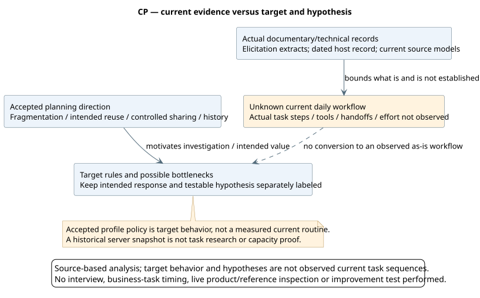
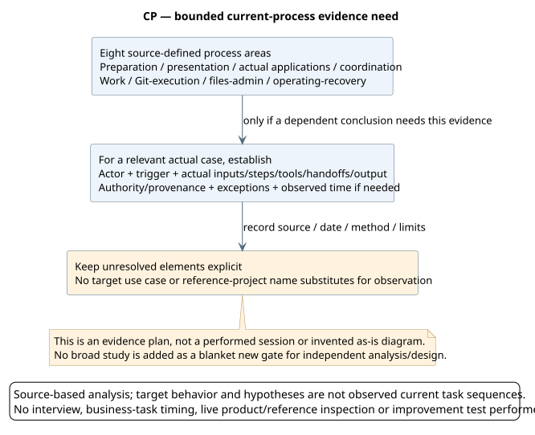
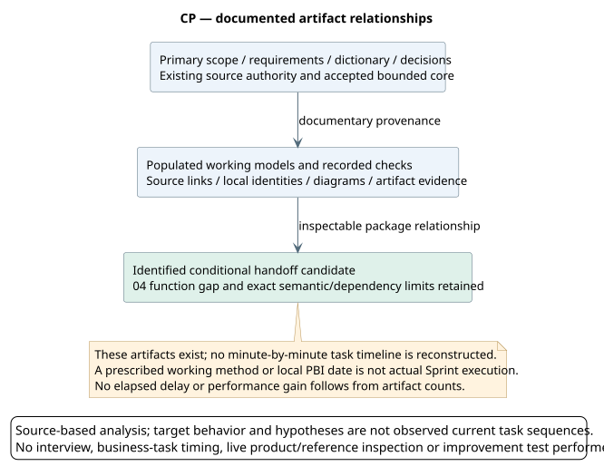
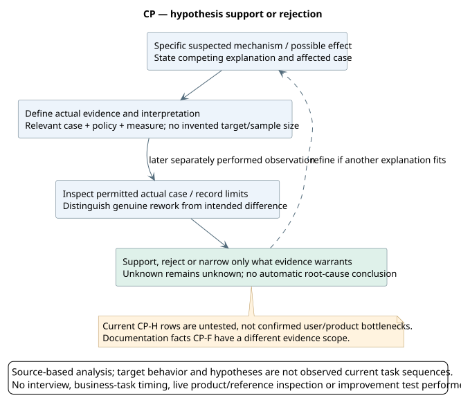
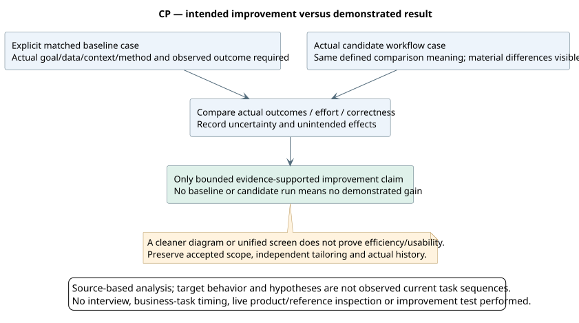
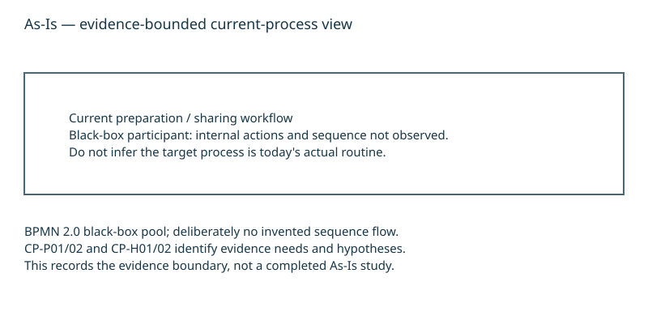
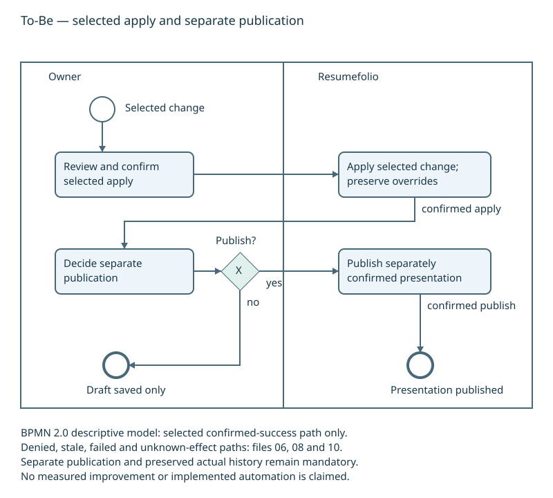

# Resumefolio — Current Processes and Bottleneck Analysis

> **Notation-alignment revision:** File 04 now contains functional decomposition and balanced DFDs. Earlier review findings/counts and their JSON/CSV evidence remain dated snapshots; references to an empty 04 describe that earlier candidate. Population does not automatically establish semantic sufficiency or close authoritative findings.

[Diagram types and reading guide](#diagram-types-and-reading-guide) · [Full diagram catalog](diagrams/README.md)

Owner: Farhad Valizadegan. Updated: November 1, 2026.
Status: Populated source-based analysis; actual daily-task observations and measured improvement results are not available. Not whole-phase acceptance.

## 1. Purpose and Evidence Basis

Separate accepted problem direction, actual documentary/technical evidence, intended product behavior and untested explanations. These are different kinds of evidence. The records below cover the agreed product scope without inventing how the owner currently performs everyday work.

The owner has stated 20 total project hours/week, OAuth not created and backups not configured. Historical Ubuntu/demo observations establish a dated environment, not current capacity or demonstrated recovery. No new interview, server session, reference-code inspection, business-task observation or benchmark was performed in this review.

[Editable PlantUML](diagrams/process-evidence-classes.puml) · [PNG](diagrams/process-evidence-classes.png)

### CP-E01 — Accepted problem and scope

**Kind:** Accepted planning direction

**Source:** [01-purpose-and-objectives.md](../01-project-planning/01-purpose-and-objectives.md)

**Supported statement:** Fragmented professional/application work and intended benefits are accepted problem/objective direction.

**Limit:** Not measured frequency, observed universal user behavior or a quantified pain level.

### CP-E02 — Elicitation activity and discovery pointers

**Kind:** Actual source register/document-extraction record

**Source:** [elicitation-log.md](../02-requirements-engineering/02-stakeholders-and-elicitation/elicitation-log.md)

**Supported statement:** LOG-001 records actual documentary extraction; LOG-002 records owner-supplied host observations; later owner inputs are explicitly recorded.

**Limit:** No new interview/workshop/daily-task observation is performed here. SRC-05/06 pointers are not inspected current workflows until exact extraction.

### CP-E03 — Dated guest/demo inspection

**Kind:** Historical technical observation

**Source:** [server-readonly-check-2026-11-01.json](../02-requirements-engineering/06-validation-and-traceability/evidence/server-readonly-check-2026-11-01.json)

**Supported statement:** Dated allocated/guest resources, web/database/PHP services, Laravel lockfile and limited operating observations were recorded.

**Limit:** Not an end-to-end personal workflow, current capacity/security test or demonstrated backup/restore; original execution limits apply.

### CP-E04 — Accepted core and owner facts

**Kind:** Recorded bounded owner decision / input

**Source:** [open-questions-and-decisions.md](../02-requirements-engineering/07-change-and-baseline/open-questions-and-decisions.md)

**Supported statement:** Explicit source/apply/publication/history core accepted; owner availability 20 hours/week, OAuth not created, backups not configured are known inputs.

**Limit:** Intended product behavior and setup facts do not establish existing daily preparation/tool/sending procedure or measured effort.

### CP-E05 — Primary intended cross-module boundaries

**Kind:** Proposed requirements with accepted scope basis

**Source:** [business-rules-and-data-lifecycle.md](../02-requirements-engineering/03-requirements-specification/business-rules-and-data-lifecycle.md)

**Supported statement:** Resource authority, selected disclosure, actual history, provider/lifecycle/recovery meanings are documented.

**Limit:** Proposed target rules are not observed current user/system behavior; older open wording must not reopen accepted profile core.

### CP-E06 — Current qualified handoff

**Kind:** Current documentary model/review fact

**Source:** [14-feasibility-dependencies-and-design-handoff.md](14-feasibility-dependencies-and-design-handoff.md)

**Supported statement:** Working models, current source identity, conditional design questions and remaining function/semantic/dependency work are documented.

**Limit:** Document/model/check counts are not real task durations, user research, implementation outcomes or whole-phase acceptance.

### CP-E07 — Proposed elicitation method and reference use

**Kind:** Investigation plan / discovery boundary

**Source:** [elicitation-plan-and-techniques.md](../02-requirements-engineering/02-stakeholders-and-elicitation/elicitation-plan-and-techniques.md)

**Supported statement:** Reuse existing sources/decisions and select a bounded method for genuine remaining gaps; reference projects need exact inspected provenance.

**Limit:** No reference repository/user workflow is inspected by this task; proposed activities are not performed sessions.

### CP-E08 — Local work index and current planning input

**Kind:** Historical scheduling index / documented tracking authority

**Source:** [product-backlog.md](../../Project-Management/product-backlog.md)

**Supported statement:** 29 local PBI references and provisional dates/Sprints; GitHub issues/project remain live authority; current capacity input is 20 hours/week.

**Limit:** No live issue/board or actual Sprint execution is inspected; historical full-time wording is not a current numerical commitment.

## 2. Current-Process Description

Each area identifies what is known, which current actions remain unobserved and the bounded evidence that would answer a specific question. Target use cases must not be relabeled as observed current workflows. Missing evidence does not mean the owner lacks an existing process.

[Editable PlantUML](diagrams/process-current-workflow-questions.puml) · [PNG](diagrams/process-current-workflow-questions.png)

### CP-P01 — Professional information and targeted preparation

**Actor context:** Intended professional-information/resume owner; actual observed participant/task sample not recorded.

**Known:** CP-E01 planning direction and CP-E04 accepted target rule support reuse plus independent tailoring; no actual field-entry session was supplied.

**Current trigger:** Preparation/update need is mentioned in planning; actual initiating event/time for a current case is not observed.

**Current sequence tools handoffs:** Actual source documents/tools, order of edits, manual variant handling, waits and handoffs are not established; do not import target UC-D01 as current routine.

**Information authority:** Identify current source of each fact, intended resume-specific override/language/omission and any actual current/live/sent copy distinction.

**Evidence needed:** A bounded authorized current preparation case with anonymized artifacts and explicitly observed edits/re-entry/intentional tailoring; no private source data needed in this document.

**Intended improvement:** Explicit selected reuse can preserve independent text while avoiding unintended propagation; actual efficiency benefit must later be demonstrated.

**Requirement ids:** [BIZ-D01](../02-requirements-engineering/03-requirements-specification/business-requirements.md#biz-d01-reusable-information-and-relevant-professional-presentation), [USR-D01](../02-requirements-engineering/03-requirements-specification/user-requirements.md#usr-d01-reuse-and-tailor-professional-information), [DOM-D01](../02-requirements-engineering/03-requirements-specification/domain-requirements-and-constraints.md#dom-d01-consistent-professional-information-meaning), [DOM-D04](../02-requirements-engineering/03-requirements-specification/domain-requirements-and-constraints.md#dom-d04-explicit-human-authored-language-and-application-work), [PRP-D03](../02-requirements-engineering/03-requirements-specification/profiles-resumes-and-portfolio.md#prp-d03-independent-selections-layouts-and-overrides), [PRP-D04](../02-requirements-engineering/03-requirements-specification/profiles-resumes-and-portfolio.md#prp-d04-explicit-shared-source-update-rules), [BRL-D02](../02-requirements-engineering/03-requirements-specification/business-rules-and-data-lifecycle.md#brl-d02-shared-information-and-independent-tailoring)

**Models:** SB-M01, SM-M01, RB-D02, IF-01

**Contracts:** DC-O01, DC-O02, DC-O03

**Parent questions:** Q-D06, Q-D07

**Status:** Source-defined process area; no observed daily-business task instance recorded by this review

### CP-P02 — Presentation, evidence, PDFs and employer access

**Actor context:** Intended owner and employer viewer; actual employer interaction not observed.

**Known:** Planning accepts controlled selected presentation. A dated demo page/deployment observation is not a witnessed sharing/revocation workflow.

**Current trigger:** An intended viewing/sharing goal is in scope; no actual current link-creation/download/revocation event sequence recorded.

**Current sequence tools handoffs:** Current export/naming/upload/language choice, employer entry, sharing medium and any access problem not established from supplied sources.

**Information authority:** Distinguish intended selection/live presentation, generated/uploaded variant, language and current request authority; do not infer content from filename alone.

**Evidence needed:** A controlled current presentation/retrieval case and any actually supplied before/after access evidence; synthetic target access cases are separate tests, not current-use observations.

**Intended improvement:** Defined selected disclosure/direct retrieval and separate PDF/link controls address possible ambiguity; measured clarity/access outcomes not yet available.

**Requirement ids:** [BIZ-D02](../02-requirements-engineering/03-requirements-specification/business-requirements.md#biz-d02-controlled-disclosure-of-professional-information), [USR-D02](../02-requirements-engineering/03-requirements-specification/user-requirements.md#usr-d02-control-pdf-and-employer-sharing), [USR-D03](../02-requirements-engineering/03-requirements-specification/user-requirements.md#usr-d03-view-intended-professional-material-without-an-account), [PDF-D02](../02-requirements-engineering/03-requirements-specification/pdf-and-controlled-sharing.md#pdf-d02-uploaded-pdf-and-language-identity), [PDF-D03](../02-requirements-engineering/03-requirements-specification/pdf-and-controlled-sharing.md#pdf-d03-per-resume-download-choices), [PDF-D04](../02-requirements-engineering/03-requirements-specification/pdf-and-controlled-sharing.md#pdf-d04-scoped-password-protected-employer-access), [PDF-D05](../02-requirements-engineering/03-requirements-specification/pdf-and-controlled-sharing.md#pdf-d05-direct-file-and-pdf-authorization), [PDF-D06](../02-requirements-engineering/03-requirements-specification/pdf-and-controlled-sharing.md#pdf-d06-owner-password-and-link-controls)

**Models:** SB-M02, SB-M03, SB-M04, SM-M04, RB-D03, RB-D04, RB-D05, IF-02

**Contracts:** DC-O04, DC-O05, DC-O06

**Parent questions:** Q-D05, Q-D08, Q-D09, Q-D10, Q-D11

**Status:** Source-defined process area; no observed daily-business task instance recorded by this review

### CP-P03 — Manual application progress and actual sent history

**Actor context:** Intended applicant; no inspected actual application/submission task instance.

**Known:** CP-E01/05 require manual preparation and actual-material independence; no real sent resume/letter/email or current register was inspected.

**Current trigger:** Actual opportunity/submission/correction event and its time are not observed; desired manual behavior is not proof of current recording method.

**Current sequence tools handoffs:** Current company/opportunity intake, letter preparation, chosen document, submission channel, progress recording and correction steps/tools/handoffs are not established.

**Information authority:** Identify what was actually sent, actual event versus recorded time and how any old/current material is distinguished; latest live source cannot be assumed actual.

**Evidence needed:** A bounded anonymized current case showing stated actual material/event and existing record; distinguish absence of evidence from evidence no record exists.

**Intended improvement:** Explicit manual progress plus identifiable actual material may reduce history ambiguity; completeness/correction/retention outcome needs actual cases.

**Requirement ids:** [BIZ-D03](../02-requirements-engineering/03-requirements-specification/business-requirements.md#biz-d03-traceable-manual-applications-and-preserved-submission-history), [USR-D04](../02-requirements-engineering/03-requirements-specification/user-requirements.md#usr-d04-prepare-and-track-applications-manually), [USR-D05](../02-requirements-engineering/03-requirements-specification/user-requirements.md#usr-d05-keep-a-trustworthy-record-of-actual-submitted-materials), [APP-D01](../02-requirements-engineering/03-requirements-specification/manual-application-management.md#app-d01-company-and-opportunity-context), [APP-D05](../02-requirements-engineering/03-requirements-specification/manual-application-management.md#app-d05-user-directed-submission-recording), [APP-D06](../02-requirements-engineering/03-requirements-specification/manual-application-management.md#app-d06-preserved-actual-submitted-copies), [APP-D07](../02-requirements-engineering/03-requirements-specification/manual-application-management.md#app-d07-correction-and-repeated-submissions), [DOM-D02](../02-requirements-engineering/03-requirements-specification/domain-requirements-and-constraints.md#dom-d02-application-history-represents-actual-submitted-material)

**Models:** SB-M05, SB-M06, SM-M06, SM-M07, RB-D06

**Contracts:** DC-O07, DC-O08, DC-O09, DC-O10

**Parent questions:** Q-D12, Q-D13, Q-D14

**Status:** Source-defined process area; no observed daily-business task instance recorded by this review

### CP-P04 — Correspondence, calendar and follow-up

**Actor context:** Intended communication/calendar user; actual daily mailbox/calendar procedure not observed.

**Known:** Owner has not created the intended product OAuth project. This does not establish whether or how the person currently uses standalone Gmail/calendar.

**Current trigger:** Current received message/deadline/follow-up trigger and actual timing not observed.

**Current sequence tools handoffs:** Actual account/tool switching, message drafting/sending, deadline entry, reminder handling or misses are not measured or reconstructed from desired integration scope.

**Information authority:** Separate local notes/activity/mapping, selected account/provider-owned fields, final send intent, actual acceptance and recipient receipt.

**Evidence needed:** A relevant current coordination task with permitted anonymized timeline; account access/failure tests belong to separately authorized provider verification.

**Intended improvement:** Explicit local/provider authority, selected synchronization and truthful send outcomes address possible coordination gaps, not proven missed-follow-up rates.

**Requirement ids:** [BIZ-D04](../02-requirements-engineering/03-requirements-specification/business-requirements.md#biz-d04-coordinated-authorized-work-in-one-product-experience), [USR-D06](../02-requirements-engineering/03-requirements-specification/user-requirements.md#usr-d06-coordinate-correspondence-and-activities), [EGC-D05](../02-requirements-engineering/03-requirements-specification/email-calendar-and-google-integration.md#egc-d05-deliberate-send-and-truthful-outcome), [EGC-D08](../02-requirements-engineering/03-requirements-specification/email-calendar-and-google-integration.md#egc-d08-explicit-synchronization-contract), [EGC-D11](../02-requirements-engineering/03-requirements-specification/email-calendar-and-google-integration.md#egc-d11-disconnect-revocation-and-reconnect), [EIF-D08](../02-requirements-engineering/03-requirements-specification/external-interface-requirements.md#eif-d08-operation-specific-failure-and-repetition-semantics), [DOM-D05](../02-requirements-engineering/03-requirements-specification/domain-requirements-and-constraints.md#dom-d05-explicit-external-service-applicability)

**Models:** SB-M07, SB-M08, SM-M08, SM-M09, SM-M10, RB-D07, RB-D08, IF-04, IF-05

**Contracts:** DC-O11, DC-O12, DC-O13, DC-O14, DC-O15

**Parent questions:** Q-D15, Q-D16, Q-D17

**Status:** Source-defined process area; no observed daily-business task instance recorded by this review

### CP-P05 — Work management, collaboration and delivery tracking

**Actor context:** Sole project owner and intended collaborators; no independent team/Sprint execution observation.

**Known:** CP-E08 indexes historical work packages and identifies remote tracking authority; working models describe intended item/task/Sprint meaning.

**Current trigger:** Actual item selection, work start, acceptance and Sprint-end events not verified through live board or observed case.

**Current sequence tools handoffs:** Current board/membership/refinement/planning/review routines and actual carryover/rework not established from provisional local dates.

**Information authority:** Distinguish item/task, readiness/progress/acceptance, coherent Sprint Goal/selection/plan and actual period/goal outcome.

**Evidence needed:** An actual authorized local or live work-record review with source/revision/date and observed outcome; no remote assignments are queried or changed here.

**Intended improvement:** Explicit work/period meaning and deliberate cross-module links may improve coherence; actual user effort or completion benefit remains unmeasured.

**Requirement ids:** [BIZ-D04](../02-requirements-engineering/03-requirements-specification/business-requirements.md#biz-d04-coordinated-authorized-work-in-one-product-experience), [USR-D07](../02-requirements-engineering/03-requirements-specification/user-requirements.md#usr-d07-plan-and-adapt-authorized-work), [USR-D08](../02-requirements-engineering/03-requirements-specification/user-requirements.md#usr-d08-collaborate-within-invited-resource-boundaries), [PKS-D03](../02-requirements-engineering/03-requirements-specification/projects-kanban-and-sprints.md#pks-d03-product-backlog-and-item-definition), [PKS-D07](../02-requirements-engineering/03-requirements-specification/projects-kanban-and-sprints.md#pks-d07-sprint-goal-and-selected-backlog-items), [PKS-D09](../02-requirements-engineering/03-requirements-specification/projects-kanban-and-sprints.md#pks-d09-explicit-completion-and-sprint-end-outcomes), [PKS-D10](../02-requirements-engineering/03-requirements-specification/projects-kanban-and-sprints.md#pks-d10-deliberate-cross-module-links-reports-and-automation)

**Models:** SB-M09, SB-M10, SM-M11, SM-M12, RB-D09, RB-D10, IF-01

**Contracts:** DC-O16, DC-O17, DC-O18, DC-O19, DC-O20, DC-O21

**Parent questions:** Q-D18, Q-D19, Q-D20, Q-D28

**Status:** Source-defined process area; no observed daily-business task instance recorded by this review

### CP-P06 — Git collaboration and conditional workflow execution

**Actor context:** Intended real Git user/reviewer/trigger actor; no current product-hosting/client/job task sample inspected.

**Known:** Development Git/diagram workflows and named prior references do not establish product Git hosting or safe actual CI execution.

**Current trigger:** No observed current clone/push/review/merge/run/deploy trigger sequence; supported target operations are requirements, not current behavior.

**Current sequence tools handoffs:** Actual current repository hosting/client/ref/review/job/target workflow and failures are not established; no reference project or arbitrary code execution performed.

**Information authority:** Identify exact repository/ref/evaluated revision/review/attempt and separate actual target authority; client transport/admin SSH/development GitHub are not interchangeable evidence.

**Evidence needed:** Exact authorized repository/client/current-case evidence or a scoped future verification plan with source revision; isolate any later execution investigation under existing gate.

**Intended improvement:** Explicit real-ref/review/attempt/target boundaries address possible stale-context/unknown-effect problems; no actual interoperability/safety/latency improvement proved.

**Requirement ids:** [BIZ-D04](../02-requirements-engineering/03-requirements-specification/business-requirements.md#biz-d04-coordinated-authorized-work-in-one-product-experience), [USR-D09](../02-requirements-engineering/03-requirements-specification/user-requirements.md#usr-d09-use-real-repository-collaboration), [USR-D10](../02-requirements-engineering/03-requirements-specification/user-requirements.md#usr-d10-run-agreed-checks-and-control-deployment-separately), [GIT-D03](../02-requirements-engineering/03-requirements-specification/git-hosting-and-collaboration.md#git-d03-real-clone-fetch-pull-and-push), [GIT-D07](../02-requirements-engineering/03-requirements-specification/git-hosting-and-collaboration.md#git-d07-controlled-merge-and-conflict-outcomes), [GIT-D10](../02-requirements-engineering/03-requirements-specification/git-hosting-and-collaboration.md#git-d10-lifecycle-capacity-and-recovery), [YML-D04](../02-requirements-engineering/03-requirements-specification/yaml-workflows-and-cicd.md#yml-d04-isolation-and-untrusted-code-boundary), [YML-D10](../02-requirements-engineering/03-requirements-specification/yaml-workflows-and-cicd.md#yml-d10-separate-controlled-deployment-stage)

**Models:** SB-M11, SB-M12, SB-M13, SB-M14, SM-M13, SM-M14, SM-M15, IF-06, IF-07

**Contracts:** DC-O22, DC-O23, DC-O25, DC-O26, DC-O27, DC-O28, DC-O29, DC-O30

**Parent questions:** Q-D21, Q-D22, Q-D23

**Status:** Source-defined process area; no observed daily-business task instance recorded by this review

### CP-P07 — File/setting/evidence administration and retirement

**Actor context:** Intended content owner and explicitly authorized administrator; actual daily admin cases not observed.

**Known:** CP-E03 reports historical guest free-resource snapshot, not current quota/replacement/access/cleanup behavior. Primary sources require effective reference-aware policies.

**Current trigger:** No actual current upload-replacement/policy/cleanup incident or frequency observed.

**Current sequence tools handoffs:** Current types/limits/tool/procedure, admission wait, temporary growth, actual accounting and removal/restore sequence are not established.

**Information authority:** Keep effective policy, intended candidate/usable content, actual required references/retained history, eligibility and confirmed usage release separate.

**Evidence needed:** An authorized bounded case with actual effective policy/usage/reference/result context; never delete data or run load/cleanup just to fill this analysis.

**Intended improvement:** Explicit current policy/reference/outcome semantics address potential false completion and unintended loss; no measured failure rate or freed-capacity result exists.

**Requirement ids:** [USR-D11](../02-requirements-engineering/03-requirements-specification/user-requirements.md#usr-d11-administer-explicit-policy-and-understand-failures), [AFO-D01](../02-requirements-engineering/03-requirements-specification/administration-files-and-operational-behavior.md#afo-d01-owner-configurable-upload-and-storage-policy), [AFO-D04](../02-requirements-engineering/03-requirements-specification/administration-files-and-operational-behavior.md#afo-d04-aggregate-quota-and-concurrent-admission), [AFO-D07](../02-requirements-engineering/03-requirements-specification/administration-files-and-operational-behavior.md#afo-d07-truthful-completion-and-interrupted-operation-handling), [AFO-D08](../02-requirements-engineering/03-requirements-specification/administration-files-and-operational-behavior.md#afo-d08-safe-replacement-and-lifecycle-effects), [AFO-D11](../02-requirements-engineering/03-requirements-specification/administration-files-and-operational-behavior.md#afo-d11-bounded-cleanup-and-storage-reclamation), [QSR-D09](../02-requirements-engineering/03-requirements-specification/quality-security-and-recovery-requirements.md#qsr-d09-deliberate-retention-and-reference-aware-removal)

**Models:** SB-M15, SM-M05, SM-M16, RB-D14, RB-D15, IF-03

**Contracts:** DC-O31, DC-O32, DC-O33, DC-O34, DC-O35, DC-O36

**Parent questions:** Q-D24, Q-D25

**Status:** Source-defined process area; no observed daily-business task instance recorded by this review

### CP-P08 — Operating, maintenance and recovery

**Actor context:** Recorded sole project owner/operator; technical observation scope known, complete operating routine not observed.

**Known:** Owner reports 20 total hours/week and no backups; dated Ubuntu/Nginx/MySQL/PHP/Laravel/demo inventory exists. OAuth setup absence is distinct from operating delivery.

**Current trigger:** The historical read-only inspection is recorded; no observed incident/update/backup/restore task timeline supplied.

**Current sequence tools handoffs:** Actual recurring maintenance/delivery/alert/recovery procedure, time burden and interruption history are not established. Narrow root cron/unit searches do not exclude other mechanisms.

**Information authority:** Separate actual effective configuration, protected source, consistent point/current rights/external pending work and demonstrated usable result.

**Evidence needed:** A later bounded authorized operating/procedure observation with non-secret evidence; backup/restore needs actual source/coverage/criteria and isolated scope.

**Intended improvement:** Defined evidence/procedures/coverage and reconciliation support operational readiness; no extra on-call budget, RPO/RTO or measured operational improvement is inferred.

**Requirement ids:** [BIZ-D05](../02-requirements-engineering/03-requirements-specification/business-requirements.md#biz-d05-usable-maintainable-and-recoverable-initial-operation), [USR-D12](../02-requirements-engineering/03-requirements-specification/user-requirements.md#usr-d12-operate-and-recover-an-identified-release), [QSR-D10](../02-requirements-engineering/03-requirements-specification/quality-security-and-recovery-requirements.md#qsr-d10-defined-protected-and-observable-backups), [QSR-D11](../02-requirements-engineering/03-requirements-specification/quality-security-and-recovery-requirements.md#qsr-d11-demonstrated-restoration-and-recovery-targets), [QSR-D12](../02-requirements-engineering/03-requirements-specification/quality-security-and-recovery-requirements.md#qsr-d12-safe-restored-access-and-external-state-reconciliation), [QSR-D14](../02-requirements-engineering/03-requirements-specification/quality-security-and-recovery-requirements.md#qsr-d14-maintainable-verifiable-and-recoverable-changes), [DOM-D08](../02-requirements-engineering/03-requirements-specification/domain-requirements-and-constraints.md#dom-d08-evidence-based-operation-within-constraints)

**Models:** SB-M16, SM-M17, SM-M18, RB-D16, IF-08, SQ-Q10, SQ-Q11, SQ-Q12, SQ-Q14

**Contracts:** DC-O33, DC-O37, DC-O38

**Parent questions:** Q-D26, Q-D27, Q-D28

**Status:** Source-defined process area; no observed daily-business task instance recorded by this review

## 3. Bottlenecks and Logic Gaps

### Confirmed documentary conditions

These findings concern the documents reviewed. They do not establish measured user delays, a product failure or a root cause for project progress.

[Editable PlantUML](diagrams/process-documented-artifact-trail.puml) · [PNG](diagrams/process-documented-artifact-trail.png)

### CP-F01 — Remaining function/flow substance

**Observed at the earlier CP review:** 04 contained five To develop prompts. **Current disposition:** the notation-alignment revision populates 04; the historical finding is no longer evidence that 04 is empty. Semantic review remains.

**Historical impact:** The earlier candidate lacked populated function/DFD analysis. The current package supplies it; exact semantic sufficiency is a separate review conclusion.

**Cause status:** Why the earlier section was left pending and any elapsed delay were not established; no measured process cause is inferred.

**Next action:** Review the now-populated 04 against existing scope/dictionary/DA-F meanings before claiming whole-analysis completion.

**Source:** [04-function-oriented-view.md](04-function-oriented-view.md)

**Parents:** SA-F01, RF-D02

**Status:** Confirmed bounded documentary condition; not a measured personal-process bottleneck

### CP-F02 — Association is not semantic sufficiency

**Observed:** 11 records 20 bounded criterion walkthroughs, not a complete review of all 470; 14 retains exact semantic reconciliation.

**Impact:** Current source/model counts cannot establish all criteria/paths or readiness.

**Cause status:** Mapping scope is explicitly bounded; no runtime failure or user-delay cause inferred.

**Next action:** Refine affected exact cases/inputs/outcomes and justified direct/derived trace; retain historical inventory scope.

**Source:** [11-model-consistency-traceability-and-review.md](11-model-consistency-traceability-and-review.md)

**Parents:** SA-F02, SA-F03, RF-D01, RF-D02

**Status:** Confirmed bounded documentary condition; not a measured personal-process bottleneck

### CP-F03 — Accepted core versus broad open wording

**Observed:** The accepted profile rule coexists with older BRL-D02/D03 open-definition wording, as already flagged by rule/handoff reviews.

**Impact:** Older wording must not reopen explicit apply/separate publication/history acceptance.

**Cause status:** Document wording needs scoped synchronization; actual user-data inconsistency is not demonstrated.

**Next action:** Preserve accepted core and synchronize only stale broad wording during appropriate source update; do not ask for the same acceptance again.

**Source:** [09-rule-based-view.md](09-rule-based-view.md)

**Parents:** SA-F04, RB-F01, Q-D07

**Status:** Confirmed bounded documentary condition; not a measured personal-process bottleneck

### CP-F04 — Historical availability wording

**Observed:** Resources/index retain historical full-time/provisional wording while explicit current sections say 20 total hours/week.

**Impact:** Using old wording as current capacity would invalidate a new estimate; no new forecast is accepted here.

**Cause status:** Historical/editorial boundary is documented; actual schedule slippage or rework duration not measured.

**Next action:** Use current 20-hour input and reconcile affected wording/work/forecast after design without rewriting accepted planning history.

**Source:** [05-resources-and-constraints.md](../01-project-planning/05-resources-and-constraints.md)

**Parents:** GAP-D05, GAP-D11, Q-D28

**Status:** Confirmed bounded documentary condition; not a measured personal-process bottleneck

### CP-F05 — Selected operation/path detail remains bounded

**Observed:** 10/12/14 label supporting lifecycle mappings and missing exhaustive draft/credential/connection/output/retirement routes.

**Impact:** A selected contract association cannot prove every consequential path is fully specified.

**Cause status:** Deliberately selected coverage, not a confirmed product defect or demonstrated incident.

**Next action:** Refine affected exact operation/policy/path where a dependent decision needs it; allocate no fictitious verified UC coverage.

**Source:** [12-interfaces-and-external-interactions.md](12-interfaces-and-external-interactions.md)

**Parents:** SA-F03, SA-F05, RF-D02, RF-D03

**Status:** Confirmed bounded documentary condition; not a measured personal-process bottleneck

### Untested process hypotheses

No hypothesis below is a confirmed measured business bottleneck. Each includes a competing explanation and evidence that could reject or narrow it.

[Editable PlantUML](diagrams/process-hypothesis-validation.puml) · [PNG](diagrams/process-hypothesis-validation.png)

### CP-H01 — Unnecessary repeated fact entry

**Process:** CP-P01

**Suspected mechanism:** The same professional fact might be independently re-entered where controlled reuse would be useful.

**Possible effect:** Potential extra effort or unintended divergence, if present in an actual case.

**Competing explanation:** Different wording/language/detail can be deliberate tailoring and has business value; low-frequency manual work may be appropriate.

**Supporting evidence needed:** Observe the same fact/intent across an actual bounded case; label copy/re-entry versus intentional tailoring and record effort/context.

**Rejection or limit:** Reject or narrow if no repeated entry is seen, variants are deliberate, or observed rework has another cause.

**Intended response:** Explicit selected reuse while preserving independent overrides is accepted target behavior; do not claim automatic propagation or measured time savings.

**Measures:** CP-M01, CP-M02, CP-M03

**Requirement ids:** [BIZ-D01](../02-requirements-engineering/03-requirements-specification/business-requirements.md#biz-d01-reusable-information-and-relevant-professional-presentation), [USR-D01](../02-requirements-engineering/03-requirements-specification/user-requirements.md#usr-d01-reuse-and-tailor-professional-information), [DOM-D01](../02-requirements-engineering/03-requirements-specification/domain-requirements-and-constraints.md#dom-d01-consistent-professional-information-meaning), [DOM-D04](../02-requirements-engineering/03-requirements-specification/domain-requirements-and-constraints.md#dom-d04-explicit-human-authored-language-and-application-work), [PRP-D03](../02-requirements-engineering/03-requirements-specification/profiles-resumes-and-portfolio.md#prp-d03-independent-selections-layouts-and-overrides), [PRP-D04](../02-requirements-engineering/03-requirements-specification/profiles-resumes-and-portfolio.md#prp-d04-explicit-shared-source-update-rules), [BRL-D02](../02-requirements-engineering/03-requirements-specification/business-rules-and-data-lifecycle.md#brl-d02-shared-information-and-independent-tailoring)

**Models:** SB-M01, SM-M01, RB-D02, IF-01

**Contracts:** DC-O01, DC-O02, DC-O03

**Parents:** Q-D06, Q-D07

**Status:** Untested bottleneck hypothesis; no frequency, delay, severity or root cause measured

### CP-H02 — Ambiguity of intended shared variant

**Process:** CP-P02

**Suspected mechanism:** Current tools/naming/availability/access context might make it difficult to identify the intended page/file/language.

**Possible effect:** Potential selection/retrieval correction or confusing access result.

**Competing explanation:** Multiple legitimate language/presentation variants or deliberate access restriction are not errors; availability failure may have a different cause.

**Supporting evidence needed:** Record intended versus actually selected representation, applicable current policy, actual feedback and any correction in a controlled relevant case.

**Rejection or limit:** Reject or narrow when intended meaning/selection is clear or differences are legitimate; do not label every differing file a defect.

**Intended response:** Separate selected publication, mode, link access and actual variant availability; no unrelated fallback or claimed clarity improvement without evidence.

**Measures:** CP-M03, CP-M05, CP-M06

**Requirement ids:** [BIZ-D02](../02-requirements-engineering/03-requirements-specification/business-requirements.md#biz-d02-controlled-disclosure-of-professional-information), [USR-D02](../02-requirements-engineering/03-requirements-specification/user-requirements.md#usr-d02-control-pdf-and-employer-sharing), [USR-D03](../02-requirements-engineering/03-requirements-specification/user-requirements.md#usr-d03-view-intended-professional-material-without-an-account), [PDF-D02](../02-requirements-engineering/03-requirements-specification/pdf-and-controlled-sharing.md#pdf-d02-uploaded-pdf-and-language-identity), [PDF-D03](../02-requirements-engineering/03-requirements-specification/pdf-and-controlled-sharing.md#pdf-d03-per-resume-download-choices), [PDF-D04](../02-requirements-engineering/03-requirements-specification/pdf-and-controlled-sharing.md#pdf-d04-scoped-password-protected-employer-access), [PDF-D05](../02-requirements-engineering/03-requirements-specification/pdf-and-controlled-sharing.md#pdf-d05-direct-file-and-pdf-authorization), [PDF-D06](../02-requirements-engineering/03-requirements-specification/pdf-and-controlled-sharing.md#pdf-d06-owner-password-and-link-controls)

**Models:** SB-M02, SB-M03, SB-M04, SM-M04, RB-D03, RB-D04, RB-D05, IF-02

**Contracts:** DC-O04, DC-O05, DC-O06

**Parents:** Q-D05, Q-D08, Q-D09, Q-D10, Q-D11

**Status:** Untested bottleneck hypothesis; no frequency, delay, severity or root cause measured

### CP-H03 — Uncertain actual submission history

**Process:** CP-P03

**Suspected mechanism:** Current recording may not preserve an identifiable actual set/event independently of later editable/live content.

**Possible effect:** Potential inability to establish what was actually sent or to interpret corrections.

**Competing explanation:** A trustworthy external archive/manual method may already exist; absence of inspected evidence is not evidence the history is absent.

**Supporting evidence needed:** Inspect a permitted anonymized actual case and its material/provenance/recorded-time context, including deliberate resubmission/correction.

**Rejection or limit:** Reject or narrow if existing actual history is reliably identifiable; do not infer failure from current source differing from an older actual copy.

**Intended response:** Explicit actual-material capture and distinguishable manual progress/corrections support intended traceability, not a proven reduced error rate.

**Measures:** CP-M03, CP-M07, CP-M09

**Requirement ids:** [BIZ-D03](../02-requirements-engineering/03-requirements-specification/business-requirements.md#biz-d03-traceable-manual-applications-and-preserved-submission-history), [USR-D04](../02-requirements-engineering/03-requirements-specification/user-requirements.md#usr-d04-prepare-and-track-applications-manually), [USR-D05](../02-requirements-engineering/03-requirements-specification/user-requirements.md#usr-d05-keep-a-trustworthy-record-of-actual-submitted-materials), [APP-D01](../02-requirements-engineering/03-requirements-specification/manual-application-management.md#app-d01-company-and-opportunity-context), [APP-D05](../02-requirements-engineering/03-requirements-specification/manual-application-management.md#app-d05-user-directed-submission-recording), [APP-D06](../02-requirements-engineering/03-requirements-specification/manual-application-management.md#app-d06-preserved-actual-submitted-copies), [APP-D07](../02-requirements-engineering/03-requirements-specification/manual-application-management.md#app-d07-correction-and-repeated-submissions), [DOM-D02](../02-requirements-engineering/03-requirements-specification/domain-requirements-and-constraints.md#dom-d02-application-history-represents-actual-submitted-material)

**Models:** SB-M05, SB-M06, SM-M06, SM-M07, RB-D06

**Contracts:** DC-O07, DC-O08, DC-O09, DC-O10

**Parents:** Q-D12, Q-D13, Q-D14

**Status:** Untested bottleneck hypothesis; no frequency, delay, severity or root cause measured

### CP-H04 — Coordination/handoff friction

**Process:** CP-P04

**Suspected mechanism:** Cross-tool/account/activity handoffs might obscure the next intended action or actual completion.

**Possible effect:** Potential retrieval effort, duplicated entry or missed defined follow-up.

**Competing explanation:** Tool separation may be intentional/effective; a late action may be user choice, changed deadline or unrelated interruption.

**Supporting evidence needed:** Record an actual intended handoff/deadline/action/time meaning and observed outcome; distinguish external acceptance from receipt and actual reminders.

**Rejection or limit:** Reject or narrow if handoffs work well or no agreed expectation was missed; tool-switch count alone proves no harm.

**Intended response:** Deliberate selected local/provider coordination and truthful outcomes address possible friction, not automatic send/sync or demonstrated productivity gain.

**Measures:** CP-M01, CP-M04, CP-M05, CP-M09

**Requirement ids:** [BIZ-D04](../02-requirements-engineering/03-requirements-specification/business-requirements.md#biz-d04-coordinated-authorized-work-in-one-product-experience), [USR-D06](../02-requirements-engineering/03-requirements-specification/user-requirements.md#usr-d06-coordinate-correspondence-and-activities), [EGC-D05](../02-requirements-engineering/03-requirements-specification/email-calendar-and-google-integration.md#egc-d05-deliberate-send-and-truthful-outcome), [EGC-D08](../02-requirements-engineering/03-requirements-specification/email-calendar-and-google-integration.md#egc-d08-explicit-synchronization-contract), [EGC-D11](../02-requirements-engineering/03-requirements-specification/email-calendar-and-google-integration.md#egc-d11-disconnect-revocation-and-reconnect), [EIF-D08](../02-requirements-engineering/03-requirements-specification/external-interface-requirements.md#eif-d08-operation-specific-failure-and-repetition-semantics), [DOM-D05](../02-requirements-engineering/03-requirements-specification/domain-requirements-and-constraints.md#dom-d05-explicit-external-service-applicability)

**Models:** SB-M07, SB-M08, SM-M08, SM-M09, SM-M10, RB-D07, RB-D08, IF-04, IF-05

**Contracts:** DC-O11, DC-O12, DC-O13, DC-O14, DC-O15

**Parents:** Q-D15, Q-D16, Q-D17

**Status:** Untested bottleneck hypothesis; no frequency, delay, severity or root cause measured

### CP-H05 — Work status versus actual accepted outcome

**Process:** CP-P05

**Suspected mechanism:** Current item/task/board/Sprint meaning may be interpreted inconsistently across records or participants.

**Possible effect:** Potential ambiguous acceptance, period result or explicit incomplete-work disposition.

**Competing explanation:** Different status views can represent different valid subjects; work may intentionally be incomplete or not accepted.

**Supporting evidence needed:** Inspect a real authorized work instance with explicit subject/criteria/period outcome and actual recorded disposition; no inference from dates/columns alone.

**Rejection or limit:** Reject or narrow if interpretations are clear and correct; never call all tasks Done equivalent to accepted item.

**Intended response:** Maintain separate item/task/readiness/acceptance and coherent Sprint Backlog/actual end meanings; no automatic carryover or measured throughput claim.

**Measures:** CP-M03, CP-M05, CP-M09

**Requirement ids:** [BIZ-D04](../02-requirements-engineering/03-requirements-specification/business-requirements.md#biz-d04-coordinated-authorized-work-in-one-product-experience), [USR-D07](../02-requirements-engineering/03-requirements-specification/user-requirements.md#usr-d07-plan-and-adapt-authorized-work), [USR-D08](../02-requirements-engineering/03-requirements-specification/user-requirements.md#usr-d08-collaborate-within-invited-resource-boundaries), [PKS-D03](../02-requirements-engineering/03-requirements-specification/projects-kanban-and-sprints.md#pks-d03-product-backlog-and-item-definition), [PKS-D07](../02-requirements-engineering/03-requirements-specification/projects-kanban-and-sprints.md#pks-d07-sprint-goal-and-selected-backlog-items), [PKS-D09](../02-requirements-engineering/03-requirements-specification/projects-kanban-and-sprints.md#pks-d09-explicit-completion-and-sprint-end-outcomes), [PKS-D10](../02-requirements-engineering/03-requirements-specification/projects-kanban-and-sprints.md#pks-d10-deliberate-cross-module-links-reports-and-automation)

**Models:** SB-M09, SB-M10, SM-M11, SM-M12, RB-D09, RB-D10, IF-01

**Contracts:** DC-O16, DC-O17, DC-O18, DC-O19, DC-O20, DC-O21

**Parents:** Q-D18, Q-D19, Q-D20, Q-D28

**Status:** Untested bottleneck hypothesis; no frequency, delay, severity or root cause measured

### CP-H06 — Stale ref/review or ambiguous execution effect

**Process:** CP-P06

**Suspected mechanism:** Current Git/review/job/target references may not retain exact evaluated revision or actual attempt effect.

**Possible effect:** Potential recheck/rework or unsafe repetition if such a case exists.

**Competing explanation:** Current external tools may already preserve correct revision/attempt context; no product hosting or unsafe runner has been observed here.

**Supporting evidence needed:** Use exact permitted source/client/ref/review/attempt evidence and relevant existing policy; any actual execution check requires its own safe authorized scope.

**Rejection or limit:** Reject or narrow where correct context/reconciliation already exists; no vulnerability, slow job or unsafe configuration claim from a missing inspection.

**Intended response:** Explicit revision/attempt/output and separate target authority constrain intended product behavior; actual interoperability/safety benefit needs evidence.

**Measures:** CP-M03, CP-M06, CP-M09

**Requirement ids:** [BIZ-D04](../02-requirements-engineering/03-requirements-specification/business-requirements.md#biz-d04-coordinated-authorized-work-in-one-product-experience), [USR-D09](../02-requirements-engineering/03-requirements-specification/user-requirements.md#usr-d09-use-real-repository-collaboration), [USR-D10](../02-requirements-engineering/03-requirements-specification/user-requirements.md#usr-d10-run-agreed-checks-and-control-deployment-separately), [GIT-D03](../02-requirements-engineering/03-requirements-specification/git-hosting-and-collaboration.md#git-d03-real-clone-fetch-pull-and-push), [GIT-D07](../02-requirements-engineering/03-requirements-specification/git-hosting-and-collaboration.md#git-d07-controlled-merge-and-conflict-outcomes), [GIT-D10](../02-requirements-engineering/03-requirements-specification/git-hosting-and-collaboration.md#git-d10-lifecycle-capacity-and-recovery), [YML-D04](../02-requirements-engineering/03-requirements-specification/yaml-workflows-and-cicd.md#yml-d04-isolation-and-untrusted-code-boundary), [YML-D10](../02-requirements-engineering/03-requirements-specification/yaml-workflows-and-cicd.md#yml-d10-separate-controlled-deployment-stage)

**Models:** SB-M11, SB-M12, SB-M13, SB-M14, SM-M13, SM-M14, SM-M15, IF-06, IF-07

**Contracts:** DC-O22, DC-O23, DC-O25, DC-O26, DC-O27, DC-O28, DC-O29, DC-O30

**Parents:** Q-D21, Q-D22, Q-D23

**Status:** Untested bottleneck hypothesis; no frequency, delay, severity or root cause measured

### CP-H07 — Admission/replacement/accounting uncertainty

**Process:** CP-P07

**Suspected mechanism:** Current policy/usage/reference and completion meanings may not stay aligned during replacement, interruption or growth.

**Possible effect:** Potential false usable/freed-space result, rework or required-material loss if observed.

**Competing explanation:** Existing policy/procedure may handle this correctly; intentional rejection/retention is not a processing defect.

**Supporting evidence needed:** Observe a bounded permitted case with actual effective policy/current references/usage and result; no cleanup/load on live data just to create evidence.

**Rejection or limit:** Reject or narrow if actual semantics hold; do not infer capacity saturation from fixed allocation or a failed unrelated action.

**Intended response:** Effective reference-aware admission/cleanup and truthful partial results are proposed controls, not proven reclaimed capacity or a universal rollback.

**Measures:** CP-M05, CP-M06, CP-M07, CP-M09

**Requirement ids:** [USR-D11](../02-requirements-engineering/03-requirements-specification/user-requirements.md#usr-d11-administer-explicit-policy-and-understand-failures), [AFO-D01](../02-requirements-engineering/03-requirements-specification/administration-files-and-operational-behavior.md#afo-d01-owner-configurable-upload-and-storage-policy), [AFO-D04](../02-requirements-engineering/03-requirements-specification/administration-files-and-operational-behavior.md#afo-d04-aggregate-quota-and-concurrent-admission), [AFO-D07](../02-requirements-engineering/03-requirements-specification/administration-files-and-operational-behavior.md#afo-d07-truthful-completion-and-interrupted-operation-handling), [AFO-D08](../02-requirements-engineering/03-requirements-specification/administration-files-and-operational-behavior.md#afo-d08-safe-replacement-and-lifecycle-effects), [AFO-D11](../02-requirements-engineering/03-requirements-specification/administration-files-and-operational-behavior.md#afo-d11-bounded-cleanup-and-storage-reclamation), [QSR-D09](../02-requirements-engineering/03-requirements-specification/quality-security-and-recovery-requirements.md#qsr-d09-deliberate-retention-and-reference-aware-removal)

**Models:** SB-M15, SM-M05, SM-M16, RB-D14, RB-D15, IF-03

**Contracts:** DC-O31, DC-O32, DC-O33, DC-O34, DC-O35, DC-O36

**Parents:** Q-D24, Q-D25

**Status:** Untested bottleneck hypothesis; no frequency, delay, severity or root cause measured

### CP-H08 — Operational effort or dependency interruption pressure

**Process:** CP-P08

**Suspected mechanism:** Required recurring maintenance/integration/recovery work might compete with the same limited owner time and shared resources.

**Possible effect:** Potential delayed operating response or engineering work if observed against defined expectations.

**Competing explanation:** Current actual workload may be small or managed by other mechanisms; 20 hours/week alone does not establish a bottleneck.

**Supporting evidence needed:** Record a relevant authorized procedure/event and actual effort/wait/result/resource context; distinguish known absent backups from a measured outage or recovery duration.

**Rejection or limit:** Reject or narrow if work fits the evaluated conditions; no schedule/resource/recovery conclusion from idle readings or no observed incident.

**Intended response:** Explicit operating scope, coverage/evidence and feasible work reconciliation support readiness; no additional staffing, service purchase or measured improvement claimed.

**Measures:** CP-M01, CP-M08, CP-M09, CP-M10

**Requirement ids:** [BIZ-D05](../02-requirements-engineering/03-requirements-specification/business-requirements.md#biz-d05-usable-maintainable-and-recoverable-initial-operation), [USR-D12](../02-requirements-engineering/03-requirements-specification/user-requirements.md#usr-d12-operate-and-recover-an-identified-release), [QSR-D10](../02-requirements-engineering/03-requirements-specification/quality-security-and-recovery-requirements.md#qsr-d10-defined-protected-and-observable-backups), [QSR-D11](../02-requirements-engineering/03-requirements-specification/quality-security-and-recovery-requirements.md#qsr-d11-demonstrated-restoration-and-recovery-targets), [QSR-D12](../02-requirements-engineering/03-requirements-specification/quality-security-and-recovery-requirements.md#qsr-d12-safe-restored-access-and-external-state-reconciliation), [QSR-D14](../02-requirements-engineering/03-requirements-specification/quality-security-and-recovery-requirements.md#qsr-d14-maintainable-verifiable-and-recoverable-changes), [DOM-D08](../02-requirements-engineering/03-requirements-specification/domain-requirements-and-constraints.md#dom-d08-evidence-based-operation-within-constraints)

**Models:** SB-M16, SM-M17, SM-M18, RB-D16, IF-08, SQ-Q10, SQ-Q11, SQ-Q12, SQ-Q14

**Contracts:** DC-O33, DC-O37, DC-O38

**Parents:** Q-D26, Q-D27, Q-D28

**Status:** Untested bottleneck hypothesis; no frequency, delay, severity or root cause measured

## 4. Intended Improvements and Model Links

Use each CP-P requirement/model/contract association and corresponding CP-H intended response as a proposed explanation of how the target system addresses the accepted problem. These associations are not exact criterion coverage or proof of benefit.

The [accepted profile policy](../02-requirements-engineering/07-change-and-baseline/open-questions-and-decisions.md#owner-accepted-profile-update-policy) remains authoritative: profile edits do not automatically change existing resumes; selected apply preserves independent text; publication is separately confirmed; actual submitted materials remain independent. This decision does not need renewed approval.

For other rules preserve the existing proposed/accepted status. Do not introduce new retention, session, capacity, response-time or recovery targets from these hypotheses.

[Editable PlantUML](diagrams/process-improvement-evidence.puml) · [PNG](diagrams/process-improvement-evidence.png)

## 5. Review and Follow-up

Continue the substantive [function-oriented view](04-function-oriented-view.md) and targeted [consistency review](11-model-consistency-traceability-and-review.md). Keep the [conditional handoff](14-feasibility-dependencies-and-design-handoff.md) distinct from accepted design or implementation permission.

A missing observed baseline limits claims about actual workflow and improvements. It is not a new blanket gate preventing independent domain analysis or design work. Collect evidence only where a dependent conclusion needs it. Existing questions/findings remain in their authoritative registers; CP identifiers are local analysis records, not new requirements or competing closure decisions.

## 6. Measurement and Elicitation Method

For a permitted case record source/date, participant role, goal, actual trigger, inputs, observed actions/tools, handoffs, outputs, exception handling and what was not observed. Distinguish observation from participant recollection and intended behavior. Use anonymized evidence; do not copy credentials or private application correspondence into analysis records.

Record clock meaning and interruptions before comparing durations. Preserve intentional tailoring, access restrictions and legitimate variants as possible explanations. Select sample boundaries appropriate to the specific claim; no arbitrary sample size or success threshold is accepted here. Record contradictory evidence and unknown denominators. A future synthetic product test is not evidence that a personal current workflow was observed.

### CP-M01 — Active/wait/elapsed case time

**Operational definition:** For one defined case, record declared start/end and distinguish observed active work, waiting and interruption intervals without double counting.

**Required data:** Task identity/goal, event/recorded-time meaning, observed timestamps/intervals, participant context and permitted data.

**Interpretation:** Elapsed time is not automatically system latency; unexplained idle time is not established waiting caused by a tool.

**Actual result:** Not measured in this task; no numerical baseline or target benefit

**Target status:** No sample size, threshold, time saving or improvement percentage selected

### CP-M02 — Repeated-entry and intentional-tailoring events

**Operational definition:** Count observed same-fact re-entry separately from deliberate tailoring, language maintenance, correction and new information.

**Required data:** Exact factual identity/intent, relevant change events and observed reason/classification where available.

**Interpretation:** Repeated values or multiple resume versions alone are not waste; unknown reasons remain unknown.

**Actual result:** Not measured in this task; no numerical baseline or target benefit

**Target status:** No sample size, threshold, time saving or improvement percentage selected

### CP-M03 — Identity/version/meaning ambiguity

**Operational definition:** Record observed cases where intended source/draft/live/actual material/revision/subject cannot be established, with exact evidence and consequences.

**Required data:** Expected representation/subject/event and actual available identity/provenance/policy at the observed moment.

**Interpretation:** A legitimate difference is not an error. Missing inspected evidence is not proof the real record is absent.

**Actual result:** Not measured in this task; no numerical baseline or target benefit

**Target status:** No sample size, threshold, time saving or improvement percentage selected

### CP-M04 — Defined follow-up/handoff outcome

**Operational definition:** For an explicit agreed expected action/deadline, compare actual observed action/outcome and distinguish changed expectation or missing evidence.

**Required data:** Intended recipient/next action, defined time/timezone/criteria and actual records/observation.

**Interpretation:** Do not equate provider acceptance with recipient receipt, lateness with failure, or all tool switches with harmful delay.

**Actual result:** Not measured in this task; no numerical baseline or target benefit

**Target status:** No sample size, threshold, time saving or improvement percentage selected

### CP-M05 — Context retrieval/transition effort

**Operational definition:** Record the actual steps/handoffs needed to locate intended resource/context, with optional observed active/wait intervals.

**Required data:** Bounded same-goal case, observed resource/actor context, tool/step transitions and interruptions.

**Interpretation:** A count of tools or clicks is not by itself a quality defect or proof one unified view is better.

**Actual result:** Not measured in this task; no numerical baseline or target benefit

**Target status:** No sample size, threshold, time saving or improvement percentage selected

### CP-M06 — Applicable authorization/result correctness

**Operational definition:** For a defined current policy and authorized controlled case, compare expected exact scope/result with actual observation.

**Required data:** Reviewed actor/resource/action/state policy, intended entry path, controlled inputs and actual permitted evidence.

**Interpretation:** This is a separate verification design if synthetic; it is not an observed personal workflow or performed penetration test.

**Actual result:** Not measured in this task; no numerical baseline or target benefit

**Target status:** No sample size, threshold, time saving or improvement percentage selected

### CP-M07 — Actual-material completeness

**Operational definition:** For an inspected actual-submission case, distinguish confirmed required components, missing and unknown provenance/retention under the reviewed capture policy.

**Required data:** Actual event/material identity, required component definition and permitted retained evidence.

**Interpretation:** No completeness rate with absent/undefined denominator; unknowns are reported separately and no latest-live substitution allowed.

**Actual result:** Not measured in this task; no numerical baseline or target benefit

**Target status:** No sample size, threshold, time saving or improvement percentage selected

### CP-M08 — Procedure effort and coverage

**Operational definition:** For a defined actual operating task, record steps/effort/dependencies/known covered outcome and limitations within the same project-time budget.

**Required data:** Identified environment/procedure/source/date, authorized non-secret observation and actual result.

**Interpretation:** A plan or backup artifact is not a performed restore. Do not invent RPO/RTO or an operations allowance beyond 20 total hours/week.

**Actual result:** Not measured in this task; no numerical baseline or target benefit

**Target status:** No sample size, threshold, time saving or improvement percentage selected

### CP-M09 — Rework/interruption/repetition meaning

**Operational definition:** Classify actually observed correction, retry or new event by its intended cause/context and actual prior effect rather than counting every repeated action as rework.

**Required data:** Exact original/next operation context, observed state/evidence and stated reason if known.

**Interpretation:** Missing response is not proof no effect; distinguish legitimate new submission/correction from harmful duplicate.

**Actual result:** Not measured in this task; no numerical baseline or target benefit

**Target status:** No sample size, threshold, time saving or improvement percentage selected

### CP-M10 — Paired improvement comparison

**Operational definition:** Compare explicitly matched baseline and candidate cases under defined equivalent goal/data/environment/criteria; record actual outcomes and limitations.

**Required data:** Real observed baseline and actual candidate run/feedback with compatible methods; annotate any material difference.

**Interpretation:** With no baseline or candidate run there is no demonstrated improvement. No percentage/success/effect estimate can be derived from diagram/model counts.

**Actual result:** Not measured in this task; no numerical baseline or target benefit

**Target status:** No sample size, threshold, time saving or improvement percentage selected

## 7. Exported Records and Reproducibility

The five CSV files contain the same local records as this document. The JSON review includes input hashes and explicitly records zero new interviews, task observations, benchmarks or confirmed measured business bottlenecks.

- [Source Evidence](evidence/current-process-source-evidence-2026-11-01.csv)
- [Process Catalog](evidence/current-process-process-catalog-2026-11-01.csv)
- [Documentary Findings](evidence/current-process-documentary-findings-2026-11-01.csv)
- [Bottleneck Hypotheses](evidence/current-process-bottleneck-hypotheses-2026-11-01.csv)
- [Measurement Plan](evidence/current-process-measurement-plan-2026-11-01.csv)

- [Source review and artifact verification](evidence/current-process-review-2026-11-01.json)

## 8. Disposition

The source-based analysis package is populated. Actual current-business workflows, bottleneck frequency/severity, quantitative baseline and demonstrated improvement remain unmeasured. No existing question, feasibility gate, owner acceptance or milestone is closed by generating these artifacts.

[Start here](00-start-here.md) · [System Analysis index](README.md)

## Diagram Types and Reading Guide

Native [BPMN 2.0](https://www.omg.org/spec/BPMN/2.0.2/About-BPMN) models are provided below; they are not UML activity diagrams relabeled BPMN. The As-Is black-box participant honestly records that current internal steps have not been observed. The To-Be lanes describe a selected confirmed-success target path from the accepted profile policy, not implemented automation or proven improvement. Exceptions remain in the detailed sequence/activity/contract views. CP-H01/02 are untested hypotheses, not measured bottleneck icons.

| Comparison | As-Is | To-Be |
|---|---|---|
| Steps and responsibility | Internal sequence not observed | Owner selects/confirms; system applies; publication separately chosen |
| Source and authority | Existing source register and explicit evidence limits | Accepted profile/apply/publication policy; DC-O02/DC-O03 |
| Bottleneck conclusion | Not established | Intended reduction in unintended propagation; benefit unmeasured |
| Quantitative comparison | No baseline | No demonstrated improvement |

[Editable BPMN XML](diagrams/process-bpmn-as-is-boundary.bpmn) · [PNG](diagrams/process-bpmn-as-is-boundary.png)

[Editable BPMN XML](diagrams/process-bpmn-target-publication.bpmn) · [PNG](diagrams/process-bpmn-target-publication.png)

