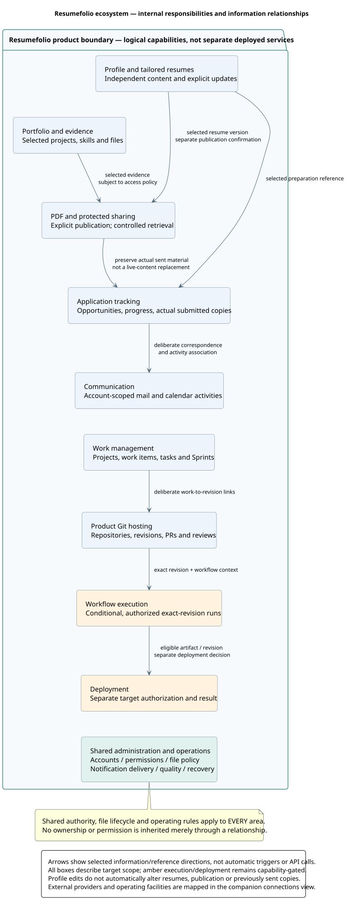

# Resumefolio — System Analysis

[Editable source](diagrams/ecosystem-overview.puml) · [PNG](diagrams/ecosystem-overview.png)

**Connected platforms:** see the [complete ecosystem map and connection-status register](02-system-context-and-boundaries.md#ecosystem-and-connected-platforms), then [detailed interface contracts](12-interfaces-and-external-interactions.md#1-interface-inventory).

[Diagram types and reading guide](#diagram-types-and-reading-guide) · [Full diagram catalog](diagrams/README.md)

Owner: Farhad Valizadegan. Updated: November 1, 2026.

**Current disposition:** substantial analysis models are populated; targeted semantic reconciliation and scoped owner acceptance remain. This is not a completed/accepted phase or permission to start product coding.

## Purpose and Course Basis

Translate requirements into precise domain concepts, logical behavior and constraints. The complementary views follow the FAU Applied Software Engineering V03–V06 approach; this directory is a project-specific organization. Analysis explains required meaning and behavior; physical architecture and technology choices belong to justified design decisions.

## Reading Route and Documents

Start with 00–02, then 03 and the complementary views 04–10. Use 11 for consistency, 12–13 for external and operational boundaries, 14 for conditional handoff and 15 for current-process evidence limits. Populated means documented, not accepted or tested in the product.

| File | Current content / remaining limitation |
|---|---|
| [00-start-here.md](00-start-here.md) | Approach and activity mapping. |
| [01-analysis-purpose-scope-and-approach.md](01-analysis-purpose-scope-and-approach.md) | Purpose, scope and approach. |
| [02-system-context-and-boundaries.md](02-system-context-and-boundaries.md) | Logical context and external boundaries. |
| [03-domain-model-and-object-oriented-view.md](03-domain-model-and-object-oriented-view.md) | Conceptual domain: 53 concepts and ten class views and one package view. |
| [04-function-oriented-view.md](04-function-oriented-view.md) | Populated functional decomposition, balanced context/Level 1 DFDs, logical stores and selected Level 2 refinement. |
| [05-data-oriented-view.md](05-data-oriented-view.md) | Conceptual data: 34 dictionary subjects and nine ER views. |
| [06-scenario-based-view.md](06-scenario-based-view.md) | 16 sequence models; interaction models, not executed traces. |
| [07-state-based-view.md](07-state-based-view.md) | 18 state models and 128 transition contracts. |
| [08-control-flow-based-view.md](08-control-flow-based-view.md) | 17 activities and 276 steps/guards. |
| [09-rule-based-view.md](09-rule-based-view.md) | 18 rule tables and eight diagrams; policies retain their source status. |
| [10-domain-constraints-and-operation-contracts.md](10-domain-constraints-and-operation-contracts.md) | 18 typed constraints and 39 selected operation contracts. |
| [11-model-consistency-traceability-and-review.md](11-model-consistency-traceability-and-review.md) | SA-RV03 current inventory and 470-row trace register; exact semantic closure remains explicit and partial. |
| [12-interfaces-and-external-interactions.md](12-interfaces-and-external-interactions.md) | Eight interface families and 27 bounded interaction cases. |
| [13-security-quality-and-operational-analysis.md](13-security-quality-and-operational-analysis.md) | Conditional authority, trust cases, 14 quality scenarios and recovery analysis; no configured-control/test claims. |
| [14-feasibility-dependencies-and-design-handoff.md](14-feasibility-dependencies-and-design-handoff.md) | Qualified feasibility/dependency/design-handoff package; choices and acceptance remain conditional. |
| [15-current-processes-and-bottleneck-analysis.md](15-current-processes-and-bottleneck-analysis.md) | Eight source-defined process areas, five documentary findings, eight untested hypotheses and ten measurement definitions; no observed business-task baseline. |

## Authoritative Inputs

- [Planning and phase gates](../01-project-planning/project-plan.md)
- [Accepted scope](../01-project-planning/02-scope.md)
- [Distributed requirements specification](../02-requirements-engineering/03-requirements-specification/requirements-specification.md)
- [Existing scenarios](../02-requirements-engineering/04-scenarios-and-models/user-stories-and-scenarios.md)
- [Glossary and dictionary](../02-requirements-engineering/05-data-definitions/README.md)
- [Questions and actual decisions](../02-requirements-engineering/07-change-and-baseline/open-questions-and-decisions.md)
- [Traceability and review evidence](../02-requirements-engineering/06-validation-and-traceability/README.md)

Refine these authoritative records when analysis exposes a missing requirement or definition. Do not create competing copies of requirements, vocabulary, questions or decisions.

## Working Boundaries and Completion

Preserve the full agreed scope, exclusions and conditional execution gates. Domain classes, conceptual ER models and logical functions do not select code classes, database schema, services or deployment units. Technical architecture, frameworks, database, Git engine and runner choices remain later justified design decisions.

Cross-view consistency, exact traceability, resolved or explicitly tracked questions, and actual review evidence support an identified owner disposition. Scaffold creation does not complete analysis or accept M-02. The agreed initial SDLC documentation, delivery reconciliation and pre-implementation baseline still precede product coding.

## Optional Supporting Artifacts

UI prototypes and an initial user-manual draft may help validate domain workflows, terminology and feedback. They are optional course artifacts, not files claimed to exist or newly mandated deliverables. Link any later prototype/manual to the relevant scenarios and keep actual feedback distinct from assumptions.

## Diagrams

The [diagram catalog](diagrams/README.md) links editable PlantUML sources, SVG previews and PNG exports. Read each diagram with its document's definitions, guards and limitations. Scenario, state, activity, rule and process diagrams describe different questions; they are not interchangeable evidence of implementation.

## Current cross-view review

[SA-RV03](11-model-consistency-traceability-and-review.md) is the current documentary review. SA-RV02 is retained as an explicitly historical snapshot. Its 157 candidate contexts, 470 criterion contexts and 39 contract associations are documentary associations, not coverage percentages. The current review supersedes earlier scaffold descriptions while retaining historical findings and their limits.

### Interface view update after SA-RV02

See [12](12-interfaces-and-external-interactions.md) for the populated interface view and evidence.

### Security/quality/operations update after SA-RV02

See [13](13-security-quality-and-operational-analysis.md) for conditional security, quality and recovery analysis. OAuth and backup setup remain unperformed owner-reported work; server observations are dated, not current capacity certification.

### Qualified handoff update after SA-RV02

See [14](14-feasibility-dependencies-and-design-handoff.md) for the historical fingerprinted candidate package and existing dependency gates. Its source snapshot precedes the current file-15/README revision and is not a fingerprint of this entire current folder.

## Next Work

1. Review the populated function/DFD view against the complementary models and exact source criteria.
2. Reconcile exact semantics and traceability across affected views; preserve accepted profile behavior and track genuinely unresolved details in the existing register.
3. Refresh the handoff candidate identity after material revisions and record actual scoped review/acceptance. Proceed with independent design questions while their prerequisites permit it.

File 15 now separates evidence from hypotheses. Actual workflow observation is needed for a dependent bottleneck/improvement claim, not as a new blanket prerequisite for all analysis. No measured benefit is claimed.

## Diagram Types and Reading Guide

This umbrella view summarizes the domain ecosystem. It is not a selected deployment architecture. The [notation alignment report](evidence/notation-alignment-review-2026-11-01.md) maps every numbered file to its diagram family and records remaining evidence/design limits.
