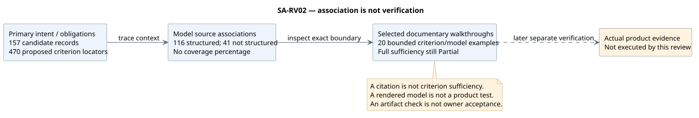
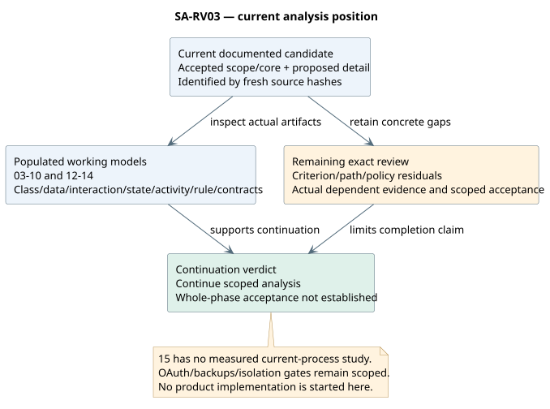
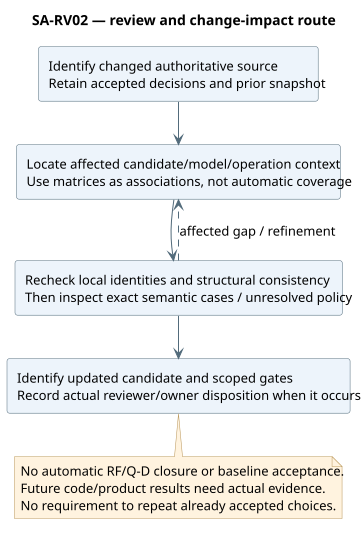
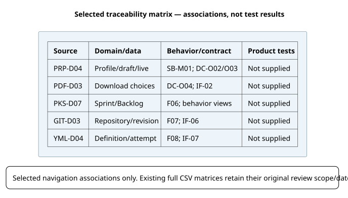

# Resumefolio — Model Consistency, Traceability and Review

> **Notation-alignment revision:** File 04 now contains functional decomposition and balanced DFDs. Earlier review findings/counts and their JSON/CSV evidence remain dated snapshots; references to an empty 04 describe that earlier candidate. Population does not automatically establish semantic sufficiency or close authoritative findings.

[Diagram types and reading guide](#diagram-types-and-reading-guide) · [Full diagram catalog](../diagrams/README.md)

Owner: Farhad Valizadegan. Review: **SA-RV02**, November 1, 2026. Reviewer: Codex, root-owned documentary/structural review. This is not an independent stakeholder review, product test or owner baseline decision.

## 1. Continuation Verdict and Limits

**Continue scoped analysis; do not declare the whole analysis/handoff baseline complete.** Domain 03 and data/scenario/state/activity/rule/contract views 05–10 are populated working models. The earlier statement that these were mostly scaffolds is superseded. Function view 04 and interface/quality/handoff views 12–14 still contain substantive placeholders; selected criterion/path sufficiency and detailed policy/evidence gates remain visible. There is no reason to restart folder organization or repeatedly reopen already accepted product choices.

The [accepted profile-update core](../../02-requirements-engineering/07-change-and-baseline/open-questions-and-decisions.md#owner-accepted-profile-update-policy) remains accepted: source edit alone does not update existing resumes; selected apply and separately confirmed publication differ; independent text/other resumes/actual submitted material remain preserved. Conditional detailed proposals are not silently accepted by this review.

Planning M-01 acceptance belongs to the identified historical snapshot in [planning completion criteria](../../01-project-planning/10-planning-completion-criteria.md). It does not accept every later working copy. This candidate is identified by fresh input/output SHA-256 records in [review evidence](../evidence/model-consistency-review-2026-11-01.json); the prior report’s HEAD is not asserted as current. No new M-02/M-03 or analysis/design acceptance decision is recorded.

**Review boundary:** all current structured source inventories, source-identity/association checks, current rule partitions, state reachability, activity structural termination and selected documentary criterion/model boundaries. Source scope includes Planning, Requirements Engineering and System Analysis; current report/navigation targets are identified separately. No code, live server, provider API, load/security control, backup restore or product workflow was executed. Missing future code/results alone is not an analysis-stage defect.

[PlantUML](../diagrams/review-trace-evidence-levels.puml) · [PNG](../diagrams/review-trace-evidence-levels.png)

## 2. Checks Performed and Result

| Check | Fresh evidence / result | Practical limit |
|---|---|---|
| Primary identity and criterion inventory | 157 unique candidate headings; 470 unique existing proposed criterion locators retained | Identity is not semantic sufficiency or owner acceptance |
| Domain/data | 53 domain concepts, nine class views; 34 dictionary subjects and nine ER views | Cardinalities and detailed policies retain their documented proposed status |
| Interaction provenance | 16 sequence models reference 12 parent + 16 operation use cases and 60 source path locators | Broad path references are not executed cases or proof of every criterion |
| State structure | 18 state subjects, 128 unique declared transitions; declared states reachable from scoped initial context | Reachability ignores guard satisfiability and real concurrent timing |
| Activity structure | 17 activity models, 276 identified actions/guards; declared alternatives have scoped terminating/return paths | An observation ending does not stop underlying queued/running/external work |
| Rule partition | 18 tables, 131 rows; all 483 declared condition combinations match exactly one row | Abstract finite-domain completeness, not real predicate truth or complete product coverage |
| Contracts | 18 typed constraints, 39 selected contracts; actual model/step/transition/rule references resolve | Supporting lifecycle mappings are labeled; not every operation/path is exhaustively contracted |
| Existing diagram source/render structure | 92 existing active PlantUML sources pass a fresh syntax check; matching SVGs parse and PNGs open | Existing renders were structurally checked; this pass does not claim a fresh pixel-for-pixel rerender or visual inspection of all 92. Earlier visual reviews retain their scope |
| New review diagrams | Three locally rendered review diagrams, with source/SVG/PNG sets | These depict evidence/review relationships, not runtime architecture |
| Candidate source associations | 116 candidates have a structured model association; 41 do not. Five of those 41 have textual mentions; 36 have neither in the inspected Markdown | Not a functional coverage percentage. Text mentions and structured association are distinct inventories |
| Criterion-level review | 470-row context inventory; 20 selected documentary boundary walkthroughs | No row is marked product-verified or fully criterion-covered; 450 receive context-only status |
| Current source stability | Primary/model inputs captured by fresh hashes; existing seven derivation snapshots compared separately | Six match; one older domain-context source hash differs and remains historical, with existing provenance note |
| Local file/fragment links | Fresh overlay check resolves current/candidate local links; exact totals and zero/missing result are in the review record | Internal link validity says nothing about external-service availability or policy correctness |

### Current model inventory versus remaining files

| Document | Current observed position |
|---|---|
| 00–02 | Populated guide, purpose and logical context; accepted/proposed boundaries retained |
| 03 | Populated domain/concept catalog and nine class views |
| 04 | Function-oriented scaffold: five To develop prompts, no populated logical decomposition/DFD package |
| 05–10 | Populated selected data, interaction, state, activity, rule and contract models; cross-view sufficiency remains bounded |
| 11 | This fresh review replaces stale current-state conclusions; historical prior content is retained in structured evidence |
| 12 | Interface scaffold: five To develop prompts |
| 13 | Security/quality/operations scaffold: five To develop prompts |
| 14 | Feasibility/design-handoff scaffold: five To develop prompts |
| 15 | Current-process outline with no populated observation/bottleneck study; proposed investigation is not measured current behavior |

## 3. Material Findings and Gates

SA-Fxx records below are local dispositions of this review, not a replacement owner question/findings register. [RF-D01–RF-D05](../../02-requirements-engineering/06-validation-and-traceability/review-plan-and-findings.md), [Q-D records](../../02-requirements-engineering/07-change-and-baseline/open-questions-and-decisions.md) and dependent planning gates retain authority. No parent is auto-closed.

| Finding | Status / observed evidence | Meaning / next action | Parent context |
|---|---|---|---|
| **SA-F01** | Open: analysis completion. 04/12/13/14 each retain five To develop prompts; 15 has unpopulated observation tables. | Function/data-flow, interface, quality/operations and design-handoff substance is not supplied merely by populated behavior models. **Action:** Populate 04, 12 and 13; form qualified 14 from actual inputs. Treat 15 only as an unperformed current-process study, not invented findings. | RF-D02 RF-D03 RF-D05 |
| **SA-F02** | Open: association reconciliation. 116 candidates have structured primary associations; 41 do not. Five of the 41 have textual mentions and 36 do not in the inspected analysis Markdown excluding this review. | These are distinct inventories, not a functional coverage percentage or proof a capability is absent. Business/user/domain/quality/interface intent and GIT-D10/PKS-D10 require explicit justified reconciliation. **Action:** Use the 157-row matrix to add justified direct or derived intent-to-model links. Do not auto-link based only on similar wording or close old citation findings. | RF-D01 RF-D02 |
| **SA-F03** | Open: exact semantic sufficiency. 470 criterion contexts inventoried; 20 selected documentary boundary walkthroughs. All 20 still retain explicit sufficiency/execution limits. | Candidate citations, 60 source path references and model counts do not demonstrate each criterion has adequate concrete normal/denied/failure/concurrent/recovery cases. **Action:** Refine exact cases/inputs/outcomes and gaps at affected operations; use the 470-row inventory without marking context-only rows covered. | RF-D02 RF-D04 RF-D05 |
| **SA-F04** | Open: primary wording synchronization; accepted core retained. Accepted profile policy/PRP-D04-AC01 require explicit selected apply and separate publication; older BRL-D02/D03 open-definition prose remains broader/older. | Accepted bounded core governs its scope; older proposal wording must not reopen it. Source-removal/concurrency detail remains separately proposed. **Action:** Synchronize the affected primary wording in its own scoped update, retaining the recorded acceptance rather than asking it again. | RF-D03 Q-D07 |
| **SA-F05** | Open: scoped policy/path detail. SM-F01/RB-F02 readiness-vs-progress proposal remains; contract mappings label supporting/upstream/adjacent cases. Credential rotation, corrections and category retirement lack exhaustive dedicated activity/contract paths. | Readiness is not an accepted fourth progress state. Source associations and partial normal routes do not define every legal correction or consequential operation. **Action:** Refine only affected policy/paths/contracts; e.g. distinguish fresh password rotation policy from already-open sessions, and add justified lifecycle routes without new fake external UC coverage. | RF-D02 RF-D03 Q-D05 Q-D11 Q-D14 Q-D18 |
| **SA-F06** | Retained: dependent evidence gates. Owner inputs: OAuth not created, backups not configured, 20 hours/week. Demo resources do not establish load, safe untrusted execution or usable recovery. | These are known inputs. They do not block writing conditional analysis; they block asserting affected dependent operational capabilities are demonstrated ready. **Action:** Carry exact scope/gates into 12/13/14. No server, OAuth, backup, execution or live restore is performed by this review. | RF-D05 Q-D15 Q-D23 Q-D25 Q-D26 Q-D27 |
| **SA-F07** | Recorded provenance boundary; no snapshot rewrite. Six inspected model-evidence input snapshots match current inputs; earlier domain derivation differs for context document 02 only. Domain evidence explicitly says original hashes identify an earlier derivation. | Historical hashes are not all intended to be current. Current 02 is included in this review snapshot; the single older context hash is preserved, not overwritten or treated as automatic corruption. **Action:** Use the current review snapshot for this candidate; retain older derivation/diagram-review provenance. Revisit if substantive source change alters an affected conclusion. | RBC-D01 |
| **SA-F08** | Resolved locally by this update. Prior SA-RV01 described domain/data/state/contract work as largely pending; current inventories show populated 03 and 05–10. | The prior report is now historical and retained verbatim in structured evidence. Its old counts/HEAD are not carried forward as current facts. **Action:** Use SA-RV02 current inventory and explicit remaining-work limits. No RF parent or baseline decision is closed by this local report correction. | RF-D05 |

The 41 structured-association gaps include high-level business/user intent, domain constraints, quality/interface records and GIT-D10/PKS-D10. Some can legitimately use justified derived intent-to-capability links; do not manufacture a direct class/operation citation merely to improve a count. The full per-candidate list, including textual mentions, is in [the 157-row matrix](../evidence/requirements-to-analysis-associations-2026-11-01.csv). Its 41 is not comparable with RF-D01’s earlier source-scenario citation count because the inspected relationship and source set differ.

[PlantUML](../diagrams/review-current-position.puml) · [PNG](../diagrams/review-current-position.png)

## 4. Context Trace Examples

These 20 walkthroughs associate an exact existing proposed criterion locator with deliberately selected model/contract boundaries. The criterion text is retained in [the 470-row inventory](../evidence/criterion-review-context-2026-11-01.csv) and review JSON. “Aligned” means the selected documentary boundary agrees; it does not mean the entire criterion is sufficient, tested or accepted. Locators remain proposed and no new criterion IDs are allocated.

| Walkthrough / exact criterion | Selected model and contract context | Documentary alignment | Remaining sufficiency / evidence limit |
|---|---|---|---|
| **SA-W01 — PRP-D04-AC01**; [PRP-D04](../../02-requirements-engineering/03-requirements-specification/profiles-resumes-and-portfolio.md#prp-d04-explicit-shared-source-update-rules) | [SB-M01](../06-scenario-based-view.md#sb-m01), [SM-M01](../07-state-based-view.md#sm-m01), [CF-M01](../08-control-flow-based-view.md#cf-m01), [RB-D02](../09-rule-based-view.md#rb-d02); [DC-O01](../10-domain-constraints-and-operation-contracts.md#dc-o01), [DC-O02](../10-domain-constraints-and-operation-contracts.md#dc-o02), [DC-O03](../10-domain-constraints-and-operation-contracts.md#dc-o03) | Source edit, selected draft application and separate publication stay distinct; accepted core is not reopened. | Concurrent/source-removal detail remains scoped proposed policy; no product execution. |
| **SA-W02 — PRP-D04-AC03**; [PRP-D04](../../02-requirements-engineering/03-requirements-specification/profiles-resumes-and-portfolio.md#prp-d04-explicit-shared-source-update-rules) | [SB-M01](../06-scenario-based-view.md#sb-m01), [SM-M07](../07-state-based-view.md#sm-m07), [CF-M06](../08-control-flow-based-view.md#cf-m06), [RB-D06](../09-rule-based-view.md#rb-d06); [DC-O02](../10-domain-constraints-and-operation-contracts.md#dc-o02), [DC-O09](../10-domain-constraints-and-operation-contracts.md#dc-o09) | No automatic addition to other resumes; actual sent content stays independent of later edits. | Selection omission, reference/correction and physical preservation need actual criterion cases. |
| **SA-W03 — ACC-D04-AC03**; [ACC-D04](../../02-requirements-engineering/03-requirements-specification/accounts-authentication-and-permissions.md#acc-d04-cross-user-private-data-isolation) | [SB-M10](../06-scenario-based-view.md#sb-m10), [SM-M03](../07-state-based-view.md#sm-m03), [CF-M10](../08-control-flow-based-view.md#cf-m10), [RB-D01](../09-rule-based-view.md#rb-d01); [DC-O20](../10-domain-constraints-and-operation-contracts.md#dc-o20), [DC-O21](../10-domain-constraints-and-operation-contracts.md#dc-o21) | Grant scope does not confer unrelated private/mail/repository/secret authority. | Complete actor/resource/action/state matrix and direct adversarial cases remain in 13/primary review. |
| **SA-W04 — PDF-D03-AC01**; [PDF-D03](../../02-requirements-engineering/03-requirements-specification/pdf-and-controlled-sharing.md#pdf-d03-per-resume-download-choices) | [SB-M02](../06-scenario-based-view.md#sb-m02), [SB-M04](../06-scenario-based-view.md#sb-m04), [SM-M04](../07-state-based-view.md#sm-m04), [SM-M05](../07-state-based-view.md#sm-m05), [CF-M02](../08-control-flow-based-view.md#cf-m02), [CF-M04](../08-control-flow-based-view.md#cf-m04), [RB-D03](../09-rule-based-view.md#rb-d03), [RB-D04](../09-rule-based-view.md#rb-d04); [DC-O04](../10-domain-constraints-and-operation-contracts.md#dc-o04), [DC-O06](../10-domain-constraints-and-operation-contracts.md#dc-o06) | Four download modes × two requested categories are enumerated; actual selected availability/access checked separately. | Language/revision/current access and actual retrieval cases still need product verification. |
| **SA-W05 — PDF-D06-AC02**; [PDF-D06](../../02-requirements-engineering/03-requirements-specification/pdf-and-controlled-sharing.md#pdf-d06-owner-password-and-link-controls) | [SB-M03](../06-scenario-based-view.md#sb-m03), [SM-M04](../07-state-based-view.md#sm-m04), [CF-M03](../08-control-flow-based-view.md#cf-m03), [RB-D05](../09-rule-based-view.md#rb-d05); [DC-O05](../10-domain-constraints-and-operation-contracts.md#dc-o05), [DC-O06](../10-domain-constraints-and-operation-contracts.md#dc-o06) | Confirmed disablement blocks fresh protected access; PDF mode is not changed by disablement. | Existing/in-flight/cached-session semantics remain separate proposals; no delivered-copy recall. |
| **SA-W06 — PDF-D06-AC03**; [PDF-D06](../../02-requirements-engineering/03-requirements-specification/pdf-and-controlled-sharing.md#pdf-d06-owner-password-and-link-controls) | [SB-M04](../06-scenario-based-view.md#sb-m04), [SM-M04](../07-state-based-view.md#sm-m04), [CF-M04](../08-control-flow-based-view.md#cf-m04), [RB-D05](../09-rule-based-view.md#rb-d05); [DC-O06](../10-domain-constraints-and-operation-contracts.md#dc-o06) | Current credential context is required for fresh eligible access. | A dedicated credential-rotation contract is not one of the 39 selected operations; exact rotation/session policy remains to refine. |
| **SA-W07 — APP-D06-AC02**; [APP-D06](../../02-requirements-engineering/03-requirements-specification/manual-application-management.md#app-d06-preserved-actual-submitted-copies) | [SB-M06](../06-scenario-based-view.md#sb-m06), [SM-M07](../07-state-based-view.md#sm-m07), [CF-M06](../08-control-flow-based-view.md#cf-m06), [RB-D06](../09-rule-based-view.md#rb-d06); [DC-O09](../10-domain-constraints-and-operation-contracts.md#dc-o09), [DC-O10](../10-domain-constraints-and-operation-contracts.md#dc-o10) | Actual user-identified sent components are not replaced by whichever live PDF exists later. | Provenance/completeness/correction/retrieval and retained-material cases remain proposed/untested. |
| **SA-W08 — APP-D07-AC02**; [APP-D07](../../02-requirements-engineering/03-requirements-specification/manual-application-management.md#app-d07-correction-and-repeated-submissions) | [SB-M06](../06-scenario-based-view.md#sb-m06), [SM-M07](../07-state-based-view.md#sm-m07), [CF-M06](../08-control-flow-based-view.md#cf-m06), [RB-D06](../09-rule-based-view.md#rb-d06); [DC-O10](../10-domain-constraints-and-operation-contracts.md#dc-o10) | New actual submission/correction remains distinguishable from earlier represented actual context. | Supporting lifecycle contract is not a complete activity/state correction route; verify explicit cases. |
| **SA-W09 — EGC-D12-AC02**; [EGC-D12](../../02-requirements-engineering/03-requirements-specification/email-calendar-and-google-integration.md#egc-d12-bounded-failures-recovery-and-feasibility-evidence) | [SB-M07](../06-scenario-based-view.md#sb-m07), [SM-M09](../07-state-based-view.md#sm-m09), [CF-M07](../08-control-flow-based-view.md#cf-m07), [RB-D07](../09-rule-based-view.md#rb-d07), [RB-D18](../09-rule-based-view.md#rb-d18); [DC-O12](../10-domain-constraints-and-operation-contracts.md#dc-o12), [DC-O38](../10-domain-constraints-and-operation-contracts.md#dc-o38) | Unknown acceptance requires same-attempt reconciliation before a separately eligible retry; no blind resend. | OAuth absent; provider evidence, actual safe repetition and scope enforcement not demonstrated. |
| **SA-W10 — BRL-D07-AC03**; [BRL-D07](../../02-requirements-engineering/03-requirements-specification/business-rules-and-data-lifecycle.md#brl-d07-explicit-provider-synchronization-authority) | [SB-M08](../06-scenario-based-view.md#sb-m08), [SM-M08](../07-state-based-view.md#sm-m08), [SM-M10](../07-state-based-view.md#sm-m10), [CF-M08](../08-control-flow-based-view.md#cf-m08), [RB-D08](../09-rule-based-view.md#rb-d08); [DC-O14](../10-domain-constraints-and-operation-contracts.md#dc-o14), [DC-O15](../10-domain-constraints-and-operation-contracts.md#dc-o15) | Local unlink/provider mutation/disconnect are different; unlink needs no active provider write capability. | Disconnect/retained-copy/pending-work contracts are not exhaustive; provider policy/operation evidence remain. |
| **SA-W11 — PKS-D09-AC01**; [PKS-D09](../../02-requirements-engineering/03-requirements-specification/projects-kanban-and-sprints.md#pks-d09-explicit-completion-and-sprint-end-outcomes) | [SM-M11](../07-state-based-view.md#sm-m11), [CF-M09](../08-control-flow-based-view.md#cf-m09), [RB-D09](../09-rule-based-view.md#rb-d09); [DC-O16](../10-domain-constraints-and-operation-contracts.md#dc-o16), [DC-O17](../10-domain-constraints-and-operation-contracts.md#dc-o17) | Task progress/board column alone does not establish item acceptance. | Readiness/progress ambiguity and exact criteria/acceptance roles still need primary policy alignment. |
| **SA-W12 — PKS-D09-AC02**; [PKS-D09](../../02-requirements-engineering/03-requirements-specification/projects-kanban-and-sprints.md#pks-d09-explicit-completion-and-sprint-end-outcomes) | [SB-M09](../06-scenario-based-view.md#sb-m09), [SM-M12](../07-state-based-view.md#sm-m12), [CF-M09](../08-control-flow-based-view.md#cf-m09), [RB-D10](../09-rule-based-view.md#rb-d10); [DC-O19](../10-domain-constraints-and-operation-contracts.md#dc-o19) | Sprint end records actual goal/item result and explicit incomplete-work disposition without automatic acceptance. | Detailed permitted end/carryover/concurrency cases remain proposed; no product result. |
| **SA-W13 — GIT-D07-AC03**; [GIT-D07](../../02-requirements-engineering/03-requirements-specification/git-hosting-and-collaboration.md#git-d07-controlled-merge-and-conflict-outcomes) | [SB-M12](../06-scenario-based-view.md#sb-m12), [SM-M13](../07-state-based-view.md#sm-m13), [CF-M12](../08-control-flow-based-view.md#cf-m12), [RB-D11](../09-rule-based-view.md#rb-d11); [DC-O26](../10-domain-constraints-and-operation-contracts.md#dc-o26) | Changed source/target requires current revision-specific recheck; merge does not grant deploy permission. | Merge policy/review validity/real ref behavior still needs exact contract sufficiency and actual interoperability tests. |
| **SA-W14 — YML-D07-AC03**; [YML-D07](../../02-requirements-engineering/03-requirements-specification/yaml-workflows-and-cicd.md#yml-d07-truthful-run-and-step-outcomes) | [SB-M13](../06-scenario-based-view.md#sb-m13), [SM-M14](../07-state-based-view.md#sm-m14), [CF-M13](../08-control-flow-based-view.md#cf-m13), [RB-D18](../09-rule-based-view.md#rb-d18); [DC-O27](../10-domain-constraints-and-operation-contracts.md#dc-o27), [DC-O28](../10-domain-constraints-and-operation-contracts.md#dc-o28), [DC-O38](../10-domain-constraints-and-operation-contracts.md#dc-o38) | Known running/pending, confirmed terminal and lost runner result are distinct; cancellation request is not termination. | Safe execution environment and actual lost-runner/reconciliation behavior not demonstrated. |
| **SA-W15 — YML-D10-AC01**; [YML-D10](../../02-requirements-engineering/03-requirements-specification/yaml-workflows-and-cicd.md#yml-d10-separate-controlled-deployment-stage) | [SB-M14](../06-scenario-based-view.md#sb-m14), [SM-M15](../07-state-based-view.md#sm-m15), [CF-M14](../08-control-flow-based-view.md#cf-m14), [RB-D13](../09-rule-based-view.md#rb-d13); [DC-O30](../10-domain-constraints-and-operation-contracts.md#dc-o30) | Target authority is independent of push/merge/successful checks. | Exact target controls/approvals/resources remain gated; no live deployment. |
| **SA-W16 — AFO-D07-AC01**; [AFO-D07](../../02-requirements-engineering/03-requirements-specification/administration-files-and-operational-behavior.md#afo-d07-truthful-completion-and-interrupted-operation-handling) | [SB-M15](../06-scenario-based-view.md#sb-m15), [SM-M05](../07-state-based-view.md#sm-m05), [CF-M15](../08-control-flow-based-view.md#cf-m15), [RB-D14](../09-rule-based-view.md#rb-d14), [RB-D18](../09-rule-based-view.md#rb-d18); [DC-O32](../10-domain-constraints-and-operation-contracts.md#dc-o32) | Candidate admission/processing is not usable completion; interrupted/failed work cannot claim complete usable file. | Actual processing/replacement/concurrent-admission failure behavior not tested. |
| **SA-W17 — AFO-D11-AC02**; [AFO-D11](../../02-requirements-engineering/03-requirements-specification/administration-files-and-operational-behavior.md#afo-d11-bounded-cleanup-and-storage-reclamation) | [SM-M16](../07-state-based-view.md#sm-m16), [RB-D15](../09-rule-based-view.md#rb-d15); [DC-O34](../10-domain-constraints-and-operation-contracts.md#dc-o34), [DC-O35](../10-domain-constraints-and-operation-contracts.md#dc-o35) | Protected actual references and required shared content constrain reclamation; source/association changes are not purge authority. | Supporting category lifecycle contracts lack complete dedicated activity paths; exact category retention/reference cases remain. |
| **SA-W18 — AFO-D11-AC03**; [AFO-D11](../../02-requirements-engineering/03-requirements-specification/administration-files-and-operational-behavior.md#afo-d11-bounded-cleanup-and-storage-reclamation) | [SM-M16](../07-state-based-view.md#sm-m16), [SM-M18](../07-state-based-view.md#sm-m18), [RB-D15](../09-rule-based-view.md#rb-d15), [RB-D18](../09-rule-based-view.md#rb-d18); [DC-O35](../10-domain-constraints-and-operation-contracts.md#dc-o35), [DC-O38](../10-domain-constraints-and-operation-contracts.md#dc-o38) | Partial cleanup cannot claim complete reclamation or freed capacity. | Actual cleanup/accounting policy and operation evidence required; no automatic global rollback guarantee. |
| **SA-W19 — QSR-D11-AC02**; [QSR-D11](../../02-requirements-engineering/03-requirements-specification/quality-security-and-recovery-requirements.md#qsr-d11-demonstrated-restoration-and-recovery-targets) | [SB-M16](../06-scenario-based-view.md#sb-m16), [SM-M17](../07-state-based-view.md#sm-m17), [CF-M16](../08-control-flow-based-view.md#cf-m16), [RB-D16](../09-rule-based-view.md#rb-d16); [DC-O37](../10-domain-constraints-and-operation-contracts.md#dc-o37) | Restored candidate is assessed for actual scoped integrity/access/usability rather than just extraction/startup. | Backups absent; actual required core-workflow restoration checks unperformed. |
| **SA-W20 — QSR-D11-AC03**; [QSR-D11](../../02-requirements-engineering/03-requirements-specification/quality-security-and-recovery-requirements.md#qsr-d11-demonstrated-restoration-and-recovery-targets) | [SM-M17](../07-state-based-view.md#sm-m17), [CF-M16](../08-control-flow-based-view.md#cf-m16), [RB-D16](../09-rule-based-view.md#rb-d16); [DC-O37](../10-domain-constraints-and-operation-contracts.md#dc-o37) | Actual measured results/limits must be compared with defined targets; unavailable evidence is not Pass. | RPO/RTO/coverage criteria and actual measurements remain unestablished; no invented numeric target. |

### Reading the downloadable matrices

| Artifact | Rows / meaning | Must not be inferred |
|---|---|---|
| [Requirements → analysis associations](../evidence/requirements-to-analysis-associations-2026-11-01.csv) | 157 candidates; direct structured domain/data/scenario/state/activity/rule/constraint/contract references and separate textual mentions | A source association does not prove all criteria/paths for that candidate |
| [Criterion review context](../evidence/criterion-review-context-2026-11-01.csv) | All 470 existing locators and exact wording; 20 selected walkthroughs, 450 context-only rows | Candidate-context models are not automatically criterion mappings, product Pass or complete coverage |
| [Contract cross-view associations](../evidence/contract-cross-view-associations-2026-11-01.csv) | All 39 selected contracts with source IDs, concepts, activity steps, transitions/rules and mapping limits | Supporting/adjacent context is not a complete direct activity path or an invented external UC |

Actual design, backlog, implementation and product-result links remain unassigned here unless separately evidenced. No link is invented from a similar name or merely from a planning PBI mention. RF-D04 remains a staged follow-up, not a reason to demand future code before writing analysis.

## 5. Cross-View Completion Checklist

- [x] Replace stale current-state review with a fresh identified source snapshot and explicit review scope.
- [x] Confirm current populated domain/data/interaction/state/activity/rule/contract artifacts and preserve accepted core.
- [x] Recheck source IDs, declared state/activity structure, rule partitions, local references and existing diagram syntax/render structure.
- [x] Record selected exact-criterion documentary walkthroughs and preserve all other rows as context-only.
- [x] Distinguish supporting operation mappings, historical provenance and known dependent gates.
- [ ] Complete function-oriented decomposition and balanced information flows in 04.
- [ ] Complete interface, quality/operations and qualified handoff substance in 12–14.
- [ ] Resolve or explicitly disposition all affected intent/criterion/path/policy gaps before claiming the dependent conclusion complete.
- [ ] Perform appropriate actual stakeholder/owner review on an identified candidate and record its scope; no automatic acceptance here.
- [ ] Obtain actual dependent provider/capacity/isolation/recovery/product evidence at the gate that requires it; not every such test is a prerequisite for drafting analysis.

## 6. Next Coherent Work

1. Populate 04 with logical responsibilities, named information flows and balanced context/decomposition boundaries using the existing dictionary/DA-F meanings. Existing activity diagrams are not DFDs.
2. Complete 12 interface contracts and 13 authority/trust/quality/recovery scenarios from current requirements and the scoped missing evidence; do not invent numerical targets or assume controls exist.
3. Reconcile the 41 association gaps and affected exact criteria, beginning with direct/private access, actual history, changed references, external ambiguity and destructive lifecycle operations. Keep supporting mapping limits visible.
4. Build 14 as an identified conditional handoff candidate, retaining known investigation gates and planning/backlog implications. Refresh this review after affected source/model changes; obtain actual owner disposition only for the concrete applicable candidate/decision.

This is continued forward work, not a restart of Planning or Requirements Engineering. Later design may reveal new details and trigger targeted source updates. It does not reopen the already accepted explicit source/apply/publication behavior. No coding, server configuration, Git commit or deployment is performed by this review.

## 7. Evidence Identity, Historical Review and Known Inputs

The prior SA-RV01 report is retained verbatim as UTF-8 content plus its original SHA-256 in the review JSON, alongside its separate [context-input review evidence](../evidence/context-input-review-2026-11-01.json). Its past 4,118-reference count and HEAD are historical observations. This SA-RV02 uses current input hashes and separate candidate output hashes; it does not rewrite earlier derivation hashes to pretend they were fresh.

The domain derivation has one changed historical source: current 02 differs from its older derivation hash. The domain evidence explicitly records that original hashes belong to earlier derivation and later text/diagram review is separate. Current 02 is included in this review; all other inspected stored inputs in those seven snapshots match. This bounded finding is not a claim that historical render bytes were freshly regenerated.

Known owner inputs remain 20 total project hours/week, OAuth not created and backups not configured. The existing Ubuntu Laravel demo has 2 vCPU, 4 GB RAM and 40 GB disk; previous idle readings do not establish current combined capacity, safe untrusted execution or usable recovery. No secret value is included, no fresh server access occurred, and no missing future control is described as already implemented.

## 8. Maintenance and Review Route

[PlantUML](../diagrams/review-change-impact-route.puml) · [PNG](../diagrams/review-change-impact-route.png)

When an authoritative source changes, locate affected concepts/relationships, decisions, transitions, activity steps and operations; check actual semantics as well as local IDs. Preserve prior snapshots and scope the new review. A structural Pass never automatically closes an RF/Q-D record, approves every proposal or establishes product readiness.

[Structured review evidence](../evidence/model-consistency-review-2026-11-01.json) · [Diagram catalog](../diagrams/README.md) · [System Analysis index](../README.md)

## Diagram Types and Reading Guide

The compact matrix is a reading aid; the existing 157-candidate, 470-criterion and 39-contract CSVs remain historical source inventories, not newly executed tests. The file-04 scaffold finding is superseded by the populated function/DFD view in this revision, but semantic sufficiency and parent-finding closure are not automatic. No implementation-component or test-case mapping is invented.

[Editable source](../diagrams/traceability-selected-matrix.puml) · [PNG](../diagrams/traceability-selected-matrix.png)
